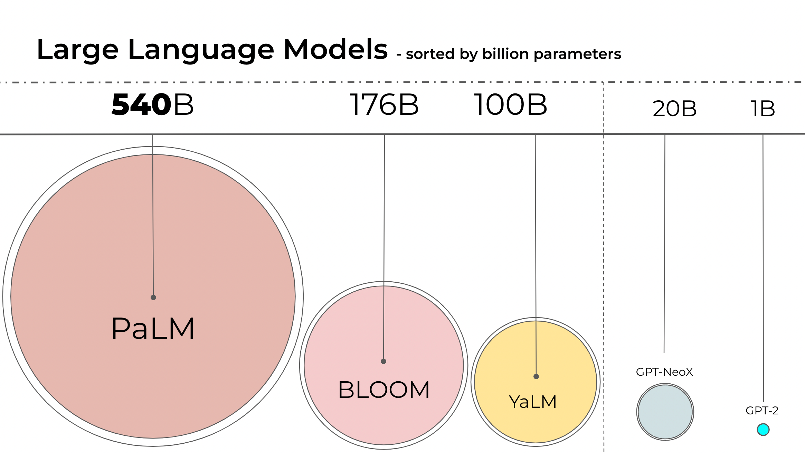
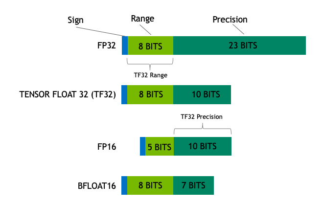
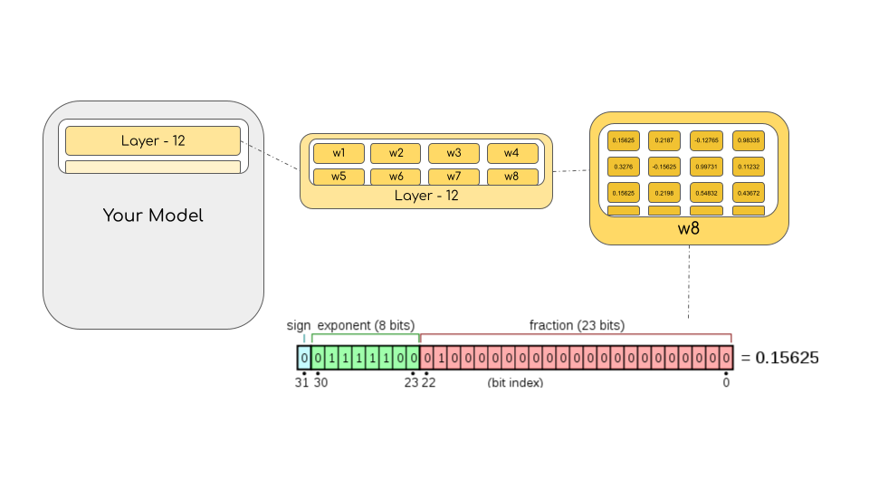
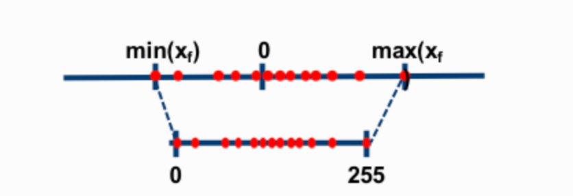
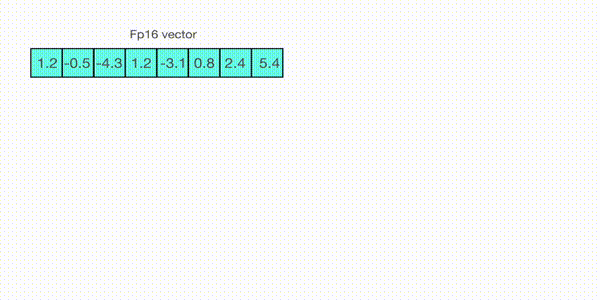
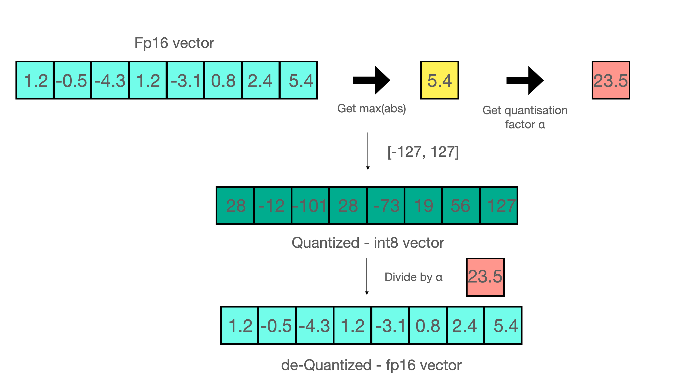
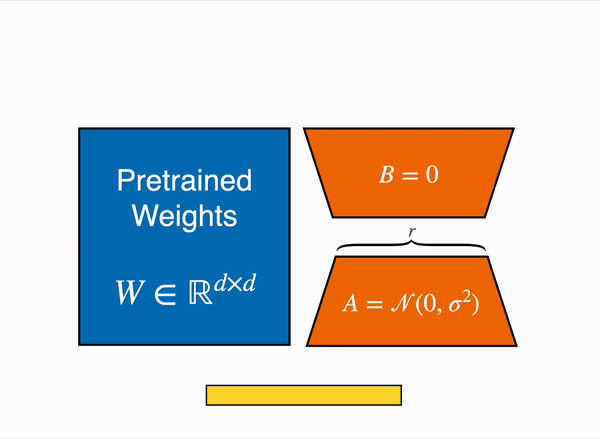

# 112.基于Bitsandbytes量化模型

## <font style="color:#000000;">示例代码</font>

[quantization-demo.zip](https://www.yuque.com/attachments/yuque/0/2025/zip/2424104/1747014138887-02193401-abee-4eea-847a-d676beb3b057.zip)

## 引言

语言模型一直在变大。截至撰写本文时，PaLM 有 5400 亿参数，OPT、GPT-3 和 BLOOM 有大约 1760 亿参数，而且我们仍在继续朝着更大的模型发展。下图总结了最近的一些语言模型的尺寸。



由于这些模型很大，因此它们很难在一般的设备上运行。举个例子，仅推理 BLOOM-176B 模型，你就需要 8 个 80GB A100 GPU (每个约 15,000 美元)。而如果要微调 BLOOM-176B 的话，你需要 72 个这样的 GPU！更大的模型，如 PaLM，还需要更多资源。

由于这些庞大的模型需要大量 GPU 才能运行，因此我们需要找到降低资源需求而同时保持模型性能的方法。目前已有一些试图缩小模型尺寸的技术，比如你可能听说过的量化和蒸馏等技术。

完成 BLOOM-176B 的训练后，Hugging Face 和 BigScience 一直在寻找能让这个大模型更容易在更少的 GPU 上运行的方法。通过我们的 BigScience 社区，我们了解到一些有关 Int8 推理的研究，它不会降低大模型的预测性能，而且可以将大模型的内存占用量减少 2 倍。很快我们就开始合作进行这项研究，最终将其完全整合到 Hugging Face `transformers` 中。本文我们将详述我们集成在 Hugging Face 中的 LLM.int8() 方案，它适用于所有 Hugging Face 模型。如果你想了解更多研究细节，可以阅读我们的论文 [LLM.int8(): 8-bit Matrix Multiplication for Transformers at Scale](https://arxiv.org/abs/2208.07339)。

本文将主要介绍 LLM.int8() 量化技术，讨论将其纳入 `transformers` 库的过程中经历的困难，并对后续工作进行了计划。

在这里，你将了解到究竟是什么让一个大模型占用这么多内存？是什么让 BLOOM 占用了 350GB 内存？我们先从一些基础知识开始，慢慢展开。

## 数据类型

我们从理解不同浮点数据类型开始，这些数据类型在机器学习中也被称为“精度”。

模型的大小由其参数量及其精度决定，精度通常为 float32、float16 或 bfloat16 之一 ([下图来源](https://blogs.nvidia.com/blog/2020/05/14/tensorfloat-32-precision-format/))。



Float32 (FP32) 是标准的 IEEE 32 位浮点表示。使用该数据类型，可以表示大范围的浮点数。在 FP32 中，为“指数”保留了 8 位，为“尾数”保留了 23 位，为符号保留了 1 位。因为是标准数据类型，所以大部分硬件都支持 FP32 运算指令。

而在 Float16 (FP16) 数据类型中，指数保留 5 位，尾数保留 10 位。这使得 FP16 数字的数值范围远低于 FP32。因此 FP16 存在上溢 (当用于表示非常大的数时) 和下溢 (当用于表示非常小的数时) 的风险。

例如，当你执行 `10k * 10k` 时，最终结果应为 `100M`，FP16 无法表示该数，因为 FP16 能表示的最大数是 `64k`。因此你最终会得到 `NaN` (Not a Number，不是数字)，在神经网络的计算中，因为计算是按层和 batch 顺序进行的，因此一旦出现 `NaN`，之前的所有计算就全毁了。一般情况下，我们可以通过缩放损失 (loss scaling) 来缓解这个问题，但该方法并非总能奏效。

于是我们发明了一种新格式 Bfloat16 (BF16) 来规避这些限制。BF16 为指数保留了 8 位 (与 FP32 相同)，为小数保留了 7 位。这意味着使用 BF16 我们可以保留与 FP32 相同的动态范围。但是相对于 FP16，我们损失了 3 位精度。因此，在使用 BF16 精度时，大数值绝对没有问题，但是精度会比 FP16 差。

在 Ampere 架构中，NVIDIA 还引入了 [TensorFloat-32](https://blogs.nvidia.com/blog/2020/05/14/tensorfloat-32-precision-format/)(TF32) 精度格式，它使用 19 位表示，结合了 BF16 的范围和 FP16 的精度。目前，它仅在某些操作的内部使用 \[译者注: 即 TF32 是一个计算数据类型而不是存储数据类型]。

在机器学习术语中，FP32 称为全精度 (4 字节)，而 BF16 和 FP16 称为半精度 (2 字节)。除此以外，还有 Int8 (INT8) 数据类型，它是一个 8 位的整型数据表示，可以存储 $2^8$ 个不同的值 (对于有符号整数，区间为 \[-128, 127]，而对于无符号整数，区间为 \[0, 255])。

虽然理想情况下训练和推理都应该在 FP32 中完成，但 FP32 比 FP16/BF16 慢两倍，因此实践中常常使用混合精度方法，其中，使用 FP32 权重作为精确的 “主权重 (master weight)”，而使用 FP16/BF16 权重进行前向和后向传播计算以提高训练速度，最后在梯度更新阶段再使用 FP16/BF16 梯度更新 FP32 主权重。

在训练期间，主权重始终为 FP32。而在实践中，在推理时，半精度权重通常能提供与 FP32 相似的精度 —— 因为只有在模型梯度更新时才需要精确的 FP32 权重。这意味着在推理时我们可以使用半精度权重，这样我们仅需一半 GPU 显存就能获得相同的结果。



以字节为单位计算模型大小时，需要将参数量乘以所选精度的大小 (以字节为单位)。例如，如果我们使用 BLOOM-176B 模型的 Bfloat16 版本，其大小就应为 $176 \times 10^{9} \times 2 字节 = 352GB$！如前所述，这个大小需要多个 GPU 才能装得下，这是一个相当大的挑战。

但是，如果我们可以使用另外的数据类型来用更少的内存存储这些权重呢？深度学习社区已广泛使用的方法是量化。

## 模型量化简介

通过实验，我们发现不使用 4 字节 FP32 精度转而使用 2 字节 BF16/FP16 半精度可以获得几乎相同的推理结果，同时模型大小会减半。这促使我们想进一步削减内存，但随着我们使用更低的精度，推理结果的质量也开始急剧下降。

为了解决这个问题，我们引入了 8 位量化。仅用四分之一精度，因此模型大小也仅需 1/4！但这次，我们不能简单地丢弃另一半位宽了。

基本上讲，量化过程是从一种数据类型“舍入”到另一种数据类型。举个例子，如果一种数据类型的范围为 `0..9`，而另一种数据类型的范围为 `0..4`，则第一种数据类型中的值 `4` 将舍入为第二种数据类型中的 `2` 。但是，如果在第一种数据类型中有值 `3`，它介于第二种数据类型的 `1` 和 `2` 之间，那么我们通常会四舍五入为 `2`。也就是说，第一种数据类型的值 `4` 和 `3` 在第二种数据类型中具有相同的值 `2`。这充分表明量化是一个有噪过程，会导致信息丢失，是一种有损压缩。

两种最常见的 8 位量化技术是零点量化 (zero-point quantization) 和最大绝对值 (absolute maximum quantization，absmax) 量化。它们都将浮点值映射为更紧凑的 Int8 (1 字节) 值。这些方法的第一步都是用量化常数对输入进行归一化缩放。

在零点量化中，如果我的数值范围是 `-1.0…1.0`，我想量化到 `-127…127`，我需要先缩放 `127`倍，然后四舍五入到 `8` 位精度。要恢复原始值，我需要将 Int8 值除以相同的量化因子 `127`。在这个例子中，值 `0.3` 将缩放为 `0.3*127 = 38.1`。四舍五入后得到值 `38`。恢复时，我们会得到 `38/127=0.2992` —— 因此最终会有 `0.008` 的量化误差。这些看似微小的误差在沿着模型各层传播时往往会累积和增长，从而导致最终的精度下降。

***译者注: 这个例子举得不好，因为浮点范围和整型范围都是对称的，所以不存在零点调整了，而零点调整是零点量化中最能体现其命名原因的部分。简而言之，零点量化分为两步，第一步值域映射，即通过缩放将原始的数值范围映射为量化后的数值范围; 第二步零点调整，即通过平移将映射后的数据的最小值对齐为目标值域的最小值***



([图源](https://intellabs.github.io/distiller/algo_quantization.html))

现在我们再看下 absmax 量化的细节。要计算 absmax 量化中 fp16 数与其对应的 int8 数之间的映射，你必须先除以张量的最大绝对值，然后再乘以数据类型的最大可表示值。

例如，假设你要用 absmax 对向量 `[1.2, -0.5, -4.3, 1.2, -3.1, 0.8, 2.4, 5.4]` 进行量化。首先需要计算该向量元素的最大绝对值，在本例中为 `5.4`。 Int8 的范围为 `[-127, 127]`，因此我们将 `127` 除以 `5.4`，得到缩放因子 `23.5`。最后，将原始向量乘以缩放因子得到最终的量化向量 `[28, -12, -101, 28, -73, 19, 56, 127]`。



要恢复原向量，可以将 int8 量化值除以缩放因子，但由于上面的过程是“四舍五入”的，我们将丢失一些精度。



对于无符号 Int8，我们可以先减去最小值然后再用最大绝对值来缩放，这与零点量化的做法相似。其做法也与最小 - 最大缩放 (min-max scaling) 类似，但后者在缩放时会额外保证输入中的 `0` 始终映射到一个整数，从而保证 `0` 的量化是无误差的。

当进行矩阵乘法时，我们可以通过组合各种技巧，例如逐行或逐向量量化，来获取更精确的结果。举个例子，对矩阵乘法 $A \times B=C$，我们不会直接使用常规量化方式，即用整个张量的最大绝对值对张量进行归一化，而会转而使用向量量化方法，找到 A 的每一行和 B 的每一列的最大绝对值，然后逐行或逐列归一化 A 和 B 。最后将 A 与 B 相乘得到 C。最后，我们再计算与 A 和 B 的最大绝对值向量的外积，并将此与 C 求哈达玛积来反量化回 FP16。有关此技术的更多详细信息可以参考 [LLM.int8() 论文](https://arxiv.org/abs/2208.07339) 或 Tim 的博客上的 [关于量化和涌现特征的博文](https://timdettmers.com/2022/08/17/llm-int8-and-emergent-features/)。

虽然这些基本技术能够帮助我们量化深度学习模型，但它们通常会导致大模型准确性的下降。我们集成到 Hugging Face Transformers 和 Accelerate 库中的 LLM.int8() 是第一个适用于大模型 (如 BLOOM-176B) 且不会降低准确性的量化技术。

## 如何在 transformers 中使用它？

在本节中，我们将介绍该方法在 `transformers` 中的集成、如何使用它以及目前支持的模型。

### 入门

作为快速入门，我们可以从源代码安装 `accelerate` 和 `transformers` ，以加载 4 比特模型，另请确保已安装最新版本的 `bitsandbytes` 库 (0.39.0)。

```bash
pip install -q -U bitsandbytes
pip install -q -U git+https://github.com/huggingface/transformers.git
pip install -q -U git+https://github.com/huggingface/peft.git
pip install -q -U git+https://github.com/huggingface/accelerate.git
```

### 快速开始

以 4 比特加载模型的基本方法是通过在调用 `from_pretrained` 方法时传递参数 `load_in_4bit=True` ，并将设备映射设置成 `“auto”` 。

```python
from transformers import AutoModelForCausalLM

model = AutoModelForCausalLM.from_pretrained("facebook/opt-350m", load_in_4bit=True, device_map="auto")
...
```

这样就行了！

一般地，我们建议用户在使用 `device_map` 加载模型后不要手动设置设备。因此，在该行之后应避免对模型或模型的任何子模块进行任何设备分配 - 除非你知道自己在做什么。

请记住，加载量化模型会自动将模型的其他子模块转换为 `float16` 数据类型。你可以通过将 `torch_dtype=dtype` 传递给 `from_pretrained` 方法来修改此行为 (例如，如果你希望在层规一化算子中使用 `float32` )。

### 高级用法

你可以使用 4 比特量化的不同变体，例如 NF4 (NormalFloat4 (默认) ) 或纯 FP4 量化。从理论分析和实证结果来看，我们建议使用 NF4 量化以获得更好的性能。

其他选项包括 `bnb_4bit_use_double_quant` ，它在第一轮量化之后会进行第二轮量化，为每个参数额外节省 0.4 比特。最后是计算类型，虽然 4 比特 bitsandbytes 以 4 比特存储权重，但计算仍然以 16 或 32 比特进行，这里可以选择任意组合 (float16、bfloat16、float32 等)。

如果使用 16 比特计算数据类型 (默认 torch.float32)，矩阵乘法和训练将会更快。用户应该利用 transformers 中最新的 `BitsAndBytesConfig` 来更改这些参数。下面是使用 NF4 量化加载 4 比特模型的示例，例子中使用了双量化以及 bfloat16 计算数据类型以加速训练:

```python
from transformers import BitsAndBytesConfig

nf4_config = BitsAndBytesConfig(
   load_in_4bit=True,
   bnb_4bit_quant_type="nf4",
   bnb_4bit_use_double_quant=True,
   bnb_4bit_compute_dtype=torch.bfloat16
)

model_nf4 = AutoModelForCausalLM.from_pretrained(model_id, quantization_config=nf4_config)
```

#### 更改计算数据类型

如上所述，你还可以通过更改 `BitsAndBytesConfig` 中的 `bnb_4bit_compute_dtype` 参数来更改量化模型的计算数据类型。

```python
import torch
from transformers import BitsAndBytesConfig

quantization_config = BitsAndBytesConfig(
   load_in_4bit=True,
   bnb_4bit_compute_dtype=torch.bfloat16
)
```

#### 嵌套量化

要启用嵌套量化，你可以使用 `BitsAndBytesConfig` 中的 `bnb_4bit_use_double_quant` 参数。这将会在第一轮量化之后启用第二轮量化，以便每个参数额外节省 0.4 比特。我们在上文提及的微调 Google Colab 笔记本中也使用了此功能。

```python
from transformers import BitsAndBytesConfig

double_quant_config = BitsAndBytesConfig(
   load_in_4bit=True,
   bnb_4bit_use_double_quant=True,
)

model_double_quant = AutoModelForCausalLM.from_pretrained(model_id, quantization_config=double_quant_config)
```

当然，正如本节开头提到的，所有这些功能都是可任意组合的。你可以将所有这些参数组合在一起，找到最适合你的配置。经验法则是: 如果内存有限制，使用双量化; 使用 NF4 以获得更高的精度; 使用 16 比特浮点加快微调速度。作为一个例子，在 [推理演示应用](https://colab.research.google.com/drive/1ge2F1QSK8Q7h0hn3YKuBCOAS0bK8E0wf?usp=sharing) 中，我们使用嵌套量化、bfloat16 计算数据类型以及 NF4 量化在单个 16GB GPU 中使用 4 比特完成了对 gpt-neo-x-20b (40GB) 模型的拟合。

### 常见问题

#### FP4 量化有硬件要求吗？

请注意，此方法仅与 GPU 兼容，目前尚无法在 CPU 上对模型进行 4 比特量化。在 GPU 中，此方法没有任何硬件要求，只要安装了 CUDA>=11.2，任何 GPU 都可以用于运行 4 比特量化。

另请记住，计算不是以 4 比特完成的，仅仅是权重和激活被压缩为该格式，而计算仍在指定的或者原始数据类型上进行。

#### 支持哪些模型？

与 [这篇博文](https://huggingface.co/blog/zh/hf-bitsandbytes-integration) 中介绍的 LLM.int8 集成类似，我们的集成严重依赖于 `accelerate` 库。因此，任何支持 `accelerate` 库加载的模型 (即调用 `from_pretrained` 时支持 `device_map` 参数) 都可以进行 4 比特量化。另请注意，这与模态完全无关，只要可以使用 `device_map` 参数加载模型，就可以量化它们。

对于文本模型，截至本文撰写时，最常用的架构都是支持的，例如用于纯文本的 Llama、OPT、GPT-Neo、GPT-NeoX，用于多模态的 Blip2 等。

截至本文撰写时，支持 `accelerate` 的模型有:

```python
[
    'bigbird_pegasus', 'blip_2', 'bloom', 'bridgetower', 'codegen', 'deit', 'esm',
    'gpt2', 'gpt_bigcode', 'gpt_neo', 'gpt_neox', 'gpt_neox_japanese', 'gptj', 'gptsan_japanese',
    'lilt', 'llama', 'longformer', 'longt5', 'luke', 'm2m_100', 'mbart', 'mega', 'mt5', 'nllb_moe',
    'open_llama', 'opt', 'owlvit', 'plbart', 'roberta', 'roberta_prelayernorm', 'rwkv', 'switch_transformers',
    't5', 'vilt', 'vit', 'vit_hybrid', 'whisper', 'xglm', 'xlm_roberta'
]
```

请注意，如果你最喜欢的模型不在列表中，你可以提交一个 PR 或在 transformers 中提交一个问题，以添加对该架构的 accelerate 加载的支持。

#### 我们可以训练 4 比特 / 8 比特模型吗？

对这些模型进行全模型 4 比特训练是不可能的。但是，你可以利用参数高效微调 (PEFT) 来训练这些模型，即在基础模型之上训练新增部分如适配器。QLoRA 论文就是这么做的，Hugging Face 的 PEFT 库也正式支持了该方法。我们提供了相应的 [微调笔记本](https://colab.research.google.com/drive/1VoYNfYDKcKRQRor98Zbf2-9VQTtGJ24k?usp=sharing)。如果大家想要复现论文的结果，还可以查阅 [QLoRA 代码库](https://github.com/artidoro/qlora)。

|  |
| --- |
| **原始 (冻结的) 预训练权重 (左侧) 的输出激活需要加上低秩适配器的输出，这个低秩适配器由矩阵 A 和 B 权重组成 (右侧)。** |

#### 这项工作还有什么其他意义？

这项工作可以为社区和人工智能研究带来一些积极的影响，因为它可以影响很多可能的用法或应用场景。在 RLHF (基于人类反馈的强化学习) 中，可以加载单个 4 比特基础模型，并在其上训练多个适配器，一个用于奖励建模，另一个用于价值策略训练。我们很快就会发布关于此用法的更详细的博文。

我们还针对这种量化方法对在消费类硬件上训练大模型的影响涉及了一些基准测试。我们在英伟达 T4 (16GB) 上对 2 种不同的架构 Llama 7B (fp16 时，模型大小为 15GB) 和 Llama 13B (fp16 时，模型大小为 27GB) 进行了多次微调实验，结果如下:

| 模型 | 半精度模型大小（GB） | 硬件 / 总显存 | 量化方法（CD = 计算数据类型 / GC = 梯度 checkpointing / NQ = 双量化） | batch size | 梯度累积步数 | 优化器 | 序列长度 | 结果 |
| --- | --- | --- | --- | --- | --- | --- | --- | --- |
|  |  |  |  |  |  |  |  |  |
| <10B 模型 |  |  |  |  |  |  |  |  |
| decapoda-research/llama-7b-hf | 14GB | 1xNVIDIA-T4 / 16GB | LLM.int8 (8-bit) + GC | 1 | 4 | AdamW | 512 | **无 OOM** |
| decapoda-research/llama-7b-hf | 14GB | 1xNVIDIA-T4 / 16GB | LLM.int8 (8-bit) + GC | 1 | 4 | AdamW | 1024 | OOM |
| decapoda-research/llama-7b-hf | 14GB | 1xNVIDIA-T4 / 16GB | 4bit + NF4 + bf16 CD + no GC | 1 | 4 | AdamW | 512 | **无 OOM** |
| decapoda-research/llama-7b-hf | 14GB | 1xNVIDIA-T4 / 16GB | 4bit + FP4 + bf16 CD + no GC | 1 | 4 | AdamW | 512 | **无 OOM** |
| decapoda-research/llama-7b-hf | 14GB | 1xNVIDIA-T4 / 16GB | 4bit + NF4 + bf16 CD + no GC | 1 | 4 | AdamW | 1024 | OOM |
| decapoda-research/llama-7b-hf | 14GB | 1xNVIDIA-T4 / 16GB | 4bit + FP4 + bf16 CD + no GC | 1 | 4 | AdamW | 1024 | OOM |
| decapoda-research/llama-7b-hf | 14GB | 1xNVIDIA-T4 / 16GB | 4bit + NF4 + bf16 CD + GC | 1 | 4 | AdamW | 1024 | **无 OOM** |
|  |  |  |  |  |  |  |  |  |
| 10B+ 模型 |  |  |  |  |  |  |  |  |
| decapoda-research/llama-13b-hf | 27GB | 2xNVIDIA-T4 / 32GB | LLM.int8 (8-bit) + GC | 1 | 4 | AdamW | 512 | **无 OOM** |
| decapoda-research/llama-13b-hf | 27GB | 1xNVIDIA-T4 / 16GB | LLM.int8 (8-bit) + GC | 1 | 4 | AdamW | 512 | OOM |
| decapoda-research/llama-13b-hf | 27GB | 1xNVIDIA-T4 / 16GB | 4bit + FP4 + bf16 CD + no GC | 1 | 4 | AdamW | 512 | OOM |
| decapoda-research/llama-13b-hf | 27GB | 1xNVIDIA-T4 / 16GB | 4bit + FP4 + fp16 CD + no GC | 1 | 4 | AdamW | 512 | OOM |
| decapoda-research/llama-13b-hf | 27GB | 1xNVIDIA-T4 / 16GB | 4bit + NF4 + fp16 CD + GC | 1 | 4 | AdamW | 512 | **无 OOM** |
| decapoda-research/llama-13b-hf | 27GB | 1xNVIDIA-T4 / 16GB | 4bit + NF4 + fp16 CD + GC | 1 | 4 | AdamW | 1024 | OOM |
| decapoda-research/llama-13b-hf | 27GB | 1xNVIDIA-T4 / 16GB | 4bit + NF4 + fp16 CD + GC + NQ | 1 | 4 | AdamW | 1024 | **无 OOM** |

我们使用了 TRL 库中最新的 `SFTTrainer` ，你可以在 [此处](https://gist.github.com/younesbelkada/f48af54c74ba6a39a7ae4fd777e72fe8) 找到基准测试脚本。


> 更新: 2025-05-12 09:42:19  
> 原文: <https://www.yuque.com/aaron-wecc3/dhluml/opyvy42tha3fhiic>