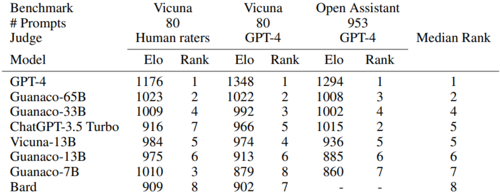
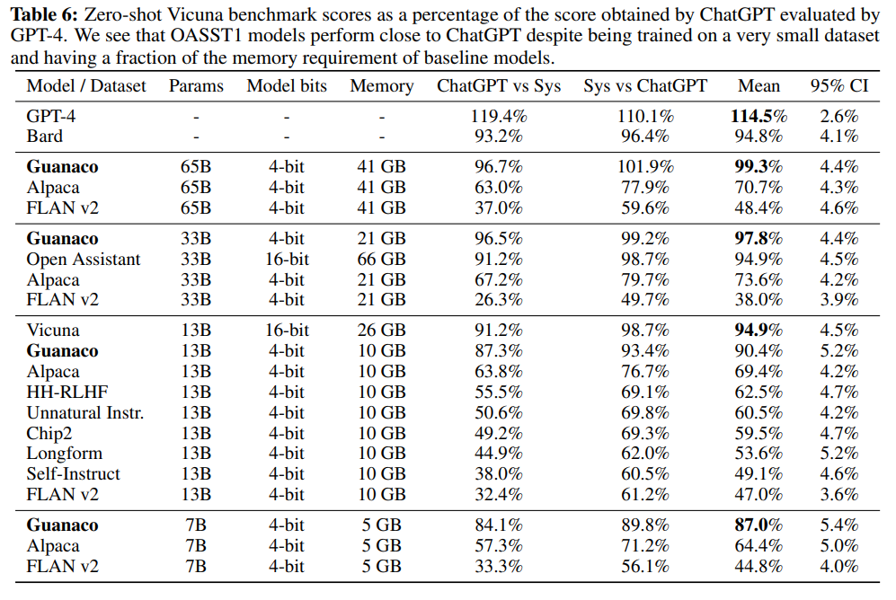

# 113.QLoRA量化微调快速入门

### <font style="color:#000000;">示例代码</font>

[qlora-quick.zip](https://www.yuque.com/attachments/yuque/0/2025/zip/2424104/1747014138672-3166849b-ff10-4fbe-9d68-9ae216a5a346.zip)

### <font style="color:rgb(51, 51, 51);">一、前言</font>

<font style="color:rgb(51, 51, 51);">在大型语言模型（LLM）领域，微调是提高性能和调整行为的关键过程。然而，由于内存需求巨大，对于大型模型进行微调可能非常昂贵。最近，华盛顿大学发表了一项关于解决这一问题的创新方案——QLoRA（Quantized Low-Rank Adapter）。</font>

<font style="color:rgb(51, 51, 51);">QLoRA 是一种新的微调大型语言模型（LLM）的方法，它能够在节省内存的同时保持速度。其工作原理是首先将 LLM 进行 4 位量化，从而显著减少模型的内存占用。接着，使用低阶适配器（LoRA）方法对量化的 LLM 进行微调。LoRA 使得改进后的模型能够保留原始 LLM 的大部分准确性，同时具有更小的体积和更快的速度。</font>

<font style="color:rgb(51, 51, 51);">以上是对 QLoRA 的简要介绍，下面将进一步探讨其原理和应用。</font>

### <font style="color:rgb(51, 51, 51);">二、QLoRA 介绍</font>

<font style="color:rgb(51, 51, 51);">QLoRA 是一种高效的微调方法，通过将梯度反向传播到低阶适配器 (LoRA) 中，以显著减少内存使用量。它可以在单个 48GB GPU 上微调 650 亿个参数的模型，并且能够保持完整的 16 位微调任务性能。</font>

<font style="color:rgb(51, 51, 51);">同时还推出了一个名为 Guanaco 的新模型家族，它在 Vicuna 基准上表现出色，达到了 ChatGPT 性能水平的 99.3%。令人惊喜的是，只需要在单个 GPU 上进行 24 小时的微调，就能够取得如此优异的结果。这些创新使得在资源有限的情况下，能够以更高效的方式进行模型微调，并取得了非常令人满意的成果。</font>



<font style="color:rgb(51, 51, 51);">QLoRA 是一种创新的微调 LLM 方法，经过多项任务验证，包括文本分类、问题回答和自然语言生成等，证明了其在各个领域的有效性。这一方法的出现为更广泛的用户和应用程序提供了更便捷的 LLM 应用方式，并有望进一步推动 LLM 在不同领域的应用。</font>

#### <font style="color:rgb(51, 51, 51);">2.1、</font>**<font style="color:rgb(51, 51, 51);">关键创新</font>**

*<font style="color:rgb(51, 51, 51);"> LoRA（低秩适配器）和 QLoRA（量化 LoRA）都是微调大型语言模型并减少内存需求的方法。然而，QLoRA 引入了多项创新，以在保持性能的同时进一步减少内存使用。以下是两种方法的比较：</font>*

##### ***<font style="color:rgb(51, 51, 51);">LoRA：</font>***

* *<font style="color:rgb(51, 51, 51);">- 使用一小组可训练参数（适配器），同时保持完整模型参数固定。</font>*
* *<font style="color:rgb(51, 51, 51);">- 随机梯度下降期间的梯度通过固定的预训练模型权重传递到适配器，适配器被更新以优化损失函数。</font>*
* *<font style="color:rgb(51, 51, 51);">- 与完全微调相比，内存效率更高，但仍需要 16 位精度进行训练。</font>*

##### ***<font style="color:rgb(51, 51, 51);">QLoRA：</font>***

* *<font style="color:rgb(51, 51, 51);">- 通过冻结的 4 位量化预训练语言模型将梯度反向传播到低阶适配器 (LoRA) 中。</font>*
* *<font style="color:rgb(51, 51, 51);">- 引入 4 位 NormalFloat (NF4)，这是一种适用于正态分布数据的信息理论上最佳量化数据类型，可产生比 4 位整数和 4 位浮点更好的经验结果。</font>*
* *<font style="color:rgb(51, 51, 51);">- 应用双量化，一种对量化常数进行量化的方法，每个参数平均节省约 0.37 位。</font>*
* *<font style="color:rgb(51, 51, 51);">- 使用具有 NVIDIA 统一内存的分页优化器，以避免在处理具有长序列长度的小批量时在梯度检查点期间出现内存峰值。</font>*
* *<font style="color:rgb(51, 51, 51);">- 显着降低内存需求，与 16 位完全微调基准相比，允许在单个 48GB GPU 上微调 65B 参数模型，而不会降低运行时间或预测性能。</font>*

*<font style="color:rgb(51, 51, 51);">总之，QLoRA 建立在传统 LoRA 的基础上，引入了 4 位量化、4 位 NormalFloat 数据类型、双量化和分页优化器，以进一步减少内存使用，同时保持与 16 位微调方法相当的性能。</font>*

#### <font style="color:rgb(51, 51, 51);">2.2 性能分析</font>

<font style="color:rgb(51, 51, 51);">通过对模型规模和聊天机器人性能进行深入研究，发现了一些有趣的结果。由于内存开销的限制，常规微调方法无法使用。因此，采用了一种特殊的指令微调方法，在多个数据集、不同的模型架构和参数数量范围内进行了训练，总共训练了 1000 多个模型。</font>

<font style="color:rgb(51, 51, 51);">结果显示，即使使用比之前最先进的模型更小的模型，通过 QLoRA 对小型高质量数据集进行微调，也能够获得最先进的结果。这表明，数据质量对于模型性能的影响远远大于数据集的大小。这一发现对于优化聊天机器人的性能具有重要的指导意义。</font>



<font style="color:rgb(51, 51, 51);">通过对 Guanaco 65B 模型进行了评估，该模型使用 QLORA 对 OASST1 的变体进行了微调。结果表明，它是性能最佳的开源聊天机器人模型，其性能可与 ChatGPT 相媲美。与 GPT-4 相比，Guanaco 65B 和 33B 的预期获胜概率为 30%。</font>

* <font style="color:rgb(51, 51, 51);">在 Vicuna 基准测试中，Guanaco 65B 在 GPT-4 之后表现最好，相对于 ChatGPT 达到了 99.3% 的性能。尽管参数较多，但由于权重仅使用 4 位精度，Guanaco 33B 模型的内存效率比 Vicuna 13B 模型更高。此外，Guanaco 7B 可以安装在现代手机上，同时得分比 Alpaca 13B 高出近 20 个百分点。</font>
* <font style="color:rgb(51, 51, 51);">尽管结果令人印象深刻，但许多模型的性能重叠，置信区间范围很广。作者将这种不确定性归因于缺乏明确的规模规范。为了解决这个问题，他们建议使用 Elo 排名方法，该方法基于人类注释者和 GPT-4 的成对判断。</font>
* <font style="color:rgb(51, 51, 51);">Elo 排名表明，Guanaco 33B 和 65B 模型在 Vicuna 和 OA 基准测试中的表现优于除 GPT-4 之外的所有模型，并且与 ChatGPT 的表现相当。然而，微调数据集的选择极大地影响了性能，表明数据集适用性的重要性。</font>

### <font style="color:rgb(51, 51, 51);">三、QLoRA 微调要求 </font>

#### <font style="color:rgb(51, 51, 51);">3.1、QLoRA 的硬件要求</font>

* **<font style="color:rgb(51, 51, 51);">GPU：</font>**<font style="color:rgb(51, 51, 51);">对于参数少于 200 亿的模型，例如 GPT-J，建议使用至少具有 12 GB VRAM 的 GPU。例如，可以使用 RTX 3060 12 GB GPU。如果您有更大的 GPU 和 24 GB VRAM，则可以使用具有 200 亿个参数的模型，例如 GPT-NeoX-20b。</font>
* **<font style="color:rgb(51, 51, 51);">RAM：</font>**<font style="color:rgb(51, 51, 51);">建议您至少拥有 6 GB RAM。目前大多数计算机都满足这一标准。</font>
* **<font style="color:rgb(51, 51, 51);">Hard Drive：</font>**<font style="color:rgb(51, 51, 51);">由于 GPT-J 和 GPT-NeoX-20b 是大型型号，因此您的硬盘上至少需要有 80 GB 的可用空间。</font>

<font style="color:rgb(51, 51, 51);">如果您的系统不满足这些标准，您可以使用 Google Colab 的免费实例。</font>

#### <font style="color:rgb(51, 51, 51);">3.2、QLoRA 的软件要求</font>

* **<font style="color:rgb(51, 51, 51);">CUDA</font>**<font style="color:rgb(51, 51, 51);">：确保您的计算机上安装了 CUDA。</font>
* **<font style="color:rgb(51, 51, 51);">Dependencies</font>**<font style="color:rgb(51, 51, 51);">: 依赖项：</font>
* **<font style="color:rgb(51, 51, 51);">bitsandbytes</font>**<font style="color:rgb(51, 51, 51);">：该库包含量化大型语言模型（LLM）所需的所有工具。</font>
* **<font style="color:rgb(51, 51, 51);">Hugging Face Transformers 和 Accelerate</font>**<font style="color:rgb(51, 51, 51);">：这些标准库用于 Hugging Face Hub 的高效模型训练。</font>
* **<font style="color:rgb(51, 51, 51);">PEFT</font>**<font style="color:rgb(51, 51, 51);">：该库提供了各种方法的实现，以微调少量额外的模型参数。 LoRA 需要它。</font>
* **<font style="color:rgb(51, 51, 51);">数据集</font>**<font style="color:rgb(51, 51, 51);">：虽然不是强制性的，但可以使用数据集库来获取数据集以进行微调。或者，您可以提供自己的数据集。</font>

<font style="color:rgb(51, 51, 51);">确保在继续对 GPT 模型进行基于 QLoRA 的微调之前安装所有必需的软件依赖项。</font>

### <font style="color:rgb(51, 51, 51);">四、QLoRA 演示</font>

***<font style="color:rgb(51, 51, 51);">Guanaco</font>***<font style="color:rgb(51, 51, 51);"> 是一个专为研究目的而设计的系统，可以通过以下的演示地址体验。</font>

1. <font style="color:rgb(51, 51, 51);">访问 Guanaco Playground 演示 \[4]，这是 33B 型号的演示，65B 型号的演示将稍后进行。</font>
2. <font style="color:rgb(51, 51, 51);">如果您想要托管自己的 Guanaco gradio 演示，您可以使用此 \[5]。对于 7B 和 13B 型号，它可以与免费 GPU 配合使用。</font>
3. <font style="color:rgb(51, 51, 51);">关于 ChatGPT 和 guanaco 之间的区别，可以在 \[6] 中比较它们的模型响应。在 Vicuna 提示上，您可以看到 ChatGPT 和 guanaco 65B 之间的对比。</font>

### <font style="color:rgb(51, 51, 51);">五、QLoRA 安装</font>

<font style="color:rgb(51, 51, 51);">要使用 Transformer 和 BitsandBytes 加载 4 位模型，您必须从源代码安装加速器和 Transformer，并安装当前版本的 BitsandBytes 库 (0.39.0)。您可以使用以下命令来实现上述目的：</font>

```plain
pip install -q -U bitsandbytes
pip install -q -U git+https://github.com/huggingface/transformers.git
pip install -q -U git+https://github.com/huggingface/peft.git
pip install -q -U git+https://github.com/huggingface/accelerate.git
```

### <font style="color:rgb(51, 51, 51);">六、QLoRA 入门</font>

<font style="color:rgb(25, 27, 31);">qlora.py脚本下载链接：</font>[GitHub - artidoro/qlora: QLoRA: Efficient Finetuning of Quantized LLMs](https://link.zhihu.com/?target=https%3A//github.com/artidoro/qlora)

<code><font style="color:rgb(51, 51, 51);background-color:rgb(243, 244, 244);">qlora.py</font></code><font style="color:rgb(51, 51, 51);"> 函数可用于对各种数据集进行微调和推断。以下是在 Alpaca 数据集上微调基线模型的基本命令：</font>

```plain
python qlora.py --model_name_or_path facebook/opt-350m
```

<font style="color:rgb(51, 51, 51);">对于大于 13B 的模型，我们建议调整学习率：</font>

```plain
python qlora.py –learning_rate 0.0001 --model_name_or_path facebook/opt-350m
```

#### <font style="color:rgb(51, 51, 51);">6.1、量化</font>

<font style="color:rgb(51, 51, 51);">量化参数由 </font><code>**<font style="color:rgb(51, 51, 51);background-color:rgb(243, 244, 244);">BitsandbytesConfig</font>**</code><font style="color:rgb(51, 51, 51);"> 控制，如下所示：</font>

* <font style="color:rgb(51, 51, 51);">通过 </font><code>**<font style="color:rgb(51, 51, 51);background-color:rgb(243, 244, 244);">load_in_4bit</font>**</code><font style="color:rgb(51, 51, 51);"> 启用 4 位加载。</font>
* <code>**<font style="color:rgb(51, 51, 51);background-color:rgb(243, 244, 244);">bnb_4bit_compute_dtype</font>**</code><font style="color:rgb(51, 51, 51);"> 用于线性层计算的数据类型。</font>
* <font style="color:rgb(51, 51, 51);">嵌套量化通过 </font><code>**<font style="color:rgb(51, 51, 51);background-color:rgb(243, 244, 244);">bnb_4bit_use_double_quant</font>**</code><font style="color:rgb(51, 51, 51);"> 启用。</font>
* <code>**<font style="color:rgb(51, 51, 51);background-color:rgb(243, 244, 244);">bnb_4bit_quant_type</font>**</code><font style="color:rgb(51, 51, 51);"> 指定用于量化的数据类型。支持两种量化数据类型： </font><code>**<font style="color:rgb(51, 51, 51);background-color:rgb(243, 244, 244);">fp4</font>**</code><font style="color:rgb(51, 51, 51);"> （四位浮点）和 </font><code>**<font style="color:rgb(51, 51, 51);background-color:rgb(243, 244, 244);">nf4</font>**</code><font style="color:rgb(51, 51, 51);"> （常规四位浮点）。我们提倡使用 </font><code>**<font style="color:rgb(51, 51, 51);background-color:rgb(243, 244, 244);">nf4</font>**</code><font style="color:rgb(51, 51, 51);"> ，因为理论上它对于正态分布权重来说是最佳的。</font>

```plain
model = AutoModelForCausalLM.from_pretrained(
        model_name_or_path='/name/or/path/to/your/model',
        load_in_4bit=True,
        device_map='auto',
        max_memory=max_memory,
        torch_dtype=torch.bfloat16,
        quantization_config=BitsAndBytesConfig(
            load_in_4bit=True,
            bnb_4bit_compute_dtype=torch.bfloat16,
            bnb_4bit_use_double_quant=True,
            bnb_4bit_quant_type='nf4'
        ),
    )
```

#### <font style="color:rgb(51, 51, 51);">6.2、分页优化器</font>

<font style="color:rgb(51, 51, 51);">为了处理 GPU 偶尔耗尽内存的情况，QLoRA 使用了利用 NVIDIA 统一内存功能的分页优化器，该功能在 CPU 和 GPU 之间执行自动页到页传输，其功能与 CPU RAM 和 GPU 之间的常规内存分页非常相似。磁盘。此功能用于为优化器状态分配分页内存，然后在 GPU 内存不足时将其移至 CPU RAM，并在需要时转移回 GPU 内存。</font>

<font style="color:rgb(51, 51, 51);">我们可以使用以下参数访问分页优化器。</font>

```plain
--optim paged_adamw_32bit
```

###


> 更新: 2025-05-12 09:42:18  
> 原文: <https://www.yuque.com/aaron-wecc3/dhluml/qb2at410ncn7knld>