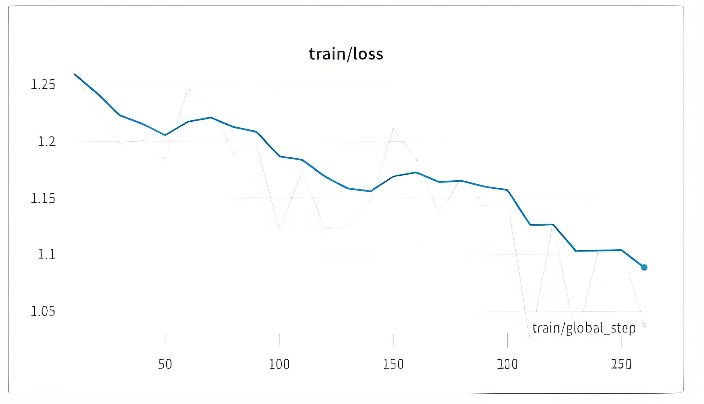

# 114.基于QLoRA微调LLaMA

### <font style="color:#000000;">示例代码</font>

[qlora-llama.zip](https://www.yuque.com/attachments/yuque/0/2025/zip/2424104/1747014138764-7b76f13f-3ba2-47b6-b1ef-96d2a1381bf1.zip)

### <font style="color:rgb(51, 51, 51);">前言</font>

<font style="color:rgb(51, 51, 51);">QLoRA 是一种高效的微调方法，通过将梯度反向传播到低阶适配器 (LoRA) 中，以显著减少内存使用量。它可以在单个 48GB GPU 上微调 650 亿个参数的模型，并且能够保持完整的 16 位微调任务性能。</font>

<font style="color:rgb(51, 51, 51);">同时还推出了一个名为 Guanaco 的新模型家族，它在 Vicuna 基准上表现出色，达到了 ChatGPT 性能水平的 99.3%。令人惊喜的是，只需要在单个 GPU 上进行 24 小时的微调，就能够取得如此优异的结果。这些创新使得在资源有限的情况下，能够以更高效的方式进行模型微调，并取得了非常令人满意的成果。</font>


<font style="color:rgb(51, 51, 51);">QLoRA 是一种创新的微调 LLM 方法，经过多项任务验证，包括文本分类、问题回答和自然语言生成等，证明了其在各个领域的有效性。这一方法的出现为更广泛的用户和应用程序提供了更便捷的 LLM 应用方式，并有望进一步推动 LLM 在不同领域的应用。</font>

<font style="color:rgb(51, 51, 51);">接下来我们将介绍如何在单个 Google Colab 上微调最新的 Llama-2-7b 模型并将其转变为聊天机器人。我们将利用 Hugging Face 生态系统中的 PEFT 库以及 QLoRA 来实现更高效的内存微调。</font>

*<font style="color:rgb(51, 51, 51);"></font>*

*<font style="color:rgb(51, 51, 51);"></font>*<font style="color:rgb(51, 51, 51);">LoRA（低秩适配器）和 QLoRA（量化 LoRA）都是微调大型语言模型并减少内存需求的方法。然而，QLoRA 引入了多项创新，以在保持性能的同时进一步减少内存使用。以下是两种方法的比较：</font>

**<font style="color:rgb(51, 51, 51);">LoRA：</font>**

* <font style="color:rgb(51, 51, 51);">- 使用一小组可训练参数（适配器），同时保持完整模型参数固定。</font>
* <font style="color:rgb(51, 51, 51);">- 随机梯度下降期间的梯度通过固定的预训练模型权重传递到适配器，适配器被更新以优化损失函数。</font>
* <font style="color:rgb(51, 51, 51);">- 与完全微调相比，内存效率更高，但仍需要 16 位精度进行训练。</font>

**<font style="color:rgb(51, 51, 51);">QLoRA：</font>**

* <font style="color:rgb(51, 51, 51);">- 通过冻结的 4 位量化预训练语言模型将梯度反向传播到低阶适配器 (LoRA) 中。</font>
* <font style="color:rgb(51, 51, 51);">- 引入 4 位 NormalFloat (NF4)，这是一种适用于正态分布数据的信息理论上最佳量化数据类型，可产生比 4 位整数和 4 位浮点更好的经验结果。</font>
* <font style="color:rgb(51, 51, 51);">- 应用双量化，一种对量化常数进行量化的方法，每个参数平均节省约 0.37 位。</font>
* <font style="color:rgb(51, 51, 51);">- 使用具有 NVIDIA 统一内存的分页优化器，以避免在处理具有长序列长度的小批量时在梯度检查点期间出现内存峰值。</font>
* <font style="color:rgb(51, 51, 51);">- 显着降低内存需求，与 16 位完全微调基准相比，允许在单个 48GB GPU 上微调 65B 参数模型，而不会降低运行时间或预测性能。</font>

<font style="color:rgb(51, 51, 51);">总之，QLoRA 建立在传统 LoRA 的基础上，引入了 4 位量化、4 位 NormalFloat 数据类型、双量化和分页优化器，以进一步减少内存使用，同时保持与 16 位微调方法相当的性能。</font>

### 微调过程

#### <font style="color:rgb(51, 51, 51);">1、PEFT 或参数高效微调</font>

<font style="color:rgb(51, 51, 51);">PEFT（即参数高效微调）是 Hugging Face 的一个新开源库，可将预训练语言模型 (PLM) 高效地适应各种下游应用程序，而无需微调所有模型参数。 PEFT 目前包括以下技术：</font>

* <font style="color:rgb(51, 51, 51);">LoRA：大语言模型的低阶自适应 </font>*<font style="color:rgb(51, 51, 51);">\[8]</font>*
* <font style="color:rgb(51, 51, 51);">前缀调优：P-Tuning v2：快速调优可与跨尺度和任务的通用微调相媲美</font>
* <font style="color:rgb(51, 51, 51);">P-Tuning：GPT 也能理解 </font>*<font style="color:rgb(51, 51, 51);">\[9]</font>*
* <font style="color:rgb(51, 51, 51);">即时调优：规模的力量可实现参数高效的即时调优 </font>*<font style="color:rgb(51, 51, 51);">\[10]</font>*

#### <font style="color:rgb(51, 51, 51);">2、设置开发环境</font>

<font style="color:rgb(51, 51, 51);">首先需要安装必要的依赖，我们将需要安装 </font><code><font style="color:rgb(51, 51, 51);background-color:rgb(243, 244, 244);">accelerate</font></code><font style="color:rgb(51, 51, 51);"> 、 </font><code><font style="color:rgb(51, 51, 51);background-color:rgb(243, 244, 244);">peft</font></code><font style="color:rgb(51, 51, 51);"> 、 </font><code><font style="color:rgb(51, 51, 51);background-color:rgb(243, 244, 244);">transformers</font></code><font style="color:rgb(51, 51, 51);"> 、 </font><code><font style="color:rgb(51, 51, 51);background-color:rgb(243, 244, 244);">datasets</font></code><font style="color:rgb(51, 51, 51);"> 和 TRL 库，以利用最新的 </font><code><font style="color:rgb(51, 51, 51);background-color:rgb(243, 244, 244);">SFTTrainer</font></code><font style="color:rgb(51, 51, 51);"> 。通过使用 </font><code><font style="color:rgb(51, 51, 51);background-color:rgb(243, 244, 244);">bitsandbytes</font></code><font style="color:rgb(51, 51, 51);"> 将基本模型量化为 4 位。同时还将安装 </font><code><font style="color:rgb(51, 51, 51);background-color:rgb(243, 244, 244);">einops</font></code><font style="color:rgb(51, 51, 51);"> ，因为它是加载 Falcon 模型所必须的库。</font>

```plain
pip install trl transformers accelerate git+https://github.com/huggingface/peft.git
pip install datasets bitsandbytes einops wandb
```

#### <font style="color:rgb(51, 51, 51);">3、准备数据集</font>

<font style="color:rgb(51, 51, 51);">我们将从 AlexanderDoria/novel17_test 数据集中加载了 train 数据集分割。该数据集包含了一些法语小说的文本数据，用于进行自然语言处理任务的训练和评估。该数据集中的文本将被用于训练模型，以便让模型能够对法语小说进行自然语言处理。</font>

```plain
from datasets import load_dataset
 
#dataset_name = "timdettmers/openassistant-guanaco" ###Human ,.,,,,,, ###Assistant
 
dataset_name = 'AlexanderDoria/novel17_test' #french novels
dataset = load_dataset(dataset_name, split="train")
```

#### <font style="color:rgb(51, 51, 51);">4、加载模型</font>

<font style="color:rgb(51, 51, 51);">加载预训练模型并使用 BitsAndBytesConfig 函数设置了量化配置，将模型加载为 4 位，并使用 torch.float16 计算数据类型。通过 from_pretrained 函数将预训练模型加载到 model 变量中，并将量化配置传递给模型。</font>

```plain
import torch
from transformers import AutoModelForCausalLM, AutoTokenizer, BitsAndBytesConfig, AutoTokenizer
 
model_name = "TinyPixel/Llama-2-7B-bf16-sharded"
 
bnb_config = BitsAndBytesConfig(
    load_in_4bit=True,
    bnb_4bit_quant_type="nf4",
    bnb_4bit_compute_dtype=torch.float16,
)
 
model = AutoModelForCausalLM.from_pretrained(
    model_name,
    quantization_config=bnb_config,
    trust_remote_code=True
)
model.config.use_cache = False
```

<font style="color:rgb(51, 51, 51);">加载预训练模型的分词器，并将其配置为在序列结尾添加填充标记，以便在使用模型进行推断时进行批处理。</font>

```plain
tokenizer = AutoTokenizer.from_pretrained(model_name, trust_remote_code=True)
tokenizer.pad_token = tokenizer.eos_token
```

<font style="color:rgb(51, 51, 51);">创建一个 PEFT 配置对象，以便在训练和评估模型时使用。</font>

```plain
from peft import LoraConfig, get_peft_model
 
lora_alpha = 16
lora_dropout = 0.1
lora_r = 64
 
peft_config = LoraConfig(
    lora_alpha=lora_alpha,
    lora_dropout=lora_dropout,
    r=lora_r,
    bias="none",
    task_type="CAUSAL_LM"
)
```

#### <font style="color:rgb(51, 51, 51);">5、加载训练器</font>

<font style="color:rgb(51, 51, 51);">我们将使用 TRL 库中的 </font><code><font style="color:rgb(51, 51, 51);background-color:rgb(243, 244, 244);">SFTTrainer</font></code><font style="color:rgb(51, 51, 51);"> ，它提供了 transformers </font><code><font style="color:rgb(51, 51, 51);background-color:rgb(243, 244, 244);">Trainer</font></code><font style="color:rgb(51, 51, 51);"> 的包装器，以便使用 PEFT 适配器轻松地在基于指令的数据集上微调模型。让我们首先加载下面的训练参数。</font>

```plain
from transformers import TrainingArguments
 
output_dir = "./results"
per_device_train_batch_size = 4
gradient_accumulation_steps = 4
optim = "paged_adamw_32bit"
save_steps = 100
logging_steps = 10
learning_rate = 2e-4
max_grad_norm = 0.3
max_steps = 100
warmup_ratio = 0.03
lr_scheduler_type = "constant"
 
training_arguments = TrainingArguments(
    output_dir=output_dir,
    per_device_train_batch_size=per_device_train_batch_size,
    gradient_accumulation_steps=gradient_accumulation_steps,
    optim=optim,
    save_steps=save_steps,
    logging_steps=logging_steps,
    learning_rate=learning_rate,
    fp16=True,
    max_grad_norm=max_grad_norm,
    max_steps=max_steps,
    warmup_ratio=warmup_ratio,
    group_by_length=True,
    lr_scheduler_type=lr_scheduler_type,
)
```

<font style="color:rgb(51, 51, 51);">然后最后将所有内容传递给训练器，创建一个训练器对象，以便对指定的语言模型进行训练。</font>

```plain
from trl import SFTTrainer
 
max_seq_length = 512
 
trainer = SFTTrainer(
    model=model,
    train_dataset=dataset,
    peft_config=peft_config,
    dataset_text_field="text",
    max_seq_length=max_seq_length,
    tokenizer=tokenizer,
    args=training_arguments,
)
```

<font style="color:rgb(51, 51, 51);">我们还将通过升级 float 32 中的层规范来预处理模型，以获得更稳定的训练</font>

```plain
for name, module in trainer.model.named_modules():
    if "norm" in name:
        module = module.to(torch.float32)
```

#### <font style="color:rgb(51, 51, 51);">6、训练模型</font>

<font style="color:rgb(51, 51, 51);">接下来启动模型的训练过程，以便通过反向传播算法来更新模型参数，从而提高模型的性能。</font>

```plain
trainer.train()
```

<font style="color:rgb(51, 51, 51);">在训练过程中，模型应该很好地收敛，如下所示：</font>



<font style="color:rgb(51, 51, 51);">将训练后的模型保存到本地文件系统中以备后续使用。</font><code><font style="color:rgb(51, 51, 51);background-color:rgb(243, 244, 244);">SFTTrainer</font></code><font style="color:rgb(51, 51, 51);"> 仅正确保存适配器，而不是保存整个模型。</font>

```plain
model_to_save = trainer.model.module if hasattr(trainer.model, 'module') else trainer.model  # Take care of distributed/parallel training
model_to_save.save_pretrained("outputs")
```

<font style="color:rgb(51, 51, 51);">使用 LoraConfig 类加载预训练模型的配置信息，并将其与现有的模型结合起来以获取一个新的模型。</font>

```plain
lora_config = LoraConfig.from_pretrained('outputs')
model = get_peft_model(model, lora_config)
```

<font style="color:rgb(51, 51, 51);">使用预训练模型生成一段新的文本，以便测试模型的生成能力。</font>

```plain
text = "Écrire un texte dans un style baroque sur la glace et le feu ### Assistant: Si j'en luis éton"
device = "cuda:0"
 
inputs = tokenizer(text, return_tensors="pt").to(device)
outputs = model.generate(**inputs, max_new_tokens=50)
print(tokenizer.decode(outputs[0], skip_special_tokens=True))
```

<font style="color:rgb(51, 51, 51);">将模型推送到 Hugging Face Hub 上，可以与其他人共享和访问。</font>

```plain
from huggingface_hub import login
login()
 
model.push_to_hub("llama2-qlora-finetunined-french")
```

### <font style="color:rgb(51, 51, 51);">QLoRA 的局限性</font>

<font style="color:rgb(51, 51, 51);">QLoRA 是一种基于 LoRA（Logical Reasoning Architecture）的推理模型，它在某些方面存在一些局限性。以下是一些已知的局限性：</font>

1. <font style="color:rgb(51, 51, 51);">推理速度较慢：使用四位的推理时，QLoRA 的推理速度相对较慢。目前，QLoRA 的四位推理系统尚未与四位矩阵乘法连接，这可能会影响到其性能和速度。</font>
2. <font style="color:rgb(51, 51, 51);">Trainer 恢复训练失败：在使用 Trainer 来恢复 LoRA 的训练运行时，可能会遇到失败的情况。这可能是由于一些内部问题或配置不正确导致的，需要进一步调查和解决。</font>
3. **<font style="color:rgb(51, 51, 51);">bnb_4bit_compute_type='fp16'\_</font>**<font style="color:rgb(51, 51, 51);">\_的不稳定性：目前，使用 bnb_4bit_compute_type='fp16'可能会导致不稳定性。特别是对于 7B LLaMA 任务，只有 80% 的微调运行没有问题。虽然有解决方案，但尚未以比特和字节的形式实现。</font>
4. <font style="color:rgb(51, 51, 51);">设置 tokenizer.bos_token_id 为 1：为了避免产生困难，建议将 tokenizer.bos_token_id 设置为 1。这可能是为了确保在使用 QLoRA 时，开始标记（BOS）的 ID 被正确设置为 1，以避免潜在的问题。</font>

### <font style="color:rgb(51, 51, 51);">总结</font>

<font style="color:rgb(51, 51, 51);">QLoRA 是一种基于量化的语言模型微调方法，它可以将预训练的语言模型量化为低精度格式，从而在保持模型性能的同时提高推理速度和减少模型存储空间。</font>

<font style="color:rgb(51, 51, 51);">我们讲了如何使用 QLoRA 方法微调 LLaMA 2 模型，包括加载预训练模型、设置量化配置、使用 SFTTrainer 类创建训练器对象、训练模型等步骤。我们还讨论了如何使用 BitsAndBytesConfig 函数将模型量化为 4 位，并将 torch.float16 计算数据类型用于计算。这些操作可以帮助我们在保持模型性能的同时提高推理速度和减少模型存储空间，从而使得在资源受限的环境下也能够进行语言模型的部署和应用。</font>

### <font style="color:rgb(51, 51, 51);">参考资料</font>

**<font style="color:rgb(51, 51, 51);">\[1]. QLoRA GitHub：</font>**

[<font style="color:rgb(65, 131, 196);">https://github.com/artidoro/qlora</font>](https://github.com/artidoro/qlora)

**<font style="color:rgb(51, 51, 51);">\[2]. QLoRA Pager：</font>**

[<font style="color:rgb(65, 131, 196);">https://arxiv.org/abs/2305.14314</font>](https://arxiv.org/abs/2305.14314)

**<font style="color:rgb(51, 51, 51);">\[3]. </font>*****<font style="color:rgb(51, 51, 51);">Bits and Bytes (for 4-bit training):</font>***

[<font style="color:rgb(65, 131, 196);">https://github.com/TimDettmers/bitsandbytes</font>](https://github.com/TimDettmers/bitsandbytes)

**<font style="color:rgb(51, 51, 51);">\[4]. Guanaco HF Playground：</font>**

[<font style="color:rgb(65, 131, 196);">https://huggingface.co/spaces/uwnlp/guanaco-playground-tgi</font>](https://huggingface.co/spaces/uwnlp/guanaco-playground-tgi)

**<font style="color:rgb(51, 51, 51);">\[5].</font>\*\*\*\*<font style="color:rgb(51, 51, 51);">Guanaco Gradio Colab：</font>**

[<font style="color:rgb(65, 131, 196);">https://colab.research.google.com/drive/17XEqL1JcmVWjHkT-WczdYkJlNINacwG7?usp=sharing</font>](https://colab.research.google.com/drive/17XEqL1JcmVWjHkT-WczdYkJlNINacwG7?usp=sharing)

**<font style="color:rgb(51, 51, 51);">\[6].</font>\*\*\*\*<font style="color:rgb(51, 51, 51);">Guanaco vs ChatGPT Colab：</font>**

[<font style="color:rgb(65, 131, 196);">https://colab.research.google.com/drive/1kK6xasHiav9nhiRUJjPMZb4fAED4qRHb?usp=sharing</font>](https://colab.research.google.com/drive/1kK6xasHiav9nhiRUJjPMZb4fAED4qRHb?usp=sharing)

**<font style="color:rgb(51, 51, 51);">\[7].</font>\*\*\*\*<font style="color:rgb(51, 51, 51);">PEFT GitHub：</font>**

[<font style="color:rgb(65, 131, 196);">https://github.com/huggingface/peft</font>](https://github.com/huggingface/peft)

**<font style="color:rgb(51, 51, 51);">\[8].</font>\*\*\*\*<font style="color:rgb(51, 51, 51);">LoRA Pager：</font>**

[<font style="color:rgb(65, 131, 196);">https://arxiv.org/pdf/2106.09685.pdf</font>](https://arxiv.org/pdf/2106.09685.pdf)

**<font style="color:rgb(51, 51, 51);">\[9].</font>\*\*\*\*<font style="color:rgb(51, 51, 51);">P-Tuning Pager：</font>**

[<font style="color:rgb(65, 131, 196);">https://arxiv.org/pdf/2103.10385.pdf</font>](https://arxiv.org/pdf/2103.10385.pdf)

**<font style="color:rgb(51, 51, 51);">\[10].</font>****<font style="color:rgb(51, 51, 51);">Prompt Tuning</font>****<font style="color:rgb(51, 51, 51);">Pager：</font>**

[<font style="color:rgb(65, 131, 196);">https://arxiv.org/pdf/2104.08691.pdf</font>](https://arxiv.org/pdf/2104.08691.pdf)

**<font style="color:rgb(51, 51, 51);">\[11].</font>\*\*\*\*<font style="color:rgb(51, 51, 51);">SFTTrainer HF：</font>**

[<font style="color:rgb(65, 131, 196);">https://huggingface.co/docs/trl/main/en/sft_trainer</font>](https://huggingface.co/docs/trl/main/en/sft_trainer)


> 更新: 2025-05-12 09:42:18  
> 原文: <https://www.yuque.com/aaron-wecc3/dhluml/pgk08qk07gy5dns9>