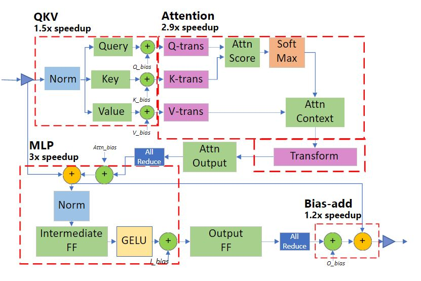

# 115.基于DeepSpeed加速大模型训练

# <font style="color:rgb(51, 51, 51);">示例代码</font>

[deepspeed-train.zip](https://www.yuque.com/attachments/yuque/0/2025/zip/2424104/1747713193633-9892dbbb-d48c-47b2-a37e-e99500b60901.zip)

# <font style="color:rgb(51, 51, 51);">DeepSpeed 介绍</font>

## <font style="color:rgb(51, 51, 51);">分布式背景介绍</font>

* <font style="color:rgb(51, 51, 51);">分布式计算环境中，主节点负责协调其他节点和进程的工作</font>
* <font style="color:rgb(51, 51, 51);">pytorch 官方提供的分布式训练工具 Accelerate 只支持 nvlink，而 T4，3090 这类显卡是 PIX ，检测方式：nvidia-smi topo -m；deepspeed 支持更大规模的模型训练</font>
* <font style="color:rgb(51, 51, 51);">混合精度训练</font>
* <font style="color:rgb(51, 51, 51);">ZeRO 可以减少内存占用，优化大模型训练，将模型参数分成了三个部分：Optimizer States、Gradient 和 Model Parameter。在使用 ZeRO 进行分布式训练时，可以选择 ZeRO-Offload 和 ZeRO-Stage3 等不同的优化技术。</font>

## <font style="color:rgb(51, 51, 51);">deepspeed 介绍</font>

[<font style="color:#000000;">DeepSpeed</font>](https://deepspeed.org.cn/)<font style="color:#000000;"> 是一个为速度和规模而设计的库，用于大规模模型的分布式训练，模型参数可达数十亿。其核心是零冗余优化器 (ZeRO)，它跨数据并行进程分片优化器状态 (ZeRO-1)、梯度 (ZeRO-2) 和参数 (ZeRO-3)。这大大减少了内存使用量，使您可以将训练扩展到数十亿参数的模型。为了释放更高</font><font style="color:rgb(74, 85, 101);">的内存效率，</font><font style="color:#000000;">ZeRO-Offload 通过在优化期间利用 CPU 资源来减少 GPU </font>

* <font style="color:rgb(51, 51, 51);">在 DeepSpeed 中，可以通过在配置文件中设置 “bf16.enabled”: true 来启用 BF16 混合精度训练，减少占用内存。</font>
  * <font style="color:rgb(51, 51, 51);">混合精度训练是指在训练过程中同时使用 FP16（半精度浮点数）和 FP32（单精度浮点数）两种精度的技术。</font>
* <font style="color:rgb(51, 51, 51);">deepspeed 可以根据具体情况选择合适的通信库，例如在 CPU 集群上进行分布式训练，可以选择 mpi 和 gloo；如果是在 GPU 上进行分布式训练，可以选择 nccl。</font>
  * <font style="color:rgb(51, 51, 51);">mpi 是一种跨节点通信库，常用于 CPU 集群上的分布式训练；</font>
  * <font style="color:rgb(51, 51, 51);">gloo 是一种高性能的分布式训练框架，支持 CPU 和 GPU 上的分布式训练；</font>
  * <font style="color:rgb(51, 51, 51);">nccl 是 NVIDIA 提供的 GPU 专用通信库，被广泛应用于 GPU 上的分布式训练。</font>
* <font style="color:rgb(51, 51, 51);">DeepSpeed 的核心技术：</font>
  * <font style="color:rgb(51, 51, 51);">Zero（Zero Redundancy Optimizer，3D 优化与卸载）：在 deepspeed 中通过</font><code><font style="color:rgb(51, 51, 51);">zero_optimization.stage=0/1/2/3</font></code><font style="color:rgb(51, 51, 51);"> 设置，卸载通过</font><code><font style="color:rgb(51, 51, 51);">zero_optimization.offload_optimizer.device</font></code><font style="color:rgb(51, 51, 51);">设置</font>
* <font style="color:rgb(51, 51, 51);">DeepSpeed 的推理优化技术：</font>
  * <font style="color:rgb(51, 51, 51);">Deep fusion：如下图，红色虚线框是以该单位为优化 Kernel，对应的数字是优化的效率倍数</font>
  * <font style="color:rgb(51, 51, 51);">Inference-customized GeMM</font>



# <font style="color:rgb(31, 35, 40);">微调训练</font>

## <font style="color:rgb(31, 35, 40);">环境准备</font>

<font style="color:rgb(31, 35, 40);">推荐的第三方库版本参考</font>[SWIFT安装文档](https://modelscope.cn/docs/llm-training-and-inference/intro/swift-installation)

```plain
pip install ms-swift -U

# deepspeed zero2/zero3
pip install deepspeed -U
```

## <font style="color:rgb(31, 35, 40);">微调</font>

<font style="color:rgb(31, 35, 40);">ms-swift使用了分层式的设计思想，用户可以使用命令行界面、Web-UI界面和直接使用Python的方式进行微调。</font>

### <font style="color:rgb(31, 35, 40);">使用CLI</font>

<font style="color:rgb(31, 35, 40);">我们提供了10分钟在单卡A10上对</font><font style="color:#080808;background-color:#ffffff;">Qwen2-1.5B</font><font style="color:rgb(31, 35, 40);">进行自我认知微调的最佳实践，具体参考</font>[这里](https://modelscope.cn/docs/llm-training-and-inference/intro/quickstart)<font style="color:rgb(31, 35, 40);">，这可以帮助您快速了解SWIFT。</font>

<font style="color:rgb(31, 35, 40);">此外，我们给出了一系列脚本帮助您了解SWIFT的训练能力：</font>

* <font style="color:rgb(31, 35, 40);">DeepSpeed ZeRO2/ZeRO3: 节约显存资源，但训练速度下降。ZeRO2将对优化器状态、模型梯度进行分片。ZeRO3在ZeRO2基础上，对模型参数进行分片，更加节约显存，但训练速度更慢。参考</font>[这里](https://github.com/modelscope/ms-swift/tree/main/examples/train/multi-gpu/deepspeed)<font style="color:rgb(31, 35, 40);">。</font>
* <font style="color:rgb(31, 35, 40);">多机多卡训练: 我们书写了使用swift、torchrun、dlc、deepspeed、accelerate启动多节点运行的shell脚本示例。除了dlc和deepspeed，其他启动脚本都需要在所有节点中启动才可运行。具体参考</font>[这里](https://github.com/modelscope/swift/blob/main/examples/train/multi-node)<font style="color:rgb(31, 35, 40);">。</font>

<font style="color:rgb(31, 35, 40);">小帖士：</font>

* <font style="color:rgb(31, 35, 40);">在使用</font><code><font style="color:rgb(31, 35, 40);">swift sft</font></code><font style="color:rgb(31, 35, 40);">通过LoRA技术微调base模型为chat模型时，有时需要手动设置模板。通过添加</font><code><font style="color:rgb(31, 35, 40);">--template default</font></code><font style="color:rgb(31, 35, 40);">参数来避免base模型因未见过对话模板中的特殊字符而无法正常停止的情况。具体参考</font>[这里](https://github.com/modelscope/ms-swift/tree/main/examples/train/base_to_chat)<font style="color:rgb(31, 35, 40);">。</font>
* <font style="color:rgb(31, 35, 40);">如果使用NPU进行训练，只需要将shell中的</font><code><font style="color:rgb(31, 35, 40);">CUDA_VISIBLE_DEVICES</font></code><font style="color:rgb(31, 35, 40);">修改为</font><code><font style="color:rgb(31, 35, 40);">ASCEND_RT_VISIBLE_DEVICES</font></code><font style="color:rgb(31, 35, 40);">。</font>
* <font style="color:rgb(31, 35, 40);">SWIFT默认在训练时设置</font><code><font style="color:rgb(31, 35, 40);">--gradient_checkpointing true</font></code><font style="color:rgb(31, 35, 40);">来节约显存，这会略微降低训练速度。</font>
* <font style="color:rgb(31, 35, 40);">如果要使用deepspeed，你需要安装deepspeed：</font><code><font style="color:rgb(31, 35, 40);">pip install deepspeed -U</font></code><font style="color:rgb(31, 35, 40);">。使用deepspeed可以节约显存，但会略微降低训练速度。</font>

### <font style="color:rgb(31, 35, 40);">deepspeed Zero2微调</font>

```bash
# 18GiB * 2
nproc_per_node=1

CUDA_VISIBLE_DEVICES=0,1 \
NPROC_PER_NODE=$nproc_per_node \
swift sft \
    --model Qwen/Qwen2-1.5B \
    --train_type lora \
    --dataset 'swift/self-cognition#10' \
    --torch_dtype bfloat16 \
    --num_train_epochs 1 \
    --per_device_train_batch_size 1 \
    --per_device_eval_batch_size 1 \
    --learning_rate 1e-4 \
    --lora_rank 8 \
    --lora_alpha 32 \
    --target_modules all-linear \
    --gradient_accumulation_steps $(expr 16 / $nproc_per_node) \
    --eval_steps 100 \
    --save_steps 100 \
    --save_total_limit 2 \
    --logging_steps 5 \
    --max_length 2048 \
    --output_dir output \
    --system 'You are a helpful assistant.' \
    --warmup_ratio 0.05 \
    --dataloader_num_workers 4 \
    --model_author swift \
    --model_name swift-robot \
    --deepspeed zero2

```

**<font style="color:rgb(31, 35, 40);"></font>**

### <font style="color:rgb(31, 35, 40);">deepspeed分布式微调</font>

```bash
# If your need only a part of the GPUs in every node, try:
# --include="worker-0:0,1@worker-1:2,3"
#--hostfile=./examples/train/multi-node-deepspeed/host.txt
deepspeed ms-swift/swift/cli/sft.py \
    --model Qwen/Qwen2-1.5B \
    --train_type lora \
    --torch_dtype bfloat16 \
    --dataset 'swift/self-cognition#2' \
    --num_train_epochs 1 \
    --lora_rank 8 \
    --lora_alpha 32 \
    --learning_rate 1e-4 \
    --gradient_accumulation_steps 16 \
    --eval_steps 100 \
    --save_steps 100 \
    --save_total_limit 2 \
    --logging_steps 5 \
    --model_author swift \
    --model_name swift-robot \
    --gradient_checkpointing_kwargs '{"use_reentrant": false}'

```

**<font style="color:rgb(31, 35, 40);"></font>**

### <font style="color:rgb(31, 35, 40);">debug微调</font>

<font style="color:rgb(31, 35, 40);">你可以使用以下方式进行debug，这与使用命令行微调是等价的，但此方式不支持分布式。微调命令行运行入口可以查看</font>[这里](https://github.com/modelscope/ms-swift/blob/main/swift/cli/sft.py)<font style="color:rgb(31, 35, 40);">。</font>

```plain
from swift.llm import sft_main, TrainArguments
result = sft_main(TrainArguments(
    model='Qwen/Qwen2.5-7B-Instruct',
    train_type='lora',
    dataset=['AI-ModelScope/alpaca-gpt4-data-zh#500',
             'AI-ModelScope/alpaca-gpt4-data-en#500',
             'swift/self-cognition#500'],
    torch_dtype='bfloat16'
))
print(result) 
```

### 报错

#### <font style="color:rgb(31, 35, 40);">RuntimeError: Expected to mark a variable ready only once</font>

解决方案：<font style="color:rgb(31, 35, 40);">添加--gradient_checkpointing_kwargs '{"use_reentrant": false}'之后就可以正常微调了</font>

<font style="color:rgb(31, 35, 40);">参考：</font><https://github.com/modelscope/ms-swift/issues/3446>

## <font style="color:rgb(31, 35, 40);">Merge LoRA</font>

```bash
# Since `output/vx-xxx/checkpoint-xxx` is trained by swift and contains an `args.json` file,
# there is no need to explicitly set `--model`, `--system`, etc., as they will be automatically read.
swift export \
    --adapters output/vx-xxx/checkpoint-xxx \
    --merge_lora true
```

## <font style="color:rgb(31, 35, 40);">推理（微调后模型）</font>

<font style="color:rgb(31, 35, 40);">使用CLI对LoRA训练的checkpoint进行推理：</font>

```plain
CUDA_VISIBLE_DEVICES=0 \
swift infer \
    --adapters output/vx-xxx/checkpoint-xxx \
    --infer_backend pt \
    --stream true \
    --temperature 0 \
    --max_new_tokens 2048
```

* <font style="color:rgb(31, 35, 40);">adapters文件夹中包含了训练的参数文件</font><code><font style="color:rgb(31, 35, 40);">args.json</font></code><font style="color:rgb(31, 35, 40);">，因此不需要额外指定</font><code><font style="color:rgb(31, 35, 40);">--model</font></code><font style="color:rgb(31, 35, 40);">，</font><code><font style="color:rgb(31, 35, 40);">--system</font></code><font style="color:rgb(31, 35, 40);">，swift会自动读取这些参数。如果要关闭此行为，可以设置</font><code><font style="color:rgb(31, 35, 40);">--load_args false</font></code><font style="color:rgb(31, 35, 40);">。</font>
* <font style="color:rgb(31, 35, 40);">如果使用全参数训练，请使用</font><code><font style="color:rgb(31, 35, 40);">--model</font></code><font style="color:rgb(31, 35, 40);">替代</font><code><font style="color:rgb(31, 35, 40);">--adapters</font></code><font style="color:rgb(31, 35, 40);">指定训练的checkpoint目录。更多参考。</font>
* <font style="color:rgb(31, 35, 40);">你可以使用</font><code><font style="color:rgb(31, 35, 40);">swift app</font></code><font style="color:rgb(31, 35, 40);">替代</font><code><font style="color:rgb(31, 35, 40);">swift infer</font></code><font style="color:rgb(31, 35, 40);">进行界面推理。</font>
* <font style="color:rgb(31, 35, 40);">你可以选择对LoRA进行merge（额外指定</font><code><font style="color:rgb(31, 35, 40);">--merge_lora true</font></code><font style="color:rgb(31, 35, 40);">），然后指定</font><code><font style="color:rgb(31, 35, 40);">--infer_backend vllm/lmdeploy</font></code><font style="color:rgb(31, 35, 40);">进行推理加速。</font>

<font style="color:rgb(31, 35, 40);">对数据集中的验证集进行批量推理：</font>

```plain
CUDA_VISIBLE_DEVICES=0 \
swift infer \
    --adapters output/vx-xxx/checkpoint-xxx \
    --infer_backend pt \
    --temperature 0 \
    --max_new_tokens 2048 \
    --load_data_args true \
    --max_batch_size 1
```

* <font style="color:rgb(31, 35, 40);">你可以设置</font><code><font style="color:rgb(31, 35, 40);">--max_batch_size 8</font></code><font style="color:rgb(31, 35, 40);">，从而使用</font><code><font style="color:rgb(31, 35, 40);">--infer_backend pt</font></code><font style="color:rgb(31, 35, 40);">进行批量处理。若使用</font><code><font style="color:rgb(31, 35, 40);">infer_backend vllm/lmdeploy</font></code><font style="color:rgb(31, 35, 40);">则无需指定，会进行自动batch。</font>
* <code><font style="color:rgb(31, 35, 40);">--load_data_args true</font></code><font style="color:rgb(31, 35, 40);">会额外读取训练存储参数文件</font><code><font style="color:rgb(31, 35, 40);">args.json</font></code><font style="color:rgb(31, 35, 40);">中的数据参数。</font>

<font style="color:rgb(31, 35, 40);">若想对额外的测试集进行推理，而不使用训练时的验证集，使用</font><code><font style="color:rgb(31, 35, 40);">--val_dataset <dataset_path></font></code><font style="color:rgb(31, 35, 40);">进行推理：</font>

```plain
CUDA_VISIBLE_DEVICES=0 \
swift infer \
    --adapters output/vx-xxx/checkpoint-xxx \
    --infer_backend pt \
    --temperature 0 \
    --max_new_tokens 2048 \
    --val_dataset <dataset-path> \
    --max_batch_size 1
```

<font style="color:rgb(31, 35, 40);">使用Python对训练后LoRA推理的例子如下：</font>

```plain
import os
os.environ['CUDA_VISIBLE_DEVICES'] = '0'

from swift.llm import (
    PtEngine, RequestConfig, safe_snapshot_download, get_model_tokenizer, get_template, InferRequest
)
from swift.tuners import Swift
# 请调整下面几行
model = 'Qwen/Qwen2.5-7B-Instruct'
lora_checkpoint = safe_snapshot_download('swift/test_lora')  # 修改成checkpoint_dir
template_type = None  # None: 使用对应模型默认的template_type
default_system = "You are a helpful assistant."  # None: 使用对应模型默认的default_system

# 加载模型和对话模板
model, tokenizer = get_model_tokenizer(model)
model = Swift.from_pretrained(model, lora_checkpoint)
template_type = template_type or model.model_meta.template
template = get_template(template_type, tokenizer, default_system=default_system)
engine = PtEngine.from_model_template(model, template, max_batch_size=2)
request_config = RequestConfig(max_tokens=512, temperature=0)

# 这里使用了2个infer_request来展示batch推理
infer_requests = [
    InferRequest(messages=[{'role': 'user', 'content': 'who are you?'}]),
    InferRequest(messages=[{'role': 'user', 'content': '浙江的省会在哪？'},
                           {'role': 'assistant', 'content': '浙江的省会在哪？'},
                           {'role': 'user', 'content': '这里有什么好吃的'},]),
]
resp_list = engine.infer(infer_requests, request_config)
query0 = infer_requests[0].messages[0]['content']
print(f'response0: {resp_list[0].choices[0].message.content}')
print(f'response1: {resp_list[1].choices[0].message.content}')
```


> 更新: 2025-05-20 11:53:13  
> 原文: <https://www.yuque.com/aaron-wecc3/dhluml/tinp6t8did1wq01v>