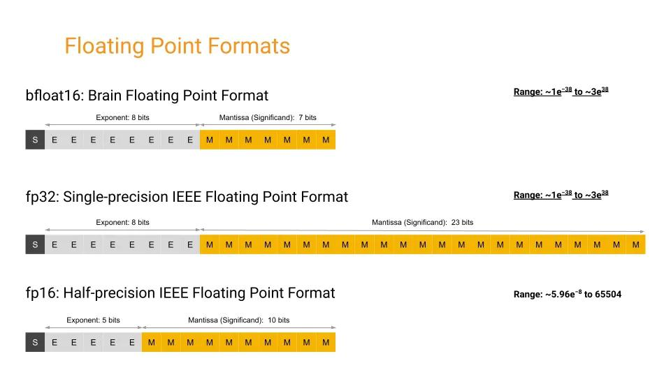

# 117.基于FSDP实现完全分片数据并行训练

### <font style="color:rgb(51, 51, 51);">示例代码</font>

[fsdp-demo.zip](https://www.yuque.com/attachments/yuque/0/2025/zip/2424104/1747713193672-24185878-da4f-4781-b709-e83008a90b8b.zip)

### <font style="color:rgb(51, 51, 51);">前置知识</font>

<font style="color:rgb(51, 51, 51);">在介绍针对权重数据、优化器数据和梯度数据进行分布式数据并行的算法 FSDP 前，需要一些前置知识，如何执行混精度训练和对显存消耗进行估算，以帮助更好地理解完全分片数据并行算法 FSDP。</font>

#### <font style="color:rgb(51, 51, 51);">精度格式</font>

<font style="color:rgb(51, 51, 51);">在深度学习中，常用的精度格式包括 </font>**<font style="color:rgb(51, 51, 51);">FP32</font>**<font style="color:rgb(51, 51, 51);">、</font>**<font style="color:rgb(51, 51, 51);">FP16</font>**<font style="color:rgb(51, 51, 51);">、</font>**<font style="color:rgb(51, 51, 51);">BF16</font>**<font style="color:rgb(51, 51, 51);"> 和 </font>**<font style="color:rgb(51, 51, 51);">TF32</font>**<font style="color:rgb(51, 51, 51);">。</font>



* **<font style="color:rgb(51, 51, 51);">FP16</font>**<font style="color:rgb(51, 51, 51);">：同样是 IEEE 754 标准下的半精度浮点格式。随着深度学习的发展，FP16 逐渐取代了 FP32 的地位。因为相较于 FP32，更低的精度并不会对神经网络的性能产生重大影响。额外的精度不会带来任何好处，反而会更慢、占用更多内存并降低通信速度。FP16 通常用于混合精度训练（MindSpore/PyTorch）。也用于训练后量化，以加快推理速度。其他用于量化的格式还有整数 INT8（8 位整数）、INT4（4 位）甚至 INT1（二进制值）。</font>
* **<font style="color:rgb(51, 51, 51);">BF16</font>**<font style="color:rgb(51, 51, 51);">：谷歌最初开发的另一种 16 位格式被称为 "Brain Floating Point Format"，简称 "bfloat16"。这个名字源于 "谷歌大脑"（谷歌 Brain），谷歌大脑是谷歌的一个 AI 研究小组，这种格式就是在这个小组构思出来的。最开始是被使用在谷歌芯片 TPU 中，后被广泛使用在 </font>[<font style="color:rgb(65, 131, 196);">GPU</font>](https://cloud.tencent.com/product/gpu?from_column=20065\&from=20065)<font style="color:rgb(51, 51, 51);">、NPU 等 AI 芯片中。由于具有更多的指数位，常被用于处理 FP16 的溢出问题。</font>
* **<font style="color:rgb(51, 51, 51);">FP32</font>**<font style="color:rgb(51, 51, 51);">：这种格式在很长一段时间内都是深度学习的主力，它是 IEEE 754 标准下的单精度浮点数。长期以来，它一直是神经网络计算的标准类型。长期以来，神经网络中的权重、激活和其他值都默认用 FP32 表示。</font>
* **<font style="color:rgb(51, 51, 51);">TF32</font>**<font style="color:rgb(51, 51, 51);">：这是一种十分特殊的格式（无需显示设置，而是自动执行），它将 FP32 数据截断为 TF32 进行计算，然后再转换回 FP32。这一创新的最大优势在于编译器只需在 AI 编译层提供支持。其他代码部分则可以继续使用动态范围相同但精度较高的 FP32，无需进行修改。TF32 的快速插入性使得利用 AI 计算加速核心的速度成为可能，而无需过多修改现有代码。</font>

<font style="color:rgb(51, 51, 51);">TF32 采用与 FP16 相同的 10 位尾数，这满足了 AI 工作负载的精度要求，并且使用了与 FP32 相同的 8 位指数，因此具有相同的数值范围。从技术上讲，它可以视为一种 19 位格式，也可以视为扩展精度的 BF16。</font>

<font style="color:rgb(51, 51, 51);">TF32 的优势在于其格式与 FP32 相同。当使用 TF32 进行计算时，输入 FP32 操作数的尾数从 23 位舍入到 10 位，然后进行精确乘法运算，最后以正常的 FP32 格式进行累加。相比之下，FP16 和 BF16 等格式需要更多工作，因为它们涉及不同的位布局。尽管如此，也值得使用这些不同搞得精度格式，因为它们可以减少内存带宽、存储和计算位数，从而提升执行速度。</font>

```plain
torch.backends.npu.matmul.allow_tf32 = True
torch.backends.npu.matmul.allow_16 = True
```

#### <font style="color:rgb(51, 51, 51);">混精训练</font>

<font style="color:rgb(51, 51, 51);">在当今大模型训练的背景下，混合精度训练已然成为一种备受推崇的普遍做法。通过采用混合精度训练，能够将训练速度显著提升数倍，而又不会对模型的整体性能产生重大影响。在数据科学领域，精度一直是评判的重要考量因素——在传统的科学计算领域，人们通常追求较高的精度，如 FP128 或 FP64 等。</font>

<font style="color:rgb(51, 51, 51);">然而，在深度学习中，所面临的实际上是一个高维函数拟合（或近似）的优化问题，因此并不需要过于精确的数值表示，且使用低精度将会带来显著的计算速度提升。</font>

<font style="color:rgb(51, 51, 51);">在深度学习中，使用 FP16 训练有时会出现下溢出的问题：FP16 的有效的动态范围约为 {5.96e}^{-8} \sim 65504 ，在训练后期，例如激活函数的梯度会非常小，甚至在梯度乘以学习率后，值会更加小。由于 FP16 的精度范围有限，过小的梯度可能导致更新无效，这个时候就需要使用混精度训练。</font>

<font style="color:rgb(51, 51, 51);">混精度训练可以分为两个部分：</font>**<font style="color:rgb(51, 51, 51);">半精度</font>**<font style="color:rgb(51, 51, 51);"> 和 </font>**<font style="color:rgb(51, 51, 51);">权重备份</font>**<font style="color:rgb(51, 51, 51);">，如图所示，这里使用 FP16 和 FP32 来举例。在训练开始时，准备两套模型状态，其中一套为 FP32 类型（优化器状态和模型参数），另一套为 FP16 类型（模型参数），在前向传播、反向传播时，都使用 FP16 类型的模型参数进行计算；而在参数更新时，将梯度成与学习率 \eta 相乘，更新到 FP32 类型的模型状态上，在新一轮的训练中，再次将 FP32 类型的模型拷贝为 FP16 类型的模型。这个过程就是</font>**<font style="color:rgb(51, 51, 51);">混精度训练</font>**<font style="color:rgb(51, 51, 51);">。</font>


<font style="color:rgb(51, 51, 51);">image</font>

<font style="color:rgb(51, 51, 51);">由于在计算密集的前向传播、反向传播中，使用了 FP16 进行计算，与单精度相比，训练的速度会大幅度提升。另外，由于激活值在训练过程中占用内存的很大部分，使用 FP16 储存激活值在大批量训练时也会节省内存。同时，在分布式环境下使用 FP16 梯度通信量也会降低。</font>

<font style="color:rgb(51, 51, 51);">为了获得最佳性能，在混精度中需要额外选择合适的批量大小。通常建议使用 2 的幂次方作为批量大小，并与输入 / 输出神经元的数量相匹配，通常为 8 的倍数，但也可能更高，具体取决于所使用的硬件和模型的数据类型。</font>

<font style="color:rgb(51, 51, 51);">而在 FSDP 中，可以通过在 torch 中指定 </font><code><font style="color:rgb(51, 51, 51);background-color:rgb(243, 244, 244);">fpSixteen</font></code><font style="color:rgb(51, 51, 51);"> 进行混精度的自动配置。</font>

```plain
fpSixteen = MixedPrecision(
    param_dtype=torch.float16,
    
    reduce_dtype=torch.float16,
    
    buffer_dtype=torch.float16,
)

bfSixteen = MixedPrecision(
    param_dtype=torch.bfloat16,
    
    reduce_dtype=torch.bfloat16,
    
    buffer_dtype=torch.bfloat16,
)

model = FSDP(model,
       auto_wrap_policy=t5_auto_wrap_policy,
       mixed_precision=bfSixteen)
```

#### <font style="color:rgb(51, 51, 51);">损失缩放</font>

<font style="color:rgb(51, 51, 51);">解决 FP16 下溢问题的另一个方法是损失缩放（Loss Scale）。刚才提到，训练到了后期，梯度（特别是激活函数平滑段的梯度）会特别小，FP16 表示容易产生下溢现象。为了解决梯度过小的问题，需要对损失进行缩放，由于链式法则的存在，损失的缩放也会作用在梯度上。</font>

<font style="color:rgb(51, 51, 51);">缩放过后的梯度，就会平移到 FP16 有效的展示范围内。不过缩放并非对于所有网络而言都是必须的，而缩放的取值为也会特别大，一般在 8 - 32k 之间。在 PyTorch 中，可以通过这样的方式实现自动损失缩放：</font>

```plain
from torch.cuda.amp import GradScaler, autocast
scaler = GradScaler()

with autocast():
    output = model(input)
    loss = loss_fn(output, target)

scaler.scale(loss).backward()
scaler.step(optimizer)
scaler.update()
```

<font style="color:rgb(51, 51, 51);">其中这种损失缩放的方式是动态的，每当梯度溢出时候减少损失缩放规模，并且间歇性地尝试增加损失规模，从而实现在不引起溢出的情况下使用最高损失缩放因子，更好地恢复精度。</font>

**<font style="color:rgb(51, 51, 51);">动态损失缩放</font>**<font style="color:rgb(51, 51, 51);">的算法会从比较高的缩放因子开始（如 2^{24} ），然后开始进行训练，并在迭代中检查数是否会溢出（Infs/Nans）；如果没有梯度溢出，则不调整缩放因子，继续进行迭代；如果检测到梯度溢出，则缩放因子会减半，重新确认梯度更新情况，直到参数不出现在溢出的范围内；在训练的后期，loss 已经趋近收敛稳定，梯度更新的幅度往往小了，这个时候可以允许更高的损失缩放因子来再次防止数据下溢。</font>

#### <font style="color:rgb(51, 51, 51);">内存消耗估算</font>

<font style="color:rgb(51, 51, 51);">在神经网络模型的训练中，合理估算和管理内存消耗是非常重要的。的内存存储主要分为两大块：</font>**<font style="color:rgb(51, 51, 51);">模型状态（Model States）</font>**<font style="color:rgb(51, 51, 51);"> 和</font>**<font style="color:rgb(51, 51, 51);">剩余状态（Residual States）</font>**<font style="color:rgb(51, 51, 51);">。</font>

<font style="color:rgb(51, 51, 51);">Ⅰ. </font>**<font style="color:rgb(51, 51, 51);">模型状态</font>**<font style="color:rgb(51, 51, 51);">指和模型本身相关的，必须存储的内容，具体包括：</font>

* <font style="color:rgb(51, 51, 51);">优化器状态（Optimizer States）：Adam 优化算法中的 Momentum 和 Variance；</font>
* <font style="color:rgb(51, 51, 51);">梯度（Gradients）：模型梯度 G；</font>
* <font style="color:rgb(51, 51, 51);">参数（Parameters）：模型参数 W；</font>

<font style="color:rgb(51, 51, 51);">Ⅱ. </font>**<font style="color:rgb(51, 51, 51);">剩余状态</font>**<font style="color:rgb(51, 51, 51);">是并非模型必须的，但在训练过程中会额外产生的内容，具体包括：</font>

* <font style="color:rgb(51, 51, 51);">激活值（Activation）：在反向传播过程中使用链式法则计算梯度时会用到。有了它算梯度会更快，但它不是必须存储的，因为可以通过重新前向传播来计算；</font>
* <font style="color:rgb(51, 51, 51);">临时存储（Temporary Buffers）: 例如把梯度发送到某个 NPU 上进行 All-Reduce 时产生的存储；</font>
* <font style="color:rgb(51, 51, 51);">碎片化的存储空间（Unusable Fragment Memory）：虽然总存储空间是够的，但是如果取不到连续的存储空间相关的请求也会失败。对这类空间浪费可以通过内存整理来解决。</font>

<font style="color:rgb(51, 51, 51);">拿 FP32 与 FP16 的混合精度训练举例，假设模型的参数量是 \Phi ，那么模型状态所消耗的空间为：</font>

|  |  |
| --- | --- |
| <font style="color:rgb(51, 51, 51);">FP32 Parameters</font> | <font style="color:rgb(51, 51, 51);">4\Phi</font> |
| <font style="color:rgb(51, 51, 51);">FP32 Adam Optimizer Momentum</font> | <font style="color:rgb(51, 51, 51);">4\Phi</font> |
| <font style="color:rgb(51, 51, 51);">FP32 Adam Optimizer Variance</font> | <font style="color:rgb(51, 51, 51);">4\Phi</font> |
| <font style="color:rgb(51, 51, 51);">FP16 Gradients</font> | <font style="color:rgb(51, 51, 51);">2\Phi</font> |
| <font style="color:rgb(51, 51, 51);">FP16 Parameters</font> | <font style="color:rgb(51, 51, 51);">2\Phi</font> |
| <font style="color:rgb(51, 51, 51);">Total</font> | <font style="color:rgb(51, 51, 51);">16\Phi</font> |

<font style="color:rgb(51, 51, 51);">而由于剩余状态和具体模型架构有关，因此需要具体分析。</font>

<font style="color:rgb(51, 51, 51);">接下来基于 Transformer 的架构进行具体分析，因为所有参数超过 10 亿的 SOTA 模型都遵循这一架构。分析假设使用 Adam 优化器进行混合精度训练，因为此优化器是训练基于 Transformer 的大模型较为常用。</font>

**<font style="color:rgb(51, 51, 51);">模型状态</font>**<font style="color:rgb(51, 51, 51);">：模型状态由优化器状态、梯度和参数组成。基于 Transformer 的模型中的参数总数主要取决于隐藏维度 （hd ）和 Transformer 层数（nl ）。Transformer 块中的几乎所有参数都来自每个块内的四个线性层，其大小分别为：（hd ,3hd ）、（hd ,hd ）、（hd ,4hd ）和（4hd ,hd ）。因此，基于 Transformer 的模型中的总参数可以近似为：</font>

<font style="color:rgb(51, 51, 51);">12 × nl × hd^2</font>

**<font style="color:rgb(51, 51, 51);">剩余状态</font>**<font style="color:rgb(51, 51, 51);">：剩余状态主要是指激活内存，它取决于模型结构、批量大小（bsz ）和序列长度（seq ），而且可能相当大。不过激活所需的内存可以通过激活检查点（activation checkpointing）大大减少，假设 ci 是两个激活检查点之间的 Transformer 块数，bsz × seq × hd 是每个 Transformer 块的输入大小，激活检查点所需的内存估计为：</font>

<font style="color:rgb(51, 51, 51);">2 × bsz × seq × hd × nl / ci</font>

**<font style="color:rgb(51, 51, 51);">激活工作内存</font>**<font style="color:rgb(51, 51, 51);">：激活工作内存是反向传播过程中所需的内存，用于在执行实际反向传播之前重新计算激活。是两个连续激活检查点之间的激活量。例如，如果为每个 Transformer 块创建一个激活检查点，那么内存就是每个 Transformer 块的总激活量。其字节数约为：</font>

<font style="color:rgb(51, 51, 51);">bsz × seq × ci × (16 × hd + 2 × attn</font><font style="color:rgb(51, 51, 51);">\_</font><font style="color:rgb(51, 51, 51);">heads × seq)</font>

**<font style="color:rgb(51, 51, 51);">模型状态工作内存</font>**<font style="color:rgb(51, 51, 51);">：模型状态工作内存是指在将所有模型状态卸载到 CPU 或 NVMe 之后，对模型中最大的单个算子执行前向或后向传播所需的 NPU 内存最小量。这大约是由模型中该算子的参数和梯度的大小决定的，因为必须至少有足够的内存来保存向后传播的参数及其梯度。Transformer 的最大的算子是将隐藏状态从 h 转换为 4h 的线性层。该线性层的参数和梯度的大小为：</font>

<font style="color:rgb(51, 51, 51);">4 × hd × 4hd</font>

### <font style="color:rgb(51, 51, 51);">完全分片数据并行 FSDP</font>

<font style="color:rgb(51, 51, 51);">完全分片数据并行（Fully Sharded Data Parallel，FSDP）在分布式 AI 系统中具有重要地位，不仅能提高并行效率，还能减少显式内存消耗，这两方面的优势为模型的大规模训练带来了显著的好处。</font>

<font style="color:rgb(51, 51, 51);">值得注意的是，并行效率和内存消耗之间存在着密切关联关系，降低内存占用可以使使用更大的并行度，进而提升整体的并行加速效果。完全分片数据并行是基于零冗余优化器（ZeRO）的具体在 AI 框架中的实现，主要的实现有微软的 </font>**<font style="color:rgb(51, 51, 51);">Deepspeed</font>**<font style="color:rgb(51, 51, 51);"> 和 Meta 的 </font>**<font style="color:rgb(51, 51, 51);">Fairscale</font>**<font style="color:rgb(51, 51, 51);">，其中 Fairscale 被集成到 PyTorch 中，并作为 FSDP 实现基础。在本内容将从零冗余优化器的常用技术入手，深入剖析如何降低内存开销并提高训练效率。</font>

<font style="color:rgb(51, 51, 51);">在数据并行中，每个 NPU 都需要保存一份完整的参数（模型状态和剩余状态），而不是所有的参数在训练的整个过程中都会被使用到，而是在特定的阶段中（某个层的前向或反向传播），因此可以在不需要使用的时候将它转移到其他地方节省内存空间。</font>

### <font style="color:rgb(51, 51, 51);">FSDP 简单实现</font>

<font style="color:rgb(51, 51, 51);">和 DDP 一样，可以通过简单的嵌套使用 ZeRO 优化器来实现 FSDP。将模型的参数、梯度和优化器状态分片，从而显著减少单个 NPU 的内存占用，实现更大模型的训练。</font>

<font style="color:rgb(51, 51, 51);">以下是一个简单的代码示例，展示了如何使用 </font><code><font style="color:rgb(51, 51, 51);background-color:rgb(243, 244, 244);">torch.distributed.fsdp</font></code><font style="color:rgb(51, 51, 51);"> 中的 </font><code><font style="color:rgb(51, 51, 51);background-color:rgb(243, 244, 244);">FullyShardedDataParallel</font></code><font style="color:rgb(51, 51, 51);">（FSDP）类来实现完全分片数据并行：</font>

```plain
import torch
from torch.distributed.fsdp import FullyShardedDataParallel as FSDP

torch.cuda.set_device(device_id)
sharded_module = FSDP(my_module)

optim = torch.optim.Adam(sharded_module.parameters(), lr=0.0001)
x = sharded_module(x, y=3, z=torch.Tensor([1]))

loss = x.sum()
loss.backward()
optim.step()
```

<font style="color:rgb(51, 51, 51);">首先设置当前的 NPU，然后将 </font><code><font style="color:rgb(51, 51, 51);background-color:rgb(243, 244, 244);">my_module</font></code><font style="color:rgb(51, 51, 51);"> 包装成一个 FSDP 模块。这会将模型的参数、梯度和优化器状态在多个 NPU 之间进行分片，从而减少每个 NPU 上的内存占用。</font>

<font style="color:rgb(51, 51, 51);">再来看一个更详细的例子，使用 </font><code><font style="color:rgb(51, 51, 51);background-color:rgb(243, 244, 244);">fsdp_main</font></code><font style="color:rgb(51, 51, 51);"> 函数，用于分布式训练 T5 模型。函数通过 </font><code><font style="color:rgb(51, 51, 51);background-color:rgb(243, 244, 244);">setup_model</font></code><font style="color:rgb(51, 51, 51);"> 函数加载模型和分词器，并设置分布式训练的相关环境变量，包括 </font><code><font style="color:rgb(51, 51, 51);background-color:rgb(243, 244, 244);">local_rank</font></code><font style="color:rgb(51, 51, 51);">、</font><code><font style="color:rgb(51, 51, 51);background-color:rgb(243, 244, 244);">rank</font></code><font style="color:rgb(51, 51, 51);"> 和 </font><code><font style="color:rgb(51, 51, 51);background-color:rgb(243, 244, 244);">world_size</font></code><font style="color:rgb(51, 51, 51);">。</font>

<font style="color:rgb(51, 51, 51);">在数据集和数据加载器设置之后，通过 </font><code><font style="color:rgb(51, 51, 51);background-color:rgb(243, 244, 244);">functools.partial</font></code><font style="color:rgb(51, 51, 51);"> 函数部分应用了 </font><code><font style="color:rgb(51, 51, 51);background-color:rgb(243, 244, 244);">transformer_auto_wrap_policy</font></code><font style="color:rgb(51, 51, 51);">，并指定 </font><code><font style="color:rgb(51, 51, 51);background-color:rgb(243, 244, 244);">T5Block</font></code><font style="color:rgb(51, 51, 51);"> 为要自动包装的变压器层。这一步的目的是定义一个自动包装策略，用于后续的模型分片和并行处理。</font>

<font style="color:rgb(51, 51, 51);">接下来，定义了 </font><code><font style="color:rgb(51, 51, 51);background-color:rgb(243, 244, 244);">sharding_strategy</font></code><font style="color:rgb(51, 51, 51);"> 变量，并将其设为 </font><code><font style="color:rgb(51, 51, 51);background-color:rgb(243, 244, 244);">ShardingStrategy.SHARD_GRAD_OP</font></code><font style="color:rgb(51, 51, 51);">。这表示使用 Zero2 分片策略，如果要使用 Zero3 策略，可以将其设为 </font><code><font style="color:rgb(51, 51, 51);background-color:rgb(243, 244, 244);">FULL_SHARD</font></code><font style="color:rgb(51, 51, 51);">。</font>

<font style="color:rgb(51, 51, 51);">分片策略决定了在分布式训练中如何管理和分配模型参数，以优化内存使用和计算性能。</font>

<font style="color:rgb(51, 51, 51);">为了支持混精度训练（bf16），如果当前 CUDA 版本和 NCCL 版本支持 bf16，并且 CUDA 版本大于或等于 11.0，那么 </font><code><font style="color:rgb(51, 51, 51);background-color:rgb(243, 244, 244);">bf16_ready</font></code><font style="color:rgb(51, 51, 51);"> 变量为 </font><code><font style="color:rgb(51, 51, 51);background-color:rgb(243, 244, 244);">True</font></code><font style="color:rgb(51, 51, 51);">，并将 </font><code><font style="color:rgb(51, 51, 51);background-color:rgb(243, 244, 244);">mp_policy</font></code><font style="color:rgb(51, 51, 51);"> 设为 </font><code><font style="color:rgb(51, 51, 51);background-color:rgb(243, 244, 244);">bfSixteen</font></code><font style="color:rgb(51, 51, 51);">。否则，</font><code><font style="color:rgb(51, 51, 51);background-color:rgb(243, 244, 244);">mp_policy</font></code><font style="color:rgb(51, 51, 51);"> 设为 </font><code><font style="color:rgb(51, 51, 51);background-color:rgb(243, 244, 244);">None</font></code><font style="color:rgb(51, 51, 51);">，默认使用 fp32（单精度）训练。</font>

<font style="color:rgb(51, 51, 51);">在模型仍在 CPU 上时，代码将模型传入 </font><code><font style="color:rgb(51, 51, 51);background-color:rgb(243, 244, 244);">FSDP</font></code><font style="color:rgb(51, 51, 51);">（Fully Sharded Data Parallel）模块，配置自动包装策略、混合精度策略（</font><code><font style="color:rgb(51, 51, 51);background-color:rgb(243, 244, 244);">mixed_precision</font></code><font style="color:rgb(51, 51, 51);">），以及当前 NPU ID（</font><code><font style="color:rgb(51, 51, 51);background-color:rgb(243, 244, 244);">device_id</font></code><font style="color:rgb(51, 51, 51);">）。这一步是将模型转换为分布式训练的模式，以便在多个 NPU 之间分片和</font>[<font style="color:rgb(65, 131, 196);">并行计算</font>](https://cloud.tencent.com/product/gpu?from_column=20065\&from=20065)<font style="color:rgb(51, 51, 51);">。</font>

```plain
def fsdp_main(args):
    model, tokenizer = setup_model("t5-base")

    local_rank = int(os.environ['LOCAL_RANK'])
    rank = int(os.environ['RANK'])
    world_size = int(os.environ['WORLD_SIZE'])

    
    
    t5_auto_wrap_policy = functools.partial(
        transformer_auto_wrap_policy,
        transformer_layer_cls={
            T5Block,
        },
    )
    sharding_strategy: ShardingStrategy = ShardingStrategy.SHARD_GRAD_OP 
    torch.cuda.set_device(local_rank)

    bf16_ready = (
    torch.version.cuda
    and torch.cuda.is_bf16_supported()
    and LooseVersion(torch.version.cuda) >= "11.0"
    and dist.is_nccl_available()
    and nccl.version() >= (2, 10)
    )

    if bf16_ready:
        mp_policy = bfSixteen
    else:
        mp_policy = None 

    
    model = FSDP(model,
        auto_wrap_policy=t5_auto_wrap_policy,
        mixed_precision=mp_policy,
        
        device_id=torch.cuda.current_device())

    optimizer = optim.AdamW(model.parameters(), lr=args.lr)
    scheduler = StepLR(optimizer, step_size=1, gamma=args.gamma)

    for epoch in range(1, args.epochs + 1):
        train_accuracy = train(args, model, rank, world_size, train_loader, optimizer, epoch, sampler=sampler1)
        scheduler.step()
```

<font style="color:rgb(51, 51, 51);">当然，如果需要更简单而全面的配置，可以通过 </font><code><font style="color:rgb(51, 51, 51);background-color:rgb(243, 244, 244);">deepspeed</font></code><font style="color:rgb(51, 51, 51);"> 库进行便捷的 ZeRO 配置。</font>

<font style="color:rgb(51, 51, 51);"></font>

### <font style="color:rgb(31, 35, 40);">环境准备</font>

<font style="color:rgb(31, 35, 40);">推荐的第三方库版本参考</font>[SWIFT安装文档](https://modelscope.cn/docs/llm-training-and-inference/intro/swift-installation)

```plain
pip install ms-swift -U

# 若使用deepspeed zero2/zero3
pip install deepspeed -U
```

### <font style="color:rgb(31, 35, 40);">微调训练</font>

<font style="color:rgb(31, 35, 40);">ms-swift使用了分层式的设计思想，用户可以使用命令行界面、Web-UI界面和直接使用Python的方式进行微调。</font>

#### <font style="color:rgb(31, 35, 40);">使用CLI</font>

<font style="color:rgb(31, 35, 40);">我们提供了10分钟在单卡3090上对Qwen2.5-7B-Instruct进行自我认知微调的最佳实践，具体参考</font>[这里](https://modelscope.cn/docs/llm-training-and-inference/intro/quickstart)<font style="color:rgb(31, 35, 40);">，这可以帮助您快速了解SWIFT。</font>

<font style="color:rgb(31, 35, 40);">此外，我们给出了一系列脚本帮助您了解SWIFT的训练能力：</font>

* <font style="color:rgb(31, 35, 40);">轻量化训练：SWIFT支持的轻量微调示例可以参考</font>[这里](https://github.com/modelscope/swift/blob/main/examples/train/tuners)<font style="color:rgb(31, 35, 40);">。（注意：这些方式预训练也可以使用，但预训练通常使用全参数训练）。</font>
* <font style="color:rgb(31, 35, 40);">分布式训练：SWIFT支持的分布式训练技术包括：DDP、device_map、DeepSpeed ZeRO2/ZeRO3、FSDP。</font>
  * <font style="color:rgb(31, 35, 40);">FSDP+QLoRA: 双卡3090运行70B模型的训练，参考</font>[这里](https://github.com/modelscope/ms-swift/tree/main/examples/train/multi-gpu/fsdp_qlora/train.sh)<font style="color:rgb(31, 35, 40);">。</font>

<font style="color:rgb(31, 35, 40);">小帖士：</font>

* <font style="color:rgb(31, 35, 40);">在使用</font><code><font style="color:rgb(31, 35, 40);">swift sft</font></code><font style="color:rgb(31, 35, 40);">通过LoRA技术微调base模型为chat模型时，有时需要手动设置模板。通过添加</font><code><font style="color:rgb(31, 35, 40);">--template default</font></code><font style="color:rgb(31, 35, 40);">参数来避免base模型因未见过对话模板中的特殊字符而无法正常停止的情况。具体参考</font>[这里](https://github.com/modelscope/ms-swift/tree/main/examples/train/base_to_chat)<font style="color:rgb(31, 35, 40);">。</font>
* <font style="color:rgb(31, 35, 40);">如果需要在</font>**<font style="color:rgb(31, 35, 40);">断网</font>**<font style="color:rgb(31, 35, 40);">环境下进行训练，请设置</font><code><font style="color:rgb(31, 35, 40);">--model <model_dir></font></code><font style="color:rgb(31, 35, 40);">和</font><code><font style="color:rgb(31, 35, 40);">--check_model false</font></code><font style="color:rgb(31, 35, 40);">。如果对应的模型需要</font><code><font style="color:rgb(31, 35, 40);">git clone</font></code><font style="color:rgb(31, 35, 40);">github的仓库，例如</font><code><font style="color:rgb(31, 35, 40);">deepseek-ai/Janus-Pro-7B</font></code><font style="color:rgb(31, 35, 40);">，请设置手动下载仓库，并设置</font><code><font style="color:rgb(31, 35, 40);">--local_repo_path <repo_dir></font></code><font style="color:rgb(31, 35, 40);">。具体参数含义请参考</font>[命令行参数文档](https://modelscope.cn/docs/llm-training-and-inference/user-guide/%E5%91%BD%E4%BB%A4%E8%A1%8C%E5%8F%82%E6%95%B0.md)<font style="color:rgb(31, 35, 40);">。</font>
* <font style="color:rgb(31, 35, 40);">SWIFT默认在训练时设置</font><code><font style="color:rgb(31, 35, 40);">--gradient_checkpointing true</font></code><font style="color:rgb(31, 35, 40);">来节约显存，这会略微降低训练速度。</font>
* <font style="color:rgb(31, 35, 40);">若使用DDP进行训练，出现报错：</font><code><font style="color:rgb(31, 35, 40);">RuntimeError: Expected to mark a variable ready only once.</font></code><font style="color:rgb(31, 35, 40);">，请额外设置参数</font><code><font style="color:rgb(31, 35, 40);">--gradient_checkpointing_kwargs '{"use_reentrant": false}'</font></code><font style="color:rgb(31, 35, 40);">或者使用DeepSpeed进行训练。</font>
* <font style="color:rgb(31, 35, 40);">如果要使用deepspeed，你需要安装deepspeed：</font><code><font style="color:rgb(31, 35, 40);">pip install deepspeed -U</font></code><font style="color:rgb(31, 35, 40);">。使用deepspeed可以节约显存，但会略微降低训练速度</font>

#### <font style="color:rgb(31, 35, 40);">FSDP 微调</font>

```bash
# 14GiB * 2
nproc_per_node=1

CUDA_VISIBLE_DEVICES=0,1 \
accelerate launch --config_file "fsdp_offload.json" \
    sft.py \
    --model Qwen/Qwen2-1.5B \
    --train_type lora \
    --dataset 'swift/self-cognition#10' \
    --torch_dtype bfloat16 \
    --num_train_epochs 1 \
    --per_device_train_batch_size 1 \
    --per_device_eval_batch_size 1 \
    --quant_bits 4 \
    --bnb_4bit_compute_dtype bfloat16 \
    --bnb_4bit_quant_storage bfloat16 \
    --learning_rate 1e-4 \
    --lora_rank 8 \
    --lora_alpha 32 \
    --gradient_checkpointing true \
    --weight_decay 0.1 \
    --target_modules all-linear \
    --gradient_accumulation_steps $(expr 16 / $nproc_per_node) \
    --eval_steps 100 \
    --save_steps 100 \
    --save_total_limit 2 \
    --logging_steps 5 \
    --max_length 2048 \
    --output_dir output \
    --system 'You are a helpful assistant.' \
    --warmup_ratio 0.05 \
    --dataloader_num_workers 4 \
    --model_author swift \
    --model_name swift-robot

```

**<font style="color:rgb(31, 35, 40);"></font>**

#### <font style="color:rgb(31, 35, 40);">debug微调</font>

<font style="color:rgb(31, 35, 40);">你可以使用以下方式进行debug，这与使用命令行微调是等价的，但此方式不支持分布式。微调命令行运行入口可以查看</font>[这里](https://github.com/modelscope/ms-swift/blob/main/swift/cli/sft.py)<font style="color:rgb(31, 35, 40);">。</font>

```plain
from swift.llm import sft_main, TrainArguments
result = sft_main(TrainArguments(
    model='Qwen/Qwen2.5-7B-Instruct',
    train_type='lora',
    dataset=['AI-ModelScope/alpaca-gpt4-data-zh#500',
             'AI-ModelScope/alpaca-gpt4-data-en#500',
             'swift/self-cognition#500'],
    torch_dtype='bfloat16'
))
print(result) 
```

### <font style="color:rgb(31, 35, 40);">模型合并</font>

```bash
# Since `output/vx-xxx/checkpoint-xxx` is trained by swift and contains an `args.json` file,
# there is no need to explicitly set `--model`, `--system`, etc., as they will be automatically read.
swift export \
    --adapters output/vx-xxx/checkpoint-xxx \
    --merge_lora true
```

### <font style="color:rgb(31, 35, 40);">模型推理</font>

<font style="color:rgb(31, 35, 40);">使用CLI对LoRA训练的checkpoint进行推理：</font>

```plain
CUDA_VISIBLE_DEVICES=0 \
swift infer \
    --adapters output/vx-xxx/checkpoint-xxx \
    --infer_backend pt \
    --stream true \
    --temperature 0 \
    --max_new_tokens 2048
```

* <font style="color:rgb(31, 35, 40);">adapters文件夹中包含了训练的参数文件</font><code><font style="color:rgb(31, 35, 40);">args.json</font></code><font style="color:rgb(31, 35, 40);">，因此不需要额外指定</font><code><font style="color:rgb(31, 35, 40);">--model</font></code><font style="color:rgb(31, 35, 40);">，</font><code><font style="color:rgb(31, 35, 40);">--system</font></code><font style="color:rgb(31, 35, 40);">，swift会自动读取这些参数。如果要关闭此行为，可以设置</font><code><font style="color:rgb(31, 35, 40);">--load_args false</font></code><font style="color:rgb(31, 35, 40);">。</font>
* <font style="color:rgb(31, 35, 40);">如果使用全参数训练，请使用</font><code><font style="color:rgb(31, 35, 40);">--model</font></code><font style="color:rgb(31, 35, 40);">替代</font><code><font style="color:rgb(31, 35, 40);">--adapters</font></code><font style="color:rgb(31, 35, 40);">指定训练的checkpoint目录。更多参考。</font>
* <font style="color:rgb(31, 35, 40);">你可以使用</font><code><font style="color:rgb(31, 35, 40);">swift app</font></code><font style="color:rgb(31, 35, 40);">替代</font><code><font style="color:rgb(31, 35, 40);">swift infer</font></code><font style="color:rgb(31, 35, 40);">进行界面推理。</font>
* <font style="color:rgb(31, 35, 40);">你可以选择对LoRA进行merge（额外指定</font><code><font style="color:rgb(31, 35, 40);">--merge_lora true</font></code><font style="color:rgb(31, 35, 40);">），然后指定</font><code><font style="color:rgb(31, 35, 40);">--infer_backend vllm/lmdeploy</font></code><font style="color:rgb(31, 35, 40);">进行推理加速。</font>

<font style="color:rgb(31, 35, 40);">对数据集中的验证集进行批量推理：</font>

```plain
CUDA_VISIBLE_DEVICES=0 \
swift infer \
    --adapters output/vx-xxx/checkpoint-xxx \
    --infer_backend pt \
    --temperature 0 \
    --max_new_tokens 2048 \
    --load_data_args true \
    --max_batch_size 1
```

* <font style="color:rgb(31, 35, 40);">你可以设置</font><code><font style="color:rgb(31, 35, 40);">--max_batch_size 8</font></code><font style="color:rgb(31, 35, 40);">，从而使用</font><code><font style="color:rgb(31, 35, 40);">--infer_backend pt</font></code><font style="color:rgb(31, 35, 40);">进行批量处理。若使用</font><code><font style="color:rgb(31, 35, 40);">infer_backend vllm/lmdeploy</font></code><font style="color:rgb(31, 35, 40);">则无需指定，会进行自动batch。</font>
* <code><font style="color:rgb(31, 35, 40);">--load_data_args true</font></code><font style="color:rgb(31, 35, 40);">会额外读取训练存储参数文件</font><code><font style="color:rgb(31, 35, 40);">args.json</font></code><font style="color:rgb(31, 35, 40);">中的数据参数。</font>

<font style="color:rgb(31, 35, 40);">若想对额外的测试集进行推理，而不使用训练时的验证集，使用</font><code><font style="color:rgb(31, 35, 40);">--val_dataset <dataset_path></font></code><font style="color:rgb(31, 35, 40);">进行推理：</font>

```plain
CUDA_VISIBLE_DEVICES=0 \
swift infer \
    --adapters output/vx-xxx/checkpoint-xxx \
    --infer_backend pt \
    --temperature 0 \
    --max_new_tokens 2048 \
    --val_dataset <dataset-path> \
    --max_batch_size 1
```

<font style="color:rgb(31, 35, 40);">使用Python对训练后LoRA推理的例子如下：</font>

```plain
import os
os.environ['CUDA_VISIBLE_DEVICES'] = '0'

from swift.llm import (
    PtEngine, RequestConfig, safe_snapshot_download, get_model_tokenizer, get_template, InferRequest
)
from swift.tuners import Swift
# 请调整下面几行
model = 'Qwen/Qwen2.5-7B-Instruct'
lora_checkpoint = safe_snapshot_download('swift/test_lora')  # 修改成checkpoint_dir
template_type = None  # None: 使用对应模型默认的template_type
default_system = "You are a helpful assistant."  # None: 使用对应模型默认的default_system

# 加载模型和对话模板
model, tokenizer = get_model_tokenizer(model)
model = Swift.from_pretrained(model, lora_checkpoint)
template_type = template_type or model.model_meta.template
template = get_template(template_type, tokenizer, default_system=default_system)
engine = PtEngine.from_model_template(model, template, max_batch_size=2)
request_config = RequestConfig(max_tokens=512, temperature=0)

# 这里使用了2个infer_request来展示batch推理
infer_requests = [
    InferRequest(messages=[{'role': 'user', 'content': 'who are you?'}]),
    InferRequest(messages=[{'role': 'user', 'content': '浙江的省会在哪？'},
                           {'role': 'assistant', 'content': '浙江的省会在哪？'},
                           {'role': 'user', 'content': '这里有什么好吃的'},]),
]
resp_list = engine.infer(infer_requests, request_config)
query0 = infer_requests[0].messages[0]['content']
print(f'response0: {resp_list[0].choices[0].message.content}')
print(f'response1: {resp_list[1].choices[0].message.content}')
```


> 更新: 2025-05-20 11:53:13  
> 原文: <https://www.yuque.com/aaron-wecc3/dhluml/kqgr8ny3fnoegzgz>