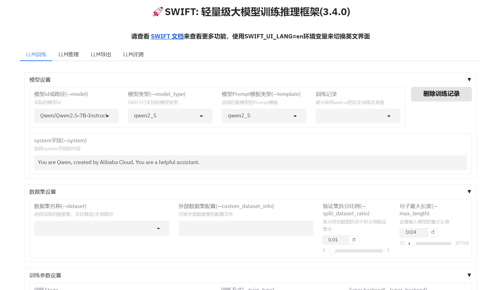

# 118.Swift模型训练框架快速入门

# <font style="color:rgb(31, 35, 40);">示例代码</font>

[swift-quick.zip](https://www.yuque.com/attachments/yuque/0/2025/zip/2424104/1747713193736-718354d7-a1eb-4049-add5-cf2adac5991e.zip)

# <font style="color:rgb(31, 35, 40);">前言</font>

<font style="color:rgb(31, 35, 40);">ms-swift是魔搭社区提供的大模型与多模态大模型训练部署框架，现已支持450+大模型与150+多模态大模型的训练（预训练、微调、人类对齐）、推理、评测、量化与部署。模型开发者可以在ms-swift框架中一站式完成围绕大模型的各类需求。目前ms-swift的主要能力包含：</font>

* <font style="color:rgb(31, 35, 40);">🍎</font><font style="color:rgb(31, 35, 40);"> 模型类型：支持450+纯文本大模型、150+多模态大模型以及All-to-All全模态模型、序列分类模型、Embedding模型训练到部署全流程。</font>
* <font style="color:rgb(31, 35, 40);">数据集类型：内置150+预训练、微调、人类对齐、多模态等各种类型的数据集，并支持自定义数据集。</font>
* <font style="color:rgb(31, 35, 40);">硬件支持：CPU、RTX系列、T4/V100、A10/A100/H100、Ascend NPU、MPS等。</font>
* <font style="color:rgb(31, 35, 40);">🍊</font><font style="color:rgb(31, 35, 40);"> 轻量训练：支持了LoRA、QLoRA、DoRA、LoRA+、ReFT、RS-LoRA、LLaMAPro、Adapter、GaLore、Q-Galore、LISA、UnSloth、Liger-Kernel等轻量微调方式。</font>
* <font style="color:rgb(31, 35, 40);">分布式训练：支持分布式数据并行（DDP）、device_map简易模型并行、DeepSpeed ZeRO2 ZeRO3、FSDP等分布式训练技术。</font>
* <font style="color:rgb(31, 35, 40);">量化训练：支持对BNB、AWQ、GPTQ、AQLM、HQQ、EETQ量化模型进行训练。</font>
* <font style="color:rgb(31, 35, 40);">RLHF训练：支持纯文本大模型和多模态大模型的DPO、GRPO、RM、PPO、KTO、CPO、SimPO、ORPO等人类对齐训练方法。</font>
* <font style="color:rgb(31, 35, 40);">🍓</font><font style="color:rgb(31, 35, 40);"> 多模态训练：支持对图像、视频和语音不同模态模型进行训练，支持VQA、Caption、OCR、Grounding任务的训练。</font>
* <font style="color:rgb(31, 35, 40);">界面训练：以界面的方式提供训练、推理、评测、量化的能力，完成大模型的全链路。</font>
* <font style="color:rgb(31, 35, 40);">插件化与拓展：支持自定义模型和数据集拓展，支持对loss、metric、trainer、loss-scale、callback、optimizer等组件进行自定义。</font>
* <font style="color:rgb(31, 35, 40);">🍉</font><font style="color:rgb(31, 35, 40);"> 工具箱能力：除了对大模型和多模态大模型的训练支持外，还支持其推理、评测、量化和部署全流程。</font>
* <font style="color:rgb(31, 35, 40);">推理加速：支持PyTorch、vLLM、LmDeploy推理加速引擎，并提供OpenAI接口，为推理、部署和评测模块提供加速。</font>
* <font style="color:rgb(31, 35, 40);">模型评测：以EvalScope作为评测后端，支持100+评测数据集对纯文本和多模态模型进行评测。</font>
* <font style="color:rgb(31, 35, 40);">模型量化：支持AWQ、GPTQ和BNB的量化导出，导出的模型支持使用vLLM/LmDeploy推理加速，并支持继续训练。</font>

## <font style="color:rgb(31, 35, 40);">安装</font>

<font style="color:rgb(31, 35, 40);">ms-swift的安装请参考</font>[安装文档](https://modelscope.cn/docs/llm-training-and-inference/intro/swift-installation)<font style="color:rgb(31, 35, 40);">。</font>

## <font style="color:rgb(31, 35, 40);">使用样例</font>

<font style="color:rgb(31, 35, 40);">10分钟在单卡A10上对Qwen/Qwen2-1.5B进行自我认知微调：</font>

```plain
CUDA_VISIBLE_DEVICES=0 \
swift sft \
    --model Qwen/Qwen2-1.5B \
    --train_type lora \
    --dataset 'AI-ModelScope/alpaca-gpt4-data-zh#30' \
              'AI-ModelScope/alpaca-gpt4-data-en#30' \
              'swift/self-cognition#40' \
    --torch_dtype bfloat16 \
    --num_train_epochs 1 \
    --per_device_train_batch_size 1 \
    --per_device_eval_batch_size 1 \
    --learning_rate 1e-4 \
    --lora_rank 8 \
    --lora_alpha 32 \
    --target_modules all-linear \
    --gradient_accumulation_steps 16 \
    --eval_steps 50 \
    --save_steps 50 \
    --save_total_limit 2 \
    --logging_steps 5 \
    --max_length 2048 \
    --output_dir output \
    --system 'You are a helpful assistant.' \
    --warmup_ratio 0.05 \
    --dataloader_num_workers 4 \
    --model_author swift \
    --model_name swift-robot
```

<font style="color:rgb(31, 35, 40);">小贴士：</font>

* <font style="color:rgb(31, 35, 40);">如果要使用自定义数据集进行训练，你可以参考</font>[这里](https://modelscope.cn/docs/llm-training-and-inference/customization/custom-dataset)<font style="color:rgb(31, 35, 40);">组织数据集格式，并指定</font><code><font style="color:rgb(31, 35, 40);">--dataset <dataset_path></font></code><font style="color:rgb(31, 35, 40);">。</font>
* <code><font style="color:rgb(31, 35, 40);">--model_author</font></code><font style="color:rgb(31, 35, 40);">和</font><code><font style="color:rgb(31, 35, 40);">--model_name</font></code><font style="color:rgb(31, 35, 40);">参数只有当数据集中包含</font><code><font style="color:rgb(31, 35, 40);">swift/self-cognition</font></code><font style="color:rgb(31, 35, 40);">时才生效。</font>
* <font style="color:rgb(31, 35, 40);">如果要使用其他模型进行训练，你只需要修改</font><code><font style="color:rgb(31, 35, 40);">--model <model_id/model_path></font></code><font style="color:rgb(31, 35, 40);">即可。</font>
* <font style="color:rgb(31, 35, 40);">默认使用ModelScope进行模型和数据集的下载。如果要使用HuggingFace，指定</font><code><font style="color:rgb(31, 35, 40);">--use_hf true</font></code><font style="color:rgb(31, 35, 40);">即可。</font>

<font style="color:rgb(31, 35, 40);">训练完成后，使用以下命令对训练后的权重进行推理：</font>

* <font style="color:rgb(31, 35, 40);">这里的</font><code><font style="color:rgb(31, 35, 40);">--adapters</font></code><font style="color:rgb(31, 35, 40);">需要替换成训练生成的last checkpoint文件夹。由于adapters文件夹中包含了训练的参数文件</font><code><font style="color:rgb(31, 35, 40);">args.json</font></code><font style="color:rgb(31, 35, 40);">，因此不需要额外指定</font><code><font style="color:rgb(31, 35, 40);">--model</font></code><font style="color:rgb(31, 35, 40);">，</font><code><font style="color:rgb(31, 35, 40);">--system</font></code><font style="color:rgb(31, 35, 40);">，swift会自动读取这些参数。如果要关闭此行为，可以设置</font><code><font style="color:rgb(31, 35, 40);">--load_args false</font></code><font style="color:rgb(31, 35, 40);">。</font>

```plain
# 使用交互式命令行进行推理
CUDA_VISIBLE_DEVICES=0 \
swift infer \
    --adapters output/vx-xxx/checkpoint-xxx \
    --stream true \
    --temperature 0 \
    --max_new_tokens 2048

# merge-lora并使用vLLM进行推理加速
CUDA_VISIBLE_DEVICES=0 \
swift infer \
    --adapters output/vx-xxx/checkpoint-xxx \
    --stream true \
    --merge_lora true \
    --infer_backend vllm \
    --max_model_len 8192 \
    --temperature 0 \
    --max_new_tokens 2048
```

<font style="color:rgb(31, 35, 40);">最后，使用以下命令将模型推送到ModelScope：</font>

```plain
CUDA_VISIBLE_DEVICES=0 \
swift export \
    --adapters output/vx-xxx/checkpoint-xxx \
    --push_to_hub true \
    --hub_model_id '<your-model-id>' \
    --hub_token '<your-sdk-token>' \
    --use_hf false
```

# SWIFT安装

## Wheel包安装

可以使用pip进行安装：

```plain
pip install 'ms-swift'
# 使用评测
pip install 'ms-swift[eval]' -U
# 全能力
pip install 'ms-swift[all]' -U
```

## 源代码安装

```plain
# pip install git+https://github.com/modelscope/ms-swift.git

# 全能力
# pip install "git+https://github.com/modelscope/ms-swift.git#egg=ms-swift[all]"

git clone https://github.com/modelscope/ms-swift.git
cd ms-swift
pip install -e .

# 全能力
# pip install -e '.[all]'
```

## 旧版本

SWIFT在3.0版本开始进行了不兼容式重构，如果需要使用2.x旧版本，请执行如下命令进行安装：

```plain
pip install ms-swift==2.*
```

## 镜像

```plain
 vllm0.8.3 (该版本vllm可能导致部分GRPO训练卡住，GRPO建议优先使用vllm0.7.3)
modelscope-registry.cn-hangzhou.cr.aliyuncs.com/modelscope-repo/modelscope:ubuntu22.04-cuda12.4.0-py311-torch2.6.0-vllm0.8.3-modelscope1.25.0-swift3.3.0.post1
modelscope-registry.us-west-1.cr.aliyuncs.com/modelscope-repo/modelscope:ubuntu22.04-cuda12.4.0-py311-torch2.6.0-vllm0.8.3-modelscope1.25.0-swift3.3.0.post1

# vllm0.7.3
modelscope-registry.us-west-1.cr.aliyuncs.com/modelscope-repo/modelscope:ubuntu22.04-cuda12.4.0-py311-torch2.5.1-modelscope1.25.0-swift3.2.2
```

更多镜像可以查看[这里](https://modelscope.cn/docs/intro/environment-setup#%E6%9C%80%E6%96%B0%E9%95%9C%E5%83%8F)

## 支持的硬件

| 硬件环境 | 备注 |
| --- | --- |
| A10/A100/H100 |  |
| RTX20/30/40系列 |  |
| T4/V100 | 部分模型出现NAN |
| Ascend NPU | 部分模型出现NAN或算子不支持 |
| MPS |  |
| CPU |  |

## 运行环境

|  | 范围 | 推荐 | 备注 |
| --- | --- | --- | --- |
| python | >=3.9 | 3.10 |  |
| cuda |  | cuda12 | 使用cpu、npu、mps则无需安装 |
| torch | >=2.0 |  |  |
| transformers | >=4.33 | 4.51 |  |
| modelscope | >=1.19 |  |  |
| peft | >=0.11,<0.16 |  |  |
| trl | >=0.13,<0.17 | 0.16 | RLHF |
| deepspeed | >=0.14 | 0.14.5 | 训练 |
| vllm | >=0.5.1 | 0.7.3/0.8.3 | 推理/部署/评测 |
| lmdeploy | >=0.5 | 0.7.2.post1 | 推理/部署/评测 |
| evalscope | >=0.11 |  | 评测 |

更多可选依赖可以参考[这里](https://github.com/modelscope/ms-swift/blob/main/requirements/install_all.sh)。

## Notebook环境

Swift支持训练的绝大多数模型都可以在`A10`显卡上使用，用户可以使用ModelScope官方提供的免费显卡资源：

1. 进入[ModelScope](https://www.modelscope.cn/)官方网站并登录
2. 点击左侧的`我的Notebook`并开启一个免费GPU实例
3. 愉快地薅A10显卡羊毛

# Web-UI

目前SWIFT已经支持了界面化的训练和推理，参数支持和脚本训练相同。在安装SWIFT后，使用如下命令：

```plain
swift web-ui --lang zh
# or en
swift web-ui --lang en
```

开启界面训练和推理。



SWIFT web-ui是命令行的高级封装，即，在界面上启动的训练、部署等任务，会在系统中以命令行启动一个独立的进程，伪代码类似：

```plain
import os
os.system('swift sft --model xxx --dataset xxx')
```

这给web-ui带来了几个特性：

1. web-ui的每个超参数描述都带有`--xxx`的标记，这与[命令行参数](https://modelscope.cn/docs/llm-training-and-inference/user-guide/command-line-parameters)的内容是一致的
2. web-ui可以在一台多卡机器上并行启动多个训练/部署任务
3. web-ui服务关闭后，后台服务是仍旧运行的，这防止了web-ui被关掉后影响训练进程，如果需要关闭后台服务，只需要**选择对应的任务**后在界面上的`运行时`tab点击杀死服务
4. 重新启动web-ui后，如果需要显示正在运行的服务，在`运行时`tab点击`找回运行时任务`即可
5. 训练界面支持显示运行日志，请在选择某个任务后手动点击`展示运行状态`，在训练时运行状态支持展示训练图表，图标包括训练loss、训练acc、学习率等基本指标，在人类对齐任务重界面图标为margin、logps等关键指标
6. web-ui的训练不支持PPO，该过程比较复杂，建议使用examples的直接运行

如果需要使用share模式，请添加`--share true`参数。注意：请不要在dsw、notebook等环境中使用该参数。

目前ms-swift额外支持了界面推理模式（即Space部署）：

```plain
swift app --model '<model>' --studio_title My-Awesome-Space --stream true
# 或者
swift app --model '<model>' --adapters '<adapter>' --stream true
```

即可启动一个只有推理页面的应用，该应用会在启动时对模型进行部署并提供后续使用。

**<font style="color:rgb(39, 37, 76);">命令行参数</font>**

# 命令行参数

命令行参数的介绍会分为基本参数，原子参数、集成参数和特定模型参数。命令行最终使用的参数列表为集成参数。集成参数继承自基本参数和一些原子参数。特定模型参数是针对于具体模型的参数，可以通过`--model_kwargs'`或者环境变量进行设置。Megatron-SWIFT命令行参数介绍可以在[Megatron-SWIFT训练文档](https://modelscope.cn/docs/llm-training-and-inference/user-guide/megatron-swift)中找到。

参数文档：<https://modelscope.cn/docs/llm-training-and-inference/user-guide/command-line-parameters>

提示：

* 命令行传入list使用空格隔开即可。例如：`--dataset <dataset_path1> <dataset_path2>`。
* 命令行传入dict使用json。例如：`--model_kwargs '{"fps_max_frames": 12}'`
* 带🔥的参数为重要参数，刚熟悉ms-swift的用户可以先关注这些命令行参数

## 基本参数

* 🔥tuner_backend: 可选为'peft'，'unsloth'。默认为'peft'
* 🔥train_type: 可选为: 'lora'、'full'、'longlora'、'adalora'、'llamapro'、'adapter'、'vera'、'boft'、'fourierft'、'reft'。默认为'lora'
* 🔥adapters: 用于指定adapter的id/path的list，默认为`[]`
* external_plugins: 外部plugin py文件列表，这些文件会被注册进plugin模块中，例子请参见[这里](https://github.com/modelscope/ms-swift/tree/main/examples/train/grpo/run_external_rm.sh)
* seed: 默认为42
* model_kwargs: 特定模型可传入的额外参数，该参数列表会在训练推理时打印日志进行提示。例如`--model_kwargs '{"fps_max_frames": 12}'`
* load_args: 当指定`--resume_from_checkpoint`、`--model`、`--adapters`会读取保存文件中的`args.json`，将默认为None的`基本参数`（除去数据参数和生成参数）进行赋值（可通过手动传入进行覆盖）。推理和导出时默认为True，训练时默认为False
* load_data_args: 如果将该参数设置为True，则会额外读取`args.json`中的数据参数。默认为False
* use_hf: 控制模型下载、数据集下载、模型推送使用ModelScope还是HuggingFace。默认为False，使用ModelScope
* hub_token: hub token. modelscope的hub token可以查看[这里](https://modelscope.cn/my/myaccesstoken)
* custom_register_path: 自定义模型、对话模板和数据集注册的`.py`文件路径的list。默认为`[]`

### 模型参数

* 🔥model: 模型id或模型本地路径。如果是自定义模型请配合`model_type`和`template`使用，具体可以参考[自定义模型](https://modelscope.cn/docs/llm-training-and-inference/customization/custom-model)
* model_type: 模型类型。相同的模型架构、template、模型加载过程被定义为一个model_type。默认为None，根据`--model`的后缀和config.json中的architectures属性进行自动选择
* model_revision: 模型版本，默认为None
* task_type: 默认为'causal_lm'。可选为'causal_lm'、'seq_cls'、'embedding'。seq_cls的例子可以查看[这里](https://github.com/modelscope/ms-swift/tree/main/examples/train/seq_cls)，embedding的例子查看[这里](https://github.com/modelscope/ms-swift/tree/main/examples/train/embedding)
* 🔥torch_dtype: 模型权重的数据类型，支持`float16`,`bfloat16`,`float32`。默认为None，从config.json文件中读取
* attn_impl: attention类型，可选项为`flash_attn`, `sdpa`, `eager`。默认使用sdpa，若不支持则使用eager。
  * 注意：这三种实现并不一定都支持，这取决于对应模型的支持情况。
* num_labels: 分类模型（即`--task_type seq_cls`）需要指定该参数。代表标签数量，默认为None
* problem_type: 分类模型（即`--task_type seq_cls`）需要指定该参数。可选为'regression', 'single_label_classification', 'multi_label_classification'。默认为None，根据num_labels和数据集类型进行自动设置
* rope_scaling: rope类型，支持`linear`和`dynamic`，请配合`max_length`共同使用。默认为None
* device_map: 模型使用的device_map配置，例如：'auto'、'cpu'、json字符串、json文件路径。默认为None，根据设备和分布式训练情况自动设置
* max_memory: device_map设置为'auto'或者'sequential'时，会根据max_memory进行模型权重的device分配，例如：`--max_memory '{0: "20GB", 1: "20GB"}'`。默认为None
* local_repo_path: 部分模型在加载时依赖于github repo。为了避免`git clone`时遇到网络问题，可以直接使用本地repo。该参数需要传入本地repo的路径, 默认为`None`

### 数据参数

* 🔥dataset: 数据集id或路径的list。默认为`[]`。每个数据集的传入格式为：`数据集id or 数据集路径:子数据集采样数量`，其中子数据集和取样数据可选。本地数据集支持jsonl、csv、json、文件夹等。开源数据集可以通过git clone到本地并将文件夹传入而离线使用。自定义数据集格式可以参考[自定义数据集](https://modelscope.cn/docs/llm-training-and-inference/customization/custom-dataset)。你可以传入`--dataset <dataset1> <dataset2>`来使用多个数据集。
  * 子数据集: 该参数只有当dataset为ID或者文件夹时生效。若注册时指定了subsets，且只有一个子数据集，则默认选择注册时指定的子数据集，否则默认为'default'。你可以使用`/`来选择多个子数据集，例如：`<dataset_id>:subset1/subset2`。你也可以使用'all'来选择所有的子数据集，例如：`<dataset_id>:all`。
  * 采样数量: 默认使用完整的数据集。若采样数少于数据样本总数，则进行随机选择（不重复采样）。若采样数高于数据样本总数，则只额外随机采样`采样数%数据样本总数`的样本，数据样本重复采样`采样数//数据样本总数`次。注意：流式数据集只进行顺序采样。若设置`--dataset_shuffle false`，则非流式数据集也进行顺序采样。
* 🔥val_dataset: 验证集id或路径的list。默认为`[]`
* 🔥split_dataset_ratio: 不指定val_dataset时如何拆分训练集和验证集，默认为0.01。若不需要切分验证集，设置为0即可
* data_seed: 数据集随机种子，默认为42
* 🔥dataset_num_proc: 数据集预处理的进程数，默认为1
* dataset_shuffle: 是否对dataset进行随机操作。默认为True。
  * 注意：CPT/SFT的随机包括两个部分：数据集的随机，由`dataset_shuffle`控制；train_dataloader中的随机，由`train_dataloader_shuffle`控制。
* val_dataset_shuffle: 是否对val_dataset进行随机操作。默认为False。
* 🔥streaming: 流式读取并处理数据集，默认False。通常在处理大型数据集时，设置为True
* interleave_prob: 默认值为 None。在组合多个数据集时，默认使用 `concatenate_datasets` 函数；如果设置了该参数，则会使用 `interleave_datasets` 函数。该参数通常用于流式数据集的组合，并会作为参数传入 `interleave_datasets` 函数中
* stopping_strategy: 可选为"first_exhausted", "all_exhausted"，默认为"first_exhausted"。传入interleave_datasets函数中
* shuffle_buffer_size: 该参数用于指定流式数据集的随机buffer大小，默认为1000
* enable_cache: 数据集预处理使用cache，默认False
* download_mode: 数据集下载模式，包含`reuse_dataset_if_exists`和`force_redownload`，默认为reuse_dataset_if_exists
* columns: 用于对数据集进行列映射，使数据集满足AutoPreprocessor可以处理的样式，具体查看[这里](https://modelscope.cn/docs/llm-training-and-inference/customization/custom-dataset)。你可以传入json字符串，例如：`'{"text1": "query", "text2": "response"}'`，默认为None。
* strict: 如果为True，则数据集只要某行有问题直接抛错，否则会丢弃出错数据样本。默认False
* remove_unused_columns: 是否删除数据集中不被使用的列，默认为True
* 🔥model_name: 仅用于自我认知任务，只对`swift/self-cognition`数据集生效，替换掉数据集中的`{{NAME}}`通配符。传入模型中文名和英文名，以空格分隔，例如：`--model_name 小黄 'Xiao Huang'`。默认为None
* 🔥model_author: 仅用于自我认知任务，只对`swift/self-cognition`数据集生效，替换掉数据集中的`{{AUTHOR}}`通配符。传入模型作者的中文名和英文名，以空格分隔，例如：`--model_author '魔搭' 'ModelScope'`。默认为None
* custom_dataset_info: 自定义数据集注册的json文件路径，参考[自定义数据集](https://modelscope.cn/docs/llm-training-and-inference/customization/custom-dataset)。默认为`[]`

### 模板参数

* 🔥template: 对话模板类型。默认为None，自动选择对应model的template类型
* 🔥system: 自定义system字段，可以传入字符串或者txt文件路径。默认为None，使用template的默认system
  * 注意：数据集中的system优先级最高，然后是`--system`，最后是定义在template中的`default_system`。
* 🔥max_length: 单样本的tokens最大长度。默认为None，设置为模型支持的tokens最大长度(max_model_len)
  * 注意：PPO、GRPO和推理情况下，max_length代表max_prompt_length
* truncation_strategy: 如果单样本的tokens超过`max_length`如何处理，支持`delete`, `left`和`right`，代表删除、左侧裁剪和右侧裁剪，默认为'delete'
* 🔥max_pixels: 多模态模型输入图片的最大像素数（H\*W），将超过该限制的图像进行缩放。默认为None，不限制最大像素数
* tools_prompt: 智能体训练时的工具列表转为system的格式，请参考[智能体训练](https://modelscope.cn/docs/llm-training-and-inference/user-guide/agent-support)。可选为'react_en'、'react_zh'、'glm4'、'toolbench'、'qwen'，默认为'react_en'
* norm_bbox: 控制如何对bbox进行缩放。可选项为'norm1000', 'none'。其中'norm1000'代表对bbox进行千分位坐标缩放，'none'代表不缩放。默认为None，根据模型进行自动选择
* response_prefix: response的前缀字符，例如QwQ-32B将response_prefix设置为`'<think>\n'`。默认为None，根据模型自动设置
* padding_side: 当训练`batch_size>=2`时的padding_side，可选值为'left'、'right'，默认为'right'。（推理时的batch_size>=2时，只进行左padding）
* loss_scale: 训练tokens的loss权重设置。默认为`'default'`，代表所有response（含history）以1计算交叉熵损失。可选值为'default'、'last_round'、'all'，以及agent需要的loss_scale: 'react'、'agentflan'、'alpha_umi'和'qwen'。其中'last_round'代表只计算最后一轮response的损失，'all'代表计算所有tokens的损失。agent部分可以查看[插件化](https://modelscope.cn/docs/llm-training-and-inference/customization/plugins)和[智能体训练](https://modelscope.cn/docs/llm-training-and-inference/user-guide/agent-support)
* use_chat_template: 使用chat模板或generation模板，默认为`True`。`swift pt`会自动设置为generation模板
* template_backend: 选择template后端，可选为'swift'、'jinja'，默认为'swift'。如果使用jinja，则使用transformers的`apply_chat_template`。
  * 注意：jinja的template后端只支持推理，不支持训练。

### 生成参数

参考[generation_config](https://huggingface.co/docs/transformers/main_classes/text_generation#transformers.GenerationConfig)文档

* 🔥max_new_tokens: 推理最大生成新tokens的数量。默认为None，无限制
* temperature: 温度参数。默认为None，读取generation_config.json。
  * 注意：do_sample参数在本版本中移除了，请将temperature配置为0来达到相同效果
* top_k: top_k参数，默认为None。读取generation_config.json
* top_p: top_p参数，默认为None。读取generation_config.json
* repetition_penalty: 重复惩罚项。默认为None，读取generation_config.json
* num_beams: beam search的并行保留数量，默认为1
* 🔥stream: 流式输出，默认为`False`
* stop_words: 除了eos_token外额外的停止词，默认为`[]`。
  * 注意：eos_token会在输出respsone中被删除，额外停止词会在输出中保留
* logprobs: 是否输出logprobs，默认为False
* top_logprobs: 输出top_logprobs的数量，默认为None

### 量化参数

以下为加载模型时量化的参数，具体含义可以查看[量化](https://huggingface.co/docs/transformers/main/en/main_classes/quantization)文档。这里不包含`swift export`中涉及的`gptq`、`awq`量化参数

* 🔥quant_method: 加载模型时采用的量化方法，可选项为`bnb`、`hqq`、`eetq`
* 🔥quant_bits: 量化bits数，默认为None
* hqq_axis: hqq量化axis，默认为None
* bnb_4bit_compute_dtype: bnb量化计算类型，可选为`float16`、`bfloat16`、`float32`。默认为None，设置为`torch_dtype`
* bnb_4bit_quant_type: bnb量化类型，支持`fp4`和`nf4`，默认为`nf4`
* bnb_4bit_use_double_quant: 是否使用双重量化，默认为`True`
* bnb_4bit_quant_storage: bnb量化存储类型，默认为None


> 更新: 2025-05-20 11:53:13  
> 原文: <https://www.yuque.com/aaron-wecc3/dhluml/fule6agwhgavesyr>