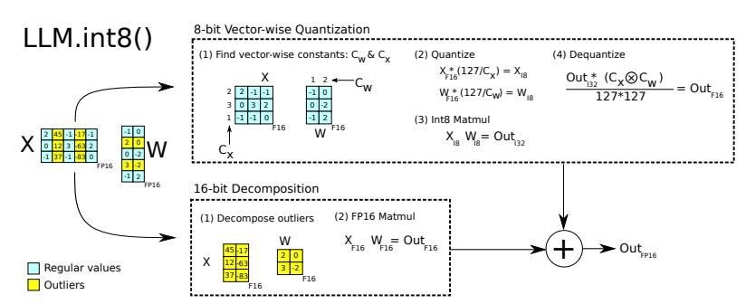
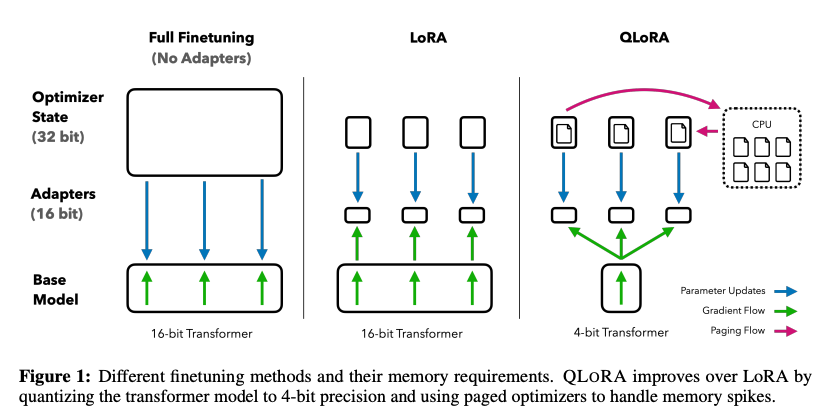
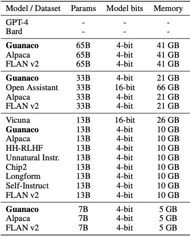
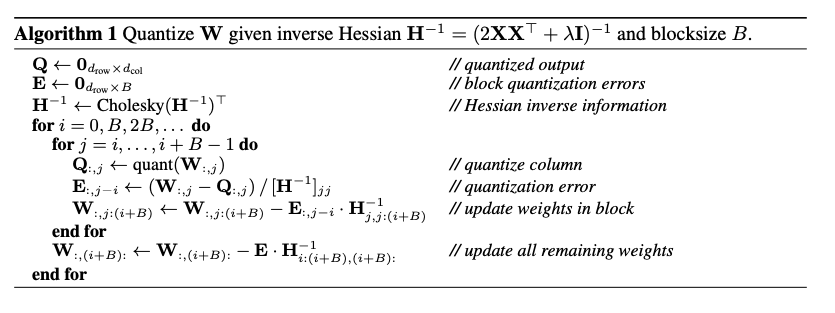
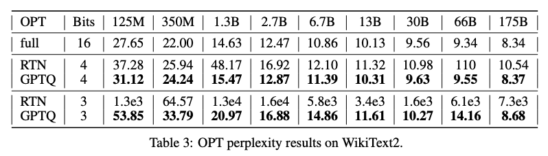
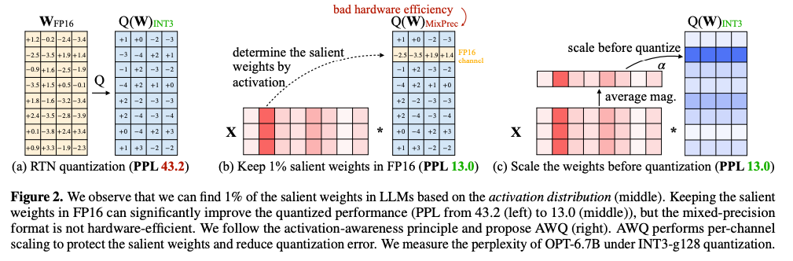
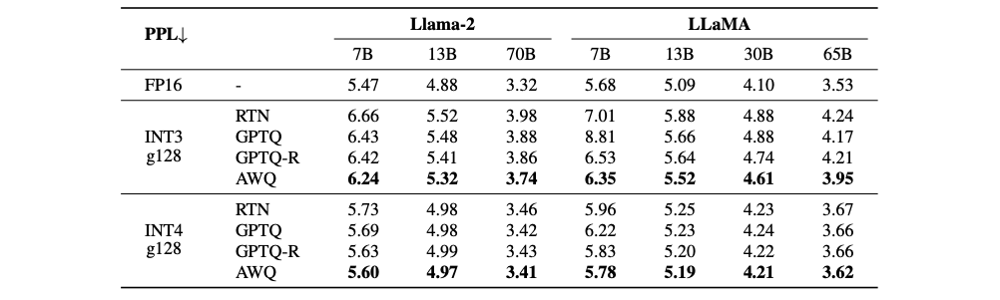

# 119.基于Swift框进行量化训练

## <font style="color:rgb(31, 35, 40);">示例代码</font>
[quantization-train.zip](https://www.yuque.com/attachments/yuque/0/2025/zip/2424104/1747713193668-75252dd0-811c-4ec8-b0bd-71ac86fdf976.zip)

## <font style="color:rgb(31, 35, 40);">量化是什么</font>
<font style="color:rgb(31, 35, 40);">模型的推理过程是一个复杂函数的计算过程，这个计算一般以矩阵乘法为主，也就是涉及到了并行计算。一般来说，单核CPU可以进行的计算种类更多，速度更快，但一般都是单条计算；而显卡能进行的都是基础的并行计算，做矩阵乘法再好不过。如果把所有的矩阵都加载到显卡上，就会导致显卡显存的占用大量增加，尤其是LLM模型大小从7b、14b、34b到几百b不等，占用显存的大小就是惊人的数字，如何在减少运算量和显存占用的条件下，做到推理效果不下降太多呢？在这里需要引入浮点数和定点数的概念。</font>


<font style="color:rgb(31, 35, 40);">双精度浮点数：在PyTorch中用</font>**<font style="color:rgb(31, 35, 40);">torch.float64</font>**<font style="color:rgb(31, 35, 40);">表示，或者在其他语言中也称为double类型，在LLM训练中一般比较少用</font>

<font style="color:rgb(31, 35, 40);">全精度浮点数：在PyTorch中用</font>**<font style="color:rgb(31, 35, 40);">torch.float32</font>**<font style="color:rgb(31, 35, 40);">表示</font>

<font style="color:rgb(31, 35, 40);">低精度浮点数：在PyTorch中用</font>**<font style="color:rgb(31, 35, 40);">torch.bfloat16和torch.float16</font>**<font style="color:rgb(31, 35, 40);">表示。这两个浮点数的差别在上图中可以表示：</font>

1. <font style="color:rgb(31, 35, 40);">bfloat16的小数部分较短，整数部分较长，这会有利于在训练中减少梯度爆炸的情况（即梯度累加值超过了最大值），但是这种数据类型是在N系列显卡Ampere系列才支持的，即</font>**<font style="color:rgb(31, 35, 40);">30系列</font>**<font style="color:rgb(31, 35, 40);">显卡。</font>
2. <font style="color:rgb(31, 35, 40);">float16的小数部分较长，这意味着在精度控制上float16更好，但整数部分较短，比较容易梯度爆炸。</font>

<font style="color:rgb(31, 35, 40);">那么是否有更加减少显存占用和计算量的数值表达方式呢？那么可以考虑是否把浮点数转换为定点数（整数），整数计算更快更省显存，如果计算精度下降不大就很完美了。这种用整数计算代替浮点数计算的方法就是</font>**<font style="color:rgb(31, 35, 40);">量化</font>**<font style="color:rgb(31, 35, 40);">。</font>

<font style="color:rgb(31, 35, 40);">量化的基本原理是</font>**<font style="color:rgb(31, 35, 40);">根据每个tensor的浮点型最大值和最小值，将其映射为一个固定范围的整形数值集合</font>**<font style="color:rgb(31, 35, 40);">，比如[-127~127]。假设一个简单的公式：qweight=round(weight/scale)，其中qweight代表量化后权重，weight代表量化前权重，scale代表缩放因子，可以看到在进行缩放后为了将浮点型转换为整数过程中增加了round操作丢失了小数部分。在后续计算或反量化为浮点型时存在无法完全还原的情况，这就是精度损失。</font>

<font style="color:rgb(31, 35, 40);">按照量化发生的步骤区分，可以划分为</font>**<font style="color:rgb(31, 35, 40);">PTQ（训练后量化，或离线量化）和QAT（训练感知型量化，或在线量化）</font>**<font style="color:rgb(31, 35, 40);">。PTQ量化可以分为data-free和calibration两种，前者不使用数据集进行校准直接计算量化因子，后者会根据少量真实数据进行统计分析并对量化因子进行额外校准，但耗费的时间更长。QAT量化会先在待量化的算子上增加一个伪量化结构，并在训练时模拟量化过程并实时更新计算量化因子（类似反向传播过程）及原始权重。QAT由于较为复杂一般作为辅助措施存在，用于改进PTQ量化的技术手段。</font>

<font style="color:rgb(31, 35, 40);">按照量化方法可以划分为</font>**<font style="color:rgb(31, 35, 40);">线性量化、非线性量化（如对数量化）等多种方式，目前较为常用的是线性量化。其中线性量化又可以按照对称性划分为对称量化和非对称量化</font>**<font style="color:rgb(31, 35, 40);">，非对称量化为了解决weight分布不均匀问题，其在公式中增加了zero_point项：qweight=round(weight/scale + zero_point)，使稠密数据部分可以得到更宽泛的数值范围。</font>


<font style="color:rgb(31, 35, 40);">按照量化粒度划分可以分为**逐层量化（每层使用一套量化因子）、逐组量化（在每层中按照group使用一套量化因子）、逐通道量化（按channel划分量化因子）**等几种方式。</font>

<font style="color:rgb(31, 35, 40);">按照量化最大值的阈值区分，可以分为</font>**<font style="color:rgb(31, 35, 40);">饱和量化和不饱和量化</font>**<font style="color:rgb(31, 35, 40);">两种。不饱和量化按照浮点数最大值和量化后最大值的比例计算量化因子，由于原始weight的非均匀性会导致某些整形数值范围存在权重空缺。饱和量化会计算一个中间值以计算出量化因子，因此会舍弃一部分不重要数据，将重要数据尽量均匀的分布到量化数值范围内。</font>

<font style="color:rgb(31, 35, 40);">按照量化后的比特数划分，可以分为2比特量化，4比特量化，8比特量化等类型。</font>

<font style="color:rgb(31, 35, 40);">一般来说，PyTorch中量化模块的forward过程会先对量化权重进行反量化后使用浮点数进行计算。</font>

<font style="color:rgb(31, 35, 40);">下面介绍几种常用的量化库。</font>

## <font style="color:rgb(51, 51, 51);">量化库</font>
### [**<font style="color:rgb(65, 131, 196);">BnB 量化</font>**](https://zhida.zhihu.com/search?content_id=243299682&content_type=Article&match_order=1&q=BnB%E9%87%8F%E5%8C%96&zhida_source=entity)
<font style="color:rgb(51, 51, 51);">BnB 全称是 BitsAndBytes，是几乎最早集成到 transformers 框架中的量化算法。</font>

<font style="color:rgb(51, 51, 51);">BitsandBytes 是一个将模型量化为 8 位或 4 位的量化库。由于其方便性和有效性，它是最常见的量化库。</font>

<font style="color:rgb(51, 51, 51);">BitsandBytes 的 8 位量化基于 LLM.int8() 论文。为了减轻量化误差，它将模型权重的敏感异常值保留在 FP16 中，将其他异常值保留在 INT8 中，然后分别进行矩阵乘法。最后，将它们相加以返回 FP16 格式。下图显示了此过程。</font>



<font style="color:rgb(51, 51, 51);">该技术可应用于高达 170B 规模的模型，但运行 170B 模型仍需要 8 x 24GB VRAM，运行 66B 模型则需要 4 x 24GB VRAM。在消费级 GPU 上运行大型模型仍然不够。</font>

<font style="color:rgb(51, 51, 51);">因此，开发了 4 位量化来解决这个问题。Bitsandbytes 的 4 位量化通常与 QLoRA 一起使用，以微调量化后的 LLM。直观地说，QLoRA 以 4 位量化目标模型，使其冻结，然后使用 LoRA 对冻结的 4 位模型进行微调。以下是完全微调、LoRA 和 QLoRA 之间的比较。</font>



<font style="color:rgb(51, 51, 51);">从技术上讲，QLoRA 主要利用了以下特性。</font>

+ <font style="color:rgb(51, 51, 51);">4 位 NormalFloat 量化</font>

<font style="color:rgb(51, 51, 51);">该技术利用了预训练的神经网络权重具有正态分布的事实，并引入了称为 4 位 NormalFloat 类型的新数据类型，这确保了每个量化箱中的预期值数量相等。</font>

+ <font style="color:rgb(51, 51, 51);">分页优化器</font>

<font style="color:rgb(51, 51, 51);">QLoRA 应用分页优化器来避免 GPU 内存突然激增。分页优化器使用 NVIDIA 统一内存功能自动在 CPU 和 GPU 之间切换页面到页面的传输（在这种情况下，你可以想象 GPU 页面类似于内存中的 CPU 页面）。</font>

+ <font style="color:rgb(51, 51, 51);">双重量化</font>

<font style="color:rgb(51, 51, 51);">当你将量化应用于模型权重时，你需要与模型权重具有相同数据类型的量化常数。由于 LLM 中有许多参数，量化常数也会给内存空间带来负担。为了最大限度地减少每个参数的内存占用，作者对量化常数进行了量化。</font>

<font style="color:rgb(51, 51, 51);">下表显示了参数大小与 GPU VRAM 消耗的关系。</font>



<font style="color:rgb(51, 51, 51);">请注意，内存列显示模型的内存需求，因此它不包含微调部分。虽然这取决于数据集或超参数设置，但我们可以使用消费级 24GB VRAM 机器微调多达 13B 参数模型。</font>

<font style="color:rgb(51, 51, 51);">当零样本 LLM 精度不足以完成我们的目标任务时，我们应该使用 QLoRA。对于现实世界的 AI 项目，我们经常使用这种技术，因为基础模型通常不适用于特定的现场数据。</font>

<font style="color:rgb(51, 51, 51);"></font>

### **<font style="color:rgb(51, 51, 51);">GPTQ 量化</font>**
**<font style="color:rgb(51, 51, 51);">GPTQ（Group-wise Precision Tuning Quantization，分组精确调整量化）</font>**<font style="color:rgb(51, 51, 51);">是2022 年提出的</font>**<font style="color:rgb(51, 51, 51);">早期成功的量化算法之一。当时，该技术首次成功地将 </font>**<font style="color:rgb(51, 51, 51);">BLOOM 或 OPT-175B 等 175B 规模的大模型量化为 4-bit**。</font>

<font style="color:rgb(51, 51, 51);">GPTQ 采用</font>**<font style="color:rgb(51, 51, 51);">逐行量化（per-row quantization）</font>**<font style="color:rgb(51, 51, 51);">，即</font>**<font style="color:rgb(51, 51, 51);">独立地量化权重矩阵的每一行</font>**<font style="color:rgb(51, 51, 51);">，以找到</font>**<font style="color:rgb(51, 51, 51);">最优的量化权重</font>**<font style="color:rgb(51, 51, 51);">，从而</font>**<font style="color:rgb(51, 51, 51);">最小化量化误差</font>**<font style="color:rgb(51, 51, 51);">。</font>

<font style="color:rgb(51, 51, 51);">为了实现</font>**<font style="color:rgb(51, 51, 51);">高精度量化</font>**<font style="color:rgb(51, 51, 51);">，GPTQ </font>**<font style="color:rgb(51, 51, 51);">利用 Hessian 矩阵</font>**<font style="color:rgb(51, 51, 51);">计算剩余权重的最优更新，从而</font>**<font style="color:rgb(51, 51, 51);">减少量化带来的信息损失</font>**<font style="color:rgb(51, 51, 51);">。需要注意的是，GPTQ </font>**<font style="color:rgb(51, 51, 51);">保留嵌入层（embedding layer）和输出层（output layer）为 FP16 以维持模型精度</font>**<font style="color:rgb(51, 51, 51);">。</font>

<font style="color:rgb(51, 51, 51);"></font>

<font style="color:rgb(51, 51, 51);">下面的伪代码描述了 GPTQ 算法的工作原理：</font>



<font style="color:rgb(51, 51, 51);">根据论文，使用单个 A100 GPU（80GB VRAM）大约需要四个小时就可以量化 175B 参数模型。OPT-175B 的量化结果如下表所示。</font>



<font style="color:rgb(51, 51, 51);">困惑度（perplexity）衡量模型预测句子中下一个单词的能力。因此，困惑度值降低，这意味着模型对其预测更有信心。在上表中，与 16 位精度相比，通过 GPTQ 量化的模型将困惑度值的增加保持在尽可能小的水平。</font>


### **<font style="color:rgb(51, 51, 51);">AWQ 量化</font>**
<font style="color:rgb(51, 51, 51);">AWQ（Activation-aware Weight Quantization，激活感知权重量化）最近是最流行的量化算法之一。该算法侧重于对 LLM 性能非常重要的显著权重。作者的研究表明，LLM 的权重比例很小（0.1~1%），对量化误差有显著影响。他们利用激活幅度来找到这一小部分权重，并应用每通道缩放来减轻显著权重的量化误差。此过程的说明如下图 </font><font style="color:rgb(51, 51, 51);">©</font><font style="color:rgb(51, 51, 51);"> 所示。</font>



<font style="color:rgb(51, 51, 51);">下表展示了 Llama-2 和 LLaMA 模型的 AWQ 结果。从中可以看出，AWQ 可以获得比舍入到最近 (RTN) 量化和 GPTQ 更好的困惑度。</font>



<font style="color:rgb(51, 51, 51);">请注意，根据论文，对于某些模型（例如 Mistral 模型和指令调整模型），AWQ 有时不如 GPTQ。当我们量化 LLM 时，我们应该比较这些算法的结果并选择最佳算法。</font>


### **<font style="color:rgb(51, 51, 51);">HQQ 量化</font>**
<font style="color:rgb(51, 51, 51);">blog：</font>[<font style="color:rgb(65, 131, 196);">https://mobiusml.github.io/hqq_blog/</font>](https://link.zhihu.com/?target=https%3A//mobiusml.github.io/hqq_blog/%3Fspm%3Da2c6h.13046898.publish-article.18.65286ffaa2V6mQ)

<font style="color:rgb(51, 51, 51);">HQQ 是由 Mobius Labs 开发的一种快速且精确的模型量化器，它不需要校准数据即可量化大型模型。HQQ 的核心优势在于其速度和兼容性，支持 8、4、3、2、1 比特量化。作为一种动态的后训练量化方法，HQQ 无需校准阶段，但能够取得与需要校准数据集的方法相当的准确度，并且有着极快的推理速度。HQQ 通过快速鲁棒优化实现了动态量化，它不需要校准数据，可用于量化任何模型。</font>

HQQ 的设计灵感来源于对传统量化方法的深入研究和优化。传统的量化方法通常依赖于校准数据集来调整模型参数，以确保量化的精度与原始模型尽可能接近。然而，这种依赖校准数据的方式不仅增加了复杂性，还限制了模型在实际应用中的灵活性和适应性。HQQ 通过引入一种全新的动态量化机制，彻底摆脱了对校准数据的依赖，同时保持了高精度和高效的推理能力。

**<font style="color:rgb(51, 51, 51);">HQQ 的技术亮点</font>**

1. **快速鲁棒优化**<font style="color:rgb(51, 51, 51);">  
</font><font style="color:rgb(51, 51, 51);">HQQ 的核心在于其快速鲁棒优化算法。该算法能够在量化过程中自动调整模型权重的分布，确保即使在极低比特数（如 1 比特或 2 比特）下，模型的表现仍然稳定且可靠。这一特性使得 HQQ 在资源受限的环境中（如边缘设备或嵌入式系统）具有显著优势。</font>
2. **无需校准数据**<font style="color:rgb(51, 51, 51);">  
</font><font style="color:rgb(51, 51, 51);">校准数据的获取往往需要额外的时间和资源，尤其是在大规模分布式系统中。HQQ 通过动态分析模型权重和激活值的分布特征，在量化过程中实时调整量化参数，从而消除了对校准数据的需求。这不仅简化了量化流程，还提高了模型部署的效率。</font>
3. **广泛的兼容性**<font style="color:rgb(51, 51, 51);">  
</font><font style="color:rgb(51, 51, 51);">HQQ 支持多种主流深度学习框架（如 PyTorch 和 TensorFlow），并能够无缝集成到现有的模型开发和部署流程中。无论是卷积神经网络（CNN）、Transformer 还是其他复杂的架构，HQQ 都能提供一致的高性能表现。</font>
4. **多比特量化支持**<font style="color:rgb(51, 51, 51);">  
</font><font style="color:rgb(51, 51, 51);">HQQ 提供了从 8 比特到 1 比特的多种量化选项，用户可以根据具体应用场景的需求选择合适的量化级别。例如，在对计算资源要求较高的场景中，可以选择更低的比特数以进一步降低内存占用和计算成本；而在对精度要求较高的任务中，则可以选择更高的比特数以保留更多的信息。</font>
5. **极快的推理速度**<font style="color:rgb(51, 51, 51);">  
</font><font style="color:rgb(51, 51, 51);">通过减少模型权重的存储需求和计算操作的数量，HQQ 显著提升了推理速度。实验表明，使用 HQQ 量化后的模型在 GPU 和 CPU 上的推理性能均优于传统量化方法，尤其在低比特量化的情况下，性能提升更为明显。</font>

## **<font style="color:rgb(51, 51, 51);">总结</font>**
<font style="color:rgb(51, 51, 51);">前提：量化是把模型的浮点型参数转换为整形（至少是更低的 bit 数）的过程，减少显存占用。</font>

1. **<font style="color:rgb(51, 51, 51);">BnB</font>**<font style="color:rgb(51, 51, 51);">  
</font>**<font style="color:rgb(51, 51, 51);">概述</font>**<font style="color:rgb(51, 51, 51);">: bitsandbytes 是一个高效的量化库，支持8-bit量化，适用于大规模模型。  
</font>**<font style="color:rgb(51, 51, 51);">特点</font>**<font style="color:rgb(51, 51, 51);">:  
</font><font style="color:rgb(51, 51, 51);">8-bit量化: 将模型权重和激活值量化为8-bit整数，减少内存占用和计算量。  
</font><font style="color:rgb(51, 51, 51);">高效实现: 优化了CUDA内核，提升计算效率。  
</font><font style="color:rgb(51, 51, 51);">易用性: 提供简单API，便于集成到现有训练和推理流程。  
</font>**<font style="color:rgb(51, 51, 51);">应用场景: </font>**<font style="color:rgb(51, 51, 51);">适用于需要压缩和加速大规模模型的场景。</font>
2. **<font style="color:rgb(51, 51, 51);">HQQ</font>**<font style="color:rgb(51, 51, 51);"> (Half-Quadratic Quantization)  
</font>**<font style="color:rgb(51, 51, 51);">概述</font>**<font style="color:rgb(51, 51, 51);">: HQQ 是一种半二次量化方法，通过二次函数逼近量化误差，提升量化精度。  
</font>**<font style="color:rgb(51, 51, 51);">特点</font>**<font style="color:rgb(51, 51, 51);">:  
</font><font style="color:rgb(51, 51, 51);">半二次量化: 使用二次函数优化量化误差，相比线性量化更精确。  
</font><font style="color:rgb(51, 51, 51);">高精度: 在低比特量化下仍保持较高模型精度。  
</font><font style="color:rgb(51, 51, 51);">灵活性: 支持不同比特宽度，适应多种需求。  
</font>**<font style="color:rgb(51, 51, 51);">应用场景</font>**<font style="color:rgb(51, 51, 51);">: 适用于对精度要求较高的低比特量化场景</font>
3. **GPTQ** (Generative Pre-trained Transformer Quantization)

**概述**: GPTQ 是一种针对大规模生成式预训练模型的量化方法，专注于通过量化技术减少模型大小和推理延迟，同时保持较高的精度。它特别适用于Transformer架构的模型，如GPT系列。  
**特点**:  

    - **先进的权重量化**: 使用逐层量化策略，对权重进行非均匀量化，优化内存使用和计算效率。 
    - **精度保持**: 在低比特量化（如4-bit或更低）下，仍能显著保留模型性能，接近全精度（FP16/FP32）的表现。  
    - **高效实现**: 针对Transformer架构进行了专门优化，支持硬件加速，提升推理速度。  
    - **灵活性**: 支持多种量化配置，可根据需求调整比特宽度和量化粒度。  
**应用场景**:  
    - 适用于需要在资源受限环境下部署大规模生成式模型的场景，如移动端、嵌入式设备或云端服务中的低成本推理任务。  
    - 特别适合需要快速推理的应用，如实时对话系统、文本生成服务等。
4. **AWQ** (Activation-aware Weight Quantization)

**概述**: AWQ 是一种基于激活感知的权重量化方法，通过结合激活值分布优化量化过程，从而在低比特量化下实现更高的精度。  
**特点**:  

    - **激活感知量化**: 充分利用激活值的统计特性，动态调整量化参数，降低量化误差。  
    - **高精度保持**: 在极低比特（如2-bit或3-bit）量化下，仍能显著优于传统量化方法，尤其在复杂任务中表现突出。  
    - **自适应性**: 支持动态调整量化策略，根据模型的不同层和激活分布进行个性化优化。  
    - **高效部署**: 通过优化量化流程，减少推理时的计算开销，同时兼容主流深度学习框架。  
**应用场景**:  
    - 适用于对模型精度要求极高且资源受限的场景，如边缘计算设备上的深度学习推理任务。  
    - 特别适合需要处理复杂、多模态数据的任务，如图像生成、自然语言理解等。

## **<font style="color:rgb(51, 51, 51);">应用</font>**
### <font style="color:rgb(31, 35, 40);">微调训练</font>
<font style="color:rgb(31, 35, 40);">ms-swift使用了分层式的设计思想，用户可以使用命令行界面、Web-UI界面和直接使用Python的方式进行微调。</font>

### <font style="color:rgb(31, 35, 40);">使用CLI</font>
<font style="color:rgb(31, 35, 40);">我们提供了10分钟在单卡3090上对Qwen2.5-7B-Instruct进行自我认知微调的最佳实践，具体参考</font>[这里](https://modelscope.cn/docs/llm-training-and-inference/intro/quickstart)<font style="color:rgb(31, 35, 40);">，这可以帮助您快速了解SWIFT。</font>

<font style="color:rgb(31, 35, 40);">此外，我们给出了一系列脚本帮助您了解SWIFT的训练能力：</font>

+ <font style="color:rgb(31, 35, 40);">量化训练：支持使用GPTQ、AWQ、AQLM、BNB、HQQ、EETQ量化技术的QLoRA训练。微调7B模型只需要9GB显存资源。具体参考</font>[这里](https://github.com/modelscope/ms-swift/tree/main/examples/train/qlora)<font style="color:rgb(31, 35, 40);">。</font>

<font style="color:rgb(31, 35, 40);">小帖士：</font>

+ <font style="color:rgb(31, 35, 40);">在使用</font>`<font style="color:rgb(31, 35, 40);">swift sft</font>`<font style="color:rgb(31, 35, 40);">通过LoRA技术微调base模型为chat模型时，有时需要手动设置模板。通过添加</font>`<font style="color:rgb(31, 35, 40);">--template default</font>`<font style="color:rgb(31, 35, 40);">参数来避免base模型因未见过对话模板中的特殊字符而无法正常停止的情况。具体参考</font>[这里](https://github.com/modelscope/ms-swift/tree/main/examples/train/base_to_chat)<font style="color:rgb(31, 35, 40);">。</font>
+ <font style="color:rgb(31, 35, 40);">如果需要在</font>**<font style="color:rgb(31, 35, 40);">断网</font>**<font style="color:rgb(31, 35, 40);">环境下进行训练，请设置</font>`<font style="color:rgb(31, 35, 40);">--model <model_dir></font>`<font style="color:rgb(31, 35, 40);">和</font>`<font style="color:rgb(31, 35, 40);">--check_model false</font>`<font style="color:rgb(31, 35, 40);">。如果对应的模型需要</font>`<font style="color:rgb(31, 35, 40);">git clone</font>`<font style="color:rgb(31, 35, 40);">github的仓库，例如</font>`<font style="color:rgb(31, 35, 40);">deepseek-ai/Janus-Pro-7B</font>`<font style="color:rgb(31, 35, 40);">，请设置手动下载仓库，并设置</font>`<font style="color:rgb(31, 35, 40);">--local_repo_path <repo_dir></font>`<font style="color:rgb(31, 35, 40);">。具体参数含义请参考</font>[命令行参数文档](https://modelscope.cn/docs/llm-training-and-inference/user-guide/%E5%91%BD%E4%BB%A4%E8%A1%8C%E5%8F%82%E6%95%B0.md)<font style="color:rgb(31, 35, 40);">。</font>
+ <font style="color:rgb(31, 35, 40);">无法对QLoRA训练的模型进行Merge LoRA，因此不建议使用QLoRA进行微调，无法在推理和部署时使用vLLM/LMDeploy进行推理加速。建议使用LoRA/全参数进行微调，合并为完整权重后再使用GPTQ/AWQ/BNB进行</font>[量化](https://github.com/modelscope/ms-swift/tree/main/examples/export/quantize)<font style="color:rgb(31, 35, 40);">。</font>
+ <font style="color:rgb(31, 35, 40);">SWIFT默认在训练时设置</font>`<font style="color:rgb(31, 35, 40);">--gradient_checkpointing true</font>`<font style="color:rgb(31, 35, 40);">来节约显存，这会略微降低训练速度。</font>
+ <font style="color:rgb(31, 35, 40);">若使用DDP进行训练，出现报错：</font>`<font style="color:rgb(31, 35, 40);">RuntimeError: Expected to mark a variable ready only once.</font>`<font style="color:rgb(31, 35, 40);">，请额外设置参数</font>`<font style="color:rgb(31, 35, 40);">--gradient_checkpointing_kwargs '{"use_reentrant": false}'</font>`<font style="color:rgb(31, 35, 40);">或者使用DeepSpeed进行训练。</font>
+ <font style="color:rgb(31, 35, 40);">如果要使用deepspeed，你需要安装deepspeed：</font>`<font style="color:rgb(31, 35, 40);">pip install deepspeed -U</font>`<font style="color:rgb(31, 35, 40);">。使用deepspeed可以节约显存，但会略微降低训练速度。</font>
+ <font style="color:rgb(31, 35, 40);">如果您的机器是A100等高性能显卡，且模型支持flash-attn，推荐你安装</font>[flash-attn](https://github.com/Dao-AILab/flash-attention/releases)<font style="color:rgb(31, 35, 40);">，并设置</font>`<font style="color:rgb(31, 35, 40);">--attn_impl flash_attn</font>`<font style="color:rgb(31, 35, 40);">，这将会加快训练和推理的速度并略微降低显存占用。</font>

### <font style="color:rgb(31, 35, 40);">模型合并</font>
```bash
# Since `output/vx-xxx/checkpoint-xxx` is trained by swift and contains an `args.json` file,
# there is no need to explicitly set `--model`, `--system`, etc., as they will be automatically read.
swift export \
    --adapters output/vx-xxx/checkpoint-xxx \
    --merge_lora true
```


### <font style="color:rgb(31, 35, 40);">模型推理</font>
<font style="color:rgb(31, 35, 40);">使用CLI对LoRA训练的checkpoint进行推理：</font>

```plain
CUDA_VISIBLE_DEVICES=0 \
swift infer \
    --adapters output/vx-xxx/checkpoint-xxx \
    --infer_backend pt \
    --stream true \
    --temperature 0 \
    --max_new_tokens 2048
```

+ <font style="color:rgb(31, 35, 40);">adapters文件夹中包含了训练的参数文件</font>`<font style="color:rgb(31, 35, 40);">args.json</font>`<font style="color:rgb(31, 35, 40);">，因此不需要额外指定</font>`<font style="color:rgb(31, 35, 40);">--model</font>`<font style="color:rgb(31, 35, 40);">，</font>`<font style="color:rgb(31, 35, 40);">--system</font>`<font style="color:rgb(31, 35, 40);">，swift会自动读取这些参数。如果要关闭此行为，可以设置</font>`<font style="color:rgb(31, 35, 40);">--load_args false</font>`<font style="color:rgb(31, 35, 40);">。</font>
+ <font style="color:rgb(31, 35, 40);">如果使用全参数训练，请使用</font>`<font style="color:rgb(31, 35, 40);">--model</font>`<font style="color:rgb(31, 35, 40);">替代</font>`<font style="color:rgb(31, 35, 40);">--adapters</font>`<font style="color:rgb(31, 35, 40);">指定训练的checkpoint目录。更多参考。</font>
+ <font style="color:rgb(31, 35, 40);">你可以使用</font>`<font style="color:rgb(31, 35, 40);">swift app</font>`<font style="color:rgb(31, 35, 40);">替代</font>`<font style="color:rgb(31, 35, 40);">swift infer</font>`<font style="color:rgb(31, 35, 40);">进行界面推理。</font>
+ <font style="color:rgb(31, 35, 40);">你可以选择对LoRA进行merge（额外指定</font>`<font style="color:rgb(31, 35, 40);">--merge_lora true</font>`<font style="color:rgb(31, 35, 40);">），然后指定</font>`<font style="color:rgb(31, 35, 40);">--infer_backend vllm/lmdeploy</font>`<font style="color:rgb(31, 35, 40);">进行推理加速。</font>

<font style="color:rgb(31, 35, 40);">对数据集中的验证集进行批量推理：</font>

```plain
CUDA_VISIBLE_DEVICES=0 \
swift infer \
    --adapters output/vx-xxx/checkpoint-xxx \
    --infer_backend pt \
    --temperature 0 \
    --max_new_tokens 2048 \
    --load_data_args true \
    --max_batch_size 1
```

+ <font style="color:rgb(31, 35, 40);">你可以设置</font>`<font style="color:rgb(31, 35, 40);">--max_batch_size 8</font>`<font style="color:rgb(31, 35, 40);">，从而使用</font>`<font style="color:rgb(31, 35, 40);">--infer_backend pt</font>`<font style="color:rgb(31, 35, 40);">进行批量处理。若使用</font>`<font style="color:rgb(31, 35, 40);">infer_backend vllm/lmdeploy</font>`<font style="color:rgb(31, 35, 40);">则无需指定，会进行自动batch。</font>
+ `<font style="color:rgb(31, 35, 40);">--load_data_args true</font>`<font style="color:rgb(31, 35, 40);">会额外读取训练存储参数文件</font>`<font style="color:rgb(31, 35, 40);">args.json</font>`<font style="color:rgb(31, 35, 40);">中的数据参数。</font>

<font style="color:rgb(31, 35, 40);">若想对额外的测试集进行推理，而不使用训练时的验证集，使用</font>`<font style="color:rgb(31, 35, 40);">--val_dataset <dataset_path></font>`<font style="color:rgb(31, 35, 40);">进行推理：</font>

```plain
CUDA_VISIBLE_DEVICES=0 \
swift infer \
    --adapters output/vx-xxx/checkpoint-xxx \
    --infer_backend pt \
    --temperature 0 \
    --max_new_tokens 2048 \
    --val_dataset <dataset-path> \
    --max_batch_size 1
```

<font style="color:rgb(31, 35, 40);">使用Python对训练后LoRA推理的例子如下：</font>

```plain
import os
os.environ['CUDA_VISIBLE_DEVICES'] = '0'

from swift.llm import (
    PtEngine, RequestConfig, safe_snapshot_download, get_model_tokenizer, get_template, InferRequest
)
from swift.tuners import Swift
# 请调整下面几行
model = 'Qwen/Qwen2.5-7B-Instruct'
lora_checkpoint = safe_snapshot_download('swift/test_lora')  # 修改成checkpoint_dir
template_type = None  # None: 使用对应模型默认的template_type
default_system = "You are a helpful assistant."  # None: 使用对应模型默认的default_system

# 加载模型和对话模板
model, tokenizer = get_model_tokenizer(model)
model = Swift.from_pretrained(model, lora_checkpoint)
template_type = template_type or model.model_meta.template
template = get_template(template_type, tokenizer, default_system=default_system)
engine = PtEngine.from_model_template(model, template, max_batch_size=2)
request_config = RequestConfig(max_tokens=512, temperature=0)

# 这里使用了2个infer_request来展示batch推理
infer_requests = [
    InferRequest(messages=[{'role': 'user', 'content': 'who are you?'}]),
    InferRequest(messages=[{'role': 'user', 'content': '浙江的省会在哪？'},
                           {'role': 'assistant', 'content': '浙江的省会在哪？'},
                           {'role': 'user', 'content': '这里有什么好吃的'},]),
]
resp_list = engine.infer(infer_requests, request_config)
query0 = infer_requests[0].messages[0]['content']
print(f'response0: {resp_list[0].choices[0].message.content}')
print(f'response1: {resp_list[1].choices[0].message.content}')
```

<font style="color:rgb(31, 35, 40);">多模态模型的LoRA推理示例如下：</font>

```plain
import os
os.environ['CUDA_VISIBLE_DEVICES'] = '0'

from swift.llm import (
    PtEngine, RequestConfig, safe_snapshot_download, get_model_tokenizer, get_template, InferRequest
)
from swift.tuners import Swift
# 请调整下面几行
model = 'Qwen/Qwen2.5-VL-7B-Instruct'
lora_checkpoint = safe_snapshot_download('swift/test_grounding')  # 修改成checkpoint_dir
template_type = None  # None: 使用对应模型默认的template_type
default_system = None  # None: 使用对应模型默认的default_system

# 加载模型和对话模板
model, tokenizer = get_model_tokenizer(model)
model = Swift.from_pretrained(model, lora_checkpoint)
template_type = template_type or model.model_meta.template
template = get_template(template_type, tokenizer, default_system=default_system)
engine = PtEngine.from_model_template(model, template, max_batch_size=2)
request_config = RequestConfig(max_tokens=512, temperature=0)

# 这里使用了2个infer_request来展示batch推理
infer_requests = [
    InferRequest(messages=[{'role': 'user', 'content': 'who are you?'}]),
    InferRequest(messages=[{'role': 'user', 'content': '<image>Task: Object Detection'}],
                 images=['http://modelscope-open.oss-cn-hangzhou.aliyuncs.com/images/animal.png']),
]
resp_list = engine.infer(infer_requests, request_config)
query0 = infer_requests[0].messages[0]['content']
print(f'response0: {resp_list[0].choices[0].message.content}')
print(f'response1: {resp_list[1].choices[0].message.content}')
```

<font style="color:rgb(31, 35, 40);">如果使用ms-swift训练的模型，可以通过以下方式获取训练的配置：</font>

```plain
from swift.llm import safe_snapshot_download, BaseArguments

lora_adapters = safe_snapshot_download('swift/test_lora')
args = BaseArguments.from_pretrained(lora_adapters)
print(f'args.model: {args.model}')
print(f'args.model_type: {args.model_type}')
print(f'args.template_type: {args.template}')
print(f'args.default_system: {args.system}')
```

+ <font style="color:rgb(31, 35, 40);">对全参数训练的checkpoint进行推理，将</font>`<font style="color:rgb(31, 35, 40);">model</font>`<font style="color:rgb(31, 35, 40);">设置为checkpoint_dir，并将lora_checkpoint设置为None即可。更多参考。</font>
+ <font style="color:rgb(31, 35, 40);">使用流式推理以及</font>`<font style="color:rgb(31, 35, 40);">VllmEngine</font>`<font style="color:rgb(31, 35, 40);">、</font>`<font style="color:rgb(31, 35, 40);">LmdeployEngine</font>`<font style="color:rgb(31, 35, 40);">进行推理加速，可以参考</font>[大模型](https://github.com/modelscope/ms-swift/blob/main/examples/infer/demo.py)<font style="color:rgb(31, 35, 40);">和</font>[多模态大模型](https://github.com/modelscope/ms-swift/blob/main/examples/infer/demo_mllm.py)<font style="color:rgb(31, 35, 40);">推理示例。</font>
+ <font style="color:rgb(31, 35, 40);">微调后的模型使用huggingface transformers/peft生态推理，可以参考</font>[这里](https://github.com/modelscope/ms-swift/blob/main/examples/infer/demo_hf.py)<font style="color:rgb(31, 35, 40);">。</font>
+ <font style="color:rgb(31, 35, 40);">若训练了多个LoRA，要进行多LoRA切换，可以参考</font>[推理](https://github.com/modelscope/ms-swift/blob/main/examples/infer/demo_lora.py)<font style="color:rgb(31, 35, 40);">、</font>[部署](https://github.com/modelscope/ms-swift/tree/main/examples/deploy/lora)<font style="color:rgb(31, 35, 40);">样例。</font>
+ <font style="color:rgb(31, 35, 40);">对多模态模型进行Grounding任务的画框，可以参考</font>[这里](https://github.com/modelscope/ms-swift/blob/main/examples/infer/demo_grounding.py)<font style="color:rgb(31, 35, 40);">。</font>
+ <font style="color:rgb(31, 35, 40);">对LoRA微调后的Bert进行推理，可以参考</font>[这里](https://github.com/modelscope/ms-swift/blob/main/examples/infer/demo_bert.py)<font style="color:rgb(31, 35, 40);">。</font>
+ <font style="color:rgb(31, 35, 40);"></font>

<font style="color:rgb(51, 51, 51);">除上面介绍的量化方法外，还有很多其他类型的量化方法，比如 AQLM、EETQ、GGUF 等，这么多的量化方式，一个一个了解使用太麻烦了，在不修改训练代码的情况下适配多种量化策略是非常重要的。</font>

<font style="color:rgb(51, 51, 51);">在这里使用了魔搭社区的 </font>[<font style="color:rgb(65, 131, 196);">SWIFT 框架</font>](https://zhida.zhihu.com/search?content_id=243299682&content_type=Article&match_order=1&q=SWIFT%E6%A1%86%E6%9E%B6&zhida_source=entity)<font style="color:rgb(51, 51, 51);">来进行量化训练。该框架在 github 上开源：</font>

[<font style="color:rgb(65, 131, 196);">https://github.com/modelscope/swift</font>](https://link.zhihu.com/?target=https%3A//github.com/modelscope/swift%3Fspm%3Da2c6h.13046898.publish-article.20.65286ffaa2V6mQ)

<font style="color:rgb(51, 51, 51);">或者通过 pip 安装：</font>

```plain
pip install ms-swift

# autoawq和cuda版本有对应关系，请按照`https://github.com/casper-hansen/AutoAWQ`选择版本
pip install autoawq -U

# auto_gptq和cuda版本有对应关系，请按照`https://github.com/PanQiWei/AutoGPTQ#quick-installation`选择版本
pip install auto_gptq -U

# hqq和eetq使用暂时需要从源码下载transformers和peft
pip install git+https://github.com/huggingface/transformers
pip install git+https://github.com/huggingface/peft.git
# hqq
pip install hqq
# eetq
git clone https://github.com/NetEase-FuXi/EETQ.git
cd EETQ/
git submodule update --init --recursive
pip install .
```

<font style="color:rgb(51, 51, 51);">回顾下上面提到的量化方式，bnb/hqq/eetq 是不需要量化数据集的，因此可以在训练前直接量化模型，速度很快。因此推荐即时量化后直接 QLoRA 训练模型：</font>

```plain
swift sft --model_type llama3-8b-instruct --dataset alpaca-en --quantization_bit 8 --quant_method bnb --sft_type lora
```

<font style="color:rgb(51, 51, 51);">也可以替换为 hqq 或者 eetq：</font>

```plain
swift sft --model_type llama3-8b-instruct --dataset alpaca-en --quantization_bit 8 --quant_method eetq --sft_type lora
# --quant_method eetq其中bnb支持4/8 bit量化，eetq支持8bit量化，hqq支持1/2/3/4/8bit量化。
```

<font style="color:rgb(51, 51, 51);">而 GPTQ 和 AWQ 由于需要量化集的存在，且量化会花费较长时间，因此一般在训练后 (或者针对原始模型) 再单独量化：</font>

```plain
# GPTQ
OMP_NUM_THREADS=14 swift export --model_type llama3-8b-instruct --quant_method gptq --dataset alpaca-zh alpaca-en sharegpt-gpt4-mini --quant_seqlen 4096 --quant_bits 4
# AWQ
swift export --model_type llama3-8b-instruct --quant_bits 4 --quant_method awq --quant_n_samples 64 --quant_seqlen 4096 --dataset alpaca-zh alpaca-en sharegpt-gpt4-mini注意，实际使用GPTQ量化时需要指定OMP_NUM_THREADS=N，否则会出现CPU占满阻塞的问题。
```

<font style="color:rgb(51, 51, 51);">注意，实际使用 GPTQ 量化时需要指定 OMP_NUM_THREADS=N，否则会出现 CPU 占满阻塞的问题。</font>

<font style="color:rgb(51, 51, 51);">swift export 指令会使用指定的数据集对模型进行量化，并在本地保存量化后的模型，默认的保存路径为'{model_type}-{quant_method}-{quant_bits}'，也可以通过 --quant_output_dir 来指定</font>

<font style="color:rgb(51, 51, 51);">QLoRA 可以支持 FSDP（完全分片数据并行技术），因此可以使用 BNB+LoRA 在两张 24G 显卡上运行一个 70B 模型的训练：</font>

```plain
# 源代码clone
# cd examples/pytorch/llm
# vim fsdp.sh并写入下面的内容
# pip install bitsandbytes>=0.43.0
nproc_per_node=2

CUDA_VISIBLE_DEVICES=0,1 \
accelerate launch --config_file "./scripts/llama2_70b_chat/qlora_fsdp/fsdp_offload.json" \
    llm_sft.py \
    --model_type llama2-70b-chat \
    --model_revision master \
    --sft_type lora \
    --tuner_backend peft \
    --template_type AUTO \
    --dtype bf16 \
    --output_dir output \
    --dataset leetcode-python-en \
    --train_dataset_sample -1 \
    --num_train_epochs 1 \
    --max_length 2048 \
    --check_dataset_strategy warning \
    --quantization_bit 4 \
    --bnb_4bit_comp_dtype AUTO \
    --bnb_4bit_quant_storage bfloat16 \
    --lora_rank 8 \
    --lora_alpha 32 \
    --lora_dtype AUTO \
    --lora_dropout_p 0.05 \
    --lora_target_modules DEFAULT \
    --gradient_checkpointing true \
    --batch_size 1 \
    --weight_decay 0.1 \
    --learning_rate 1e-4 \
    --gradient_accumulation_steps $(expr 16 / $nproc_per_node) \
    --max_grad_norm 0.5 \
    --warmup_ratio 0.03 \
    --eval_steps 50 \
    --save_steps 50 \
    --save_total_limit 2 \
    --logging_steps 10 \
```

<font style="color:rgb(51, 51, 51);">如果只是想体验量化后的模型推理阶段，可以借助不需要校准数据集的量化方法，使用 swift infer 来量化模型并推理，大大减少模型推理所需的显存占用</font>

```plain
CUDA_VISIBLE_DEVICES=0 swift infer \
    --model_type qwen1half-7b-chat \
    --quant_method bnb \
    --quantization_bit 4

CUDA_VISIBLE_DEVICES=0 swift infer \
    --model_type qwen1half-7b-chat \
    --quant_method hqq \
    --quantization_bit 4

CUDA_VISIBLE_DEVICES=0 swift infer \
    --model_type qwen1half-7b-chat \
    --quant_method eetq \
    --dtype fp16
```


> 更新: 2025-05-20 11:53:13  
> 原文: <https://www.yuque.com/aaron-wecc3/dhluml/iwsvu1sgy188n08i>