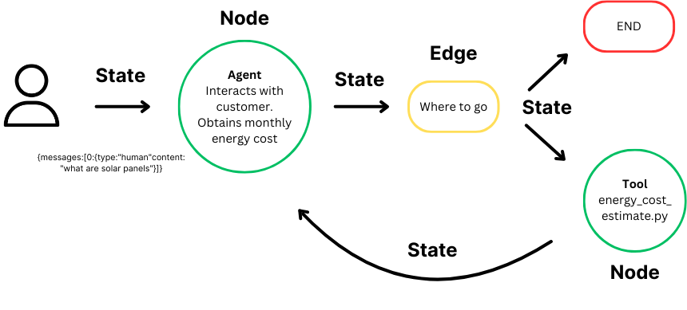
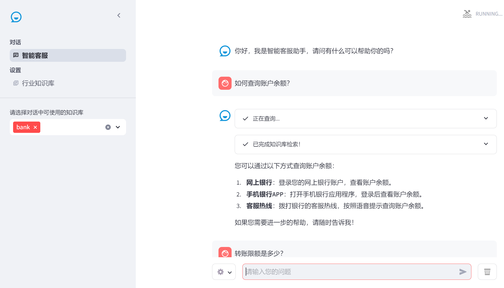

# 12.LangGraph基于RAG构建智能客服应用

**示例代码**

[langgraph-rag.ppt](https://www.yuque.com/attachments/yuque/0/2025/ppt/1387387/1745159934063-934e6eb9-abe9-4c0f-85db-bc4fdc98793c.ppt)

*<font style="color:#DF2A3F;">注：将ppt后缀名改为zip后解压</font>*

python版本：3.10

<font style="color:rgb(51, 51, 51);"></font>

<font style="color:rgb(51, 51, 51);">AI 领域正从基础的 RAG 系统向更智能的 AI 智能体进化，后者能处理更复杂的任务并适应新信息。LangGraph 作为 LangChain 库的扩展，助力开发者构建具有</font>[<font style="color:rgb(51, 51, 51);">状态管理</font>](https://so.csdn.net/so/search?q=%E7%8A%B6%E6%80%81%E7%AE%A1%E7%90%86\&spm=1001.2101.3001.7020)<font style="color:rgb(51, 51, 51);">和循环计算能力的先进 AI 系统。</font>

# <font style="color:rgb(51, 51, 51);">LangGraph流程</font>

<font style="color:rgb(51, 51, 51);">LangGraph 是 LangChain 的高级库，为大型语言模型（LLM）带来循环</font>[<font style="color:rgb(51, 51, 51);">计算能力</font>](https://so.csdn.net/so/search?q=%E8%AE%A1%E7%AE%97%E8%83%BD%E5%8A%9B\&spm=1001.2101.3001.7020)<font style="color:rgb(51, 51, 51);">。它超越了 LangChain 的线性工作流，通过循环支持复杂的任务处理。</font>

* **<font style="color:rgb(51, 51, 51);">状态</font>**<font style="color:rgb(51, 51, 51);">：维护计算过程中的上下文，实现基于累积数据的动态决策。</font>
* **<font style="color:rgb(51, 51, 51);">节点</font>**<font style="color:rgb(51, 51, 51);">：代表计算步骤，执行特定任务，可定制以适应不同工作流。</font>
* **<font style="color:rgb(51, 51, 51);">边</font>**<font style="color:rgb(51, 51, 51);">：连接节点，定义计算流程，支持条件逻辑，实现复杂工作流。</font>



<font style="color:rgb(51, 51, 51);">LangGraph 简化了 AI 开发，自动管理状态，保持上下文，使 AI 能智能响应变化。它让开发者专注于创新，而非技术细节，同时确保应用程序的高性能和可靠性。</font>

<font style="color:rgb(51, 51, 51);"></font>

# <font style="color:rgb(0, 0, 0);">RAG流程</font>


<font style="color:rgb(0, 0, 0);">一个典型的RAG应用有两个主要组成部分：</font>

**<font style="color:rgb(0, 0, 0);">索引(Indexing)</font>**<font style="color:rgb(0, 0, 0);">：从数据源获取数据并建立索引的管道(pipeline)。</font>*<font style="color:rgb(0, 0, 0);">这通常在离线状态下进行。</font>*

**<font style="color:rgb(0, 0, 0);">检索和生成(Retrieval and generation)</font>**<font style="color:rgb(0, 0, 0);">：实际的RAG链，在运行时接收用户查询，从索引中检索相关数据，然后将其传递给模型。</font>

<font style="color:rgb(0, 0, 0);">从原始数据到答案的最常见完整顺序如下：</font>

## <font style="color:rgb(0, 0, 0);">索引(Indexing) </font>

1. **<font style="color:rgb(0, 0, 0);">加载(Load)</font>**<font style="color:rgb(0, 0, 0);">：首先我们需要加载数据。这是通过文档加载器</font>[<font style="color:rgb(0, 0, 0);">Document Loaders</font>](https://blog.frognew.com/library/agi/langchain/components/document-loaders.html)<font style="color:rgb(0, 0, 0);">完成的。</font>
2. **<font style="color:rgb(0, 0, 0);">分割(Split)</font>**<font style="color:rgb(0, 0, 0);">：文本分割器</font>[<font style="color:rgb(0, 0, 0);">Text splitters</font>](https://python.langchain.com/docs/concepts/#text-splitters)<font style="color:rgb(0, 0, 0);">将大型文档(</font><code><font style="color:rgb(0, 0, 0);">Documents</font></code><font style="color:rgb(0, 0, 0);">)分成更小的块(chunks)。这对于索引数据和将其传递给模型都很有用，因为大块数据更难搜索，而且不适合模型有限的上下文窗口。</font>
3. **<font style="color:rgb(0, 0, 0);">存储(Store)</font>**<font style="color:rgb(0, 0, 0);">：我们需要一个地方来存储和索引我们的分割(splits)，以便后续可以对其进行搜索。这通常使用向量存储</font>[<font style="color:rgb(0, 0, 0);">VectorStore</font>](https://blog.frognew.com/library/agi/langchain/components/vector-stores.html)<font style="color:rgb(0, 0, 0);">和嵌入模型</font>[<font style="color:rgb(0, 0, 0);">Embeddings model</font>](https://blog.frognew.com/library/agi/langchain/components/embedding-models.html)<font style="color:rgb(0, 0, 0);">来完成。</font>


## <font style="color:rgb(0, 0, 0);">检索和生成(Retrieval and generation) </font>

4. **<font style="color:rgb(0, 0, 0);">检索(Retrieve)</font>**<font style="color:rgb(0, 0, 0);">：给定用户输入，使用检索器</font>[<font style="color:rgb(0, 0, 0);">Retriever</font>](https://blog.frognew.com/library/agi/langchain/components/retrievers.html)<font style="color:rgb(0, 0, 0);">从存储中检索相关的文本片段。</font>
5. **<font style="color:rgb(0, 0, 0);">生成(Generate)</font>**<font style="color:rgb(0, 0, 0);">：</font><font style="color:rgb(0, 0, 0);"> </font>[<font style="color:rgb(0, 0, 0);">ChatModel</font>](https://blog.frognew.com/library/agi/langchain/components/chat-models.html)<font style="color:rgb(0, 0, 0);">使用包含问题和检索到的数据的提示来生成答案。</font>


# <font style="color:rgb(51, 51, 51);">LangGraph基于RAG构建智能客服</font>

## 客服界面



## 运行环境

建议使用 Python>=3.10

可参考如下命令进行环境创建

```plain
conda create -n agent python=3.10 -y
conda activate agent
```

## 安装依赖

```plain
pip install -r requirements.txt
```

## 配置OpenAI 环境变量

### Windows 导入环境变量

注意：每次执行完，需要重启PyCharm才能生效

```powershell
setx OPENAI_BASE_URL "https://api.openai.com/v1"
setx OPENAI_API_KEY "sk-xxxxxxxxxxxxxxxxxxxxxxxxxxxxxxxxxxxxxxxxxxxxxxxx"
```

### Mac 导入环境变量

```bash
export OPENAI_BASE_URL='https://api.openai.com/v1'
export OPENAI_API_KEY='sk-xxxxxxxxxxxxxxxxxxxxxxxxxxxxxxxxxxxxxxxxxxxxxxxx'
```

## 运行项目

使用以下命令行运行webui

```bash
streamlit run rag.py
```

## 验证效果

如何查询账户余额？


> 更新: 2025-04-20 22:38:54  
> 原文: <https://www.yuque.com/aaron-wecc3/dhluml/xbtqq4akfzph9h0f>