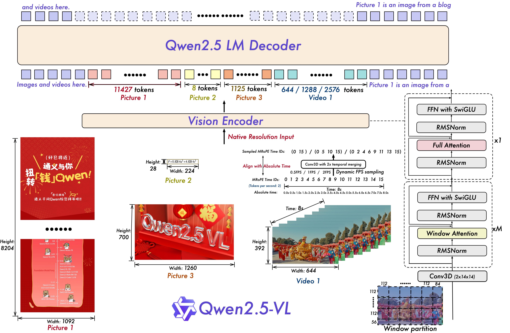

# 120.Swift多模态模型训练

## <font style="color:rgb(31, 35, 40);">示例代码</font>

[multi-modal.zip](https://www.yuque.com/attachments/yuque/0/2025/zip/2424104/1747713193674-3cf846e1-c661-44ca-abaa-4e66f66ef686.zip)

## <font style="color:rgb(31, 35, 40);">环境准备</font>

SWIFT介绍：<https://modelscope.cn/docs/llm-training-and-inference/intro/quickstart>

<font style="color:rgb(31, 35, 40);">推荐的第三方库版本参考</font>[SWIFT安装文档](https://modelscope.cn/docs/llm-training-and-inference/intro/swift-installation)

```plain
pip install ms-swift -U

# 若使用deepspeed zero2/zero3
pip install deepspeed -U
```

## <font style="color:rgb(31, 35, 40);">微调训练</font>

<font style="color:rgb(31, 35, 40);">ms-swift使用了分层式的设计思想，用户可以使用命令行界面、Web-UI界面和直接使用Python的方式进行微调。</font>

### <font style="color:rgb(31, 35, 40);">使用CLI</font>

<font style="color:rgb(31, 35, 40);">我们提供了10分钟在单卡3090上对Qwen2.5-7B-Instruct进行自我认知微调的最佳实践，具体参考</font>[这里](https://modelscope.cn/docs/llm-training-and-inference/intro/quickstart)<font style="color:rgb(31, 35, 40);">，这可以帮助您快速了解SWIFT。</font>

<font style="color:rgb(31, 35, 40);">此外，我们给出了一系列脚本帮助您了解SWIFT的训练能力：</font>

* <font style="color:rgb(31, 35, 40);">多模态训练：SWIFT支持多模态模型的预训练、微调和RLHF。支持Caption、VQA、OCR、</font>[Grounding](https://github.com/modelscope/ms-swift/blob/main/examples/notebook/qwen2_5-vl-grounding/zh.ipynb)<font style="color:rgb(31, 35, 40);">任务。支持图像、视频和音频三种模态。具体参考</font>[这里](https://github.com/modelscope/ms-swift/tree/main/examples/train/multimodal)<font style="color:rgb(31, 35, 40);">。多模态自定义数据集格式参考</font>[自定义数据集文档](https://modelscope.cn/docs/llm-training-and-inference/customization/custom-dataset)<font style="color:rgb(31, 35, 40);">。</font>
  * <font style="color:rgb(31, 35, 40);">对ViT/Aligner使用全参数训练，LLM使用LoRA训练，并采用不同学习率的例子参考</font>[这里](https://github.com/modelscope/ms-swift/tree/main/examples/train/multimodal/lora_llm_full_vit)<font style="color:rgb(31, 35, 40);">。</font>
  * <font style="color:rgb(31, 35, 40);">多模态模型packing，增加训练速度，例子参考</font>[这里](https://github.com/modelscope/ms-swift/tree/main/examples/train/packing)<font style="color:rgb(31, 35, 40);">。</font>

<font style="color:rgb(31, 35, 40);">小帖士：</font>

* <font style="color:rgb(31, 35, 40);">在使用</font><code><font style="color:rgb(31, 35, 40);">swift sft</font></code><font style="color:rgb(31, 35, 40);">通过LoRA技术微调base模型为chat模型时，有时需要手动设置模板。通过添加</font><code><font style="color:rgb(31, 35, 40);">--template default</font></code><font style="color:rgb(31, 35, 40);">参数来避免base模型因未见过对话模板中的特殊字符而无法正常停止的情况。具体参考</font>[这里](https://github.com/modelscope/ms-swift/tree/main/examples/train/base_to_chat)<font style="color:rgb(31, 35, 40);">。</font>
* <font style="color:rgb(31, 35, 40);">如果需要在</font>**<font style="color:rgb(31, 35, 40);">断网</font>**<font style="color:rgb(31, 35, 40);">环境下进行训练，请设置</font><code><font style="color:rgb(31, 35, 40);">--model <model_dir></font></code><font style="color:rgb(31, 35, 40);">和</font><code><font style="color:rgb(31, 35, 40);">--check_model false</font></code><font style="color:rgb(31, 35, 40);">。如果对应的模型需要</font><code><font style="color:rgb(31, 35, 40);">git clone</font></code><font style="color:rgb(31, 35, 40);">github的仓库，例如</font><code><font style="color:rgb(31, 35, 40);">deepseek-ai/Janus-Pro-7B</font></code><font style="color:rgb(31, 35, 40);">，请设置手动下载仓库，并设置</font><code><font style="color:rgb(31, 35, 40);">--local_repo_path <repo_dir></font></code><font style="color:rgb(31, 35, 40);">。具体参数含义请参考</font>[命令行参数文档](https://modelscope.cn/docs/llm-training-and-inference/user-guide/%E5%91%BD%E4%BB%A4%E8%A1%8C%E5%8F%82%E6%95%B0.md)<font style="color:rgb(31, 35, 40);">。</font>
* <font style="color:rgb(31, 35, 40);">如果使用NPU进行训练，只需要将shell中的</font><code><font style="color:rgb(31, 35, 40);">CUDA_VISIBLE_DEVICES</font></code><font style="color:rgb(31, 35, 40);">修改为</font><code><font style="color:rgb(31, 35, 40);">ASCEND_RT_VISIBLE_DEVICES</font></code><font style="color:rgb(31, 35, 40);">。</font>
* <font style="color:rgb(31, 35, 40);">SWIFT默认在训练时设置</font><code><font style="color:rgb(31, 35, 40);">--gradient_checkpointing true</font></code><font style="color:rgb(31, 35, 40);">来节约显存，这会略微降低训练速度。</font>

### 音频模型微调

模型：<https://modelscope.cn/models/Qwen/Qwen2-Audio-7B-Instruct>

数据集：<https://modelscope.cn/datasets/speech_asr/speech_asr_aishell1_trainsets>

<font style="color:rgb(31, 35, 40);">Qwen2-Audio 是 Qwen 大型音频-语言模型的新系列。Qwen2-Audio 能够接受各种音频信号输入，并根据语音指令执行音频分析或直接文本响应。我们引入了两种不同的音频交互模式：</font>

* <font style="color:rgb(31, 35, 40);">语音聊天：用户可以在没有文本输入的情况下自由地与 Qwen2-Audio 进行语音互动；</font>
* <font style="color:rgb(31, 35, 40);">音频分析：用户可以在互动过程中提供音频和文本指令进行分析；</font>

<font style="color:rgb(31, 35, 40);">我们发布了 Qwen2-Audio-7B 和 Qwen2-Audio-7B-Instruct，分别是预训练模型和聊天模型。</font>

<font style="color:rgb(31, 35, 40);"></font>

<font style="color:rgb(31, 35, 40);"></font>

### <font style="color:rgb(31, 35, 40);">图像模型微调</font>

模型：<https://modelscope.cn/models/Qwen/Qwen2.5-VL-7B-Instruct>

数据集：<https://modelscope.cn/datasets/AI-ModelScope/LaTeX_OCR/file/view/master/human_handwrite%2Ftest-00000-of-00001.parquet?id=49715&status=0>

<font style="color:rgb(31, 35, 40);">自从Qwen2-VL发布以来的五个月里，许多开发者在Qwen2-VL视觉-语言模型上构建了新的模型，并为我们提供了宝贵的反馈。在此期间，我们专注于构建更有用的视觉-语言模型。今天，我们非常激动地介绍Qwen家族的最新成员：Qwen2.5-VL。</font>

**<font style="color:rgb(31, 35, 40);">主要改进：</font>**

* **<font style="color:rgb(31, 35, 40);">视觉理解能力</font>**<font style="color:rgb(31, 35, 40);">：Qwen2.5-VL不仅擅长识别常见的物体如花、鸟、鱼和昆虫，而且在分析图像中的文本、图表、图标、图形和布局方面也非常出色。</font>
* **<font style="color:rgb(31, 35, 40);">自主代理能力</font>**<font style="color:rgb(31, 35, 40);">：Qwen2.5-VL可以直接作为视觉代理，能够进行推理并动态指导工具的使用，具备计算机和手机操作的能力。</font>
* **<font style="color:rgb(31, 35, 40);">理解和捕捉长视频中的事件</font>**<font style="color:rgb(31, 35, 40);">：Qwen2.5-VL可以理解超过1小时的视频，并且这次新增了通过定位相关视频片段来捕捉事件的能力。</font>
* **<font style="color:rgb(31, 35, 40);">不同格式下的视觉定位能力</font>**<font style="color:rgb(31, 35, 40);">：Qwen2.5-VL可以通过生成边界框或点准确地在图像中定位物体，并能提供稳定的JSON输出，包括坐标和属性。</font>
* **<font style="color:rgb(31, 35, 40);">生成结构化输出</font>**<font style="color:rgb(31, 35, 40);">：对于发票扫描件、表格等数据，Qwen2.5-VL支持其内容的结构化输出，适用于金融、商业等领域。</font>

**<font style="color:rgb(31, 35, 40);">模型架构更新：</font>**

* **<font style="color:rgb(31, 35, 40);">用于视频理解的动态分辨率和帧率训练</font>**<font style="color:rgb(31, 35, 40);">：</font>

<font style="color:rgb(31, 35, 40);">我们将动态分辨率扩展到时间维度，采用动态FPS采样，使模型能够在不同的采样率下理解视频。相应地，我们在时间维度上更新mRoPE，加入ID和绝对时间对齐，使模型能够学习时间序列和速度，最终获得精确定位特定时刻的能力。</font>



* **<font style="color:rgb(31, 35, 40);">简化且高效的视觉编码器</font>**

<font style="color:rgb(31, 35, 40);">通过在ViT中策略性地实现窗口注意力机制，我们提高了训练和推理速度。进一步优化ViT架构，引入SwiGLU和RMSNorm，使其与Qwen2.5 LLM的结构保持一致。</font>

<font style="color:rgb(31, 35, 40);">我们有三个模型，参数量分别为30亿、70亿和720亿。此仓库包含经过指令调优的70亿参数的Qwen2.5-VL模型。更多信息，请访问我们的</font>[博客](https://qwenlm.github.io/blog/qwen2.5-vl/)<font style="color:rgb(31, 35, 40);">和</font>[GitHub](https://github.com/QwenLM/Qwen2.5-VL)<font style="color:rgb(31, 35, 40);">。</font>

###

### <font style="color:rgb(31, 35, 40);">debug微调</font>

<font style="color:rgb(31, 35, 40);">你可以使用以下方式进行debug，这与使用命令行微调是等价的，但此方式不支持分布式。微调命令行运行入口可以查看</font>[这里](https://github.com/modelscope/ms-swift/blob/main/swift/cli/sft.py)<font style="color:rgb(31, 35, 40);">。</font>

```plain
from swift.llm import sft_main, TrainArguments
result = sft_main(TrainArguments(
    model='Qwen/Qwen2.5-7B-Instruct',
    train_type='lora',
    dataset=['AI-ModelScope/alpaca-gpt4-data-zh#500',
             'AI-ModelScope/alpaca-gpt4-data-en#500',
             'swift/self-cognition#500'],
    torch_dtype='bfloat16'
))
print(result) 
```

## <font style="color:rgb(31, 35, 40);">模型合并</font>

```bash
# Since `output/vx-xxx/checkpoint-xxx` is trained by swift and contains an `args.json` file,
# there is no need to explicitly set `--model`, `--system`, etc., as they will be automatically read.
swift export \
    --adapters output/vx-xxx/checkpoint-xxx \
    --merge_lora true
```

## <font style="color:rgb(31, 35, 40);">模型推理</font>

<font style="color:rgb(31, 35, 40);">使用CLI对LoRA训练的checkpoint进行推理：</font>

```plain
CUDA_VISIBLE_DEVICES=0 \
swift infer \
    --adapters output/vx-xxx/checkpoint-xxx \
    --infer_backend pt \
    --stream true \
    --temperature 0 \
    --max_new_tokens 2048
```

* <font style="color:rgb(31, 35, 40);">adapters文件夹中包含了训练的参数文件</font><code><font style="color:rgb(31, 35, 40);">args.json</font></code><font style="color:rgb(31, 35, 40);">，因此不需要额外指定</font><code><font style="color:rgb(31, 35, 40);">--model</font></code><font style="color:rgb(31, 35, 40);">，</font><code><font style="color:rgb(31, 35, 40);">--system</font></code><font style="color:rgb(31, 35, 40);">，swift会自动读取这些参数。如果要关闭此行为，可以设置</font><code><font style="color:rgb(31, 35, 40);">--load_args false</font></code><font style="color:rgb(31, 35, 40);">。</font>
* <font style="color:rgb(31, 35, 40);">如果使用全参数训练，请使用</font><code><font style="color:rgb(31, 35, 40);">--model</font></code><font style="color:rgb(31, 35, 40);">替代</font><code><font style="color:rgb(31, 35, 40);">--adapters</font></code><font style="color:rgb(31, 35, 40);">指定训练的checkpoint目录。更多参考。</font>
* <font style="color:rgb(31, 35, 40);">你可以使用</font><code><font style="color:rgb(31, 35, 40);">swift app</font></code><font style="color:rgb(31, 35, 40);">替代</font><code><font style="color:rgb(31, 35, 40);">swift infer</font></code><font style="color:rgb(31, 35, 40);">进行界面推理。</font>
* <font style="color:rgb(31, 35, 40);">你可以选择对LoRA进行merge（额外指定</font><code><font style="color:rgb(31, 35, 40);">--merge_lora true</font></code><font style="color:rgb(31, 35, 40);">），然后指定</font><code><font style="color:rgb(31, 35, 40);">--infer_backend vllm/lmdeploy</font></code><font style="color:rgb(31, 35, 40);">进行推理加速。</font>

<font style="color:rgb(31, 35, 40);">对数据集中的验证集进行批量推理：</font>

```plain
CUDA_VISIBLE_DEVICES=0 \
swift infer \
    --adapters output/vx-xxx/checkpoint-xxx \
    --infer_backend pt \
    --temperature 0 \
    --max_new_tokens 2048 \
    --load_data_args true \
    --max_batch_size 1
```

* <font style="color:rgb(31, 35, 40);">你可以设置</font><code><font style="color:rgb(31, 35, 40);">--max_batch_size 8</font></code><font style="color:rgb(31, 35, 40);">，从而使用</font><code><font style="color:rgb(31, 35, 40);">--infer_backend pt</font></code><font style="color:rgb(31, 35, 40);">进行批量处理。若使用</font><code><font style="color:rgb(31, 35, 40);">infer_backend vllm/lmdeploy</font></code><font style="color:rgb(31, 35, 40);">则无需指定，会进行自动batch。</font>
* <code><font style="color:rgb(31, 35, 40);">--load_data_args true</font></code><font style="color:rgb(31, 35, 40);">会额外读取训练存储参数文件</font><code><font style="color:rgb(31, 35, 40);">args.json</font></code><font style="color:rgb(31, 35, 40);">中的数据参数。</font>

<font style="color:rgb(31, 35, 40);">若想对额外的测试集进行推理，而不使用训练时的验证集，使用</font><code><font style="color:rgb(31, 35, 40);">--val_dataset <dataset_path></font></code><font style="color:rgb(31, 35, 40);">进行推理：</font>

```plain
CUDA_VISIBLE_DEVICES=0 \
swift infer \
    --adapters output/vx-xxx/checkpoint-xxx \
    --infer_backend pt \
    --temperature 0 \
    --max_new_tokens 2048 \
    --val_dataset <dataset-path> \
    --max_batch_size 1
```

<font style="color:rgb(31, 35, 40);">使用Python对训练后LoRA推理的例子如下：</font>

```plain
import os
os.environ['CUDA_VISIBLE_DEVICES'] = '0'

from swift.llm import (
    PtEngine, RequestConfig, safe_snapshot_download, get_model_tokenizer, get_template, InferRequest
)
from swift.tuners import Swift
# 请调整下面几行
model = 'Qwen/Qwen2.5-7B-Instruct'
lora_checkpoint = safe_snapshot_download('swift/test_lora')  # 修改成checkpoint_dir
template_type = None  # None: 使用对应模型默认的template_type
default_system = "You are a helpful assistant."  # None: 使用对应模型默认的default_system

# 加载模型和对话模板
model, tokenizer = get_model_tokenizer(model)
model = Swift.from_pretrained(model, lora_checkpoint)
template_type = template_type or model.model_meta.template
template = get_template(template_type, tokenizer, default_system=default_system)
engine = PtEngine.from_model_template(model, template, max_batch_size=2)
request_config = RequestConfig(max_tokens=512, temperature=0)

# 这里使用了2个infer_request来展示batch推理
infer_requests = [
    InferRequest(messages=[{'role': 'user', 'content': 'who are you?'}]),
    InferRequest(messages=[{'role': 'user', 'content': '浙江的省会在哪？'},
                           {'role': 'assistant', 'content': '浙江的省会在哪？'},
                           {'role': 'user', 'content': '这里有什么好吃的'},]),
]
resp_list = engine.infer(infer_requests, request_config)
query0 = infer_requests[0].messages[0]['content']
print(f'response0: {resp_list[0].choices[0].message.content}')
print(f'response1: {resp_list[1].choices[0].message.content}')
```


> 更新: 2025-05-20 11:53:13  
> 原文: <https://www.yuque.com/aaron-wecc3/dhluml/fa1zay1rncltoecw>