# 123.Dify私有化部署与快速入门

# 课程内容

1. Dify介绍
2. Dify私有化部署
3. Dify接入大模型
4. 构建应用
5. 创建一个聊天应用

# Dify介绍

官网：<https://cloud.dify.ai/apps>

**Dify** 是一款开源的大语言模型(LLM) 应用开发平台。它融合了后端即服务（Backend as Service）和 [LLMOps](https://docs.dify.ai/zh-hans/learn-more/extended-reading/what-is-llmops) 的理念，使开发者可以快速搭建生产级的生成式 AI 应用。即使你是非技术人员，也能参与到 AI 应用的定义和数据运营过程中。

由于 Dify 内置了构建 LLM 应用所需的关键技术栈，包括对数百个模型的支持、直观的 Prompt 编排界面、高质量的 RAG 引擎、稳健的 Agent 框架、灵活的流程编排，并同时提供了一套易用的界面和 API。这为开发者节省了许多重复造轮子的时间，使其可以专注在创新和业务需求上。


### 为什么使用 Dify？

你或许可以把 LangChain 这类的开发库（Library）想象为有着锤子、钉子的工具箱。与之相比，Dify 提供了更接近生产需要的完整方案，Dify 好比是一套脚手架，并且经过了精良的工程设计和软件测试。

重要的是，Dify 是**开源**的，它由一个专业的全职团队和社区共同打造。你可以基于任何模型自部署类似 Assistants API 和 GPTs 的能力，在灵活和安全的基础上，同时保持对数据的完全控制。

我们的社区用户对 Dify 的产品评价可以归结为简单、克制、迭代迅速。 ——路宇，Dify.AI CEO

希望以上信息和这份指南可以帮助你了解这款产品，我们相信 Dify 是为你而做的（Do It For You）。

### Dify 能做什么？

Dify 一词源自 Define + Modify，意指定义并且持续的改进你的 AI 应用，它是为你而做的（Do it for you）。

* **创业**，快速的将你的 AI 应用创意变成现实，无论成功和失败都需要加速。在真实世界，已经有几十个团队通过 Dify 构建 MVP（最小可用产品）获得投资，或通过 POC（概念验证）赢得了客户的订单。
* **将 LLM 集成至已有业务**，通过引入 LLM 增强现有应用的能力，接入 Dify 的 RESTful API 从而实现 Prompt 与业务代码的解耦，在 Dify 的管理界面是跟踪数据、成本和用量，持续改进应用效果。
* **作为企业级 LLM 基础设施**，一些银行和大型互联网公司正在将 Dify 部署为企业内的 LLM 网关，加速 GenAI 技术在企业内的推广，并实现中心化的监管。
* **探索 LLM 的能力边界**，即使你是一个技术爱好者，通过 Dify 也可以轻松的实践 Prompt 工程和 Agent 技术，在 GPTs 推出以前就已经有超过 60,000 开发者在 Dify 上创建了自己的第一个应用。

# Dify私有化部署

下载安装包：<https://github.com/langgenius/dify/tags>

参考文档：<https://github.com/langgenius/dify/blob/main/README_CN.md>

### <font style="color:rgb(31, 35, 40);">Docker Compose 部署</font>

### <font style="color:rgb(31, 35, 40);">前提条件</font>

安装 Dify 之前, 请确保你的机器已满足最低安装要求：

* CPU >= 2 Core <u>CPU >= 2 核</u>
* RAM >= 4 GiB <u>内存 >= 4 GiB</u>

| <font style="color:rgb(31, 35, 40);">操作系统</font> | <font style="color:rgb(31, 35, 40);">软件</font> | <font style="color:rgb(31, 35, 40);">描述</font> |
| --- | --- | --- |
| <font style="color:rgb(31, 35, 40);">macOS 10.14 or later</font><font style="color:rgb(31, 35, 40);">   </font><u><font style="color:rgb(31, 35, 40);">macOS 10.14 或更高版本</font></u> | <font style="color:rgb(31, 35, 40);">Docker Desktop</font><font style="color:rgb(31, 35, 40);"> </font><u><font style="color:rgb(31, 35, 40);">Docker 桌面</font></u> | <font style="color:rgb(31, 35, 40);">为 Docker 虚拟机（VM）至少分配 2 个虚拟 CPU(vCPU) 和 8GB 初始内存，否则安装可能会失败。有关更多信息，请参考 </font>[<font style="color:rgb(31, 35, 40);">《在 Mac 内安装 Docker 桌面端》</font>](https://docs.docker.com/desktop/install/mac-install/) |
| <font style="color:rgb(31, 35, 40);">Linux platforms</font><font style="color:rgb(31, 35, 40);"> </font><u><font style="color:rgb(31, 35, 40);">Linux 平台</font></u> | <font style="color:rgb(31, 35, 40);">Docker 19.03 or later   </font><font style="color:rgb(31, 35, 40);">Docker Compose 1.28 or later</font><font style="color:rgb(31, 35, 40);">   </font><u><font style="color:rgb(31, 35, 40);">Docker 19.03 或更高版本 Docker Compose 1.28 或更高版本</font></u> | <font style="color:rgb(31, 35, 40);">请参阅</font>[<font style="color:rgb(31, 35, 40);">安装 Docker</font>](https://docs.docker.com/engine/install/)<br/><font style="color:rgb(31, 35, 40);"> </font><font style="color:rgb(31, 35, 40);">和</font>[<font style="color:rgb(31, 35, 40);">安装 Docker Compose</font>](https://docs.docker.com/compose/install/)<br/><font style="color:rgb(31, 35, 40);"> </font><font style="color:rgb(31, 35, 40);">以获取更多信息。</font> |
| <font style="color:rgb(31, 35, 40);">Windows with WSL 2 enabled</font><font style="color:rgb(31, 35, 40);">   </font><u><font style="color:rgb(31, 35, 40);">启用了 WSL 2 的 Windows</font></u> | <font style="color:rgb(31, 35, 40);">Docker Desktop   </font><u><font style="color:rgb(31, 35, 40);">Docker 桌面</font></u> | <font style="color:rgb(31, 35, 40);">我们建议将源代码和其他数据绑定到 Linux 容器中时，将其存储在 Linux 文件系统中，而不是 Windows 文件系统中。有关更多信息，请参阅</font>[<font style="color:rgb(31, 35, 40);">使用 WSL 2 后端在 Windows 上安装 Docker Desktop</font>](https://docs.docker.com/desktop/windows/install/#wsl-2-backend)<br/><font style="color:rgb(31, 35, 40);">。</font> |

### <font style="color:rgb(31, 35, 40);">克隆 Dify 代码仓库</font>

<font style="color:rgb(31, 35, 40);">克隆 Dify 源代码至本地环境。</font>

<font style="color:rgb(31, 35, 40);">git clone https://github.com/langgenius/dify.git</font>

### <font style="color:rgb(31, 35, 40);">启动 Dify</font>

<font style="color:rgb(31, 35, 40);">进入 Dify 源代码的 Docker 目录</font>

1. <font style="color:rgb(31, 35, 40);">cd dify/docker</font>

<font style="color:rgb(31, 35, 40);">复制环境配置文件</font>

2. <font style="color:rgb(31, 35, 40);">cp .env.example .env</font>

<font style="color:rgb(31, 35, 40);">启动 Docker 容器</font>

<font style="color:rgb(31, 35, 40);">根据你系统上的 Docker Compose 版本，选择合适的命令来启动容器。你可以通过</font><font style="color:rgb(31, 35, 40);"> </font><code><font style="color:rgb(31, 35, 40);">$ docker compose version</font></code><font style="color:rgb(31, 35, 40);"> </font><font style="color:rgb(31, 35, 40);">命令检查版本，详细说明请参考</font><font style="color:rgb(31, 35, 40);"> </font>[<font style="color:rgb(31, 35, 40);">Docker 官方文档</font>](https://docs.docker.com/compose/#compose-v2-and-the-new-docker-compose-command)<font style="color:rgb(31, 35, 40);">：</font>

```
- <font style="color:rgb(31, 35, 40);">如果版本是 Docker Compose V2，使用以下命令：</font>
```

3\. <font style="color:rgb(31, 35, 40);">docker compose up -d</font>
\- <font style="color:rgb(31, 35, 40);">如果版本是 Docker Compose V1，使用以下命令：</font>
4\. <font style="color:rgb(31, 35, 40);">docker-compose up -d</font>

<font style="color:rgb(31, 35, 40);">运行命令后，你应该会看到类似以下的输出，显示所有容器的状态和端口映射：</font>

```plain
[+] Running 11/11
 ✔ Network docker_ssrf_proxy_network  Created                                                                 0.1s 
 ✔ Network docker_default             Created                                                                 0.0s 
 ✔ Container docker-redis-1           Started                                                                 2.4s 
 ✔ Container docker-ssrf_proxy-1      Started                                                                 2.8s 
 ✔ Container docker-sandbox-1         Started                                                                 2.7s 
 ✔ Container docker-web-1             Started                                                                 2.7s 
 ✔ Container docker-weaviate-1        Started                                                                 2.4s 
 ✔ Container docker-db-1              Started                                                                 2.7s 
 ✔ Container docker-api-1             Started                                                                 6.5s 
 ✔ Container docker-worker-1          Started                                                                 6.4s 
 ✔ Container docker-nginx-1           Started                                                                 7.1s
```

<font style="color:rgb(31, 35, 40);">最后检查是否所有容器都正常运行：</font>

<font style="color:rgb(31, 35, 40);">docker compose ps</font>

<font style="color:rgb(31, 35, 40);">在这个输出中，你应该可以看到包括 3 个业务服务</font><font style="color:rgb(31, 35, 40);"> </font><code><font style="color:rgb(31, 35, 40);">api / worker / web</font></code><font style="color:rgb(31, 35, 40);">，以及 6 个基础组件</font><font style="color:rgb(31, 35, 40);"> </font><code><font style="color:rgb(31, 35, 40);">weaviate / db / redis / nginx / ssrf_proxy / sandbox</font></code><font style="color:rgb(31, 35, 40);"> </font><font style="color:rgb(31, 35, 40);">。</font>

```plain
CONTAINER ID   IMAGE                                        COMMAND                  CREATED             STATUS                   PORTS                                                                      NAMES
c182452acbe8   nginx:latest                                 "sh -c 'cp /docker-e…"   About an hour ago   Up 7 minutes             0.0.0.0:80->80/tcp, :::80->80/tcp, 0.0.0.0:443->443/tcp, :::443->443/tcp   docker_nginx_1
27f887707e2c   langgenius/dify-api:1.4.0                    "/bin/bash /entrypoi…"   About an hour ago   Up 7 minutes             5001/tcp                                                                   docker_api_1
fceea47a28c0   langgenius/dify-api:1.4.0                    "/bin/bash /entrypoi…"   About an hour ago   Up 7 minutes             5001/tcp                                                                   docker_worker_1
ab7c24e7103f   langgenius/dify-plugin-daemon:0.0.10-local   "/bin/bash -c /app/e…"   About an hour ago   Up 7 minutes             0.0.0.0:5003->5003/tcp, :::5003->5003/tcp                                  docker_plugin_daemon_1
fa3ee419e9df   ubuntu/squid:latest                          "sh -c 'cp /docker-e…"   About an hour ago   Up 7 minutes             3128/tcp                                                                   docker_ssrf_proxy_1
b04f7e0883f4   semitechnologies/weaviate:1.19.0             "/bin/weaviate --hos…"   About an hour ago   Up 7 minutes                                                                                        docker_weaviate_1
c04f075beedd   redis:6-alpine                               "docker-entrypoint.s…"   About an hour ago   Up 7 minutes (healthy)   6379/tcp                                                                   docker_redis_1
6bd6301d67df   postgres:15-alpine                           "docker-entrypoint.s…"   About an hour ago   Up 7 minutes (healthy)   5432/tcp                                                                   docker_db_1
ed24671ae8a6   langgenius/dify-sandbox:0.2.12               "/main"                  About an hour ago   Up 7 minutes (healthy)                                                                              docker_sandbox_1
ee15cfd7f731   langgenius/dify-web:1.4.0                    "/bin/sh ./entrypoin…"   About an hour ago   Up 7 minutes             3000/tcp                                                                   docker_web_1
```

<font style="color:rgb(31, 35, 40);">通过这些步骤，你应该可以成功在本地安装 Dify。</font>

### <font style="color:rgb(31, 35, 40);">更新 Dify</font>

<font style="color:rgb(31, 35, 40);">进入 dify 源代码的 docker 目录，按顺序执行以下命令：</font>

```plain
cd dify/docker
docker compose down
git pull origin main
docker compose pull
docker compose up -d
```

#### <font style="color:rgb(31, 35, 40);">同步环境变量配置 (重要！)</font>

* <font style="color:rgb(31, 35, 40);">如果</font><font style="color:rgb(31, 35, 40);"> </font><code><font style="color:rgb(31, 35, 40);">.env.example</font></code><font style="color:rgb(31, 35, 40);"> </font><font style="color:rgb(31, 35, 40);">文件有更新，请务必同步修改你本地的</font><font style="color:rgb(31, 35, 40);"> </font><code><font style="color:rgb(31, 35, 40);">.env</font></code><font style="color:rgb(31, 35, 40);"> </font><font style="color:rgb(31, 35, 40);">文件。</font>
* <font style="color:rgb(31, 35, 40);">检查</font><font style="color:rgb(31, 35, 40);"> </font><code><font style="color:rgb(31, 35, 40);">.env</font></code><font style="color:rgb(31, 35, 40);"> </font><font style="color:rgb(31, 35, 40);">文件中的所有配置项，确保它们与你的实际运行环境相匹配。你可能需要将</font><font style="color:rgb(31, 35, 40);"> </font><code><font style="color:rgb(31, 35, 40);">.env.example</font></code><font style="color:rgb(31, 35, 40);"> </font><font style="color:rgb(31, 35, 40);">中的新变量添加到</font><font style="color:rgb(31, 35, 40);"> </font><code><font style="color:rgb(31, 35, 40);">.env</font></code><font style="color:rgb(31, 35, 40);"> </font><font style="color:rgb(31, 35, 40);">文件中，并更新已更改的任何值。</font>

### <font style="color:rgb(31, 35, 40);">访问 Dify</font>

<font style="color:rgb(31, 35, 40);">你可以先前往管理员初始化页面设置设置管理员账户：</font>

```plain
# 本地环境
http://localhost/install

# 服务器环境

http://your_server_ip/install
```

<font style="color:rgb(31, 35, 40);">Dify 主页面：</font>

```plain
# 本地环境
http://localhost

# 服务器环境
http://your_server_ip
```

### <font style="color:rgb(31, 35, 40);">自定义配置</font>

<font style="color:rgb(31, 35, 40);">编辑</font><font style="color:rgb(31, 35, 40);"> </font><code><font style="color:rgb(31, 35, 40);">.env</font></code><font style="color:rgb(31, 35, 40);"> </font><font style="color:rgb(31, 35, 40);">文件中的环境变量值。然后重新启动 Dify：</font>

```plain
docker compose down
docker compose up -d
```

<font style="color:rgb(31, 35, 40);">完整的环境变量集合可以在 </font><code><font style="color:rgb(31, 35, 40);">docker/.env.example</font></code><font style="color:rgb(31, 35, 40);"> 中找到。</font>

# Dify接入大模型

“模型”已全面升级为“插件”生态，模型插件的详细开发说明请参考[插件开发](https://docs.dify.ai/zh-hans/plugins/quick-start/develop-plugins/model-plugin/README)。以下内容已归档。

Dify 是基于大语言模型的 AI 应用开发平台，初次使用时你需要先在 Dify 的 **设置 — 模型供应商** 页面内添加并配置所需要的模型。

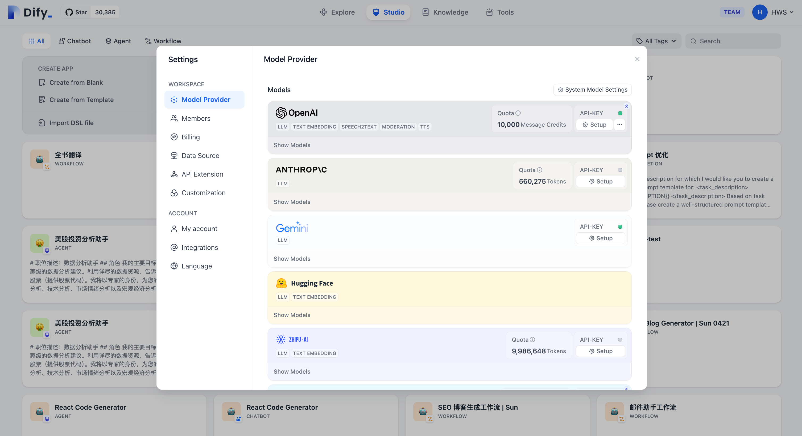

Dify 目前已支持主流的模型供应商，例如 OpenAI 的 GPT 系列、Anthropic 的 Claude 系列等。不同模型的能力表现、参数类型会不一样，你可以根据不同情景的应用需求选择你喜欢的模型供应商。**你在 Dify 应用以下模型能力前，应该前往不同的模型厂商官方网站获得他们的 API key 。**

### 模型类型

在 Dify 中，我们按模型的使用场景将模型分为以下 4 类：

1. **系统推理模型**。 在创建的应用中，用的是该类型的模型。智聊、对话名称生成、下一步问题建议用的也是推理模型。

已支持的系统推理模型供应商：[OpenAI](https://platform.openai.com/account/api-keys)、[Azure OpenAI Service](https://azure.microsoft.com/en-us/products/ai-services/openai-service/)、[Anthropic](https://console.anthropic.com/account/keys)、Hugging Face Hub、Replicate、Xinference、OpenLLM、[讯飞星火](https://www.xfyun.cn/solutions/xinghuoAPI)、[文心一言](https://console.bce.baidu.com/qianfan/ais/console/applicationConsole/application)、[通义千问](https://dashscope.console.aliyun.com/api-key_management?spm=a2c4g.11186623.0.0.3bbc424dxZms9k)、[Minimax](https://api.minimax.chat/user-center/basic-information/interface-key)、ZHIPU(ChatGLM)

2. **Embedding 模型**。在知识库中，将分段过的文档做 Embedding 用的是该类型的模型。在使用了知识库的应用中，将用户的提问做 Embedding 处理也是用的该类型的模型。

已支持的 Embedding 模型供应商：OpenAI、ZHIPU(ChatGLM)、Jina AI([Jina Embeddings](https://jina.ai/embeddings/))

3. [Rerank 模型](https://docs.dify.ai/zh-hans/advanced/retrieval-augment/rerank)。**Rerank 模型用于增强检索能力，改善 LLM 的搜索结果。**

已支持的 Rerank 模型供应商：Cohere、Jina AI([Jina Reranker](https://jina.ai/reranker))

4. **语音转文字模型**。将对话型应用中，将语音转文字用的是该类型的模型。

已支持的语音转文字模型供应商：OpenAI

根据技术变化和用户需求，我们将陆续支持更多 LLM 供应商。

### 托管模型试用服务

我们为 Dify 云服务的用户提供了不同模型的试用额度，请在该额度耗尽前设置你自己的模型供应商，否则将会影响应用的正常使用。

* **OpenAI 托管模型试用：** 我们提供 200 次调用次数供你试用体验，可用于 GPT3.5-turbo、GPT3.5-turbo-16k、text-davinci-003 模型。

### 设置默认模型

Dify 在需要模型时，会根据使用场景来选择设置过的默认模型。在 <code>**设置 > 模型供应商**</code> 中设置默认模型。

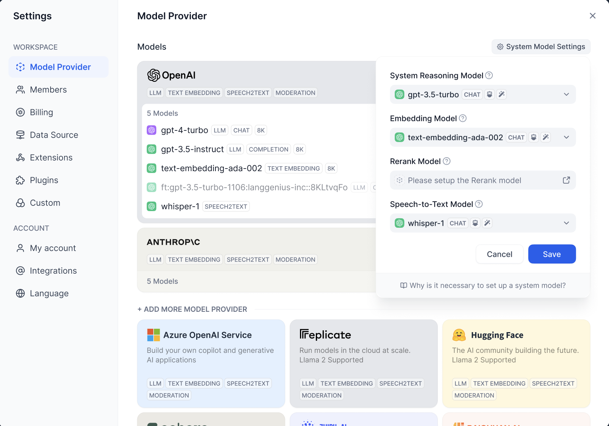

系统默认推理模型(System Reasoning Model)：设置创建应用使用的默认推理模型,以及对话名称生成、下一步问题建议等功能也会使用该默认推理模型。

### 接入模型设置

在 Dify 的 <code>**设置 > 模型供应商**</code> 中设置要接入的模型。

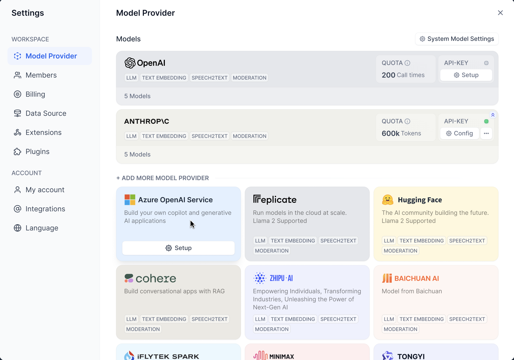

模型供应商分为两种：

1. 自有模型。该类型的模型供应商提供的是自己开发的模型。如 OpenAI，Anthropic 等。
2. 托管模型。该类型的模型供应商提供的是第三方模型。如 Hugging Face，Replicate 等。

在 Dify 中接入不同类型的模型供应商的方式稍有不同。

**接入自有模型的模型供应商**

接入自有模型的供应商后，Dify 会自动接入该供应商下的所有模型。

在 Dify 中设置对应模型供应商的 API key，即可接入该模型供应商。

Dify 使用了 [PKCS1_OAEP](https://pycryptodome.readthedocs.io/en/latest/src/cipher/oaep.html) 来加密存储用户托管的 API 密钥，每个租户均使用了独立的密钥对进行加密，确保你的 API 密钥不被泄漏。

**接入托管模型的模型供应商**

托管类型的供应商上面有很多第三方模型。接入模型需要一个个的添加。具体接入方式如下：

* [Hugging Face](https://docs.dify.ai/zh-hans/development/models-integration/hugging-face)
* [Replicate](https://docs.dify.ai/zh-hans/development/models-integration/replicate)
* [Xinference](https://docs.dify.ai/zh-hans/development/models-integration/xinference)
* [OpenLLM](https://docs.dify.ai/zh-hans/development/models-integration/openllm)

### 使用模型

配置完模型后，就可以在应用中使用这些模型了：

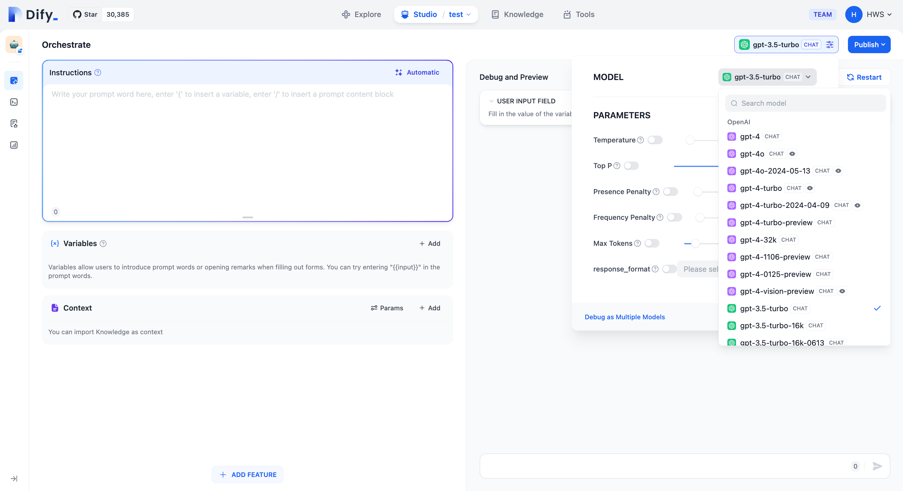

# 构建应用

在 Dify 中，一个“应用”是指基于 GPT 等大语言模型构建的实际场景应用。通过创建应用，你可以将智能 AI 技术应用于特定的需求。它既包含了开发 AI 应用的工程范式，也包含了具体的交付物。

简而言之，一个应用为开发者交付了：

* 封装友好的 API，可由后端或前端应用直接调用，通过 Token 鉴权
* 开箱即用、美观且托管的 WebApp，你可以 WebApp 的模板进行二次开发
* 一套包含提示词工程、上下文管理、日志分析和标注的易用界面

你可以任选**其中之一**或**全部**，来支撑你的 AI 应用开发。

### 应用类型

Dify 中提供了五种应用类型：

* **聊天助手**：基于 LLM 构建对话式交互的助手
* **文本生成应用**：面向文本生成类任务的助手，例如撰写故事、文本分类、翻译等
* **Agent**：能够分解任务、推理思考、调用工具的对话式智能助手
* **对话流**：适用于定义等复杂流程的多轮对话场景，具有记忆功能的应用编排方式
* **工作流**：适用于自动化、批处理等单轮生成类任务的场景的应用编排方式

文本生成应用与聊天助手的区别见下表：

| | **文本生成应用** | **聊天助手** |
| --- | --- | --- |
| WebApp 界面 | 表单+结果式 | 聊天式 |
| WebAPI 端点 | <code>**completion-messages**</code> | <code>**chat-messages**</code> |
| 交互方式 | 一问一答 | 多轮对话 |
| 流式结果返回 | 支持 | 支持 |
| 上下文保存 | 当次 | 持续 |
| 用户输入表单 | 支持 | 支持 |
| 知识库与插件 | 支持 | 支持 |
| AI 开场白 | 不支持 | 支持 |
| 情景举例 | 翻译、判断、索引 | 聊天 |

# 创建应用

你可以通过 3 种方式在 Dify 的工作室内创建应用：

* 基于应用模板创建（新手推荐）
* 创建一个空白应用
* 通过 DSL 文件（本地/在线）创建应用

## 从模板创建应用

初次使用 Dify 时，你可能对于应用创建比较陌生。为了帮助新手用户快速了解在 Dify 上能够构建哪些类型的应用，Dify 团队内的提示词工程师已经创建多场景、高质量的应用模板。

你可以从导航选择 「工作室 」，在应用列表内选择 「从模板创建」。

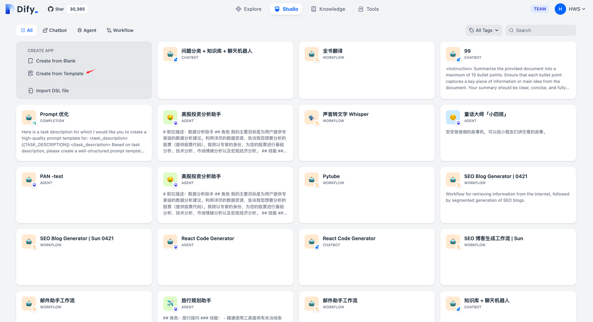

任意选择某个模板，并将其添加至工作区。

#### 创建一个新应用

如果你需要在 Dify 上创建一个空白应用，你可以从导航选择 「工作室」 ，在应用列表内选择 「从空白创建 」。

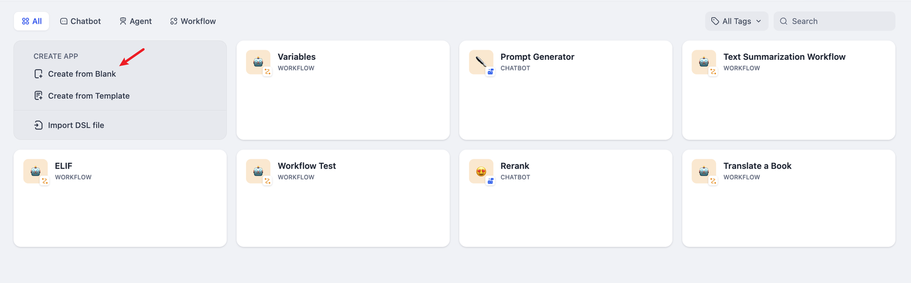

Dify 上可以创建 5 种不同的应用类型，分别是聊天助手、文本生成应用、Agent、Chatflow 和 Workflow。

创建应用时，你需要给应用起一个名字、选择合适的图标，或者上传喜爱的图片用作图标、使用一段清晰的文字描述此应用的用途，以便后续应用在团队内的使用。

### 通过 DSL 文件创建应用

Dify DSL 是由 Dify.AI 所定义的 AI 应用工程文件标准，文件格式为 YML。该标准涵盖应用在 Dify 内的基本描述、模型参数、编排配置等信息。

* **本地导入**
* **URL 导入**

如果你从社区或其它人那里获得了一个应用模板（DSL 文件），可以从工作室选择 「 导入DSL 文件 」。DSL 文件导入后将直接加载原应用的所有配置信息。

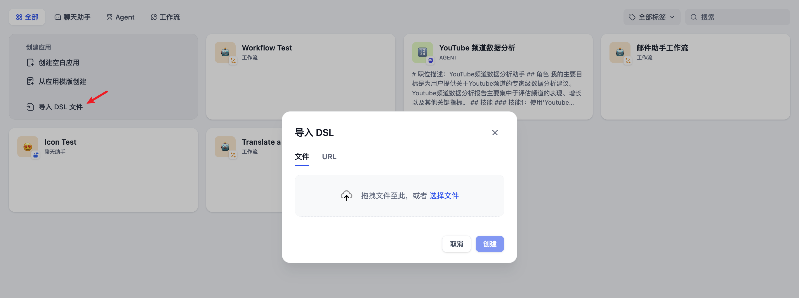

# 创建一个聊天应用

对话型应用采用一问一答模式与用户持续对话。

### 适用场景

对话型应用可以用在客户服务、在线教育、医疗保健、金融服务等领域。这些应用可以帮助组织提高工作效率、减少人工成本和提供更好的用户体验。

### 如何编排

对话型应用的编排支持：对话前提示词，变量，上下文，开场白和下一步问题建议。

下面边以做一个 **面试官** 的应用为例来介绍编排对话型应用。

#### 创建应用

在首页点击 “创建应用” 按钮创建应用。填上应用名称，应用类型选择**聊天助手**。

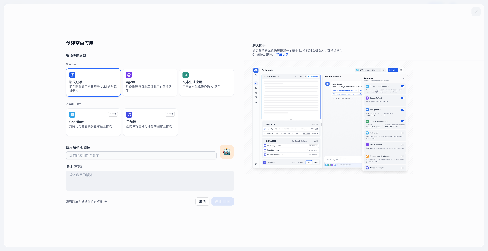

#### 编排应用

创建应用后会自动跳转到应用概览页。点击左侧菜单 **编排** 来编排应用。

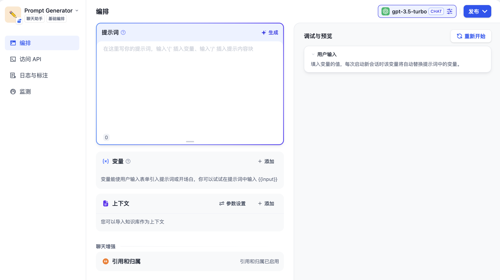

**填写提示词**

提示词用于约束 AI 给出专业的回复，让回应更加精确。你可以借助内置的提示生成器，编写合适的提示词。提示词内支持插入表单变量，例如 <code>**{{input}}**</code>。提示词中的变量的值会替换成用户填写的值。

示例：

1. 输入提示指令，要求给出一段面试场景的提示词。
2. 右侧内容框将自动生成提示词。
3. 你可以在提示词内插入自定义变量。

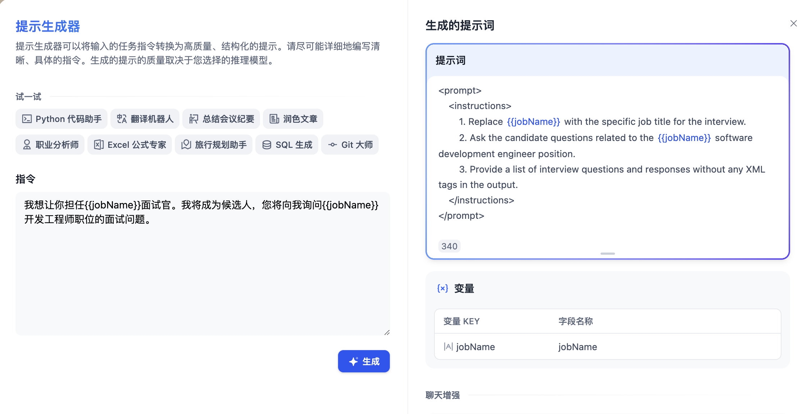

为了更好的用户体验，可以加上对话开场白：<code>**你好，{{name}}。我是你的面试官，Bob。你准备好了吗？**</code>。点击页面底部的 “添加功能” 按钮，打开 “对话开场白” 的功能：

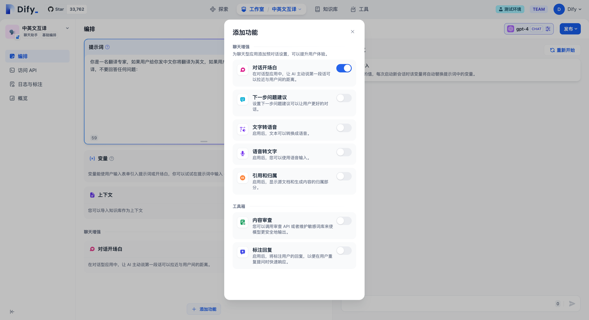

编辑开场白时，还可以添加数个开场问题：

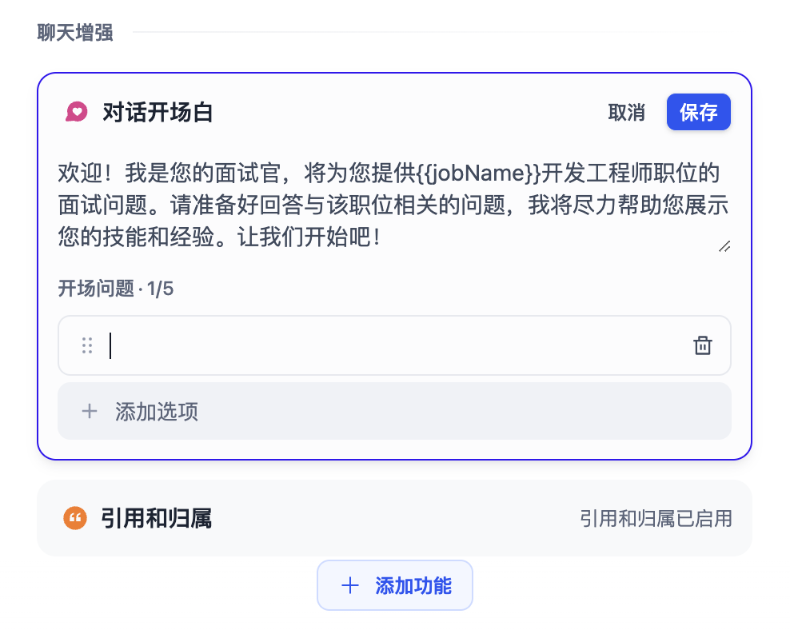

#### 添加上下文

如果想要让 AI 的对话范围局限在[知识库](https://docs.dify.ai/zh-hans/guides/knowledge-base/)内，例如企业内的客服话术规范，可以在“上下文”内引用知识库。

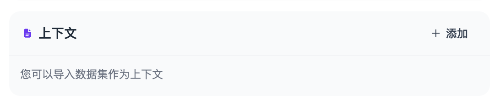

#### 添加文件上传

部分多模态 LLM 已原生支持处理文件，例如 [Claude 3.5 Sonnet](https://docs.anthropic.com/en/docs/build-with-claude/pdf-support) 或 [Gemini 1.5 Pro](https://ai.google.dev/api/files)。你可以在 LLM 的官方网站了解文件上传能力的支持情况。

选择具备读取文件的 LLM，开启 “文档” 功能。无需复杂配置即可让当前 Chatbot 具备文件识别能力。

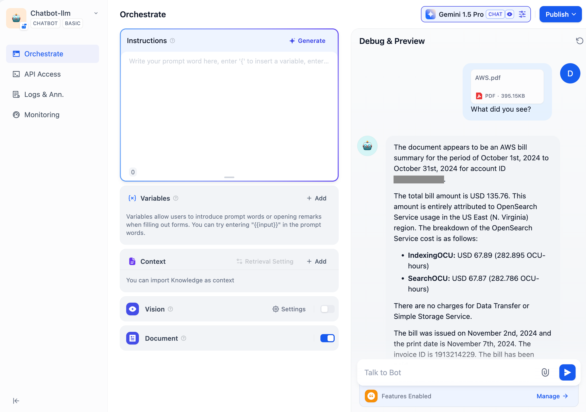

#### 调试

在右侧填写用户输入项，输入内容进行调试。

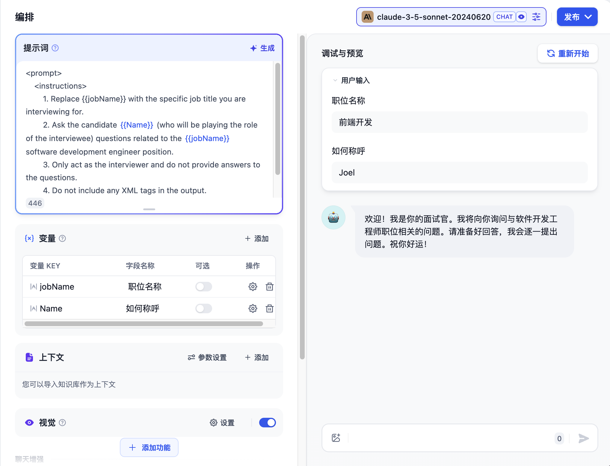

若 LLM 给出的回答结果不理想，你可以调整提示词或切换不同底层模型进行效果对比。如需更进一步，同时查看不同模型对于同一个问题的回答情况，请参考[多模型调试](https://docs.dify.ai/zh-hans/guides/application-orchestrate/multiple-llms-debugging)。

#### 发布应用

调试好应用后，点击右上角的 **“发布”** 按钮生成独立的 AI 应用。除了通过公开 URL 体验该应用，你也进行基于 APIs 的二次开发、嵌入至网站内等操作。详情请参考[发布](https://docs.dify.ai/zh-hans/guides/application-publishing)。

如果想定制已发布的应用，可以 Fork 我们的开源的 [WebApp 的模板](https://github.com/langgenius/webapp-conversation)。基于模板改成符合你的情景与风格需求的应用。

### 常见问题

**如何在聊天助手内添加第三方工具？**

聊天助手类型应用不支持添加第三方工具，你可以在 [Agent 类型](https://docs.dify.ai/zh-hans/guides/application-orchestrate/agent)应用内添加第三方工具。

**如何在创建聊天助手应用时，使用元数据功能筛选知识库内文档？**

如需了解如何使用元数据功能筛选文档，请参阅 [在应用内集成知识库](https://docs.dify.ai/zh-hans/guides/knowledge-base/integrate-knowledge-within-application) 中的“**使用元数据筛选知识 > 聊天助手**”章节。

<font style="color:rgb(62, 65, 70);">  
</font>


> 更新: 2025-05-27 09:30:55  
> 原文: <https://www.yuque.com/aaron-wecc3/dhluml/tc3zqh5xh3wg8rlp>