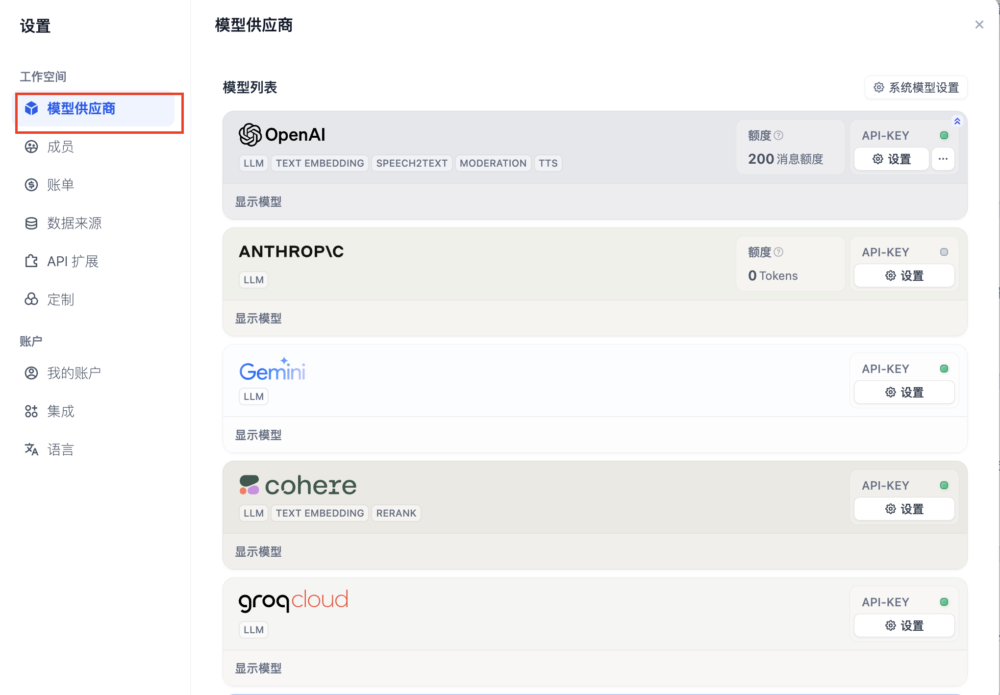
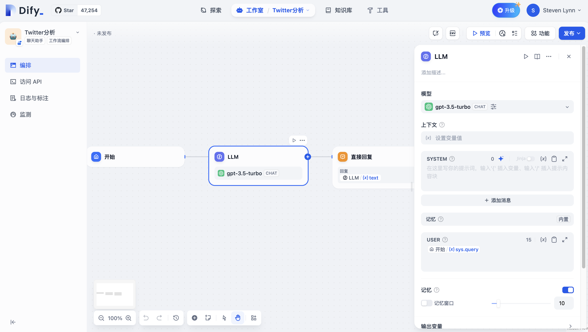
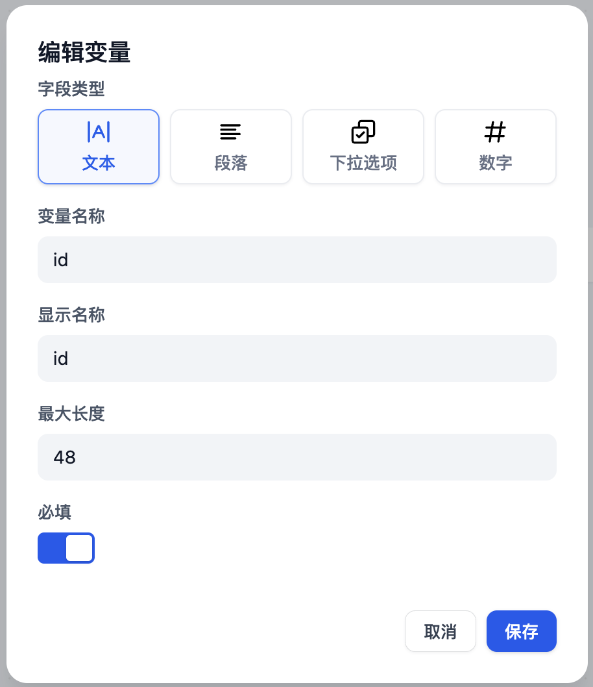
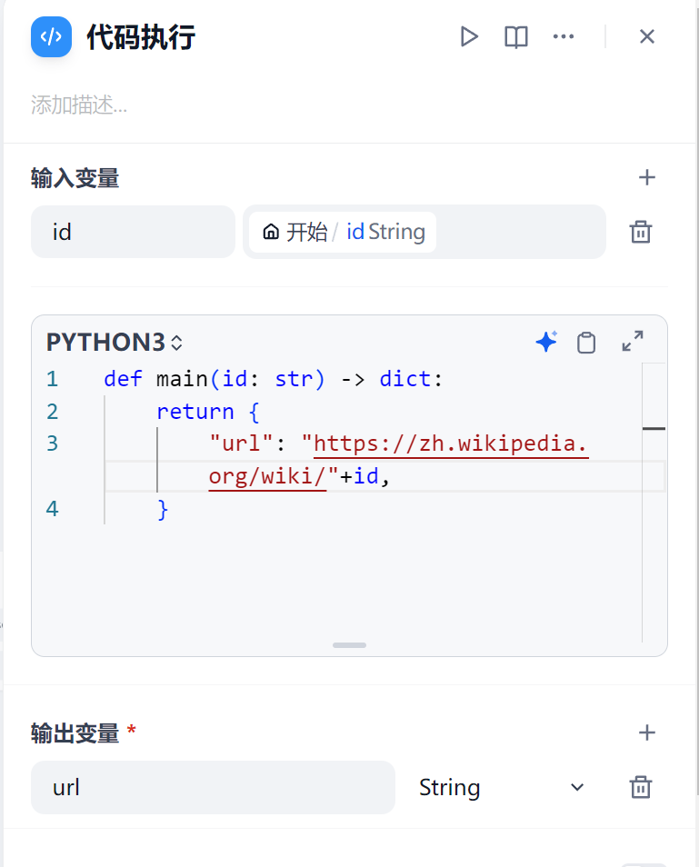
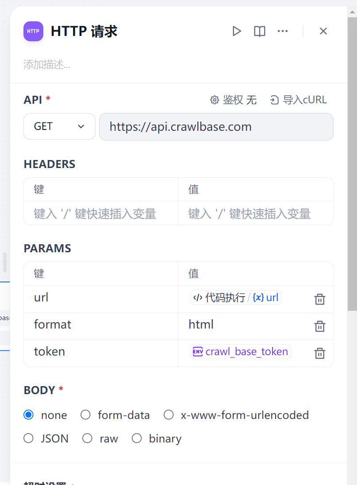
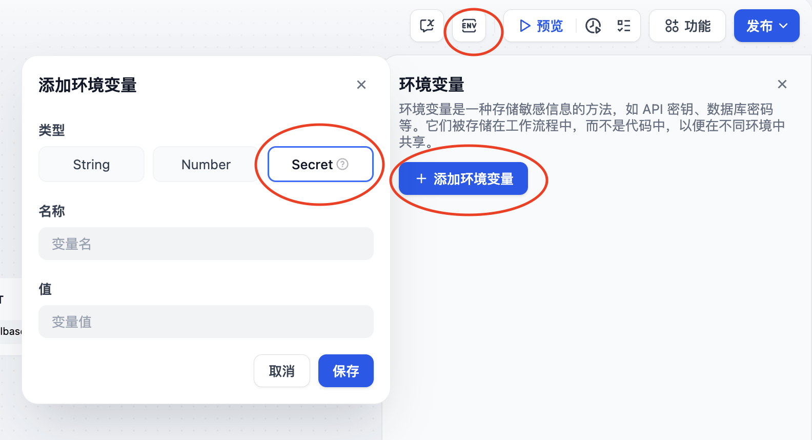
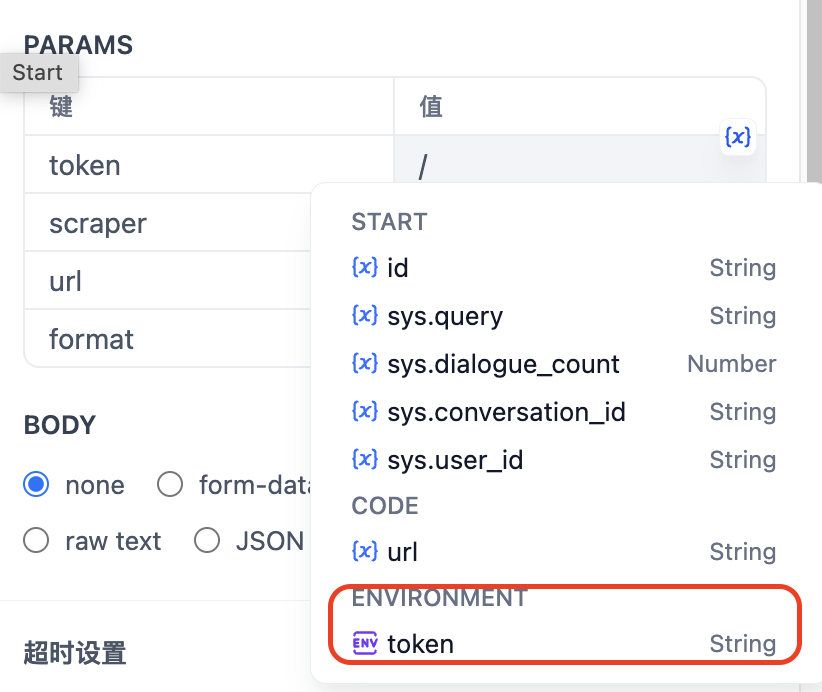
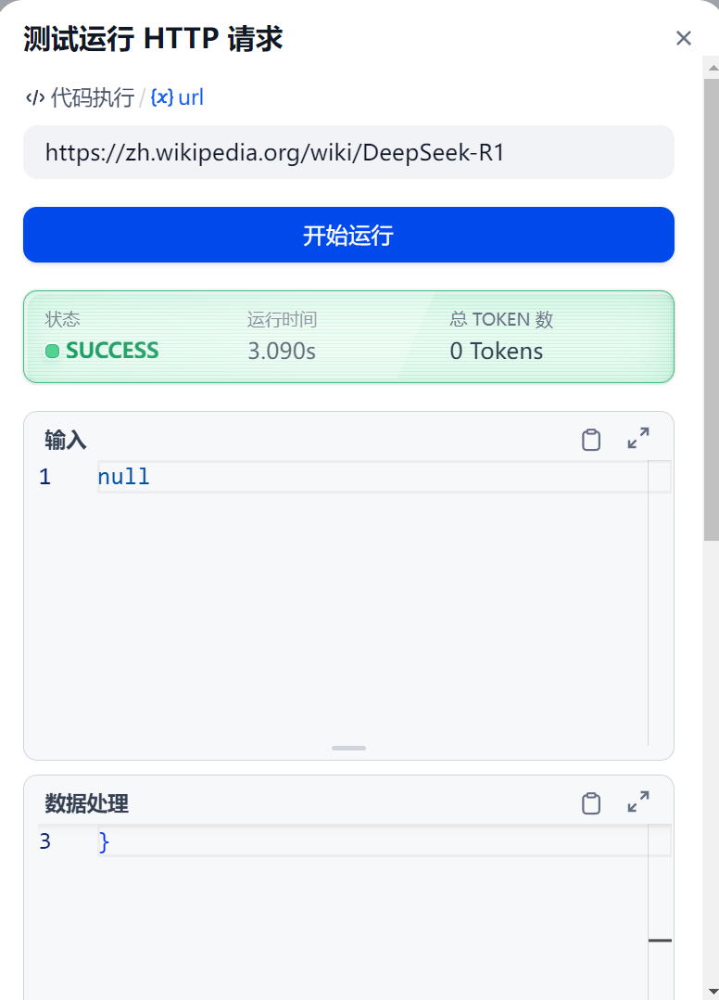
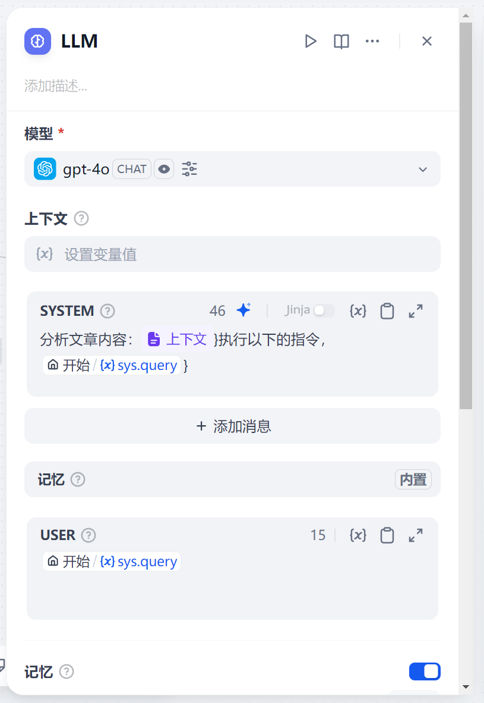

# 129.Dify基于工作流搭建社媒分析助手

## 课程内容

1. <font style="color:rgb(62, 65, 70);">ChatFlow 的基础知识</font>
2. <font style="color:rgb(62, 65, 70);">如何在 Dify 中避免明文密钥</font>
3. <font style="color:rgb(62, 65, 70);">HTTP 工具的使用</font>
4. <font style="color:rgb(62, 65, 70);">社媒文章分析助手搭建</font>

## 简介

<font style="color:rgb(62, 65, 70);">Dify 内置 HTTP 工具，我们可以通过发送 HTTP 请求来调用外部爬虫工具，实现社媒文章分析、文案改写</font>

<font style="color:rgb(62, 65, 70);"></font>

**<font style="color:rgb(62, 65, 70);">效果展示</font>**

<https://zh.wikipedia.org/wiki/DeepSeek-R1>


## **前提条件**

### 注册 Crawlbase

<font style="color:rgb(62, 65, 70);">Crawlbase 是一个为企业和开发者设计的全方位数据爬取和抓取平台，Crawlbase Scraper 可以从 X、Facebook 和 Instagram 等社交平台抓取数据。</font>

<font style="color:rgb(62, 65, 70);">点击注册：</font>[crawlbase.com](https://crawlbase.com/)

### Dify 平台

[Dify](https://cloud.dify.ai/)<font style="color:rgb(62, 65, 70);"> </font><font style="color:rgb(62, 65, 70);">是一个开源的 LLM 应用开发平台。你可以选择</font>[云服务](https://cloud.dify.ai/)<font style="color:rgb(62, 65, 70);">（开箱即用）或参考</font><font style="color:rgb(62, 65, 70);"> </font>[docker compose 本地](https://docs.dify.ai/getting-started/install-self-hosted)<font style="color:rgb(62, 65, 70);">自建 Dify 平台。我们需要使用 LLM 处理由 Crawlbase 抓取的社交平台数据。</font>

<font style="color:rgb(62, 65, 70);">Free 版本的 Dify 提供了免费 200 条 OpenAI 的消息额度，如果消息额度不够用，你可以参考下图步骤, 自定义其它模型供应商。</font>

<font style="color:rgb(62, 65, 70);">点击</font>**右上角头像 - 设置 - 模型供应商**



## 创建 ChatFlow 应用

<font style="color:rgb(62, 65, 70);">现在，让我们开始创建 ChatFlow。点击</font><code>**创建空白应用 - 工作流编排**</code><font style="color:rgb(62, 65, 70);">：</font>


<font style="color:rgb(62, 65, 70);">初始化的 Chatflow 应用如下：</font>



## 添加节点

### 开始节点

<font style="color:rgb(62, 65, 70);">在开始节点中，我们可以在聊天开始时添加一些系统变量。在本文中，我们需要一个 Twitter 用户的 ID 作为字符串变量。让我们将其命名为</font><code>**id**</code><font style="color:rgb(62, 65, 70);">。</font>

<font style="color:rgb(62, 65, 70);">点击开始节点并添加一个新变量：</font>



### 代码节点

<font style="color:rgb(62, 65, 70);">根据</font>[Crawlbase文档](https://crawlbase.com/docs/crawling-api/scrapers/#twitter-profile)<font style="color:rgb(62, 65, 70);">所述，变量</font><code>**url**</code><font style="color:rgb(62, 65, 70);">（将在下一个节点中使用）为 </font><https://zh.wikipedia.org/wiki/DeepSeek-R1>

<font style="color:rgb(62, 65, 70);">为了将用户ID转换为完整URL，我们可以使用以下Python代码将前缀</font><code>**https://twitter.com/**</code><font style="color:rgb(62, 65, 70);">与用户 ID 整合：</font>

Copy

```python
def main(id: str) -> dict:
    return {
        "url": "https://zh.wikipedia.org/wiki/"+id,
    }
```

<font style="color:rgb(62, 65, 70);">添加一个代码节点并选择 Python ，然后设置输入和输出变量名：</font>



### HTTP 请求节点

<font style="color:rgb(62, 65, 70);">根据</font><font style="color:rgb(62, 65, 70);"> </font>[Crawlbase文档](https://crawlbase.com/docs/crawling-api/scrapers/#twitter-profile)<font style="color:rgb(62, 65, 70);">，如果以 HTTP 请求格式抓取 Twitter 用户的个人资料，我们需要按以下格式填写 HTTP 请求节点：</font>



<font style="color:rgb(62, 65, 70);">出于安全考虑，最好不要直接将 API Key 作为明文输入。在 Dify 最新版本中，可以在</font><code>**环境变量**</code><font style="color:rgb(62, 65, 70);">中设置令牌值。点击</font><font style="color:rgb(62, 65, 70);"> </font><code>**env**</code><font style="color:rgb(62, 65, 70);"> </font><font style="color:rgb(62, 65, 70);">-</font><font style="color:rgb(62, 65, 70);"> </font><code>**添加变量**</code><font style="color:rgb(62, 65, 70);">来设置 API Key，这样就不会以明文出现在节点中。</font>



<font style="color:rgb(62, 65, 70);">点击</font>[此处](https://crawlbase.com/dashboard/account/docs)<font style="color:rgb(62, 65, 70);">获取 Crawlbase API Key。输入</font><font style="color:rgb(62, 65, 70);"> </font><code>**/**</code><font style="color:rgb(62, 65, 70);">插入为变量。</font>



<font style="color:rgb(62, 65, 70);">点击此节点的开始按钮，输入Elon Musk 的 URL 进行测试：</font>



### LLM 节点

<font style="color:rgb(62, 65, 70);">现在，我们可以使用 LLM 来分析 Crawlbase 抓取的结果并执行我们的命令。</font>

<font style="color:rgb(62, 65, 70);">变量</font><font style="color:rgb(62, 65, 70);"> </font><code>**context**</code><font style="color:rgb(62, 65, 70);"> </font><font style="color:rgb(62, 65, 70);">的值为 HTTP 请求节点的</font><font style="color:rgb(62, 65, 70);"> </font><code>**body**</code><font style="color:rgb(62, 65, 70);">。</font>

<font style="color:rgb(62, 65, 70);">以下是一个提示词示例。</font>



## 测试运行

<font style="color:rgb(62, 65, 70);">点击 </font><code>**预览**</code><font style="color:rgb(62, 65, 70);">开始测试运行，并在</font><code>**id**</code><font style="color:rgb(62, 65, 70);">中输入：DeepSeek-R1</font>

<font style="color:rgb(62, 65, 70);">例如，模仿我提供的wiki词条语言风格，写一篇关于deepseek-r1的入门文档</font>


<font style="color:rgb(62, 65, 70);">点击右上角的</font><code>**发布**</code><font style="color:rgb(62, 65, 70);">，并将其添加到你的网站中。</font>

##


> 更新: 2025-05-31 15:03:36  
> 原文: <https://www.yuque.com/aaron-wecc3/dhluml/rhsca9ogwzrst6vf>