# 130.Dify集成MCP服务实现文案创作

## <font style="color:rgb(51, 51, 51);">课程内容</font>

1. 为什么要用MCP服务
2. 安装 mcp-server 插件
3. 搭建要发布的工作流
4. 配置 MCP Server 插件
5. 在 dify 中调用 MCP Server
6. 在魔搭中测试

## <font style="color:rgb(51, 51, 51);">前言</font>

<font style="color:rgb(24, 24, 24);">MCP</font><font style="color:rgb(24, 24, 24);">即模型上下文协议（Model Context Protocol），是一种开放的通信协议，是人工智能领域的 “USB 接口”。MCP</font><font style="color:rgb(24, 24, 24);">在大模型和外部数据源（数据、工具、开发环境等）之间建立了双向且更加安全的连接，使用单一的标准协议取代碎片化的集成方式。如果把 LLM 比作人的大脑，MCP 就是手脚。LLM 不断提升智能下限，MCP 则是不断提升创意上限。</font>

### <font style="color:rgb(24, 24, 24);">在 MCP 出现前，大模型和数据源之间是如何连接的？</font>

* <font style="color:rgb(24, 24, 24);">利用 API 接口：如果数据源提供了 API 接口，开源大模型可以通过调用 API 来获取数据，包括数据的读取和写入等操作。</font>
* <font style="color:rgb(24, 24, 24);">基于特定代码编写：开发者针对具体的开源大模型和数据源，依据其各自的接口规范与数据格式要求，使用编程语言（如 Python）编写连接代码。以连接 MySQL 数据库与开源大模型为例，可利用 Python 的</font><code><font style="color:rgb(24, 24, 24);background-color:rgba(0, 0, 0, 0.04);">pymysql</font></code><font style="color:rgb(24, 24, 24);">库来建立数据库连接，获取数据后进行处理和转换，使其能被大模型理解和使用。</font>
* <font style="color:rgb(24, 24, 24);">AI 应用开发平台&编程框架</font>
  * <font style="color:rgb(24, 24, 24);">LangChain：是一个用于开发由语言模型驱动的应用程序的框架，能将开源大模型与各种数据源集成。如可以通过 LangChain 的</font><code><font style="color:rgb(24, 24, 24);background-color:rgba(0, 0, 0, 0.04);">SQLDatabaseChain</font></code><font style="color:rgb(24, 24, 24);">将大模型与关系型数据库连接，实现基于数据库数据的问答等功能。</font>
  * <font style="color:rgb(24, 24, 24);">LlamaIndex：主要用于构建向量数据库索引，方便大模型高效检索和利用数据。能将文本数据等处理成向量形式存入向量数据库，如 Pinecone 等，大模型在运行时可快速从向量数据库中获取相关上下文信息。</font>
  * <font style="color:rgb(24, 24, 24);">Dify&</font>[<font style="color:rgb(19, 102, 236);">百炼</font>](https://help.aliyun.com/zh/model-studio/what-is-model-studio)<font style="color:rgb(24, 24, 24);">：低代码 AI 应用开发平台，支持将开源大模型与多种数据源连接。用户通过简单的配置和少量代码，就能让大模型访问数据库、文件存储等数据源中的数据。</font>
* <font style="color:rgb(24, 24, 24);">采用插件系统：部分大模型有插件系统，类似于 OpenAI 的 ChatGPT 插件。开发者可开发插件来连接特定数据源，比如开发一个连接企业内部知识库的插件，使大模型能获取知识库中的信息进行回答。</font>

<font style="color:rgb(24, 24, 24);">MCP 的出现给开发者们提供了更多的选项，省去了接口代码的编写和维护工作。</font>

### <font style="color:rgb(24, 24, 24);">MCP 的核心架构</font>

<font style="color:rgb(24, 24, 24);">MCP 采用客户端-服务端架构，以下是 MCP 官方展示的架构：</font>

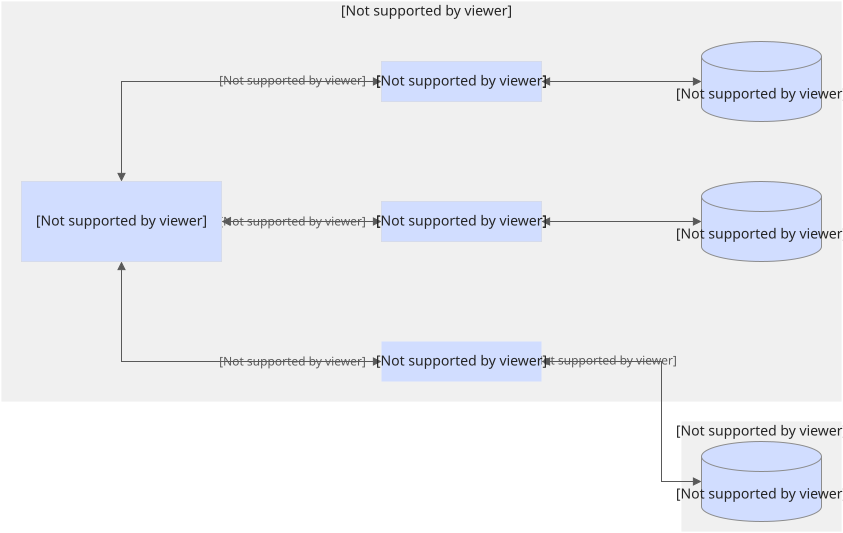

* <font style="color:rgb(24, 24, 24);">MCP Client（客户端）：作为调用方，是用户与 MCP 生态的交互入口。</font>

<font style="color:rgb(24, 24, 24);">例如，聊天应用类，提供自然语言交互服务，让用户通过对话调用 AI 能力；编码工具类，在 IDE 里调用外部应用和系统的能力；任务自动化类，帮用户自动化执行重复性任务，如数据处理、流程调度，以提升效率。</font>

* <font style="color:rgb(24, 24, 24);">MCP Server（服务端）：作为被调用方，提供后端服务支撑，包含各类核心功能模块。</font>

<font style="color:rgb(24, 24, 24);">例如，数据库类（如 ClickHouse、Supabase）负责数据存储、查询与管理；设计类（如 Figma、Blender）支撑设计创作、文件协作等功能；生产力工具类（如 Notion、Obsidian）提供笔记管理、知识整理等办公协作服务；支付类（如 Stripe），处理在线支付交易，支持商业场景的资金流转。</font>

* <font style="color:rgb(24, 24, 24);">Local MCP Server（本地数据源）：MCP 服务器可以安全访问本地计算机上的文件、数据库和服务。</font>
* <font style="color:rgb(24, 24, 24);">Remote MCP Server（远程服务源）：MCP 服务器可以通过互联网（例如通过 API）连接到外部系统。</font>

### <font style="color:rgb(24, 24, 24);">MCP 的运作机制</font>

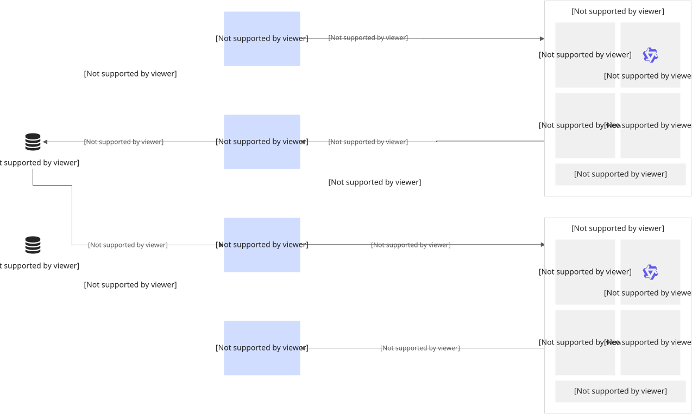

<font style="color:rgb(24, 24, 24);">如上图所示，一次基于MCP的调用，一共有6个核心的步骤。我们先拟定一个前提：</font>

<font style="color:rgb(51, 51, 51);">今天，我们要聚焦于 Dify 的一个新玩法，介绍一款同样强大的插件—— </font>**<font style="color:rgb(51, 51, 51);">mcp-server</font>**<font style="color:rgb(51, 51, 51);">。它的作用恰好相反：</font>**<font style="color:rgb(51, 51, 51);">可以将你在 Dify 上构建的应用直接发布成一个符合 MCP 标准的服务端点</font>**<font style="color:rgb(51, 51, 51);"> 。</font>

<font style="color:rgb(51, 51, 51);">这款由 Dify 社区贡献的 Extension 插件，安装后能让你的任意 Dify 应用变身为 MCP Server，允许外部兼容 MCP 协议的客户端直接访问。这为 Dify 应用的集成和共享提供了极大的便利。</font>

<font style="color:rgb(51, 51, 51);">下面，我们就来详细看看 </font>**<font style="color:rgb(51, 51, 51);">mcp-server</font>**<font style="color:rgb(51, 51, 51);"> 插件的核心功能以及如何一步步使用它。</font>

**<font style="color:rgb(51, 51, 51);">mcp-server 插件的核心功能</font>**

<font style="color:rgb(51, 51, 51);">简单来说，</font>**<font style="color:rgb(51, 51, 51);">mcp-server</font>**<font style="color:rgb(51, 51, 51);"> 主要做了三件事：</font>

**<font style="color:rgb(51, 51, 51);">1、将 Dify 应用暴露为 MCP 工具：</font>**<font style="color:rgb(51, 51, 51);"> 它能将你的整个 Dify 应用（无论简单或复杂）抽象成一个单一的 MCP 工具，方便外部 MCP 客户端（如 Cursor、Claude Desktop、Cline、Windsurf，甚至 Dify 自身等）发现和调用。</font>

**<font style="color:rgb(51, 51, 51);">2、利用 Dify Endpoint 功能生成访问入口：</font>**<font style="color:rgb(51, 51, 51);"> 当你为应用创建 Endpoint 后，会得到一个专属的 URL。外部 MCP 客户端可以通过这个 URL 直接连接到你的应用。</font>

**<font style="color:rgb(51, 51, 51);">3、提供标准的 MCP 服务：</font>**<font style="color:rgb(51, 51, 51);"> 插件会在 Dify 插件环境中自动运行一个 HTTP 服务。该服务基于 HTTP 和 SSE (Server-Sent Events) 协议，能够高效地处理外部 MCP 客户端的请求，包括协议握手、能力发现（告诉客户端它能做什么）以及实际的工具调用。</font>

<font style="color:rgb(51, 51, 51);">接下来，我们进入实操环节。</font>

## <font style="color:rgb(51, 51, 51);">一、安装 mcp-server 插件</font>

<font style="color:rgb(51, 51, 51);">在 dify 市场中搜索 MCP 相关的插件，找到该插件并点击【安装】即可。</font>

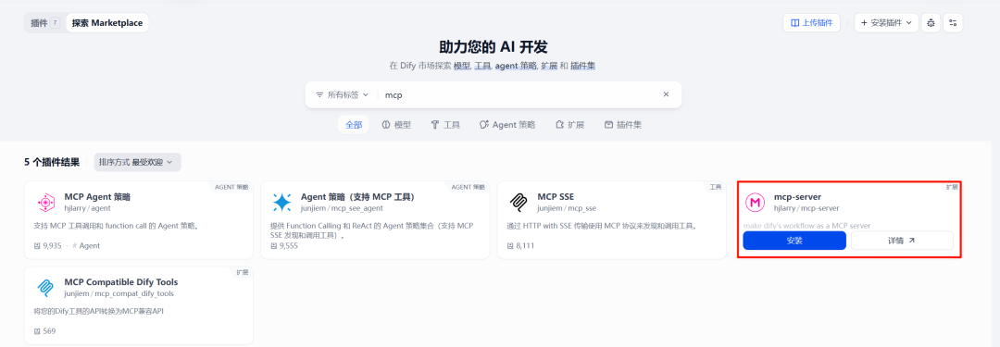

## <font style="color:rgb(51, 51, 51);">二、搭建要发布的工作流</font>

<font style="color:rgb(51, 51, 51);">你可以使用已有的 Dify 应用（聊天型或工作流型）来进行发布，或者新建一个。</font>

<font style="color:rgb(51, 51, 51);">为了方便演示，我创建了一个简单的</font>**<font style="color:rgb(51, 51, 51);">写诗工作流</font>**<font style="color:rgb(51, 51, 51);">：</font>

**<font style="color:rgb(51, 51, 51);">功能：</font>**<font style="color:rgb(51, 51, 51);"> 输入指定诗人的名字，让 LLM 模仿该诗人风格创作一首七律诗。</font>

**<font style="color:rgb(51, 51, 51);">搭建步骤：</font>**

**<font style="color:rgb(51, 51, 51);">开始节点：</font>**<font style="color:rgb(51, 51, 51);"> 添加一个字符串类型的输入变量 </font>**<font style="color:rgb(51, 51, 51);">author</font>**<font style="color:rgb(51, 51, 51);">，用于接收用户输入的诗人名字。</font>

**<font style="color:rgb(51, 51, 51);">LLM 节点：</font>**<font style="color:rgb(51, 51, 51);"> 接收 </font>**<font style="color:rgb(51, 51, 51);">author</font>**<font style="color:rgb(51, 51, 51);"> 变量，设置提示词（Prompt），例如：“请模仿诗人 {{author}} 的风格，创作一首七律诗。”</font>

**<font style="color:rgb(51, 51, 51);">结束节点：</font>**<font style="color:rgb(51, 51, 51);"> 输出 LLM 生成的结果。</font>

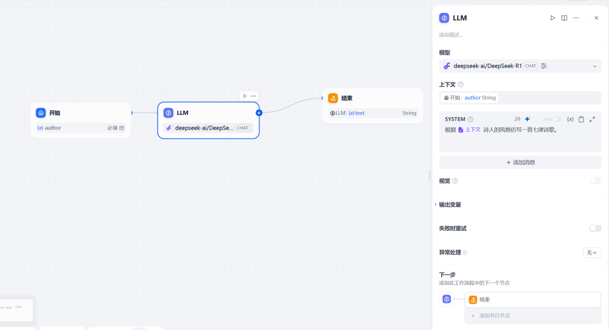

<font style="color:rgb(51, 51, 51);">测试一下：输入诗人的名字为杜甫。</font>

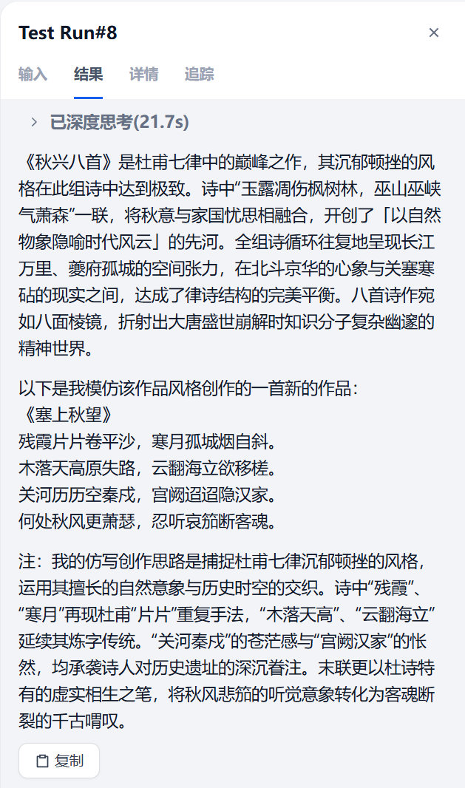

<font style="color:rgb(51, 51, 51);">测试成功后发布。</font>

## <font style="color:rgb(51, 51, 51);">三、配置 MCP Server 插件</font>

<font style="color:rgb(51, 51, 51);">设置 API 端点，主要填写端点名称、待发布的 APP、APP Type、App 输入参数四项。</font>

**<font style="color:rgb(51, 51, 51);">Endpoint Name：</font>**<font style="color:rgb(51, 51, 51);">Endpoint 名称，本示例为 poem。</font>

**<font style="color:rgb(51, 51, 51);">App：</font>**<font style="color:rgb(51, 51, 51);">选择要发布为 MCP Server 的 Dify 应用，选择上面创建的工作流写诗大神。</font>

**<font style="color:rgb(51, 51, 51);">App Type：</font>**<font style="color:rgb(51, 51, 51);">应用类型（Chat 或 Workflow），本示例为工作流。</font>

**<font style="color:rgb(51, 51, 51);">App Input Schema：</font>**<font style="color:rgb(51, 51, 51);">定义应用的输入参数，帮助外部系统理解与该应用的交互方式，格式为 JSON。</font>

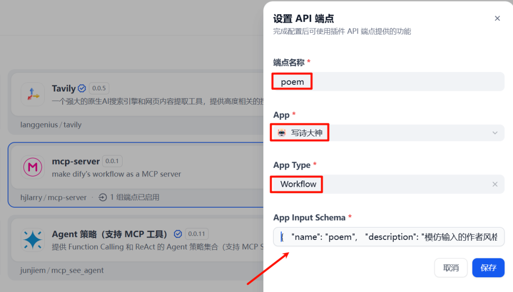

<font style="color:rgb(51, 51, 51);">输入参数内容如下：</font>

**<font style="color:rgb(51, 51, 51);">properties：</font>**<font style="color:rgb(51, 51, 51);">列出应用接收的所有参数及其类型。本示例的参数只有一个，author。</font>

**<font style="color:rgb(51, 51, 51);">description：</font>**<font style="color:rgb(51, 51, 51);">用于向 MCP Client 说明此应用的主要功能，帮助系统在需要时自动发现并调用。</font>

**<font style="color:rgb(51, 51, 51);">required：</font>**<font style="color:rgb(51, 51, 51);">声明调用应用时必须提供的参数。对于聊天类应用（Agent / Chatflow），参数是通常是必需的。</font>

<font style="color:rgb(51, 51, 51);">这块大家可以拷贝，根据自己的实际情况进行替换。</font>

<font style="color:rgb(51, 51, 51);">主要是 name、description、title、properties 中的参数名称、required 后面的值。</font>

```plain
{
  "name": "poem",
  "description": "模仿输入的作者风格写诗歌",
  "inputSchema": {
    "title": "poem",
    "type": "object",
    "properties": {
      "author": {
        "title": "author",
        "description": "作者",
        "type": "string"
      }
    },
    "required": ["author"]  
  }
}
```

<font style="color:rgb(51, 51, 51);">保存配置后将会自动生成 Endpoint URL。</font>**<font style="color:rgb(51, 51, 51);">我们后续用到的是 GET 后面的 URL 地址。</font>**

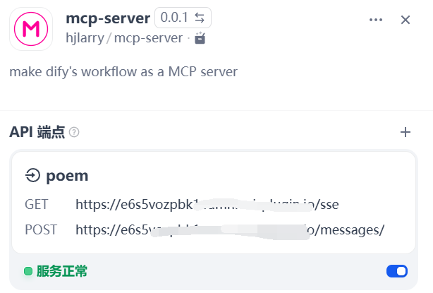

## <font style="color:rgb(51, 51, 51);">四、测试</font>

### <font style="color:rgb(51, 51, 51);">4.1 在 dify 中调用 MCP Server</font>

<font style="color:rgb(51, 51, 51);">在 dify 中使用 MCP 的话，需要安装插件 mcp-sse。</font>

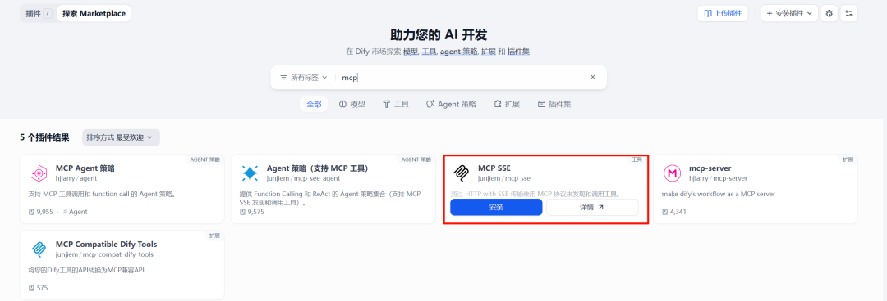

<font style="color:rgb(51, 51, 51);">找到我们安装好的这个工具，设置授权，支持设置多个 mcp 服务。</font>

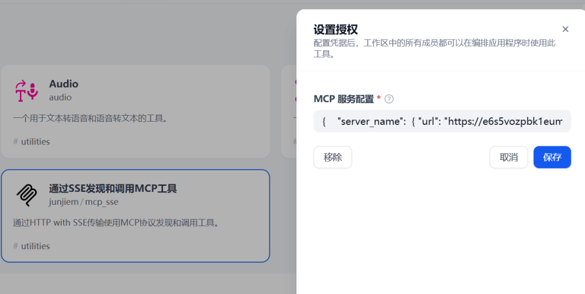

<font style="color:rgb(51, 51, 51);">具体配置如下，url 替换为你发布的 mcp server 自动生成的 url 地址。</font>

```plain
{   
    "server_name": 
    { 
    "url": "https://e******/sse",  
    "headers": {},  
    "timeout": 60,     
    "sse_read_timeout": 300  
    } 
}
```

<font style="color:rgb(51, 51, 51);">配置好后新建一个 Agent 可以测试一下。</font>

<font style="color:rgb(51, 51, 51);">需要添加一下 MCP SSE 工具。</font>

```python
提示词：调用mcp工具回答用户问题，先获取工具列表，再选中可用的工具，最后返回工具结果中的诗歌原文及解析
```

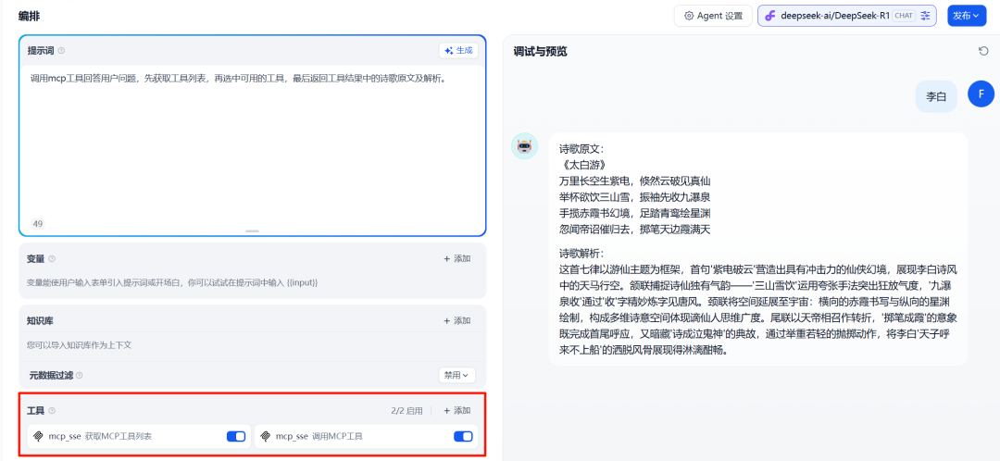

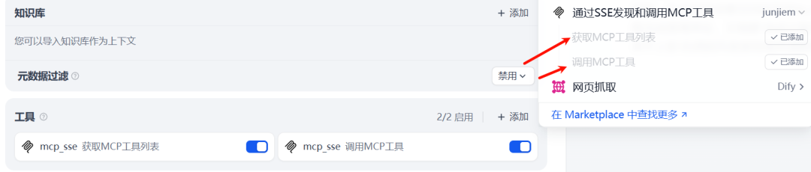

<font style="color:rgb(51, 51, 51);">可以看到 DeepSeek R1 的思考过程，根据提示词的要求先调用功能工具列表，查找可用的工具。然后在调用可用的工具回答问题。</font>

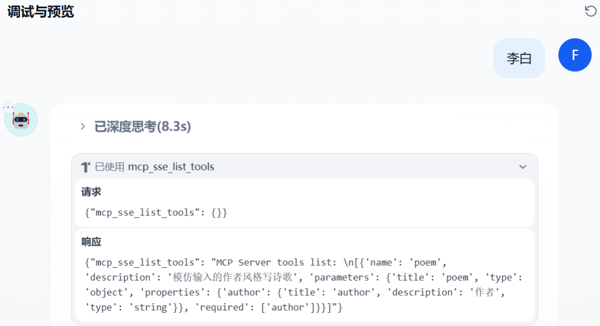

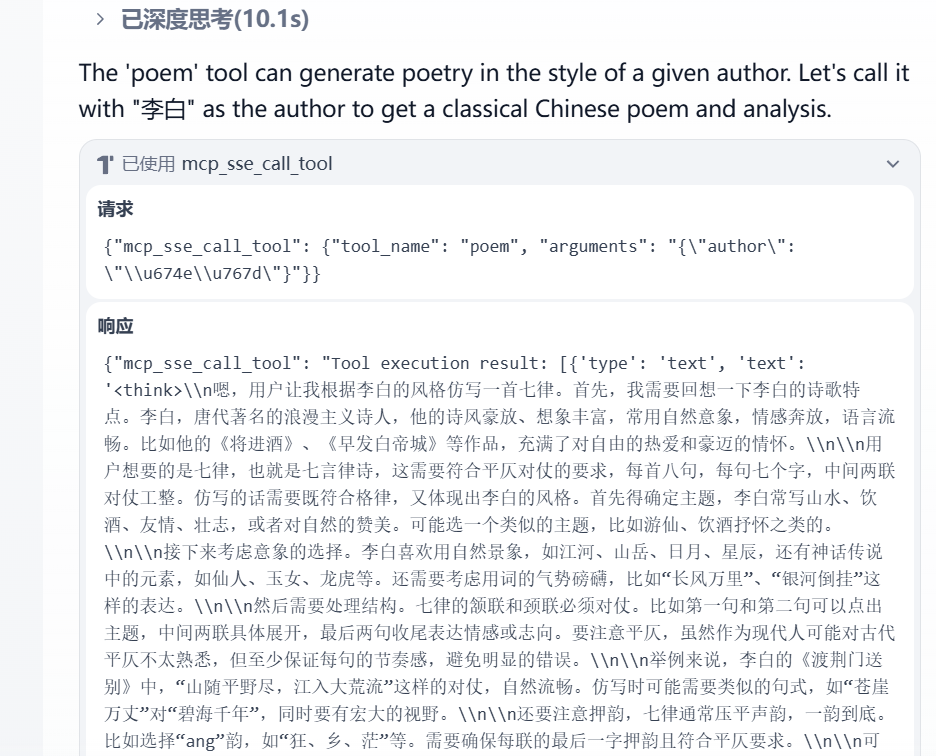

### <font style="color:rgb(51, 51, 51);">4.2 在魔搭中测试</font>

<font style="color:rgb(51, 51, 51);">之前有一期介绍过魔搭社区，可以测试自己搭建的 MCP Server。</font>

<https://modelscope.cn/studios/modelscope/mcp-playground>

<font style="color:rgb(51, 51, 51);">在 MCP 实验场中添加 MPC Server，填写名称和 SSE 链接。</font>

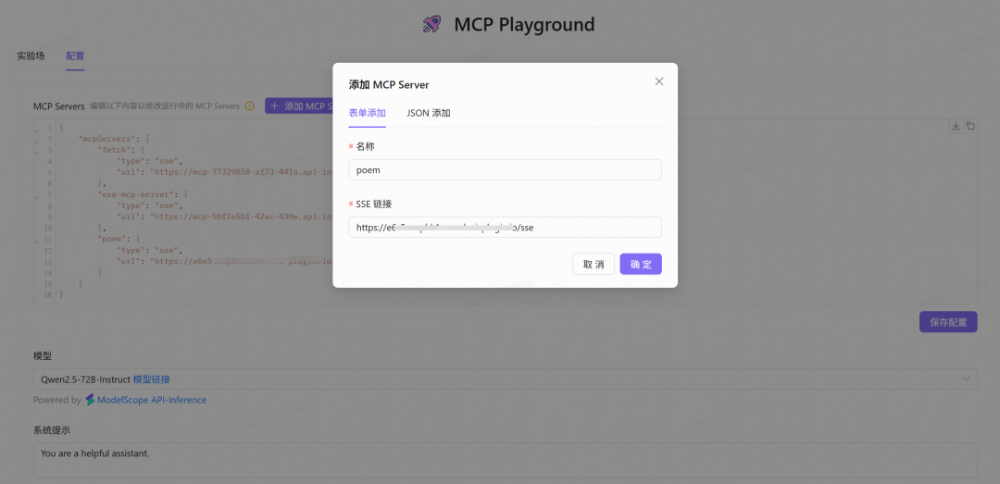

<font style="color:rgb(51, 51, 51);">添加完成后来测试一下。</font>

```python
提示词：请使用 poem 服务的功能帮我查询信息或解决问题
```

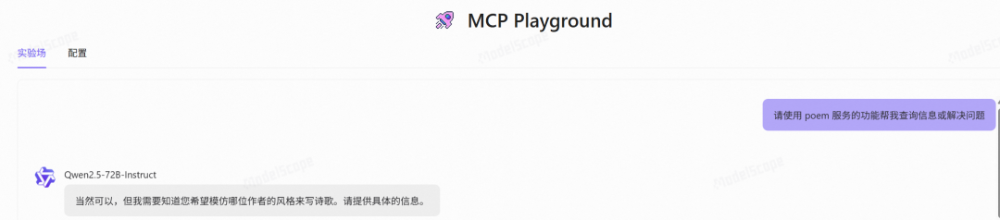

<font style="color:rgb(51, 51, 51);">输入诗人名称，可以看到调用了 MCP 工具，给的参数为李白成功拿到了结果。</font>

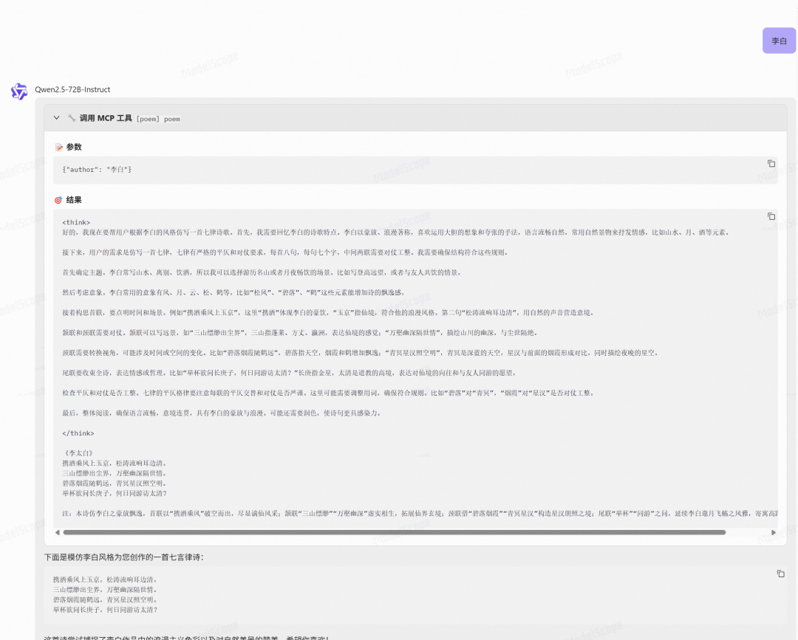

<font style="color:rgb(51, 51, 51);">通过以上步骤，可以看到 </font>**<font style="color:rgb(51, 51, 51);">mcp-server</font>**<font style="color:rgb(51, 51, 51);"> 插件提供了一种相当便捷的方式，能够将我们精心构建的 Dify 应用（）转化为标准的 MCP Server，供内外部各种客户端调用。这无疑大大增强了 Dify 应用的通用性和集成能力。</font>

<font style="color:rgb(51, 51, 51);">虽然目前配置 App Input Schema 的 JSON 格式还需要一些手动操作，可能略显繁琐，但相比于从零开始搭建服务接口，已经简化了许多。</font>

<font style="color:rgb(51, 51, 51);">期待未来 Dify 不需要这么稍显麻烦的配置就能发布了。</font>


> 更新: 2025-05-31 15:03:36  
> 原文: <https://www.yuque.com/aaron-wecc3/dhluml/kzs9gwrsoatpqhvs>