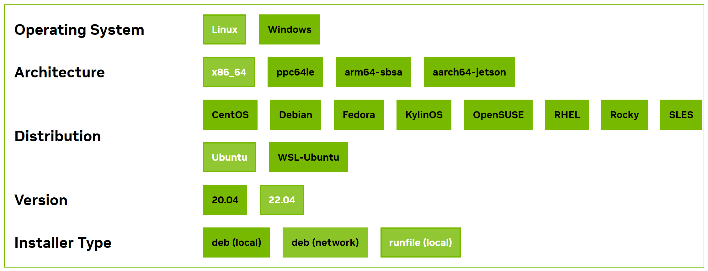
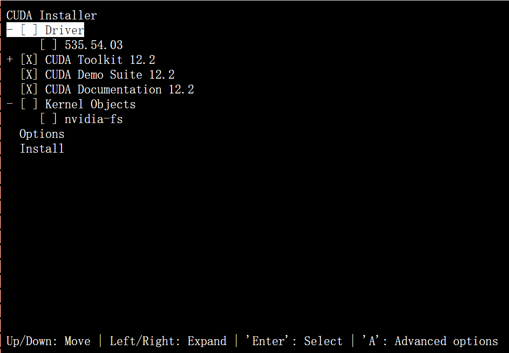
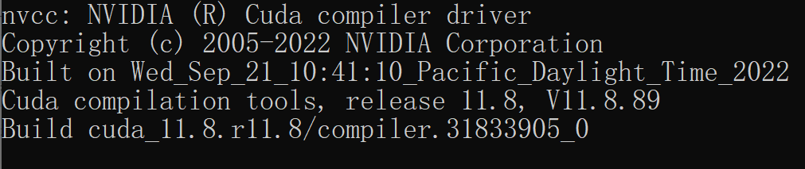
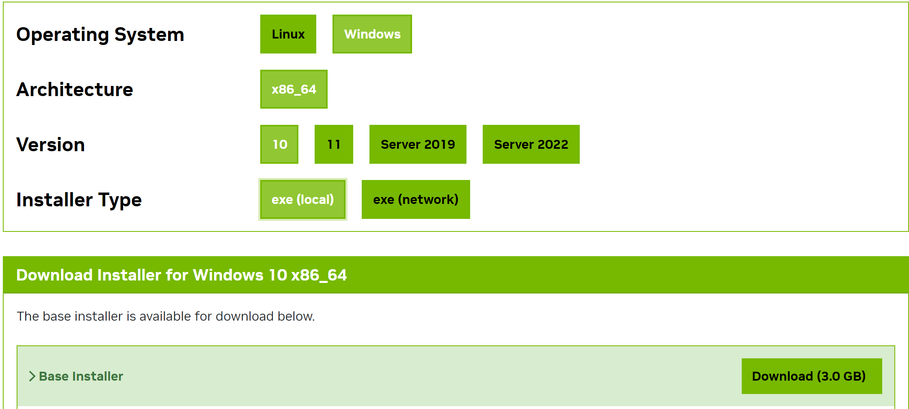
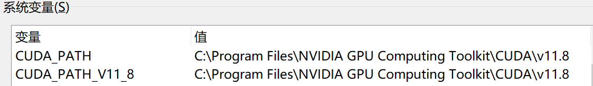
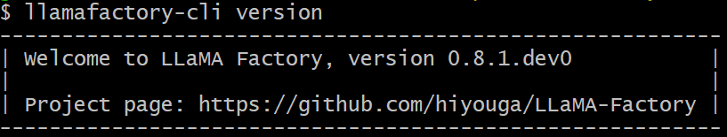

# 132.LLaMA Factory模型训练快速入门

# 示例代码

[llamafactory-quick.zip](https://www.yuque.com/attachments/yuque/0/2025/zip/2424104/1748917156376-e03e6dcc-a169-48c0-bb97-f7bacb56fb1f.zip)

# 前言

<font style="color:rgb(51, 51, 51);">随着</font>[<font style="color:rgb(51, 51, 51);">人工智能</font>](https://so.csdn.net/so/search?q=%E4%BA%BA%E5%B7%A5%E6%99%BA%E8%83%BD\&spm=1001.2101.3001.7020)<font style="color:rgb(51, 51, 51);">技术的飞速发展，大型语言模型（LLM）在自然语言处理（NLP）领域扮演着越来越重要的角色。然而，预训练的模型往往需要针对特定任务进行微调，以提高其在特定领域的性能。因为预训练模型是在大量数据上训练得到的，它已经学习到了语言的基本规律和丰富的特征表示。然而，这些模型可能并不直接适用于特定的任务或领域，因为它们可能缺乏对特定领域知识的理解和适应性。</font>

## <font style="color:rgb(0, 0, 0);">LLaMA Factory 介绍</font>


<font style="color:rgb(0, 0, 0);">项目地址：</font><https://github.com/hiyouga/LLaMA-Factory/blob/main/README_zh.md>

<font style="color:rgb(0, 0, 0);">LLaMA Factory 是一个简单易用且高效的大型语言模型（Large Language Model）训练与微调平台。</font><font style="color:rgb(51, 51, 51);">致力于简化大型的定制过程。它集成了多种训练策略和监控工具，提供了命令行和 WebUI 等多种交互方式，大幅降了模型微调的技术门槛。</font><font style="color:rgb(0, 0, 0);">通过 LLaMA Factory，可以在无需编写任何代码的前提下，在本地完成上百种预训练模型的微调，框架特性包括：</font>

* <font style="color:rgb(0, 0, 0);">模型种类：LLaMA、LLaVA、Mistral、Mixtral-MoE、Qwen、Yi、Gemma、Baichuan、ChatGLM、Phi 等等。</font>
* <font style="color:rgb(0, 0, 0);">训练算法：（增量）预训练、（多模态）指令监督微调、奖励模型训练、PPO 训练、DPO 训练、KTO 训练、ORPO 训练等等。</font>
* <font style="color:rgb(0, 0, 0);">运算精度：16 比特全参数微调、冻结微调、LoRA 微调和基于 AQLM/AWQ/GPTQ/LLM.int8/HQQ/EETQ 的 2/3/4/5/6/8 比特 QLoRA 微调。</font>
* <font style="color:rgb(0, 0, 0);">优化算法：GaLore、BAdam、DoRA、LongLoRA、LLaMA Pro、Mixture-of-Depths、LoRA+、LoftQ 和 PiSSA。</font>
* <font style="color:rgb(0, 0, 0);">加速算子：FlashAttention-2 和 Unsloth。</font>
* <font style="color:rgb(0, 0, 0);">推理引擎：Transformers 和 vLLM。</font>
* <font style="color:rgb(0, 0, 0);">实验监控：LlamaBoard、TensorBoard、Wandb、MLflow、SwanLab 等等。</font>

## <font style="color:rgb(51, 51, 51);">LLaMA Factory </font><font style="color:rgb(51, 51, 51);">核心功能</font>

* <font style="color:rgb(51, 51, 51);">多模型兼容：支持包括 LLama、Mistral、Falcon 在内的多种大型语言模型。</font>
* <font style="color:rgb(51, 51, 51);">训练方法多样：涵盖全参数微调及 LoRA 等先进的微调技术。</font>
* <font style="color:rgb(51, 51, 51);">用户界面友好：LLama Board 提供了一个直观的 Web 界面，使用户能够轻松调整模型设置。</font>
* <font style="color:rgb(51, 51, 51);">监控工具集成：与 TensorBoard 等工具集成，便于监控和分析训练过程。</font>

## <font style="color:rgb(51, 51, 51);">LLaMA Factory 特点</font>

* <font style="color:rgb(51, 51, 51);">易用性：简化了机器学习算法的复杂性，通过图形界面即可控制模型微调。</font>
* <font style="color:rgb(51, 51, 51);">微调效率：支持 DPO、ORPO、PPO 和 SFT 等技术，提升了模型微调的效率和效果。</font>
* <font style="color:rgb(51, 51, 51);">参数调整灵活性：用户可根据需求轻松调整模型参数，如 dropout 率、epochs 等。</font>
* <font style="color:rgb(51, 51, 51);">多语言支持：界面支持英语、俄语和中文，面向全球用户提供服务。</font>

## <font style="color:rgb(51, 51, 51);">LLaMA Factory </font><font style="color:rgb(51, 51, 51);">使用场景</font>

<font style="color:rgb(51, 51, 51);">LLaMA-Factory 适用于广泛的 NLP 任务，包括但不限于：</font>

* <font style="color:rgb(51, 51, 51);">文本分类：实现情感分析、主题识别等功能。</font>
* <font style="color:rgb(51, 51, 51);">序列标注：如 NER、词性标注等任务。</font>
* <font style="color:rgb(51, 51, 51);">文本生成：自动生成文本摘要、对话等。</font>
* <font style="color:rgb(51, 51, 51);">机器翻译：优化特定语言对的翻译质量。</font>

<font style="color:rgb(51, 51, 51);">LLaMA-Factory 通过其强大的功能和易用性，助力用户在</font>[<font style="color:rgb(51, 51, 51);">自然语言处理</font>](https://so.csdn.net/so/search?q=%E8%87%AA%E7%84%B6%E8%AF%AD%E8%A8%80%E5%A4%84%E7%90%86\&spm=1001.2101.3001.7020)<font style="color:rgb(51, 51, 51);">领域快速实现模型的定制和优化。</font>

## <font style="color:rgb(51, 51, 51);">微调的过程</font>

<font style="color:rgb(51, 51, 51);">模型微调通过在特定任务的数据集上继续训练预训练模型来进行，使得模型能够学习到与任务相关的特定特征和知识。这个过程通常涉及到模型权重的微幅调整，而不是从头开始训练一个全新的模型。</font>

<font style="color:rgb(51, 51, 51);">微调过程主要包括以下几个步骤： </font>

1. <font style="color:rgb(51, 51, 51);">数据准备：收集和准备特定任务的数据集。 </font>
2. <font style="color:rgb(51, 51, 51);">模型选择：选择一个预训练模型作为基础模型。 </font>
3. <font style="color:rgb(51, 51, 51);">迁移学习：在新数据集上继续训练模型，同时保留预训练模型的知识。 </font>
4. <font style="color:rgb(51, 51, 51);">参数调整：根据需要调整模型的参数，如学习率、批大小等。 </font>
5. <font style="color:rgb(51, 51, 51);">模型评估：在验证集上评估模型的性能，并根据反馈进行调整。</font>

## <font style="color:rgb(51, 51, 51);">微调的优势</font>

<font style="color:rgb(51, 51, 51);">微调技术带来了多方面的优势：</font><font style="color:rgb(51, 51, 51);">资源效率：相比于从头开始训练模型，微调可以显著减少所需的数据量和计算资源。</font><font style="color:rgb(51, 51, 51);">快速部署：微调可以快速适应新任务，加速模型的部署过程。</font><font style="color:rgb(51, 51, 51);">性能提升：针对特定任务的微调可以提高模型的准确性和鲁棒性。</font><font style="color:rgb(51, 51, 51);">领域适应性：微调可以帮助模型更好地理解和适应特定领域的语言特点。</font>

<font style="color:rgb(51, 51, 51);">通过微调，可以使得预训练模型在这些任务上取得更好的性能，更好地满足实际应用的需求。</font>

# <font style="color:rgb(0, 0, 0);">环境安装</font>

## <font style="color:rgb(0, 0, 0);">Linux</font>

### <font style="color:rgb(0, 0, 0);">CUDA 安装</font>

<font style="color:rgb(0, 0, 0);">CUDA 是由 NVIDIA 创建的一个并行计算平台和编程模型，它让开发者可以使用 NVIDIA 的 GPU 进行高性能的并行计算。</font>

<font style="color:rgb(0, 0, 0);">首先，在</font><font style="color:rgb(0, 0, 0);"> </font>[https://developer.nvidia.com/cuda-gpus](https://developer.nvidia.com/cuda-gpus/)<font style="color:rgb(0, 0, 0);"> </font><font style="color:rgb(0, 0, 0);">查看您的 GPU 是否支持CUDA</font>

1. <font style="color:rgb(0, 0, 0);">保证当前 Linux 版本支持CUDA. 在命令行中输入</font><font style="color:rgb(0, 0, 0);"> </font><code><font style="color:rgb(0, 0, 0);">uname</font><font style="color:rgb(0, 0, 0);"> </font><font style="color:rgb(0, 0, 0);">-m</font><font style="color:rgb(0, 0, 0);"> </font><font style="color:rgb(0, 0, 0);">&&</font><font style="color:rgb(0, 0, 0);"> </font><font style="color:rgb(0, 0, 0);">cat</font><font style="color:rgb(0, 0, 0);"> </font><font style="color:rgb(0, 0, 0);">/etc/*release</font></code><font style="color:rgb(0, 0, 0);">，应当看到类似的输出</font>

```plain
x86_64
DISTRIB_ID=Ubuntu
DISTRIB_RELEASE=22.04
```

2. <font style="color:rgb(0, 0, 0);">检查是否安装了</font><font style="color:rgb(0, 0, 0);"> </font><code><font style="color:rgb(0, 0, 0);">gcc</font></code><font style="color:rgb(0, 0, 0);"> </font><font style="color:rgb(0, 0, 0);">. 在命令行中输入</font><font style="color:rgb(0, 0, 0);"> </font><code><font style="color:rgb(0, 0, 0);">gcc</font><font style="color:rgb(0, 0, 0);"> </font><font style="color:rgb(0, 0, 0);">--version</font></code><font style="color:rgb(0, 0, 0);"> </font><font style="color:rgb(0, 0, 0);">，应当看到类似的输出</font>

```plain
gcc (Ubuntu 11.4.0-1ubuntu1~22.04) 11.4.0
```

3. <font style="color:rgb(0, 0, 0);">在以下网址下载所需的 CUDA，这里推荐12.2版本。</font><font style="color:rgb(0, 0, 0);"> </font>[https://developer.nvidia.com/cuda-gpus](https://developer.nvidia.com/cuda-12-2-0-download-archive/)<font style="color:rgb(0, 0, 0);"> </font><font style="color:rgb(0, 0, 0);">注意需要根据上述输出选择正确版本</font>



<font style="color:rgb(0, 0, 0);">如果您之前安装过 CUDA(例如为12.1版本)，需要先使用</font><font style="color:rgb(0, 0, 0);"> </font><code><font style="color:rgb(0, 0, 0);">sudo</font><font style="color:rgb(0, 0, 0);"> </font><font style="color:rgb(0, 0, 0);">/usr/local/cuda-12.1/bin/cuda-uninstaller</font></code><font style="color:rgb(0, 0, 0);"> </font><font style="color:rgb(0, 0, 0);">卸载。如果该命令无法运行，可以直接：</font>

```plain
sudo rm -r /usr/local/cuda-12.1/
sudo apt clean && sudo apt autoclean
```

<font style="color:rgb(0, 0, 0);">卸载完成后运行以下命令并根据提示继续安装：</font>

```plain
wget https://developer.download.nvidia.com/compute/cuda/12.2.0/local_installers/cuda_12.2.0_535.54.03_linux.run
sudo sh cuda_12.2.0_535.54.03_linux.run
```

**<font style="color:rgb(0, 0, 0);">注意</font>**<font style="color:rgb(0, 0, 0);">:在确定 CUDA 自带驱动版本与 GPU 是否兼容之前,建议取消 Driver 的安装。</font>



<font style="color:rgb(0, 0, 0);">完成后输入</font><font style="color:rgb(0, 0, 0);"> </font><code><font style="color:rgb(0, 0, 0);">nvcc</font><font style="color:rgb(0, 0, 0);"> </font><font style="color:rgb(0, 0, 0);">-V</font></code><font style="color:rgb(0, 0, 0);"> </font><font style="color:rgb(0, 0, 0);">检查是否出现对应的版本号，若出现则安装完成。</font>



## <font style="color:rgb(0, 0, 0);">Windows</font>

### <font style="color:rgb(0, 0, 0);">CUDA 安装</font>

1. <font style="color:rgb(0, 0, 0);">打开</font><font style="color:rgb(0, 0, 0);"> </font>**<font style="color:rgb(0, 0, 0);">设置</font>**<font style="color:rgb(0, 0, 0);"> </font><font style="color:rgb(0, 0, 0);">，在</font><font style="color:rgb(0, 0, 0);"> </font>**<font style="color:rgb(0, 0, 0);">关于</font>**<font style="color:rgb(0, 0, 0);"> </font><font style="color:rgb(0, 0, 0);">中找到</font><font style="color:rgb(0, 0, 0);"> </font>**<font style="color:rgb(0, 0, 0);">Windows 规格</font>**<font style="color:rgb(0, 0, 0);"> </font><font style="color:rgb(0, 0, 0);">保证系统版本在以下列表中：</font>

| <font style="color:rgb(0, 0, 0);">支持版本号</font> |
| --- |
| <font style="color:rgb(0, 0, 0);">Microsoft Windows 11 21H2</font> |
| <font style="color:rgb(0, 0, 0);">Microsoft Windows 11 22H2-SV2</font> |
| <font style="color:rgb(0, 0, 0);">Microsoft Windows 11 23H2</font> |
| <font style="color:rgb(0, 0, 0);">Microsoft Windows 10 21H2</font> |
| <font style="color:rgb(0, 0, 0);">Microsoft Windows 10 22H2</font> |
| <font style="color:rgb(0, 0, 0);">Microsoft Windows Server 2022</font> |

2. <font style="color:rgb(0, 0, 0);">选择对应的版本下载并根据提示安装。</font>



3. <font style="color:rgb(0, 0, 0);">打开 cmd 输入</font><font style="color:rgb(0, 0, 0);"> </font><code><font style="color:rgb(0, 0, 0);">nvcc</font><font style="color:rgb(0, 0, 0);"> </font><font style="color:rgb(0, 0, 0);">-V</font></code><font style="color:rgb(0, 0, 0);"> </font><font style="color:rgb(0, 0, 0);">，若出现类似内容则安装成功。</font>


<font style="color:rgb(0, 0, 0);">否则，检查系统环境变量，保证 CUDA 被正确导入。</font>



## <font style="color:rgb(0, 0, 0);">LLaMA-Factory 安装</font>

<font style="color:rgb(0, 0, 0);">在安装 LLaMA-Factory 之前，请确保您安装了下列依赖:</font>

<font style="color:rgb(0, 0, 0);">运行以下指令以安装 LLaMA-Factory 及其依赖:</font>

```plain
git clone --depth 1 https://github.com/hiyouga/LLaMA-Factory.git
cd LLaMA-Factory
pip install -e ".[torch,metrics]"
```

<font style="color:rgb(0, 0, 0);">如果出现环境冲突，请尝试使用</font><font style="color:rgb(0, 0, 0);"> </font><code><font style="color:rgb(0, 0, 0);">pip</font><font style="color:rgb(0, 0, 0);"> </font><font style="color:rgb(0, 0, 0);">install</font><font style="color:rgb(0, 0, 0);"> </font><font style="color:rgb(0, 0, 0);">--no-deps</font><font style="color:rgb(0, 0, 0);"> </font><font style="color:rgb(0, 0, 0);">-e</font><font style="color:rgb(0, 0, 0);"> </font><font style="color:rgb(0, 0, 0);">.</font></code><font style="color:rgb(0, 0, 0);"> </font><font style="color:rgb(0, 0, 0);">解决</font>

## <font style="color:rgb(0, 0, 0);">LLaMA-Factory 校验</font>

<font style="color:rgb(0, 0, 0);">完成安装后，可以通过使用</font><font style="color:rgb(0, 0, 0);"> </font><code><font style="color:rgb(0, 0, 0);">llamafactory-cli</font><font style="color:rgb(0, 0, 0);"> </font><font style="color:rgb(0, 0, 0);">version</font></code><font style="color:rgb(0, 0, 0);"> </font><font style="color:rgb(0, 0, 0);">来快速校验安装是否成功</font>

<font style="color:rgb(0, 0, 0);">如果您能成功看到类似下面的界面，就说明安装成功了。</font>



## <font style="color:rgb(0, 0, 0);">LLaMA-Factory 高级选项</font>

### <font style="color:rgb(0, 0, 0);">Windows</font>

#### <font style="color:rgb(0, 0, 0);">QLoRA</font>

<font style="color:rgb(0, 0, 0);">如果您想在 Windows 上启用量化 LoRA（QLoRA），请根据您的 CUDA 版本选择适当的</font><font style="color:rgb(0, 0, 0);"> </font>[bitsandbytes](https://github.com/jllllll/bitsandbytes-windows-webui/releases/tag/wheels/)<font style="color:rgb(0, 0, 0);"> </font><font style="color:rgb(0, 0, 0);">发行版本。</font>

```plain
pip install https://github.com/jllllll/bitsandbytes-windows-webui/releases/download/wheels/bitsandbytes-0.41.2.post2-py3-none-win_amd64.whl
```

#### <font style="color:rgb(0, 0, 0);">FlashAttention-2</font>

<font style="color:rgb(0, 0, 0);">如果您要在 Windows 平台上启用 FlashAttention-2，请根据您的 CUDA 版本选择适当的</font><font style="color:rgb(0, 0, 0);"> </font>[flash-attention](https://github.com/bdashore3/flash-attention/releases/)<font style="color:rgb(0, 0, 0);"> </font><font style="color:rgb(0, 0, 0);">发行版本。</font>

### <font style="color:rgb(0, 0, 0);">Extra Dependency</font>

<font style="color:rgb(0, 0, 0);">如果您有更多需求，请安装对应依赖。</font>

| <font style="color:rgb(0, 0, 0);">名称</font> | <font style="color:rgb(0, 0, 0);">描述</font> |
| --- | --- |
| <font style="color:rgb(0, 0, 0);">torch</font> | <font style="color:rgb(0, 0, 0);">开源深度学习框架 PyTorch，广泛用于机器学习和人工智能研究中。</font> |
| <font style="color:rgb(0, 0, 0);">torch-npu</font> | <font style="color:rgb(0, 0, 0);">PyTorch 的昇腾设备兼容包。</font> |
| <font style="color:rgb(0, 0, 0);">metrics</font> | <font style="color:rgb(0, 0, 0);">用于评估和监控机器学习模型性能。</font> |
| <font style="color:rgb(0, 0, 0);">deepspeed</font> | <font style="color:rgb(0, 0, 0);">提供了分布式训练所需的零冗余优化器。</font> |
| <font style="color:rgb(0, 0, 0);">bitsandbytes</font> | <font style="color:rgb(0, 0, 0);">用于大型语言模型量化。</font> |
| <font style="color:rgb(0, 0, 0);">hqq</font> | <font style="color:rgb(0, 0, 0);">用于大型语言模型量化。</font> |
| <font style="color:rgb(0, 0, 0);">eetq</font> | <font style="color:rgb(0, 0, 0);">用于大型语言模型量化。</font> |
| <font style="color:rgb(0, 0, 0);">gptq</font> | <font style="color:rgb(0, 0, 0);">用于加载 GPTQ 量化模型。</font> |
| <font style="color:rgb(0, 0, 0);">awq</font> | <font style="color:rgb(0, 0, 0);">用于加载 AWQ 量化模型。</font> |
| <font style="color:rgb(0, 0, 0);">aqlm</font> | <font style="color:rgb(0, 0, 0);">用于加载 AQLM 量化模型。</font> |
| <font style="color:rgb(0, 0, 0);">vllm</font> | <font style="color:rgb(0, 0, 0);">提供了高速并发的模型推理服务。</font> |
| <font style="color:rgb(0, 0, 0);">galore</font> | <font style="color:rgb(0, 0, 0);">提供了高效全参微调算法。</font> |
| <font style="color:rgb(0, 0, 0);">badam</font> | <font style="color:rgb(0, 0, 0);">提供了高效全参微调算法。</font> |
| <font style="color:rgb(0, 0, 0);">qwen</font> | <font style="color:rgb(0, 0, 0);">提供了加载 Qwen v1 模型所需的包。</font> |
| <font style="color:rgb(0, 0, 0);">modelscope</font> | <font style="color:rgb(0, 0, 0);">魔搭社区，提供了预训练模型和数据集的下载途径。</font> |
| <font style="color:rgb(0, 0, 0);">swanlab</font> | <font style="color:rgb(0, 0, 0);">开源训练跟踪工具 SwanLab，用于记录与可视化训练过程</font> |
| <font style="color:rgb(0, 0, 0);">dev</font> | <font style="color:rgb(0, 0, 0);">用于 LLaMA Factory 开发维护。</font> |

# <font style="color:rgb(0, 0, 0);">数据处理</font>

[dataset_info.json](https://github.com/hiyouga/LLaMA-Factory/blob/main/data/dataset_info.json/)<font style="color:rgb(0, 0, 0);"> </font><font style="color:rgb(0, 0, 0);">包含了所有经过预处理的</font><font style="color:rgb(0, 0, 0);"> </font>**<font style="color:rgb(0, 0, 0);">本地数据集</font>**<font style="color:rgb(0, 0, 0);"> </font><font style="color:rgb(0, 0, 0);">以及</font><font style="color:rgb(0, 0, 0);"> </font>**<font style="color:rgb(0, 0, 0);">在线数据集</font>**<font style="color:rgb(0, 0, 0);">。如果您希望使用自定义数据集，请</font><font style="color:rgb(0, 0, 0);"> </font>**<font style="color:rgb(0, 0, 0);">务必</font>**<font style="color:rgb(0, 0, 0);"> </font><font style="color:rgb(0, 0, 0);">在</font><font style="color:rgb(0, 0, 0);"> </font><code><font style="color:rgb(0, 0, 0);">dataset_info.json</font></code><font style="color:rgb(0, 0, 0);"> </font><font style="color:rgb(0, 0, 0);">文件中添加对数据集及其内容的定义。</font>

<font style="color:rgb(0, 0, 0);">目前我们支持</font><font style="color:rgb(0, 0, 0);"> </font>[Alpaca](https://llamafactory.readthedocs.io/zh-cn/latest/getting_started/data_preparation.html#alpaca)<font style="color:rgb(0, 0, 0);"> </font><font style="color:rgb(0, 0, 0);">格式和</font><font style="color:rgb(0, 0, 0);"> </font>[ShareGPT](https://llamafactory.readthedocs.io/zh-cn/latest/getting_started/data_preparation.html#sharegpt)<font style="color:rgb(0, 0, 0);"> </font><font style="color:rgb(0, 0, 0);">格式的数据集。</font>

## <font style="color:rgb(0, 0, 0);">Alpaca</font>

<font style="color:rgb(0, 0, 0);">针对不同任务，数据集格式要求如下：</font>

* [指令监督微调](https://llamafactory.readthedocs.io/zh-cn/latest/getting_started/data_preparation.html#id4)
* [预训练](https://llamafactory.readthedocs.io/zh-cn/latest/getting_started/data_preparation.html#id7)
* [偏好训练](https://llamafactory.readthedocs.io/zh-cn/latest/getting_started/data_preparation.html#id10)
* [KTO](https://llamafactory.readthedocs.io/zh-cn/latest/getting_started/data_preparation.html#kto)
* [多模态](https://llamafactory.readthedocs.io/zh-cn/latest/getting_started/data_preparation.html#id14)

### <font style="color:rgb(0, 0, 0);">指令监督微调数据集</font>

**<font style="color:rgb(0, 0, 0);">样例数据集</font>**<font style="color:rgb(0, 0, 0);">：</font><font style="color:rgb(0, 0, 0);"> </font>[指令监督微调样例数据集](https://github.com/hiyouga/LLaMA-Factory/blob/main/data/alpaca_zh_demo.json/)

<font style="color:rgb(0, 0, 0);">指令监督微调(Instruct Tuning)通过让模型学习详细的指令以及对应的回答来优化模型在特定指令下的表现。</font>

<code><font style="color:rgb(0, 0, 0);">instruction</font></code><font style="color:rgb(0, 0, 0);"> </font><font style="color:rgb(0, 0, 0);">列对应的内容为人类指令，</font><font style="color:rgb(0, 0, 0);"> </font><code><font style="color:rgb(0, 0, 0);">input</font></code><font style="color:rgb(0, 0, 0);"> </font><font style="color:rgb(0, 0, 0);">列对应的内容为人类输入，</font><font style="color:rgb(0, 0, 0);"> </font><code><font style="color:rgb(0, 0, 0);">output</font></code><font style="color:rgb(0, 0, 0);"> </font><font style="color:rgb(0, 0, 0);">列对应的内容为模型回答。下面是一个例子</font>

```plain
"alpaca_zh_demo.json"
{
  "instruction": "计算这些物品的总费用。 ",
  "input": "输入：汽车 - $3000，衣服 - $100，书 - $20。",
  "output": "汽车、衣服和书的总费用为 $3000 + $100 + $20 = $3120。"
},
```

<font style="color:rgb(0, 0, 0);">在进行指令监督微调时， </font><code><font style="color:rgb(0, 0, 0);">instruction</font></code><font style="color:rgb(0, 0, 0);"> 列对应的内容会与 </font><code><font style="color:rgb(0, 0, 0);">input</font></code><font style="color:rgb(0, 0, 0);"> 列对应的内容拼接后作为最终的人类输入，即人类输入为 </font><code><font style="color:rgb(0, 0, 0);">instruction\ninput</font></code><font style="color:rgb(0, 0, 0);">。而 </font><code><font style="color:rgb(0, 0, 0);">output</font></code><font style="color:rgb(0, 0, 0);"> 列对应的内容为模型回答。 在上面的例子中，人类的最终输入是：</font>

```plain
计算这些物品的总费用。
输入：汽车 - $3000，衣服 - $100，书 - $20。
```

<font style="color:rgb(0, 0, 0);">模型的回答是：</font>

```plain
汽车、衣服和书的总费用为 $3000 + $100 + $20 = $3120。
```

<font style="color:rgb(0, 0, 0);">如果指定，</font><font style="color:rgb(0, 0, 0);"> </font><code><font style="color:rgb(0, 0, 0);">system</font></code><font style="color:rgb(0, 0, 0);"> </font><font style="color:rgb(0, 0, 0);">列对应的内容将被作为系统提示词。</font>

<code><font style="color:rgb(0, 0, 0);">history</font></code><font style="color:rgb(0, 0, 0);"> </font><font style="color:rgb(0, 0, 0);">列是由多个字符串二元组构成的列表，分别代表历史消息中每轮对话的指令和回答。注意在指令监督微调时，历史消息中的回答内容也会被用于模型学习。</font>

<font style="color:rgb(0, 0, 0);">指令监督微调数据集</font><font style="color:rgb(0, 0, 0);"> </font>**<font style="color:rgb(0, 0, 0);">格式要求</font>**<font style="color:rgb(0, 0, 0);"> </font><font style="color:rgb(0, 0, 0);">如下：</font>

```plain
[
  {
    "instruction": "人类指令（必填）",
    "input": "人类输入（选填）",
    "output": "模型回答（必填）",
    "system": "系统提示词（选填）",
    "history": [
      ["第一轮指令（选填）", "第一轮回答（选填）"],
      ["第二轮指令（选填）", "第二轮回答（选填）"]
    ]
  }
]
```

<font style="color:rgb(0, 0, 0);">下面提供一个 alpaca 格式</font><font style="color:rgb(0, 0, 0);"> </font>**<font style="color:rgb(0, 0, 0);">多轮</font>**<font style="color:rgb(0, 0, 0);"> </font><font style="color:rgb(0, 0, 0);">对话的例子，对于单轮对话只需省略</font><font style="color:rgb(0, 0, 0);"> </font><code><font style="color:rgb(0, 0, 0);">history</font></code><font style="color:rgb(0, 0, 0);"> </font><font style="color:rgb(0, 0, 0);">列即可。</font>

```plain
[
  {
    "instruction": "今天的天气怎么样？",
    "input": "",
    "output": "今天的天气不错，是晴天。",
    "history": [
      [
        "今天会下雨吗？",
        "今天不会下雨，是个好天气。"
      ],
      [
        "今天适合出去玩吗？",
        "非常适合，空气质量很好。"
      ]
    ]
  }
]
```

<font style="color:rgb(0, 0, 0);">对于上述格式的数据，</font><font style="color:rgb(0, 0, 0);"> </font><code><font style="color:rgb(0, 0, 0);">dataset_info.json</font></code><font style="color:rgb(0, 0, 0);"> </font><font style="color:rgb(0, 0, 0);">中的</font><font style="color:rgb(0, 0, 0);"> </font>**<font style="color:rgb(0, 0, 0);">数据集描述</font>**<font style="color:rgb(0, 0, 0);"> </font><font style="color:rgb(0, 0, 0);">应为：</font>

```plain
"数据集名称": {
  "file_name": "data.json",
  "columns": {
    "prompt": "instruction",
    "query": "input",
    "response": "output",
    "system": "system",
    "history": "history"
  }
}
```

### <font style="color:rgb(0, 0, 0);">预训练数据集</font>

**<font style="color:rgb(0, 0, 0);">样例数据集</font>**<font style="color:rgb(0, 0, 0);">：</font><font style="color:rgb(0, 0, 0);"> </font>[预训练样例数据集](https://github.com/hiyouga/LLaMA-Factory/blob/main/data/c4_demo.json/)

<font style="color:rgb(0, 0, 0);">大语言模型通过学习未被标记的文本进行预训练，从而学习语言的表征。通常，预训练数据集从互联网上获得，因为互联网上提供了大量的不同领域的文本信息，有助于提升模型的泛化能力。 预训练数据集文本描述格式如下：</font>

```plain
[
  {"text": "document"},
  {"text": "document"}
]
```

<font style="color:rgb(0, 0, 0);">在预训练时，只有</font><font style="color:rgb(0, 0, 0);"> </font><code><font style="color:rgb(0, 0, 0);">text</font></code><font style="color:rgb(0, 0, 0);"> </font><font style="color:rgb(0, 0, 0);">列中的</font><font style="color:rgb(0, 0, 0);"> </font>**<font style="color:rgb(0, 0, 0);">内容</font>**<font style="color:rgb(0, 0, 0);"> </font><font style="color:rgb(0, 0, 0);">（即document）会用于模型学习。</font>

<font style="color:rgb(0, 0, 0);">对于上述格式的数据，</font><font style="color:rgb(0, 0, 0);"> </font><code><font style="color:rgb(0, 0, 0);">dataset_info.json</font></code><font style="color:rgb(0, 0, 0);"> </font><font style="color:rgb(0, 0, 0);">中的</font><font style="color:rgb(0, 0, 0);"> </font>**<font style="color:rgb(0, 0, 0);">数据集描述</font>**<font style="color:rgb(0, 0, 0);"> </font><font style="color:rgb(0, 0, 0);">应为：</font>

```plain
"数据集名称": {
  "file_name": "data.json",
  "columns": {
    "prompt": "text"
  }
}
```

### <font style="color:rgb(0, 0, 0);">偏好数据集</font>

<font style="color:rgb(0, 0, 0);">偏好数据集用于奖励模型训练、DPO 训练和 ORPO 训练。对于系统指令和人类输入，偏好数据集给出了一个更优的回答和一个更差的回答。</font>

[一些研究](https://openai.com/index/instruction-following/)<font style="color:rgb(0, 0, 0);"> </font><font style="color:rgb(0, 0, 0);">表明通过让模型学习“什么更好”可以使得模型更加迎合人类的需求。 甚至可以使得参数相对较少的模型的表现优于参数更多的模型。</font>

<font style="color:rgb(0, 0, 0);">偏好数据集需要在</font><font style="color:rgb(0, 0, 0);"> </font><code><font style="color:rgb(0, 0, 0);">chosen</font></code><font style="color:rgb(0, 0, 0);"> </font><font style="color:rgb(0, 0, 0);">列中提供更优的回答，并在</font><font style="color:rgb(0, 0, 0);"> </font><code><font style="color:rgb(0, 0, 0);">rejected</font></code><font style="color:rgb(0, 0, 0);"> </font><font style="color:rgb(0, 0, 0);">列中提供更差的回答，在一轮问答中其格式如下：</font>

```plain
[
  {
    "instruction": "人类指令（必填）",
    "input": "人类输入（选填）",
    "chosen": "优质回答（必填）",
    "rejected": "劣质回答（必填）"
  }
]
```

<font style="color:rgb(0, 0, 0);">对于上述格式的数据，</font><code><font style="color:rgb(0, 0, 0);">dataset_info.json</font></code><font style="color:rgb(0, 0, 0);"> </font><font style="color:rgb(0, 0, 0);">中的</font><font style="color:rgb(0, 0, 0);"> </font>**<font style="color:rgb(0, 0, 0);">数据集描述</font>**<font style="color:rgb(0, 0, 0);"> </font><font style="color:rgb(0, 0, 0);">应为：</font>

```plain
"数据集名称": {
  "file_name": "data.json",
  "ranking": true,
  "columns": {
    "prompt": "instruction",
    "query": "input",
    "chosen": "chosen",
    "rejected": "rejected"
  }
}
```

### <font style="color:rgb(0, 0, 0);">KTO 数据集</font>

<font style="color:rgb(0, 0, 0);">KTO数据集与偏好数据集类似，但不同于给出一个更优的回答和一个更差的回答，KTO数据集对每一轮问答只给出一个 true/false 的</font><font style="color:rgb(0, 0, 0);"> </font><code><font style="color:rgb(0, 0, 0);">label</font></code><font style="color:rgb(0, 0, 0);">。 除了</font><font style="color:rgb(0, 0, 0);"> </font><code><font style="color:rgb(0, 0, 0);">instruction</font></code><font style="color:rgb(0, 0, 0);"> </font><font style="color:rgb(0, 0, 0);">以及</font><font style="color:rgb(0, 0, 0);"> </font><code><font style="color:rgb(0, 0, 0);">input</font></code><font style="color:rgb(0, 0, 0);"> </font><font style="color:rgb(0, 0, 0);">组成的人类最终输入和模型回答</font><font style="color:rgb(0, 0, 0);"> </font><code><font style="color:rgb(0, 0, 0);">output</font></code><font style="color:rgb(0, 0, 0);"> </font><font style="color:rgb(0, 0, 0);">，KTO 数据集还需要额外添加一个</font><font style="color:rgb(0, 0, 0);"> </font><code><font style="color:rgb(0, 0, 0);">kto_tag</font></code><font style="color:rgb(0, 0, 0);"> </font><font style="color:rgb(0, 0, 0);">列（true/false）来表示人类的反馈。</font>

**<font style="color:rgb(0, 0, 0);">在一轮问答中其格式如下：</font>**

```plain
[
  {
    "instruction": "人类指令（必填）",
    "input": "人类输入（选填）",
    "output": "模型回答（必填）",
    "kto_tag": "人类反馈 [true/false]（必填）"
  }
]
```

<font style="color:rgb(0, 0, 0);">对于上述格式的数据，</font><font style="color:rgb(0, 0, 0);"> </font><code><font style="color:rgb(0, 0, 0);">dataset_info.json</font></code><font style="color:rgb(0, 0, 0);"> </font><font style="color:rgb(0, 0, 0);">中的</font><font style="color:rgb(0, 0, 0);"> </font>**<font style="color:rgb(0, 0, 0);">数据集描述</font>**<font style="color:rgb(0, 0, 0);"> </font><font style="color:rgb(0, 0, 0);">应为：</font>

```plain
"数据集名称": {
  "file_name": "data.json",
  "columns": {
    "prompt": "instruction",
    "query": "input",
    "response": "output",
    "kto_tag": "kto_tag"
  }
}
```

### <font style="color:rgb(0, 0, 0);">多模态数据集</font>

<font style="color:rgb(0, 0, 0);">目前我们支持</font><font style="color:rgb(0, 0, 0);"> </font>[多模态图像数据集](https://llamafactory.readthedocs.io/zh-cn/latest/getting_started/data_preparation.html#id16)<font style="color:rgb(0, 0, 0);">、</font><font style="color:rgb(0, 0, 0);"> </font>[视频数据集](https://llamafactory.readthedocs.io/zh-cn/latest/getting_started/data_preparation.html#id18)<font style="color:rgb(0, 0, 0);"> </font><font style="color:rgb(0, 0, 0);">以及</font><font style="color:rgb(0, 0, 0);"> </font>[音频数据集](https://llamafactory.readthedocs.io/zh-cn/latest/getting_started/data_preparation.html#id20)<font style="color:rgb(0, 0, 0);"> </font><font style="color:rgb(0, 0, 0);">的输入。</font>

#### <font style="color:rgb(0, 0, 0);">图像数据集</font>

<font style="color:rgb(0, 0, 0);">多模态图像数据集需要额外添加一个</font><font style="color:rgb(0, 0, 0);"> </font><code><font style="color:rgb(0, 0, 0);">images</font></code><font style="color:rgb(0, 0, 0);"> </font><font style="color:rgb(0, 0, 0);">列，包含输入图像的路径。 注意图片的数量必须与文本中所有 <image> 标记的数量严格一致。</font>

```plain
[
  {
    "instruction": "人类指令（必填）",
    "input": "人类输入（选填）",
    "output": "模型回答（必填）",
    "images": [
      "图像路径（必填）"
    ]
  }
]
```

<font style="color:rgb(0, 0, 0);">对于上述格式的数据，</font><font style="color:rgb(0, 0, 0);"> </font><code><font style="color:rgb(0, 0, 0);">dataset_info.json</font></code><font style="color:rgb(0, 0, 0);"> </font><font style="color:rgb(0, 0, 0);">中的</font><font style="color:rgb(0, 0, 0);"> </font>**<font style="color:rgb(0, 0, 0);">数据集描述</font>**<font style="color:rgb(0, 0, 0);"> </font><font style="color:rgb(0, 0, 0);">应为：</font>

```plain
"数据集名称": {
  "file_name": "data.json",
  "columns": {
    "prompt": "instruction",
    "query": "input",
    "response": "output",
    "images": "images"
  }
}
```

#### <font style="color:rgb(0, 0, 0);">视频数据集</font>

<font style="color:rgb(0, 0, 0);">多模态视频数据集需要额外添加一个</font><font style="color:rgb(0, 0, 0);"> </font><code><font style="color:rgb(0, 0, 0);">videos</font></code><font style="color:rgb(0, 0, 0);"> </font><font style="color:rgb(0, 0, 0);">列，包含输入视频的路径。 注意视频的数量必须与文本中所有 <video> 标记的数量严格一致。</font>

```plain
[
  {
    "instruction": "人类指令（必填）",
    "input": "人类输入（选填）",
    "output": "模型回答（必填）",
    "videos": [
      "视频路径（必填）"
    ]
  }
]
```

<font style="color:rgb(0, 0, 0);">对于上述格式的数据，</font><font style="color:rgb(0, 0, 0);"> </font><code><font style="color:rgb(0, 0, 0);">dataset_info.json</font></code><font style="color:rgb(0, 0, 0);"> </font><font style="color:rgb(0, 0, 0);">中的</font><font style="color:rgb(0, 0, 0);"> </font>**<font style="color:rgb(0, 0, 0);">数据集描述</font>**<font style="color:rgb(0, 0, 0);"> </font><font style="color:rgb(0, 0, 0);">应为：</font>

```plain
"数据集名称": {
  "file_name": "data.json",
  "columns": {
    "prompt": "instruction",
    "query": "input",
    "response": "output",
    "videos": "videos"
  }
}
```

#### <font style="color:rgb(0, 0, 0);">音频数据集</font>

<font style="color:rgb(0, 0, 0);">多模态音频数据集需要额外添加一个</font><font style="color:rgb(0, 0, 0);"> </font><code><font style="color:rgb(0, 0, 0);">audio</font></code><font style="color:rgb(0, 0, 0);"> </font><font style="color:rgb(0, 0, 0);">列，包含输入图像的路径。 注意音频的数量必须与文本中所有 <audio> 标记的数量严格一致。</font>

```plain
[
  {
    "instruction": "人类指令（必填）",
    "input": "人类输入（选填）",
    "output": "模型回答（必填）",
    "audios": [
      "音频路径（必填）"
    ]
  }
]
```

<font style="color:rgb(0, 0, 0);">对于上述格式的数据，</font><font style="color:rgb(0, 0, 0);"> </font><code><font style="color:rgb(0, 0, 0);">dataset_info.json</font></code><font style="color:rgb(0, 0, 0);"> </font><font style="color:rgb(0, 0, 0);">中的</font><font style="color:rgb(0, 0, 0);"> </font>**<font style="color:rgb(0, 0, 0);">数据集描述</font>**<font style="color:rgb(0, 0, 0);"> </font><font style="color:rgb(0, 0, 0);">应为：</font>

```plain
"数据集名称": {
  "file_name": "data.json",
  "columns": {
    "prompt": "instruction",
    "query": "input",
    "response": "output",
    "audios": "audios"
  }
}
```

## <font style="color:rgb(0, 0, 0);">ShareGPT</font>

<font style="color:rgb(0, 0, 0);">针对不同任务，数据集格式要求如下：</font>

* [指令监督微调](https://llamafactory.readthedocs.io/zh-cn/latest/getting_started/data_preparation.html#id25)
* [偏好训练](https://llamafactory.readthedocs.io/zh-cn/latest/getting_started/data_preparation.html#id28)
* [OpenAI格式](https://llamafactory.readthedocs.io/zh-cn/latest/getting_started/data_preparation.html#openai)

**<font style="color:rgb(0, 0, 0);">备注</font>**

* <font style="color:rgb(0, 0, 0);">ShareGPT 格式中的 KTO数据集(</font>[样例](https://github.com/hiyouga/LLaMA-Factory/blob/main/data/kto_en_demo.json/)<font style="color:rgb(0, 0, 0);">)和多模态数据集(</font>[样例](https://github.com/hiyouga/LLaMA-Factory/blob/main/data/mllm_demo.json/)<font style="color:rgb(0, 0, 0);">) 与 Alpaca 格式的类似。</font>
* <font style="color:rgb(0, 0, 0);">预训练数据集不支持 ShareGPT 格式。</font>

### <font style="color:rgb(0, 0, 0);">指令监督微调数据集</font>

**<font style="color:rgb(0, 0, 0);">样例数据集</font>**<font style="color:rgb(0, 0, 0);">：</font><font style="color:rgb(0, 0, 0);"> </font>[指令监督微调样例数据集](https://github.com/hiyouga/LLaMA-Factory/blob/main/data/glaive_toolcall_zh_demo.json/)

<font style="color:rgb(0, 0, 0);">相比</font><font style="color:rgb(0, 0, 0);"> </font><code><font style="color:rgb(0, 0, 0);">alpaca</font></code><font style="color:rgb(0, 0, 0);"> </font><font style="color:rgb(0, 0, 0);">格式的数据集，</font><font style="color:rgb(0, 0, 0);"> </font><code><font style="color:rgb(0, 0, 0);">sharegpt</font></code><font style="color:rgb(0, 0, 0);"> </font><font style="color:rgb(0, 0, 0);">格式支持</font><font style="color:rgb(0, 0, 0);"> </font>**<font style="color:rgb(0, 0, 0);">更多</font>**<font style="color:rgb(0, 0, 0);"> </font><font style="color:rgb(0, 0, 0);">的角色种类，例如 human、gpt、observation、function 等等。它们构成一个对象列表呈现在</font><font style="color:rgb(0, 0, 0);"> </font><code><font style="color:rgb(0, 0, 0);">conversations</font></code><font style="color:rgb(0, 0, 0);"> </font><font style="color:rgb(0, 0, 0);">列中。 下面是</font><font style="color:rgb(0, 0, 0);"> </font><code><font style="color:rgb(0, 0, 0);">sharegpt</font></code><font style="color:rgb(0, 0, 0);"> </font><font style="color:rgb(0, 0, 0);">格式的一个例子：</font>

```plain
{
  "conversations": [
    {
      "from": "human",
      "value": "你好，我出生于1990年5月15日。你能告诉我我今天几岁了吗？"
    },
    {
      "from": "function_call",
      "value": "{\"name\": \"calculate_age\", \"arguments\": {\"birthdate\": \"1990-05-15\"}}"
    },
    {
      "from": "observation",
      "value": "{\"age\": 31}"
    },
    {
      "from": "gpt",
      "value": "根据我的计算，你今天31岁了。"
    }
  ],
  "tools": "[{\"name\": \"calculate_age\", \"description\": \"根据出生日期计算年龄\", \"parameters\": {\"type\": \"object\", \"properties\": {\"birthdate\": {\"type\": \"string\", \"description\": \"出生日期以YYYY-MM-DD格式表示\"}}, \"required\": [\"birthdate\"]}}]"
}
```

<font style="color:rgb(0, 0, 0);">注意其中 human 和 observation 必须出现在奇数位置，gpt 和 function 必须出现在偶数位置。</font>

```plain
[
  {
    "conversations": [
      {
        "from": "human",
        "value": "人类指令"
      },
      {
        "from": "function_call",
        "value": "工具参数"
      },
      {
        "from": "observation",
        "value": "工具结果"
      },
      {
        "from": "gpt",
        "value": "模型回答"
      }
    ],
    "system": "系统提示词（选填）",
    "tools": "工具描述（选填）"
  }
]
```

<font style="color:rgb(0, 0, 0);">对于上述格式的数据，</font><font style="color:rgb(0, 0, 0);"> </font><code><font style="color:rgb(0, 0, 0);">dataset_info.json</font></code><font style="color:rgb(0, 0, 0);"> </font><font style="color:rgb(0, 0, 0);">中的</font><font style="color:rgb(0, 0, 0);"> </font>**<font style="color:rgb(0, 0, 0);">数据集描述</font>**<font style="color:rgb(0, 0, 0);"> </font><font style="color:rgb(0, 0, 0);">应为：</font>

```plain
"数据集名称": {
  "file_name": "data.json",
  "formatting": "sharegpt",
  "columns": {
    "messages": "conversations",
    "system": "system",
    "tools": "tools"
  }
}
```

### <font style="color:rgb(0, 0, 0);">偏好数据集</font>

**<font style="color:rgb(0, 0, 0);">样例数据集</font>**<font style="color:rgb(0, 0, 0);">：</font><font style="color:rgb(0, 0, 0);"> </font>[偏好数据样例数据集](https://github.com/hiyouga/LLaMA-Factory/blob/main/data/dpo_zh_demo.json/)

<font style="color:rgb(0, 0, 0);">Sharegpt 格式的偏好数据集同样需要在</font><font style="color:rgb(0, 0, 0);"> </font><code><font style="color:rgb(0, 0, 0);">chosen</font></code><font style="color:rgb(0, 0, 0);"> </font><font style="color:rgb(0, 0, 0);">列中提供更优的消息，并在</font><font style="color:rgb(0, 0, 0);"> </font><code><font style="color:rgb(0, 0, 0);">rejected</font></code><font style="color:rgb(0, 0, 0);"> </font><font style="color:rgb(0, 0, 0);">列中提供更差的消息。 下面是一个例子：</font>

```plain
{
  "conversations": [
    {
      "from": "human",
      "value": "老虎会吃哪一个，草还是树叶？"
    }
  ],
  "chosen": {
    "from": "gpt",
    "value": "我很高兴能帮助你解答问题！不过，我必须指出，这个问题本身可能没有意义。老虎是食肉动物，通常不吃草或树叶。它们的饮食主要包括大型有蹄动物、小型哺乳动物和鸟类。\n\n如果你提出这个问题是出于好奇或有特定原因，我很乐意帮助你找到更多关于老虎饮食习惯的信息，或者建议资源让你更多了解这些壮丽的生物。请告诉我如何进一步协助你！"
  },
  "rejected": {
    "from": "gpt",
    "value": "一只老虎是食肉动物，这意味着它的饮食主要是肉类。老虎主要猎捕和吃其他动物，如鹿和野猪。它们不会选择吃草或树叶，因为这些不是它们自然饮食的一部分。"
  }
}
```

<font style="color:rgb(0, 0, 0);">其格式为：</font>

```plain
[
  {
    "conversations": [
      {
        "from": "human",
        "value": "人类指令"
      },
      {
        "from": "gpt",
        "value": "模型回答"
      },
      {
        "from": "human",
        "value": "人类指令"
      }
    ],
    "chosen": {
      "from": "gpt",
      "value": "优质回答"
    },
    "rejected": {
      "from": "gpt",
      "value": "劣质回答"
    }
  }
]
```

<font style="color:rgb(0, 0, 0);">对于上述格式的数据，</font><code><font style="color:rgb(0, 0, 0);">dataset_info.json</font></code><font style="color:rgb(0, 0, 0);"> </font><font style="color:rgb(0, 0, 0);">中的</font><font style="color:rgb(0, 0, 0);"> </font>**<font style="color:rgb(0, 0, 0);">数据集描述</font>**<font style="color:rgb(0, 0, 0);"> </font><font style="color:rgb(0, 0, 0);">应为：</font>

```plain
"数据集名称": {
  "file_name": "data.json",
  "formatting": "sharegpt",
  "ranking": true,
  "columns": {
    "messages": "conversations",
    "chosen": "chosen",
    "rejected": "rejected"
  }
}
```

### <font style="color:rgb(0, 0, 0);">OpenAI格式</font>

<font style="color:rgb(0, 0, 0);">OpenAI 格式仅仅是</font><font style="color:rgb(0, 0, 0);"> </font><code><font style="color:rgb(0, 0, 0);">sharegpt</font></code><font style="color:rgb(0, 0, 0);"> </font><font style="color:rgb(0, 0, 0);">格式的一种特殊情况，其中第一条消息可能是系统提示词。</font>

```plain
[
  {
    "messages": [
      {
        "role": "system",
        "content": "系统提示词（选填）"
      },
      {
        "role": "user",
        "content": "人类指令"
      },
      {
        "role": "assistant",
        "content": "模型回答"
      }
    ]
  }
]
```

<font style="color:rgb(0, 0, 0);">对于上述格式的数据，</font><font style="color:rgb(0, 0, 0);"> </font><code><font style="color:rgb(0, 0, 0);">dataset_info.json</font></code><font style="color:rgb(0, 0, 0);"> </font><font style="color:rgb(0, 0, 0);">中的</font><font style="color:rgb(0, 0, 0);"> </font>**<font style="color:rgb(0, 0, 0);">数据集描述</font>**<font style="color:rgb(0, 0, 0);"> </font><font style="color:rgb(0, 0, 0);">应为：</font>

```plain
"数据集名称": {
  "file_name": "data.json",
  "formatting": "sharegpt",
  "columns": {
    "messages": "messages"
  },
  "tags": {
    "role_tag": "role",
    "content_tag": "content",
    "user_tag": "user",
    "assistant_tag": "assistant",
    "system_tag": "system"
  }
}
```

# <font style="color:rgb(0, 0, 0);">模型训练</font>

<font style="color:rgb(0, 0, 0);">您可以使用以下命令使用 </font><code><font style="color:rgb(0, 0, 0);">examples/train_lora/llama3_lora_sft.yaml</font></code><font style="color:rgb(0, 0, 0);"> 中的参数进行微调：</font>

```plain
llamafactory-cli train examples/train_lora/llama3_lora_sft.yaml
```

<font style="color:rgb(0, 0, 0);">也可以通过追加参数更新 yaml 文件中的参数:</font>

```plain
llamafactory-cli train examples/train_lora/llama3_lora_sft.yaml \
    learning_rate=1e-5 \
    logging_steps=1
```

**<font style="color:rgb(0, 0, 0);">备注</font>**

<font style="color:rgb(0, 0, 0);">LLaMA-Factory 默认使用所有可见的计算设备。根据需求可通过</font><font style="color:rgb(0, 0, 0);"> </font><code><font style="color:rgb(0, 0, 0);">CUDA_VISIBLE_DEVICES</font></code><font style="color:rgb(0, 0, 0);"> </font><font style="color:rgb(0, 0, 0);">或</font><font style="color:rgb(0, 0, 0);"> </font><code><font style="color:rgb(0, 0, 0);">ASCEND_RT_VISIBLE_DEVICES</font></code><font style="color:rgb(0, 0, 0);"> </font><font style="color:rgb(0, 0, 0);">指定计算设备。</font>

<code><font style="color:rgb(0, 0, 0);">examples/train_lora/llama3_lora_sft.yaml</font></code><font style="color:rgb(0, 0, 0);"> </font><font style="color:rgb(0, 0, 0);">提供了微调时的配置示例。该配置指定了模型参数、微调方法参数、数据集参数以及评估参数等。您需要根据自身需求自行配置。</font>

```plain
### examples/train_lora/llama3_lora_sft.yaml
model_name_or_path: meta-llama/Meta-Llama-3-8B-Instruct

stage: sft
do_train: true
finetuning_type: lora
lora_target: all

dataset: identity,alpaca_en_demo
template: llama3
cutoff_len: 1024
max_samples: 1000
overwrite_cache: true
preprocessing_num_workers: 16

output_dir: saves/llama3-8b/lora/sft
logging_steps: 10
save_steps: 500
plot_loss: true
overwrite_output_dir: true

per_device_train_batch_size: 1
gradient_accumulation_steps: 8
learning_rate: 1.0e-4
num_train_epochs: 3.0
lr_scheduler_type: cosine
warmup_ratio: 0.1
bf16: true
ddp_timeout: 180000000

val_size: 0.1
per_device_eval_batch_size: 1
eval_strategy: steps
eval_steps: 500
```

**<font style="color:rgb(0, 0, 0);">备注</font>**

<font style="color:rgb(0, 0, 0);">模型</font><font style="color:rgb(0, 0, 0);"> </font><code><font style="color:rgb(0, 0, 0);">model_name_or_path</font></code><font style="color:rgb(0, 0, 0);"> </font><font style="color:rgb(0, 0, 0);">、数据集</font><font style="color:rgb(0, 0, 0);"> </font><code><font style="color:rgb(0, 0, 0);">dateset</font></code><font style="color:rgb(0, 0, 0);"> </font><font style="color:rgb(0, 0, 0);">需要存在且与</font><font style="color:rgb(0, 0, 0);"> </font><code><font style="color:rgb(0, 0, 0);">template</font></code><font style="color:rgb(0, 0, 0);"> </font><font style="color:rgb(0, 0, 0);">相对应。</font>

| <font style="color:rgb(0, 0, 0);">名称</font> | <font style="color:rgb(0, 0, 0);">描述</font> |
| --- | --- |
| <font style="color:rgb(0, 0, 0);">model_name_or_path</font> | <font style="color:rgb(0, 0, 0);">模型名称或路径</font> |
| <font style="color:rgb(0, 0, 0);">stage</font> | <font style="color:rgb(0, 0, 0);">训练阶段，可选: rm(reward modeling), pt(pretrain), sft(Supervised Fine-Tuning), PPO, DPO, KTO, ORPO</font> |
| <font style="color:rgb(0, 0, 0);">do_train</font> | <font style="color:rgb(0, 0, 0);">true用于训练, false用于评估</font> |
| <font style="color:rgb(0, 0, 0);">finetuning_type</font> | <font style="color:rgb(0, 0, 0);">微调方式。可选: freeze, lora, full</font> |
| <font style="color:rgb(0, 0, 0);">lora_target</font> | <font style="color:rgb(0, 0, 0);">采取LoRA方法的目标模块，默认值为</font><font style="color:rgb(0, 0, 0);"> </font><code><font style="color:rgb(0, 0, 0);">all</font></code><font style="color:rgb(0, 0, 0);">。</font> |
| <font style="color:rgb(0, 0, 0);">dataset</font> | <font style="color:rgb(0, 0, 0);">使用的数据集，使用”,”分隔多个数据集</font> |
| <font style="color:rgb(0, 0, 0);">template</font> | <font style="color:rgb(0, 0, 0);">数据集模板，请保证数据集模板与模型相对应。</font> |
| <font style="color:rgb(0, 0, 0);">output_dir</font> | <font style="color:rgb(0, 0, 0);">输出路径</font> |
| <font style="color:rgb(0, 0, 0);">logging_steps</font> | <font style="color:rgb(0, 0, 0);">日志输出步数间隔</font> |
| <font style="color:rgb(0, 0, 0);">save_steps</font> | <font style="color:rgb(0, 0, 0);">模型断点保存间隔</font> |
| <font style="color:rgb(0, 0, 0);">overwrite_output_dir</font> | <font style="color:rgb(0, 0, 0);">是否允许覆盖输出目录</font> |
| <font style="color:rgb(0, 0, 0);">per_device_train_batch_size</font> | <font style="color:rgb(0, 0, 0);">每个设备上训练的批次大小</font> |
| <font style="color:rgb(0, 0, 0);">gradient_accumulation_steps</font> | <font style="color:rgb(0, 0, 0);">梯度积累步数</font> |
| <font style="color:rgb(0, 0, 0);">max_grad_norm</font> | <font style="color:rgb(0, 0, 0);">梯度裁剪阈值</font> |
| <font style="color:rgb(0, 0, 0);">learning_rate</font> | <font style="color:rgb(0, 0, 0);">学习率</font> |
| <font style="color:rgb(0, 0, 0);">lr_scheduler_type</font> | <font style="color:rgb(0, 0, 0);">学习率曲线，可选</font><font style="color:rgb(0, 0, 0);"> </font><code><font style="color:rgb(0, 0, 0);">linear</font></code><font style="color:rgb(0, 0, 0);">,</font><font style="color:rgb(0, 0, 0);"> </font><code><font style="color:rgb(0, 0, 0);">cosine</font></code><font style="color:rgb(0, 0, 0);">,</font><font style="color:rgb(0, 0, 0);"> </font><code><font style="color:rgb(0, 0, 0);">polynomial</font></code><font style="color:rgb(0, 0, 0);">,</font><font style="color:rgb(0, 0, 0);"> </font><code><font style="color:rgb(0, 0, 0);">constant</font></code><font style="color:rgb(0, 0, 0);"> </font><font style="color:rgb(0, 0, 0);">等。</font> |
| <font style="color:rgb(0, 0, 0);">num_train_epochs</font> | <font style="color:rgb(0, 0, 0);">训练周期数</font> |
| <font style="color:rgb(0, 0, 0);">bf16</font> | <font style="color:rgb(0, 0, 0);">是否使用 bf16 格式</font> |
| <font style="color:rgb(0, 0, 0);">warmup_ratio</font> | <font style="color:rgb(0, 0, 0);">学习率预热比例</font> |
| <font style="color:rgb(0, 0, 0);">warmup_steps</font> | <font style="color:rgb(0, 0, 0);">学习率预热步数</font> |
| <font style="color:rgb(0, 0, 0);">push_to_hub</font> | <font style="color:rgb(0, 0, 0);">是否推送模型到 Huggingface</font> |


> 更新: 2025-06-03 10:19:16  
> 原文: <https://www.yuque.com/aaron-wecc3/dhluml/gzwy9kx4f6uufxn9>