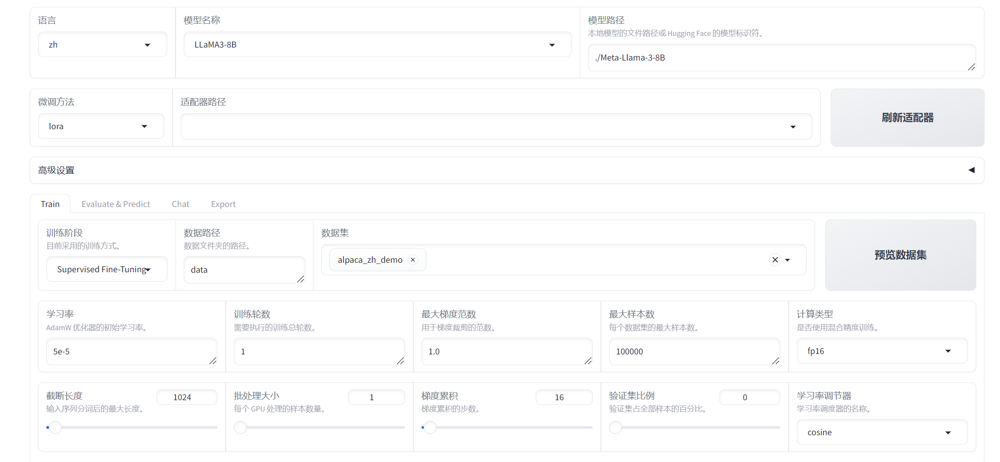

# 136.LLaMA Factory模型评估

# 示例代码

[llamafactory-eval.zip](https://www.yuque.com/attachments/yuque/0/2025/zip/2424104/1749261173808-dbd25528-e7e9-4c21-b417-2ffeba14d474.zip)

# 前言

<font style="color:rgb(51, 51, 51);">随着</font>[<font style="color:rgb(51, 51, 51);">人工智能</font>](https://so.csdn.net/so/search?q=%E4%BA%BA%E5%B7%A5%E6%99%BA%E8%83%BD\&spm=1001.2101.3001.7020)<font style="color:rgb(51, 51, 51);">技术的飞速发展，大型语言模型（LLM）在自然语言处理（NLP）领域扮演着越来越重要的角色。然而，预训练的模型往往需要针对特定任务进行微调，以提高其在特定领域的性能。因为预训练模型是在大量数据上训练得到的，它已经学习到了语言的基本规律和丰富的特征表示。然而，这些模型可能并不直接适用于特定的任务或领域，因为它们可能缺乏对特定领域知识的理解和适应性。</font>

## <font style="color:rgb(0, 0, 0);">LLaMA Factory 介绍</font>


<font style="color:rgb(0, 0, 0);">项目地址：</font><https://github.com/hiyouga/LLaMA-Factory/blob/main/README_zh.md>

<font style="color:rgb(0, 0, 0);">LLaMA Factory 是一个简单易用且高效的大型语言模型（Large Language Model）训练与微调平台。</font><font style="color:rgb(51, 51, 51);">致力于简化大型的定制过程。它集成了多种训练策略和监控工具，提供了命令行和 WebUI 等多种交互方式，大幅降了模型微调的技术门槛。</font><font style="color:rgb(0, 0, 0);">通过 LLaMA Factory，可以在无需编写任何代码的前提下，在本地完成上百种预训练模型的微调，框架特性包括：</font>

* <font style="color:rgb(0, 0, 0);">模型种类：LLaMA、LLaVA、Mistral、Mixtral-MoE、Qwen、Yi、Gemma、Baichuan、ChatGLM、Phi 等等。</font>
* <font style="color:rgb(0, 0, 0);">训练算法：（增量）预训练、（多模态）指令监督微调、奖励模型训练、PPO 训练、DPO 训练、KTO 训练、ORPO 训练等等。</font>
* <font style="color:rgb(0, 0, 0);">运算精度：16 比特全参数微调、冻结微调、LoRA 微调和基于 AQLM/AWQ/GPTQ/LLM.int8/HQQ/EETQ 的 2/3/4/5/6/8 比特 QLoRA 微调。</font>
* <font style="color:rgb(0, 0, 0);">优化算法：GaLore、BAdam、DoRA、LongLoRA、LLaMA Pro、Mixture-of-Depths、LoRA+、LoftQ 和 PiSSA。</font>
* <font style="color:rgb(0, 0, 0);">加速算子：FlashAttention-2 和 Unsloth。</font>
* <font style="color:rgb(0, 0, 0);">推理引擎：Transformers 和 vLLM。</font>
* <font style="color:rgb(0, 0, 0);">实验监控：LlamaBoard、TensorBoard、Wandb、MLflow、SwanLab 等等。</font>

## <font style="color:rgb(51, 51, 51);">LLaMA Factory </font><font style="color:rgb(51, 51, 51);">核心功能</font>

* <font style="color:rgb(51, 51, 51);">多模型兼容：支持包括 LLama、Mistral、Falcon 在内的多种大型语言模型。</font>
* <font style="color:rgb(51, 51, 51);">训练方法多样：涵盖全参数微调及 LoRA 等先进的微调技术。</font>
* <font style="color:rgb(51, 51, 51);">用户界面友好：LLama Board 提供了一个直观的 Web 界面，使用户能够轻松调整模型设置。</font>
* <font style="color:rgb(51, 51, 51);">监控工具集成：与 TensorBoard 等工具集成，便于监控和分析训练过程。</font>

## <font style="color:rgb(51, 51, 51);">LLaMA Factory 特点</font>

* <font style="color:rgb(51, 51, 51);">易用性：简化了机器学习算法的复杂性，通过图形界面即可控制模型微调。</font>
* <font style="color:rgb(51, 51, 51);">微调效率：支持 DPO、ORPO、PPO 和 SFT 等技术，提升了模型微调的效率和效果。</font>
* <font style="color:rgb(51, 51, 51);">参数调整灵活性：用户可根据需求轻松调整模型参数，如 dropout 率、epochs 等。</font>
* <font style="color:rgb(51, 51, 51);">多语言支持：界面支持英语、俄语和中文，面向全球用户提供服务。</font>

## <font style="color:rgb(51, 51, 51);">LLaMA Factory </font><font style="color:rgb(51, 51, 51);">使用场景</font>

<font style="color:rgb(51, 51, 51);">LLaMA-Factory 适用于广泛的 NLP 任务，包括但不限于：</font>

* <font style="color:rgb(51, 51, 51);">文本分类：实现情感分析、主题识别等功能。</font>
* <font style="color:rgb(51, 51, 51);">序列标注：如 NER、词性标注等任务。</font>
* <font style="color:rgb(51, 51, 51);">文本生成：自动生成文本摘要、对话等。</font>
* <font style="color:rgb(51, 51, 51);">机器翻译：优化特定语言对的翻译质量。</font>

<font style="color:rgb(51, 51, 51);">LLaMA-Factory 通过其强大的功能和易用性，助力用户在</font>[<font style="color:rgb(51, 51, 51);">自然语言处理</font>](https://so.csdn.net/so/search?q=%E8%87%AA%E7%84%B6%E8%AF%AD%E8%A8%80%E5%A4%84%E7%90%86\&spm=1001.2101.3001.7020)<font style="color:rgb(51, 51, 51);">领域快速实现模型的定制和优化。</font>

## <font style="color:rgb(51, 51, 51);">微调的过程</font>

<font style="color:rgb(51, 51, 51);">模型微调通过在特定任务的数据集上继续训练预训练模型来进行，使得模型能够学习到与任务相关的特定特征和知识。这个过程通常涉及到模型权重的微幅调整，而不是从头开始训练一个全新的模型。</font>

<font style="color:rgb(51, 51, 51);">微调过程主要包括以下几个步骤： </font>

1. <font style="color:rgb(51, 51, 51);">数据准备：收集和准备特定任务的数据集。 </font>
2. <font style="color:rgb(51, 51, 51);">模型选择：选择一个预训练模型作为基础模型。 </font>
3. <font style="color:rgb(51, 51, 51);">迁移学习：在新数据集上继续训练模型，同时保留预训练模型的知识。 </font>
4. <font style="color:rgb(51, 51, 51);">参数调整：根据需要调整模型的参数，如学习率、批大小等。 </font>
5. <font style="color:rgb(51, 51, 51);">模型评估：在验证集上评估模型的性能，并根据反馈进行调整。</font>

## <font style="color:rgb(51, 51, 51);">微调的优势</font>

<font style="color:rgb(51, 51, 51);">微调技术带来了多方面的优势：</font><font style="color:rgb(51, 51, 51);">资源效率：相比于从头开始训练模型，微调可以显著减少所需的数据量和计算资源。</font><font style="color:rgb(51, 51, 51);">快速部署：微调可以快速适应新任务，加速模型的部署过程。</font><font style="color:rgb(51, 51, 51);">性能提升：针对特定任务的微调可以提高模型的准确性和鲁棒性。</font><font style="color:rgb(51, 51, 51);">领域适应性：微调可以帮助模型更好地理解和适应特定领域的语言特点。</font>

<font style="color:rgb(51, 51, 51);">通过微调，可以使得预训练模型在这些任务上取得更好的性能，更好地满足实际应用的需求。</font>

# <font style="color:rgb(31, 35, 40);">环境准备</font>

## <font style="color:rgb(31, 35, 40);">安装 LLaMA Factory</font>

```plain
git clone --depth 1 https://github.com/hiyouga/LLaMA-Factory.git
cd LLaMA-Factory
pip install -e ".[torch,metrics]"
```

<font style="color:rgb(31, 35, 40);">可选的额外依赖项：torch、torch-npu、metrics、deepspeed、liger-kernel、bitsandbytes、hqq、eetq、gptq、aqlm、vllm、sglang、galore、apollo、badam、adam-mini、qwen、minicpm_v、modelscope、openmind、swanlab、quality</font>

Tip

<font style="color:rgb(31, 35, 40);">遇到包冲突时，可使用 </font><code><font style="color:rgb(31, 35, 40);">pip install --no-deps -e .</font></code><font style="color:rgb(31, 35, 40);"> 解决。</font>

## <font style="color:rgb(31, 35, 40);">数据准备</font>

<font style="color:rgb(31, 35, 40);">关于数据集文件的格式，请参考</font><font style="color:rgb(31, 35, 40);"> </font>[data/README_zh.md](https://github.com/hiyouga/LLaMA-Factory/blob/main/data/README_zh.md)<font style="color:rgb(31, 35, 40);"> </font><font style="color:rgb(31, 35, 40);">的内容。你可以使用 HuggingFace / ModelScope / Modelers 上的数据集或加载本地数据集。</font>

Note

<font style="color:rgb(31, 35, 40);">使用自定义数据集时，请更新</font><font style="color:rgb(31, 35, 40);"> </font><code><font style="color:rgb(31, 35, 40);">data/dataset_info.json</font></code><font style="color:rgb(31, 35, 40);"> </font><font style="color:rgb(31, 35, 40);">文件。</font>

<font style="color:rgb(31, 35, 40);">您也可以使用</font><font style="color:rgb(31, 35, 40);"> </font>[**Easy Dataset**](https://github.com/ConardLi/easy-dataset)<font style="color:rgb(31, 35, 40);"> </font><font style="color:rgb(31, 35, 40);">构建用于微调的合成数据。</font>

## <font style="color:rgb(31, 35, 40);">快速开始</font>

<font style="color:rgb(31, 35, 40);">下面三行命令分别对 Llama3-8B-Instruct 模型进行 LoRA</font><font style="color:rgb(31, 35, 40);"> </font>**<font style="color:rgb(31, 35, 40);">微调</font>**<font style="color:rgb(31, 35, 40);">、</font>**<font style="color:rgb(31, 35, 40);">推理</font>**<font style="color:rgb(31, 35, 40);">和</font>**<font style="color:rgb(31, 35, 40);">合并</font>**<font style="color:rgb(31, 35, 40);">。</font>

```plain
llamafactory-cli train examples/train_lora/llama3_lora_sft.yaml
llamafactory-cli chat examples/inference/llama3_lora_sft.yaml
llamafactory-cli export examples/merge_lora/llama3_lora_sft.yaml
```

<font style="color:rgb(31, 35, 40);">高级用法请参考</font><font style="color:rgb(31, 35, 40);"> </font>[examples/README_zh.md](https://github.com/hiyouga/LLaMA-Factory/blob/main/examples/README_zh.md)<font style="color:rgb(31, 35, 40);">（包括多 GPU 微调）。</font>

Tip

<font style="color:rgb(31, 35, 40);">使用</font><font style="color:rgb(31, 35, 40);"> </font><code><font style="color:rgb(31, 35, 40);">llamafactory-cli help</font></code><font style="color:rgb(31, 35, 40);"> </font><font style="color:rgb(31, 35, 40);">显示帮助信息。</font>

<font style="color:rgb(31, 35, 40);">遇到报错请先看</font>[常见问题](https://github.com/hiyouga/LLaMA-Factory/issues/4614)<font style="color:rgb(31, 35, 40);">。</font>

## <font style="color:rgb(31, 35, 40);">LLaMA Board 可视化微调（由 </font>[Gradio](https://github.com/gradio-app/gradio)<font style="color:rgb(31, 35, 40);"> 驱动）</font>

<font style="color:rgb(31, 35, 40);">llamafactory-cli webui</font>

## <font style="color:rgb(31, 35, 40);">构建 Docker</font>

<font style="color:rgb(31, 35, 40);">CUDA 用户：</font>

```plain
cd docker/docker-cuda/
docker compose up -d
docker compose exec llamafactory bash
```

<font style="color:rgb(31, 35, 40);">昇腾 NPU 用户：</font>

```plain
cd docker/docker-npu/
docker compose up -d
docker compose exec llamafactory bash
```

<font style="color:rgb(31, 35, 40);">AMD ROCm 用户：</font>

```plain
cd docker/docker-rocm/
docker compose up -d
docker compose exec llamafactory bash
```

## <font style="color:rgb(31, 35, 40);">从魔搭社区下载</font>

<font style="color:rgb(31, 35, 40);">如果您在 Hugging Face 模型和数据集的下载中遇到了问题，可以通过下述方法使用魔搭社区。</font>

<font style="color:rgb(31, 35, 40);">export USE_MODELSCOPE_HUB=1 # Windows 使用 `set USE_MODELSCOPE_HUB=1`</font>

<font style="color:rgb(31, 35, 40);">将 </font><code><font style="color:rgb(31, 35, 40);">model_name_or_path</font></code><font style="color:rgb(31, 35, 40);"> 设置为模型 ID 来加载对应的模型。在</font>[魔搭社区](https://modelscope.cn/models)<font style="color:rgb(31, 35, 40);">查看所有可用的模型，例如 </font><code><font style="color:rgb(31, 35, 40);">LLM-Research/Meta-Llama-3-8B-Instruct</font></code><font style="color:rgb(31, 35, 40);">。</font>

# <font style="color:rgb(0, 0, 0);">WebUI</font>

<font style="color:rgb(0, 0, 0);">LLaMA-Factory 支持通过 WebUI 零代码微调大语言模型。 在完成</font><font style="color:rgb(0, 0, 0);"> </font>[安装](https://llamafactory.readthedocs.io/zh-cn/latest/getting_started/installation.html#installation)<font style="color:rgb(0, 0, 0);"> </font><font style="color:rgb(0, 0, 0);">后，您可以通过以下指令进入 WebUI:</font>

```plain
llamafactory-cli webui
```

<font style="color:rgb(0, 0, 0);">WebUI 主要分为四个界面：训练、评估与预测、对话、导出。</font>

## <font style="color:rgb(0, 0, 0);">训练</font>



<font style="color:rgb(0, 0, 0);">在开始训练模型之前，您需要指定的参数有：</font>

1. <font style="color:rgb(0, 0, 0);">模型名称及路径</font>
2. <font style="color:rgb(0, 0, 0);">训练阶段</font>
3. <font style="color:rgb(0, 0, 0);">微调方法</font>
4. <font style="color:rgb(0, 0, 0);">训练数据集</font>
5. <font style="color:rgb(0, 0, 0);">学习率、训练轮数等训练参数</font>
6. <font style="color:rgb(0, 0, 0);">微调参数等其他参数</font>
7. <font style="color:rgb(0, 0, 0);">输出目录及配置路径</font>

<font style="color:rgb(0, 0, 0);">随后，您可以点击</font><font style="color:rgb(0, 0, 0);"> </font><code><font style="color:rgb(0, 0, 0);">开始</font></code><font style="color:rgb(0, 0, 0);"> </font><font style="color:rgb(0, 0, 0);">按钮开始训练模型。</font>

**<font style="color:rgb(0, 0, 0);">备注</font>**

<font style="color:rgb(0, 0, 0);">关于断点重连:适配器断点保存于</font><font style="color:rgb(0, 0, 0);"> </font><code><font style="color:rgb(0, 0, 0);">output_dir</font></code><font style="color:rgb(0, 0, 0);"> </font><font style="color:rgb(0, 0, 0);">目录下，请指定</font><font style="color:rgb(0, 0, 0);"> </font>**<font style="color:rgb(0, 0, 0);">适配器路径</font>**<font style="color:rgb(0, 0, 0);"> </font><font style="color:rgb(0, 0, 0);">以加载断点继续训练。</font>

<font style="color:rgb(0, 0, 0);">如果您需要使用自定义数据集，请在</font><font style="color:rgb(0, 0, 0);"> </font><code><font style="color:rgb(0, 0, 0);">data/data_info.json</font></code><font style="color:rgb(0, 0, 0);"> </font><font style="color:rgb(0, 0, 0);">中添加自定义数据集描述并确保</font><font style="color:rgb(0, 0, 0);"> </font>[数据集格式](https://llamafactory.readthedocs.io/zh-cn/latest/getting_started/data_preparation.html#id1)<font style="color:rgb(0, 0, 0);"> </font><font style="color:rgb(0, 0, 0);">正确，否则可能会导致训练失败。</font>

## <font style="color:rgb(0, 0, 0);">评估预测与对话</font>

<font style="color:rgb(0, 0, 0);">模型训练完毕后，您可以通过在评估与预测界面通过指定</font><font style="color:rgb(0, 0, 0);"> </font>**<font style="color:rgb(0, 0, 0);">模型</font>**<font style="color:rgb(0, 0, 0);"> </font><font style="color:rgb(0, 0, 0);">及</font><font style="color:rgb(0, 0, 0);"> </font>**<font style="color:rgb(0, 0, 0);">适配器</font>**<font style="color:rgb(0, 0, 0);"> </font><font style="color:rgb(0, 0, 0);">的路径在指定数据集上进行评估。</font>

<font style="color:rgb(0, 0, 0);">您也可以通过在对话界面指定</font><font style="color:rgb(0, 0, 0);"> </font>**<font style="color:rgb(0, 0, 0);">模型</font>**<font style="color:rgb(0, 0, 0);">、</font><font style="color:rgb(0, 0, 0);"> </font>**<font style="color:rgb(0, 0, 0);">适配器</font>**<font style="color:rgb(0, 0, 0);"> </font><font style="color:rgb(0, 0, 0);">及</font><font style="color:rgb(0, 0, 0);"> </font>**<font style="color:rgb(0, 0, 0);">推理引擎</font>**<font style="color:rgb(0, 0, 0);"> </font><font style="color:rgb(0, 0, 0);">后输入对话内容与模型进行对话观察效果。</font>

## <font style="color:rgb(0, 0, 0);">导出</font>

<font style="color:rgb(0, 0, 0);">如果您对模型效果满意并需要导出模型，您可以在导出界面通过指定 </font>**<font style="color:rgb(0, 0, 0);">模型</font>**<font style="color:rgb(0, 0, 0);">、 </font>**<font style="color:rgb(0, 0, 0);">适配器</font>**<font style="color:rgb(0, 0, 0);">、 </font>**<font style="color:rgb(0, 0, 0);">分块大小</font>**<font style="color:rgb(0, 0, 0);">、 </font>**<font style="color:rgb(0, 0, 0);">导出量化等级及校准数据集</font>**<font style="color:rgb(0, 0, 0);">、 </font>**<font style="color:rgb(0, 0, 0);">导出设备</font>**<font style="color:rgb(0, 0, 0);">、 </font>**<font style="color:rgb(0, 0, 0);">导出目录</font>**<font style="color:rgb(0, 0, 0);"> 等参数后点击 </font><code><font style="color:rgb(0, 0, 0);">导出</font></code><font style="color:rgb(0, 0, 0);"> 按钮导出模型。</font>

<font style="color:rgb(0, 0, 0);"></font>

<font style="color:rgb(0, 0, 0);"></font>

# <font style="color:rgb(0, 0, 0);">SFT 训练</font>

## <font style="color:rgb(0, 0, 0);">命令行</font>

<font style="color:rgb(0, 0, 0);">您可以使用以下命令使用</font><font style="color:rgb(0, 0, 0);"> </font><code><font style="color:rgb(0, 0, 0);">examples/train_lora/llama3_lora_sft.yaml</font></code><font style="color:rgb(0, 0, 0);"> </font><font style="color:rgb(0, 0, 0);">中的参数进行微调：</font>

```plain
llamafactory-cli train examples/train_lora/llama3_lora_sft.yaml
```

<font style="color:rgb(0, 0, 0);">也可以通过追加参数更新 yaml 文件中的参数:</font>

```plain
llamafactory-cli train examples/train_lora/llama3_lora_sft.yaml \
    learning_rate=1e-5 \
    logging_steps=1
```

**<font style="color:rgb(0, 0, 0);">备注</font>**

<font style="color:rgb(0, 0, 0);">LLaMA-Factory 默认使用所有可见的计算设备。根据需求可通过</font><font style="color:rgb(0, 0, 0);"> </font><code><font style="color:rgb(0, 0, 0);">CUDA_VISIBLE_DEVICES</font></code><font style="color:rgb(0, 0, 0);"> </font><font style="color:rgb(0, 0, 0);">或</font><font style="color:rgb(0, 0, 0);"> </font><code><font style="color:rgb(0, 0, 0);">ASCEND_RT_VISIBLE_DEVICES</font></code><font style="color:rgb(0, 0, 0);"> </font><font style="color:rgb(0, 0, 0);">指定计算设备。</font>

<code><font style="color:rgb(0, 0, 0);">examples/train_lora/llama3_lora_sft.yaml</font></code><font style="color:rgb(0, 0, 0);"> </font><font style="color:rgb(0, 0, 0);">提供了微调时的配置示例。该配置指定了模型参数、微调方法参数、数据集参数以及评估参数等。您需要根据自身需求自行配置。</font>

```plain
### examples/train_lora/llama3_lora_sft.yaml
model_name_or_path: meta-llama/Meta-Llama-3-8B-Instruct

stage: sft
do_train: true
finetuning_type: lora
lora_target: all

dataset: identity,alpaca_en_demo
template: llama3
cutoff_len: 1024
max_samples: 1000
overwrite_cache: true
preprocessing_num_workers: 16

output_dir: saves/llama3-8b/lora/sft
logging_steps: 10
save_steps: 500
plot_loss: true
overwrite_output_dir: true

per_device_train_batch_size: 1
gradient_accumulation_steps: 8
learning_rate: 1.0e-4
num_train_epochs: 3.0
lr_scheduler_type: cosine
warmup_ratio: 0.1
bf16: true
ddp_timeout: 180000000

val_size: 0.1
per_device_eval_batch_size: 1
eval_strategy: steps
eval_steps: 500
```

**<font style="color:rgb(0, 0, 0);">备注</font>**

<font style="color:rgb(0, 0, 0);">模型</font><font style="color:rgb(0, 0, 0);"> </font><code><font style="color:rgb(0, 0, 0);">model_name_or_path</font></code><font style="color:rgb(0, 0, 0);"> </font><font style="color:rgb(0, 0, 0);">、数据集</font><font style="color:rgb(0, 0, 0);"> </font><code><font style="color:rgb(0, 0, 0);">dateset</font></code><font style="color:rgb(0, 0, 0);"> </font><font style="color:rgb(0, 0, 0);">需要存在且与</font><font style="color:rgb(0, 0, 0);"> </font><code><font style="color:rgb(0, 0, 0);">template</font></code><font style="color:rgb(0, 0, 0);"> </font><font style="color:rgb(0, 0, 0);">相对应。</font>

| <font style="color:rgb(0, 0, 0);">名称</font> | <font style="color:rgb(0, 0, 0);">描述</font> |
| --- | --- |
| <font style="color:rgb(0, 0, 0);">model_name_or_path</font> | <font style="color:rgb(0, 0, 0);">模型名称或路径</font> |
| <font style="color:rgb(0, 0, 0);">stage</font> | <font style="color:rgb(0, 0, 0);">训练阶段，可选: rm(reward modeling), pt(pretrain), sft(Supervised Fine-Tuning), PPO, DPO, KTO, ORPO</font> |
| <font style="color:rgb(0, 0, 0);">do_train</font> | <font style="color:rgb(0, 0, 0);">true用于训练, false用于评估</font> |
| <font style="color:rgb(0, 0, 0);">finetuning_type</font> | <font style="color:rgb(0, 0, 0);">微调方式。可选: freeze, lora, full</font> |
| <font style="color:rgb(0, 0, 0);">lora_target</font> | <font style="color:rgb(0, 0, 0);">采取LoRA方法的目标模块，默认值为</font><font style="color:rgb(0, 0, 0);"> </font><code><font style="color:rgb(0, 0, 0);">all</font></code><font style="color:rgb(0, 0, 0);">。</font> |
| <font style="color:rgb(0, 0, 0);">dataset</font> | <font style="color:rgb(0, 0, 0);">使用的数据集，使用”,”分隔多个数据集</font> |
| <font style="color:rgb(0, 0, 0);">template</font> | <font style="color:rgb(0, 0, 0);">数据集模板，请保证数据集模板与模型相对应。</font> |
| <font style="color:rgb(0, 0, 0);">output_dir</font> | <font style="color:rgb(0, 0, 0);">输出路径</font> |
| <font style="color:rgb(0, 0, 0);">logging_steps</font> | <font style="color:rgb(0, 0, 0);">日志输出步数间隔</font> |
| <font style="color:rgb(0, 0, 0);">save_steps</font> | <font style="color:rgb(0, 0, 0);">模型断点保存间隔</font> |
| <font style="color:rgb(0, 0, 0);">overwrite_output_dir</font> | <font style="color:rgb(0, 0, 0);">是否允许覆盖输出目录</font> |
| <font style="color:rgb(0, 0, 0);">per_device_train_batch_size</font> | <font style="color:rgb(0, 0, 0);">每个设备上训练的批次大小</font> |
| <font style="color:rgb(0, 0, 0);">gradient_accumulation_steps</font> | <font style="color:rgb(0, 0, 0);">梯度积累步数</font> |
| <font style="color:rgb(0, 0, 0);">max_grad_norm</font> | <font style="color:rgb(0, 0, 0);">梯度裁剪阈值</font> |
| <font style="color:rgb(0, 0, 0);">learning_rate</font> | <font style="color:rgb(0, 0, 0);">学习率</font> |
| <font style="color:rgb(0, 0, 0);">lr_scheduler_type</font> | <font style="color:rgb(0, 0, 0);">学习率曲线，可选</font><font style="color:rgb(0, 0, 0);"> </font><code><font style="color:rgb(0, 0, 0);">linear</font></code><font style="color:rgb(0, 0, 0);">,</font><font style="color:rgb(0, 0, 0);"> </font><code><font style="color:rgb(0, 0, 0);">cosine</font></code><font style="color:rgb(0, 0, 0);">,</font><font style="color:rgb(0, 0, 0);"> </font><code><font style="color:rgb(0, 0, 0);">polynomial</font></code><font style="color:rgb(0, 0, 0);">,</font><font style="color:rgb(0, 0, 0);"> </font><code><font style="color:rgb(0, 0, 0);">constant</font></code><font style="color:rgb(0, 0, 0);"> </font><font style="color:rgb(0, 0, 0);">等。</font> |
| <font style="color:rgb(0, 0, 0);">num_train_epochs</font> | <font style="color:rgb(0, 0, 0);">训练周期数</font> |
| <font style="color:rgb(0, 0, 0);">bf16</font> | <font style="color:rgb(0, 0, 0);">是否使用 bf16 格式</font> |
| <font style="color:rgb(0, 0, 0);">warmup_ratio</font> | <font style="color:rgb(0, 0, 0);">学习率预热比例</font> |
| <font style="color:rgb(0, 0, 0);">warmup_steps</font> | <font style="color:rgb(0, 0, 0);">学习率预热步数</font> |
| <font style="color:rgb(0, 0, 0);">push_to_hub</font> | <font style="color:rgb(0, 0, 0);">是否推送模型到 Huggingface</font> |

# <font style="color:rgb(0, 0, 0);">LoRA 合并</font>

## <font style="color:rgb(0, 0, 0);">合并</font>

<font style="color:rgb(0, 0, 0);">当我们基于预训练模型训练好 LoRA 适配器后，我们不希望在每次推理的时候分别加载预训练模型和 LoRA 适配器，因此我们需要将预训练模型和 LoRA 适配器合并导出成一个模型，并根据需要选择是否量化。根据是否量化以及量化算法的不同，导出的配置文件也有所区别。</font>

<font style="color:rgb(0, 0, 0);">您可以通过</font><font style="color:rgb(0, 0, 0);"> </font><code><font style="color:rgb(0, 0, 0);">llamafactory-cli</font><font style="color:rgb(0, 0, 0);"> </font><font style="color:rgb(0, 0, 0);">export</font><font style="color:rgb(0, 0, 0);"> </font><font style="color:rgb(0, 0, 0);">merge_config.yaml</font></code><font style="color:rgb(0, 0, 0);"> </font><font style="color:rgb(0, 0, 0);">指令来合并模型。其中</font><font style="color:rgb(0, 0, 0);"> </font><code><font style="color:rgb(0, 0, 0);">merge_config.yaml</font></code><font style="color:rgb(0, 0, 0);"> </font><font style="color:rgb(0, 0, 0);">需要您根据不同情况进行配置。</font>

<code><font style="color:rgb(0, 0, 0);">examples/merge_lora/llama3_lora_sft.yaml</font></code><font style="color:rgb(0, 0, 0);"> </font><font style="color:rgb(0, 0, 0);">提供了合并时的配置示例。</font>

```plain
### examples/merge_lora/llama3_lora_sft.yaml
### model
model_name_or_path: meta-llama/Meta-Llama-3-8B-Instruct
adapter_name_or_path: saves/llama3-8b/lora/sft
template: llama3
finetuning_type: lora

### export
export_dir: models/llama3_lora_sft
export_size: 2
export_device: cpu
export_legacy_format: false
```

**<font style="color:rgb(0, 0, 0);">备注</font>**

* <font style="color:rgb(0, 0, 0);">模型</font><font style="color:rgb(0, 0, 0);"> </font><code><font style="color:rgb(0, 0, 0);">model_name_or_path</font></code><font style="color:rgb(0, 0, 0);"> </font><font style="color:rgb(0, 0, 0);">需要存在且与</font><font style="color:rgb(0, 0, 0);"> </font><code><font style="color:rgb(0, 0, 0);">template</font></code><font style="color:rgb(0, 0, 0);"> </font><font style="color:rgb(0, 0, 0);">相对应。</font><font style="color:rgb(0, 0, 0);"> </font><code><font style="color:rgb(0, 0, 0);">adapter_name_or_path</font></code><font style="color:rgb(0, 0, 0);"> </font><font style="color:rgb(0, 0, 0);">需要与微调中的适配器输出路径</font><font style="color:rgb(0, 0, 0);"> </font><code><font style="color:rgb(0, 0, 0);">output_dir</font></code><font style="color:rgb(0, 0, 0);"> </font><font style="color:rgb(0, 0, 0);">相对应。</font>
* <font style="color:rgb(0, 0, 0);">合并 LoRA 适配器时，不要使用量化模型或指定量化位数。您可以使用本地或下载的未量化的预训练模型进行合并。</font>

## <font style="color:rgb(0, 0, 0);">量化</font>

<font style="color:rgb(0, 0, 0);">在完成模型合并并获得完整模型后，为了优化部署效果，人们通常会基于显存占用、使用成本和推理速度等因素，选择通过量化技术对模型进行压缩，从而实现更高效的部署。</font>

<font style="color:rgb(0, 0, 0);">量化（Quantization）通过数据精度压缩有效地减少了显存使用并加速推理。LLaMA-Factory 支持多种量化方法，包括:</font>

* <font style="color:rgb(0, 0, 0);">AQLM</font>
* <font style="color:rgb(0, 0, 0);">AWQ</font>
* <font style="color:rgb(0, 0, 0);">GPTQ</font>
* <font style="color:rgb(0, 0, 0);">QLoRA</font>
* <font style="color:rgb(0, 0, 0);">…</font>

<font style="color:rgb(0, 0, 0);">GPTQ 等后训练量化方法(Post Training Quantization)是一种在训练后对预训练模型进行量化的方法。我们通过量化技术将高精度表示的预训练模型转换为低精度的模型，从而在避免过多损失模型性能的情况下减少显存占用并加速推理，我们希望低精度数据类型在有限的表示范围内尽可能地接近高精度数据类型的表示，因此我们需要指定量化位数</font><font style="color:rgb(0, 0, 0);"> </font><code><font style="color:rgb(0, 0, 0);">export_quantization_bit</font></code><font style="color:rgb(0, 0, 0);"> </font><font style="color:rgb(0, 0, 0);">以及校准数据集</font><font style="color:rgb(0, 0, 0);"> </font><code><font style="color:rgb(0, 0, 0);">export_quantization_dataset</font></code><font style="color:rgb(0, 0, 0);">。</font>

**<font style="color:rgb(0, 0, 0);">备注</font>**

<font style="color:rgb(0, 0, 0);">在进行模型合并时，请指定：</font>

* <code><font style="color:rgb(0, 0, 0);">model_name_or_path</font></code><font style="color:rgb(0, 0, 0);">: 预训练模型的名称或路径</font>
* <code><font style="color:rgb(0, 0, 0);">template</font></code><font style="color:rgb(0, 0, 0);">: 模型模板</font>
* <code><font style="color:rgb(0, 0, 0);">export_dir</font></code><font style="color:rgb(0, 0, 0);">: 导出路径</font>
* <code><font style="color:rgb(0, 0, 0);">export_quantization_bit</font></code><font style="color:rgb(0, 0, 0);">: 量化位数</font>
* <code><font style="color:rgb(0, 0, 0);">export_quantization_dataset</font></code><font style="color:rgb(0, 0, 0);">: 量化校准数据集</font>
* <code><font style="color:rgb(0, 0, 0);">export_size</font></code><font style="color:rgb(0, 0, 0);">: 最大导出模型文件大小</font>
* <code><font style="color:rgb(0, 0, 0);">export_device</font></code><font style="color:rgb(0, 0, 0);">: 导出设备</font>
* <code><font style="color:rgb(0, 0, 0);">export_legacy_format</font></code><font style="color:rgb(0, 0, 0);">: 是否使用旧格式导出</font>

<font style="color:rgb(0, 0, 0);">下面提供一个配置文件示例：</font>

```plain
### examples/merge_lora/llama3_gptq.yaml
### model
model_name_or_path: meta-llama/Meta-Llama-3-8B-Instruct
template: llama3

### export
export_dir: models/llama3_gptq
export_quantization_bit: 4
export_quantization_dataset: data/c4_demo.json
export_size: 2
export_device: cpu
export_legacy_format: false
```

<font style="color:rgb(0, 0, 0);">QLoRA 是一种在 4-bit 量化模型基础上使用 LoRA 方法进行训练的技术。它在极大地保持了模型性能的同时大幅减少了显存占用和推理时间。</font>

**<font style="color:rgb(0, 0, 0);">警告</font>**

<font style="color:rgb(0, 0, 0);">不要使用量化模型或设置量化位数</font><font style="color:rgb(0, 0, 0);"> </font><code><font style="color:rgb(0, 0, 0);">quantization_bit</font></code>

<font style="color:rgb(0, 0, 0);">下面提供一个配置文件示例：</font>

```plain
### examples/merge_lora/llama3_q_lora.yaml
### model
model_name_or_path: meta-llama/Meta-Llama-3-8B-Instruct
adapter_name_or_path: saves/llama3-8b/lora/sft
template: llama3
finetuning_type: lora

### export
export_dir: models/llama3_lora_sft
export_size: 2
export_device: cpu
export_legacy_format: false
```

# <font style="color:rgb(0, 0, 0);">推理</font>

<font style="color:rgb(0, 0, 0);">LLaMA-Factory 支持多种推理方式。</font>

<font style="color:rgb(0, 0, 0);">您可以使用</font><font style="color:rgb(0, 0, 0);"> </font><code><font style="color:rgb(0, 0, 0);">llamafactory-cli</font><font style="color:rgb(0, 0, 0);"> </font><font style="color:rgb(0, 0, 0);">chat</font><font style="color:rgb(0, 0, 0);"> </font><font style="color:rgb(0, 0, 0);">inference_config.yaml</font></code><font style="color:rgb(0, 0, 0);"> </font><font style="color:rgb(0, 0, 0);">或</font><font style="color:rgb(0, 0, 0);"> </font><code><font style="color:rgb(0, 0, 0);">llamafactory-cli</font><font style="color:rgb(0, 0, 0);"> </font><font style="color:rgb(0, 0, 0);">webchat</font><font style="color:rgb(0, 0, 0);"> </font><font style="color:rgb(0, 0, 0);">inference_config.yaml</font></code><font style="color:rgb(0, 0, 0);"> </font><font style="color:rgb(0, 0, 0);">进行推理与模型对话。对话时配置文件只需指定原始模型</font><font style="color:rgb(0, 0, 0);"> </font><code><font style="color:rgb(0, 0, 0);">model_name_or_path</font></code><font style="color:rgb(0, 0, 0);"> </font><font style="color:rgb(0, 0, 0);">和</font><font style="color:rgb(0, 0, 0);"> </font><code><font style="color:rgb(0, 0, 0);">template</font></code><font style="color:rgb(0, 0, 0);"> </font><font style="color:rgb(0, 0, 0);">，并根据是否是微调模型指定</font><font style="color:rgb(0, 0, 0);"> </font><code><font style="color:rgb(0, 0, 0);">adapter_name_or_path</font></code><font style="color:rgb(0, 0, 0);"> </font><font style="color:rgb(0, 0, 0);">和</font><font style="color:rgb(0, 0, 0);"> </font><code><font style="color:rgb(0, 0, 0);">finetuning_type</font></code><font style="color:rgb(0, 0, 0);">。</font>

<font style="color:rgb(0, 0, 0);">如果您希望向模型输入大量数据集并保存推理结果，您可以启动</font><font style="color:rgb(0, 0, 0);"> </font>[vllm](https://llamafactory.readthedocs.io/zh-cn/latest/getting_started/inference.html#vllm)<font style="color:rgb(0, 0, 0);"> </font><font style="color:rgb(0, 0, 0);">推理引擎对大量数据集进行快速的批量推理。您也可以通过</font><font style="color:rgb(0, 0, 0);"> </font>[部署 api](https://llamafactory.readthedocs.io/zh-cn/latest/getting_started/inference.html#api)<font style="color:rgb(0, 0, 0);"> </font><font style="color:rgb(0, 0, 0);">服务的形式通过 api 调用来进行批量推理。</font>

<font style="color:rgb(0, 0, 0);">默认情况下，模型推理将使用 Huggingface 引擎。 您也可以指定</font><font style="color:rgb(0, 0, 0);"> </font><code><font style="color:rgb(0, 0, 0);">infer_backend:</font><font style="color:rgb(0, 0, 0);"> </font><font style="color:rgb(0, 0, 0);">vllm</font></code><font style="color:rgb(0, 0, 0);"> </font><font style="color:rgb(0, 0, 0);">以使用 vllm 推理引擎以获得更快的推理速度。</font>

**<font style="color:rgb(0, 0, 0);">备注</font>**

<font style="color:rgb(0, 0, 0);">使用任何方式推理时，模型</font><font style="color:rgb(0, 0, 0);"> </font><code><font style="color:rgb(0, 0, 0);">model_name_or_path</font></code><font style="color:rgb(0, 0, 0);"> </font><font style="color:rgb(0, 0, 0);">需要存在且与</font><font style="color:rgb(0, 0, 0);"> </font><code><font style="color:rgb(0, 0, 0);">template</font></code><font style="color:rgb(0, 0, 0);"> </font><font style="color:rgb(0, 0, 0);">相对应。</font>

## <font style="color:rgb(0, 0, 0);">原始模型推理配置</font>

<font style="color:rgb(0, 0, 0);">对于原始模型推理，</font><font style="color:rgb(0, 0, 0);"> </font><code><font style="color:rgb(0, 0, 0);">inference_config.yaml</font></code><font style="color:rgb(0, 0, 0);"> </font><font style="color:rgb(0, 0, 0);">中 只需指定原始模型</font><font style="color:rgb(0, 0, 0);"> </font><code><font style="color:rgb(0, 0, 0);">model_name_or_path</font></code><font style="color:rgb(0, 0, 0);"> </font><font style="color:rgb(0, 0, 0);">和</font><font style="color:rgb(0, 0, 0);"> </font><code><font style="color:rgb(0, 0, 0);">template</font></code><font style="color:rgb(0, 0, 0);"> </font><font style="color:rgb(0, 0, 0);">即可。</font>

```plain
### examples/inference/llama3.yaml
model_name_or_path: meta-llama/Meta-Llama-3-8B-Instruct
template: llama3
infer_backend: huggingface #choices： [huggingface, vllm]
```

## <font style="color:rgb(0, 0, 0);">微调模型推理配置</font>

<font style="color:rgb(0, 0, 0);">对于微调模型推理，除原始模型和模板外，还需要指定适配器路径</font><font style="color:rgb(0, 0, 0);"> </font><code><font style="color:rgb(0, 0, 0);">adapter_name_or_path</font></code><font style="color:rgb(0, 0, 0);"> </font><font style="color:rgb(0, 0, 0);">和微调类型</font><font style="color:rgb(0, 0, 0);"> </font><code><font style="color:rgb(0, 0, 0);">finetuning_type</font></code><font style="color:rgb(0, 0, 0);">。</font>

```plain
### examples/inference/llama3_lora_sft.yaml
model_name_or_path: meta-llama/Meta-Llama-3-8B-Instruct
adapter_name_or_path: saves/llama3-8b/lora/sft
template: llama3
finetuning_type: lora
infer_backend: huggingface #choices： [huggingface, vllm]
```

## <font style="color:rgb(0, 0, 0);">多模态模型</font>

<font style="color:rgb(0, 0, 0);">对于多模态模型，您可以运行以下指令进行推理。</font>

```plain
llamafactory-cli webchat examples/inferece/llava1_5.yaml
```

<code><font style="color:rgb(0, 0, 0);">examples/inference/llava1_5.yaml</font></code><font style="color:rgb(0, 0, 0);"> </font><font style="color:rgb(0, 0, 0);">的配置示例如下：</font>

```plain
model_name_or_path: llava-hf/llava-1.5-7b-hf
template: vicuna
infer_backend: huggingface #choices： [huggingface, vllm]
```

## <font style="color:rgb(0, 0, 0);">批量推理</font>

### <font style="color:rgb(0, 0, 0);">数据集</font>

<font style="color:rgb(0, 0, 0);">您可以通过以下指令启动 vllm 推理引擎并使用数据集进行批量推理：</font>

```plain
python scripts/vllm_infer.py --model_name_or_path path_to_merged_model --dataset alpaca_en_demo
```

### <font style="color:rgb(0, 0, 0);">api</font>

<font style="color:rgb(0, 0, 0);">如果您需要使用 api 进行批量推理，您只需指定模型、适配器（可选）、模板、微调方式等信息。</font>

<font style="color:rgb(0, 0, 0);">下面是一个配置文件的示例：</font>

```plain
### examples/inference/llama3_lora_sft.yaml
model_name_or_path: meta-llama/Meta-Llama-3-8B-Instruct
adapter_name_or_path: saves/llama3-8b/lora/sft
template: llama3
finetuning_type: lora
```

<font style="color:rgb(0, 0, 0);">下面是一个启动并调用 api 服务的示例：</font>

<font style="color:rgb(0, 0, 0);">您可以使用</font><font style="color:rgb(0, 0, 0);"> </font><code><font style="color:rgb(0, 0, 0);">API_PORT=8000</font><font style="color:rgb(0, 0, 0);"> </font><font style="color:rgb(0, 0, 0);">CUDA_VISIBLE_DEVICES=0</font><font style="color:rgb(0, 0, 0);"> </font><font style="color:rgb(0, 0, 0);">llamafactory-cli</font><font style="color:rgb(0, 0, 0);"> </font><font style="color:rgb(0, 0, 0);">api</font><font style="color:rgb(0, 0, 0);"> </font><font style="color:rgb(0, 0, 0);">examples/inference/llama3_lora_sft.yaml</font></code><font style="color:rgb(0, 0, 0);"> </font><font style="color:rgb(0, 0, 0);">启动 api 服务并运行以下示例程序进行调用：</font>

```plain
# api_call_example.py
from openai import OpenAI
client = OpenAI(api_key="0",base_url="http://0.0.0.0:8000/v1")
messages = [{"role": "user", "content": "Who are you?"}]
result = client.chat.completions.create(messages=messages, model="meta-llama/Meta-Llama-3-8B-Instruct")
print(result.choices[0].message)
```

# <font style="color:rgb(0, 0, 0);">评估</font>

## <font style="color:rgb(0, 0, 0);">通用能力评估</font>

<font style="color:rgb(0, 0, 0);">在完成模型训练后，您可以通过</font><font style="color:rgb(0, 0, 0);"> </font><code><font style="color:rgb(0, 0, 0);">llamafactory-cli</font><font style="color:rgb(0, 0, 0);"> </font><font style="color:rgb(0, 0, 0);">eval</font><font style="color:rgb(0, 0, 0);"> </font><font style="color:rgb(0, 0, 0);">examples/train_lora/llama3_lora_eval.yaml</font></code><font style="color:rgb(0, 0, 0);"> </font><font style="color:rgb(0, 0, 0);">来评估模型效果。</font>

1. ‌**MMLU_test**‌：MMLU（Massive Multitask Language Understanding）是一个多任务语言理解测试，旨在评估大规模语言模型在不同任务上的综合能力，特别是跨领域表现。MMLU包含多个任务，覆盖了历史、科学、技术等多个领域，用于衡量模型在多领域知识理解与推理能力‌<font style="background-color:rgba(223, 223, 245, 0.4);">1</font><font style="background-color:rgba(223, 223, 245, 0.4);">2</font>。
2. ‌**CEVAL_validation**‌：C-Eval是一个针对中文语言理解的评估基准，覆盖人文、社科、理工等学科的综合评测。它专门用于评估中文语言模型在中文语境下的综合表现‌<font style="background-color:rgba(223, 223, 245, 0.4);">1</font><font style="background-color:rgba(223, 223, 245, 0.4);">3</font>。
3. ‌**CMMLU_test**‌：CMMLU（Chinese Massive Multitask Language Understanding）是MMLU的中文版本，继承了MMLU的多任务评估框架和理念，但针对中文领域和文化进行了扩展和调整。CMMLU包含67个主题，涉及自然科学、社会科学、工程、人文等领域，用于全面评估大模型在中文知识储备和语言理解上的能力‌<font style="background-color:rgba(223, 223, 245, 0.4);">1</font><font style="background-color:rgba(223, 223, 245, 0.4);">2</font>。

<font style="color:rgb(51, 51, 51);">这些测试通过不同的任务和领域，帮助研究人员和开发者评估语言模型在不同场景下的表现，从而优化和改进模型。</font>

<font style="color:rgb(0, 0, 0);">配置示例文件</font><font style="color:rgb(0, 0, 0);"> </font><code><font style="color:rgb(0, 0, 0);">examples/train_lora/llama3_lora_eval.yaml</font></code><font style="color:rgb(0, 0, 0);"> </font><font style="color:rgb(0, 0, 0);">具体如下：</font>

```plain
### examples/train_lora/llama3_lora_eval.yaml
### model
model_name_or_path: meta-llama/Meta-Llama-3-8B-Instruct
adapter_name_or_path: saves/llama3-8b/lora/sft # 可选项

### method
finetuning_type: lora

### dataset
task: mmlu_test # mmlu_test, ceval_validation, cmmlu_test
template: fewshot
lang: en
n_shot: 5

### output
save_dir: saves/llama3-8b/lora/eval

### eval
batch_size: 4
```

## <font style="color:rgb(0, 0, 0);">NLG 评估</font>

<font style="color:rgb(0, 0, 0);">此外，您还可以通过</font><font style="color:rgb(0, 0, 0);"> </font><code><font style="color:rgb(0, 0, 0);">llamafactory-cli</font><font style="color:rgb(0, 0, 0);"> </font><font style="color:rgb(0, 0, 0);">train</font><font style="color:rgb(0, 0, 0);"> </font><font style="color:rgb(0, 0, 0);">examples/extras/nlg_eval/llama3_lora_predict.yaml</font></code><font style="color:rgb(0, 0, 0);"> </font><font style="color:rgb(0, 0, 0);">来获得模型的 BLEU 和 ROUGE 分数以评价模型生成质量。</font>

‌\*\*BLEU和ROUGE分数是自然语言生成（NLG）评估中常用的指标，用于评价生成文本的质量和与参考文本的相似度。\*\*‌

‌\*\*BLEU（Bilingual Evaluation Understudy）\*\*‌是一种用于评估机器翻译质量的指标。它通过计算候选翻译与一个或多个参考翻译之间的n-gram重叠程度来衡量翻译的质量。BLEU分数越高，表示翻译结果越接近人类翻译的质量。BLEU的主要思想是将机器翻译的输出与一个或多个参考翻译进行比较，计算n-gram的匹配程度，从而评估翻译的准确性。BLEU分数不考虑句子的语法和语义，只关注词汇的匹配程度‌<font style="background-color:rgba(223, 223, 245, 0.4);">12</font>。

‌\*\*ROUGE（Recall Oriented Understudy for Gisting Evaluation）\*\*‌是一组用于评估自动文摘质量的指标。与BLEU不同，ROUGE侧重于评估生成文本与参考文本在内容上的重叠程度，主要衡量召回率。ROUGE包括多个变体，如ROUGE-N、ROUGE-L、ROUGE-W和ROUGE-S等，分别基于不同的n-gram、最长公共子序列等计算方法。ROUGE分数越高，表示生成的摘要越全面地覆盖了参考文本的内容‌<font style="background-color:rgba(223, 223, 245, 0.4);">2</font><font style="background-color:rgba(223, 223, 245, 0.4);">3</font>。

**<font style="color:rgb(0, 0, 0);">应用场景和优缺点</font>**

* <font style="color:rgb(0, 0, 0);">‌</font>**应用场景**<font style="color:rgb(0, 0, 0);">‌：BLEU主要用于机器翻译质量的评估，而ROUUE则常用于文本摘要、自动文摘等任务的评估。</font>
* <font style="color:rgb(0, 0, 0);">‌</font>**优缺点**<font style="color:rgb(0, 0, 0);">‌：</font>
  * <font style="color:rgb(0, 0, 0);">‌</font>**BLEU**<font style="color:rgb(0, 0, 0);">‌：</font>
    * <font style="color:rgb(0, 0, 0);">‌</font>**优点**<font style="color:rgb(0, 0, 0);">‌：快速、廉价且独立于语言，与人类评估高度相关。</font>
    * <font style="color:rgb(0, 0, 0);">‌</font>**缺点**<font style="color:rgb(0, 0, 0);">‌：不考虑句子含义、语法结构和同义词变化，可能无法完全反映翻译的自然度和质量‌</font><font style="background-color:rgba(223, 223, 245, 0.4);">1</font><font style="background-color:rgba(223, 223, 245, 0.4);">2</font><font style="color:rgb(0, 0, 0);">。</font>
  * <font style="color:rgb(0, 0, 0);">‌</font>**ROUGE**<font style="color:rgb(0, 0, 0);">‌：</font>
    * <font style="color:rgb(0, 0, 0);">‌</font>**优点**<font style="color:rgb(0, 0, 0);">‌：能够较好地评估生成文本的信息完整性和覆盖率。</font>
    * <font style="color:rgb(51, 51, 51);">‌</font>**<font style="color:rgb(51, 51, 51);">缺点</font>**<font style="color:rgb(51, 51, 51);">‌：可能过于注重召回率而忽略精确度，且对较短的生成文本惩罚不够‌</font>

<font style="color:rgb(0, 0, 0);">配置示例文件</font><font style="color:rgb(0, 0, 0);"> </font><code><font style="color:rgb(0, 0, 0);">examples/extras/nlg_eval/llama3_lora_predict.yaml</font></code><font style="color:rgb(0, 0, 0);"> </font><font style="color:rgb(0, 0, 0);">具体如下：</font>

```plain
### examples/extras/nlg_eval/llama3_lora_predict.yaml
### model
model_name_or_path: meta-llama/Meta-Llama-3-8B-Instruct
adapter_name_or_path: saves/llama3-8b/lora/sft

### method
stage: sft
do_predict: true
finetuning_type: lora

### dataset
eval_dataset: identity,alpaca_en_demo
template: llama3
cutoff_len: 2048
max_samples: 50
overwrite_cache: true
preprocessing_num_workers: 16

### output
output_dir: saves/llama3-8b/lora/predict
overwrite_output_dir: true

### eval
per_device_eval_batch_size: 1
predict_with_generate: true
ddp_timeout: 180000000
```

<font style="color:rgb(0, 0, 0);">同样，您也通过在指令</font><font style="color:rgb(0, 0, 0);"> </font><code><font style="color:rgb(0, 0, 0);">python</font><font style="color:rgb(0, 0, 0);"> </font><font style="color:rgb(0, 0, 0);">scripts/vllm_infer.py</font><font style="color:rgb(0, 0, 0);"> </font><font style="color:rgb(0, 0, 0);">--model_name_or_path</font><font style="color:rgb(0, 0, 0);"> </font><font style="color:rgb(0, 0, 0);">path_to_merged_model</font><font style="color:rgb(0, 0, 0);"> </font><font style="color:rgb(0, 0, 0);">--dataset</font><font style="color:rgb(0, 0, 0);"> </font><font style="color:rgb(0, 0, 0);">alpaca_en_demo</font></code><font style="color:rgb(0, 0, 0);"> </font><font style="color:rgb(0, 0, 0);">中指定模型、数据集以使用 vllm 推理框架以取得更快的推理速度。</font>

## <font style="color:rgb(0, 0, 0);">评估相关参数</font>

| <font style="color:rgb(0, 0, 0);">参数名称</font> | <font style="color:rgb(0, 0, 0);">类型</font> | <font style="color:rgb(0, 0, 0);">介绍</font> |
| --- | --- | --- |
| <font style="color:rgb(0, 0, 0);">task</font> | <font style="color:rgb(0, 0, 0);">str</font> | <font style="color:rgb(0, 0, 0);">评估任务的名称，可选项有 mmlu_test, ceval_validation, cmmlu_test</font> |
| <font style="color:rgb(0, 0, 0);">task_dir</font> | <font style="color:rgb(0, 0, 0);">str</font> | <font style="color:rgb(0, 0, 0);">包含评估数据集的文件夹路径，默认值为</font><font style="color:rgb(0, 0, 0);"> </font><code><font style="color:rgb(0, 0, 0);">evaluation</font></code><font style="color:rgb(0, 0, 0);">。</font> |
| <font style="color:rgb(0, 0, 0);">batch_size</font> | <font style="color:rgb(0, 0, 0);">int</font> | <font style="color:rgb(0, 0, 0);">每个GPU使用的批量大小，默认值为</font><font style="color:rgb(0, 0, 0);"> </font><code><font style="color:rgb(0, 0, 0);">4</font></code><font style="color:rgb(0, 0, 0);">。</font> |
| <font style="color:rgb(0, 0, 0);">seed</font> | <font style="color:rgb(0, 0, 0);">int</font> | <font style="color:rgb(0, 0, 0);">用于数据加载器的随机种子，默认值为</font><font style="color:rgb(0, 0, 0);"> </font><code><font style="color:rgb(0, 0, 0);">42</font></code><font style="color:rgb(0, 0, 0);">。</font> |
| <font style="color:rgb(0, 0, 0);">lang</font> | <font style="color:rgb(0, 0, 0);">str</font> | <font style="color:rgb(0, 0, 0);">评估使用的语言，可选值为</font><font style="color:rgb(0, 0, 0);"> </font><code><font style="color:rgb(0, 0, 0);">en</font></code><font style="color:rgb(0, 0, 0);">、</font><font style="color:rgb(0, 0, 0);"> </font><code><font style="color:rgb(0, 0, 0);">zh</font></code><font style="color:rgb(0, 0, 0);">。默认值为</font><font style="color:rgb(0, 0, 0);"> </font><code><font style="color:rgb(0, 0, 0);">en</font></code><font style="color:rgb(0, 0, 0);">。</font> |
| <font style="color:rgb(0, 0, 0);">n_shot</font> | <font style="color:rgb(0, 0, 0);">int</font> | <font style="color:rgb(0, 0, 0);">few-shot 的示例数量，默认值为</font><font style="color:rgb(0, 0, 0);"> </font><code><font style="color:rgb(0, 0, 0);">5</font></code><font style="color:rgb(0, 0, 0);">。</font> |
| <font style="color:rgb(0, 0, 0);">save_dir</font> | <font style="color:rgb(0, 0, 0);">str</font> | <font style="color:rgb(0, 0, 0);">保存评估结果的路径，默认值为</font><font style="color:rgb(0, 0, 0);"> </font><code><font style="color:rgb(0, 0, 0);">None</font></code><font style="color:rgb(0, 0, 0);">。 如果该路径已经存在则会抛出错误。</font> |
| <font style="color:rgb(0, 0, 0);">download_mode</font> | <font style="color:rgb(0, 0, 0);">str</font> | <font style="color:rgb(0, 0, 0);">评估数据集的下载模式，默认值为</font><font style="color:rgb(0, 0, 0);"> </font><code><font style="color:rgb(0, 0, 0);">DownloadMode.REUSE_DATASET_IF_EXISTS</font></code><font style="color:rgb(0, 0, 0);">。如果数据集已经存在则重复使用，否则则下载。</font> |


> 更新: 2025-06-07 09:52:53  
> 原文: <https://www.yuque.com/aaron-wecc3/dhluml/gt6rzu651nx61k8z>