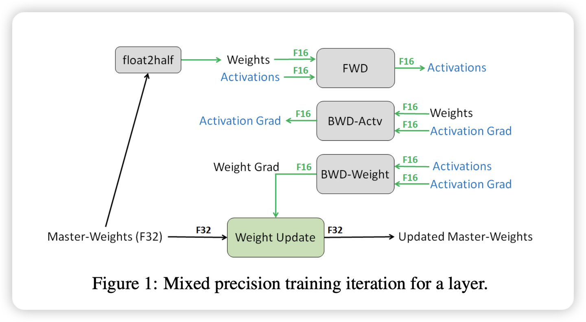

# 139.LLaMA Factory基于FSDP训练模型

# 示例代码

[llamafactory-fsdp.zip](https://www.yuque.com/attachments/yuque/0/2025/zip/2424104/1749261173854-a80d5d09-70b4-409b-8b9e-742a9b80810d.zip)

# 前言

<font style="color:rgb(51, 51, 51);">随着</font>[<font style="color:rgb(51, 51, 51);">人工智能</font>](https://so.csdn.net/so/search?q=%E4%BA%BA%E5%B7%A5%E6%99%BA%E8%83%BD\&spm=1001.2101.3001.7020)<font style="color:rgb(51, 51, 51);">技术的飞速发展，大型语言模型（LLM）在自然语言处理（NLP）领域扮演着越来越重要的角色。然而，预训练的模型往往需要针对特定任务进行微调，以提高其在特定领域的性能。因为预训练模型是在大量数据上训练得到的，它已经学习到了语言的基本规律和丰富的特征表示。然而，这些模型可能并不直接适用于特定的任务或领域，因为它们可能缺乏对特定领域知识的理解和适应性。</font>

## <font style="color:rgb(0, 0, 0);">LLaMA Factory 介绍</font>


<font style="color:rgb(0, 0, 0);">项目地址：</font><https://github.com/hiyouga/LLaMA-Factory/blob/main/README_zh.md>

<font style="color:rgb(0, 0, 0);">LLaMA Factory 是一个简单易用且高效的大型语言模型（Large Language Model）训练与微调平台。</font><font style="color:rgb(51, 51, 51);">致力于简化大型的定制过程。它集成了多种训练策略和监控工具，提供了命令行和 WebUI 等多种交互方式，大幅降了模型微调的技术门槛。</font><font style="color:rgb(0, 0, 0);">通过 LLaMA Factory，可以在无需编写任何代码的前提下，在本地完成上百种预训练模型的微调，框架特性包括：</font>

* <font style="color:rgb(0, 0, 0);">模型种类：LLaMA、LLaVA、Mistral、Mixtral-MoE、Qwen、Yi、Gemma、Baichuan、ChatGLM、Phi 等等。</font>
* <font style="color:rgb(0, 0, 0);">训练算法：（增量）预训练、（多模态）指令监督微调、奖励模型训练、PPO 训练、DPO 训练、KTO 训练、ORPO 训练等等。</font>
* <font style="color:rgb(0, 0, 0);">运算精度：16 比特全参数微调、冻结微调、LoRA 微调和基于 AQLM/AWQ/GPTQ/LLM.int8/HQQ/EETQ 的 2/3/4/5/6/8 比特 QLoRA 微调。</font>
* <font style="color:rgb(0, 0, 0);">优化算法：GaLore、BAdam、DoRA、LongLoRA、LLaMA Pro、Mixture-of-Depths、LoRA+、LoftQ 和 PiSSA。</font>
* <font style="color:rgb(0, 0, 0);">加速算子：FlashAttention-2 和 Unsloth。</font>
* <font style="color:rgb(0, 0, 0);">推理引擎：Transformers 和 vLLM。</font>
* <font style="color:rgb(0, 0, 0);">实验监控：LlamaBoard、TensorBoard、Wandb、MLflow、SwanLab 等等。</font>

## <font style="color:rgb(51, 51, 51);">LLaMA Factory </font><font style="color:rgb(51, 51, 51);">核心功能</font>

* <font style="color:rgb(51, 51, 51);">多模型兼容：支持包括 LLama、Mistral、Falcon 在内的多种大型语言模型。</font>
* <font style="color:rgb(51, 51, 51);">训练方法多样：涵盖全参数微调及 LoRA 等先进的微调技术。</font>
* <font style="color:rgb(51, 51, 51);">用户界面友好：LLama Board 提供了一个直观的 Web 界面，使用户能够轻松调整模型设置。</font>
* <font style="color:rgb(51, 51, 51);">监控工具集成：与 TensorBoard 等工具集成，便于监控和分析训练过程。</font>

## <font style="color:rgb(51, 51, 51);">LLaMA Factory 特点</font>

* <font style="color:rgb(51, 51, 51);">易用性：简化了机器学习算法的复杂性，通过图形界面即可控制模型微调。</font>
* <font style="color:rgb(51, 51, 51);">微调效率：支持 DPO、ORPO、PPO 和 SFT 等技术，提升了模型微调的效率和效果。</font>
* <font style="color:rgb(51, 51, 51);">参数调整灵活性：用户可根据需求轻松调整模型参数，如 dropout 率、epochs 等。</font>
* <font style="color:rgb(51, 51, 51);">多语言支持：界面支持英语、俄语和中文，面向全球用户提供服务。</font>

## <font style="color:rgb(51, 51, 51);">LLaMA Factory </font><font style="color:rgb(51, 51, 51);">使用场景</font>

<font style="color:rgb(51, 51, 51);">LLaMA-Factory 适用于广泛的 NLP 任务，包括但不限于：</font>

* <font style="color:rgb(51, 51, 51);">文本分类：实现情感分析、主题识别等功能。</font>
* <font style="color:rgb(51, 51, 51);">序列标注：如 NER、词性标注等任务。</font>
* <font style="color:rgb(51, 51, 51);">文本生成：自动生成文本摘要、对话等。</font>
* <font style="color:rgb(51, 51, 51);">机器翻译：优化特定语言对的翻译质量。</font>

<font style="color:rgb(51, 51, 51);">LLaMA-Factory 通过其强大的功能和易用性，助力用户在</font>[<font style="color:rgb(51, 51, 51);">自然语言处理</font>](https://so.csdn.net/so/search?q=%E8%87%AA%E7%84%B6%E8%AF%AD%E8%A8%80%E5%A4%84%E7%90%86\&spm=1001.2101.3001.7020)<font style="color:rgb(51, 51, 51);">领域快速实现模型的定制和优化。</font>

## <font style="color:rgb(51, 51, 51);">微调的过程</font>

<font style="color:rgb(51, 51, 51);">模型微调通过在特定任务的数据集上继续训练预训练模型来进行，使得模型能够学习到与任务相关的特定特征和知识。这个过程通常涉及到模型权重的微幅调整，而不是从头开始训练一个全新的模型。</font>

<font style="color:rgb(51, 51, 51);">微调过程主要包括以下几个步骤： </font>

1. <font style="color:rgb(51, 51, 51);">数据准备：收集和准备特定任务的数据集。 </font>
2. <font style="color:rgb(51, 51, 51);">模型选择：选择一个预训练模型作为基础模型。 </font>
3. <font style="color:rgb(51, 51, 51);">迁移学习：在新数据集上继续训练模型，同时保留预训练模型的知识。 </font>
4. <font style="color:rgb(51, 51, 51);">参数调整：根据需要调整模型的参数，如学习率、批大小等。 </font>
5. <font style="color:rgb(51, 51, 51);">模型评估：在验证集上评估模型的性能，并根据反馈进行调整。</font>

## <font style="color:rgb(51, 51, 51);">微调的优势</font>

<font style="color:rgb(51, 51, 51);">微调技术带来了多方面的优势：</font><font style="color:rgb(51, 51, 51);">资源效率：相比于从头开始训练模型，微调可以显著减少所需的数据量和计算资源。</font><font style="color:rgb(51, 51, 51);">快速部署：微调可以快速适应新任务，加速模型的部署过程。</font><font style="color:rgb(51, 51, 51);">性能提升：针对特定任务的微调可以提高模型的准确性和鲁棒性。</font><font style="color:rgb(51, 51, 51);">领域适应性：微调可以帮助模型更好地理解和适应特定领域的语言特点。</font>

<font style="color:rgb(51, 51, 51);">通过微调，可以使得预训练模型在这些任务上取得更好的性能，更好地满足实际应用的需求。</font>

# <font style="color:rgb(31, 35, 40);">环境准备</font>

## <font style="color:rgb(31, 35, 40);">安装 LLaMA Factory</font>

```plain
git clone --depth 1 https://github.com/hiyouga/LLaMA-Factory.git
cd LLaMA-Factory
pip install -e ".[torch,metrics]"
```

<font style="color:rgb(31, 35, 40);">可选的额外依赖项：torch、torch-npu、metrics、deepspeed、liger-kernel、bitsandbytes、hqq、eetq、gptq、aqlm、vllm、sglang、galore、apollo、badam、adam-mini、qwen、minicpm_v、modelscope、openmind、swanlab、quality</font>

Tip

<font style="color:rgb(31, 35, 40);">遇到包冲突时，可使用 </font><code><font style="color:rgb(31, 35, 40);">pip install --no-deps -e .</font></code><font style="color:rgb(31, 35, 40);"> 解决。</font>

## <font style="color:rgb(31, 35, 40);">数据准备</font>

<font style="color:rgb(31, 35, 40);">关于数据集文件的格式，请参考</font><font style="color:rgb(31, 35, 40);"> </font>[data/README_zh.md](https://github.com/hiyouga/LLaMA-Factory/blob/main/data/README_zh.md)<font style="color:rgb(31, 35, 40);"> </font><font style="color:rgb(31, 35, 40);">的内容。你可以使用 HuggingFace / ModelScope / Modelers 上的数据集或加载本地数据集。</font>

Note

<font style="color:rgb(31, 35, 40);">使用自定义数据集时，请更新</font><font style="color:rgb(31, 35, 40);"> </font><code><font style="color:rgb(31, 35, 40);">data/dataset_info.json</font></code><font style="color:rgb(31, 35, 40);"> </font><font style="color:rgb(31, 35, 40);">文件。</font>

<font style="color:rgb(31, 35, 40);">您也可以使用</font><font style="color:rgb(31, 35, 40);"> </font>[**Easy Dataset**](https://github.com/ConardLi/easy-dataset)<font style="color:rgb(31, 35, 40);"> </font><font style="color:rgb(31, 35, 40);">构建用于微调的合成数据。</font>

## <font style="color:rgb(31, 35, 40);">快速开始</font>

<font style="color:rgb(31, 35, 40);">下面三行命令分别对 Llama3-8B-Instruct 模型进行 LoRA</font><font style="color:rgb(31, 35, 40);"> </font>**<font style="color:rgb(31, 35, 40);">微调</font>**<font style="color:rgb(31, 35, 40);">、</font>**<font style="color:rgb(31, 35, 40);">推理</font>**<font style="color:rgb(31, 35, 40);">和</font>**<font style="color:rgb(31, 35, 40);">合并</font>**<font style="color:rgb(31, 35, 40);">。</font>

```plain
llamafactory-cli train examples/train_lora/llama3_lora_sft.yaml
llamafactory-cli chat examples/inference/llama3_lora_sft.yaml
llamafactory-cli export examples/merge_lora/llama3_lora_sft.yaml
```

<font style="color:rgb(31, 35, 40);">高级用法请参考</font><font style="color:rgb(31, 35, 40);"> </font>[examples/README_zh.md](https://github.com/hiyouga/LLaMA-Factory/blob/main/examples/README_zh.md)<font style="color:rgb(31, 35, 40);">（包括多 GPU 微调）。</font>

Tip

<font style="color:rgb(31, 35, 40);">使用</font><font style="color:rgb(31, 35, 40);"> </font><code><font style="color:rgb(31, 35, 40);">llamafactory-cli help</font></code><font style="color:rgb(31, 35, 40);"> </font><font style="color:rgb(31, 35, 40);">显示帮助信息。</font>

<font style="color:rgb(31, 35, 40);">遇到报错请先看</font>[常见问题](https://github.com/hiyouga/LLaMA-Factory/issues/4614)<font style="color:rgb(31, 35, 40);">。</font>

## <font style="color:rgb(31, 35, 40);">LLaMA Board 可视化微调（由 </font>[Gradio](https://github.com/gradio-app/gradio)<font style="color:rgb(31, 35, 40);"> 驱动）</font>

<font style="color:rgb(31, 35, 40);">llamafactory-cli webui</font>

## <font style="color:rgb(31, 35, 40);">构建 Docker</font>

<font style="color:rgb(31, 35, 40);">CUDA 用户：</font>

```plain
cd docker/docker-cuda/
docker compose up -d
docker compose exec llamafactory bash
```

<font style="color:rgb(31, 35, 40);">昇腾 NPU 用户：</font>

```plain
cd docker/docker-npu/
docker compose up -d
docker compose exec llamafactory bash
```

<font style="color:rgb(31, 35, 40);">AMD ROCm 用户：</font>

```plain
cd docker/docker-rocm/
docker compose up -d
docker compose exec llamafactory bash
```

## <font style="color:rgb(31, 35, 40);">从魔搭社区下载</font>

<font style="color:rgb(31, 35, 40);">如果您在 Hugging Face 模型和数据集的下载中遇到了问题，可以通过下述方法使用魔搭社区。</font>

<font style="color:rgb(31, 35, 40);">export USE_MODELSCOPE_HUB=1 # Windows 使用 `set USE_MODELSCOPE_HUB=1`</font>

<font style="color:rgb(31, 35, 40);">将 </font><code><font style="color:rgb(31, 35, 40);">model_name_or_path</font></code><font style="color:rgb(31, 35, 40);"> 设置为模型 ID 来加载对应的模型。在</font>[魔搭社区](https://modelscope.cn/models)<font style="color:rgb(31, 35, 40);">查看所有可用的模型，例如 </font><code><font style="color:rgb(31, 35, 40);">LLM-Research/Meta-Llama-3-8B-Instruct</font></code><font style="color:rgb(31, 35, 40);">。</font>

# <font style="color:rgb(51, 51, 51);">前置知识</font>

<font style="color:rgb(51, 51, 51);">在介绍针对权重数据、优化器数据和梯度数据进行分布式数据并行的算法 FSDP 前，需要一些前置知识，如何执行混精度训练和对显存消耗进行估算，以帮助更好地理解完全分片数据并行算法 FSDP。</font>

## <font style="color:rgb(51, 51, 51);">精度格式</font>

<font style="color:rgb(51, 51, 51);">在深度学习中，常用的精度格式包括 </font>**<font style="color:rgb(51, 51, 51);">FP32</font>**<font style="color:rgb(51, 51, 51);">、</font>**<font style="color:rgb(51, 51, 51);">FP16</font>**<font style="color:rgb(51, 51, 51);">、</font>**<font style="color:rgb(51, 51, 51);">BF16</font>**<font style="color:rgb(51, 51, 51);"> 和 </font>**<font style="color:rgb(51, 51, 51);">TF32</font>**<font style="color:rgb(51, 51, 51);">。</font>


* **<font style="color:rgb(51, 51, 51);">FP16</font>**<font style="color:rgb(51, 51, 51);">：同样是 IEEE 754 标准下的半精度浮点格式。随着深度学习的发展，FP16 逐渐取代了 FP32 的地位。因为相较于 FP32，更低的精度并不会对神经网络的性能产生重大影响。额外的精度不会带来任何好处，反而会更慢、占用更多内存并降低通信速度。FP16 通常用于混合精度训练（MindSpore/PyTorch）。也用于训练后量化，以加快推理速度。其他用于量化的格式还有整数 INT8（8 位整数）、INT4（4 位）甚至 INT1（二进制值）。</font>
* **<font style="color:rgb(51, 51, 51);">BF16</font>**<font style="color:rgb(51, 51, 51);">：谷歌最初开发的另一种 16 位格式被称为 "Brain Floating Point Format"，简称 "bfloat16"。这个名字源于 "谷歌大脑"（谷歌 Brain），谷歌大脑是谷歌的一个 AI 研究小组，这种格式就是在这个小组构思出来的。最开始是被使用在谷歌芯片 TPU 中，后被广泛使用在 </font>[<font style="color:rgb(65, 131, 196);">GPU</font>](https://cloud.tencent.com/product/gpu?from_column=20065\&from=20065)<font style="color:rgb(51, 51, 51);">、NPU 等 AI 芯片中。由于具有更多的指数位，常被用于处理 FP16 的溢出问题。</font>
* **<font style="color:rgb(51, 51, 51);">FP32</font>**<font style="color:rgb(51, 51, 51);">：这种格式在很长一段时间内都是深度学习的主力，它是 IEEE 754 标准下的单精度浮点数。长期以来，它一直是神经网络计算的标准类型。长期以来，神经网络中的权重、激活和其他值都默认用 FP32 表示。</font>
* **<font style="color:rgb(51, 51, 51);">TF32</font>**<font style="color:rgb(51, 51, 51);">：这是一种十分特殊的格式（无需显示设置，而是自动执行），它将 FP32 数据截断为 TF32 进行计算，然后再转换回 FP32。这一创新的最大优势在于编译器只需在 AI 编译层提供支持。其他代码部分则可以继续使用动态范围相同但精度较高的 FP32，无需进行修改。TF32 的快速插入性使得利用 AI 计算加速核心的速度成为可能，而无需过多修改现有代码。</font>

<font style="color:rgb(51, 51, 51);">TF32 采用与 FP16 相同的 10 位尾数，这满足了 AI 工作负载的精度要求，并且使用了与 FP32 相同的 8 位指数，因此具有相同的数值范围。从技术上讲，它可以视为一种 19 位格式，也可以视为扩展精度的 BF16。</font>

<font style="color:rgb(51, 51, 51);">TF32 的优势在于其格式与 FP32 相同。当使用 TF32 进行计算时，输入 FP32 操作数的尾数从 23 位舍入到 10 位，然后进行精确乘法运算，最后以正常的 FP32 格式进行累加。相比之下，FP16 和 BF16 等格式需要更多工作，因为它们涉及不同的位布局。尽管如此，也值得使用这些不同搞得精度格式，因为它们可以减少内存带宽、存储和计算位数，从而提升执行速度。</font>

```plain
torch.backends.npu.matmul.allow_tf32 = True
torch.backends.npu.matmul.allow_16 = True
```

## <font style="color:rgb(51, 51, 51);">混精训练</font>

<font style="color:rgb(51, 51, 51);">在当今大模型训练的背景下，混合精度训练已然成为一种备受推崇的普遍做法。通过采用混合精度训练，能够将训练速度显著提升数倍，而又不会对模型的整体性能产生重大影响。在数据科学领域，精度一直是评判的重要考量因素——在传统的科学计算领域，人们通常追求较高的精度，如 FP128 或 FP64 等。</font>

<font style="color:rgb(51, 51, 51);">然而，在深度学习中，所面临的实际上是一个高维函数拟合（或近似）的优化问题，因此并不需要过于精确的数值表示，且使用低精度将会带来显著的计算速度提升。</font>

<font style="color:rgb(51, 51, 51);">在深度学习中，使用 FP16 训练有时会出现下溢出的问题：FP16 的有效的动态范围约为 {5.96e}^{-8} \sim 65504 ，在训练后期，例如激活函数的梯度会非常小，甚至在梯度乘以学习率后，值会更加小。由于 FP16 的精度范围有限，过小的梯度可能导致更新无效，这个时候就需要使用混精度训练。</font>

<font style="color:rgb(51, 51, 51);">混精度训练可以分为两个部分：</font>**<font style="color:rgb(51, 51, 51);">半精度</font>**<font style="color:rgb(51, 51, 51);"> 和 </font>**<font style="color:rgb(51, 51, 51);">权重备份</font>**<font style="color:rgb(51, 51, 51);">，如图所示，这里使用 FP16 和 FP32 来举例。在训练开始时，准备两套模型状态，其中一套为 FP32 类型（优化器状态和模型参数），另一套为 FP16 类型（模型参数），在前向传播、反向传播时，都使用 FP16 类型的模型参数进行计算；而在参数更新时，将梯度成与学习率 \eta 相乘，更新到 FP32 类型的模型状态上，在新一轮的训练中，再次将 FP32 类型的模型拷贝为 FP16 类型的模型。这个过程就是</font>**<font style="color:rgb(51, 51, 51);">混精度训练</font>**<font style="color:rgb(51, 51, 51);">。</font>



<font style="color:rgb(51, 51, 51);">由于在计算密集的前向传播、反向传播中，使用了 FP16 进行计算，与单精度相比，训练的速度会大幅度提升。另外，由于激活值在训练过程中占用内存的很大部分，使用 FP16 储存激活值在大批量训练时也会节省内存。同时，在分布式环境下使用 FP16 梯度通信量也会降低。</font>

<font style="color:rgb(51, 51, 51);">为了获得最佳性能，在混精度中需要额外选择合适的批量大小。通常建议使用 2 的幂次方作为批量大小，并与输入 / 输出神经元的数量相匹配，通常为 8 的倍数，但也可能更高，具体取决于所使用的硬件和模型的数据类型。</font>

<font style="color:rgb(51, 51, 51);">而在 FSDP 中，可以通过在 torch 中指定 </font><code><font style="color:rgb(51, 51, 51);background-color:rgb(243, 244, 244);">fpSixteen</font></code><font style="color:rgb(51, 51, 51);"> 进行混精度的自动配置。</font>

```plain
fpSixteen = MixedPrecision(
    param_dtype=torch.float16,
    
    reduce_dtype=torch.float16,
    
    buffer_dtype=torch.float16,
)

bfSixteen = MixedPrecision(
    param_dtype=torch.bfloat16,
    
    reduce_dtype=torch.bfloat16,
    
    buffer_dtype=torch.bfloat16,
)

model = FSDP(model,
       auto_wrap_policy=t5_auto_wrap_policy,
       mixed_precision=bfSixteen)
```

# <font style="color:rgb(0, 0, 0);">FSDP全切片数据并行训练</font>

<font style="color:rgb(0, 0, 0);">LLaMA-Factory 支持单机多卡和多机多卡分布式训练。同时也支持</font><font style="color:rgb(0, 0, 0);"> </font><font style="color:rgb(0, 0, 0);">DDP</font><font style="color:rgb(0, 0, 0);"> </font><font style="color:rgb(0, 0, 0);">,</font><font style="color:rgb(0, 0, 0);"> </font><font style="color:rgb(0, 0, 0);">DeepSpeed</font><font style="color:rgb(0, 0, 0);"> </font><font style="color:rgb(0, 0, 0);">和 FSDP 三种分布式引擎。</font>

[DDP](https://pytorch.org/docs/stable/notes/ddp.html)<font style="color:rgb(0, 0, 0);"> </font><font style="color:rgb(0, 0, 0);">(DistributedDataParallel) 通过实现模型并行和数据并行实现训练加速。 使用 DDP 的程序需要生成多个进程并且为每个进程创建一个 DDP 实例，他们之间通过</font><font style="color:rgb(0, 0, 0);"> </font><code><font style="color:rgb(0, 0, 0);">torch.distributed</font></code><font style="color:rgb(0, 0, 0);"> </font><font style="color:rgb(0, 0, 0);">库同步。</font>

[DeepSpeed](https://www.microsoft.com/en-us/research/blog/deepspeed-extreme-scale-model-training-for-everyone/)<font style="color:rgb(0, 0, 0);"> </font><font style="color:rgb(0, 0, 0);">是微软开发的分布式训练引擎，并提供ZeRO（Zero Redundancy Optimizer）、offload、Sparse Attention、1 bit Adam、流水线并行等优化技术。 您可以根据任务需求与设备选择使用。</font>

[FSDP](https://pytorch.org/tutorials/intermediate/FSDP_tutorial.html)<font style="color:rgb(0, 0, 0);"> </font><font style="color:rgb(0, 0, 0);">通过全切片数据并行技术（Fully Sharded Data Parallel）来处理更多更大的模型。在 DDP 中，每张 GPU 都各自保留了一份完整的模型参数和优化器参数。而 FSDP 切分了模型参数、梯度与优化器参数，使得每张 GPU 只保留这些参数的一部分。 除了并行技术之外，FSDP 还支持将模型参数卸载至CPU，从而进一步降低显存需求。</font>

| <font style="color:rgb(0, 0, 0);">引擎</font> | <font style="color:rgb(0, 0, 0);">数据切分</font> | <font style="color:rgb(0, 0, 0);">模型切分</font> | <font style="color:rgb(0, 0, 0);">优化器切分</font> | <font style="color:rgb(0, 0, 0);">参数卸载</font> |
| --- | --- | --- | --- | --- |
| <font style="color:rgb(0, 0, 0);">DDP</font> | <font style="color:rgb(0, 0, 0);">支持</font> | <font style="color:rgb(0, 0, 0);">不支持</font> | <font style="color:rgb(0, 0, 0);">不支持</font> | <font style="color:rgb(0, 0, 0);">不支持</font> |
| <font style="color:rgb(0, 0, 0);">DeepSpeed</font> | <font style="color:rgb(0, 0, 0);">支持</font> | <font style="color:rgb(0, 0, 0);">支持</font> | <font style="color:rgb(0, 0, 0);">支持</font> | <font style="color:rgb(0, 0, 0);">支持</font> |
| <font style="color:rgb(0, 0, 0);">FSDP</font> | <font style="color:rgb(0, 0, 0);">支持</font> | <font style="color:rgb(0, 0, 0);">支持</font> | <font style="color:rgb(0, 0, 0);">支持</font> | <font style="color:rgb(0, 0, 0);">支持</font> |

**<font style="color:rgb(51, 51, 51);">完全分片数据并行</font>**<font style="color:rgb(51, 51, 51);">（Fully Sharded Data Parallel，FSDP）在分布式 AI 系统中具有重要地位，不仅能提高并行效率，还能减少显式内存消耗，这两方面的优势为模型的大规模训练带来了显著的好处。</font>

<font style="color:rgb(51, 51, 51);">值得注意的是，并行效率和内存消耗之间存在着密切关联关系，降低内存占用可以使使用更大的并行度，进而提升整体的并行加速效果。完全分片数据并行是基于零冗余优化器（ZeRO）的具体在 AI 框架中的实现，主要的实现有微软的 </font>**<font style="color:rgb(51, 51, 51);">Deepspeed</font>**<font style="color:rgb(51, 51, 51);"> 和 Meta 的 </font>**<font style="color:rgb(51, 51, 51);">Fairscale</font>**<font style="color:rgb(51, 51, 51);">，其中 Fairscale 被集成到 PyTorch 中，并作为 FSDP 实现基础。在本内容将从零冗余优化器的常用技术入手，深入剖析如何降低内存开销并提高训练效率。</font>

<font style="color:rgb(51, 51, 51);">在数据并行中，每个 NPU 都需要保存一份完整的参数（模型状态和剩余状态），而不是所有的参数在训练的整个过程中都会被使用到，而是在特定的阶段中（某个层的前向或反向传播），因此可以在不需要使用的时候将它转移到其他地方节省内存空间。</font>

<font style="color:rgb(51, 51, 51);"></font>

## <font style="color:rgb(51, 51, 51);">FSDP 简单实现</font>

<font style="color:rgb(51, 51, 51);">和 DDP 一样，可以通过简单的嵌套使用 ZeRO 优化器来实现 FSDP。将模型的参数、梯度和优化器状态分片，从而显著减少单个 NPU 的内存占用，实现更大模型的训练。</font>

<font style="color:rgb(51, 51, 51);">以下是一个简单的代码示例，展示了如何使用 </font><code><font style="color:rgb(51, 51, 51);background-color:rgb(243, 244, 244);">torch.distributed.fsdp</font></code><font style="color:rgb(51, 51, 51);"> 中的 </font><code><font style="color:rgb(51, 51, 51);background-color:rgb(243, 244, 244);">FullyShardedDataParallel</font></code><font style="color:rgb(51, 51, 51);">（FSDP）类来实现完全分片数据并行：</font>

```plain
import torch
from torch.distributed.fsdp import FullyShardedDataParallel as FSDP

torch.cuda.set_device(device_id)
sharded_module = FSDP(my_module)

optim = torch.optim.Adam(sharded_module.parameters(), lr=0.0001)
x = sharded_module(x, y=3, z=torch.Tensor([1]))

loss = x.sum()
loss.backward()
optim.step()
```

<font style="color:rgb(51, 51, 51);">首先设置当前的 NPU，然后将 </font><code><font style="color:rgb(51, 51, 51);background-color:rgb(243, 244, 244);">my_module</font></code><font style="color:rgb(51, 51, 51);"> 包装成一个 FSDP 模块。这会将模型的参数、梯度和优化器状态在多个 NPU 之间进行分片，从而减少每个 NPU 上的内存占用。</font>

<font style="color:rgb(51, 51, 51);">再来看一个更详细的例子，使用 </font><code><font style="color:rgb(51, 51, 51);background-color:rgb(243, 244, 244);">fsdp_main</font></code><font style="color:rgb(51, 51, 51);"> 函数，用于分布式训练 T5 模型。函数通过 </font><code><font style="color:rgb(51, 51, 51);background-color:rgb(243, 244, 244);">setup_model</font></code><font style="color:rgb(51, 51, 51);"> 函数加载模型和分词器，并设置分布式训练的相关环境变量，包括 </font><code><font style="color:rgb(51, 51, 51);background-color:rgb(243, 244, 244);">local_rank</font></code><font style="color:rgb(51, 51, 51);">、</font><code><font style="color:rgb(51, 51, 51);background-color:rgb(243, 244, 244);">rank</font></code><font style="color:rgb(51, 51, 51);"> 和 </font><code><font style="color:rgb(51, 51, 51);background-color:rgb(243, 244, 244);">world_size</font></code><font style="color:rgb(51, 51, 51);">。</font>

<font style="color:rgb(51, 51, 51);">在数据集和数据加载器设置之后，通过 </font><code><font style="color:rgb(51, 51, 51);background-color:rgb(243, 244, 244);">functools.partial</font></code><font style="color:rgb(51, 51, 51);"> 函数部分应用了 </font><code><font style="color:rgb(51, 51, 51);background-color:rgb(243, 244, 244);">transformer_auto_wrap_policy</font></code><font style="color:rgb(51, 51, 51);">，并指定 </font><code><font style="color:rgb(51, 51, 51);background-color:rgb(243, 244, 244);">T5Block</font></code><font style="color:rgb(51, 51, 51);"> 为要自动包装的变压器层。这一步的目的是定义一个自动包装策略，用于后续的模型分片和并行处理。</font>

<font style="color:rgb(51, 51, 51);">接下来，定义了 </font><code><font style="color:rgb(51, 51, 51);background-color:rgb(243, 244, 244);">sharding_strategy</font></code><font style="color:rgb(51, 51, 51);"> 变量，并将其设为 </font><code><font style="color:rgb(51, 51, 51);background-color:rgb(243, 244, 244);">ShardingStrategy.SHARD_GRAD_OP</font></code><font style="color:rgb(51, 51, 51);">。这表示使用 Zero2 分片策略，如果要使用 Zero3 策略，可以将其设为 </font><code><font style="color:rgb(51, 51, 51);background-color:rgb(243, 244, 244);">FULL_SHARD</font></code><font style="color:rgb(51, 51, 51);">。</font>

<font style="color:rgb(51, 51, 51);">分片策略决定了在分布式训练中如何管理和分配模型参数，以优化内存使用和计算性能。</font>

<font style="color:rgb(51, 51, 51);">为了支持混精度训练（bf16），如果当前 CUDA 版本和 NCCL 版本支持 bf16，并且 CUDA 版本大于或等于 11.0，那么 </font><code><font style="color:rgb(51, 51, 51);background-color:rgb(243, 244, 244);">bf16_ready</font></code><font style="color:rgb(51, 51, 51);"> 变量为 </font><code><font style="color:rgb(51, 51, 51);background-color:rgb(243, 244, 244);">True</font></code><font style="color:rgb(51, 51, 51);">，并将 </font><code><font style="color:rgb(51, 51, 51);background-color:rgb(243, 244, 244);">mp_policy</font></code><font style="color:rgb(51, 51, 51);"> 设为 </font><code><font style="color:rgb(51, 51, 51);background-color:rgb(243, 244, 244);">bfSixteen</font></code><font style="color:rgb(51, 51, 51);">。否则，</font><code><font style="color:rgb(51, 51, 51);background-color:rgb(243, 244, 244);">mp_policy</font></code><font style="color:rgb(51, 51, 51);"> 设为 </font><code><font style="color:rgb(51, 51, 51);background-color:rgb(243, 244, 244);">None</font></code><font style="color:rgb(51, 51, 51);">，默认使用 fp32（单精度）训练。</font>

<font style="color:rgb(51, 51, 51);">在模型仍在 CPU 上时，代码将模型传入 </font><code><font style="color:rgb(51, 51, 51);background-color:rgb(243, 244, 244);">FSDP</font></code><font style="color:rgb(51, 51, 51);">（Fully Sharded Data Parallel）模块，配置自动包装策略、混合精度策略（</font><code><font style="color:rgb(51, 51, 51);background-color:rgb(243, 244, 244);">mixed_precision</font></code><font style="color:rgb(51, 51, 51);">），以及当前 NPU ID（</font><code><font style="color:rgb(51, 51, 51);background-color:rgb(243, 244, 244);">device_id</font></code><font style="color:rgb(51, 51, 51);">）。这一步是将模型转换为分布式训练的模式，以便在多个 NPU 之间分片和</font>[<font style="color:rgb(65, 131, 196);">并行计算</font>](https://cloud.tencent.com/product/gpu?from_column=20065\&from=20065)<font style="color:rgb(51, 51, 51);">。</font>

```plain
def fsdp_main(args):
    model, tokenizer = setup_model("t5-base")

    local_rank = int(os.environ['LOCAL_RANK'])
    rank = int(os.environ['RANK'])
    world_size = int(os.environ['WORLD_SIZE'])

    
    
    t5_auto_wrap_policy = functools.partial(
        transformer_auto_wrap_policy,
        transformer_layer_cls={
            T5Block,
        },
    )
    sharding_strategy: ShardingStrategy = ShardingStrategy.SHARD_GRAD_OP 
    torch.cuda.set_device(local_rank)

    bf16_ready = (
    torch.version.cuda
    and torch.cuda.is_bf16_supported()
    and LooseVersion(torch.version.cuda) >= "11.0"
    and dist.is_nccl_available()
    and nccl.version() >= (2, 10)
    )

    if bf16_ready:
        mp_policy = bfSixteen
    else:
        mp_policy = None 

    
    model = FSDP(model,
        auto_wrap_policy=t5_auto_wrap_policy,
        mixed_precision=mp_policy,
        
        device_id=torch.cuda.current_device())

    optimizer = optim.AdamW(model.parameters(), lr=args.lr)
    scheduler = StepLR(optimizer, step_size=1, gamma=args.gamma)

    for epoch in range(1, args.epochs + 1):
        train_accuracy = train(args, model, rank, world_size, train_loader, optimizer, epoch, sampler=sampler1)
        scheduler.step()
```

<font style="color:rgb(51, 51, 51);">当然，如果需要更简单而全面的配置，可以通过 </font><code><font style="color:rgb(51, 51, 51);background-color:rgb(243, 244, 244);">deepspeed</font></code><font style="color:rgb(51, 51, 51);"> 库进行便捷的 ZeRO 配置。</font>

<font style="color:rgb(51, 51, 51);"></font>

<font style="color:rgb(0, 0, 0);">PyTorch 的全切片数据并行技术 </font>[FSDP](https://pytorch.org/docs/stable/fsdp.html)<font style="color:rgb(0, 0, 0);"> （Fully Sharded Data Parallel）能让我们处理更多更大的模型。LLaMA-Factory支持使用 FSDP 引擎进行分布式训练。</font>

<font style="color:rgb(0, 0, 0);">FSDP 的参数</font><font style="color:rgb(0, 0, 0);"> </font><code><font style="color:rgb(0, 0, 0);">ShardingStrategy</font></code><font style="color:rgb(0, 0, 0);"> </font><font style="color:rgb(0, 0, 0);">的不同取值决定了模型的划分方式：</font>

* <code><font style="color:rgb(0, 0, 0);">FULL_SHARD</font></code><font style="color:rgb(0, 0, 0);">: 将模型参数、梯度和优化器状态都切分到不同的GPU上，类似ZeRO-3。</font>
* <code><font style="color:rgb(0, 0, 0);">SHARD_GRAD_OP</font></code><font style="color:rgb(0, 0, 0);">: 将梯度、优化器状态切分到不同的GPU上，每个GPU仍各自保留一份完整的模型参数。类似ZeRO-2。</font>
* <code><font style="color:rgb(0, 0, 0);">NO_SHARD</font></code><font style="color:rgb(0, 0, 0);">: 不切分任何参数。类似ZeRO-0。</font>

## <font style="color:rgb(0, 0, 0);">llamafactory-cli</font>

<font style="color:rgb(0, 0, 0);">您只需根据需要修改</font><font style="color:rgb(0, 0, 0);"> </font><code><font style="color:rgb(0, 0, 0);">examples/accelerate/fsdp_config.yaml</font></code><font style="color:rgb(0, 0, 0);"> </font><font style="color:rgb(0, 0, 0);">以及</font><font style="color:rgb(0, 0, 0);"> </font><code><font style="color:rgb(0, 0, 0);">examples/extras/fsdp_qlora/llama3_lora_sft.yaml</font></code><font style="color:rgb(0, 0, 0);"> </font><font style="color:rgb(0, 0, 0);">，文件然后运行以下命令即可启动 FSDP+QLoRA 微调：</font>

```plain
bash examples/extras/fsdp_qlora/train.sh
```

**训练报错1：**

\[rank0]: torch.distributed.DistBackendError: NCCL error in: /pytorch/torch/csrc/distributed/c10d/NCCLUtils.hpp:268, invalid usage (run with NCCL_DEBUG=WARN for details), NCCL version 2.21.5

\[rank0]: ncclInvalidUsage: This usually reflects invalid usage of NCCL library.

\[rank0]: Last error:

\[rank0]: Duplicate GPU detected : rank 0 and rank 1 both on CUDA device 70

解决方案：修改fsdp_config.yaml ，<font style="color:#080808;background-color:#ffffff;">num_processes=1</font>

**训练报错2：**

\[rank0]:     raise RuntimeError(

\[rank0]: RuntimeError: Cannot writeback when the parameter shape changes

\[rank0]: Expects torch.Size(\[525336576]) but got torch.Size(\[128256, 4096])

解决方案：修改fsdp_config.yaml ，fsdp_offload_params =true

FSDP（Fully Sharded Data Parallel）中的`fsdp_offload_params`参数。这个参数是FSDP配置中的一个选项，用于控制是否将模型参数卸载（offload）到CPU内存。下面详细解释其作用：

**作用**

1. **显存优化**：当启用`fsdp_offload_params`时，FSDP会将模型参数保存在CPU内存中，而不是GPU显存。在计算需要时，再将参数从CPU移动到GPU。这样可以显著减少每个GPU上的显存占用，从而允许训练更大的模型或使用更大的批次大小。
2. **计算与通信重叠**：FSDP在参数需要参与计算之前会预取（prefetch）参数到GPU。同时，在计算过程中，已经计算完的参数梯度会被异步移回CPU。这种机制可以在一定程度上隐藏数据移动的开销。
3. **适用场景**：特别适用于GPU显存非常有限的环境。例如，在消费级显卡或多任务共享的GPU服务器上训练大型模型。

**代价**

1. **训练速度下降**：由于参数需要在CPU和GPU之间移动，这会增加额外的数据传输时间，通常会导致训练速度变慢。
2. **通信瓶颈**：如果CPU到GPU的数据传输带宽不足（如PCIe带宽限制），可能会成为训练瓶颈。

## <font style="color:rgb(0, 0, 0);">accelerate</font>

<font style="color:rgb(0, 0, 0);">此外，您也可以使用 accelerate 启动 FSDP 引擎，</font><font style="color:rgb(0, 0, 0);"> </font>**<font style="color:rgb(0, 0, 0);">节点数与 GPU 数可以通过 num_machines 和 num_processes 指定</font>**<font style="color:rgb(0, 0, 0);">。对此，Huggingface 提供了便捷的配置功能。 只需运行：</font>

```plain
accelerate config
```

<font style="color:rgb(0, 0, 0);">根据提示回答一系列问题后，我们就可以生成 FSDP 所需的配置文件。</font>

<font style="color:rgb(0, 0, 0);">当然您也可以根据需求自行配置</font><font style="color:rgb(0, 0, 0);"> </font><code><font style="color:rgb(0, 0, 0);">fsdp_config.yaml</font></code><font style="color:rgb(0, 0, 0);"> </font><font style="color:rgb(0, 0, 0);">。</font>

```plain
### /examples/accelerate/fsdp_config.yaml
compute_environment: LOCAL_MACHINE
debug: false
distributed_type: FSDP
downcast_bf16: 'no'
fsdp_config:
    fsdp_auto_wrap_policy: TRANSFORMER_BASED_WRAP
    fsdp_backward_prefetch: BACKWARD_PRE
    fsdp_forward_prefetch: false
    fsdp_cpu_ram_efficient_loading: true
    fsdp_offload_params: true # offload may affect training speed
    fsdp_sharding_strategy: FULL_SHARD
    fsdp_state_dict_type: FULL_STATE_DICT
    fsdp_sync_module_states: true
    fsdp_use_orig_params: true
machine_rank: 0
main_training_function: main
mixed_precision: fp16 # or bf16
num_machines: 1 # the number of nodes
num_processes: 2 # the number of GPUs in all nodes
rdzv_backend: static
same_network: true
tpu_env: []
tpu_use_cluster: false
tpu_use_sudo: false
use_cpu: false
```

**<font style="color:rgb(0, 0, 0);">备注</font>**

* <font style="color:rgb(0, 0, 0);">请确保</font><font style="color:rgb(0, 0, 0);"> </font><code><font style="color:rgb(0, 0, 0);">num_processes</font></code><font style="color:rgb(0, 0, 0);"> </font><font style="color:rgb(0, 0, 0);">和实际使用的总GPU数量一致</font>

<font style="color:rgb(0, 0, 0);">随后，您可以使用以下命令启动训练：</font>

```plain
accelerate launch \
--config_file examples/accelerate/fsdp_config.yaml \
src/train.py examples/extras/fsdp_qlora/llama3_lora_sft.yaml
```

**<font style="color:rgb(0, 0, 0);">警告</font>**

<font style="color:rgb(0, 0, 0);">不要在 FSDP+QLoRA 中使用 GPTQ/AWQ 模型</font>

#

# <font style="color:rgb(0, 0, 0);"></font>


> 更新: 2025-06-07 09:52:53  
> 原文: <https://www.yuque.com/aaron-wecc3/dhluml/zpfbmotkly57mls4>