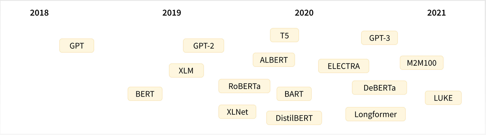
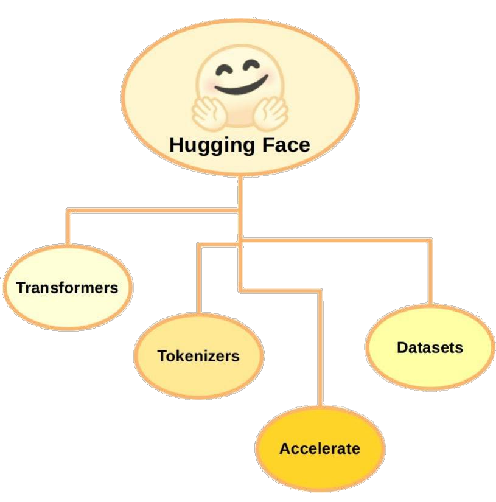

# 14.HuggingFace 核心组件及应用实战

**示例代码**

[huggingface-app.ppt](https://www.yuque.com/attachments/yuque/0/2025/ppt/1387387/1745159933986-689f23fc-72f1-4a7a-91b4-8c48091012c7.ppt)

*<font style="color:#DF2A3F;">注：将ppt后缀名改为zip后解压</font>*

python版本：3.11.7

**<font style="color:rgb(51, 51, 51);"></font>**

**<font style="color:rgb(51, 51, 51);">分享内容</font>**

1. <font style="color:rgb(51, 51, 51);">什么是 Hugging Face？它的目标是什么？</font>
2. <font style="color:rgb(51, 51, 51);">Hugging Face 中包含哪些知名的预训练模型?</font>
3. <font style="color:rgb(51, 51, 51);">如果我们要在 Hugging Face 中下载 BERT，那么</font>
   1. <font style="color:rgb(51, 51, 51);">只有一种版本，还是有多种版本可以选择？</font>
   2. <font style="color:rgb(51, 51, 51);">每一种版本的 BERT 中，只有一种格式还是有多种格式可以适应多种下游任务？</font>
4. <font style="color:rgb(51, 51, 51);">Hugging Face 库中有哪些有用的组件？</font>

## <font style="color:rgb(51, 51, 51);">一、Hugging Face 简介</font>

<font style="color:rgb(51, 51, 51);">官网：</font>[<font style="color:rgb(51, 51, 51);">https://huggingface.co/</font>](https://huggingface.co/)

<font style="color:rgb(51, 51, 51);">Hugging Face 是一个开源的 AI 社区网站，站内几乎囊括了所有常见的 AI 开源模型，号称：一网打尽，应有尽有，全部开源。</font>


<font style="color:rgb(51, 51, 51);">在 Hugging Face 中可以下载到众多开源的预训练大模型，模型本身包含相关信息和参数，可以拿来做微调和重新训练，非常方便。</font>



## <font style="color:rgb(51, 51, 51);">二、Hugging Face 核心组件</font>



<font style="color:rgb(51, 51, 51);">Hugging Face 核心组件包括 </font>**<font style="color:rgb(51, 51, 51);">Transformers、Dataset、Tokenizer</font>**<font style="color:rgb(51, 51, 51);">，此外还有一些辅助工具，如 </font>**<font style="color:rgb(51, 51, 51);">Accelerate</font>**<font style="color:rgb(51, 51, 51);">，用于加速深度学习训练过程。</font>

<font style="color:rgb(119, 119, 119);">更多内容可以去 Hugging Face 官网上发掘，下面重点介绍下它的三个核心组件。</font>

### <font style="color:rgb(51, 51, 51);">1、Hugging Face Transformers</font>

<font style="color:rgb(51, 51, 51);">Transformers 是 Hugging Face 的核心组件，主要用于自然语言处理，提供了预训练的语言模型和相关工具，使得研究者和工程师能够轻松的训练和使用海量的 NLP 模型。</font>

<font style="color:rgb(51, 51, 51);">常用的模型包括 BERT、GPT、XLNet、RoBERTa 等，并提供了模型的各种版本。</font>

<font style="color:rgb(51, 51, 51);">通过 Transformers 库，开发人员可以用这些预训练模型进行文本分类、命名实体识别、机器翻译、问答系统等 NLP 任务。</font>

<font style="color:rgb(51, 51, 51);">Transformers 库本身还提供方便的 API、实例代码、文档，让开发者学习和使用这些模型都变得非常简单，同时开发者也可以上传自己的预训练模型和 API。</font>

```python
# 首先通过 pip 下载相关库：pip install transformers

# 导入 transformers 相关库
from transformers import AutoModelForSequenceClassification

# 初始化分词器和模型
model_name = "bert-base-cased"
model = AutoModelForSequenceClassification.from_pretrained(model_name, num_labels=2)

# 将编码后的张量输入模型进行预测
outputs = model(**inputs)

# 获取预测结果和标签
predictions = outputs.logits.argmax(dim=-1)
```

### <font style="color:rgb(51, 51, 51);">2、Hugging Face Dataset</font>

<font style="color:rgb(51, 51, 51);">Dataset 是 Hugging Face 的公共数据集仓库，以下是常用的一些数据集（欢迎补充）：</font>

1. <font style="color:rgb(51, 51, 51);">SQuAD：Stanford 大学发布的问答数据集</font>
2. <font style="color:rgb(51, 51, 51);">IMBDB：电影评论数据集</font>
3. <font style="color:rgb(51, 51, 51);">CoNLL-2003：NER 命名实体识别数据集</font>
4. <font style="color:rgb(51, 51, 51);">GLUE：公共基准测试集</font>

<font style="color:rgb(51, 51, 51);">Hugging Face Dataset 简化了数据集的下载、预处理过程，并具备数据集分割、采样和迭代器等功能。</font>

```python
# 首先通过 pip 下载相关库：pip install datasets

# 导入数据集
from datasets import load_dataset

# 下载数据集并打乱数据
dataset_name = "imdb"
dataset = load_dataset(dataset_name)
```

### <font style="color:rgb(51, 51, 51);">3、Hugging Face Tokenizer</font>

<font style="color:rgb(51, 51, 51);">Tokenizer 是 Hugging Face 的分词器，它的任务是将输入文本转换为一个个标记（tokens），它还能对文本序列进行清洗、截断和填充等预处理，以满足模型的输入要求。</font>它的主要功能是将文本分解为更小的单元（通常是词或子词），并将这些单元映射到数值表示。

<font style="color:rgb(51, 51, 51);">以下是分词器的简单解释：</font>

1. **文本分割**<font style="color:rgb(51, 51, 51);">：分词器首先将输入的文本分割成更小的单元。例如，对于句子 "I love NLP"，分词器可能会将其分割为 </font><code><font style="color:rgb(51, 51, 51);">["I", "love", "NLP"]</font></code><font style="color:rgb(51, 51, 51);">。</font>
2. **词汇映射**<font style="color:rgb(51, 51, 51);">：分词器会将每个单元映射到一个唯一的数值索引，这些索引通常来自一个预定义的词汇表。例如，假设词汇表中 "I" 的索引是 1，"love" 的索引是 2，"NLP" 的索引是 3，那么分词器会将句子转换为 </font><code><font style="color:rgb(51, 51, 51);">[1, 2, 3]</font></code><font style="color:rgb(51, 51, 51);">。</font>
3. **处理特殊标记**<font style="color:rgb(51, 51, 51);">：分词器还会处理一些特殊的标记，比如句子开头的 </font><code><font style="color:rgb(51, 51, 51);">[CLS]</font></code><font style="color:rgb(51, 51, 51);"> 标记和句子结尾的 </font><code><font style="color:rgb(51, 51, 51);">[SEP]</font></code><font style="color:rgb(51, 51, 51);"> 标记，这些标记在某些模型中是必需的。</font>
4. **填充和截断**<font style="color:rgb(51, 51, 51);">：为了使输入的长度一致，分词器可以对较短的序列进行填充（添加特殊的填充标记）或对较长的序列进行截断。</font>

<font style="color:rgb(51, 51, 51);">通过这些步骤，分词器将文本转换为模型可以理解的数值格式，使得模型能够进行进一步的处理和预测。希望这个解释能帮助你理解分词器的作用！</font>

```python
# 首先通过 pip 下载相关库：pip install transformers

# 导入分词器
from transformers import AutoTokenizer

# 初始化分词器和模型
tokenizer = AutoTokenizer.from_pretrained(model_name)

# 将文本编码为模型期望的张量格式
inputs = tokenizer(dataset["train"]["text"][:10], 
                   padding=True, truncation=True, return_tensors="pt")
```

#### 张量概念

在机器学习和深度学习中，"张量"（Tensor）是一个多维数组的通用术语。它是数据的基本结构，类似于标量、向量和矩阵，但可以扩展到更高的维度。

以下是张量的简单解释：

1. **标量（0维张量）**：一个单一的数值。例如，`3` 或 `-1.5`。
2. **向量（1维张量）**：一组有序的数值。例如，`[1, 2, 3]`。
3. **矩阵（2维张量）**：一个二维数组。例如：

```plain
[[1, 2, 3],
 [4, 5, 6]]
```

4. **高维张量（3维及以上）**：可以想象成多层的矩阵。例如，一个3维张量可以是一个矩阵的集合。

在你的代码中，`inputs` 是一个张量，它是通过分词器将文本数据转换为模型可以理解的格式。这个张量通常是一个二维的，形状为 `[batch_size, sequence_length]`，其中 `batch_size` 是批处理的样本数量，`sequence_length` 是每个样本的最大长度。这个张量包含了文本的数值化表示，通常是词汇表中每个词的索引。

通过这种方式，模型可以处理文本数据并进行预测。

#### \[CLS]<font style="color:rgb(0, 0, 0);background-color:rgb(243, 243, 243);"> </font><font style="color:rgb(0, 0, 0);">\[SEP]标记作用</font>

在一些自然语言处理模型（如BERT）中，特殊标记 `[CLS]` 和 `[SEP]` 被用来帮助模型理解输入的结构和上下文。以下是它们的作用和简单解释：

1. `[CLS]`\*\* 标记\*\*：

\[CLS] 的英文全称是 "Classification"。在中文中，它通常被翻译为“分类”。这个标记在模型中用于表示整个输入序列的聚合信息，特别是在分类任务中。

```
- **作用**：`[CLS]` 标记通常放在输入序列的开头，用于表示整个序列的聚合信息。对于分类任务，模型会使用与 `[CLS]` 标记对应的输出向量来进行最终的分类。
- **例子**：假设你有一个句子 "I love NLP"，在输入到模型之前，分词器会将其转换为 `["[CLS]", "I", "love", "NLP"]`。模型会特别关注 `[CLS]` 的输出，因为它代表了整个句子的语义。
```

2\. `[SEP]`\*\* 标记\*\*：

\[SEP] 的英文全称是 "Separator"。在中文中，它通常被翻译为“分隔符”。这个标记用于分隔不同的句子或段落，帮助模型理解句子之间的边界。

```
- **作用**：`[SEP]` 标记用于分隔不同的句子或段落，帮助模型理解句子之间的边界。在句子对任务（如问答或句子对分类）中，`[SEP]` 标记用于分隔两个句子。
- **例子**：如果你有两个句子 "I love NLP" 和 "It is fascinating"，在输入到模型之前，分词器会将其转换为 `["[CLS]", "I", "love", "NLP", "[SEP]", "It", "is", "fascinating", "[SEP]"]`。这样，模型就能识别出两个句子之间的分界。
```

通过使用这些特殊标记，模型能够更好地理解输入的结构和上下文，从而提高处理和预测的准确性。

## <font style="color:rgb(51, 51, 51);">三、Hugging Face 应用实战</font>

<font style="color:rgb(51, 51, 51);">该应用实战是通过 Hugging Face Transformers 完成一个很简单的文本分类任务（预测影评是正面还是负面），完整代码如下：</font>

```python
# 1. 导入必要的库
from transformers import AutoTokenizer, AutoModelForSequenceClassification
from datasets import load_dataset

# 2. 定义数据集名称和任务类型：使用的是 imdb 影评数据集
dataset_name = "imdb"
task = "sentiment-analysis"

# 3. 下载数据集并打乱数据
dataset = load_dataset(dataset_name)
dataset = dataset.shuffle()

# 4. 初始化分词器和模型
model_name = "bert-base-cased"
tokenizer = AutoTokenizer.from_pretrained(model_name)
model = AutoModelForSequenceClassification.from_pretrained(model_name, num_labels=2)

# 5. 将文本编码为模型期望的张量格式
inputs = tokenizer(dataset["train"]["text"][:10], padding=True, truncation=True, return_tensors="pt")

# 6. 将编码后的张量输入模型进行预测
outputs = model(**inputs)

# 7. 获取预测结果和标签
predictions = outputs.logits.argmax(dim=-1)
labels = dataset["train"]["label"][:10]

# 8. 打印预测结果和标签
for i, (prediction, label) in enumerate(zip(predictions, labels)):
    prediction_label = "正面评论" if prediction == 1 else "负面评论"
    true_label = "正面评论" if label == 1 else "负面评论"
    print(f"Example {i+1}: Prediction: {prediction_label}, True label: {true_label}")
```

<font style="color:rgb(51, 51, 51);">注意：要运行代码，需要安装最新的 pytorch 、transformers 和 datasets。</font>

<font style="color:rgb(51, 51, 51);">将代码文件保存为：huggingface.py，运行后结果如下（第一次运行需要从 Hugging Face 上下载数据集和模型，需要一点时间）：</font>

```plain
C:\Users\Lenovo\anaconda3\envs\pytorch211\python.exe "huggingface.py"
Downloading readme: 100%|██████████| 7.81k/7.81k [00:00<?, ?B/s]
Downloading data: 100%|██████████| 21.0M/21.0M [00:27<00:00, 753kB/s]
Downloading data: 100%|██████████| 20.5M/20.5M [00:07<00:00, 2.88MB/s]
Downloading data: 100%|██████████| 42.0M/42.0M [00:08<00:00, 5.13MB/s]
Generating train split: 100%|██████████| 25000/25000 [00:00<00:00, 347815.24 examples/s]
Generating test split: 100%|██████████| 25000/25000 [00:00<00:00, 481791.57 examples/s]
Generating unsupervised split: 100%|██████████| 50000/50000 [00:00<00:00, 450755.18 examples/s]
C:\Users\Lenovo\anaconda3\envs\pytorch211\Lib\site-packages\huggingface_hub\file_download.py:149: UserWarning: `huggingface_hub` cache-system uses symlinks by default to efficiently store duplicated files but your machine does not support them in C:\Users\Lenovo\.cache\huggingface\hub\models--bert-base-cased. Caching files will still work but in a degraded version that might require more space on your disk. This warning can be disabled by setting the `HF_HUB_DISABLE_SYMLINKS_WARNING` environment variable. For more details, see https://huggingface.co/docs/huggingface_hub/how-to-cache#limitations.
To support symlinks on Windows, you either need to activate Developer Mode or to run Python as an administrator. In order to see activate developer mode, see this article: https://docs.microsoft.com/en-us/windows/apps/get-started/enable-your-device-for-development
  warnings.warn(message)
Some weights of BertForSequenceClassification were not initialized from the model checkpoint at bert-base-cased and are newly initialized: ['classifier.bias', 'classifier.weight']
You should probably TRAIN this model on a down-stream task to be able to use it for predictions and inference.
Example 1: Prediction: 正面评论, True label: 正面评论
Example 2: Prediction: 正面评论, True label: 正面评论
Example 3: Prediction: 正面评论, True label: 负面评论
Example 4: Prediction: 正面评论, True label: 正面评论
Example 5: Prediction: 正面评论, True label: 正面评论
Example 6: Prediction: 正面评论, True label: 正面评论
Example 7: Prediction: 正面评论, True label: 负面评论
Example 8: Prediction: 正面评论, True label: 负面评论
Example 9: Prediction: 正面评论, True label: 负面评论
Example 10: Prediction: 正面评论, True label: 负面评论

Process finished with exit code 0
```

<font style="color:rgb(51, 51, 51);">该实战主要演示如何使用 HuggingFace，预测结果并不是那么准确（准确率 50%），因为模型本身还未做过电影评论相关的微调。</font>

<font style="color:rgb(51, 51, 51);">Hugging Face 也提醒我们，可能需要用一些下游任务重新训练这个模型（即微调），再用它来做预测和推理：You should probably TRAIN this model on a down-stream task to be able to use it for predictions and inference。</font>

## <font style="color:rgb(51, 51, 51);">四、总结</font>

<font style="color:rgb(51, 51, 51);">Hugging Face 是当前最知名的 Transformer 工具库和 AI 开源模型网站，它的目标是让人们更方便地使用和开发 AI 模型。</font>

1. <font style="color:rgb(51, 51, 51);">什么是 Hugging Face？它的目标是什么？</font>
   * <font style="color:rgb(51, 51, 51);">Hugging Face Hugging Face 是一个 AI 社区网站，站内几乎囊括了所有的 AI 开源模型。Hugging Face 是当前最知名的 Transformer 工具库和 AI 开源模型网站，它的目标是让人们更方便地使用和开发 AI 模型。</font>
2. <font style="color:rgb(51, 51, 51);">Hugging Face 中包含哪些知名的预训练模型?</font>
   * <font style="color:rgb(51, 51, 51);">如 BERT、GPT、XLNet、RoBERTa</font>
3. <font style="color:rgb(51, 51, 51);">如果我要在 Hugging Face 中下载 BERT，那么</font>
   * <font style="color:rgb(51, 51, 51);">只有一种版本，还是有多种版本可以选择？</font>
     * <font style="color:rgb(51, 51, 51);">多版本</font>
   * <font style="color:rgb(51, 51, 51);">每一种版本的 BERT 中，只有一种格式还是有多种格式可以适应多种下游任务？</font>
     * <font style="color:rgb(51, 51, 51);">多种格式</font>
4. <font style="color:rgb(51, 51, 51);">Hugging Face 库中有哪些有用的组件？</font>
   * <font style="color:rgb(51, 51, 51);">核心组件包括：Transformers、Dataset、Tokenizer，此外还有一些辅助工具，如 Accelerate 等</font>


> 更新: 2025-04-20 22:38:54  
> 原文: <https://www.yuque.com/aaron-wecc3/dhluml/xrxk7ydqinuept5u>