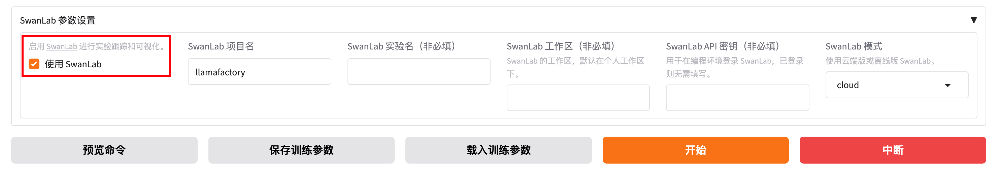
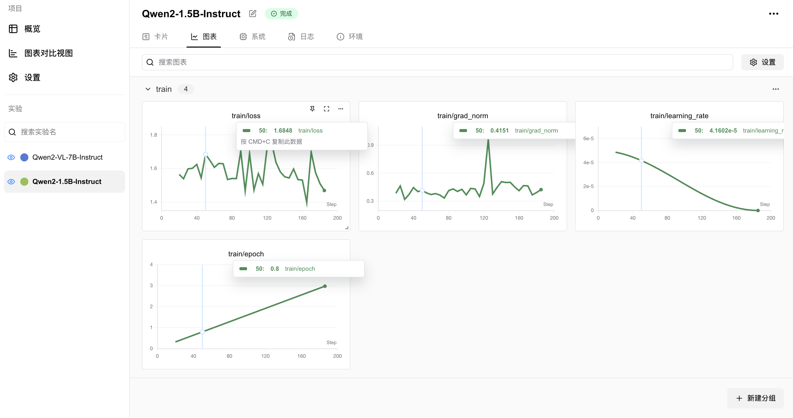
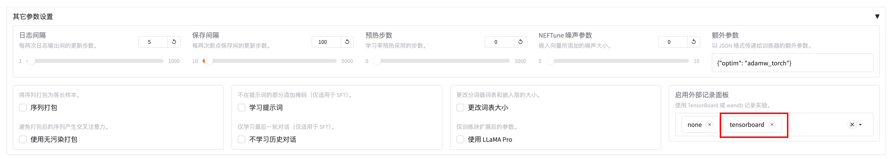
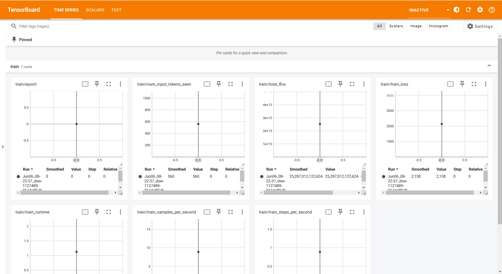
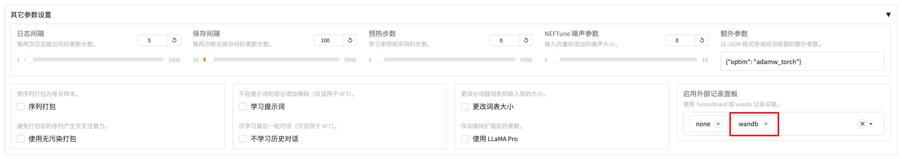

# 140.LLaMA Factory模型训练跟踪和监测

# 示例代码

[llamafactory-track.zip](https://www.yuque.com/attachments/yuque/0/2025/zip/2424104/1749261173845-719a2e07-e542-4e8c-90d7-b48e0fd257c7.zip)

# 前言

<font style="color:rgb(51, 51, 51);">随着</font>[<font style="color:rgb(51, 51, 51);">人工智能</font>](https://so.csdn.net/so/search?q=%E4%BA%BA%E5%B7%A5%E6%99%BA%E8%83%BD\&spm=1001.2101.3001.7020)<font style="color:rgb(51, 51, 51);">技术的飞速发展，大型语言模型（LLM）在自然语言处理（NLP）领域扮演着越来越重要的角色。然而，预训练的模型往往需要针对特定任务进行微调，以提高其在特定领域的性能。因为预训练模型是在大量数据上训练得到的，它已经学习到了语言的基本规律和丰富的特征表示。然而，这些模型可能并不直接适用于特定的任务或领域，因为它们可能缺乏对特定领域知识的理解和适应性。</font>

## <font style="color:rgb(0, 0, 0);">LLaMA Factory 介绍</font>


<font style="color:rgb(0, 0, 0);">项目地址：</font><https://github.com/hiyouga/LLaMA-Factory/blob/main/README_zh.md>

<font style="color:rgb(0, 0, 0);">LLaMA Factory 是一个简单易用且高效的大型语言模型（Large Language Model）训练与微调平台。</font><font style="color:rgb(51, 51, 51);">致力于简化大型的定制过程。它集成了多种训练策略和监控工具，提供了命令行和 WebUI 等多种交互方式，大幅降了模型微调的技术门槛。</font><font style="color:rgb(0, 0, 0);">通过 LLaMA Factory，可以在无需编写任何代码的前提下，在本地完成上百种预训练模型的微调，框架特性包括：</font>

* <font style="color:rgb(0, 0, 0);">模型种类：LLaMA、LLaVA、Mistral、Mixtral-MoE、Qwen、Yi、Gemma、Baichuan、ChatGLM、Phi 等等。</font>
* <font style="color:rgb(0, 0, 0);">训练算法：（增量）预训练、（多模态）指令监督微调、奖励模型训练、PPO 训练、DPO 训练、KTO 训练、ORPO 训练等等。</font>
* <font style="color:rgb(0, 0, 0);">运算精度：16 比特全参数微调、冻结微调、LoRA 微调和基于 AQLM/AWQ/GPTQ/LLM.int8/HQQ/EETQ 的 2/3/4/5/6/8 比特 QLoRA 微调。</font>
* <font style="color:rgb(0, 0, 0);">优化算法：GaLore、BAdam、DoRA、LongLoRA、LLaMA Pro、Mixture-of-Depths、LoRA+、LoftQ 和 PiSSA。</font>
* <font style="color:rgb(0, 0, 0);">加速算子：FlashAttention-2 和 Unsloth。</font>
* <font style="color:rgb(0, 0, 0);">推理引擎：Transformers 和 vLLM。</font>
* <font style="color:rgb(0, 0, 0);">实验监控：LlamaBoard、TensorBoard、Wandb、MLflow、SwanLab 等等。</font>

## <font style="color:rgb(51, 51, 51);">LLaMA Factory </font><font style="color:rgb(51, 51, 51);">核心功能</font>

* <font style="color:rgb(51, 51, 51);">多模型兼容：支持包括 LLama、Mistral、Falcon 在内的多种大型语言模型。</font>
* <font style="color:rgb(51, 51, 51);">训练方法多样：涵盖全参数微调及 LoRA 等先进的微调技术。</font>
* <font style="color:rgb(51, 51, 51);">用户界面友好：LLama Board 提供了一个直观的 Web 界面，使用户能够轻松调整模型设置。</font>
* <font style="color:rgb(51, 51, 51);">监控工具集成：与 TensorBoard 等工具集成，便于监控和分析训练过程。</font>

## <font style="color:rgb(51, 51, 51);">LLaMA Factory 特点</font>

* <font style="color:rgb(51, 51, 51);">易用性：简化了机器学习算法的复杂性，通过图形界面即可控制模型微调。</font>
* <font style="color:rgb(51, 51, 51);">微调效率：支持 DPO、ORPO、PPO 和 SFT 等技术，提升了模型微调的效率和效果。</font>
* <font style="color:rgb(51, 51, 51);">参数调整灵活性：用户可根据需求轻松调整模型参数，如 dropout 率、epochs 等。</font>
* <font style="color:rgb(51, 51, 51);">多语言支持：界面支持英语、俄语和中文，面向全球用户提供服务。</font>

## <font style="color:rgb(51, 51, 51);">LLaMA Factory </font><font style="color:rgb(51, 51, 51);">使用场景</font>

<font style="color:rgb(51, 51, 51);">LLaMA-Factory 适用于广泛的 NLP 任务，包括但不限于：</font>

* <font style="color:rgb(51, 51, 51);">文本分类：实现情感分析、主题识别等功能。</font>
* <font style="color:rgb(51, 51, 51);">序列标注：如 NER、词性标注等任务。</font>
* <font style="color:rgb(51, 51, 51);">文本生成：自动生成文本摘要、对话等。</font>
* <font style="color:rgb(51, 51, 51);">机器翻译：优化特定语言对的翻译质量。</font>

<font style="color:rgb(51, 51, 51);">LLaMA-Factory 通过其强大的功能和易用性，助力用户在</font>[<font style="color:rgb(51, 51, 51);">自然语言处理</font>](https://so.csdn.net/so/search?q=%E8%87%AA%E7%84%B6%E8%AF%AD%E8%A8%80%E5%A4%84%E7%90%86\&spm=1001.2101.3001.7020)<font style="color:rgb(51, 51, 51);">领域快速实现模型的定制和优化。</font>

## <font style="color:rgb(51, 51, 51);">微调的过程</font>

<font style="color:rgb(51, 51, 51);">模型微调通过在特定任务的数据集上继续训练预训练模型来进行，使得模型能够学习到与任务相关的特定特征和知识。这个过程通常涉及到模型权重的微幅调整，而不是从头开始训练一个全新的模型。</font>

<font style="color:rgb(51, 51, 51);">微调过程主要包括以下几个步骤： </font>

1. <font style="color:rgb(51, 51, 51);">数据准备：收集和准备特定任务的数据集。 </font>
2. <font style="color:rgb(51, 51, 51);">模型选择：选择一个预训练模型作为基础模型。 </font>
3. <font style="color:rgb(51, 51, 51);">迁移学习：在新数据集上继续训练模型，同时保留预训练模型的知识。 </font>
4. <font style="color:rgb(51, 51, 51);">参数调整：根据需要调整模型的参数，如学习率、批大小等。 </font>
5. <font style="color:rgb(51, 51, 51);">模型评估：在验证集上评估模型的性能，并根据反馈进行调整。</font>

## <font style="color:rgb(51, 51, 51);">微调的优势</font>

<font style="color:rgb(51, 51, 51);">微调技术带来了多方面的优势：</font><font style="color:rgb(51, 51, 51);">资源效率：相比于从头开始训练模型，微调可以显著减少所需的数据量和计算资源。</font><font style="color:rgb(51, 51, 51);">快速部署：微调可以快速适应新任务，加速模型的部署过程。</font><font style="color:rgb(51, 51, 51);">性能提升：针对特定任务的微调可以提高模型的准确性和鲁棒性。</font><font style="color:rgb(51, 51, 51);">领域适应性：微调可以帮助模型更好地理解和适应特定领域的语言特点。</font>

<font style="color:rgb(51, 51, 51);">通过微调，可以使得预训练模型在这些任务上取得更好的性能，更好地满足实际应用的需求。</font>

# <font style="color:rgb(31, 35, 40);">环境准备</font>

## <font style="color:rgb(31, 35, 40);">安装 LLaMA Factory</font>

```plain
git clone --depth 1 https://github.com/hiyouga/LLaMA-Factory.git
cd LLaMA-Factory
pip install -e ".[torch,metrics]"
```

<font style="color:rgb(31, 35, 40);">可选的额外依赖项：torch、torch-npu、metrics、deepspeed、liger-kernel、bitsandbytes、hqq、eetq、gptq、aqlm、vllm、sglang、galore、apollo、badam、adam-mini、qwen、minicpm_v、modelscope、openmind、swanlab、quality</font>

Tip

<font style="color:rgb(31, 35, 40);">遇到包冲突时，可使用 </font><code><font style="color:rgb(31, 35, 40);">pip install --no-deps -e .</font></code><font style="color:rgb(31, 35, 40);"> 解决。</font>

## <font style="color:rgb(31, 35, 40);">数据准备</font>

<font style="color:rgb(31, 35, 40);">关于数据集文件的格式，请参考</font><font style="color:rgb(31, 35, 40);"> </font>[data/README_zh.md](https://github.com/hiyouga/LLaMA-Factory/blob/main/data/README_zh.md)<font style="color:rgb(31, 35, 40);"> </font><font style="color:rgb(31, 35, 40);">的内容。你可以使用 HuggingFace / ModelScope / Modelers 上的数据集或加载本地数据集。</font>

Note

<font style="color:rgb(31, 35, 40);">使用自定义数据集时，请更新</font><font style="color:rgb(31, 35, 40);"> </font><code><font style="color:rgb(31, 35, 40);">data/dataset_info.json</font></code><font style="color:rgb(31, 35, 40);"> </font><font style="color:rgb(31, 35, 40);">文件。</font>

<font style="color:rgb(31, 35, 40);">您也可以使用</font><font style="color:rgb(31, 35, 40);"> </font>[**Easy Dataset**](https://github.com/ConardLi/easy-dataset)<font style="color:rgb(31, 35, 40);"> </font><font style="color:rgb(31, 35, 40);">构建用于微调的合成数据。</font>

## <font style="color:rgb(31, 35, 40);">快速开始</font>

<font style="color:rgb(31, 35, 40);">下面三行命令分别对 Llama3-8B-Instruct 模型进行 LoRA</font><font style="color:rgb(31, 35, 40);"> </font>**<font style="color:rgb(31, 35, 40);">微调</font>**<font style="color:rgb(31, 35, 40);">、</font>**<font style="color:rgb(31, 35, 40);">推理</font>**<font style="color:rgb(31, 35, 40);">和</font>**<font style="color:rgb(31, 35, 40);">合并</font>**<font style="color:rgb(31, 35, 40);">。</font>

```plain
llamafactory-cli train examples/train_lora/llama3_lora_sft.yaml
llamafactory-cli chat examples/inference/llama3_lora_sft.yaml
llamafactory-cli export examples/merge_lora/llama3_lora_sft.yaml
```

<font style="color:rgb(31, 35, 40);">高级用法请参考</font><font style="color:rgb(31, 35, 40);"> </font>[examples/README_zh.md](https://github.com/hiyouga/LLaMA-Factory/blob/main/examples/README_zh.md)<font style="color:rgb(31, 35, 40);">（包括多 GPU 微调）。</font>

Tip

<font style="color:rgb(31, 35, 40);">使用</font><font style="color:rgb(31, 35, 40);"> </font><code><font style="color:rgb(31, 35, 40);">llamafactory-cli help</font></code><font style="color:rgb(31, 35, 40);"> </font><font style="color:rgb(31, 35, 40);">显示帮助信息。</font>

<font style="color:rgb(31, 35, 40);">遇到报错请先看</font>[常见问题](https://github.com/hiyouga/LLaMA-Factory/issues/4614)<font style="color:rgb(31, 35, 40);">。</font>

## <font style="color:rgb(31, 35, 40);">LLaMA Board 可视化微调（由 </font>[Gradio](https://github.com/gradio-app/gradio)<font style="color:rgb(31, 35, 40);"> 驱动）</font>

<font style="color:rgb(31, 35, 40);">llamafactory-cli webui</font>

## <font style="color:rgb(31, 35, 40);">构建 Docker</font>

<font style="color:rgb(31, 35, 40);">CUDA 用户：</font>

```plain
cd docker/docker-cuda/
docker compose up -d
docker compose exec llamafactory bash
```

<font style="color:rgb(31, 35, 40);">昇腾 NPU 用户：</font>

```plain
cd docker/docker-npu/
docker compose up -d
docker compose exec llamafactory bash
```

<font style="color:rgb(31, 35, 40);">AMD ROCm 用户：</font>

```plain
cd docker/docker-rocm/
docker compose up -d
docker compose exec llamafactory bash
```

## <font style="color:rgb(31, 35, 40);">从魔搭社区下载</font>

<font style="color:rgb(31, 35, 40);">如果您在 Hugging Face 模型和数据集的下载中遇到了问题，可以通过下述方法使用魔搭社区。</font>

<font style="color:rgb(31, 35, 40);">export USE_MODELSCOPE_HUB=1 # Windows 使用 `set USE_MODELSCOPE_HUB=1`</font>

<font style="color:rgb(31, 35, 40);">将 </font><code><font style="color:rgb(31, 35, 40);">model_name_or_path</font></code><font style="color:rgb(31, 35, 40);"> 设置为模型 ID 来加载对应的模型。在</font>[魔搭社区](https://modelscope.cn/models)<font style="color:rgb(31, 35, 40);">查看所有可用的模型，例如 </font><code><font style="color:rgb(31, 35, 40);">LLM-Research/Meta-Llama-3-8B-Instruct</font></code><font style="color:rgb(31, 35, 40);">。、</font>

<font style="color:rgb(31, 35, 40);"></font>

<font style="color:rgb(31, 35, 40);"></font>

# <font style="color:rgb(0, 0, 0);">WebUI</font>

<font style="color:rgb(0, 0, 0);">LLaMA-Factory 支持通过 WebUI 零代码微调大语言模型。 在完成</font><font style="color:rgb(0, 0, 0);"> </font>[安装](https://llamafactory.readthedocs.io/zh-cn/latest/getting_started/installation.html#installation)<font style="color:rgb(0, 0, 0);"> </font><font style="color:rgb(0, 0, 0);">后，您可以通过以下指令进入 WebUI:</font>

```plain
llamafactory-cli webui
```

<font style="color:rgb(0, 0, 0);">WebUI 主要分为四个界面：训练、评估与预测、对话、导出。</font>

## <font style="color:rgb(0, 0, 0);">训练</font>


<font style="color:rgb(0, 0, 0);">在开始训练模型之前，您需要指定的参数有：</font>

1. <font style="color:rgb(0, 0, 0);">模型名称及路径</font>
2. <font style="color:rgb(0, 0, 0);">训练阶段</font>
3. <font style="color:rgb(0, 0, 0);">微调方法</font>
4. <font style="color:rgb(0, 0, 0);">训练数据集</font>
5. <font style="color:rgb(0, 0, 0);">学习率、训练轮数等训练参数</font>
6. <font style="color:rgb(0, 0, 0);">微调参数等其他参数</font>
7. <font style="color:rgb(0, 0, 0);">输出目录及配置路径</font>

<font style="color:rgb(0, 0, 0);">随后，您可以点击</font><font style="color:rgb(0, 0, 0);"> </font><code><font style="color:rgb(0, 0, 0);">开始</font></code><font style="color:rgb(0, 0, 0);"> </font><font style="color:rgb(0, 0, 0);">按钮开始训练模型。</font>

**<font style="color:rgb(0, 0, 0);">备注</font>**

<font style="color:rgb(0, 0, 0);">关于断点重连:适配器断点保存于</font><font style="color:rgb(0, 0, 0);"> </font><code><font style="color:rgb(0, 0, 0);">output_dir</font></code><font style="color:rgb(0, 0, 0);"> </font><font style="color:rgb(0, 0, 0);">目录下，请指定</font><font style="color:rgb(0, 0, 0);"> </font>**<font style="color:rgb(0, 0, 0);">适配器路径</font>**<font style="color:rgb(0, 0, 0);"> </font><font style="color:rgb(0, 0, 0);">以加载断点继续训练。</font>

<font style="color:rgb(0, 0, 0);">如果您需要使用自定义数据集，请在 </font><code><font style="color:rgb(0, 0, 0);">data/data_info.json</font></code><font style="color:rgb(0, 0, 0);"> 中添加自定义数据集描述并确保 </font>[数据集格式](https://llamafactory.readthedocs.io/zh-cn/latest/getting_started/data_preparation.html#id1)<font style="color:rgb(0, 0, 0);"> 正确，否则可能会导致训练失败。</font>

<font style="color:rgb(0, 0, 0);"></font>

# 实验监控

LLaMA-Factory 支持多种训练可视化工具，包括：[LlamaBoard](https://llamafactory.readthedocs.io/zh-cn/latest/advanced/monitor.html#id2) 、 [SwanLab](https://llamafactory.readthedocs.io/zh-cn/latest/advanced/monitor.html#swanlab)、[TensorBoard](https://llamafactory.readthedocs.io/zh-cn/latest/advanced/monitor.html#tensorboard) 、 [Wandb](https://llamafactory.readthedocs.io/zh-cn/latest/advanced/monitor.html#wandb)

## LlamaBoard

LlamaBoard 是指 WebUI 中自带的Loss曲线看板，可以方便的查看训练过程中的Loss变化情况。

如果你想使用 LlamaBoard，只需使用 WebUI 启动训练即可。

## SwanLab

SwanLab 是一个开源的训练跟踪与可视化工具，云端和离线均可使用，支持超参数记录、指标记录、多实验对比、硬件监控、实验环境记录等功能，可以有效地帮助开发者管理实验。

如果你想使用 SwanLab，请在启动训练时在训练配置文件中添加以下参数：

```plain
use_swanlab: true
swanlab_project: llamafactory
swanlab_run_name: test_run
```

或者，在WebUI的 SwanLab 模块中开启 SwanLab 记录：



可视化样例：



## TensorBoard

TensorBoard 是 TensorFlow 开源的离线训练跟踪工具，可以用于记录与可视化训练过程。

如果你想使用 TensorBoard，请在启动训练时在训练配置文件中添加以下参数：

```plain
report_to: tensorboard
```

或者，在WebUI的 其他参数设置 模块中的 启用外部记录面板 中开启 TensorBoard 记录：





## Wandb

Wandb（Weights and Biases）是一个云端的训练跟踪工具，可以用于记录与可视化训练过程。

如果你想使用 Wandb，请在启动训练时在训练配置文件中添加以下参数：

```plain
report_to: wandb
run_name: test_run
```

或者，在WebUI的 其他参数设置 模块中的 启用外部记录面板 中开启 Wandb 记录：




> 更新: 2025-06-07 09:52:53  
> 原文: <https://www.yuque.com/aaron-wecc3/dhluml/iw73sno039t81nb4>