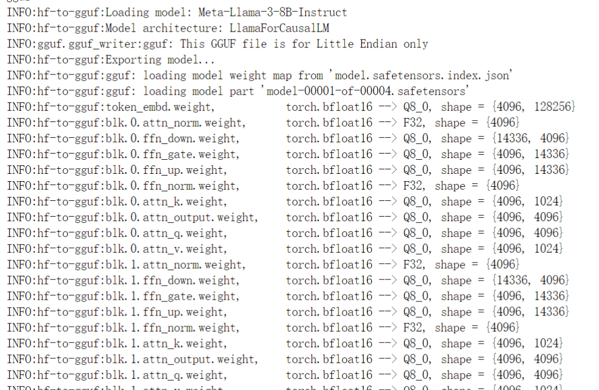
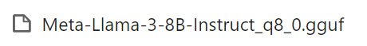
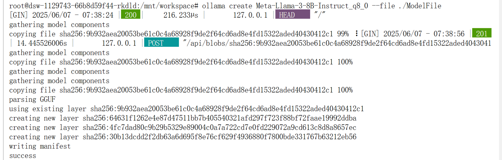
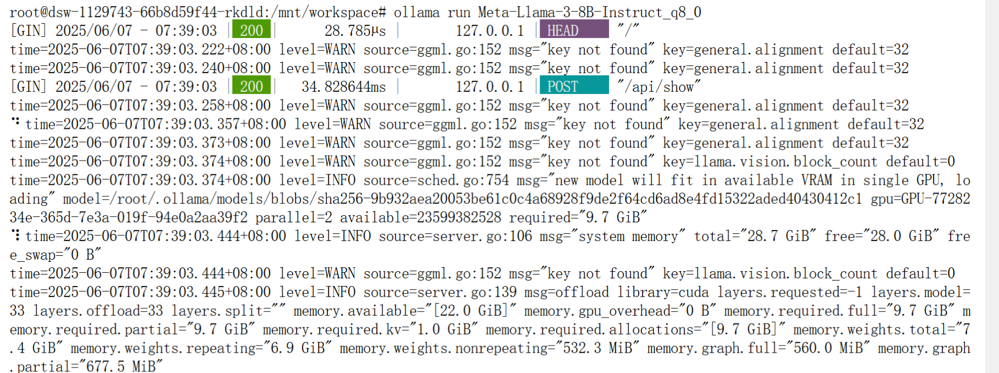

# 141.LLaMA Factory模型部署和接口调用

# 示例代码

[llamafactory-deploy.zip](https://www.yuque.com/attachments/yuque/0/2025/zip/2424104/1749261174117-22dbfd6c-cd2d-4405-9d10-42e89f904d0e.zip)

# 前言

<font style="color:rgb(51, 51, 51);">随着</font>[<font style="color:rgb(51, 51, 51);">人工智能</font>](https://so.csdn.net/so/search?q=%E4%BA%BA%E5%B7%A5%E6%99%BA%E8%83%BD\&spm=1001.2101.3001.7020)<font style="color:rgb(51, 51, 51);">技术的飞速发展，大型语言模型（LLM）在自然语言处理（NLP）领域扮演着越来越重要的角色。然而，预训练的模型往往需要针对特定任务进行微调，以提高其在特定领域的性能。因为预训练模型是在大量数据上训练得到的，它已经学习到了语言的基本规律和丰富的特征表示。然而，这些模型可能并不直接适用于特定的任务或领域，因为它们可能缺乏对特定领域知识的理解和适应性。</font>

## <font style="color:rgb(0, 0, 0);">LLaMA Factory 介绍</font>


<font style="color:rgb(0, 0, 0);">项目地址：</font><https://github.com/hiyouga/LLaMA-Factory/blob/main/README_zh.md>

<font style="color:rgb(0, 0, 0);">LLaMA Factory 是一个简单易用且高效的大型语言模型（Large Language Model）训练与微调平台。</font><font style="color:rgb(51, 51, 51);">致力于简化大型的定制过程。它集成了多种训练策略和监控工具，提供了命令行和 WebUI 等多种交互方式，大幅降了模型微调的技术门槛。</font><font style="color:rgb(0, 0, 0);">通过 LLaMA Factory，可以在无需编写任何代码的前提下，在本地完成上百种预训练模型的微调，框架特性包括：</font>

* <font style="color:rgb(0, 0, 0);">模型种类：LLaMA、LLaVA、Mistral、Mixtral-MoE、Qwen、Yi、Gemma、Baichuan、ChatGLM、Phi 等等。</font>
* <font style="color:rgb(0, 0, 0);">训练算法：（增量）预训练、（多模态）指令监督微调、奖励模型训练、PPO 训练、DPO 训练、KTO 训练、ORPO 训练等等。</font>
* <font style="color:rgb(0, 0, 0);">运算精度：16 比特全参数微调、冻结微调、LoRA 微调和基于 AQLM/AWQ/GPTQ/LLM.int8/HQQ/EETQ 的 2/3/4/5/6/8 比特 QLoRA 微调。</font>
* <font style="color:rgb(0, 0, 0);">优化算法：GaLore、BAdam、DoRA、LongLoRA、LLaMA Pro、Mixture-of-Depths、LoRA+、LoftQ 和 PiSSA。</font>
* <font style="color:rgb(0, 0, 0);">加速算子：FlashAttention-2 和 Unsloth。</font>
* <font style="color:rgb(0, 0, 0);">推理引擎：Transformers 和 vLLM。</font>
* <font style="color:rgb(0, 0, 0);">实验监控：LlamaBoard、TensorBoard、Wandb、MLflow、SwanLab 等等。</font>

## <font style="color:rgb(51, 51, 51);">LLaMA Factory </font><font style="color:rgb(51, 51, 51);">核心功能</font>

* <font style="color:rgb(51, 51, 51);">多模型兼容：支持包括 LLama、Mistral、Falcon 在内的多种大型语言模型。</font>
* <font style="color:rgb(51, 51, 51);">训练方法多样：涵盖全参数微调及 LoRA 等先进的微调技术。</font>
* <font style="color:rgb(51, 51, 51);">用户界面友好：LLama Board 提供了一个直观的 Web 界面，使用户能够轻松调整模型设置。</font>
* <font style="color:rgb(51, 51, 51);">监控工具集成：与 TensorBoard 等工具集成，便于监控和分析训练过程。</font>

## <font style="color:rgb(51, 51, 51);">LLaMA Factory 特点</font>

* <font style="color:rgb(51, 51, 51);">易用性：简化了机器学习算法的复杂性，通过图形界面即可控制模型微调。</font>
* <font style="color:rgb(51, 51, 51);">微调效率：支持 DPO、ORPO、PPO 和 SFT 等技术，提升了模型微调的效率和效果。</font>
* <font style="color:rgb(51, 51, 51);">参数调整灵活性：用户可根据需求轻松调整模型参数，如 dropout 率、epochs 等。</font>
* <font style="color:rgb(51, 51, 51);">多语言支持：界面支持英语、俄语和中文，面向全球用户提供服务。</font>

## <font style="color:rgb(51, 51, 51);">LLaMA Factory </font><font style="color:rgb(51, 51, 51);">使用场景</font>

<font style="color:rgb(51, 51, 51);">LLaMA-Factory 适用于广泛的 NLP 任务，包括但不限于：</font>

* <font style="color:rgb(51, 51, 51);">文本分类：实现情感分析、主题识别等功能。</font>
* <font style="color:rgb(51, 51, 51);">序列标注：如 NER、词性标注等任务。</font>
* <font style="color:rgb(51, 51, 51);">文本生成：自动生成文本摘要、对话等。</font>
* <font style="color:rgb(51, 51, 51);">机器翻译：优化特定语言对的翻译质量。</font>

<font style="color:rgb(51, 51, 51);">LLaMA-Factory 通过其强大的功能和易用性，助力用户在</font>[<font style="color:rgb(51, 51, 51);">自然语言处理</font>](https://so.csdn.net/so/search?q=%E8%87%AA%E7%84%B6%E8%AF%AD%E8%A8%80%E5%A4%84%E7%90%86\&spm=1001.2101.3001.7020)<font style="color:rgb(51, 51, 51);">领域快速实现模型的定制和优化。</font>

## <font style="color:rgb(51, 51, 51);">微调的过程</font>

<font style="color:rgb(51, 51, 51);">模型微调通过在特定任务的数据集上继续训练预训练模型来进行，使得模型能够学习到与任务相关的特定特征和知识。这个过程通常涉及到模型权重的微幅调整，而不是从头开始训练一个全新的模型。</font>

<font style="color:rgb(51, 51, 51);">微调过程主要包括以下几个步骤： </font>

1. <font style="color:rgb(51, 51, 51);">数据准备：收集和准备特定任务的数据集。 </font>
2. <font style="color:rgb(51, 51, 51);">模型选择：选择一个预训练模型作为基础模型。 </font>
3. <font style="color:rgb(51, 51, 51);">迁移学习：在新数据集上继续训练模型，同时保留预训练模型的知识。 </font>
4. <font style="color:rgb(51, 51, 51);">参数调整：根据需要调整模型的参数，如学习率、批大小等。 </font>
5. <font style="color:rgb(51, 51, 51);">模型评估：在验证集上评估模型的性能，并根据反馈进行调整。</font>

## <font style="color:rgb(51, 51, 51);">微调的优势</font>

<font style="color:rgb(51, 51, 51);">微调技术带来了多方面的优势：</font><font style="color:rgb(51, 51, 51);">资源效率：相比于从头开始训练模型，微调可以显著减少所需的数据量和计算资源。</font><font style="color:rgb(51, 51, 51);">快速部署：微调可以快速适应新任务，加速模型的部署过程。</font><font style="color:rgb(51, 51, 51);">性能提升：针对特定任务的微调可以提高模型的准确性和鲁棒性。</font><font style="color:rgb(51, 51, 51);">领域适应性：微调可以帮助模型更好地理解和适应特定领域的语言特点。</font>

<font style="color:rgb(51, 51, 51);">通过微调，可以使得预训练模型在这些任务上取得更好的性能，更好地满足实际应用的需求。</font>

# <font style="color:rgb(31, 35, 40);">环境准备</font>

## <font style="color:rgb(31, 35, 40);">安装 LLaMA Factory</font>

```plain
git clone --depth 1 https://github.com/hiyouga/LLaMA-Factory.git
cd LLaMA-Factory
pip install -e ".[torch,metrics]"
```

<font style="color:rgb(31, 35, 40);">可选的额外依赖项：torch、torch-npu、metrics、deepspeed、liger-kernel、bitsandbytes、hqq、eetq、gptq、aqlm、vllm、sglang、galore、apollo、badam、adam-mini、qwen、minicpm_v、modelscope、openmind、swanlab、quality</font>

Tip

<font style="color:rgb(31, 35, 40);">遇到包冲突时，可使用 </font><code><font style="color:rgb(31, 35, 40);">pip install --no-deps -e .</font></code><font style="color:rgb(31, 35, 40);"> 解决。</font>

## <font style="color:rgb(31, 35, 40);">数据准备</font>

<font style="color:rgb(31, 35, 40);">关于数据集文件的格式，请参考</font><font style="color:rgb(31, 35, 40);"> </font>[data/README_zh.md](https://github.com/hiyouga/LLaMA-Factory/blob/main/data/README_zh.md)<font style="color:rgb(31, 35, 40);"> </font><font style="color:rgb(31, 35, 40);">的内容。你可以使用 HuggingFace / ModelScope / Modelers 上的数据集或加载本地数据集。</font>

Note

<font style="color:rgb(31, 35, 40);">使用自定义数据集时，请更新</font><font style="color:rgb(31, 35, 40);"> </font><code><font style="color:rgb(31, 35, 40);">data/dataset_info.json</font></code><font style="color:rgb(31, 35, 40);"> </font><font style="color:rgb(31, 35, 40);">文件。</font>

<font style="color:rgb(31, 35, 40);">您也可以使用</font><font style="color:rgb(31, 35, 40);"> </font>[**Easy Dataset**](https://github.com/ConardLi/easy-dataset)<font style="color:rgb(31, 35, 40);"> </font><font style="color:rgb(31, 35, 40);">构建用于微调的合成数据。</font>

## <font style="color:rgb(31, 35, 40);">快速开始</font>

<font style="color:rgb(31, 35, 40);">下面三行命令分别对 Llama3-8B-Instruct 模型进行 LoRA</font><font style="color:rgb(31, 35, 40);"> </font>**<font style="color:rgb(31, 35, 40);">微调</font>**<font style="color:rgb(31, 35, 40);">、</font>**<font style="color:rgb(31, 35, 40);">推理</font>**<font style="color:rgb(31, 35, 40);">和</font>**<font style="color:rgb(31, 35, 40);">合并</font>**<font style="color:rgb(31, 35, 40);">。</font>

```plain
llamafactory-cli train examples/train_lora/llama3_lora_sft.yaml
llamafactory-cli chat examples/inference/llama3_lora_sft.yaml
llamafactory-cli export examples/merge_lora/llama3_lora_sft.yaml
```

<font style="color:rgb(31, 35, 40);">高级用法请参考</font><font style="color:rgb(31, 35, 40);"> </font>[examples/README_zh.md](https://github.com/hiyouga/LLaMA-Factory/blob/main/examples/README_zh.md)<font style="color:rgb(31, 35, 40);">（包括多 GPU 微调）。</font>

Tip

<font style="color:rgb(31, 35, 40);">使用</font><font style="color:rgb(31, 35, 40);"> </font><code><font style="color:rgb(31, 35, 40);">llamafactory-cli help</font></code><font style="color:rgb(31, 35, 40);"> </font><font style="color:rgb(31, 35, 40);">显示帮助信息。</font>

<font style="color:rgb(31, 35, 40);">遇到报错请先看</font>[常见问题](https://github.com/hiyouga/LLaMA-Factory/issues/4614)<font style="color:rgb(31, 35, 40);">。</font>

## <font style="color:rgb(31, 35, 40);">LLaMA Board 可视化微调（由 </font>[Gradio](https://github.com/gradio-app/gradio)<font style="color:rgb(31, 35, 40);"> 驱动）</font>

<font style="color:rgb(31, 35, 40);">llamafactory-cli webui</font>

## <font style="color:rgb(31, 35, 40);">构建 Docker</font>

<font style="color:rgb(31, 35, 40);">CUDA 用户：</font>

```plain
cd docker/docker-cuda/
docker compose up -d
docker compose exec llamafactory bash
```

<font style="color:rgb(31, 35, 40);">昇腾 NPU 用户：</font>

```plain
cd docker/docker-npu/
docker compose up -d
docker compose exec llamafactory bash
```

<font style="color:rgb(31, 35, 40);">AMD ROCm 用户：</font>

```plain
cd docker/docker-rocm/
docker compose up -d
docker compose exec llamafactory bash
```

## <font style="color:rgb(31, 35, 40);">从魔搭社区下载</font>

<font style="color:rgb(31, 35, 40);">如果您在 Hugging Face 模型和数据集的下载中遇到了问题，可以通过下述方法使用魔搭社区。</font>

<font style="color:rgb(31, 35, 40);">export USE_MODELSCOPE_HUB=1 # Windows 使用 `set USE_MODELSCOPE_HUB=1`</font>

<font style="color:rgb(31, 35, 40);">将 </font><code><font style="color:rgb(31, 35, 40);">model_name_or_path</font></code><font style="color:rgb(31, 35, 40);"> 设置为模型 ID 来加载对应的模型。在</font>[魔搭社区](https://modelscope.cn/models)<font style="color:rgb(31, 35, 40);">查看所有可用的模型，例如 </font><code><font style="color:rgb(31, 35, 40);">LLM-Research/Meta-Llama-3-8B-Instruct</font></code><font style="color:rgb(31, 35, 40);">。、</font>

<font style="color:rgb(31, 35, 40);"></font>

<font style="color:rgb(31, 35, 40);"></font>

# <font style="color:rgb(0, 0, 0);">WebUI</font>

<font style="color:rgb(0, 0, 0);">LLaMA-Factory 支持通过 WebUI 零代码微调大语言模型。 在完成</font><font style="color:rgb(0, 0, 0);"> </font>[安装](https://llamafactory.readthedocs.io/zh-cn/latest/getting_started/installation.html#installation)<font style="color:rgb(0, 0, 0);"> </font><font style="color:rgb(0, 0, 0);">后，您可以通过以下指令进入 WebUI:</font>

```plain
llamafactory-cli webui
```

<font style="color:rgb(0, 0, 0);">WebUI 主要分为四个界面：训练、评估与预测、对话、导出。</font>

## <font style="color:rgb(0, 0, 0);">训练</font>


<font style="color:rgb(0, 0, 0);">在开始训练模型之前，您需要指定的参数有：</font>

1. <font style="color:rgb(0, 0, 0);">模型名称及路径</font>
2. <font style="color:rgb(0, 0, 0);">训练阶段</font>
3. <font style="color:rgb(0, 0, 0);">微调方法</font>
4. <font style="color:rgb(0, 0, 0);">训练数据集</font>
5. <font style="color:rgb(0, 0, 0);">学习率、训练轮数等训练参数</font>
6. <font style="color:rgb(0, 0, 0);">微调参数等其他参数</font>
7. <font style="color:rgb(0, 0, 0);">输出目录及配置路径</font>

<font style="color:rgb(0, 0, 0);">随后，您可以点击</font><font style="color:rgb(0, 0, 0);"> </font><code><font style="color:rgb(0, 0, 0);">开始</font></code><font style="color:rgb(0, 0, 0);"> </font><font style="color:rgb(0, 0, 0);">按钮开始训练模型。</font>

**<font style="color:rgb(0, 0, 0);">备注</font>**

<font style="color:rgb(0, 0, 0);">关于断点重连:适配器断点保存于</font><font style="color:rgb(0, 0, 0);"> </font><code><font style="color:rgb(0, 0, 0);">output_dir</font></code><font style="color:rgb(0, 0, 0);"> </font><font style="color:rgb(0, 0, 0);">目录下，请指定</font><font style="color:rgb(0, 0, 0);"> </font>**<font style="color:rgb(0, 0, 0);">适配器路径</font>**<font style="color:rgb(0, 0, 0);"> </font><font style="color:rgb(0, 0, 0);">以加载断点继续训练。</font>

<font style="color:rgb(0, 0, 0);">如果您需要使用自定义数据集，请在 </font><code><font style="color:rgb(0, 0, 0);">data/data_info.json</font></code><font style="color:rgb(0, 0, 0);"> 中添加自定义数据集描述并确保 </font>[数据集格式](https://llamafactory.readthedocs.io/zh-cn/latest/getting_started/data_preparation.html#id1)<font style="color:rgb(0, 0, 0);"> 正确，否则可能会导致训练失败。</font>

# <font style="color:rgb(0, 0, 0);">SFT 训练</font>

## <font style="color:rgb(0, 0, 0);">命令行</font>

<font style="color:rgb(0, 0, 0);">您可以使用以下命令使用</font><font style="color:rgb(0, 0, 0);"> </font><code><font style="color:rgb(0, 0, 0);">examples/train_lora/llama3_lora_sft.yaml</font></code><font style="color:rgb(0, 0, 0);"> </font><font style="color:rgb(0, 0, 0);">中的参数进行微调：</font>

```plain
llamafactory-cli train examples/train_lora/llama3_lora_sft.yaml
```

<font style="color:rgb(0, 0, 0);">也可以通过追加参数更新 yaml 文件中的参数:</font>

```plain
llamafactory-cli train examples/train_lora/llama3_lora_sft.yaml \
    learning_rate=1e-5 \
    logging_steps=1
```

**<font style="color:rgb(0, 0, 0);">备注</font>**

<font style="color:rgb(0, 0, 0);">LLaMA-Factory 默认使用所有可见的计算设备。根据需求可通过</font><font style="color:rgb(0, 0, 0);"> </font><code><font style="color:rgb(0, 0, 0);">CUDA_VISIBLE_DEVICES</font></code><font style="color:rgb(0, 0, 0);"> </font><font style="color:rgb(0, 0, 0);">或</font><font style="color:rgb(0, 0, 0);"> </font><code><font style="color:rgb(0, 0, 0);">ASCEND_RT_VISIBLE_DEVICES</font></code><font style="color:rgb(0, 0, 0);"> </font><font style="color:rgb(0, 0, 0);">指定计算设备。</font>

<code><font style="color:rgb(0, 0, 0);">examples/train_lora/llama3_lora_sft.yaml</font></code><font style="color:rgb(0, 0, 0);"> </font><font style="color:rgb(0, 0, 0);">提供了微调时的配置示例。该配置指定了模型参数、微调方法参数、数据集参数以及评估参数等。您需要根据自身需求自行配置。</font>

```plain
### examples/train_lora/llama3_lora_sft.yaml
model_name_or_path: meta-llama/Meta-Llama-3-8B-Instruct

stage: sft
do_train: true
finetuning_type: lora
lora_target: all

dataset: identity,alpaca_en_demo
template: llama3
cutoff_len: 1024
max_samples: 1000
overwrite_cache: true
preprocessing_num_workers: 16

output_dir: saves/llama3-8b/lora/sft
logging_steps: 10
save_steps: 500
plot_loss: true
overwrite_output_dir: true

per_device_train_batch_size: 1
gradient_accumulation_steps: 8
learning_rate: 1.0e-4
num_train_epochs: 3.0
lr_scheduler_type: cosine
warmup_ratio: 0.1
bf16: true
ddp_timeout: 180000000

val_size: 0.1
per_device_eval_batch_size: 1
eval_strategy: steps
eval_steps: 500
```

**<font style="color:rgb(0, 0, 0);">备注</font>**

<font style="color:rgb(0, 0, 0);">模型</font><font style="color:rgb(0, 0, 0);"> </font><code><font style="color:rgb(0, 0, 0);">model_name_or_path</font></code><font style="color:rgb(0, 0, 0);"> </font><font style="color:rgb(0, 0, 0);">、数据集</font><font style="color:rgb(0, 0, 0);"> </font><code><font style="color:rgb(0, 0, 0);">dateset</font></code><font style="color:rgb(0, 0, 0);"> </font><font style="color:rgb(0, 0, 0);">需要存在且与</font><font style="color:rgb(0, 0, 0);"> </font><code><font style="color:rgb(0, 0, 0);">template</font></code><font style="color:rgb(0, 0, 0);"> </font><font style="color:rgb(0, 0, 0);">相对应。</font>

| <font style="color:rgb(0, 0, 0);">名称</font> | <font style="color:rgb(0, 0, 0);">描述</font> |
| --- | --- |
| <font style="color:rgb(0, 0, 0);">model_name_or_path</font> | <font style="color:rgb(0, 0, 0);">模型名称或路径</font> |
| <font style="color:rgb(0, 0, 0);">stage</font> | <font style="color:rgb(0, 0, 0);">训练阶段，可选: rm(reward modeling), pt(pretrain), sft(Supervised Fine-Tuning), PPO, DPO, KTO, ORPO</font> |
| <font style="color:rgb(0, 0, 0);">do_train</font> | <font style="color:rgb(0, 0, 0);">true用于训练, false用于评估</font> |
| <font style="color:rgb(0, 0, 0);">finetuning_type</font> | <font style="color:rgb(0, 0, 0);">微调方式。可选: freeze, lora, full</font> |
| <font style="color:rgb(0, 0, 0);">lora_target</font> | <font style="color:rgb(0, 0, 0);">采取LoRA方法的目标模块，默认值为</font><font style="color:rgb(0, 0, 0);"> </font><code><font style="color:rgb(0, 0, 0);">all</font></code><font style="color:rgb(0, 0, 0);">。</font> |
| <font style="color:rgb(0, 0, 0);">dataset</font> | <font style="color:rgb(0, 0, 0);">使用的数据集，使用”,”分隔多个数据集</font> |
| <font style="color:rgb(0, 0, 0);">template</font> | <font style="color:rgb(0, 0, 0);">数据集模板，请保证数据集模板与模型相对应。</font> |
| <font style="color:rgb(0, 0, 0);">output_dir</font> | <font style="color:rgb(0, 0, 0);">输出路径</font> |
| <font style="color:rgb(0, 0, 0);">logging_steps</font> | <font style="color:rgb(0, 0, 0);">日志输出步数间隔</font> |
| <font style="color:rgb(0, 0, 0);">save_steps</font> | <font style="color:rgb(0, 0, 0);">模型断点保存间隔</font> |
| <font style="color:rgb(0, 0, 0);">overwrite_output_dir</font> | <font style="color:rgb(0, 0, 0);">是否允许覆盖输出目录</font> |
| <font style="color:rgb(0, 0, 0);">per_device_train_batch_size</font> | <font style="color:rgb(0, 0, 0);">每个设备上训练的批次大小</font> |
| <font style="color:rgb(0, 0, 0);">gradient_accumulation_steps</font> | <font style="color:rgb(0, 0, 0);">梯度积累步数</font> |
| <font style="color:rgb(0, 0, 0);">max_grad_norm</font> | <font style="color:rgb(0, 0, 0);">梯度裁剪阈值</font> |
| <font style="color:rgb(0, 0, 0);">learning_rate</font> | <font style="color:rgb(0, 0, 0);">学习率</font> |
| <font style="color:rgb(0, 0, 0);">lr_scheduler_type</font> | <font style="color:rgb(0, 0, 0);">学习率曲线，可选</font><font style="color:rgb(0, 0, 0);"> </font><code><font style="color:rgb(0, 0, 0);">linear</font></code><font style="color:rgb(0, 0, 0);">,</font><font style="color:rgb(0, 0, 0);"> </font><code><font style="color:rgb(0, 0, 0);">cosine</font></code><font style="color:rgb(0, 0, 0);">,</font><font style="color:rgb(0, 0, 0);"> </font><code><font style="color:rgb(0, 0, 0);">polynomial</font></code><font style="color:rgb(0, 0, 0);">,</font><font style="color:rgb(0, 0, 0);"> </font><code><font style="color:rgb(0, 0, 0);">constant</font></code><font style="color:rgb(0, 0, 0);"> </font><font style="color:rgb(0, 0, 0);">等。</font> |
| <font style="color:rgb(0, 0, 0);">num_train_epochs</font> | <font style="color:rgb(0, 0, 0);">训练周期数</font> |
| <font style="color:rgb(0, 0, 0);">bf16</font> | <font style="color:rgb(0, 0, 0);">是否使用 bf16 格式</font> |
| <font style="color:rgb(0, 0, 0);">warmup_ratio</font> | <font style="color:rgb(0, 0, 0);">学习率预热比例</font> |
| <font style="color:rgb(0, 0, 0);">warmup_steps</font> | <font style="color:rgb(0, 0, 0);">学习率预热步数</font> |
| <font style="color:rgb(0, 0, 0);">push_to_hub</font> | <font style="color:rgb(0, 0, 0);">是否推送模型到 Huggingface</font> |

# <font style="color:rgb(0, 0, 0);">LoRA 合并</font>

## <font style="color:rgb(0, 0, 0);">合并</font>

<font style="color:rgb(0, 0, 0);">当我们基于预训练模型训练好 LoRA 适配器后，我们不希望在每次推理的时候分别加载预训练模型和 LoRA 适配器，因此我们需要将预训练模型和 LoRA 适配器合并导出成一个模型，并根据需要选择是否量化。根据是否量化以及量化算法的不同，导出的配置文件也有所区别。</font>

<font style="color:rgb(0, 0, 0);">您可以通过</font><font style="color:rgb(0, 0, 0);"> </font><code><font style="color:rgb(0, 0, 0);">llamafactory-cli</font><font style="color:rgb(0, 0, 0);"> </font><font style="color:rgb(0, 0, 0);">export</font><font style="color:rgb(0, 0, 0);"> </font><font style="color:rgb(0, 0, 0);">merge_config.yaml</font></code><font style="color:rgb(0, 0, 0);"> </font><font style="color:rgb(0, 0, 0);">指令来合并模型。其中</font><font style="color:rgb(0, 0, 0);"> </font><code><font style="color:rgb(0, 0, 0);">merge_config.yaml</font></code><font style="color:rgb(0, 0, 0);"> </font><font style="color:rgb(0, 0, 0);">需要您根据不同情况进行配置。</font>

<code><font style="color:rgb(0, 0, 0);">examples/merge_lora/llama3_lora_sft.yaml</font></code><font style="color:rgb(0, 0, 0);"> </font><font style="color:rgb(0, 0, 0);">提供了合并时的配置示例。</font>

```plain
### examples/merge_lora/llama3_lora_sft.yaml
### model
model_name_or_path: meta-llama/Meta-Llama-3-8B-Instruct
adapter_name_or_path: saves/llama3-8b/lora/sft
template: llama3
finetuning_type: lora

### export
export_dir: models/llama3_lora_sft
export_size: 2
export_device: cpu
export_legacy_format: false
```

**<font style="color:rgb(0, 0, 0);">备注</font>**

* <font style="color:rgb(0, 0, 0);">模型</font><font style="color:rgb(0, 0, 0);"> </font><code><font style="color:rgb(0, 0, 0);">model_name_or_path</font></code><font style="color:rgb(0, 0, 0);"> </font><font style="color:rgb(0, 0, 0);">需要存在且与</font><font style="color:rgb(0, 0, 0);"> </font><code><font style="color:rgb(0, 0, 0);">template</font></code><font style="color:rgb(0, 0, 0);"> </font><font style="color:rgb(0, 0, 0);">相对应。</font><font style="color:rgb(0, 0, 0);"> </font><code><font style="color:rgb(0, 0, 0);">adapter_name_or_path</font></code><font style="color:rgb(0, 0, 0);"> </font><font style="color:rgb(0, 0, 0);">需要与微调中的适配器输出路径</font><font style="color:rgb(0, 0, 0);"> </font><code><font style="color:rgb(0, 0, 0);">output_dir</font></code><font style="color:rgb(0, 0, 0);"> </font><font style="color:rgb(0, 0, 0);">相对应。</font>
* <font style="color:rgb(0, 0, 0);">合并 LoRA 适配器时，不要使用量化模型或指定量化位数。您可以使用本地或下载的未量化的预训练模型进行合并。</font>

# <font style="color:rgb(0, 0, 0);">推理</font><font style="color:rgb(51, 51, 51);"></font>

## <font style="color:rgb(51, 51, 51);">一、什么是 </font>[<font style="color:rgb(65, 131, 196);">GGUF</font>](https://zhida.zhihu.com/search?content_id=247205861\&content_type=Article\&match_order=1\&q=GGUF\&zhida_source=entity)<font style="color:rgb(51, 51, 51);">？</font>

<font style="color:rgb(51, 51, 51);">GGUF 格式的全名为（GPT-Generated Unified Format），提到 GGUF 就不得不提到它的前身 </font>[<font style="color:rgb(65, 131, 196);">GGML</font>](https://zhida.zhihu.com/search?content_id=247205861\&content_type=Article\&match_order=1\&q=GGML\&zhida_source=entity)<font style="color:rgb(51, 51, 51);">（GPT-Generated Model Language）。GGML 是专门为了机器学习设计的张量库，最早可以追溯到 2022/10。其目的是为了有一个单文件共享的格式，并且易于在不同架构的 GPU 和 CPU 上进行推理。但在后续的开发中，遇到了灵活性不足、相容性及难以维护的问题。</font>

## **<font style="color:rgb(51, 51, 51);">二、为什么要转换 GGUF 格式</font>**

<font style="color:rgb(51, 51, 51);">在传统的 </font>[<font style="color:rgb(65, 131, 196);">Deep Learning Model</font>](https://zhida.zhihu.com/search?content_id=247205861\&content_type=Article\&match_order=1\&q=Deep+Learning+Model\&zhida_source=entity)<font style="color:rgb(51, 51, 51);"> 开发中大多使用 </font>[<font style="color:rgb(65, 131, 196);">PyTorch</font>](https://zhida.zhihu.com/search?content_id=247205861\&content_type=Article\&match_order=1\&q=PyTorch\&zhida_source=entity)<font style="color:rgb(51, 51, 51);"> 来进行开发，但因为在部署时会面临相依 Lirbrary 太多、版本管理的问题于才有了 GGML、GGMF、GGJT 等格式，而在开源社群不停的迭代后 GGUF 就诞生了。</font>

<font style="color:rgb(51, 51, 51);">GGUF 实际上是基于 GGJT 的格式进行优化的，并解决了 GGML 当初面临的问题，包括：</font>

<font style="color:rgb(51, 51, 51);">1）可扩展性：轻松为 GGML 架构下的工具添加新功能，或者向 GGUF 模型添加新 Feature，不会破坏与现有模型的兼容性。</font>

<font style="color:rgb(51, 51, 51);">2）对 mmap（内存映射）的兼容性：该模型可以使用 mmap 进行加载（原理解析可见参考），实现快速载入和存储。（从 GGJT 开始导入，可参考 GitHub）</font>

<font style="color:rgb(51, 51, 51);">3）易于使用：模型可以使用少量代码轻松加载和存储，无需依赖的 Library，同时对于不同编程语言支持程度也高。</font>

<font style="color:rgb(51, 51, 51);">4）模型信息完整：加载模型所需的所有信息都包含在模型文件中，不需要额外编写设置文件。</font>

<font style="color:rgb(51, 51, 51);">5）有利于模型量化：GGUF 支持模型量化（4 位、8 位、F16），在 GPU 变得越来越昂贵的情况下，节省 vRAM 成本也非常重要。</font>

## <font style="color:rgb(51, 51, 51);">三、以 Llama-3-8B 为例</font>

<font style="color:rgb(51, 51, 51);">1、模型下载</font>

```plain
# from huggingface_hub import snapshot_download
from modelscope import snapshot_download
model_id="LLM-Research/Meta-Llama-3-8B-Instruct"
snapshot_download(model_id=model_id, cache_dir="Meta-Llama-3-8B-Instruct")
```

<font style="color:rgb(51, 51, 51);">2、开始转换 hf 模型为 gguf</font>

<font style="color:rgb(51, 51, 51);">需要用 llama.cpp 仓库的 convert_hf_to_gguf.py 脚本来转换</font>

```plain
git clone https://github.com/ggerganov/llama.cpp.git
pip install -r llama.cpp/requirements.txt
```

<font style="color:rgb(51, 51, 51);">执行转换</font>

```plain
# 如果不量化，保留模型的效果
python llama.cpp/convert_hf_to_gguf.py /mnt/workspace/.cache/modelscope/models/LLM-Research/Meta-Llama-3-8B-Instruct  --outtype f16 --verbose --outfile Meta-Llama-3-8B-Instruct_f16.gguf
# 如果需要量化（加速并有损效果），直接执行下面脚本就可以
python llama.cpp/convert_hf_to_gguf.py /mnt/workspace/.cache/modelscope/models/LLM-Research/Meta-Llama-3-8B-Instruct  --outtype q8_0 --verbose --outfile Meta-Llama-3-8B-Instruct_q8_0.gguf
```



<font style="color:rgb(51, 51, 51);">转换后模型如下：</font>



```plain
这里--outtype是输出类型，代表含义：
q2_k：特定张量（Tensor）采用较高的精度设置，而其他的则保持基础级别。
q3_k_l、q3_k_m、q3_k_s：这些变体在不同张量上使用不同级别的精度，从而达到性能和效率的平衡。
q4_0：这是最初的量化方案，使用 4 位精度。
q4_1 和 q4_k_m、q4_k_s：这些提供了不同程度的准确性和推理速度，适合需要平衡资源使用的场景。
q5_0、q5_1、q5_k_m、q5_k_s：这些版本在保证更高准确度的同时，会使用更多的资源并且推理速度较慢。
q6_k 和 q8_0：这些提供了最高的精度，但是因为高资源消耗和慢速度，可能不适合所有用户。
fp16 和 f32: 不量化，保留原始精度。
```

<font style="color:rgb(51, 51, 51);">3、使用 ollama 运行 gguf</font>

<font style="color:rgb(51, 51, 51);">转换好的 GGUF 模型可以使用以下的工具来运行：</font>

<font style="color:rgb(51, 51, 51);">ollama(推荐): 简化 AI 模型的本地部署与使用</font>

<font style="color:rgb(51, 51, 51);">llama.cpp：GGUF 的源项目。提供 CLI 和 Server 选项。</font>

[<font style="color:rgb(65, 131, 196);">text-generation-webui</font>](https://zhida.zhihu.com/search?content_id=247205861\&content_type=Article\&match_order=1\&q=text-generation-webui\&zhida_source=entity)<font style="color:rgb(51, 51, 51);">：最广泛使用的网络界面，具有许多功能和强大的扩展。支持 GPU 加速。</font>

[<font style="color:rgb(65, 131, 196);">GPT4All</font>](https://zhida.zhihu.com/search?content_id=247205861\&content_type=Article\&match_order=1\&q=GPT4All\&zhida_source=entity)<font style="color:rgb(51, 51, 51);">：一个免费且开源的本地运行图形用户界面，支持 Windows、Linux 和 macOS，并支持 GPU 加速。</font>

[<font style="color:rgb(65, 131, 196);">LM Studio</font>](https://zhida.zhihu.com/search?content_id=247205861\&content_type=Article\&match_order=1\&q=LM+Studio\&zhida_source=entity)<font style="color:rgb(51, 51, 51);">：一个易于使用且功能强大的本地图形用户界面，适用于 Windows 和 macOS（Silicon），支持 GPU 加速。</font>

<font style="color:rgb(51, 51, 51);">llama-cpp-python：支持 GPU 加速、LangChain 和 OpenAI 兼容 API 服务器的 Python 库。</font>

<font style="color:rgb(51, 51, 51);">candle：一个使用 Rust 编写的机器学习框架，具有 GPU 支持和易于使用的特点，适合追求性能的开发者。</font>

<font style="color:rgb(51, 51, 51);">可以使用 ollama Modelfile，基于 gguf 模型文件快速部署并运行模型。</font>

<font style="color:rgb(51, 51, 51);">1）安装 ollama</font>

```plain
curl -fsSL https://ollama.com/install.sh | sh
```

<font style="color:rgb(51, 51, 51);">2）启动 ollama 服务</font>

```plain
nohup ollama serve &
```

<font style="color:rgb(51, 51, 51);">3）创建 ModelFile</font>

<font style="color:rgb(51, 51, 51);">复制模型路径，创建名为 “ModelFile” 的 meta 文件，内容如下</font>

```plain
FROM ./Meta-Llama-3-8B-Instruct_q8_0.gguf

# set the temperature to 0.7 [higher is more creative, lower is more coherent]
PARAMETER temperature 0.7
PARAMETER top_p 0.8
PARAMETER repeat_penalty 1.05
TEMPLATE """{{ if .System }}<|im_start|>system
{{ .System }}<|im_end|>
{{ end }}{{ if .Prompt }}<|im_start|>user
{{ .Prompt }}<|im_end|>
{{ end }}<|im_start|>assistant
{{ .Response }}<|im_end|>"""
# set the system message
SYSTEM """
You are a helpful assistant.
"""
```

<font style="color:rgb(51, 51, 51);">4）创建自定义模型</font>

<font style="color:rgb(51, 51, 51);">使用 ollama create 命令创建自定义模型</font>

```plain
ollama create Meta-Llama-3-8B-Instruct_q8_0 --file ./ModelFile
```



<font style="color:rgb(51, 51, 51);">5）运行模型：</font>

```plain
ollama run Meta-Llama-3-8B-Instruct_q8_0
```



# 接口调用

## <font style="color:rgb(51, 51, 51);">配置 Open WebUI</font>

1. **<font style="color:rgb(51, 51, 51);">安装 Open WebUI</font>**<font style="color:rgb(51, 51, 51);">：确保你的系统已经安装了 Open WebUI。如果没有安装，可以通过以下命令进行安装：</font>

```plain
pip install open-webui
```

2. **<font style="color:rgb(51, 51, 51);">配置 WebUI</font>**<font style="color:rgb(51, 51, 51);">：运行以下命令启动 Open WebUI：</font>

```plain
open-webui serve
```

<font style="color:rgb(51, 51, 51);">启动后，你可以通过浏览器访问 WebUI 界面，通常是 </font><code><font style="color:rgb(51, 51, 51);background-color:rgb(243, 244, 244);">http://localhost:8080</font></code><font style="color:rgb(51, 51, 51);">。</font>


> 更新: 2025-06-07 09:52:53  
> 原文: <https://www.yuque.com/aaron-wecc3/dhluml/qh0m9a1c841alnio>