# 142.Dify整合Ollama访问本地大模型

### 课程内容
1. 安装 Ollama
2. 创建聊天应用
3. 在dify中调用Ollama模型服务
4. dify对外提供接口服务

### <font style="color:rgb(51, 51, 51);">步骤一：Docker 下载及安装</font>
<font style="color:rgb(51, 51, 51);">因为我的电脑是 Win11 家庭版，所以需要基于 </font>[<font style="color:rgb(65, 131, 196);">WSL2</font>](https://zhida.zhihu.com/search?content_id=253232517&content_type=Article&match_order=1&q=WSL2&zhida_source=entity)<font style="color:rgb(51, 51, 51);">（Windows Subsystem for Linux 2）来安装 Docker。有的教程提到要在 “Windows 功能” 里启用 Hyper-V，我的电脑上看不到这个选项，可以直接忽略。详见下面这篇教程：</font>

[<font style="color:rgb(65, 131, 196);">Windows 11 安装 Docker Desktop</font>](https://link.zhihu.com/?target=https%3A//mp.weixin.qq.com/s/wtWAn3IpyQUwaShfT4D1xg)

<font style="color:rgb(51, 51, 51);">官网下载链接：</font>[<font style="color:rgb(65, 131, 196);">Docker Desktop</font>](https://link.zhihu.com/?target=https%3A//www.docker.com/products/docker-desktop/)

<font style="color:rgb(51, 51, 51);">Docker Desktop 安装成功后如下图所示，可以看到有一个容器在运行。</font>

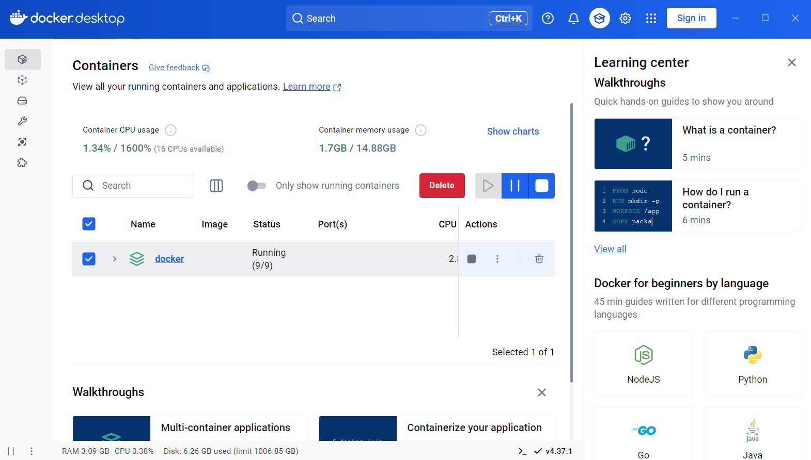

### <font style="color:rgb(51, 51, 51);">步骤二：下载 Ollama 并获取 DeepSeek LLM</font>
<font style="color:rgb(51, 51, 51);">1、打开 Ollama 的官网 </font>[<font style="color:rgb(65, 131, 196);">http://ollama.com</font>](https://link.zhihu.com/?target=http%3A//ollama.com)<font style="color:rgb(51, 51, 51);">，在官网找到 “Download”，点击下载并安装。</font>

<font style="color:rgb(51, 51, 51);">2、安装完成后 cmd 运行下面的命令看是否安装正确。</font>

```plain
ollama list
```

<font style="color:rgb(51, 51, 51);">3、cmd 命令行输入如下命令下载 DeepSeek 大模型并运行。</font>

```plain
ollama run deepseek-r1:1.5b
```

<font style="color:rgb(51, 51, 51);">需要等待一些时间（耗时长短和你机器的配置有关）。</font>

### <font style="color:rgb(51, 51, 51);">步骤三：Dify 的安装</font>
<font style="color:rgb(51, 51, 51);">我使用 Docker 方式部署 Dify。</font>

<font style="color:rgb(51, 51, 51);">在 Windows 里打开 WSL，进入 Linux 环境命令行。</font>

+ <font style="color:rgb(51, 51, 51);">下载代码：</font>

```plain
git clone https://github.com/langgenius/dify.git
cd dify/docker
```

+ <font style="color:rgb(51, 51, 51);">配置环境：</font>

```plain
cp .env.example .env
```

+ <font style="color:rgb(51, 51, 51);">启动服务：</font><font style="color:rgb(51, 51, 51);">如果你使用的是 Docker Compose V2（可以用 “docker compose version” 命令查看）：</font>

```plain
docker compose up -d
```

<font style="color:rgb(51, 51, 51);">如果是 V1 版本：</font>

```plain
docker-compose up -d
```

[<font style="color:rgb(65, 131, 196);">Docker 和 Docker Compose 命令行工具整理</font>](https://link.zhihu.com/?target=https%3A//mp.weixin.qq.com/s/adU-JnsiLpqCfYNE7ulo5Q)

<font style="color:rgb(51, 51, 51);">在这个地方，我被卡住了很长时间，每次运行都提示下面的错误：</font>

<font style="color:rgb(119, 119, 119);">Error response from daemon: Get "</font>[<font style="color:rgb(65, 131, 196);">https://registry-1.docker.io/v2/</font>](https://link.zhihu.com/?target=https%3A//registry-1.docker.io/v2/)<font style="color:rgb(119, 119, 119);">": net/http: request canceled while waiting for connection (Client.Timeout exceeded while awaiting headers)</font>

<font style="color:rgb(51, 51, 51);">在步骤一的时候，明明已经配置了 Docker 镜像，为什么还去连接 "</font>[<font style="color:rgb(65, 131, 196);">https://registry-1.docker.io/v2/</font>](https://link.zhihu.com/?target=https%3A//registry-1.docker.io/v2/)<font style="color:rgb(51, 51, 51);">" 呢？问了 deepseek，给了好多提示，按照折腾也不起作用。后来在搜答案的时候，无意中看到一个帖子说好多镜像都失效了，怀疑是不是这个问题，所以转而去寻找可用的 Docker 镜像，找了好多都没法用，最后是下面这个成功了：</font>

[<font style="color:rgb(65, 131, 196);">青春不留白 / Docker-hub</font>](https://link.zhihu.com/?target=https%3A//gitee.com/wanfeng789/docker-hub)

<font style="color:rgb(51, 51, 51);">最终我的 Docker Desktop 里 Docker Engine 的配置如下：</font>

```plain
{
  "builder": {
    "gc": {
      "defaultKeepStorage": "20GB",
      "enabled": true
    }
  },
  "dns": [
    "8.8.8.8",
    "8.8.4.4"
  ],
  "experimental": false,
  "features": {
    "buildkit": true
  },
  "max-concurrent-downloads": 3,
  "max-download-attempts": 5,
  "registry-mirrors": [
    "https://docker.1ms.run",
    "https://docker.imgdb.de",
    "https://docker.wanpeng.life",
    "https://docker.1panel.live",
    "https://hk11.606166.xyz",
    "https://docker.1panel.live",
    "https://hub.rat.dev"
  ],
  "shutdown-timeout": 1200
}
```

<font style="color:rgb(51, 51, 51);">安装完成后，通过以下命令检查服务状态：</font>

```plain
docker compose ps
```

<font style="color:rgb(51, 51, 51);">检查要特别关注以下几个关键容器的状态：</font>

+ <font style="color:rgb(51, 51, 51);">docker-api-1：API 服务</font>
+ <font style="color:rgb(51, 51, 51);">docker-web-1：Web 界面</font>
+ <font style="color:rgb(51, 51, 51);">docker-worker-1：后台任务处理</font>
+ <font style="color:rgb(51, 51, 51);">docker-db-1：数据库</font>
+ <font style="color:rgb(51, 51, 51);">docker-redis-1：缓存服务</font>
+ <font style="color:rgb(51, 51, 51);">docker-nginx-1：反向代理</font>

<font style="color:rgb(51, 51, 51);">所有容器都应该显示 "Up" 状态。然后我们可以通过浏览器访问：</font>

```plain
http://localhost/install
```

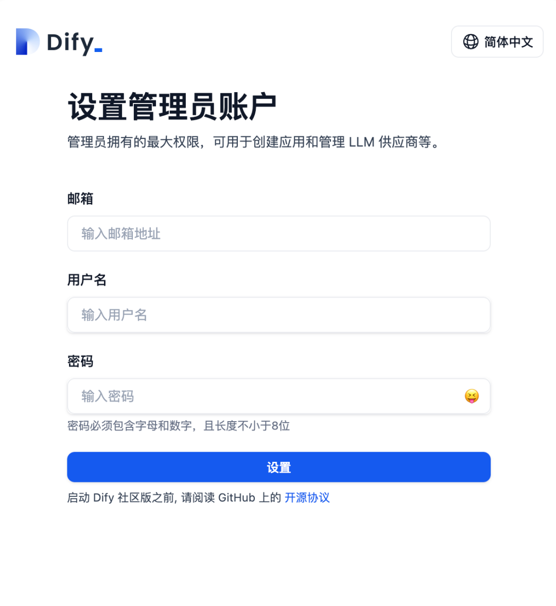

### <font style="color:rgb(51, 51, 51);">步骤四：配置 Dify 使用本地的 Ollama 上的 DeepSeek</font>
<font style="color:rgb(51, 51, 51);">这块我也折腾了不少时间，原因是添加 DeepSeek 模型时老是提示错误。开始 Ollama 是运行在 Windows 上的，后来我干脆在 Docker 里又装了一遍 Ollama 和 DeepSeek，但怀疑最终连接的还是 Windows 上运行的 Ollama，问题出在第 3 步的那个环境变量没有设置（懒得去一一排查了）。</font>

<font style="color:rgb(51, 51, 51);">1、用 ipconfig /all 命令获取本机内网 IP。</font>

<font style="color:rgb(51, 51, 51);">2、打开. env 文件，配置以下关键参数：</font>

```plain
CONSOLE_URL=http://localhost
SERVICE_API_URL=http://localhost
UPLOAD_FILE_SIZE_LIMIT=50 # 文件上传限制，单位MB
UPLOAD_FILE_MIME_TYPES=.pdf,.doc,.docx,.txt # 允许上传的文件类型
```

<font style="color:rgb(51, 51, 51);">3、在 “设置——模型供应商” 里添加 deepseek。</font>

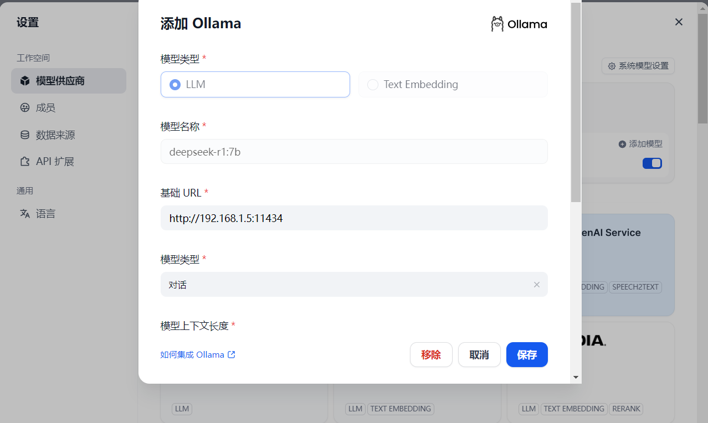

<font style="color:rgb(51, 51, 51);">这其中 192.168.1.5 是第 1 步获取的内网 IP。</font>

<font style="color:rgb(51, 51, 51);">点击 “保存” 的时候如开头所说，老是提示如下错误：</font>

<font style="color:rgb(119, 119, 119);">An error occurred during credentials validation: HTTPConnectionPool(host='192.168.1.5', port=11434): Max retries exceeded with url: /api/chat (Caused by NewConnectionError('<urllib3.connection.HTTPConnection object at 0x7f376833e420>: Failed to establish a new connection: [Errno 111] Connection refused'))</font>

<font style="color:rgb(51, 51, 51);">也是折腾了很久，还在 Docker 里重装了 Ollama 和 deepseek，后来还是看官网文档（</font>[<font style="color:rgb(65, 131, 196);">https://docs.dify.ai/development/models-integration/ollama#faq</font>](https://link.zhihu.com/?target=https%3A//docs.dify.ai/development/models-integration/ollama%23faq)<font style="color:rgb(51, 51, 51);">，论看官方文档的重要性）提示要设置个环境变量。</font>

<font style="color:rgb(51, 51, 51);">给当前登录用户添加环境变量 “OLLAMA_HOST”，设置值为 “0.0.0.0”，搞定了！</font>

### <font style="color:rgb(51, 51, 51);">步骤五：搭建知识库</font>
<font style="color:rgb(51, 51, 51);">1、创建一个空白应用，模型选之前配置的 deepseek-r1:7b。</font>

<font style="color:rgb(51, 51, 51);">2、添加一个 Text Embedding 模型</font>

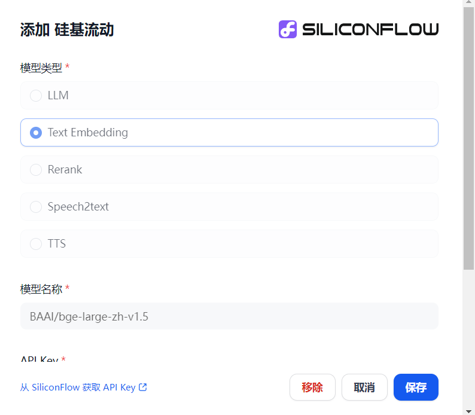

<font style="color:rgb(51, 51, 51);">我这里用的是 “BAAI/bge-large-zh-v1.5” 模型（之前为了图演示方便，和参考资料一样用的 deepseek，经知友提示容易误导人、不合适）。需要去 SiliconFlow 获取下自己的 API Key（没有注册过的可以用下面我的邀请码，双方都可以赠 token ）</font>

[<font style="color:rgb(65, 131, 196);">https://cloud.siliconflow.cn</font>](https://link.zhihu.com/?target=https%3A//cloud.siliconflow.cn/i/rpwRrxue)

<font style="color:rgb(51, 51, 51);">3、创建知识库并导入自己的资料。</font>

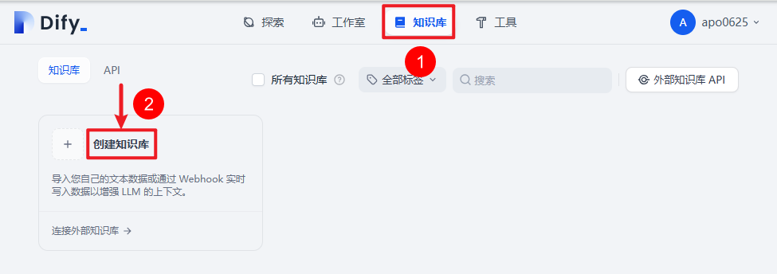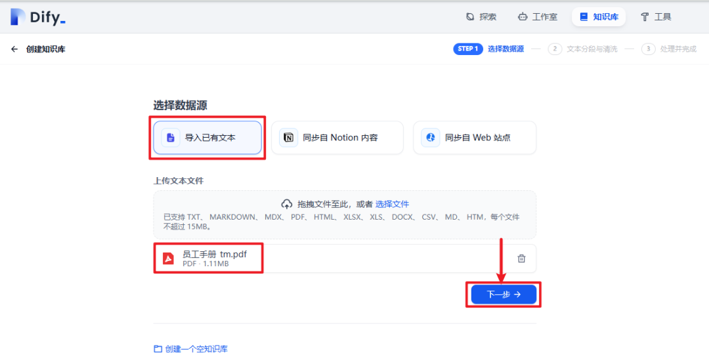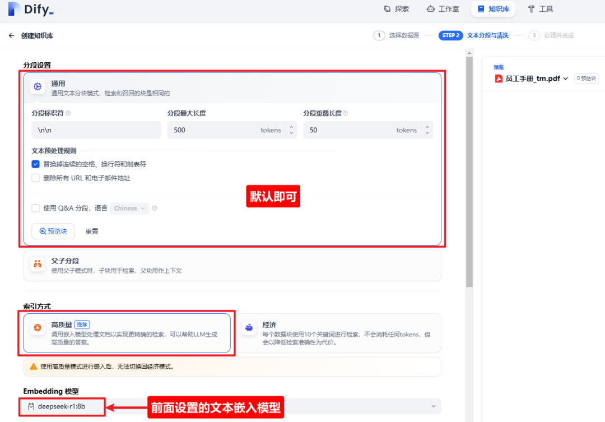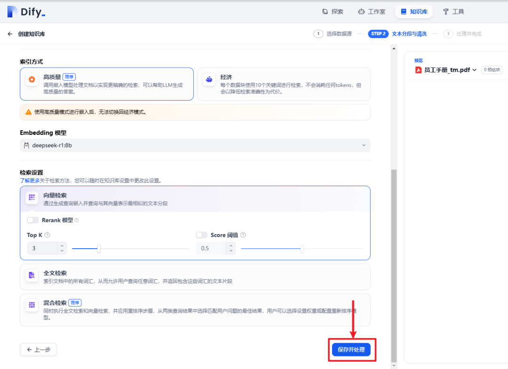

<font style="color:rgb(51, 51, 51);">文档多的话，Embedding 会有一个过程，需要等所有文档嵌入处理完成。</font>

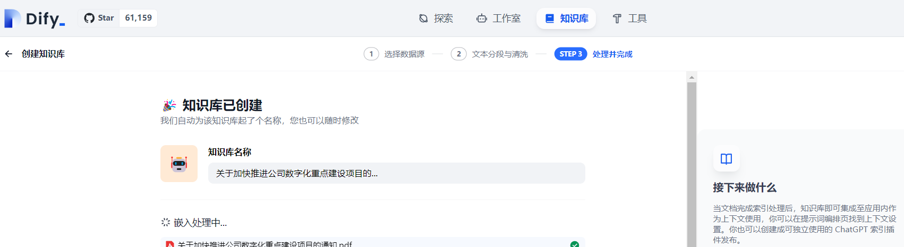

<font style="color:rgb(51, 51, 51);">4、回到之前创建的应用，在上下文中将知识库添加进去。</font>

<font style="color:rgb(51, 51, 51);">问一些和知识库相关的内容，看回答的是否满意。测试下来，添加同样的文档，回答效果比 AnythingLLM 强一些。但是还是存在不少问题，需要进一步精细化调优才可用。</font>

[<font style="color:rgb(65, 131, 196);">知识库 | Dify</font>](https://link.zhihu.com/?target=https%3A//docs.dify.ai/zh-hans/guides/knowledge-base)

<font style="color:rgb(51, 51, 51);">特点：除了给出具体引用的文档外，还可以看 “Prompt 日志”，这个对于 Debug 非常有用。</font>

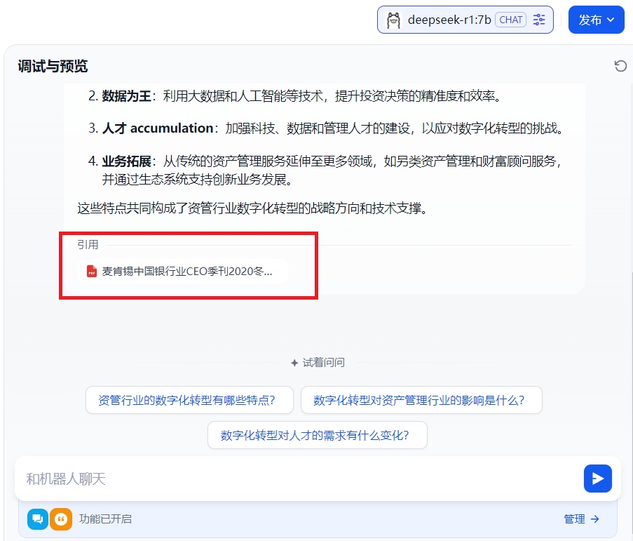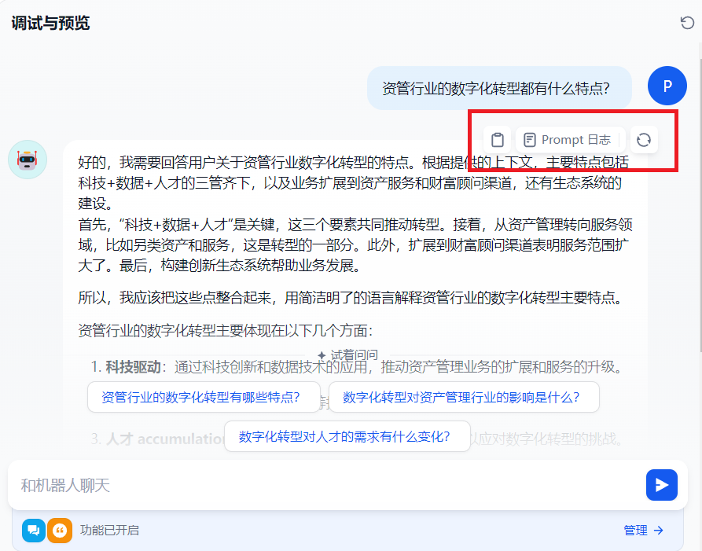


> 更新: 2025-06-14 13:44:54  
> 原文: <https://www.yuque.com/aaron-wecc3/dhluml/okklz93vpsy6tpfy>