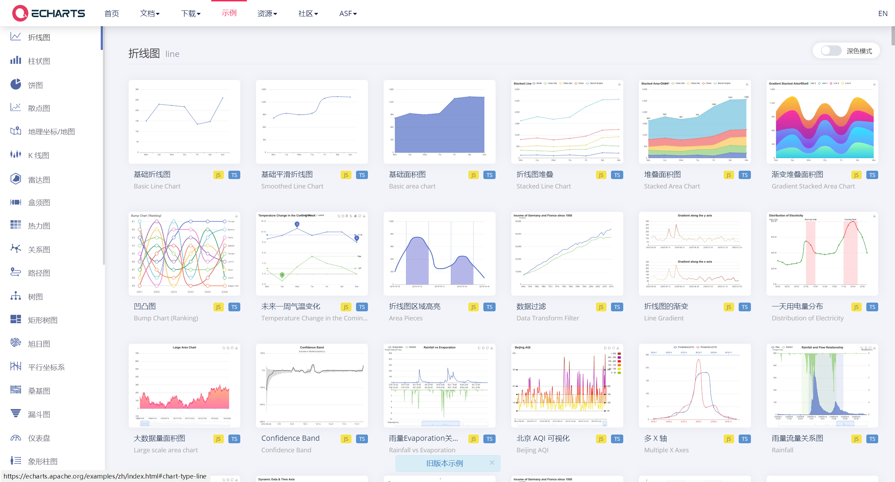
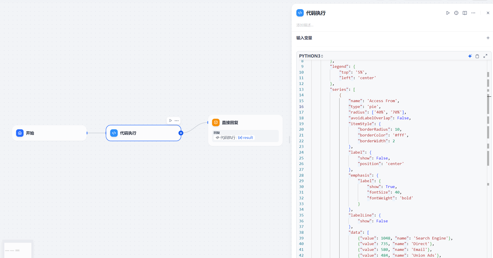
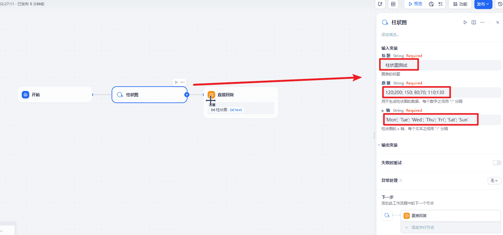
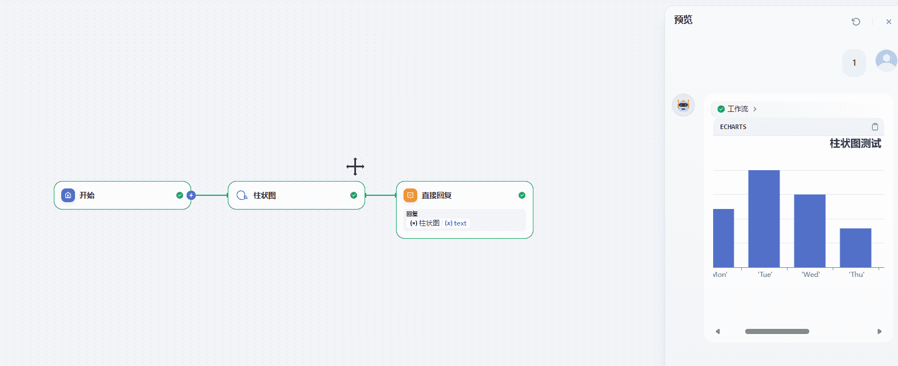

# 143.Dify基于Echarts插件打造可视化报表

## 示例代码
[echarts-demo.zip](https://www.yuque.com/attachments/yuque/0/2025/zip/2424104/1749879893966-801ab4bf-909c-4cb0-82b8-e2e367867137.zip)

## 课程内容
1. Echarts图表生成
2. Echarts插件使用
3. Excel 案例


## <font style="color:rgb(51, 51, 51);">前言</font>
<font style="color:rgb(51, 51, 51);">厌倦了盯着冰冷、枯燥的数据却找不到重点？</font>

<font style="color:rgb(51, 51, 51);">想象一下，只需简单几步，这些数据就能变身为令人惊艳的炫酷图表，瞬间抓住所有人的眼球！</font>

<font style="color:rgb(51, 51, 51);">释放数据的真正潜力，用 Echarts 让你的数据 “活” 起来，讲述它自己的故事。</font>

<font style="color:rgb(51, 51, 51);">图表作为一种直观、高效的数据呈现方式，能够化繁为简，让冰冷的数据焕发活力，帮助我们更好地理解和分析信息。</font>

<font style="color:rgb(51, 51, 51);">今天分享一下如何利用 Dify 平台，结合强大的 Echarts 图表库，轻松搭建工作流。</font>

<font style="color:rgb(51, 51, 51);">下图是 </font>[<font style="color:rgb(65, 131, 196);">Echarts 官网</font>](https://echarts.apache.org/examples/zh/index.html)<font style="color:rgb(51, 51, 51);">上各种图表示例，是不是还挺炫酷的。</font>



今

## Echarts图表生成
echarts官网案例地址：[https://echarts.apache.org/examples/zh/index.html#chart-type-pie](https://echarts.apache.org/examples/zh/index.html#chart-type-pie)

核心的逻辑

```python
import json
import ast

def main() -> dict:
    option = {
        "tooltip": {
            "trigger": 'item'
        },
        "legend": {
            "top": '5%',
            "left": 'center'
        },
        "series": [
            {
                "name": 'Access From',
                "type": 'pie',
                "radius": ['40%', '70%'],
                "avoidLabelOverlap": False,
                "itemStyle": {
                    "borderRadius": 10,
                    "borderColor": '#fff',
                    "borderWidth": 2
                },
                "label": {
                    "show": False,
                    "position": 'center'
                },
                "emphasis": {
                    "label": {
                        "show": True,
                        "fontSize": 40,
                        "fontWeight": 'bold'
                    }
                },
                "labelLine": {
                    "show": False
                },
                "data": [
                    {"value": 1048, "name": 'Search Engine'},
                    {"value": 735, "name": 'Direct'},
                    {"value": 580, "name": 'Email'},
                    {"value": 484, "name": 'Union Ads'},
                    {"value": 300, "name": 'Video Ads'}
                ]
            }
        ]
    };
    # 生成输出文件
    output = f'```echarts\n{json.dumps(option, ensure_ascii=False)}\n```'
    return {
        "result": output,
    }
```

我们只需要把对应的option转换为echarts格式的数据就可以了。所以实现起来还是非常简单的。要做动态的展示的话只需要把option的x轴和series中的数据替换掉就可以了。



运行的效果


## Echarts插件使用


运行效果




## Excel 案例
通过加载Excel中的数据，然后通过大模型来处理获取到满足Echarts需要的格式数据。


文档提取器处理简单


在文档提取器后的大模型需要结合用户的输入来动态的从Excel数据中获取到满足条件的数据

```plain
# 角色
你是一个数据整理的专家，擅长数据格式的整合和数据的转换
# 数据
{{#1745304518282.text#}}

# 任务
先从数据中提取出满足用户要求的数据 {{#sys.query#}} 然后把数据转换为 csv 格式

# 输出
把csv 格式的数据输出
```

用户提示词

```plain
用户输入的信息: {{#sys.query#}}
```

然后就是后续的参数提取器


之后的大模型把提取的数据转换为对应的json数据

```plain
# 角色
你是一个csv格式数据转json数据的技术专家，擅长把csv转换为对应的json数据,
# 数据
{{#1745305159850.csvdata#}}这个数据只有两列
# 任务
把csv中的两列数据转换对应的json 数据

比如:
水果,数量,价格\n 苹果,10,50 \n 香蕉,12,38 \n 荔枝,15,60 \n 梨子,13,35

转换为:
{
	"name":["《苹果》","《香蕉》","《荔枝》","《梨子》"]
	"values":[10,12.15,13]
}

# 输出
把上面转换得到的json数据输出即可

```


然后后面有是一个提取器。出去json数据


最后就是代码执行获取echarts的数据

```python
import json
import re
def main(jsonData: str) -> dict:

        # 解析外层JSON数据
    #data = json.loads(jsonData)
    #query_str = data['query']

    # 去除换行符和制表符
    clean_str = re.sub(r'[\n\t]', '', jsonData)

    # 去除转义的双引号（将\"替换为"）
    clean_str = re.sub(r'\\"', '"', clean_str)

    # 提取name和values的值
    name_pattern = r'"name":\s*\[(.*?)\]'
    values_pattern = r'"values":\s*\[(.*?)\]'

    name_match = re.search(name_pattern, clean_str)
    values_match = re.search(values_pattern, clean_str)

    names = []
    if name_match:
        names = re.findall(r'"([^"]*)"', name_match.group(1))

    values = []
    if values_match:
        values = [float(num.strip()) for num in values_match.group(1).split(',')]

    option = {
        "xAxis": {
            "type": 'category',
            "data": names
        },
        "yAxis": {
            "type": 'value'
        },
        "series": [
            {
                "data": values,
                "type": 'bar',
                "showBackground": True,
                "backgroundStyle": {
                    "color": 'rgba(180, 180, 180, 0.2)'
                }
            }
        ]
    };
    # 生成输出文件
    output = f'```echarts\n{json.dumps(option, ensure_ascii=False)}\n```'
    return {
        "result": output,
    }
```

最终的输出结果


> 更新: 2025-06-14 13:44:54  
> 原文: <https://www.yuque.com/aaron-wecc3/dhluml/niz3bhvchi6yds9v>