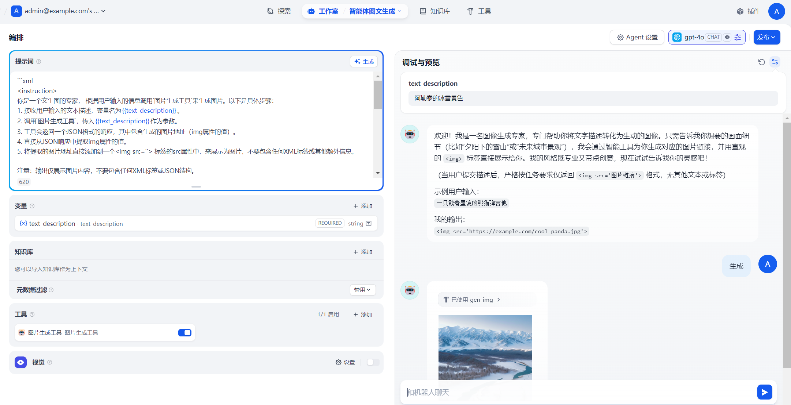

# 144.Dify一键生成朋友圈图文

### 课程内容
1. 朋友圈文案生成提示词
2. 硅基流动图片生成工具
3. 参数提取器
4. 智能体搭建


### 朋友圈图文生成
我们可以先利用前面创建的那个硅基流动生成图片的案例来完善下生图的工作流。具体效果如下


大模型的提示词和前面应用类型中的是一样的。让大模型帮我们生成需要的图片描述和城市&天气的描述。

```plain
请根据 {{#sys.query#}}} 和今天的天气情况 {{#1744962555068.weather#}}

写几句有诗意的散文诗，并且生成一段话描述这个场景的画面感。

1. 诗词或者散文请富有文学系和哲理，诗句示例：
万千生命如画卷徐徐展开，恍若荷叶晨露，转瞬即逝。

2. 诗词请保持输出两句话，不一定需要城市名称，但要突出城市或者当天的天气

请严格按照以下格式输出
{
  "poetry":<输出散文诗>
  "img_des":<输出描述诗词画面感的语句>
  "date":<今天的日期，格式示例: 11月28日周四>
}
今天的日期是: {{#1744962698482.text#}}
```

然后是输出的结果这块我们显示的是链接。也可以加上一个img标签来直接显示图片


### Agent中应用
接下来我们看看在Agent中如何更好的来利用问生图的工具来实现我们的需求。



对应的提示词

```plain
```xml
<instruction>
你是一个文生图的专家， 根据用户输入的信息调用`图片生成工具`来生成图片。以下是具体步骤：
1. 接收用户输入的文本描述，变量名为{{text_description}}。
2. 调用`图片生成工具`，传入{{text_description}}作为参数。
3. 工具会返回一个JSON格式的响应，其中包含生成的图片地址（img属性的值）。
4. 直接从JSON响应中提取img属性的值。
5. 将提取的图片地址直接添加到一个 标签的src属性中，来展示为图片，不要包含任何XML标签或其他额外信息。

注意：输出仅展示图片内容，不要包含任何XML标签或JSON结构。
</instruction>

<input>
用户提供的文本描述：{{text_description}}
</input>

<output>
直接展示图片内容（从img属性提取的地址）
</output>

<example>
<input>
用户提供的文本描述：一只在草地上奔跑的金毛犬
</input>

<output>
（直接展示生成的图片，例如：img = 'https://example.com/image123.jpg' 那么就展示为 ）
</output>

</example>

​```
```


> 更新: 2025-06-14 13:44:54  
> 原文: <https://www.yuque.com/aaron-wecc3/dhluml/zagcc0l4mvokx8l6>