# 145.Dify打造小红书爆改工作流

## 示例代码
[worflow-demo.zip](https://www.yuque.com/attachments/yuque/0/2025/zip/2424104/1749879893993-83908bcd-a6ef-4463-949a-e6cf25a2322e.zip)

## 课程内容
1. 基于笔记地址获取的笔记内容
2. 提取出核心内容、图片链接、文案的标题、文案的内容
3. 基于AI优化标题和内容
4. 基于图片工具来重新生成图片内容
5. 获取到了爆改后的小红书的文案信息

## 笔记展示
小红书笔记地址：[https://www.xiaohongshu.com/explore/680ec7950000000021018503?xsec_token=ABHmt3T5TfO0T8yvWvaXU1D7HQfcoXG3Cq5IKLThWJ3sY=&xsec_source=pc_search](https://www.xiaohongshu.com/explore/680ec7950000000021018503?xsec_token=ABHmt3T5TfO0T8yvWvaXU1D7HQfcoXG3Cq5IKLThWJ3sY=&xsec_source=pc_search)

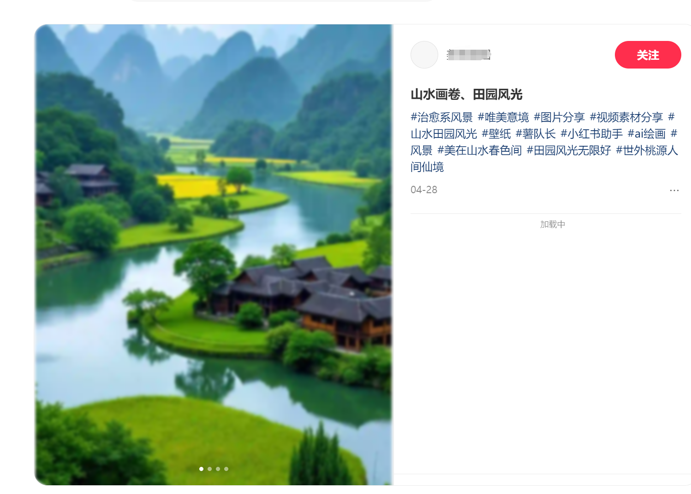


## 工作流流程
整体的工作流设计效果

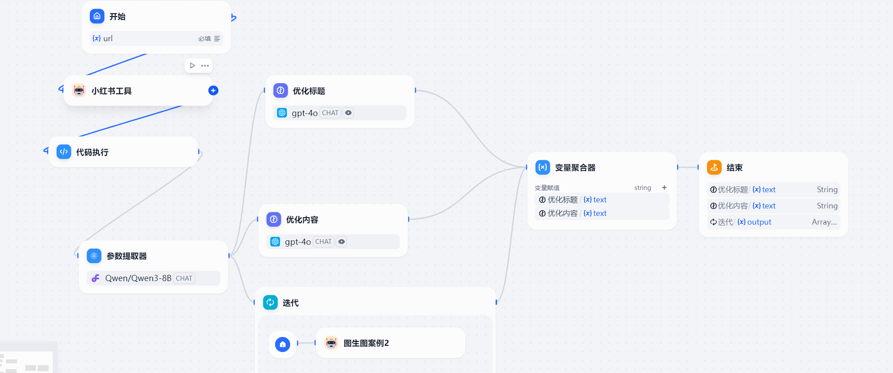

获取的响应结果

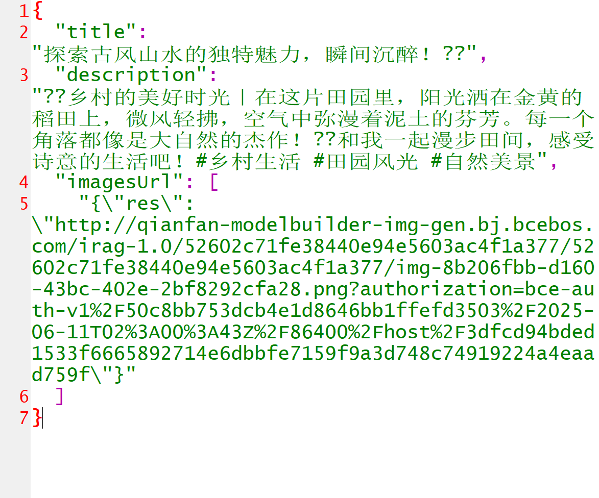


## 获取小红书笔记详情
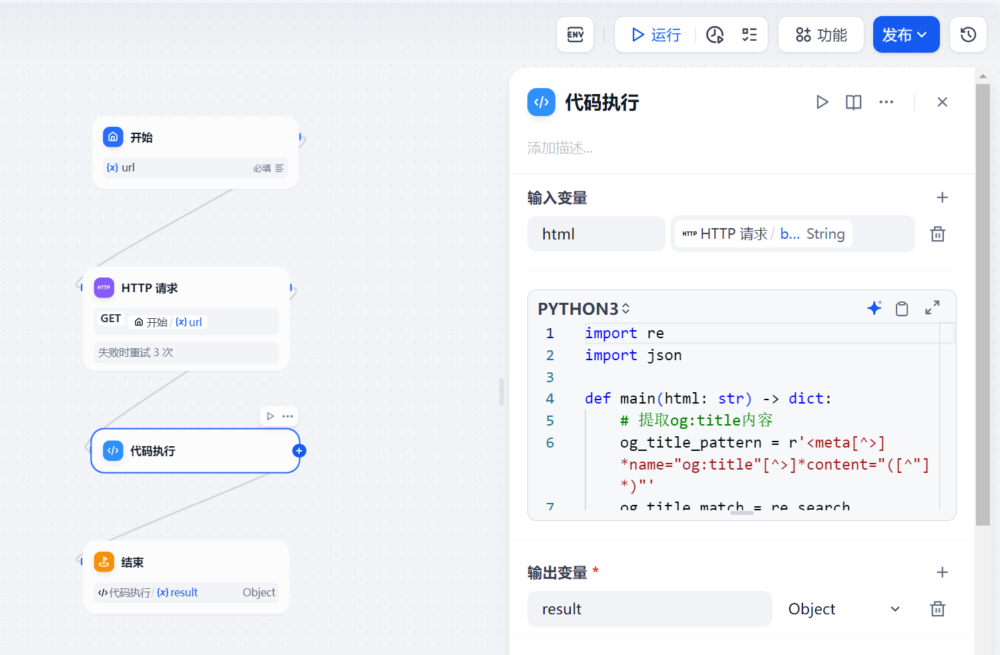


代码执行中的代码为:

```python
import re
import json

def main(html: str) -> dict:
    # 提取og:title内容
    og_title_pattern = r'<meta[^>]*name="og:title"[^>]*content="([^"]*)"'
    og_title_match = re.search(og_title_pattern, html)
    og_title = og_title_match.group(1) if og_title_match else ""

    # 提取description内容
    desc_pattern = r'<meta[^>]*name="description"[^>]*content="([^"]*)"'
    desc_match = re.search(desc_pattern, html)
    description = desc_match.group(1) if desc_match else ""

    # 提取所有og:image内容
    og_image_pattern = r'<meta[^>]*name="og:image"[^>]*content="([^"]*)"'
    og_images = re.findall(og_image_pattern, html)

    # 构建结果字典
    result = {
        "og_title": og_title,
        "description": description,
        "og_images": og_images
    }

    return {"result": result}

```

输出的内容

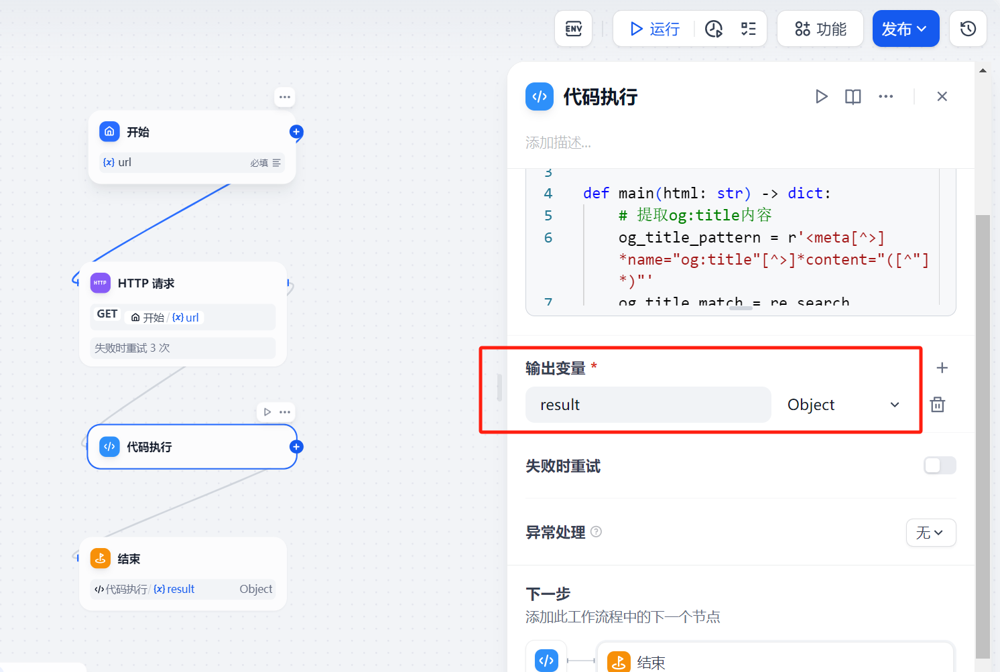


## 图生图的工具
把小红书中的图片借助AI大模型来爆改，这块我们通过百度大模型来实现。流程图的效果为

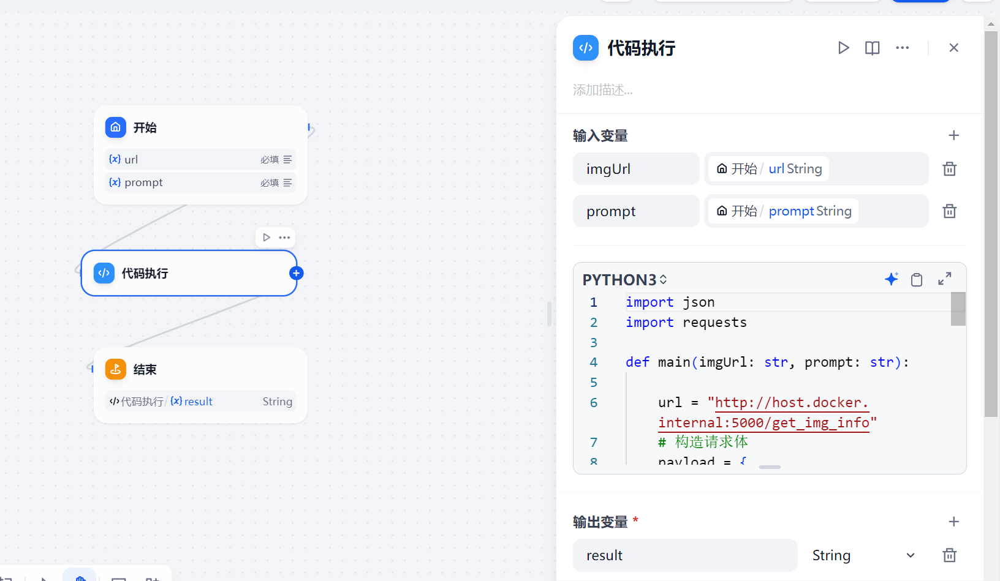

	节点接受两个参数，分别是 图片的地址和需要调整的提示词。对应的代码执行是调用 我们单独创建的 基于Flask 的web服务。

```python
import json
import requests

def main(imgUrl: str, prompt: str):

    url = "http://host.docker.internal:5000/get_img_info"
    # 构造请求体
    payload = {
        "url": imgUrl,
        "prompt": prompt,
    }

    headers = {
        "Content-Type": "application/json"
    }

    try:
        response = requests.post(url, json=payload, headers=headers)
        if response.status_code == 200:
            try:
                return {"result":str(response.json()["result"])}
            except Exception as e:
                return {"result": f"解析响应 JSON 失败: {str(e)}"}
        else:
            return {"result": f"请求失败，状态码: {response}"}
    except Exception as e:
        return {"result": str(e)}
```

	输出的结果

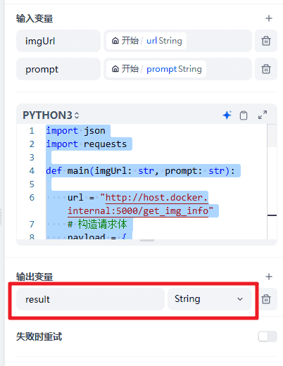


然后就是对应的Web服务的代码

```plain
from flask import Flask, request, jsonify

from openai import OpenAI

app = Flask(__name__)
def get_img_info(url,prompt):
    client = OpenAI(
        api_key="xxxxxxxxxxxxxxxxxxxxxxxxxxxxxxxxxxxxxxxxx",  # 你的千帆api-key
        base_url="https://qianfan.baidubce.com/v2",  # 千帆modelbulider平台
    )

    # 合并参考图参数到请求
    extra_data = {
        "refer_image": url,
    }
    try:
        response = client.images.generate(
            model="irag-1.0",
            prompt=prompt,
            extra_body=extra_data
        )
        return response.data[0].url
    except Exception as e:
        print(e)

@app.route('/get_img_info', methods=['POST'])
def images_info():
    data = request.get_json()
    if not data:
        return jsonify({"result": "无效的请求数据"}), 400

    url = data.get("url")
    prompt = data.get("prompt")

    if not url :
        return jsonify({"result": "需要输入图片链接"}), 400
    if not prompt :
        return jsonify({"result": "需要输入提示词"}), 400

    result = get_img_info(url, prompt)
    return jsonify({"result": result})


if __name__ == '__main__':
    # 开发环境下可以设置 debug=True，默认在本地5000端口启动服务
    app.run(debug=True)

```

## 百度AI开发平台
图生图接口地址：[https://cloud.baidu.com/doc/WENXINWORKSHOP/s/dm9cwwy4h#%E5%9B%BE%E7%94%9F%E5%9B%BE%E6%8E%A5%E5%8F%A3%E7%A4%BA%E4%BE%8B](https://cloud.baidu.com/doc/WENXINWORKSHOP/s/dm9cwwy4h#%E5%9B%BE%E7%94%9F%E5%9B%BE%E6%8E%A5%E5%8F%A3%E7%A4%BA%E4%BE%8B)

获取Api KEY: [https://console.bce.baidu.com/iam/#/iam/apikey/list](https://console.bce.baidu.com/iam/#/iam/apikey/list)

测试效果

原图:


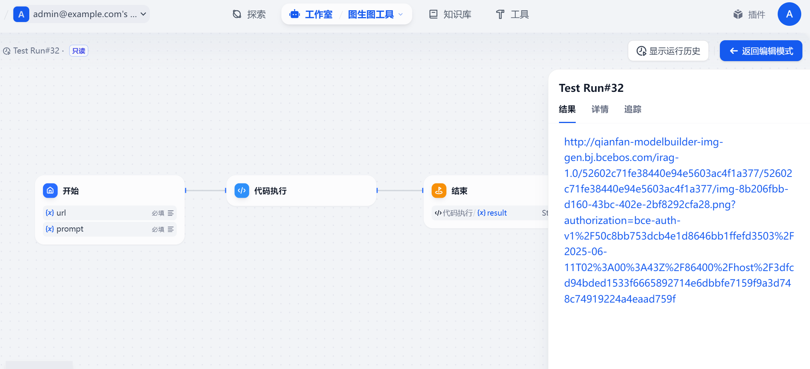

调整后的图片


## 完整工作流
小红书工具

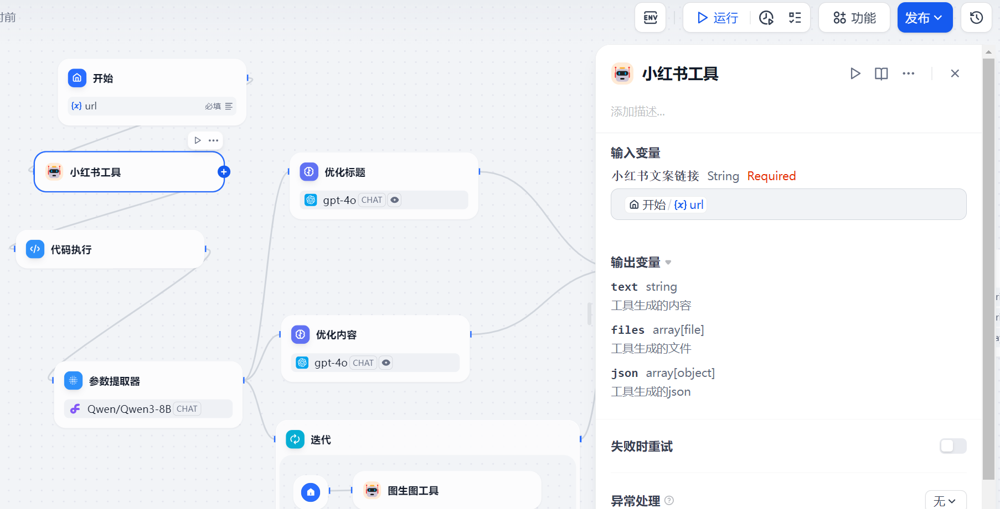

参数提取器

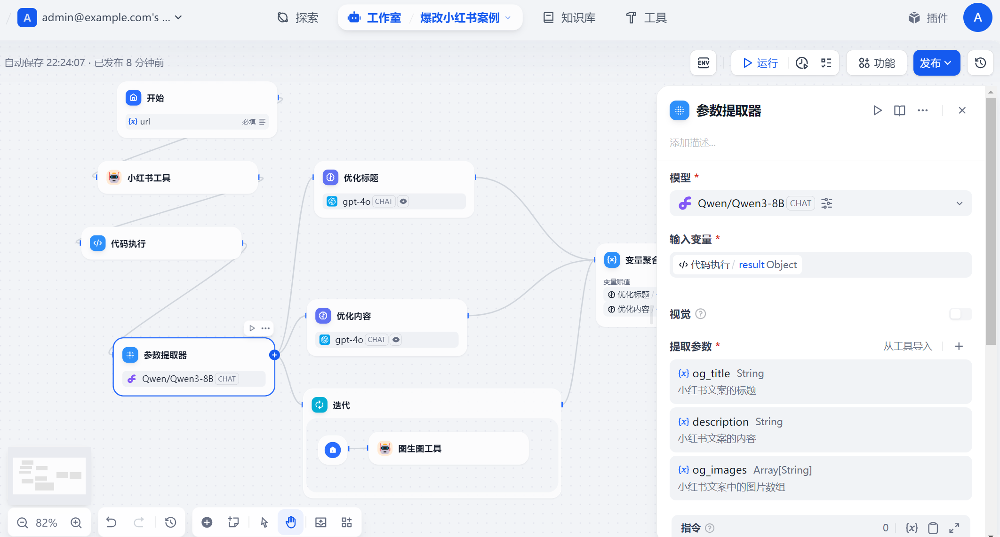

大模型文案优化提示词

```plain
```xml
<instruction>
你是一个小红书的优化专家，负责将用户提供的标题{{#1744984171999.og_title#}}优化得更加吸引人眼球。以下是你的任务指南：

<instructions>
1. **理解原标题的核心内容**：首先仔细阅读原标题，确保你完全理解其表达的主题、情感和关键信息。
2. **分析目标受众**：考虑小红书的主要用户群体（年轻女性、时尚爱好者、美妆达人等），确保优化后的标题能引起她们的共鸣。
3. **运用吸引眼球的技巧**：
   - 使用emoji（如✨、💄、🔥等）增加视觉冲击力。
   - 加入数字或列表形式（如“3个技巧”“5分钟搞定”）。
   - 制造悬念或提出问题（如“你知道为什么明星都在用吗？”）。
   - 强调效果或价值（如“瞬间提升气质”“省钱必备”）。
4. **保持简洁**：标题长度控制在20字以内，确保信息清晰且抓人眼球。
5. **避免夸张或虚假信息**：优化后的标题必须真实反映内容，不能误导读者。
6. **输出格式**：直接输出优化后的标题，不要包含任何额外的解释或XML标签。
</instructions>

<examples>
<example>
输入：如何快速化妆  
输出：💄5分钟快速化妆术，懒人必备！  
</example>

<example>
输入：夏天穿搭推荐  
输出：🔥夏日穿搭Top5，显瘦又清凉！  
</example>

<example>
输入：护肤小技巧  
输出：✨3个护肤秘诀，让你素颜也发光！  
</example>

</examples>

其他注意事项：
- 如果原标题已经非常吸引人，可以稍作调整或直接保留。
- 避免使用过于复杂的词汇，确保标题通俗易懂。
- 根据小红书的热门话题趋势，适当加入流行词汇（如“绝绝子”“yyds”等）。
</instruction>

​```
```

迭代：图片重新生成

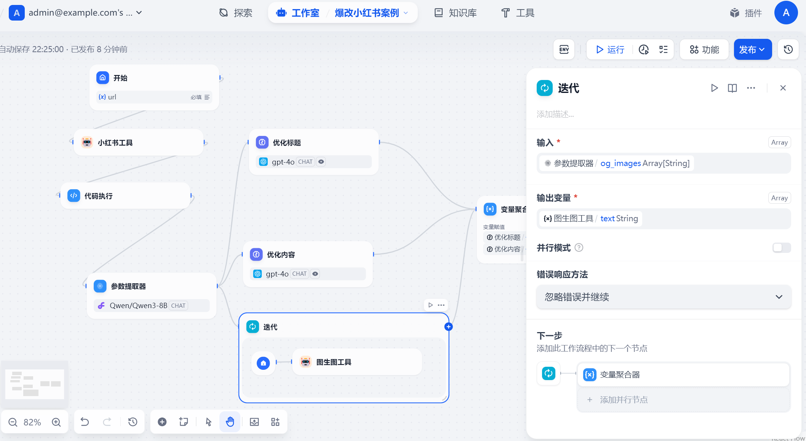

图生图

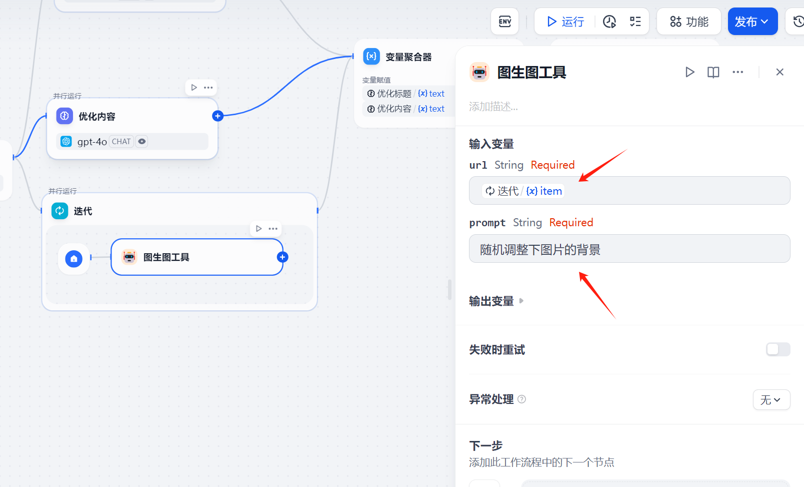


> 更新: 2025-06-14 13:44:54  
> 原文: <https://www.yuque.com/aaron-wecc3/dhluml/lzkri1i9kw6b8apb>