# 146.Dify一键获取热榜文章内容

# 课程内容
1. dify 迭代循环节点使用
2. Jina Reader从网站爬取信息
3. http 请求
4. 生成热榜文章内容


## 前言
我们每天需要通过app或者PC电脑浏览网页了解最新信息咨询，目前市面上APP应用非常多。我们手机上不可能装很多APP，另外也懒得找这些最新的热点信息。我们希望通过dify工作流每天定时推送实时新闻给我们，最好是推送到我手机上 推送到微信最好了。

以上就是我们本次的需求，看似很简单但是实现起来还是有不少技术点需要去克服了。下面分解一下技术路线。

1. 需要通过第三方接口或者爬虫获取最新的新闻资讯-爬虫技术
2. 需要将爬取的信息整理出来-llm大语言模型技术
3. 需要将整理好的新闻信息发送到企业微信、微信、飞书、QQ、钉钉等IM软件。（下期文章会介绍这方面内容）。

我们先给大家看一下 实现的一个效果。

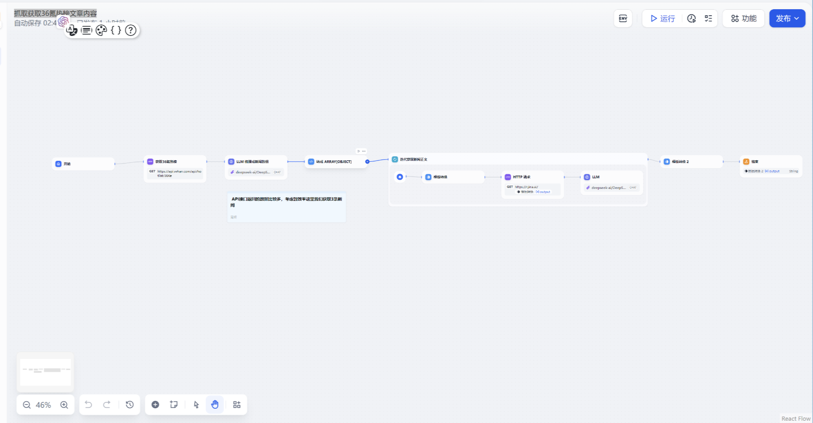

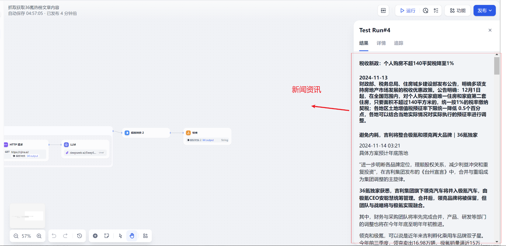

# 一、创建工作流
来到Dify中按下图顺序依次点击并点击创建

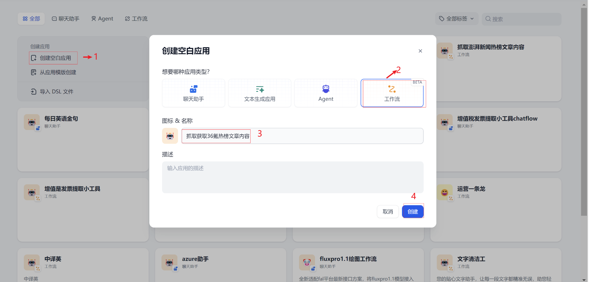

## 1.开始
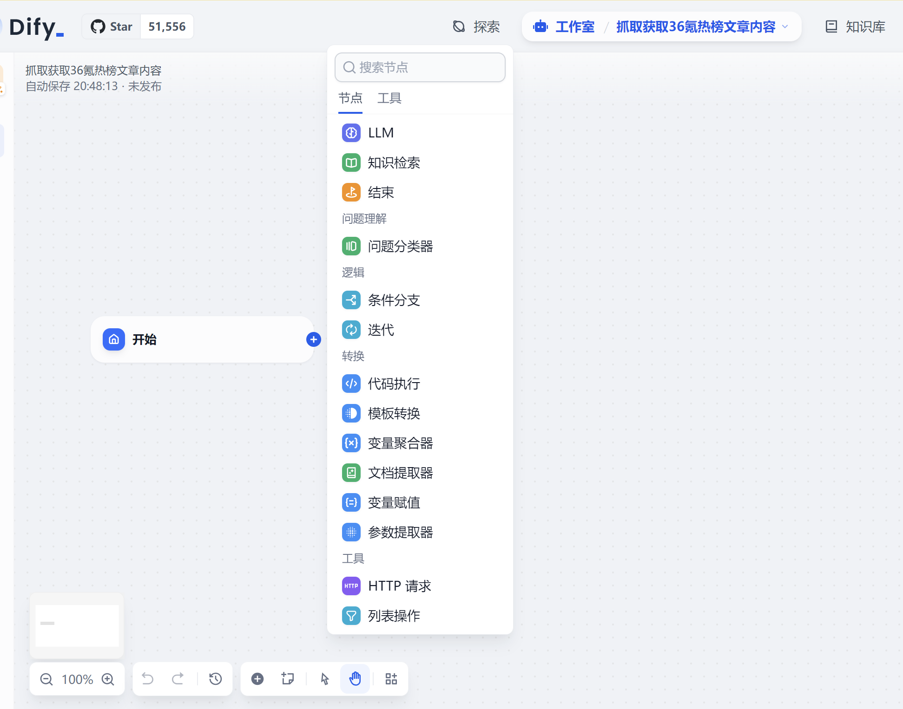

 进入画布界面如上图，给开始节点增加http请求节点

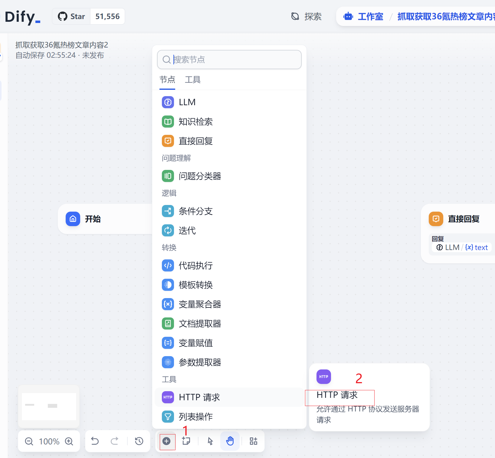

## 2.http请求
 将开始节点和这个http请求节点连接上，点击http 请求，输入我们需要获取36氪热榜文章api接口。

 我们这里用到了别人第三方接口（韩小韩webapi接口，感谢作者提供免费的api省的我们在去爬取新闻了），接口地址[https://api.vvhan.com/article/36Ke.html](https://api.vvhan.com/article/36Ke.html)

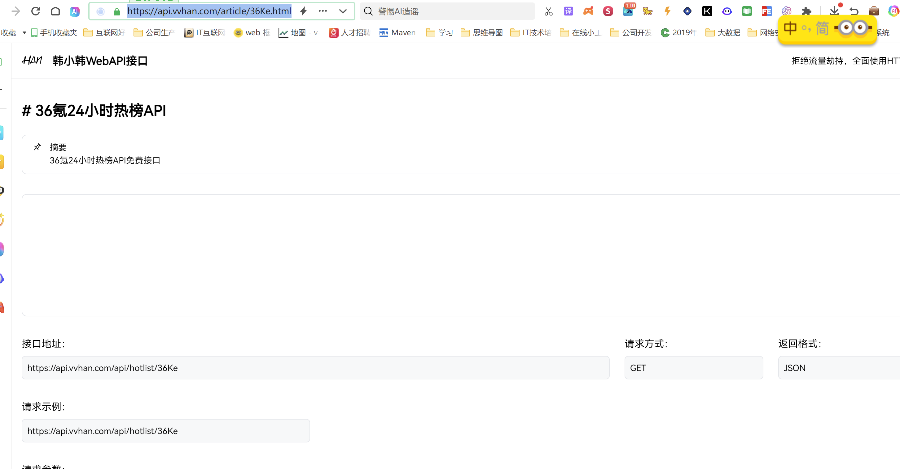

 将接口地址：[https://api.vvhan.com/api/hotlist/36Ke](https://api.vvhan.com/api/hotlist/36Ke) 复制到 http请求地址上

 因为这个http请求接口是get 请求，其他参数都不需要输入，所以以上步骤参考我图上设置即可。

 这里我们也用到dify http请求这个组件了。关于他的使用其实也非常简单，会开发小伙伴 使用postman调试接口开发工具应该都会使用，这里我就不详细展开了。

## 3.llm(文本类大语言模型)
 接下来我们将http请求连接到一个大语言模型，这里我们使用的是deepseek-ai/DeepSeek-V2.5模型。

模型里面的系统提示词输入如下内容：

```plain
```xml
<instruction>
  <instructions>
    1. 抓取了360氪新闻榜单 json ：{{#1726306543949.body#}}
    2. 只生成榜单前面 3 条数据
    3. 生成如下结构的内容：
      [{
        "title": "新闻标题",
        "url": "新闻链接"
      }]
    4.输出不要添加```json 包裹
  </instructions>
  <examples>
    <example>
      <output>
        [
          {"title": "8点1氪｜个人购房不超140平契税降至1%；特斯拉10万员工薪酬数据曝光；校园招聘严禁限定985和211高校","url":"https://36kr.com/p/3035465134387461"},
            {"title": "避免内耗，吉利将整合极氪和领克两大品牌｜36氪独家","url":"https://36kr.com/p/3034230633984003"},
 {"title": "Transformer打破三十年数学猜想，Meta研究者用AI给出反例，算法杀手攻克数学难题｜36氪独家","url":"https://36kr.com/p/3034698843615238"},
        ]
      </output>
    </example>
 <examples>
```

这里主要是让大语言模型在获取上一个节点http请求返回的body值的地方做一下数据提取。其中 1、2、3、4 都是我们需要模型提取的关键点要素。因为我们这里是先获取新闻标题和新闻链接 其他的内容我们是不需要的，所以我们把生成要点告诉大语言模型。下面example是告诉模型输出的内容格式。

我们使用原始的[https://api.vvhan.com/api/hotlist/36Ke](https://api.vvhan.com/api/hotlist/36Ke) 接口获取的内容如下：

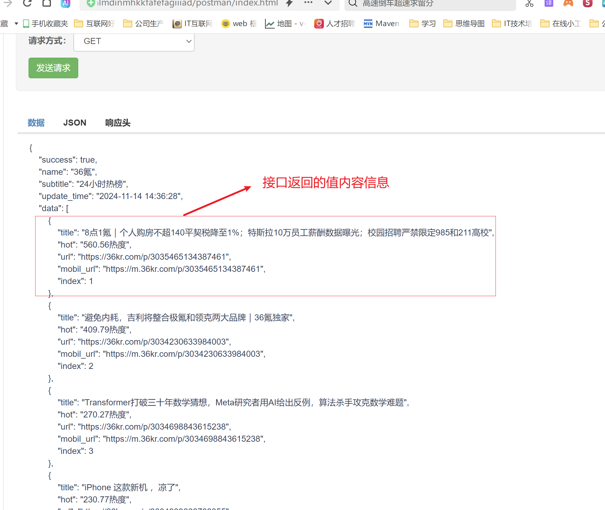

 上面的节点我们只用到2个（title 、url)，其他我们目前不需要就忽略掉他。llm(文本类大语言模型) 系统提示词配置如下

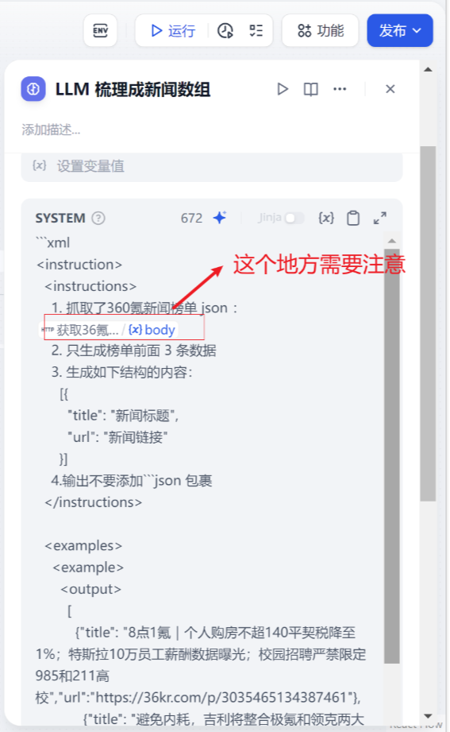

 这里我们需要注意{X}body是从上一个http 请求的内容body部分的数据，不能写死了。

## 4 .转换
 接下来我们需要对llm大语言模型输出的结果进行转换，转换的目的是把上个节点输出的内容转换成json格式数据。我们拖拽一个代码执行

 输入变量

 arg1 llm大语言模型txt

 python 代码

```plain
import json

def main(arg1: str) -> dict:
    try:
        json_object = json.loads(arg1)
        return {
            "result": json_object
        }
    except json.JSONDecodeError as e:
        return {
            "result": None,
            "error": f"Invalid JSON: {str(e)}"
        }
```

 输出变量

result array[Object]

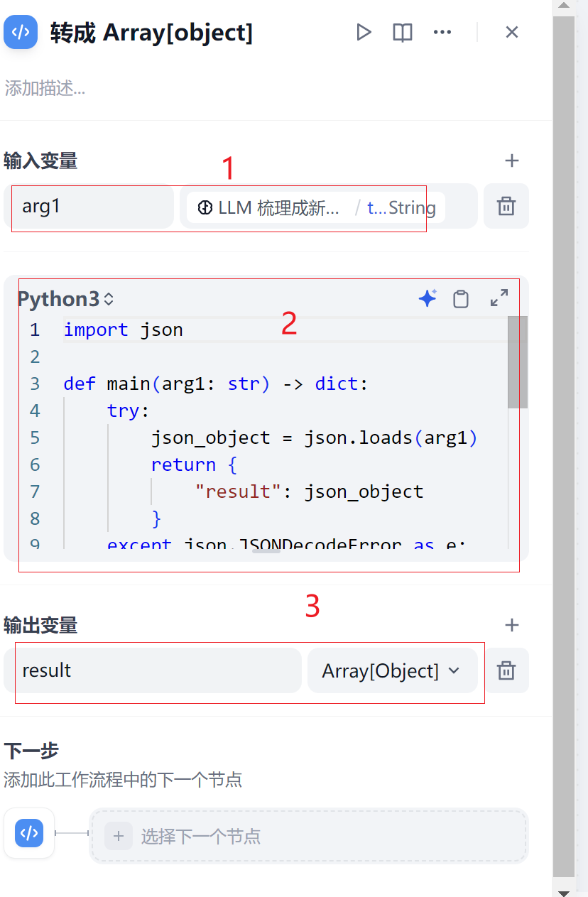

## 5 迭代
 这流程稍微复杂点，主要目的是循环遍历上个流程中获取新闻详细URL内容信息。这里我们用到了一个第三方爬虫工具Jina Reader

 这里我们简单介绍一下这个Jina Reader

 jina-ai可以将网页转出markdown格式的文件，公司官方网[https://jina.ai/reader/](https://jina.ai/reader/)

### jina-ai 使用
 使用方法

1.访问网站[https://jina.ai/reader/](https://jina.ai/reader/)

 我们在左边输入需要抓取的URL链接，然后点击下面获取内容按钮，点击后右边就会把网页内容转换成markdown格式

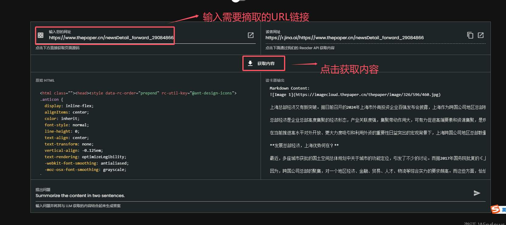

1. 使用api 接口方式

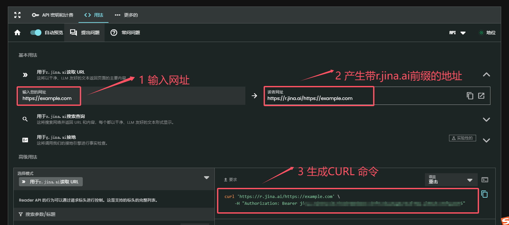

 我们将以上生成的CURL 命令复制到postman

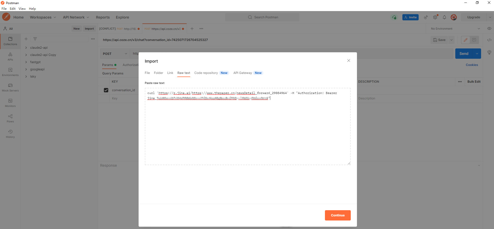

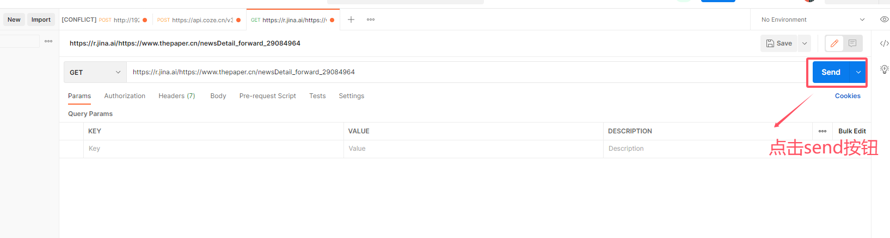

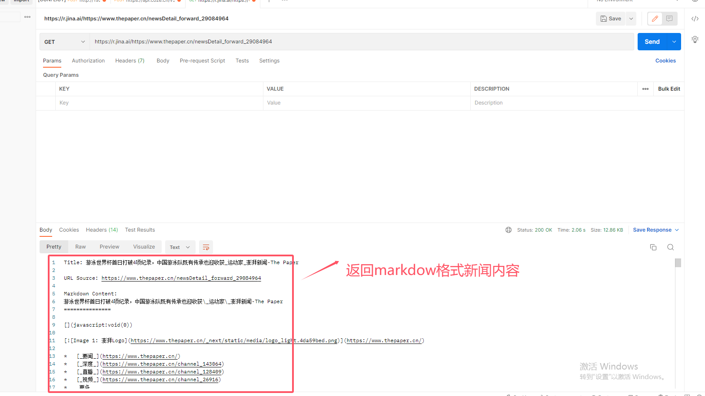

 回到dify工作流开发上，我们在工作流中拖拽一个迭代组件

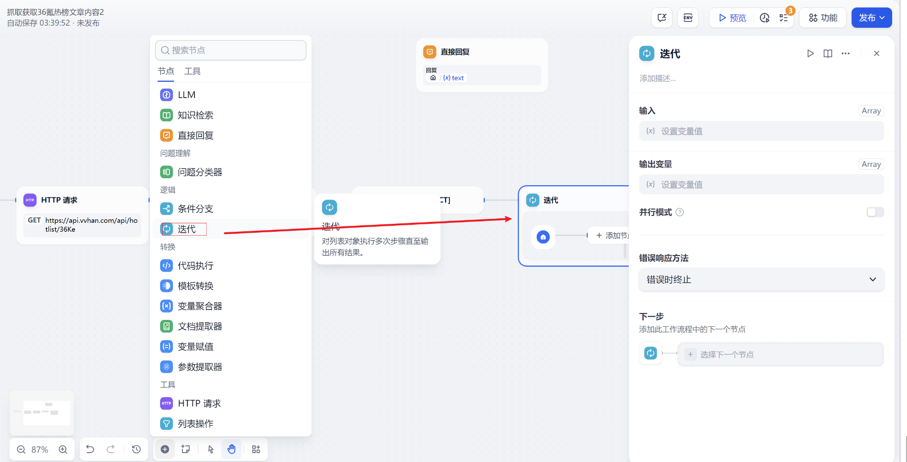

在迭代里面我们会用到三个组件（模板转换、HTTP 请求、LLM）

迭代获取新闻正文 输入变量是上一个节点转换的数组

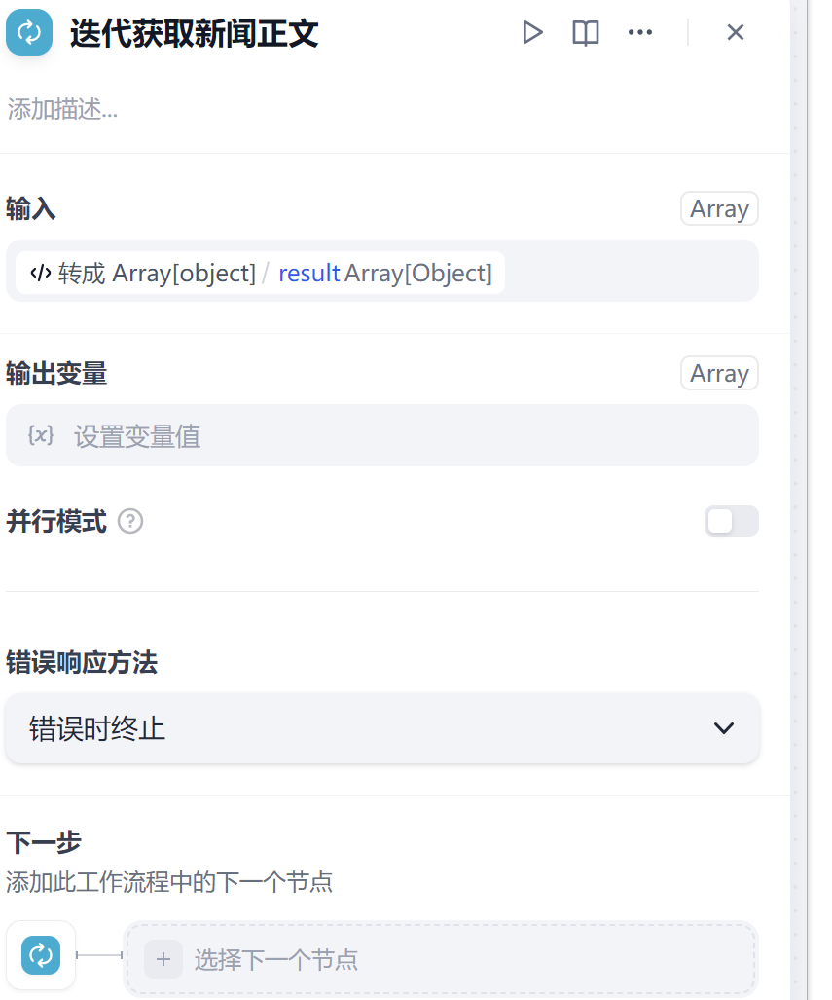

### 模板转换
模板转换的目的是获取上个节点中的url 输出我们需要的url然后发给HTTP 请求 作为详细新闻内容网页爬取功能。配置截图如下

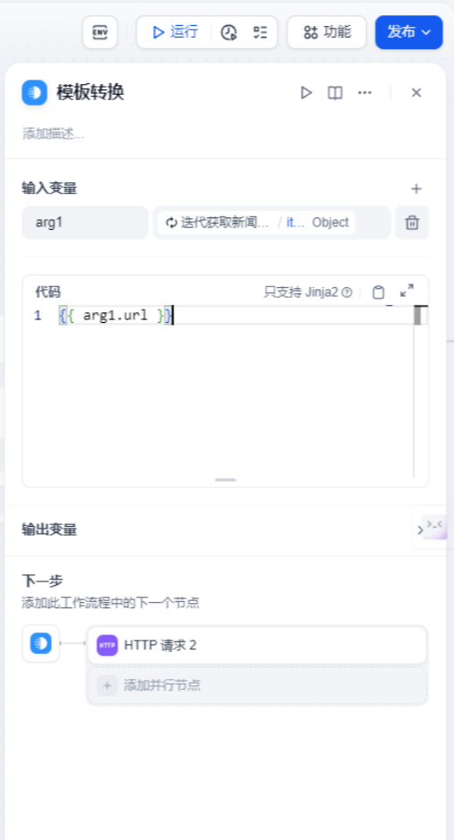

### http请求
 这个地方就是接受上个节点转换过来的URL 然后发送给jina-ai来实现http请求爬取新闻详细信息的。

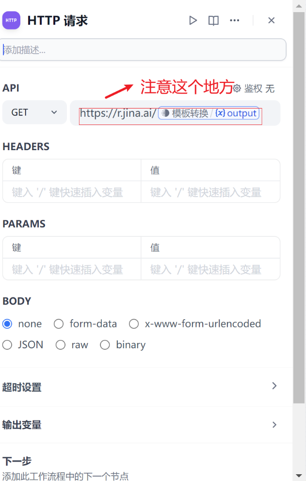

 上面的URL 是拼接的，前面 jina-ai已经介绍了他的使用了。大家不理解也可以找我上面抄就可以了。

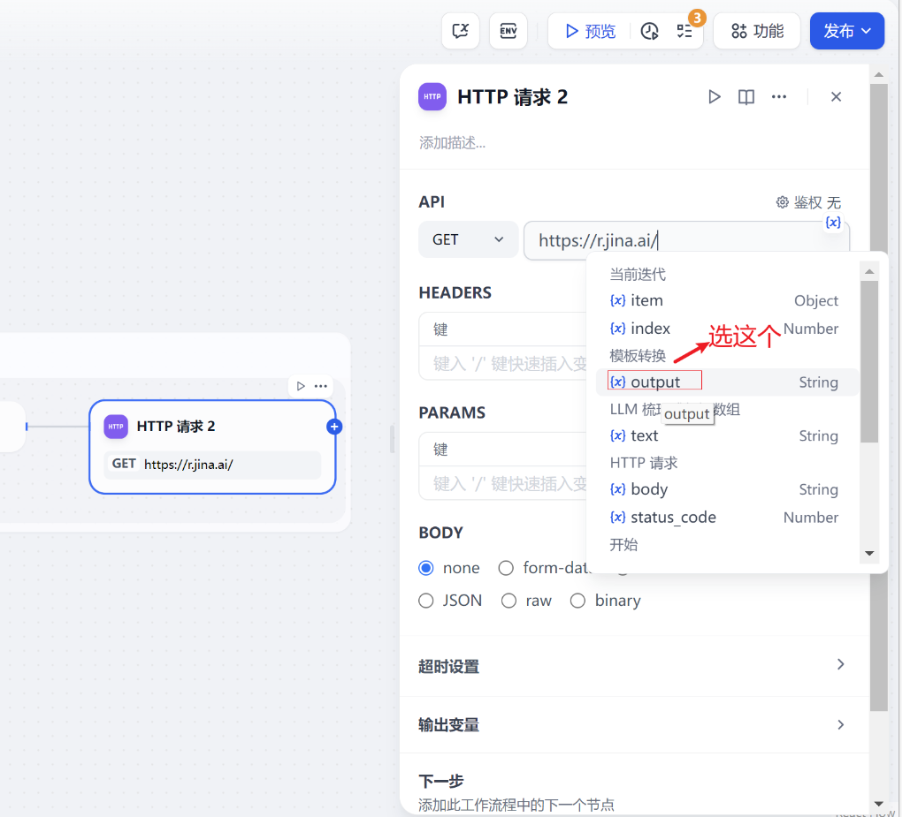

### LLM 文本类大语言模型
 这个其实很好理解，就是上面jina-ai 爬取的http 请求的结果使用文本类大语言模型进行整理，和上面的第一个文本类大语言模型功能类似区别在于它需要整理详细的新闻内容。模型我们还是选择deepseek-ai/DeepSeek-V2.5模型

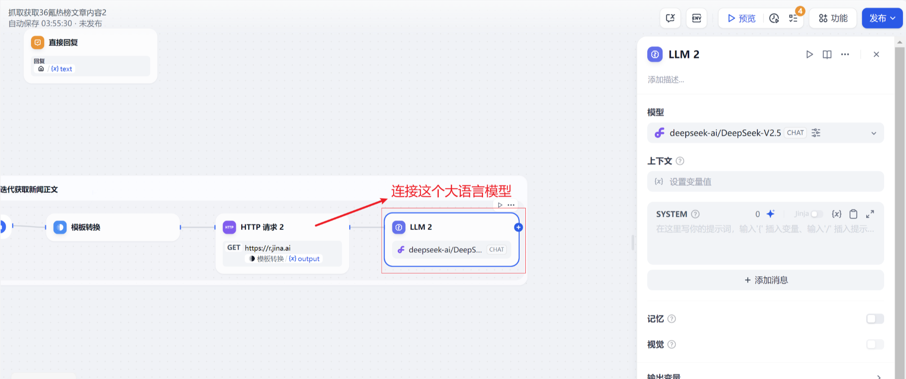

 接下来我们同样需要填写系统提示词，提示词内容如下：

```plain
```xml
<instruction>
  <instructions>
    1. jina 抓取了36氪新闻网页内容：{{#1726304211701.body#}}
    2. 生成如下结构的内容：
      新闻标题
      ============================
      新闻日期
      新闻内容
  </instructions>
  
  <examples>
    <example>
      <output>
         避免内耗，吉利将整合极氪和领克两大品牌｜36氪独家
         ============================
         2024-11-14 03:21
         具体方案预计年底落地

“进一步明晰各品牌定位，理顺股权关系，减少利益冲突和重复投资”，在吉利集团发布的《台州宣言》中，合并与重组成为集团调整的主旋律。

**36氪独家获悉，吉利集团旗下领克汽车将并入极氪汽车，由极氪CEO安聪慧统筹管理。合并后，领克品牌将被保留，但团队与战略将与极氪实现融合。**

其中，财务与采购团队将率先完成合并，产品、研发等部门的调整也将在今年年底至明年年初推进。

领克和极氪，可以说是近年来吉利孵化乘用车品牌双子星。今年前三季度，领克卖出16.98万辆，极氪销量逼近15万，两个品牌销量占吉利集团总销量近30%。不仅是销量支柱，更是吉利新能源转型的重要角色。

**知情人士透露，领克与极氪产品的重叠，是促使高层下定决心整合的原因。**
      </output>
    </example>
 <examples>
```

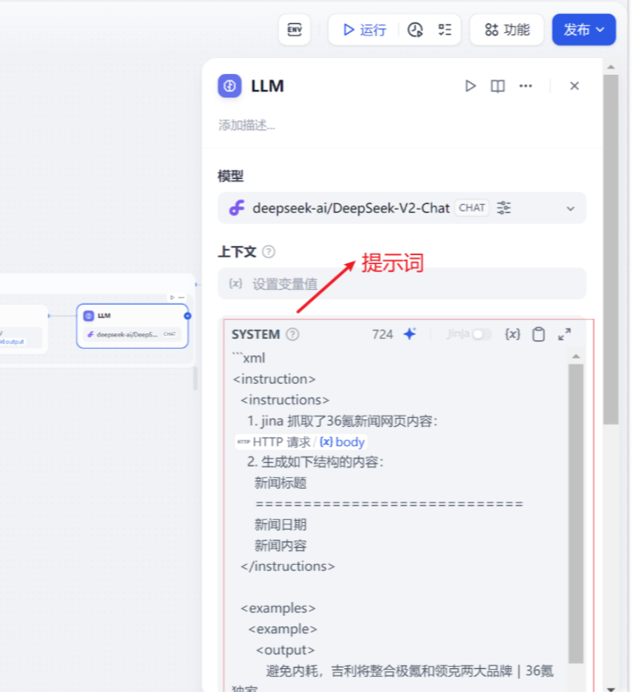

 

这个提示词 输出部分是三块（ 新闻标题、新闻日期、新闻内容）同样example 给出输出的示例，方便大语言模型学会按照这个示例输出结果。

以上结果连接后，我们在回到迭代获取新闻正文选择输出变量

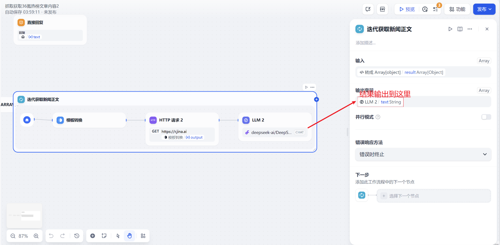

 好了以上最复杂的迭代循环讲完了。

## 6 模版转换2
 这个就是把上面迭代的结果连接输出，这里我们就不详细展开，具体配置看下面截图

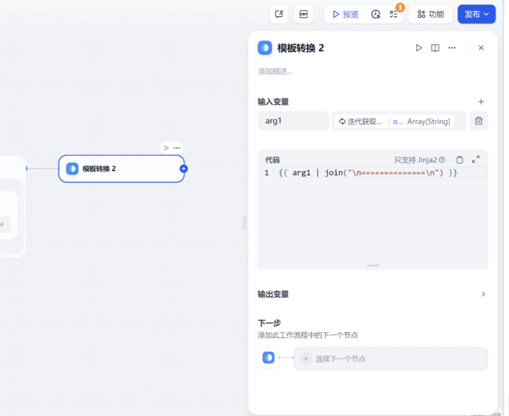

## 7 结束
 最后我们模版转换2连接上结束。将模版转换2输出output 输出

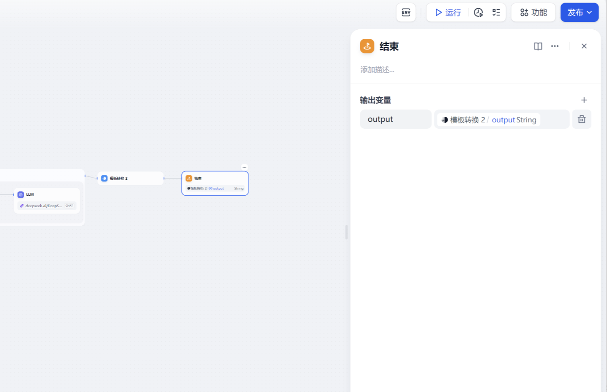

好了以上我就完成了基于jina和http实现36氪新闻热榜文章的dify工作流了。


# 二、ChatFlow调试及发布
## 发布
点击工作流左上角发布按钮对外提供发布

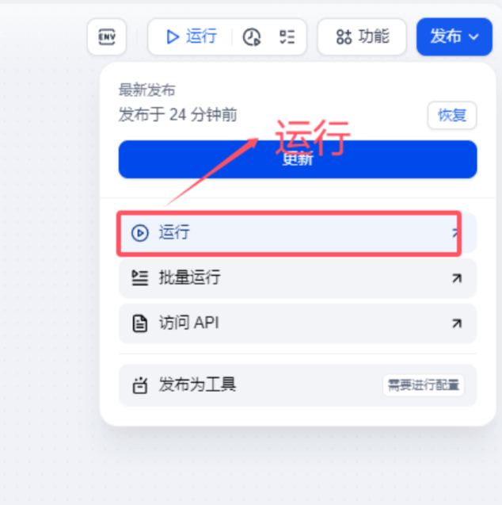

我们将分享的地址发送给其他小伙伴

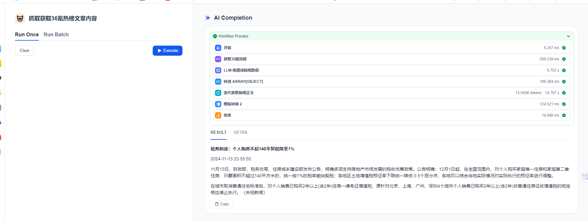

后面也可以将这个工作流和其他功能模块进行整合


> 更新: 2025-06-14 13:44:54  
> 原文: <https://www.yuque.com/aaron-wecc3/dhluml/hciegw3wgq6fghru>