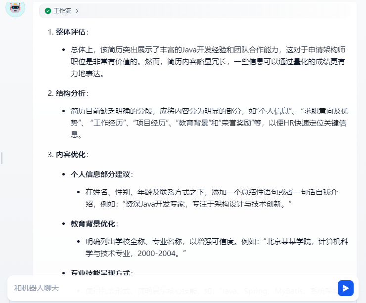
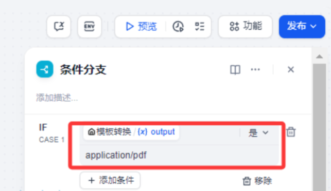
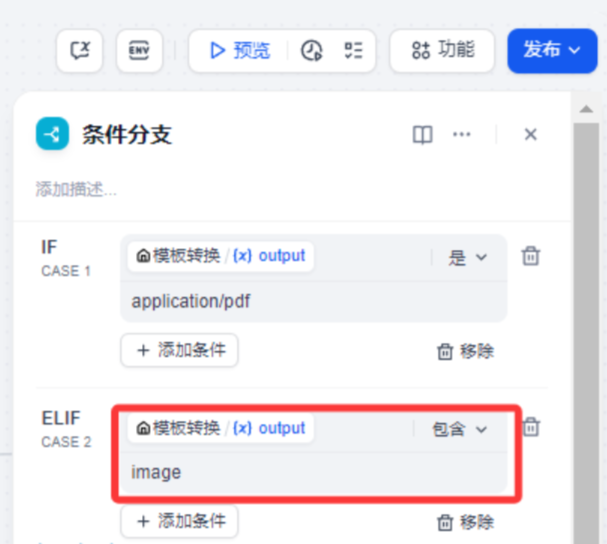

# 147.Dify搭建专业简历美化助手

# 课程内容
1. 工作流搭建流程
2. 简历文档提取器
3. 文本类模型简历编写专家
4. 图片类模型简历编写专家
5. 简历优化输出

# 前言
每年，数以百万计的大学生涌入求职市场，简历成为他们踏入职场的首张名片。然而，现实却令人担忧，近 97% 的大学生简历无法有效彰显自身竞争力。常见问题包括篇幅冗长、重点模糊、主观性描述泛滥、格式千篇一律，还夹杂过多负面信息。这些不足，让他们在求职中错失良机。

今天带大家实现一个专业且免费的大学生简历美化工作流，利用 Dify 这一强大的开源平台，能为大学生们排忧解难。它整合主流大语言模型、拥有直观的提示编排界面等优势，通过特定工作流，能将平淡简历雕琢成吸睛佳作，大幅提升面试邀约率。接下来，就让我们深入探究如何制作这一神奇的工作流。

我们首先看下工作流整体页面

话不多说下面带大家实际操作一下实现这个工作流。

# 工作流的制作
首先这个工作流由开始节点、模板转换、条件分支、文档提取器、文本类大模型、多模态大模型、直接回复等组成。

我们首先还是先创建一个chatflow 工作流

## 开始
 这个开始节点有一个参数就是文件上传，我们这里选择单个文件，文件类型选择文档和图片

## 模版转换
这个地方我们需要加个模版转换功能来提取上传文件的类型，这样后面我们好做逻辑判断，因为文本和图片处理方式不一样。

 我们输入变量用一个filetype来保存文件类型值。这个值我们需要注意是需要提取文件对应的mine_type值

通过上述方式我们就可以提取到类型了。目前我们支持pdf 和图片，所以模版转换filetype 输出值为：

application/pdf 或 image/jpeg 

## 条件分支
这个条件分支我们判断的条件就是上个 节点中filetype 返回的类型。

条件1：application/pdf

条件2：image

我们通过这个条件判断来区分用上传的是PDF文件还是image 图片

由于PDF文件格式是统一的我们就用 “是”来做判断

而image 它的格式会区分 png、jgeg、jpg、bmp等格式文件，我们这里就用“包含” 关系

这样我就有三个分支节点了

这个时候我们会出现三个条件分支，我们先讲第一个条件分支

## 文档提取器
因为PDF文件是文件格式，我们这里使用文档提取器来提取PDF文件里面的内容

## 文本类模型简历编写专家
这个地方其实就是获取文档提取器里面的内容对PDF文件的内容利用大语言模型来实现简历优化和改进，这里我们用到我们选择书生浦语internlm3-8b-instruct 模型。

系统提示词如下：

暂时无法在飞书文档外展示此内容

用户提示词这里我们需要用户传入的文档提取里面的内容给出简历修改意见

暂时无法在飞书文档外展示此内容

## 直接回复
这个地方就是我们输出大模型改写后的简历修改意见内容，给用户输出

接下来我们走第二个分支流程

## 图片类模型简历编写专家
这个地方我们上节if 条件分支，我们使用多模态模型，这里我们为了速度快我们使用了 google gemini2 flash EXP 的模型（支持多模型模型）

由于google 的模型设置和别的模型不太一样。这里我们使用用户提示词在实现简历的修改

用户提示词

暂时无法在飞书文档外展示此内容

因为用了多模态，所以我们把模型视觉开关打开（这个地方需要注意一下，很多小伙伴在用多模型模型的时候这个地方不开启）

另外我们还要注意需要传入file 

以上设置完成了多模态模型对简历编写模型设置

## 直接回复2
 这个地方就和前面类似，把上面的多模态模型输出结果输出

第三个流程分支。

## 直接回复3
这个地方其实就是在if条件判断的地方让工作流走else分支，万一用户输入的不是PDF 也不是image 就让用户重新输入

以上我们就完成整个工作流的制作。

# 验证及测试
上传一个带有PDF的简历，或者找一个图片的简历

> 更新: 2025-06-14 13:44:53  
> 原文: <https://www.yuque.com/aaron-wecc3/dhluml/aq1qlv37kgzznpfh>