# 148.Dify打造自媒体运营专家工作流

## 课程内容
1. 创建自媒体运营专家工作流
2. 视频字幕处理
3. 工作流输出总结内容
4. 测试验证


## 前言
在自媒体蓬勃发展的当下，越来越多的小伙伴投身于这个充满机遇与挑战的领域。大家在创作过程中，想必都经历过这样的场景：花费大量时间和精力，精心使用视频剪辑软件，将各种素材巧妙拼接，反复打磨每一个细节，终于制作出了一部自认为满意的视频作品。然而，创作之路并未就此结束。当你满心欢喜地准备将视频上传到各个自媒体平台时，才发现还有一系列重要的工作在等着你。编写一个吸睛的视频标题，能在众多视频中迅速抓住观众的眼球；撰写一段精彩的视频简介，能够让观众在短时间内了解视频的核心内容；而对于一些追求精益求精的自媒体博主来说，按照时间线总结视频的主要内容，方便观众精准定位到视频的精彩片段，更是提升用户体验的关键之举。这些看似琐碎的工作，实则在视频的传播和影响力方面起着举足轻重的作用。今天，就让我们一起深入探讨这些环节，看看如何做好视频标题、简介以及内容时间线的总结，为你的自媒体创作之路添砖加瓦。下面是一样UP主写的视频标题和视频内容信息：

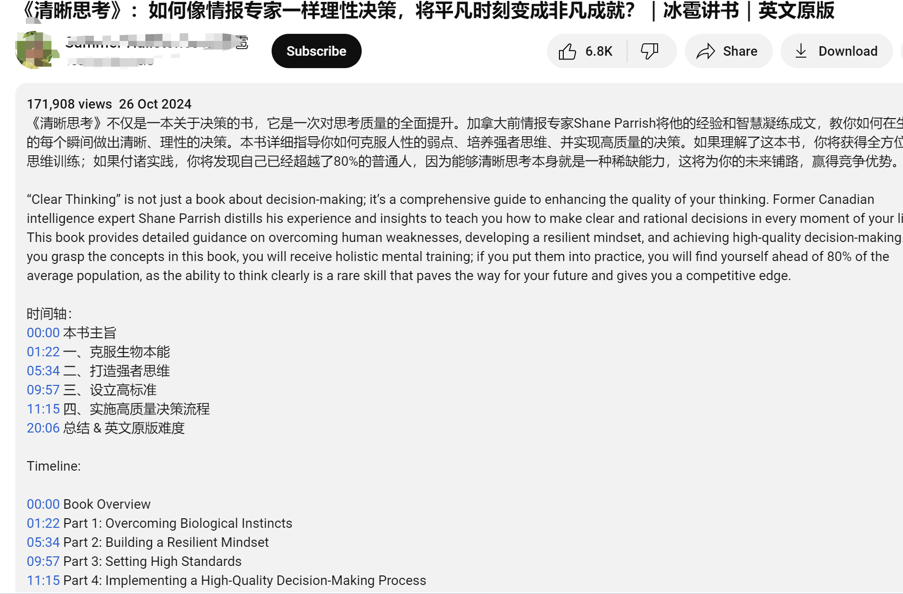

以上内容信息的文案编写工作没有半个小时是搞不定的，那么有没有办法快速生成以上这些内容呢？今天我就带大家使用dify工作流来实现以上功能。

 下面我们首先介绍一下整体功能。

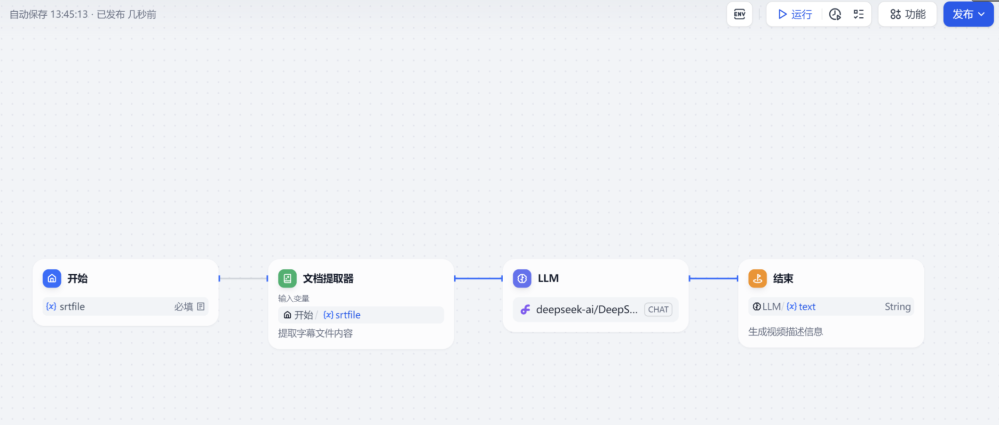

 生成效果如下：

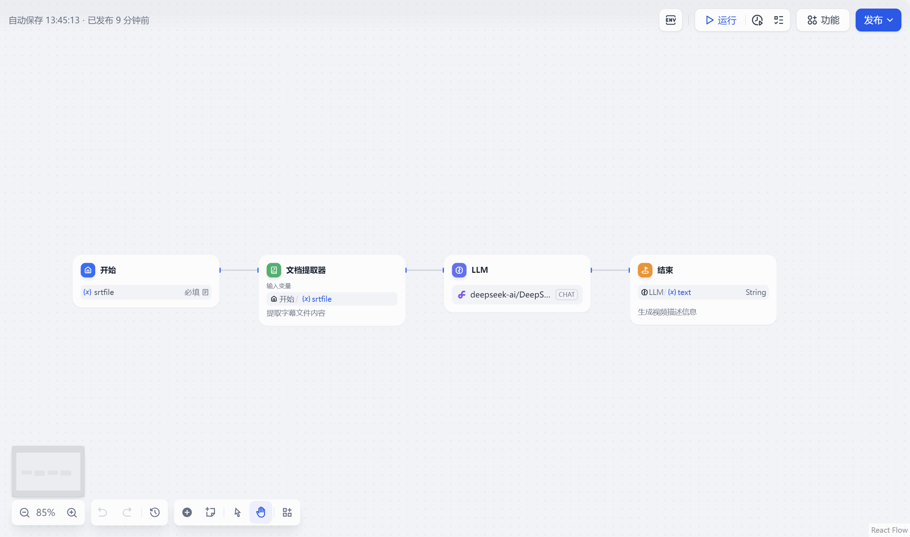

话不多说，我们就开始教大家如何制作这个工作流吧。


## 创建自媒体专家工作流
 打开dify 点击创建空白应用，创建一个工作流，给工作流启一个名字，最后点击创建按钮进入工作流画布界面

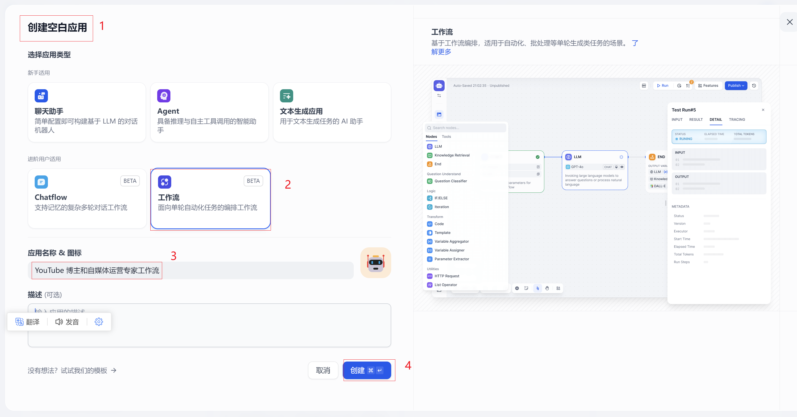

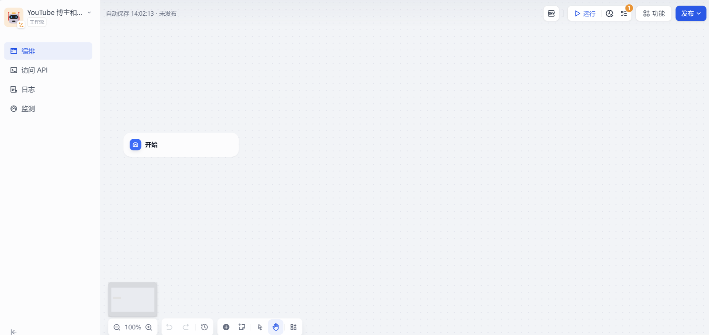

## 开始节点
这个工作流主要目的是用户输入一个带时间轴的字幕文件（srt格式）作为输入，通过大语言模型转换出上面我们要的内容。那么这个开始节点需要配置一个带文件上传的输入参数。我们添加单个文件作为输入参数，文件格式选择文档。 

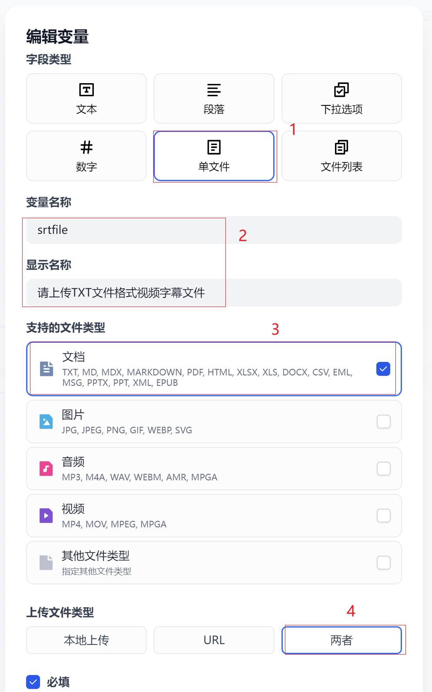

点击保存按钮完成开始按钮文件输入参数的设置

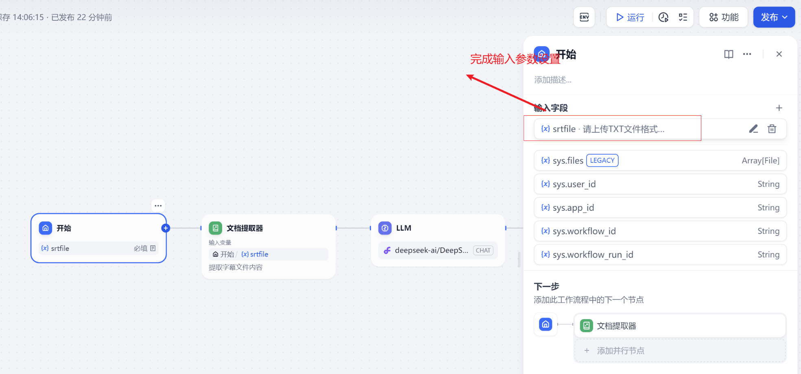

## 视频字幕处理
 这个流程主要目的是接受开始节点中上传的文件，文档提取器目的提取上传文件内容。这个地方需要注意的是文档提取器的文档格式是不支持srt文件的。它支持的文件格式如图：


文档提取器输入参数选择开始节点输入参数srtfile

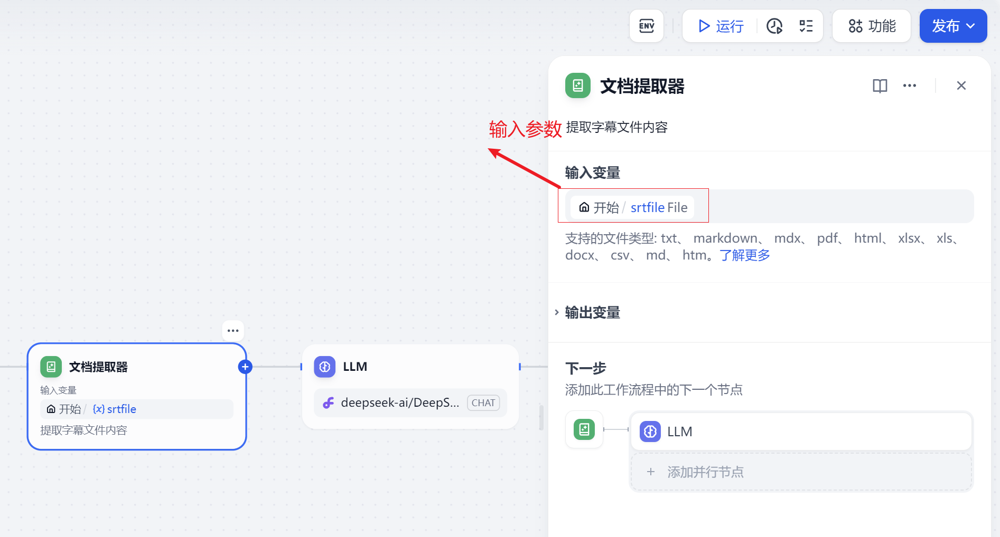

## 工作流输出总结内容
 这个LLM大语言模型是本次工作流的重点，他主要目的是通过用户输入srt文件结合提示词转换输出我们需要的内容。

 模型我们这里选择了使用硅基流动提供的模型deepseek-ai/DeepSeek-v2.5，其他的模型也可以选择。

 系统提示词内容如下：

```plain
你是一名专业的,YouTuber博主和自媒体运营专家。
根据用户提供的字幕内容{{#1737731807786.text#}}
1.生成5个吸引人的视频标题;
2.生成中文的视频简介，要求在 150 字以内,视频简介分别需要中文和英文双语介绍；
3.对视频内容进行时间轴划分,时间轴内容需要提炼出5个重点时间线，时间轴需要有中文和英文双语时间线;
4.生成 10 个符合视频内容的标签；
最终生成的结果，格式如下：
标题：
视频简介：
《清晰思考》不仅是一本关于决策的书，它是一次对思考质量的全面提升。加拿大前情报专家Shane Parrish将他的经验和智慧凝练成文，教你如何在生活的每个瞬间做出清晰、理性的决策。本书详细指导你如何克服人性的弱点、培养强者思维、并实现高质量的决策。如果理解了这本书，你将获得全方位的思维训练；如果付诸实践，你将发现自己已经超越了80%的普通人，因为能够清晰思考本身就是一种稀缺能力，这将为你的未来铺路，赢得竞争优势。
“Clear Thinking” is not just a book about decision-making; it’s a comprehensive guide to enhancing the quality of your thinking. Former Canadian intelligence expert Shane Parrish distills his experience and insights to teach you how to make clear and rational decisions in every moment of your life. This book provides detailed guidance on overcoming human weaknesses, developing a resilient mindset, and achieving high-quality decision-making. If you grasp the concepts in this book, you will receive holistic mental training; if you put them into practice, you will find yourself ahead of 80% of the average population, as the ability to think clearly is a rare skill that paves the way for your future and gives you a competitive edge.
时间轴：
00:00 本书主旨
01:22 一、克服生物本能
05:34 二、打造强者思维
09:57 三、设立高标准
11:15 四、实施高质量决策流程
20:06 总结 & 英文原版难度

Timeline:

00:00 Book Overview
01:22 Part 1: Overcoming Biological Instincts
05:34 Part 2: Building a Resilient Mindset
09:57 Part 3: Setting High Standards
11:15 Part 4: Implementing a High-Quality Decision-Making Process
20:06 Summary & Difficulty Level of the English Original
......
标签 1 #标签 2 #标签 3......
```

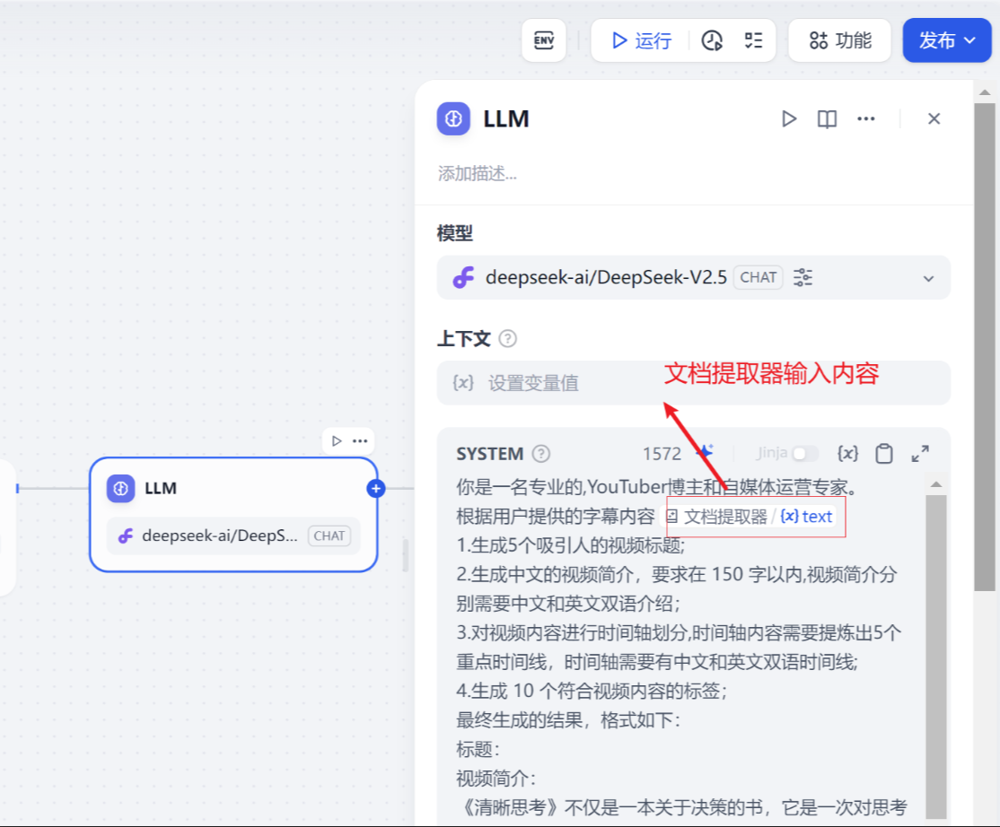

以上配置完成后，我们在配置结束节点。

## 结束节点
这个结束节点就非常简单了，他主要就是输出LLM大语言模型输出内容。

输出变量我们写一个name, 变量值是LLM大语言模型输出

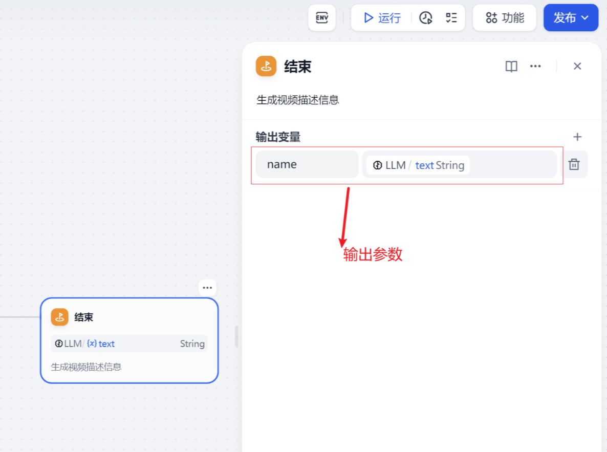

以上配置完成后我们就完成整个工作流配置。

## 测试验证
 打开工作流左上角运行，弹出输入参数选项。


 我们可以从本地上传文件。这个文件我们需要注意，因为前面提到文件提取器支持的文件不包含srt文件的，这里我们需要把srt后缀名文件修改一下。

 我们查看下我测试srt文件，我们截取部分片段帮助大家理解

```plain
1
00:00:00,800 --> 00:00:02,366
上周给大家录了一个视频

2
00:00:02,366 --> 00:00:04,966
关于谷歌开源模型Gemma的开放模型

3
00:00:05,133 --> 00:00:08,866
用了本地的Ollama环境来尝鲜进行测试

4
00:00:09,900 --> 00:00:11,466
呃有小伙伴跟我反馈

5
00:00:11,466 --> 00:00:13,366
是因为ollama的windows

6
00:00:13,366 --> 00:00:16,166
默认安装的模型是下载到c盘

7
00:00:16,166 --> 00:00:17,966
会导致c盘磁盘空间不够

8
00:00:17,966 --> 00:00:19,166
你看一下我的电脑

9
00:00:19,166 --> 00:00:22,966
我的c盘现在目前也是9.49GB还剩

10
00:00:23,200 --> 00:00:24,700
呃空间也不太够了
```

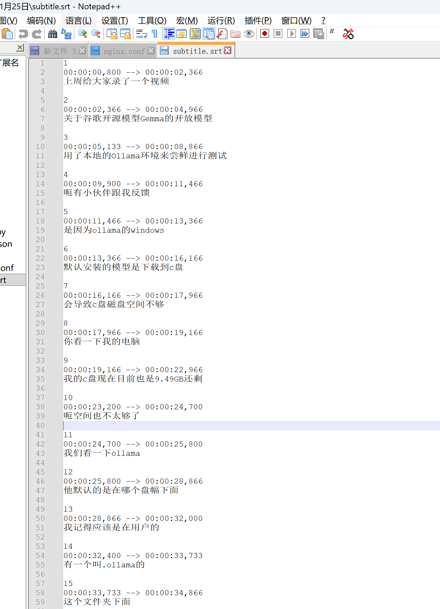

 其实这个就是一段带有时间的字幕文件。我们修改这个文件的后缀名为txt

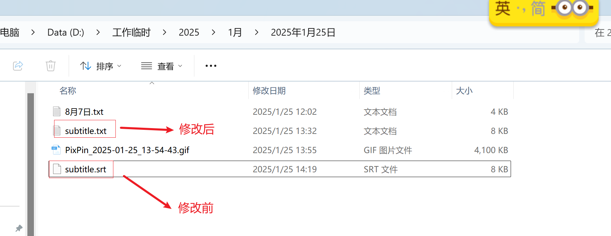

我们接下来选择修改后的subtitle.txt 上传 dify工作流

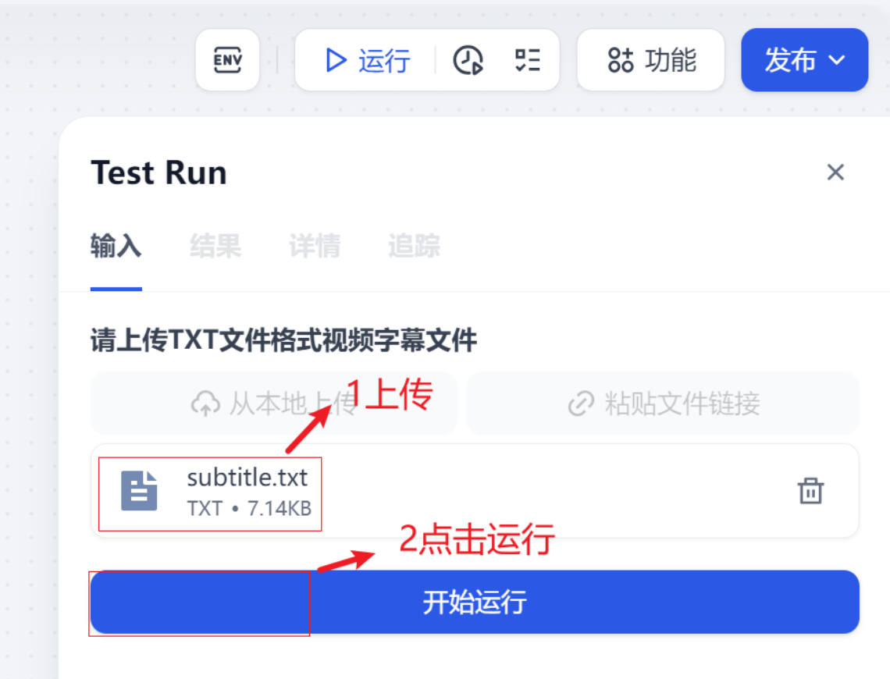

 后面的测试效果就和前面介绍的一样了，这里就重复介绍了。


# 


> 更新: 2025-06-22 13:25:55  
> 原文: <https://www.yuque.com/aaron-wecc3/dhluml/saegorp4pffhu1n2>