# 149.Dify搭建发票识别机器人

# 课程内容

1. 硅基流动图片识别服务
2. Dify创建发票识别机器人
3. 发票内容识别格式化输出
4. Chatflow调试及发布

# 硅基流动图片识别服务

硅基流动是一家专注于人工智能基础设施和生成式AI技术的初创公司。硅基流动是致力于构建可扩展、标准化且高性能的生成式AI计算基础设施平台，提供包括SiliconCloud（模型云服务平台）、SiliconLLM（大型语言模型推理引擎）和OneDiff（高性能文本到图像/视频加速库）在内的多种软件解决方案。

公司的网站<https://siliconflow.cn>

目前公司有三个产品siliconCloud、siliconLLm、OneDiff

该公司提供市面上主流模型，而且最关键是免费。

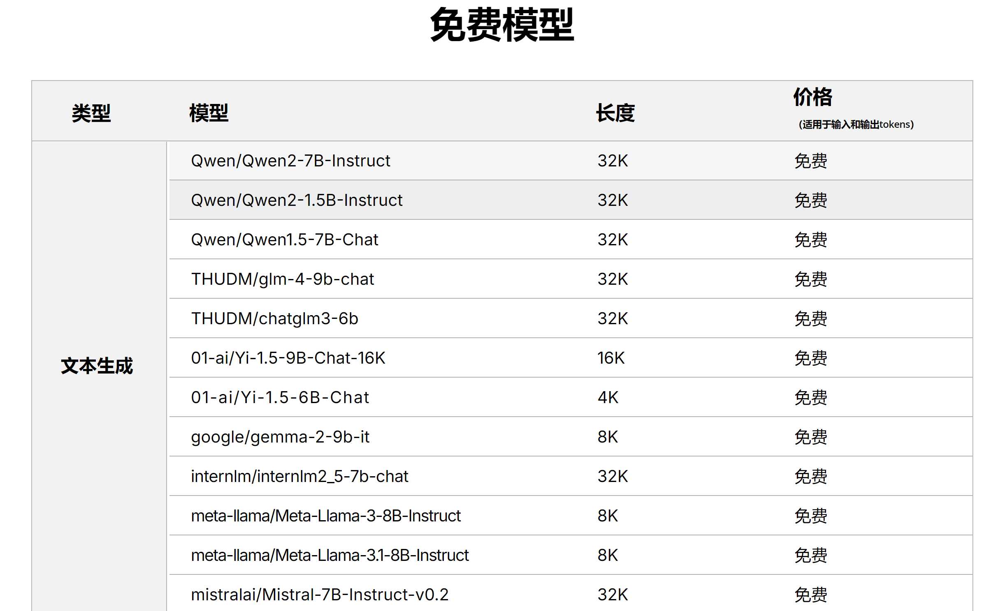

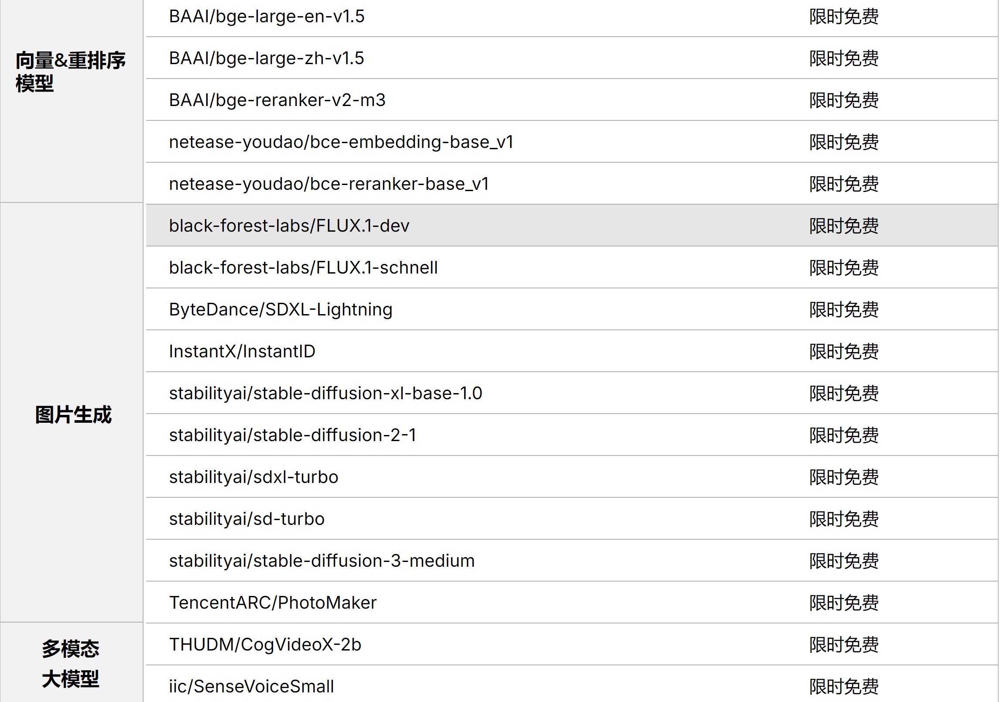

免费的模型涵盖文本生成、向量&重排序模型、图片生成、多模态大模型 等各种模型。提供一站式模型服务，这个比较爽。

目前新户注册送14块钱，大家可以通过我提供分析网址连接来感受这个免费的api模型服务。[https://cloud.siliconflow.cn](https://cloud.siliconflow.cn/i/e0f6GCrN)

## 功能介绍

注册登录后我们就可以进入体验中心

我们可以在右边的模型下拉列表中选择免费或则收费的模型

文本类模型还是蛮丰富的。

文生图和图生图 也支持目前市面主流图像生成模型（FLUX.1-dev 、FLUX.1-schnell、stable-diffusion-3-medium、stable-diffusion-xl-base-1.0、stable-diffusion-2-1、sd-turbo、sdxl-turbo、SDXL-Lightning）

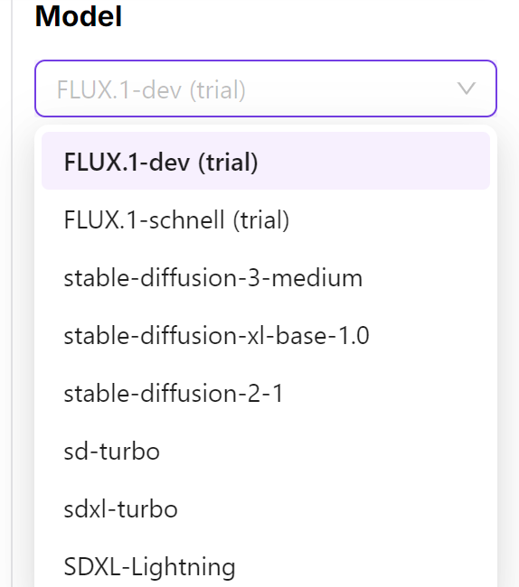

其他使用方法这里就不过多介绍了。

## 硅基流动API

登录<https://cloud.siliconflow.cn/account/ak>，账号管理，点击新建API秘钥

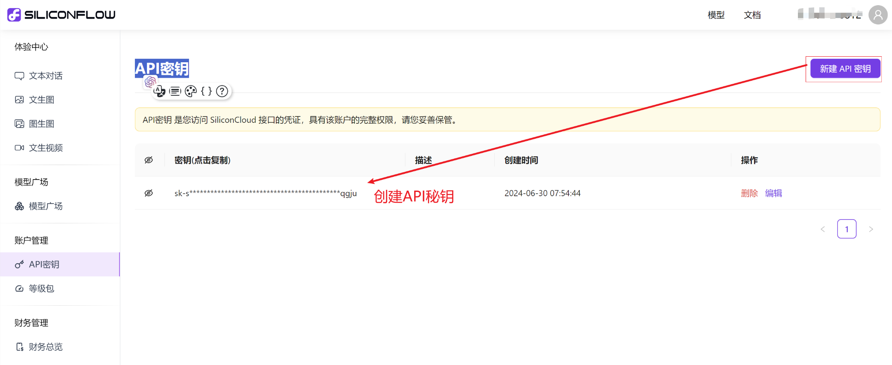

这个创建的秘钥记得保存，后面流程中会用到。

# Dify创建发票识别机器人

## 模型设置

登录dify 点击右上角设置-模型供应商

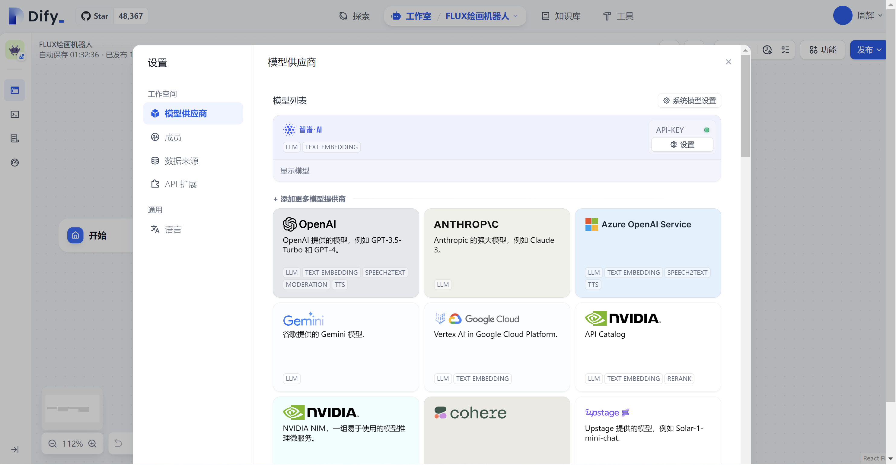

找到硅基流动，输入步骤4上创建的API

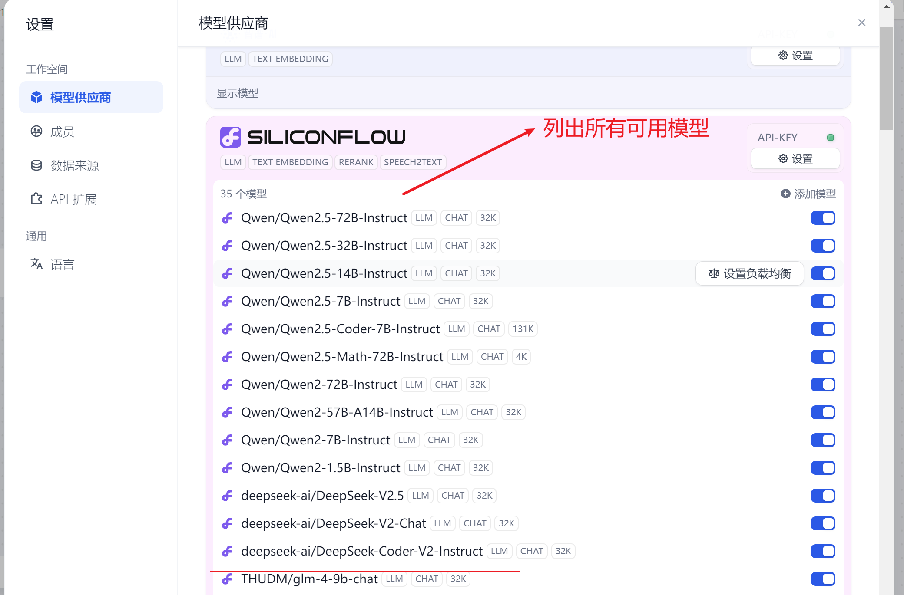

关于硅基流动多模态模型设置。这里我们需要注意目前硅基流动增加多模态识别模型.dify功能目前还不支持关于硅基流动多模态模型的设置，所以我们需要借助标准OpenAI-API-compatible 来设置这个多模态模型

目前硅基支持以下几种多模态模型

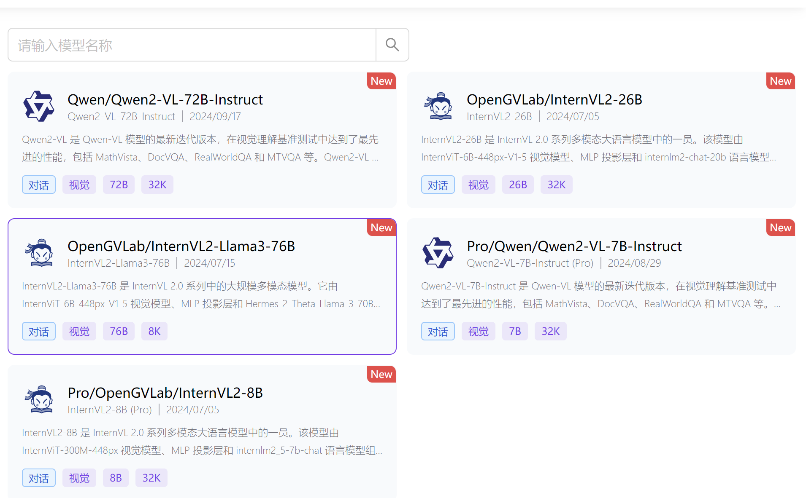

点击 OpenAI-API-compatible，添加模型

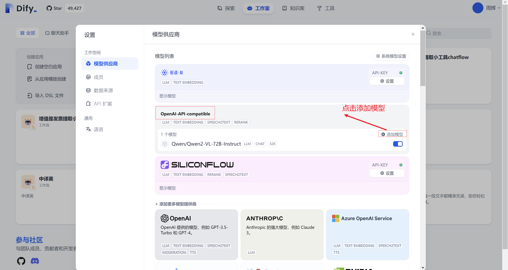

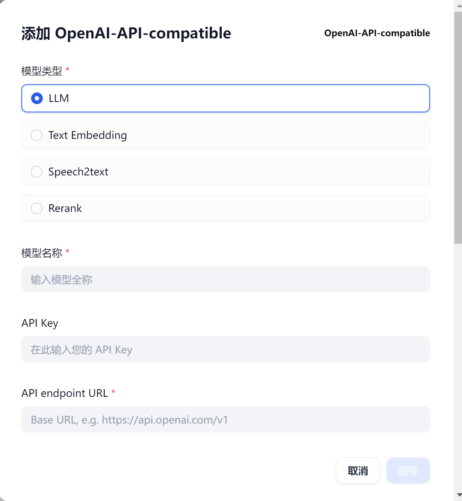

这里我们设置一下硅基流动多模态模型的配置，这里我们就以Qwen/Qwen2-VL-72B-Instruct 为案例给大家介绍，大家可以看我下面的截图设置

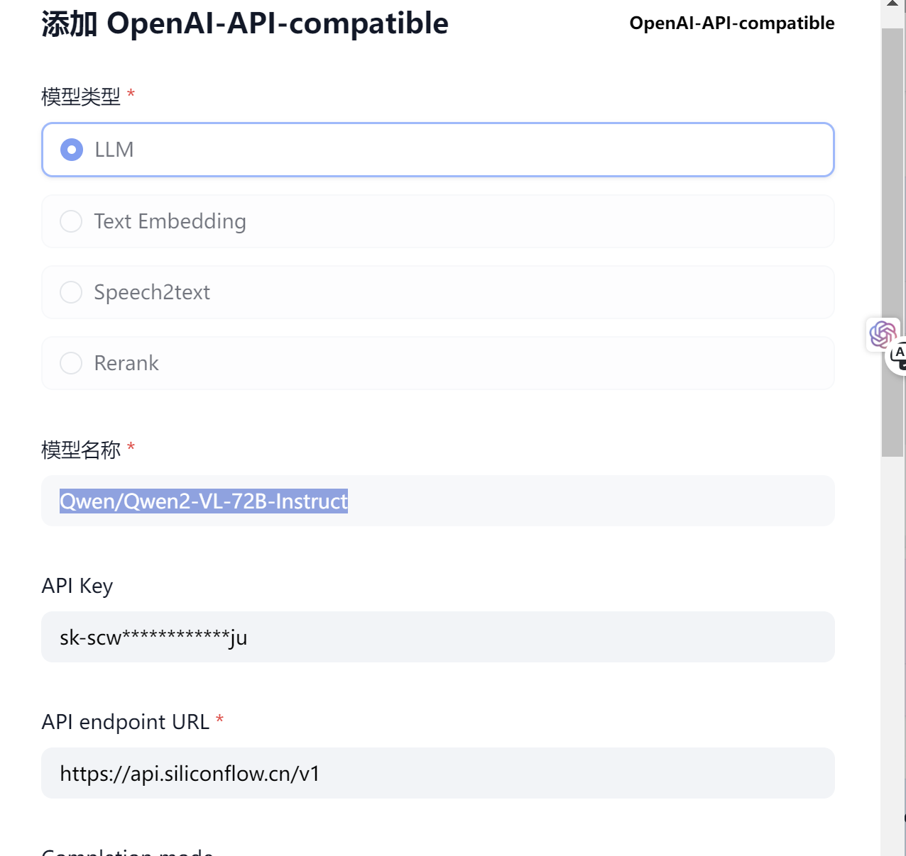

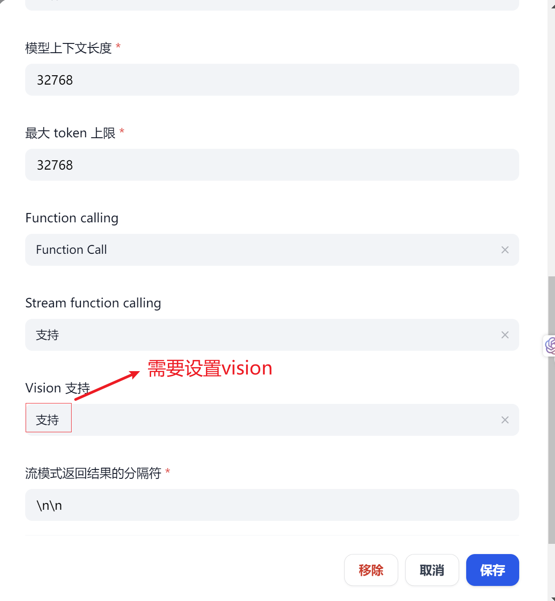

其他的和之前传统的llm模型设置一样，这里注意地方就是多模态VISION这个需要设置。点击保存完成模型设置。

## 创建工作流或者chatflow

接着来到Dify中按下图顺序依次点击并点击创建(注：chatflow和工作流配置基本差不多，下面我们就以chatflow讲解)

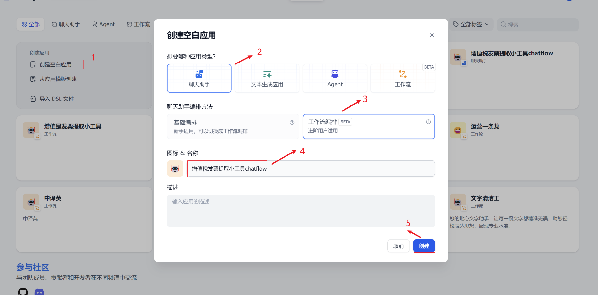

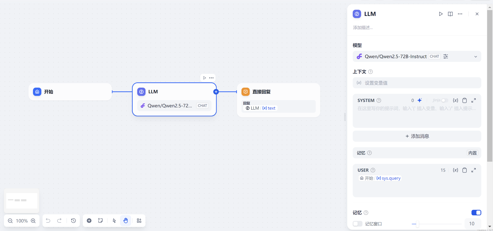

### 开始

开始节点点开后我们需要添加一个文件上传输入参数。点击开始节点输入字段，点击右边的“+”

我们选择单个文件，输入变量名称、支持的文件类型我们这里就选择图片。其他都可以默认，输入完成后，点击保存按钮


以上步骤完成开始节点设置。

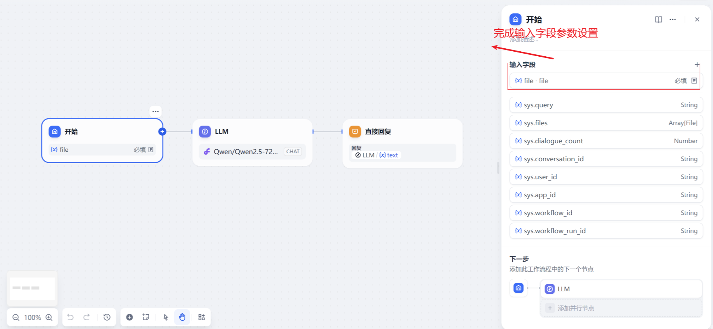

### 文档提取器

接下来我们在工作流画布中，选择文档提取器和开始节点连接，去掉llm和开始节点连接

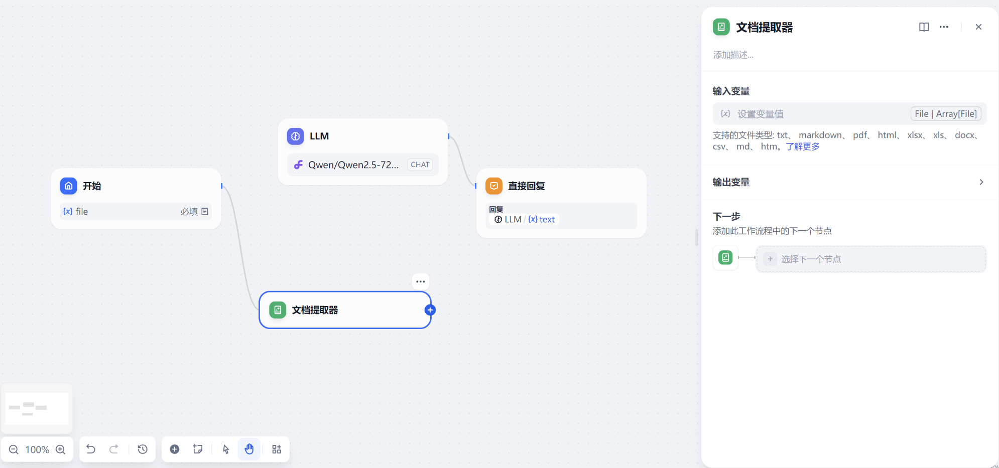

我们在文档提取器，输入变量中选中 `sys.files` 变量

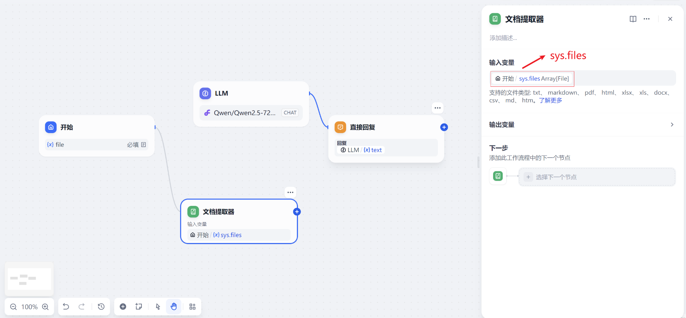

### llm

接下来我们将文档提取器的连接线和llm大语言模型连接。然后按照以下几个步骤设置

1.模型选择，模型我们在模型下拉列表中选择自定义OpenAI-API-compatible Qwen/Qwen2-VL-72B-Instruct模型；模型最大标记4096

2.上下文，这里设置开始节点file 属性值

3.SYSTEM 提示词 我们输入如下内容

```plain
请提取这张照片的内容，其中内容格式‘机器编号’、‘发票代码’、‘发票号码’、‘开票日期’、‘校 验 码’、‘购买方名称’、‘购买方纳税人识别号’、‘购买方地 址、电 话’、‘开户行及账号’、‘货物或应税劳务、服务名称’、‘规格型号’、‘单 位’、‘数 量’、‘单 价’、‘金 额’、‘税率’、‘税 额’、‘价税合计（大写）’、‘价税合计（小写）’、‘销售方名称’、‘销售方纳税人识别号’、‘销售方地 址、电 话’、‘销售方地 址、电 话’、‘开户行及账号’、‘备注’、‘收款人’、‘复核’、‘开票人’ 字段返回信息，返回的结果信息以json格式返回
```

4.视觉 点击右边按钮开启多模态

5 视觉输入变量 选择节点file`files` 变量

以上完成llm模型的设置

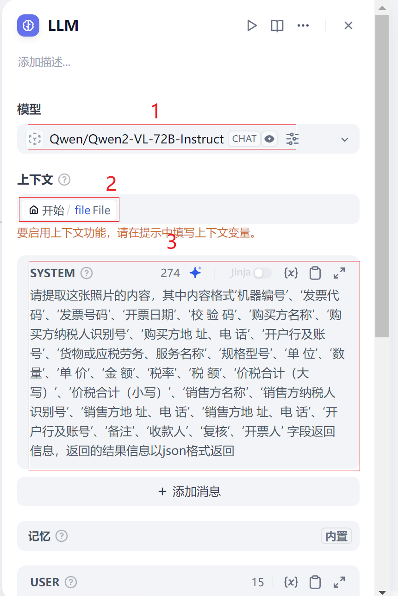

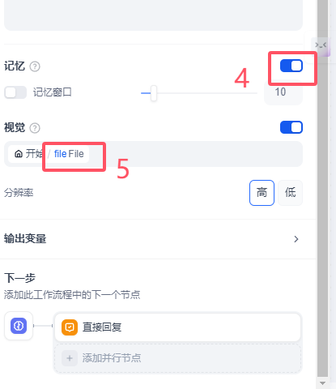

### 直接回复

接下来我们将LLM模型连接到直接回复的输出节点。

这个地方设置比较简单，在回复设置一下llm text文本输出以及 开始节点file 输出，这样设置后。就会将发票提取的票面信息以json格式的文本信息返回，并将上传的发票图片信息一并返回给用户


通过以上方式我们就初步完成了整个chatflow工作流。

## Chatflow调试及发布

接下来我们点击工作流预览测试一下。

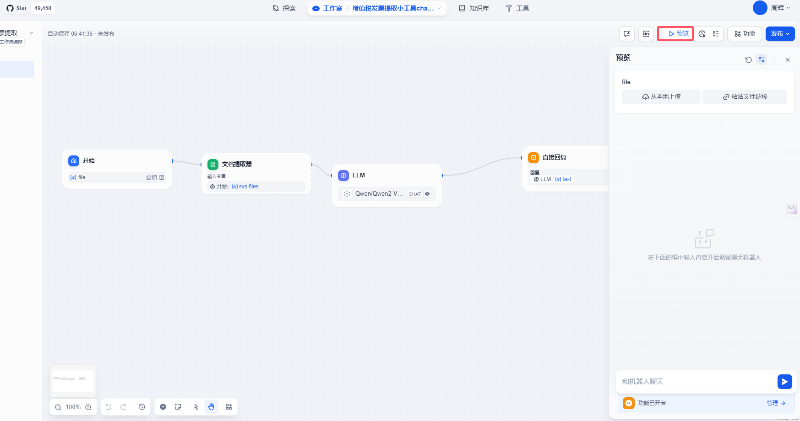

我们点击从本地文件上传，找一张增值税普通发票验证一下。

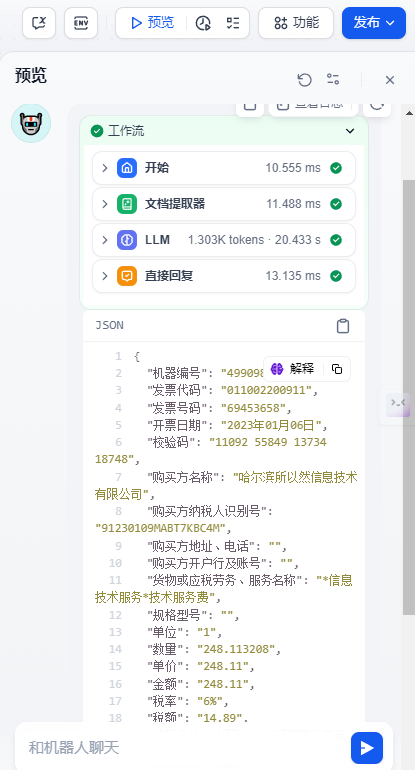

我们点开工作流看到流程节点是从开始-文档提取器-LLM-直接回复 4个流程节点，并且每个流程执行的时间都能详细展开看到。最后用户返回了发票提取的票面信息返回json值了。目前这个工作流适合增值税专用发票和增值税普通发票识别，如果大家需要识别全电发票，火车票还有其他类发票只要修改llm模型中的提示词即可。

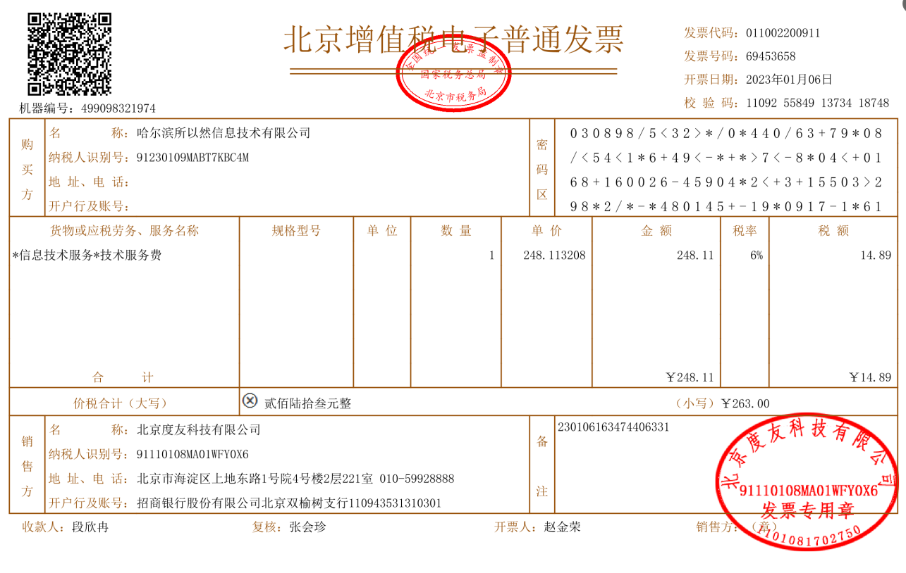

目前我测试下来Qwen/Qwen2-VL-72B-Instruct模型的发票票面ocr识别率还是蛮准的，几乎是100%识别。

接下来我们可以将这个工作流发布或则以第三方接口形式对外提供

### 发布

点击工作流左上角发布按钮对外提供发布

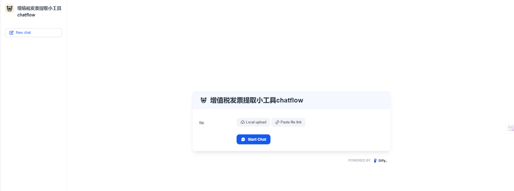

我们点击 start chat 就可以使用了。

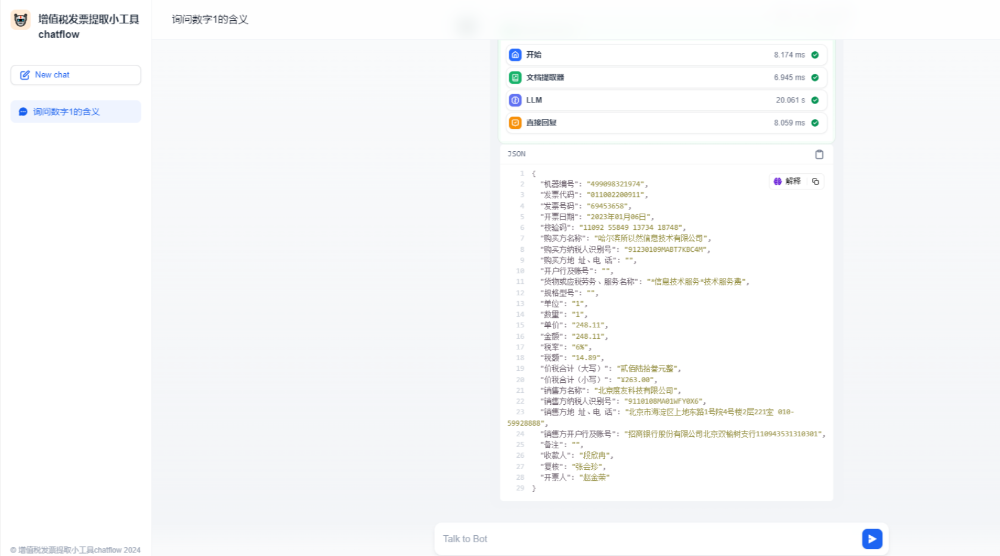

# 总结

目前dify官方最新版本已经支持文件上传，图片上传等功能了。另外硅基流动大概在2024年10月18日上线了阿里和书生的多模态模型。目前该工作流还只支持一种发票票面识别功能还比较单一，还不能识别更多发票。比如（火车票、手撕票、出租车票、医疗报销单等等）。dify工作流程这块有很多流程控制 通过这些流程控制其实是可以实现以上功能的


> 更新: 2025-06-22 13:25:55  
> 原文: <https://www.yuque.com/aaron-wecc3/dhluml/xx6ylixcp3eom3w9>