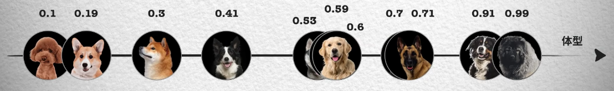
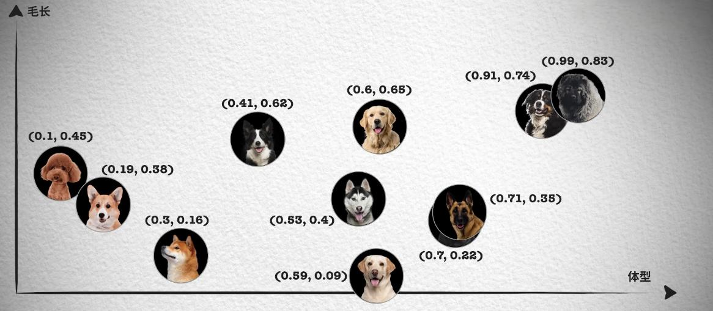
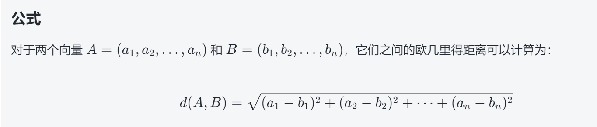
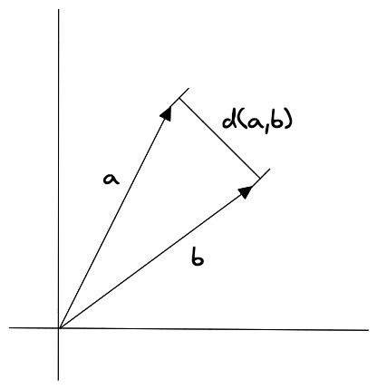
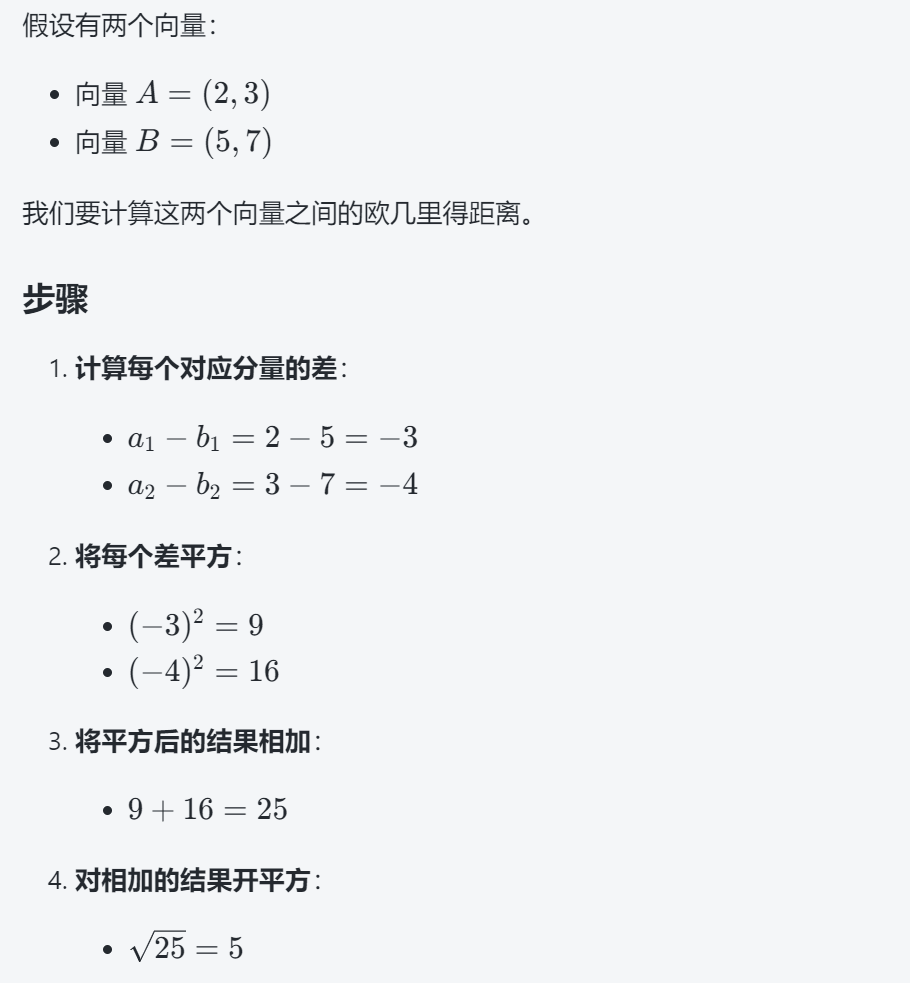
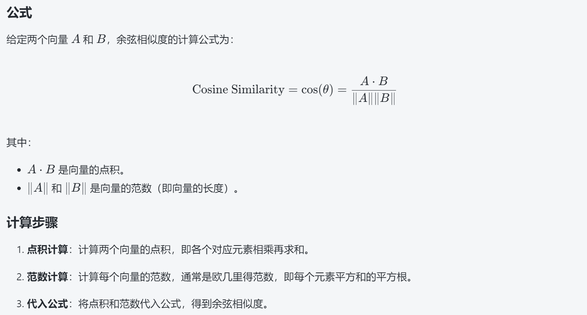
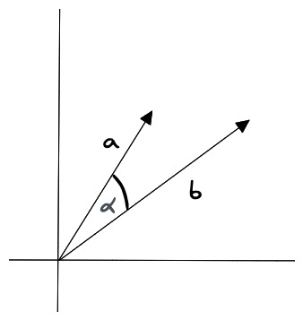
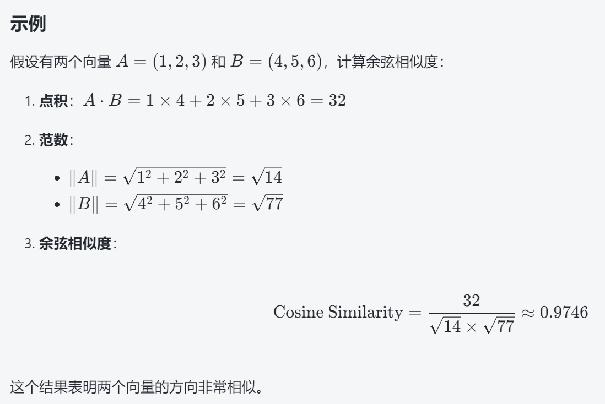
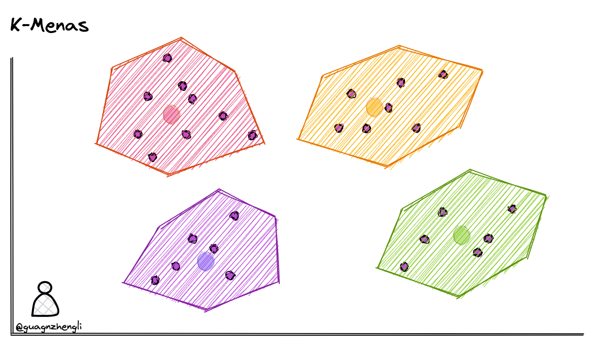
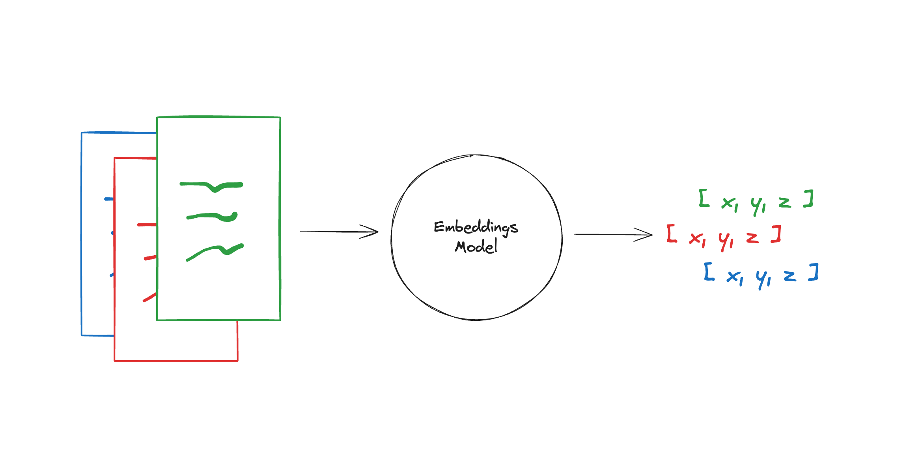

# 15.大模型时代为什么需要向量数据库?

**示例代码**

[vector-db.ppt](https://www.yuque.com/attachments/yuque/0/2025/ppt/1387387/1745159933903-21fbd5f5-7f33-4ce2-bd1a-7e57b3601ea9.ppt)

*<font style="color:#DF2A3F;">注：将ppt后缀名改为zip后解压</font>*

python版本：3.10

# 向量数据库

向量数据库（Vector Database），也叫矢量数据库，主要用来存储和处理向量数据。

在数学中，向量是有大小和方向的量，可以使用带箭头的线段表示，箭头指向即为向量的方向，线段的长度表示向量的大小。两个向量的距离或者相似性可以通过欧式距离或者余弦距离得到。

图像、文本和音视频这种非结构化数据都可以通过某种变换或者嵌入学习转化为向量数据存储到向量数据库中，从而实现对图像、文本和音视频的相似性搜索和检索。这意味着您可以使用向量数据库根据语义或上下文含义查找最相似或相关的数据，而不是使用基于精确匹配或预定义标准查询数据库的传统方法。

向量数据库的主要特点是高效存储与检索。利用索引技术和向量检索算法能实现高维大数据下的快速响应。向量数据库也是一种数据库，除了要管理向量数据外，还是支持对传统结构化数据的管理。实际使用时，有很多场景会同时对向量字段和结构化字段进行过滤检索，这对向量数据库来说也是一种挑战。

## <font style="color:rgb(51, 51, 51);">向量嵌入</font>

<font style="color:rgb(51, 51, 51);">向量嵌入(Vector Embeddings)，对于传统数据库，搜索功能都是基于不同的索引方式（B Tree、倒排索引等）加上精确匹配和排序算法（BM25、TF-IDF）等实现的。本质还是基于文本的精确匹配，这种索引和搜索算法对于关键字的搜索功能非常合适，但对于语义搜索功能就非常弱。</font>

<font style="color:rgb(51, 51, 51);">例如，如果你搜索 “小狗”，那么你只能得到带有“小狗” 关键字相关的结果，而无法得到 “柯基”、“金毛” 等结果，因为 “小狗” 和“金毛”是不同的词，传统数据库无法识别它们的语义关系，所以传统的应用需要人为的将 “小狗” 和“金毛”等词之间打上特征标签进行关联，这样才能实现语义搜索。而如何将生成和挑选特征这个过程，也被称为 Feature Engineering (特征工程)，它是将原始数据转化成更好的表达问题本质的特征的过程。</font>

<font style="color:rgb(51, 51, 51);">但是如果你需要处理非结构化的数据，就会发现非结构化数据的特征数量会开始快速膨胀，例如我们处理的是图像、音频、视频等数据，这个过程就变得非常困难。例如，对于图像，可以标注颜色、形状、纹理、边缘、对象、场景等特征，但是这些特征太多了，而且很难人为的进行标注，所以我们需要一种自动化的方式来提取这些特征，而这可以通过 Vector Embedding 实现。</font>

<font style="color:rgb(51, 51, 51);">Vector Embedding 是由 AI 模型（例如大型语言模型 LLM）生成的，它会根据不同的算法生成高维度的向量数据，代表着数据的不同特征，这些特征代表了数据的不同维度。例如，对于文本，这些特征可能包括词汇、语法、语义、情感、情绪、主题、上下文等。对于音频，这些特征可能包括音调、节奏、音高、音色、音量、语音、音乐等。</font>

<font style="color:rgb(51, 51, 51);">例如对于目前来说，文本向量可以通过 OpenAI 的 text-embedding-ada-002 模型生成，图像向量可以通过 clip-vit-base-patch32 模型生成，而音频向量可以通过 wav2vec2-base-960h 模型生成。这些向量都是通过 AI 模型生成的，所以它们都是具有语义信息的。</font>

<font style="color:rgb(51, 51, 51);">例如我们将这句话 “Your text string goes here” 用 text-embedding-ada-002 模型进行文本 Embedding，它会生成一个 1536 维的向量，得到的结果是这样：</font><code><font style="color:rgb(51, 51, 51);background-color:rgb(243, 244, 244);">“-0.006929283495992422, -0.005336422007530928, ... -4547132266452536e-05,-0.024047505110502243”</font></code><font style="color:rgb(51, 51, 51);">，它是一个长度为 1536 的数组。这个向量就包含了这句话的所有特征，这些特征包括词汇、语法，我们可以将它存入向量数据库中，以便我们后续进行语义搜索。</font>

## <font style="color:rgb(51, 51, 51);">特征和向量</font>

<font style="color:rgb(51, 51, 51);">虽然向量数据库的核心在于相似性搜索 (Similarity Search)，但在深入了解相似性搜索前，我们需要先详细了解一下特征和向量的概念和原理。</font>

<font style="color:rgb(51, 51, 51);">我们先思考一个问题？为什么我们在生活中区分不同的物品和事物？</font>

<font style="color:rgb(51, 51, 51);">如果从理论角度出发，这是因为我们会通过识别不同事物之间不同的特征来识别种类，例如分别不同种类的小狗，就可以通过体型大小、毛发长度、鼻子长短等特征来区分。如下面这张照片按照体型排序，可以看到体型越大的狗越靠近坐标轴右边，这样就能得到一个体型特征的一维坐标和对应的数值，从 0 到 1 的数字中得到每只狗在坐标系中的位置。</font>



<font style="color:rgb(51, 51, 51);">然而单靠一个体型大小的特征并不够，像照片中哈士奇、金毛和拉布拉多的体型就非常接近，我们无法区分。所以我们会继续观察其它的特征，例如毛发的长短。</font>



<font style="color:rgb(51, 51, 51);">这样每只狗对应一个二维坐标点，我们就能轻易的将哈士奇、金毛和拉布拉多区分开来，如果这时仍然无法很好的区分德牧和罗威纳犬。我们就可以继续再从其它的特征区分，比如鼻子的长短，这样就能得到一个三维的坐标系和每只狗在三维坐标系中的位置。</font>

<font style="color:rgb(51, 51, 51);">在这种情况下，只要特征足够多，就能够将所有的狗区分开来，最后就能得到一个高维的坐标系，虽然我们想象不出高维坐标系长什么样，但是在数组中，我们只需要一直向数组中追加数字就可以了。</font>

<font style="color:rgb(51, 51, 51);">实际上，只要维度够多，我们就能够将所有的事物区分开来，世间万物都可以用一个多维坐标系来表示，它们都在一个高维的特征空间中对应着一个坐标点。</font>

<font style="color:rgb(51, 51, 51);">那这和相似性搜索 (Similarity Search) 有什么关系呢？你会发现在上面的二维坐标中，德牧和罗威纳犬的坐标就非常接近，这就意味着它们的特征也非常接近。我们都知道向量是具有大小和方向的数学结构，所以可以将这些特征用向量来表示，这样就能够通过计算向量之间的距离来判断它们的相似度，这就是</font>**<font style="color:rgb(51, 51, 51);">相似性测量</font>**<font style="color:rgb(51, 51, 51);">。</font>

## <font style="color:rgb(51, 51, 51);">相似性测量</font>

<font style="color:rgb(51, 51, 51);">相似性测量 (Similarity Measurement)，上面我们讨论了向量数据库的不同搜索算法，但是还没有讨论如何衡量相似性。在相似性搜索中，需要计算两个向量之间的距离，然后根据距离来判断它们的相似度。</font>

<font style="color:rgb(51, 51, 51);">而如何计算向量在高维空间的距离呢？有三种常见的向量相似度算法：欧几里德距离、余弦相似度和点积相似度。</font>

### <font style="color:rgb(51, 51, 51);">欧几里得距离</font>

欧几里得距离（Euclidean Distance）是用于衡量两个点（或向量）之间的直线距离的一种方法。它是最常用的距离度量之一，尤其在几何和向量空间中。可以将其理解为两点之间的“直线距离”。

<font style="color:rgb(51, 51, 51);">其中，A 和 B 分别表示两个向量，</font>*<font style="color:rgb(51, 51, 51);">n</font>*<font style="color:rgb(51, 51, 51);"> 表示向量的维度。</font>







<font style="color:rgb(51, 51, 51);">欧几里得距离算法的优点是可以反映向量的绝对距离，适用于需要考虑向量长度的相似性计算。例如推荐系统中，需要根据用户的历史行为来推荐相似的商品，这时就需要考虑用户的历史行为的数量，而不仅仅是用户的历史行为的相似度。</font>

### <font style="color:rgb(51, 51, 51);">余弦相似度</font>

<font style="color:rgb(51, 51, 51);">余弦相似度（Cosine Similarity）是一种用于衡量两个向量之间相似度的指标。它通过计算两个向量夹角的余弦值来判断它们的相似程度。其值介于 -1 和 1 之间，通常用于文本分析和推荐系统等领域。</font>





**<font style="color:rgb(36, 41, 47);">特点</font>**

<font style="color:rgb(36, 41, 47);">值域：结果在 -1 到 1 之间。1 表示完全相似，0 表示不相关，-1 表示完全相反。</font>

<font style="color:rgb(51, 51, 51);">余弦相似度对向量的长度不敏感，只关注向量的方向，因此适用于高维向量的相似性计算。例如语义搜索和文档分类。</font>



## <font style="color:rgb(51, 51, 51);">相似性搜索</font>

<font style="color:rgb(51, 51, 51);">相似性搜索 (Similarity Search)，既然我们知道了可以通过比较向量之间的距离来判断它们的相似度，那么如何将它应用到真实的场景中呢？如果想要在一个海量的数据中找到和某个向量最相似的向量，我们需要对数据库中的每个向量进行一次比较计算，但这样的计算量是非常巨大的，所以我们需要一种高效的算法来解决这个问题。</font>

<font style="color:rgb(51, 51, 51);">高效的搜索算法有很多，其主要思想是通过两种方式提高搜索效率：</font>

<font style="color:rgb(51, 51, 51);">1）</font>**<font style="color:rgb(51, 51, 51);">减少向量大小</font>**<font style="color:rgb(51, 51, 51);">——通过降维或减少表示向量值的长度。</font>

<font style="color:rgb(51, 51, 51);">2）</font>**<font style="color:rgb(51, 51, 51);">缩小搜索范围</font>**<font style="color:rgb(51, 51, 51);">——可以通过聚类或将向量组织成基于树形、图形结构来实现，并限制搜索范围仅在最接近的簇中进行，或者通过最相似的分支进行过滤。</font>

<font style="color:rgb(51, 51, 51);">我们首先来介绍一下大部分算法共有的核心概念，也就是聚类。</font>

### <font style="color:rgb(51, 51, 51);">K-Means </font>

<font style="color:rgb(51, 51, 51);">我们可以在保存向量数据后，先对向量数据先进行聚类。例如下图在二维坐标系中，划定了 4 个聚类中心，然后将每个向量分配到最近的聚类中心，经过聚类算法不断调整聚类中心位置，这样就可以将向量数据分成 4 个簇。每次搜索时，只需要先判断搜索向量属于哪个簇，然后再在这一个簇中进行搜索，这样就从 4 个簇的搜索范围减少到了 1 个簇，大大减少了搜索的范围。</font>



**工作原理**

1. **初始化**：选择 $ k $ 个随机点作为初始聚类中心。
2. **分配**：将每个向量分配给离它最近的聚类中心，形成 $ k $ 个簇。
3. **更新**：重新计算每个簇的聚类中心，即簇内所有向量的平均值。
4. **迭代**：重复“分配”和“更新”步骤，直到聚类中心不再变化或达到最大迭代次数。

**举例说明**

假设我们有一组二维向量（点），例如：$ \[(1, 2), (2, 1), (4, 5), (5, 4), (8, 9)] $，我们希望将它们聚成四个簇（$ k = 4 $）。

1. **初始化**：随机选择四个点作为初始聚类中心，比如 $ (1, 2) $、$ (2, 1) $、$ (4, 5) $ 和 $ (8, 9) $。
2. **分配**：计算每个点到四个聚类中心的距离，将每个点分配给最近的聚类中心。

形成四个簇：$ \[(1, 2)] $，$ \[(2, 1)] $，$ \[(4, 5), (5, 4)] $，$ \[(8, 9)] $。

```
- 点 $ (1, 2) $ 更接近 $ (1, 2) $。
- 点 $ (2, 1) $ 更接近 $ (2, 1) $。
- 点 $ (4, 5) $ 更接近 $ (4, 5) $。
- 点 $ (5, 4) $ 更接近 $ (4, 5) $。
- 点 $ (8, 9) $ 更接近 $ (8, 9) $。
```

3\. **更新**：计算每个簇的新聚类中心。
\- 第一个簇的聚类中心是 $ (1, 2) $。
\- 第二个簇的聚类中心是 $ (2, 1) $。
\- 第三个簇的新聚类中心是 $ ((4+5)/2, (5+4)/2) = (4.5, 4.5) $。
\- 第四个簇的聚类中心是 $ (8, 9) $。
4\. **迭代**：重复分配和更新步骤，直到聚类中心不再变化。

**优点**：通过将向量聚类，我们可以在进行相似性搜索时只需计算查询向量与每个聚类中心之间的距离，而不是与所有向量计算距离。这大大减少了计算量，提高了搜索效率。这种方法在处理大规模数据时尤其有效，可以显著加快搜索速度。

**<font style="color:rgb(51, 51, 51);">缺点</font>**<font style="color:rgb(51, 51, 51);">，例如在搜索的时候，如果搜索的内容正好处于两个分类区域的中间，就很有可能遗漏掉最相似的向量。</font>

# 基于文本嵌入进行意图匹配

## <font style="color:rgb(28, 30, 33);">嵌入模型</font>

<font style="color:rgb(28, 30, 33);">Embedding models(嵌入模型)，Embeddings类是一个专为与文本嵌入模型进行交互而设计的类。有许多嵌入模型提供商（如OpenAI、Cohere、Hugging Face等）- 这个类旨在为它们提供一个标准接口。</font>

<font style="color:rgb(28, 30, 33);">Embeddings类会为文本创建一个向量表示。这很有用，因为这意味着我们可以在向量空间中思考文本，并做一些类似语义搜索的事情，比如在向量空间中寻找最相似的文本片段。</font>

<font style="color:rgb(28, 30, 33);">LangChain中的基本Embeddings类提供了两种方法：一个用于嵌入文档，另一个用于嵌入查询。前者</font><code><font style="color:rgb(28, 30, 33);">.embed_documents</font></code><font style="color:rgb(28, 30, 33);">接受多个文本作为输入，而后者</font><code><font style="color:rgb(28, 30, 33);">.embed_query</font></code><font style="color:rgb(28, 30, 33);">接受单个文本。之所以将它们作为两个单独的方法，是因为一些嵌入提供商对文档（要搜索的文档）和查询（搜索查询本身）有不同的嵌入方法。</font>

<code><font style="color:rgb(28, 30, 33);">.embed_query</font></code><font style="color:rgb(28, 30, 33);">将返回一个浮点数列表，而</font><code><font style="color:rgb(28, 30, 33);">.embed_documents</font></code><font style="color:rgb(28, 30, 33);">将返回一个浮点数列表的列表。</font>



## 设置

* OpenAI

<font style="color:rgb(28, 30, 33);">首先，我们需要安装OpenAI合作伙伴包：</font>

```bash
pip install langchain-openai
```

<font style="color:rgb(28, 30, 33);">访问API需要一个API密钥，您可以通过创建帐户并转到</font>[<font style="color:rgb(28, 30, 33);">这里</font>](https://platform.openai.com/account/api-keys)<font style="color:rgb(28, 30, 33);">来获取它。一旦我们有了密钥，我们希望通过运行以下命令将其设置为环境变量：</font>

```bash
export OPENAI_API_KEY="..."
```

<font style="color:rgb(28, 30, 33);">如果您不想设置环境变量，可以在初始化OpenAI LLM类时通过</font><code><font style="color:rgb(28, 30, 33);">api_key</font></code><font style="color:rgb(28, 30, 33);">命名参数直接传递密钥：</font>

```python
from langchain_openai import OpenAIEmbeddings
embeddings_model = OpenAIEmbeddings(api_key="...")
```

<font style="color:rgb(28, 30, 33);">否则，您可以不带任何参数初始化：</font>

```python
from langchain_openai import OpenAIEmbeddings
embeddings_model = OpenAIEmbeddings()
```

## 嵌入文本列表

<font style="color:rgb(28, 30, 33);">嵌入文本列表(embed_documents)，使用</font><code><font style="color:rgb(28, 30, 33);">.embed_documents</font></code><font style="color:rgb(28, 30, 33);">来嵌入一个字符串列表，恢复一个嵌入列表：</font>

```python
#示例：embed_documents.py
embeddings = embeddings_model.embed_documents(
    [
        "嗨！",
        "哦，你好！",
        "你叫什么名字？",
        "我的朋友们叫我World",
        "Hello World！"
    ]
)
len(embeddings), len(embeddings[0])
```

```plain
(5, 1536)
```

## 嵌入单个查询

<font style="color:rgb(28, 30, 33);">嵌入单个查询(embed_query)，使用</font><code><font style="color:rgb(28, 30, 33);">.embed_query</font></code><font style="color:rgb(28, 30, 33);">来嵌入单个文本片段（例如，用于与其他嵌入的文本片段进行比较）。</font>

```python
#示例：embed_query.py
embedded_query = embeddings_model.embed_query("对话中提到的名字是什么？")
embedded_query[:5]
```

```plain
[0.003292066277936101, -0.009463472291827202, 0.03418809175491333, -0.0011715596774592996, -0.015508134849369526]
```

***

## 问答助手

```python
#示例：embed_search.py
from openai import OpenAI
#pip install numpy
from numpy import dot
from numpy.linalg import norm

client = OpenAI()


# 定义调用 Embedding API 的函数
def get_embedding(text):
    response = client.embeddings.create(
        input=text,
        model="text-embedding-ada-002"
    )
    return response.data[0].embedding


# 计算余弦相似度，参考文章：https://blog.csdn.net/Hyman_Qiu/article/details/137743190
#定义一个函数 cosine_similarity，该函数接受两个向量 vec1 和 vec2 作为输入。
def cosine_similarity(vec1, vec2):
    #计算并返回两个向量之间的余弦相似度，公式为：两个向量的点积除以它们范数的乘积。
    return dot(vec1, vec2) / (norm(vec1) * norm(vec2))

# 实现文本搜索功能
# 定义一个函数 search_documents，该函数接受一个查询字符串 query 和一个文档列表 documents 作为输入。
def search_documents(query, documents):
    # 调用 get_embedding 函数生成查询字符串的嵌入向量 query_embedding。
    query_embedding = get_embedding(query)
    # 对每个文档调用 get_embedding 函数生成文档的嵌入向量，存储在 document_embeddings 列表中。
    document_embeddings = [get_embedding(doc) for doc in documents]
    # 计算查询嵌入向量与每个文档嵌入向量之间的余弦相似度，存储在 similarities 列表中
    similarities = [cosine_similarity(query_embedding, doc_embedding) for doc_embedding in document_embeddings]
    # 找到相似度最高的文档的索引 most_similar_index。
    most_similar_index = similarities.index(max(similarities))
    # 返回相似度最高的文档和相似度得分。
    return documents[most_similar_index], max(similarities)


# 测试文本搜索功能
if __name__ == "__main__":
    documents = [
        "OpenAI的ChatGPT是一个强大的语言模型。",
        "天空是蓝色的,阳光灿烂。",
        "人工智能正在改变世界。",
        "Python是一种流行的编程语言。"
    ]
    #".././resource/knowledge.txt" 文件内容，转换为上述documents
    #documents = [line.strip() for line in open(".././resource/knowledge.txt", "r", encoding="utf-8")]

    query = "天空是什么颜色的？"

    most_similar_document, similarity_score = search_documents(query, documents)
    print(f"最相似的文档: {most_similar_document}")
    print(f"相似性得分: {similarity_score}")

```

```plain
最相似的文档: 天空是蓝色的,阳光灿烂。
相似性得分: 0.9166142096488017
```

## 意图匹配

```python
#示例：embed_intention_recognition.py
from langchain.chains.combine_documents import create_stuff_documents_chain
from langchain.text_splitter import RecursiveCharacterTextSplitter
from langchain_community.document_loaders import TextLoader
from langchain_community.vectorstores import FAISS
from langchain_core.prompts import ChatPromptTemplate
from langchain_openai import ChatOpenAI
from langchain_openai import OpenAIEmbeddings

# 数据导入
loader = TextLoader("qa.txt", encoding="UTF-8")
docs = loader.load()
# 数据切分
text_splitter = RecursiveCharacterTextSplitter()
documents = text_splitter.split_documents(docs)
# 创建embedding
embeddings = OpenAIEmbeddings()
# 通过向量数据库存储
vector = FAISS.from_documents(documents, embeddings)
# 查询检索
# 创建 prompt
prompt = ChatPromptTemplate.from_template("""仅根据提供的上下文回答以下问题：:
<context>
{context}
</context>
Question: {input}""")
# 创建模型
llm = ChatOpenAI()
# 创建 document 的chain， 查询
document_chain = create_stuff_documents_chain(llm, prompt)
from langchain.chains import create_retrieval_chain

# # 创建搜索chain 返回值为 VectorStoreRetriever
retriever = vector.as_retriever()
retrieval_chain = create_retrieval_chain(retriever, document_chain)
# # 执行请求
response = retrieval_chain.invoke({"input": "天气"})
print(response["answer"])

```

```python
抱歉，我无法回答关于天气的问题。如果您需要查询天气信息，请使用天气应用程序或者访问天气网站。我可以帮您订餐、播放音乐、设置闹钟或者讲笑话。有什么其他问题我可以帮助您解决吗？
```


> 更新: 2025-04-20 22:38:53  
> 原文: <https://www.yuque.com/aaron-wecc3/dhluml/gqe09r6zwwpk4tyh>