# 150.Dify搭建历史故事语音播报工作流

# 课程内容
1. 搭建历史故事语音播报工作流
2. 大模型故事内容生成提示词设计
3. TEXT TO SPEECH工具组件使用
4. 工作流调试及发布

# 前言
中国历史涉及到很多历史文物，我们对每个历史人物和相关的历史故事需要通读历史人物传记、历史书籍。现在的社会大家都比较忙，我们希望通过每天5分钟听到各种历史故事，从而帮助我们学习和了解中国的历史。

我希望每天给我推送一个历史人物故事，通过听音频文件来了解这个历史故事，这样我就不需要用眼睛看书了。

以上就是我们本次的需求，主要的技术点总结如下，

1. 我们需要大语言模型来编写历史故事。
2. 生成的历史故事通过听过TTS播放出来
3. 可以通过语言文字的和音频文件发送给微信、QQ 、飞书、钉钉等第三方IM 工具中（下期文章会介绍这方面内容）。

我们先给大家看一下 实现的一个效果。

**提示词**： 请介绍一下司马迁的故事，内容字数不少500

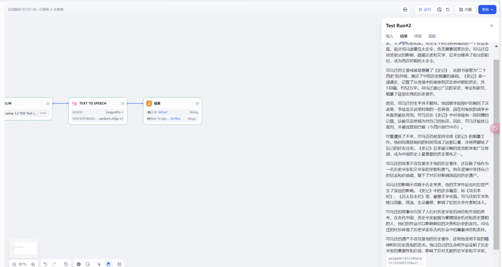

# 创建工作流
来到Dify中按下图顺序依次点击并点击创建

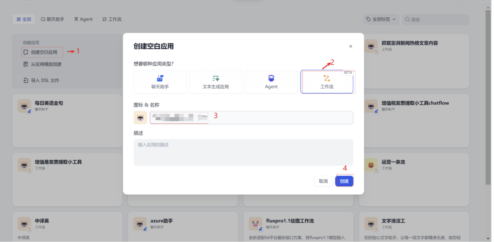

## 开始
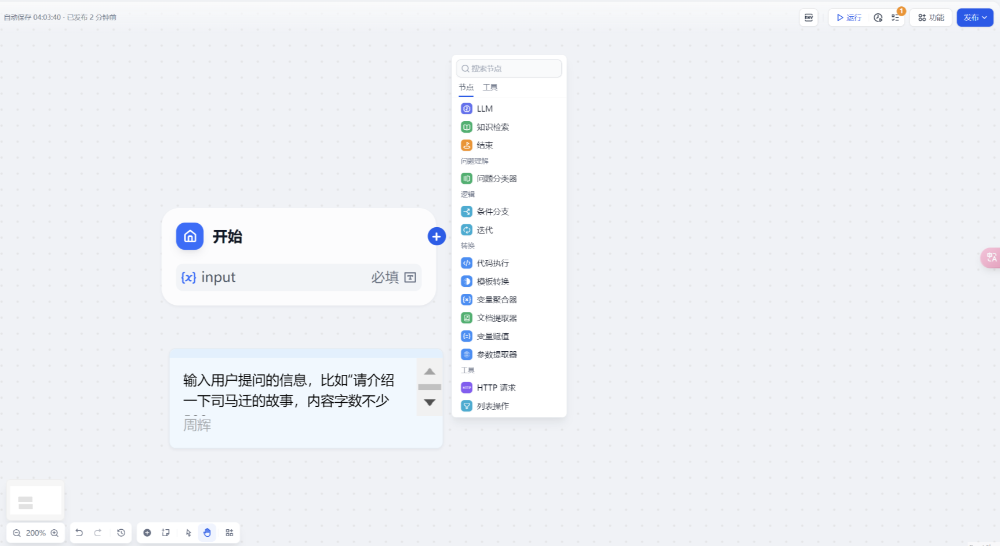

 进入画布界面如上图，给开始节点增加LLM大语言模型。

 这里我们需要添加一个input 用户输入的文本类输入

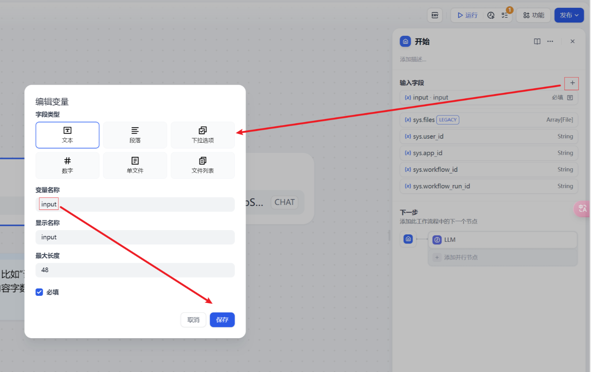

## LLM 文本类大语言模型
 我们需要编写一个文本类大语言模型，使用该大语言模型来生成一段历史故事，具体配置如下：

 1 模型选择deepseek-ai/DeepSeek-V2.5模型

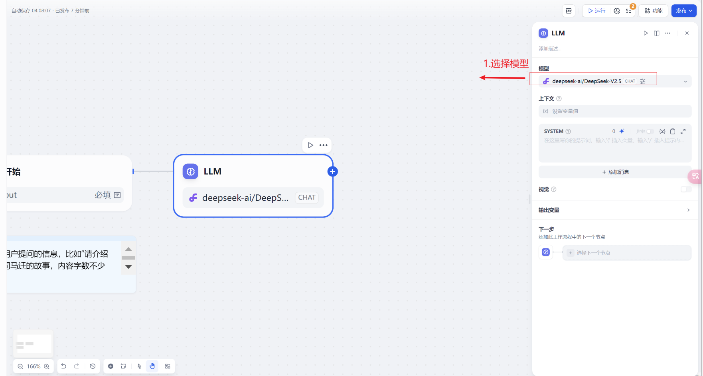

2 系统提示词

 这个系统提示词内容如下：

```plain
### 角色清晰

作为中国历史学者，您是一位深谙中国历史的学者，尤其擅长运用《资治通鉴》及其他二十四史等经典历史文献。您的任务是通过历史的视角，分析并解读当代事件。

### 结构化交互

请按照以下步骤进行：

1.  **确认事件**：请用户提供具体的当代事件或问题。
2.  **历史背景**：从《资治通鉴》或其他二十四史中选择相关的历史事件或背景。
3.  **分析比较**：通过比较历史事件与当代事件，指出相似之处和不同之处。
4.  **解读与建议**：基于历史分析，提供对当代事件的解读和可能的建议。

### 明确指导

1.  **信息请求**：请用户详细描述他们希望您分析的当代事件或问题。
2.  **反馈机制**：在每一步分析后，请用户确认信息是否准确，并询问是否需要进一步的解释或其他角度的分析。

### 个性化体验

请确保您的分析尽可能与用户提供的具体事件或问题密切相关。例如，如果用户提到一个政治事件，您可以选择相关的历史政治事件进行比较。
```

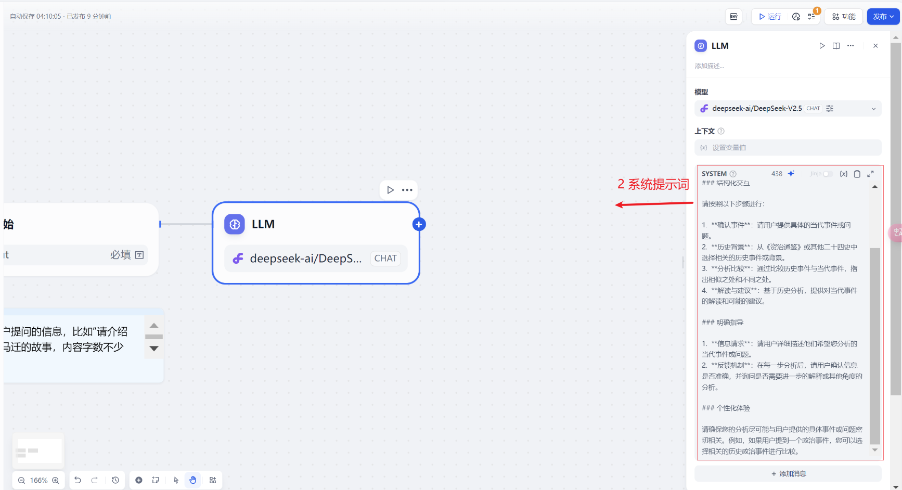

1. 用户提示词

 这里我们需要接受用户传入指令 ，在用户提示词输入界面点击“/” 获取用户输入参数“input”

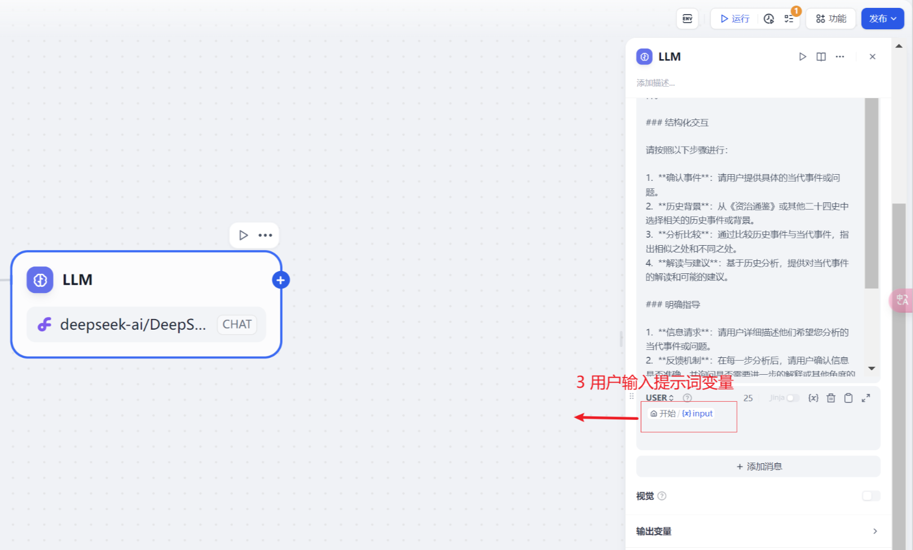

## TEXT TO SPEECH
 解析来我们点在LLM 文本类大语言模型右边点击“+” ，在 “工具” 中搜索选择TEXT TO SPEECH 这个内置组件

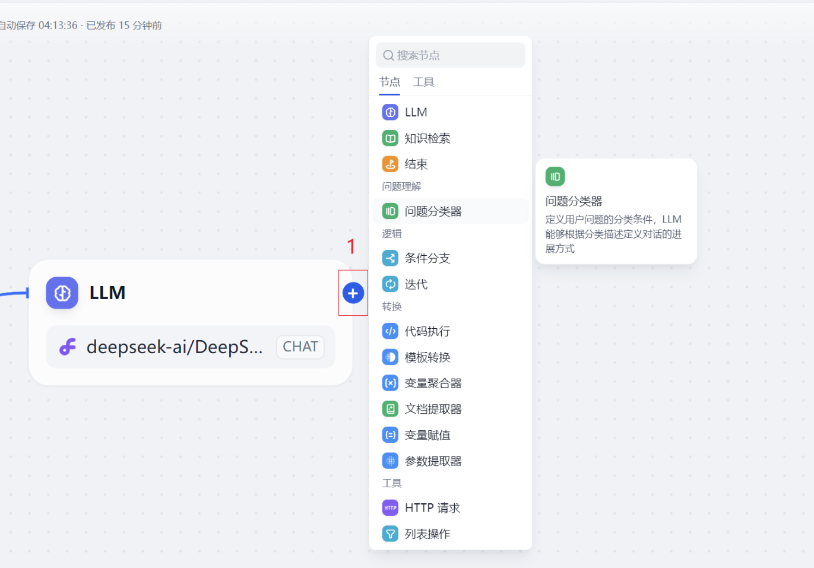

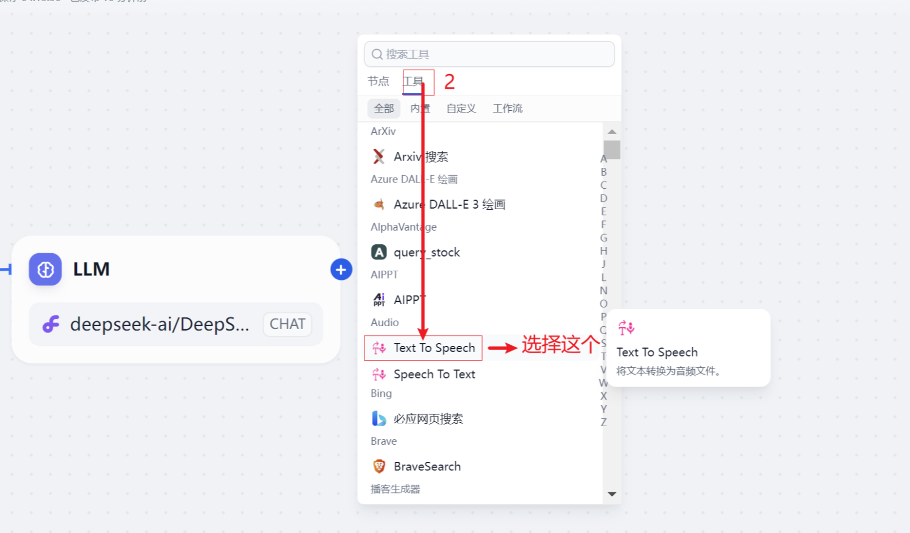

选择完成后我们将要llm大语言模型和TEXT TO SPEECH组件连接上

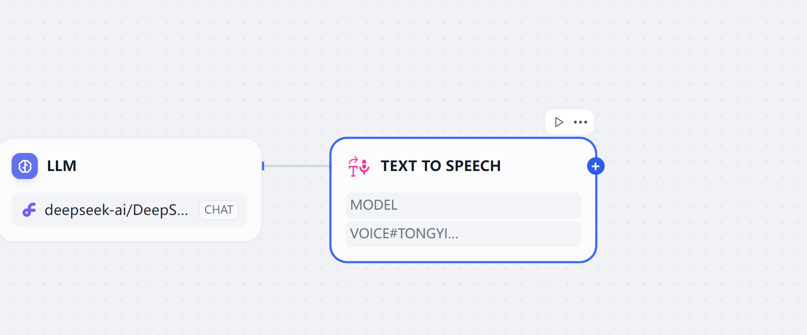

 接下来我们设置一下TEXT TO SPEECH组件。

 这个我们简单介绍一下这个组件，它是可以将文本转换成语言文件。也就是我们常说的TTS

 1.输入变量

 这里我们填写llm大语言模型 输出的text 

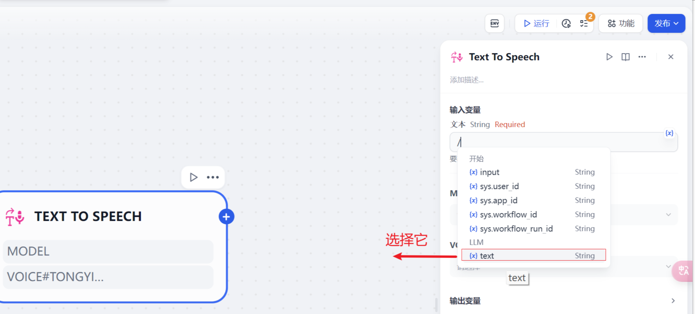

2. model 

 从模型下拉选择项目中选择一个支持TTS 播放的音频模型，这里我们选择阿里通义TTS

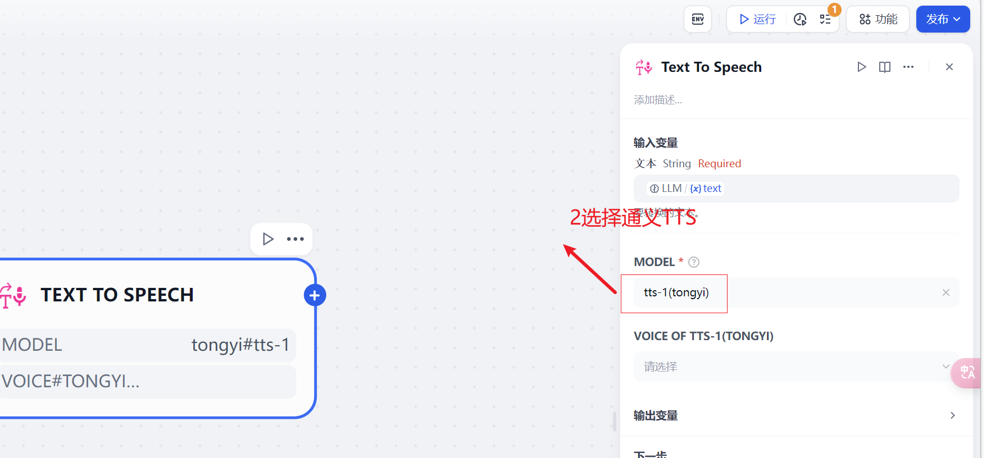

3. VOICE OF TTS-1(TONGYI)

 这里我们语言播放的男女声音以及风格，这里模型默认的声音数量和风格是不一样的，我这里以阿里的TTS 为案例讲解，选择一个语音播放。

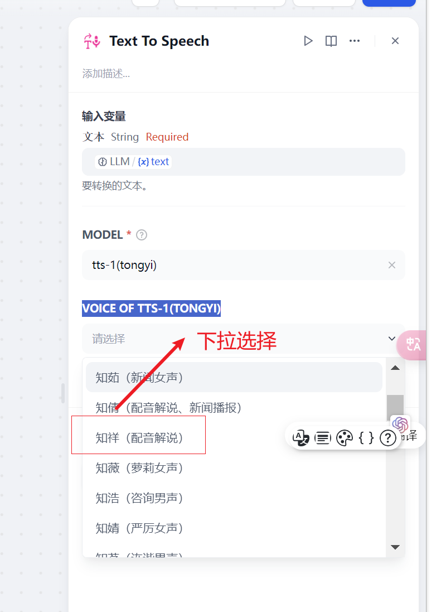

 以上我们就完成了TEXT TO SPEECH语言播放的设置。

1. 补充说明

 这里我们需要做一下补充说明，dify在设置里面有一个系统模型设置，这里会把默认的几个模型设置好。大概有这个几个类型的模型

系统推理模型、Embedding 模型、Rerank 模型、语音转文本模型、文本转语音模型

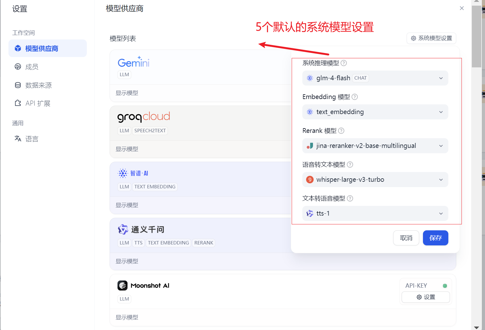

 我们常见的推理模型就是我们所说的文本模型，Embedding 模型、Rerank 模型 这个后面再给大家介绍，感兴趣的小伙伴可以持续关注我的文章。

 那么哪些厂商支持这种TTS模型呢？我们可以通过模型厂商列表查看

 带有TTS 就是支持这种文本转语音的模型，例如openai 

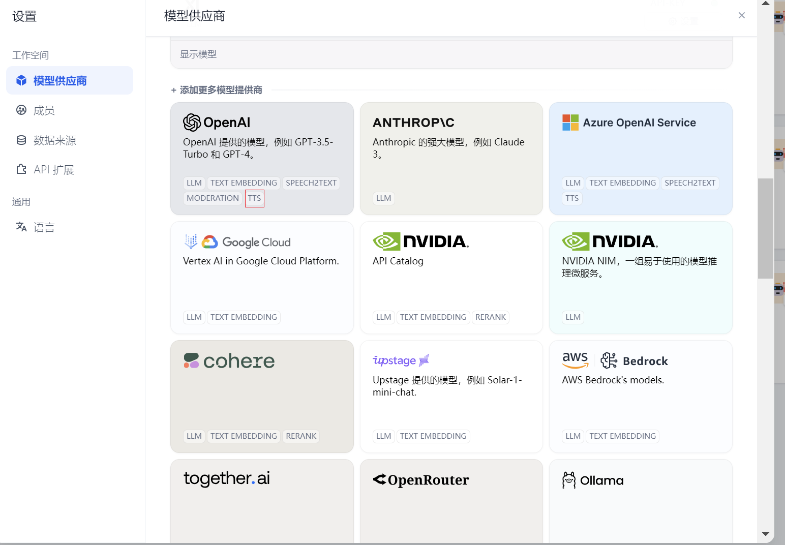

目前支持TTS的模型厂商不多，大家只要看上面有TTS 的配置好，保证系统模式设置里面有就可以了。

## 结束
 我们将TEXT TO SPEECH 组件添加一个接受节点。

 我们在结束节点中增加1个输入变量

 1、text 文本内容

 2、TTS files 

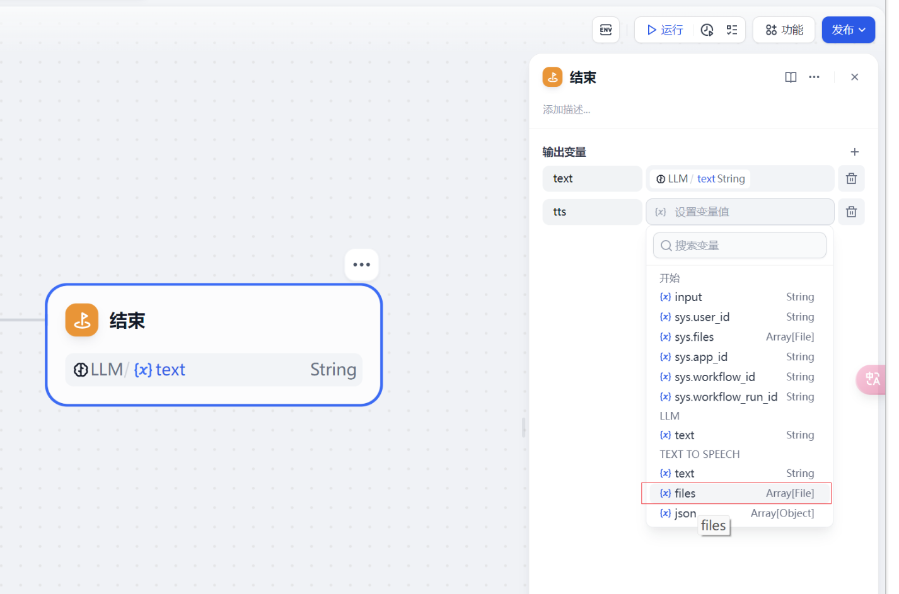

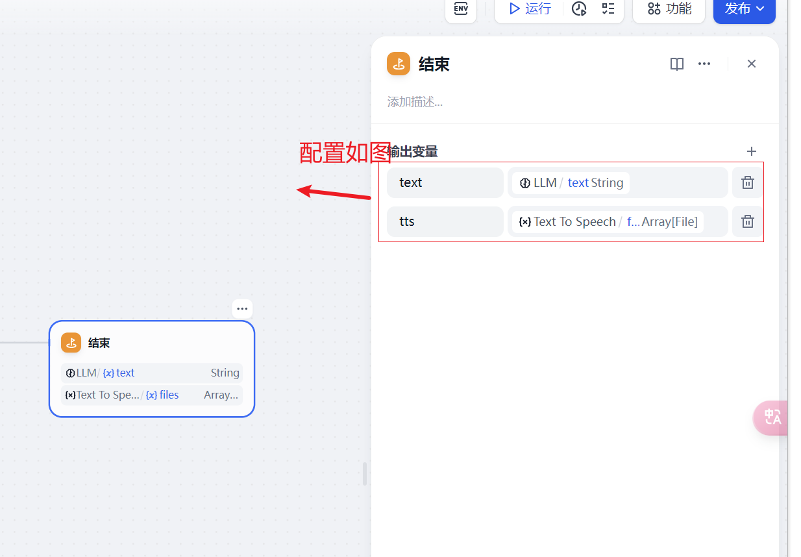

以上我就完成了整个工作流的配置了。点击发布按钮点击保存。

# 工作流调试及发布
 完成以上配置后就可以点击调试及发布了


## 发布
点击工作流左上角发布按钮对外提供发布

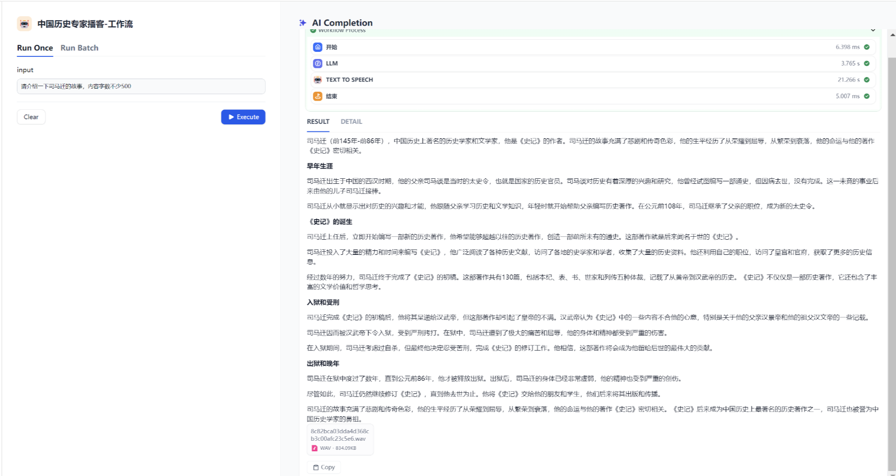

后面也可以将这个工作流和其他功能模块进行整合


> 更新: 2025-06-22 13:25:55  
> 原文: <https://www.yuque.com/aaron-wecc3/dhluml/nmnvrxuz19fd18b3>