# 151.Dify基于视觉模型实现多票据识别

## 课程内容

1. 创建多票据识别工作流
2. 执行票据文档提取
3. 多模态大模型识别票据内容
4. 变量聚合器和直接回复
5. Chatflow调试及发布

本次我们实现多种发票识别的dify基于工作流的智能体

下面我们首先介绍一下整体功能。

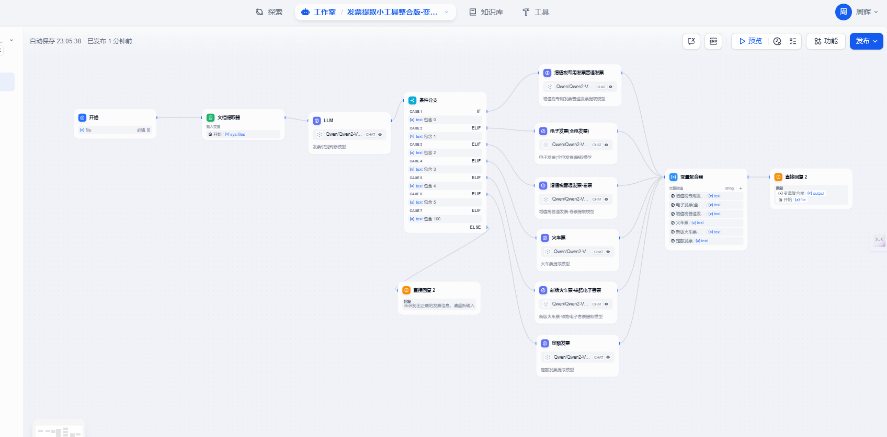

这里面主要功能：用户上传一个发票图片（目前我们这工作流支持6种发票），发票会经过文档提取器。文档提取器提取用户上传的发票传递给llm多模态模型，这个模型的作用是判断这发票是哪个类型的发票，接下来我们会根据条件分支来判断走哪个多模态发票提取的llm大语言模型。 其中这6个大语言模型区别就在于他们的系统提示词不一样，主要就是每个发票票面信息不一样。模型会根据不同发票票面信息提示词的不同而有所区别，模型返回的json格式的发票信息在发送给变量聚合器进行出来，处理完成后再发送给用户，整体的功能大概就是这样的。

实现的效果如下：

1 火车票票面识别

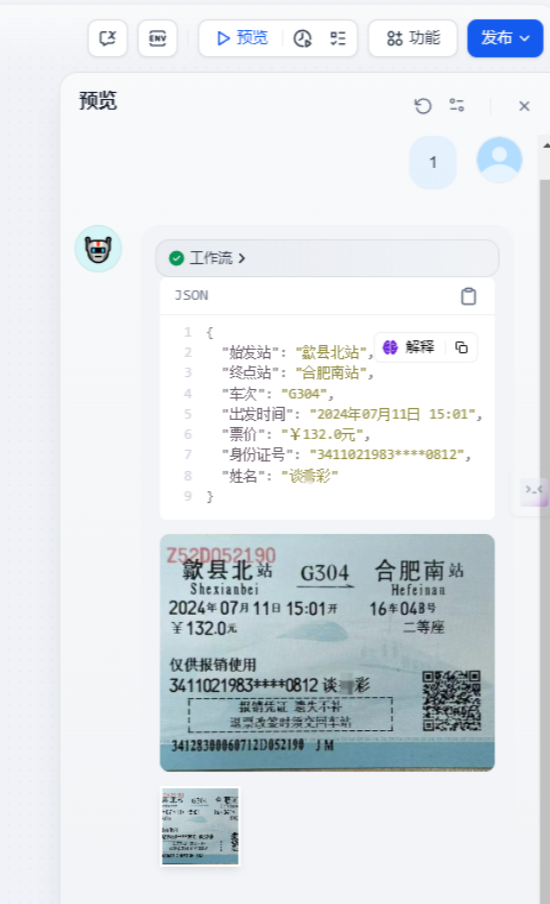

2.加油站卷式发票

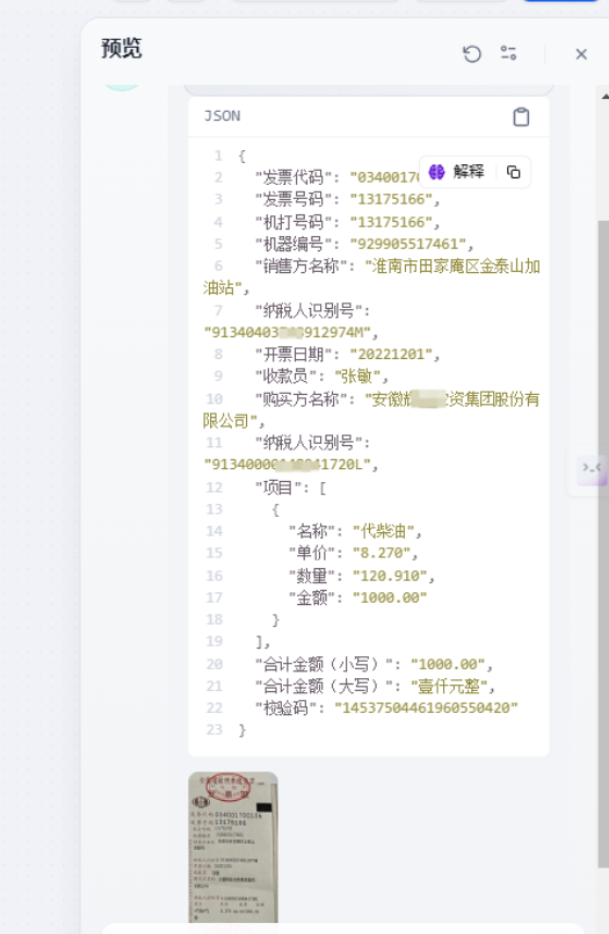

下面我们重点介绍一下这个工作流是如何实现的。

## 创建工作流或者chatflow

接着来到Dify中按下图顺序依次点击并点击创建(注：chatflow和工作流配置基本差不多，下面我们就以chatflow讲解)

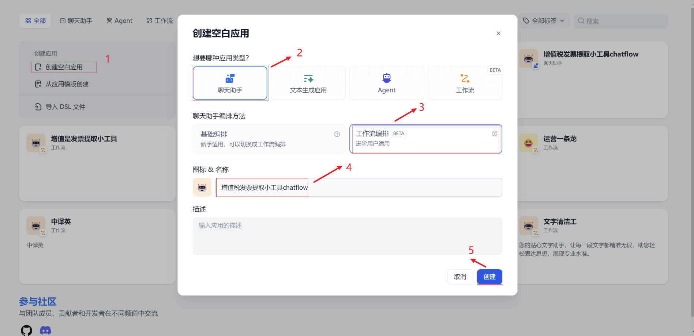

### 开始

开始节点点开后我们需要添加一个文件上传输入参数。点击开始节点输入字段，点击右边的“+”

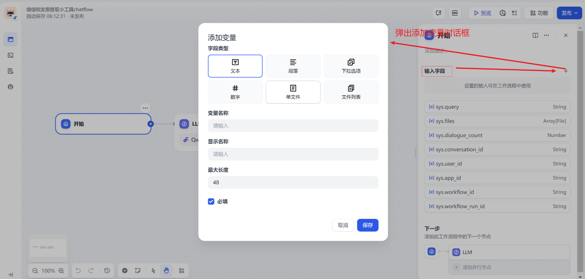

我们选择单个文件，输入变量名称、支持的文件类型我们这里就选择图片。其他都可以默认，输入完成后，点击保存按钮


以上步骤完成开始节点设置。

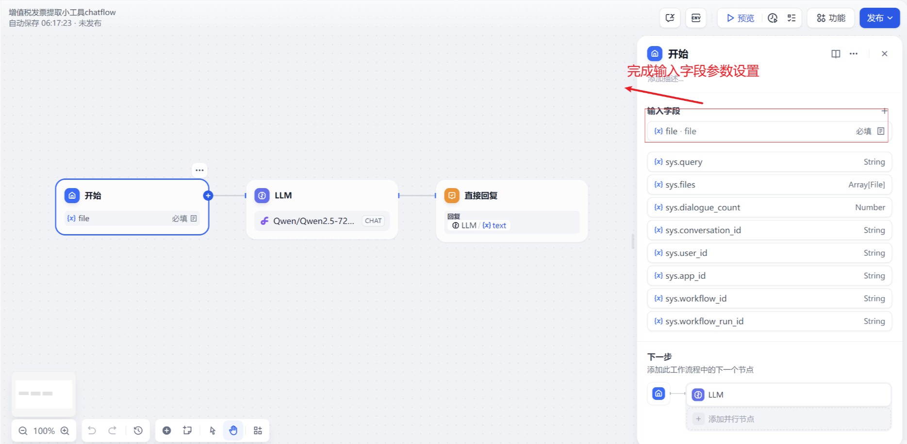

### 文档提取器

接下来我们在工作流画布中，选择文档提取器和开始节点连接，去掉llm和开始节点连接

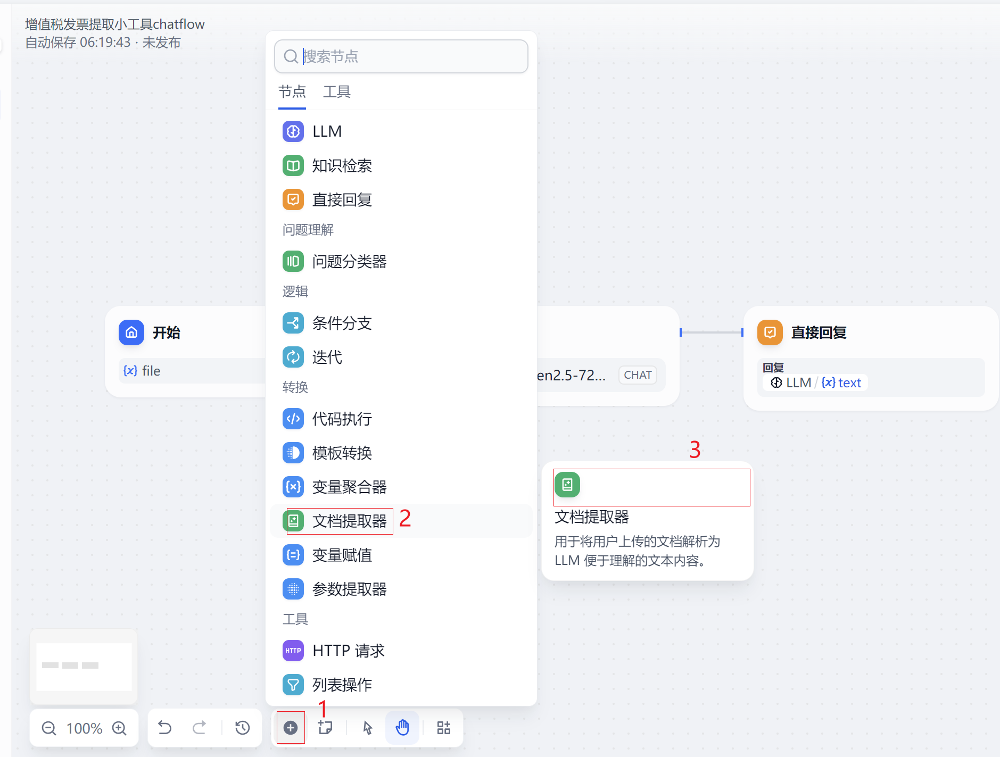

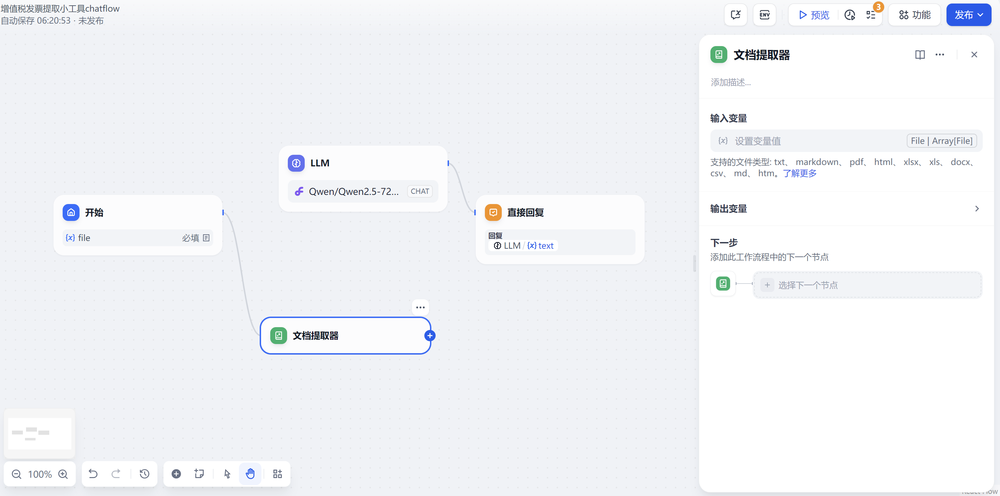

我们在文档提取器，输入变量中选中 `sys.files` 变量

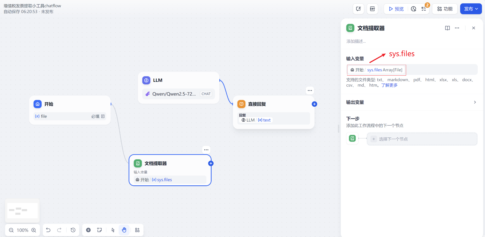

### llm(发票识别判断模型)

接下来我们将文档提取器的连接线和llm大语言模型连接。然后按照以下几个步骤设置

1.模型选择，模型我们在模型下拉列表中选择自定义OpenAI-API-compatible Qwen/Qwen2-VL-72B-Instruct模型；模型最大标记4096

2.上下文，这里设置开始节点file 属性值

3.SYSTEM 提示词 我们输入如下内容

```plain
# Role: 发票识别专家

## Profile
- 专长: 发票类型识别、图像分析、文字识别
- 经验: 多年处理各类发票和票据的经验
- 技能: 精准识别不同类型发票的特征

## Goals
- 根据用户上传的发票图像准确识别发票类型
- 返回对应的发票类型代码

## Rules
- 仔细分析发票上的所有视觉和文字信息
- 只返回指定的发票类型代码,不做其他解释
- 如果无法确定发票类型,返回 "无法识别"

## Workflows
1. 接收用户上传的发票图像
2. 分析图像中的关键信息和特征
3. 对比不同类型发票的特征
4. 确定发票类型
5. 返回对应的类型代码

## Output Format
发票类型代码:
- 0: 增值税电子发票
- 1: 电子发票(全电发票)
- 2: 增值税普通发票-卷票
- 3: 火车票
- 4: 新版火车票-铁路电子客票
- 5: 定额发票
- 6: 出租车发票

## Examples
用户: [上传增值税电子普通发票图像]
特征: 电子版式,有"增值税电子普通发票"字样,含二维码,有密码区,有 "税局监制"字样
AI: 0

用户: [上传电子发票(普通发票)或电子发票(增值税专用发票)图像]
特征: 电子版式,有"电子发票"字样,发票号码长度有20位
AI: 1

用户: [上传增值税普通发票发票联图像]
特征: 纸质卷式,较窄,有"增值税普通发票"字样,通常为红色或蓝色
AI: 2

用户: [上传火车票图像]
特征: 磁性票,较小,包含乘车日期、车次、座位等信息
AI: 3

用户: [上传新版火车票-铁路电子客票图像]
特征: 电子版式,有"电子发票(铁路电子客票)"标志,包含乘车日期、车次、座位等信息，有发票号码，发票号码长度20位
AI: 4

用户: [上传定额发票图像]
特征: 小型纸质票据,预先印制金额,通常用于小额交易
AI: 5

用户: [上传出租车发票图像]
特征: 纸质卷式,较窄,有"通用机打发票字样"字样,有“车号”、“工号”、“单价”、“里程”、“等候”等字样
AI: 6

用户: [上传模糊不清的图像]
特征: 图像模糊,无法辨识关键信息
AI: 无法识别
```

以上完成llm模型的设置

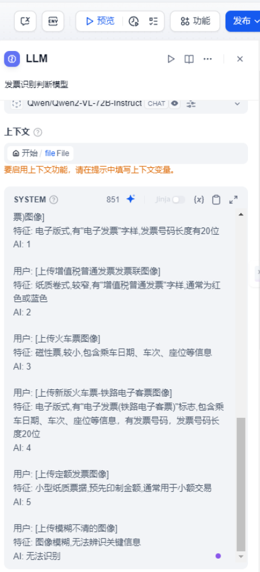

这个模型的作用是区分判断用户上传的发票是哪个类型，通过多模态模型区分后返回对应的发票种类，我这里设定以下几个类型

0 、增值税专用发票普通发票

1、电子发票(全电发票)

2、增值税普通发票-卷票

3、火车票

4、新版火车票-铁路电子客票 （2024年11月1日 国家全面推广 铁路电子客票作为抵扣报销使用）

5、定额发票

6、出租车发票

100、无法判断的发票

### 条件分支

这里我们需要接受上一个llm模型输出的返回值（0、1、2、3、4、5、100），由这个判断条件分支来让流程节点选择下面哪一个发票提取llm多模态大模型

它的设置也比较简单就是 if else , 判断条件这里我们 都选择"包含"，详细配置可以看我的这个截图

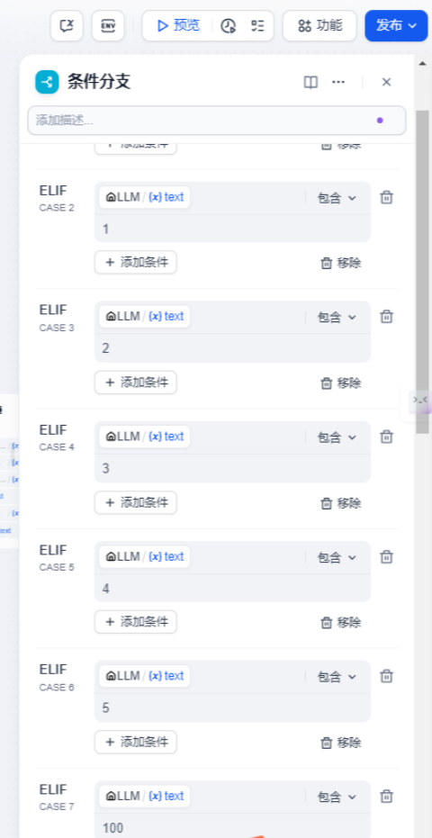

流程节点图如下

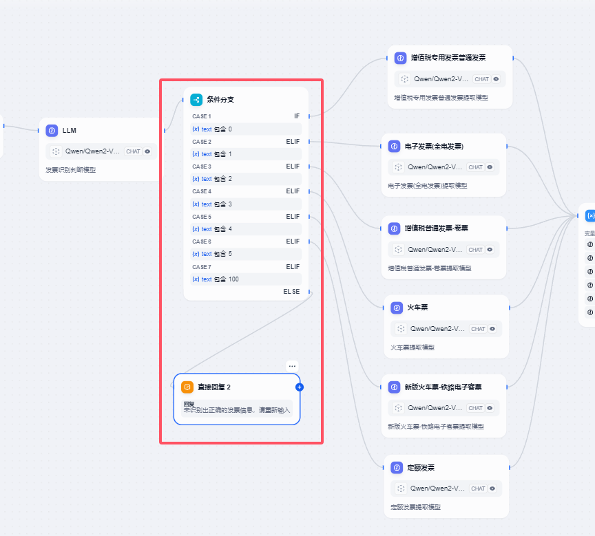

这里稍微提一下，因为最后发票无法识别，所以我们之间给它做一个直接回复的节点，节点里面填写“未识别出正确的发票信息，请重新输入”

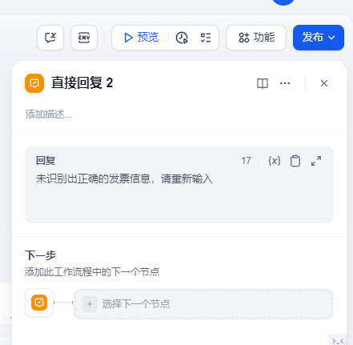

### 发票识别llm多模态模型

上一个条件分支节点连接到这个llm多模态模型中，因为这个需要具体提取发票票面信息的，所以我们这里需要6个多模态模型。每个流程节点配置都是一样的，只是系统提示词有区别，我这里就以一个增值税专用发票普通发票LLM为例给大家介绍

1.模型选择，模型我们在模型下拉列表中选择自定义OpenAI-API-compatible Qwen/Qwen2-VL-72B-Instruct模型；模型最大标记4096

2.上下文，这里设置开始节点file 属性值

3.SYSTEM 提示词 我们输入如下内容

```plain
请提取这张照片的内容，其中内容格式‘机器编号’、‘发票代码’、‘发票号码’、‘开票日期’、‘校 验 码’、‘购买方名称’、‘购买方纳税人识别号’、‘购买方地 址、电 话’、‘开户行及账号’、‘货物或应税劳务、服务名称’、‘规格型号’、‘单 位’、‘数 量’、‘单 价’、‘金 额’、‘税率’、‘税 额’、‘价税合计（大写）’、‘价税合计（小写）’、‘销售方名称’、‘销售方纳税人识别号’、‘销售方地 址、电 话’、‘销售方地 址、电 话’、‘开户行及账号’、‘备注’、‘收款人’、‘复核’、‘开票人’ 字段返回信息，返回的结果信息以json格式返回
```

4.视觉 点击右边按钮开启多模态

5 视觉输入变量 选择节点file`files` 变量

以上完成llm模型的设置

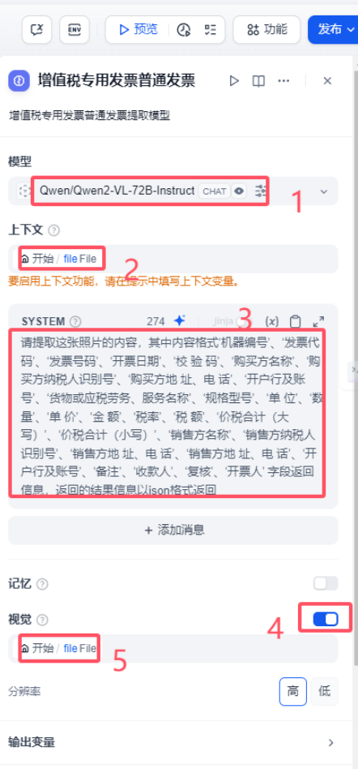

其他的提示词我这里也给大家贴一下

电子发票(全电发票)

```plain
请提取这张照片的内容，其中内容格式‘发票号码’、‘开票日期’、‘购买方信息名称’、‘购买方统一社会信用代码/纳税人识别号’、‘销售方信息名称’、‘销售方统一社会信用代码/纳税人识别号’、‘项目名称’、‘规格型号’、‘单 位’、‘数 量’、‘单 价’、‘金 额’、‘税率/征收率’、‘税 额’、‘合计’、‘价税合计（大写）’、‘价税合计（小写）’、‘备 注’ 字段返回信息，返回的结果信息以json格式返回
```

增值税普通发票-卷票

```plain
请提取这张照片的内容，其中内容格式‘发票代码’、'发票号码’、'机打号码’、‘机器编号’、‘销售方名称’、‘纳税人识别号’、‘开票日期’、‘收款员’、‘购买方名称’、‘纳税人识别号’、‘项目’、‘单价’、‘数量’、‘金额’、‘合计金额（小写）’、‘合计金额（大写）’、‘校验码’字段返回信息，返回的结果信息以json格式返回
```

火车票

```plain
请提取这张照片的内容，其中内容格式‘始发站’、‘终点站’、‘车次’、‘出发时间’、‘票价’、‘身份证号’、‘姓名’字段返回信息，返回的结果信息以json格式返回
```

新版火车票-铁路电子客票

```plain
请提取这张照片的内容，其中内容格式‘发票号码’、'开票日期’、'‘出发时间’、‘始发站’、‘终点站’、‘车次’、‘票价’、‘身份证号’、‘姓名’、‘电子客票号’、‘购买方名称’、‘统一社会信用代码’字段返回信息，返回的结果信息以json格式返回
```

定额发票

```plain
请提取这张照片的内容，其中内容格式‘发票代码’、'发票号码’、'金额’字段返回信息，返回的结果信息以json格式返回
```

出租车发票

```plain
请提取这张照片的内容，其中内容格式‘发票代码’、'发票号码’、'单位’、'车号’、'工号’、'日期’、'时间’、'单价’、'里程’、'等候’、'金额’等字段返回信息，返回的结果信息以json格式返回
```

如果需要在增加发票识别 可以根据上面操作步骤新增一个多模态识别模型以及编写 新的提示词即可。

### 变量聚合器

这个变量聚合器是干啥的呢？大家发现没有6个多模态发票识别的输出结构其实是一样的，只是它的内容有所区别。因为后面我们是需要输出给用户的，所以这里我们就用变量聚合器把llm大语言模型提取发票的结果统一输出到一个变量聚合器里面。它的配置也很简单接受上一个流程输出结果即可

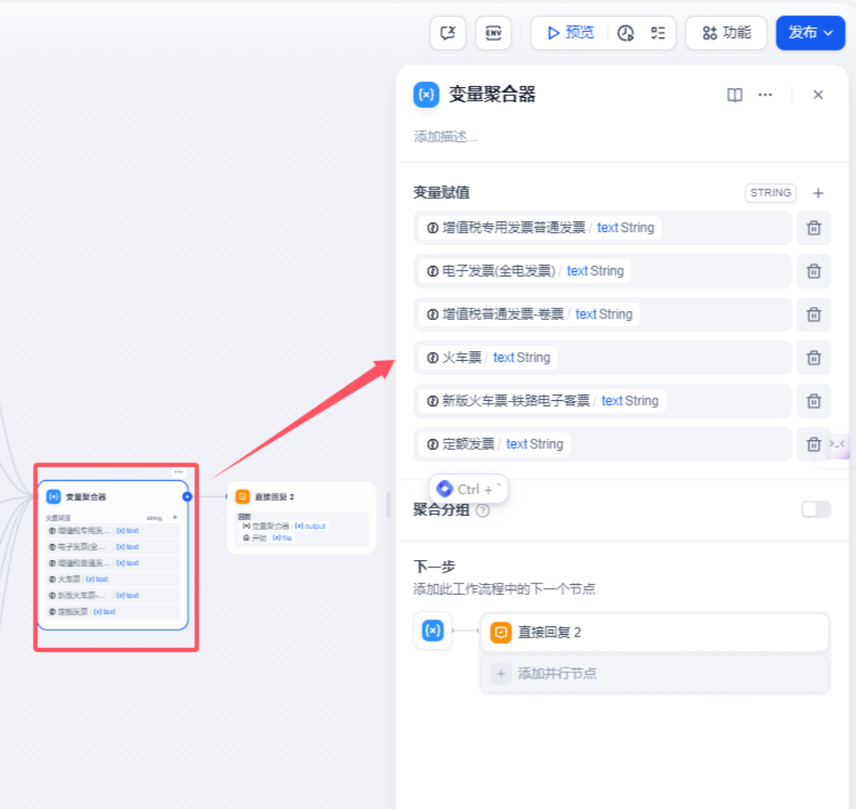

如果没有变量聚合器就会变成我之前配置的那个流程了，给大家看一下我之前的那个流程吧。

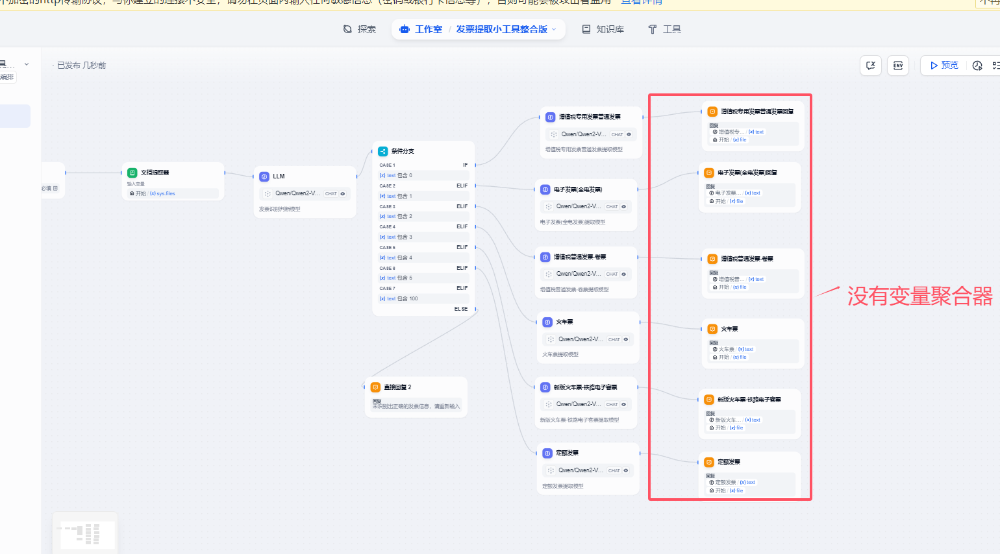

### 直接回复

接下来我们将变量聚合器连接到直接回复的输出节点。

这个地方设置比较简单，在回复设置一下llm text文本输出以及 开始节点file 输出，这样设置后。就会将发票提取的票面信息以json格式的文本信息返回，并将上传的发票图片信息一并返回给用户


通过以上方式我们就初步完成了整个chatflow工作流。

## chatflow调试及发布

完成以上配置后就可以点击调试及发布了

这里推荐大家使用硅基流动的提供的Qwen/Qwen2-VL-72B-Instruct模型，这个模型目前在上海人工智能实验室推出的CompassRank评测多模态大模型中排名第一

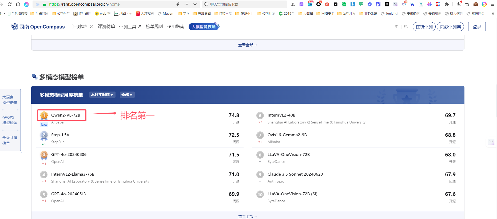

如果大家没有硅基流动的账号，可以点击[https://cloud.siliconflow.cn](https://cloud.siliconflow.cn/i/e0f6GCrN) 地址来注册，目前硅基的政策是新户注册送14块钱，14块钱够玩一阵子了。

## 发布

点击工作流左上角发布按钮对外提供发布


点击 start chat 就可以使用了。

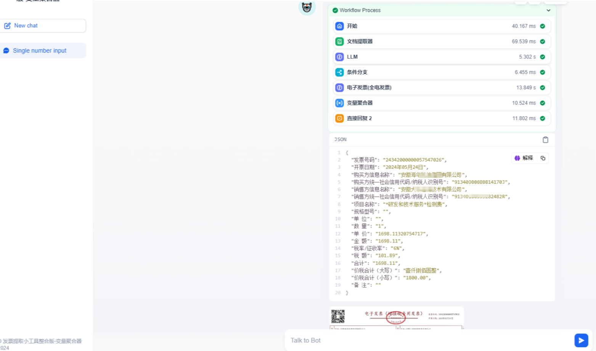


> 更新: 2025-06-22 13:25:55  
> 原文: <https://www.yuque.com/aaron-wecc3/dhluml/nf967ptx8zenqr1e>