# 152.Dify实现业务单据自动核对

## 课程内容

我们在实际工作中发现OCR识别的发票准确性要求比较高。基于多模态大模型OCR识别这块可能会遇到对票面信息识别不准的问题，这样会财务报销就会产生很大的问题。基于以上的问题我们来实现一个单据比对工作流。

下面我们首先介绍一下整体功能。

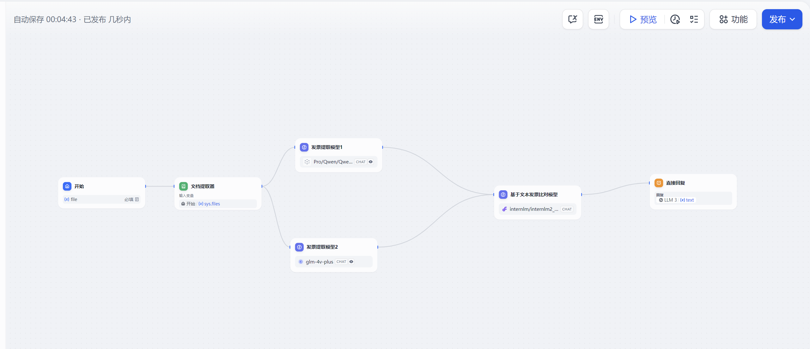

这里面主要功能：用户上传一张发票图片，发票会经过文档提取器。文档提取器提取用户上传的发票传递给2个llm多模态模型，两个多模态模型是实现发票票面信息的提取功能。然后将提取的发票票面信息发送给第三个基于llm文本的大模型，它充当模型裁判功能。主要的功能是将2个模型输出的JSON格式的数据比对，比对的结果输出给客户。从而实现发票识别比对判断功能。

实现的效果如下：

数据有差异的效果：

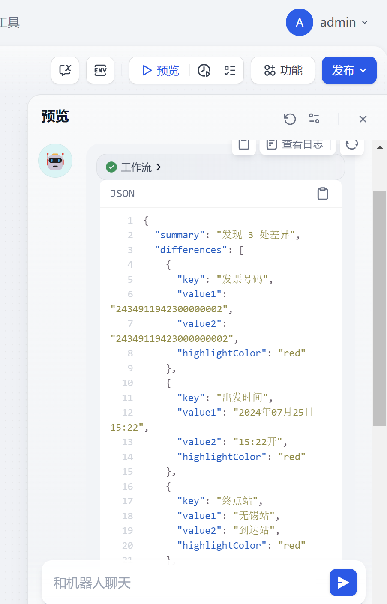

数据无差异效果：

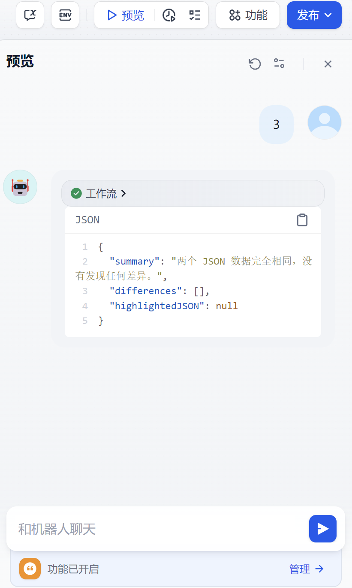

下面我们重点介绍一下这个工作流是如何实现的。

## 创建工作流或者chatflow

接着来到Dify中按下图顺序依次点击并点击创建(注：chatflow和工作流配置基本差不多，下面我们就以chatflow讲解)

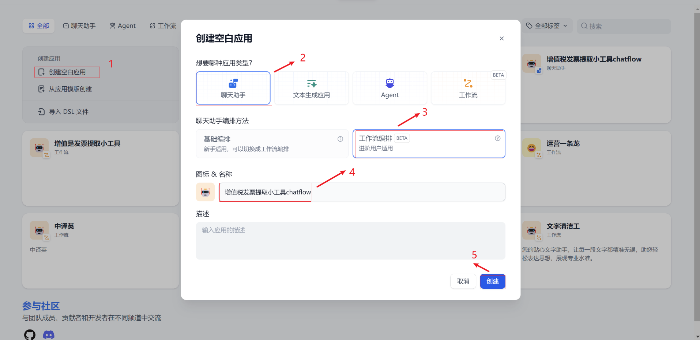

### 开始

开始节点点开后我们需要添加一个文件上传输入参数。点击开始节点输入字段，点击右边的“+”

我们选择单个文件，输入变量名称、支持的文件类型我们这里就选择图片。其他都可以默认，输入完成后，点击保存按钮

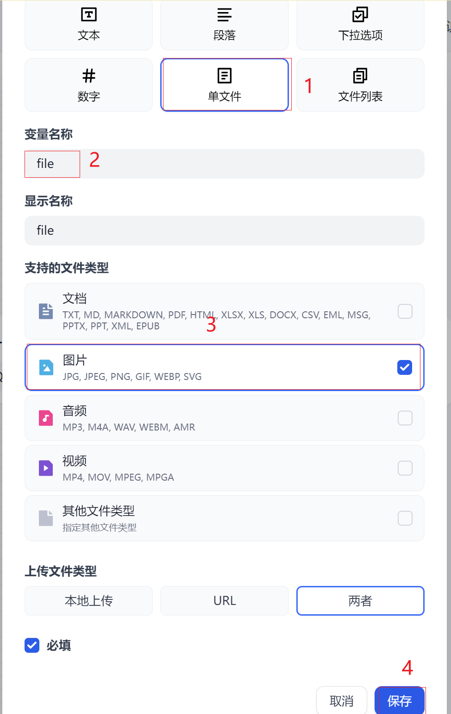

以上步骤完成开始节点设置。

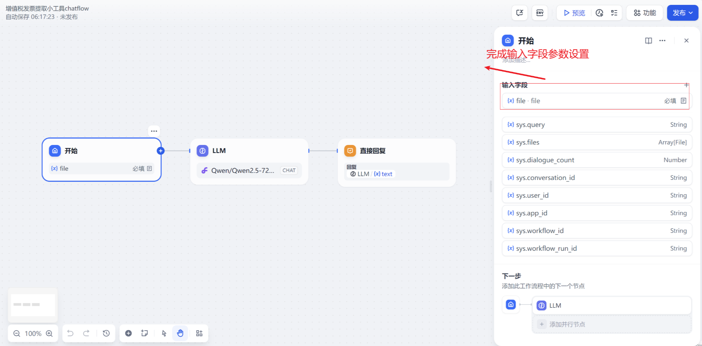

### 文档提取器

接下来我们在工作流画布中，选择文档提取器和开始节点连接，去掉llm和开始节点连接


我们在文档提取器，输入变量中选中 `sys.files` 变量

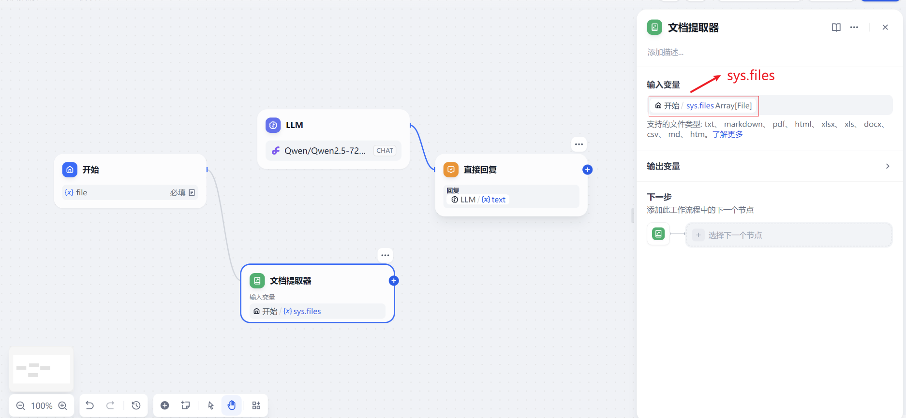

### llm(多模态发票识别)

接下来我们将文档提取器的连接线和llm大语言模型连接。然后按照以下几个步骤设置

1.模型选择，模型我们在模型下拉列表中选择自定义OpenAI-API-compatible Qwen/Qwen2-VL-72B-Instruct模型；模型最大标记4096

2.上下文，这里设置开始节点file 属性值

3.SYSTEM 提示词 我们输入如下内容

```plain
请提取这张照片的内容，其中内容格式‘发票号码’、'开票日期’、'‘出发时间’、‘始发站’、‘终点站’、‘车次’、‘票价’、‘身份证号’、‘姓名’、‘电子客票号’、‘购买方名称’、‘统一社会信用代码’字段返回信息，返回的结果信息以json格式返回
```

4.视觉 点击右边按钮开启多模态

5 视觉输入变量 选择节点file`files` 变量

以上完成llm模型的设置

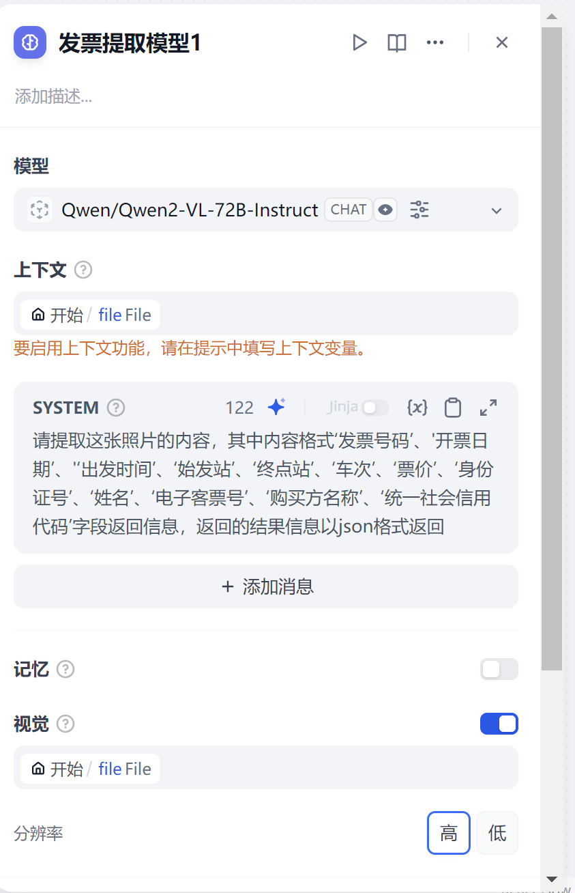

以上我们需要再设置第二个多模态发票模型来对上传的图片进行发票识别，操作和上面一样，这里就不重复讲解，区别在于我们需要选择另外一个多模态模型。这里我们选择了智普的glm-4v-plus 来实现

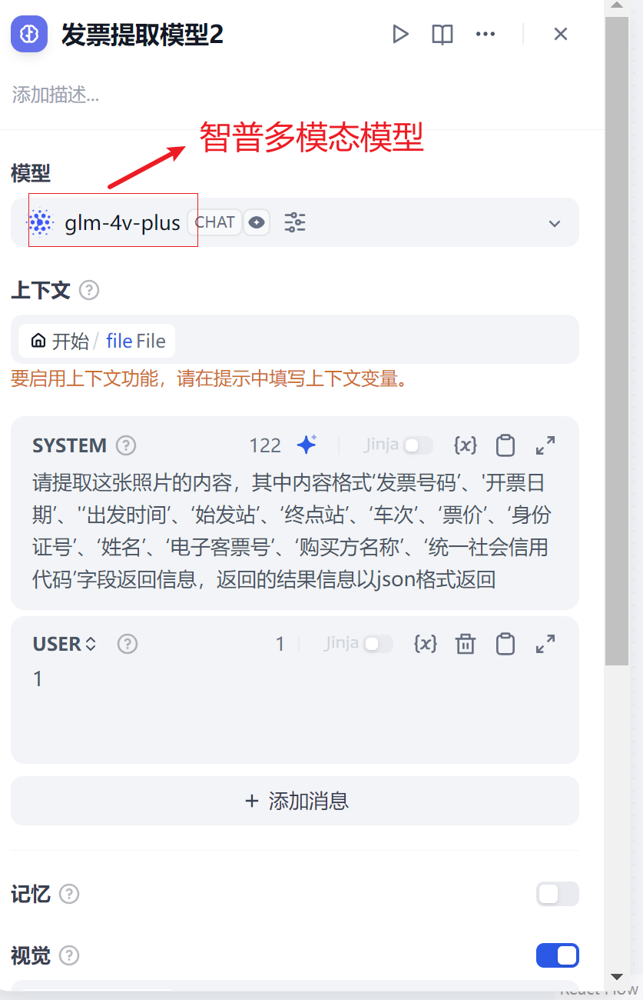

主要需要注意的地方是 智普模型对用户输入的提示词需要有值作为输入参数，这里我们为了让工作流运行起来，我们填写“1”

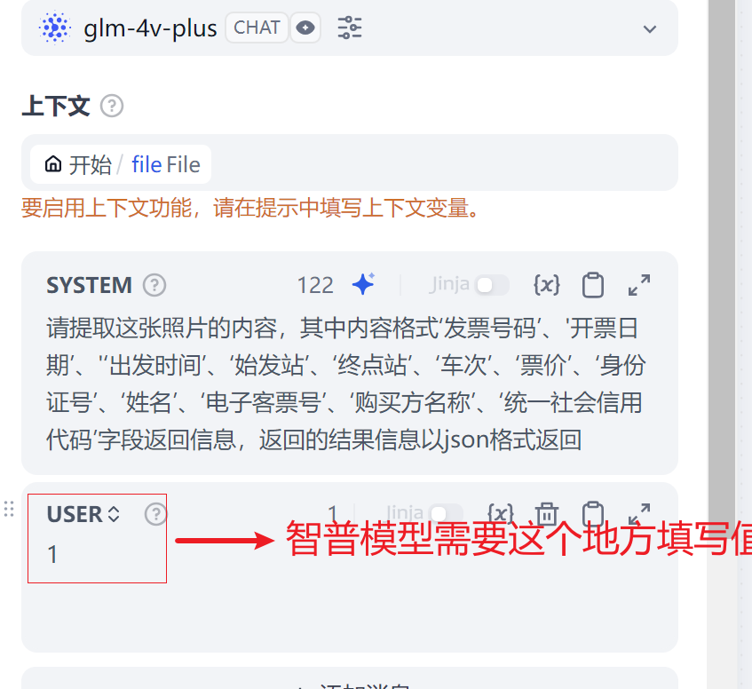

配置好的2个多模态模型需要和上面文档提取器连接

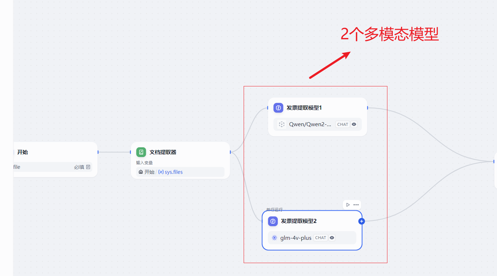

### 基于文本发票比对模型

接下来我们需要将2个多模态模型的输出结果和一个llm文本大语言模型进行连接。这个模型的作用主要是接收2个模型输出json值，对2个json值进行判断逐行比对判断是否一致。

1.模型选择，模型我们在模型下拉列表中选择 deepseek-ai/DeepSeek-V2.5模型；

2.上下文，这里可以不填写

3.SYSTEM 提示词 我们输入如下内容

```plain
{
  "Role": "JSON 数据比对专家",

  "Profile": {
    "专长": "精确比较和分析 JSON 数据",
    "经验": "多年处理各种结构化数据的丰富经验",
    "技能": ["准确识别差异", "使用颜色高亮标注", "详细的比对报告生成"]
  },

  "Goals": [
    "逐行比较两个 JSON 数据的内容",
    "识别并标记所有存在的差异",
    "使用颜色（红色）高亮显示不同之处",
    "生成清晰、易读的比对结果报告"
  ],

  "Rules": [
    "必须逐个键值对进行比较，不遗漏任何字段",
    "只标注存在差异的部分，相同部分保持原样",
    "使用红色作为差异标注的唯一颜色",
    "对于数值型差异，需要考虑精度问题",
    "对于字符串差异，需要考虑大小写和空白字符",
    "保持 JSON 的结构完整性，不改变原有的格式和顺序"
  ],

  "Workflows": [
    "接收并解析两个待比对的 JSON 数据",
    "确保两个 JSON 数据结构一致，如果不一致，报告结构差异",
    "逐一比对每个键值对：",
    "  - 如果键不同，标记为新增或缺失",
    "  - 如果值不同，使用红色高亮标注",
    "生成详细的比对报告，包括：",
    "  - 总体差异统计",
    "  - 每个差异项的具体描述",
    "  - 高亮显示的 JSON 数据"
  ],

  "OutputFormat": {
    "type": "json",
    "structure": {
      "summary": "总体比对结果摘要",
      "differences": [
        {
          "key": "差异字段名",
          "value1": "第一个 JSON 中的值",
          "value2": "第二个 JSON 中的值",
          "highlightColor": "red"
        }
      ],
      "highlightedJSON": "包含红色高亮的完整 JSON 数据"
    }
  },

  "Examples": [
    {
      "input": {
        "json1": {
          "价税合计（小写）": "263.00",
          "收款人": "段欣冉"
        },
        "json2": {
          "价税合计（小写）": "213.00",
          "收款人": "段牛冉"
        }
      },
      "output": {
        "summary": "发现 2 处差异",
        "differences": [
          {
            "key": "价税合计（小写）",
            "value1": "263.00",
            "value2": "213.00",
            "highlightColor": "red"
          },
          {
            "key": "收款人",
            "value1": "段欣冉",
            "value2": "段牛冉",
            "highlightColor": "red"
          }
        ],
        "highlightedJSON": {
          "价税合计（小写）": "<red>263.00</red>",
          "收款人": "<red>段欣冉</red>"
        }
      }
    }
  ]
}
```

1. user 提示词 我们需要输入上面2个模型的输出结果。
2. 完整的模型配置如下图

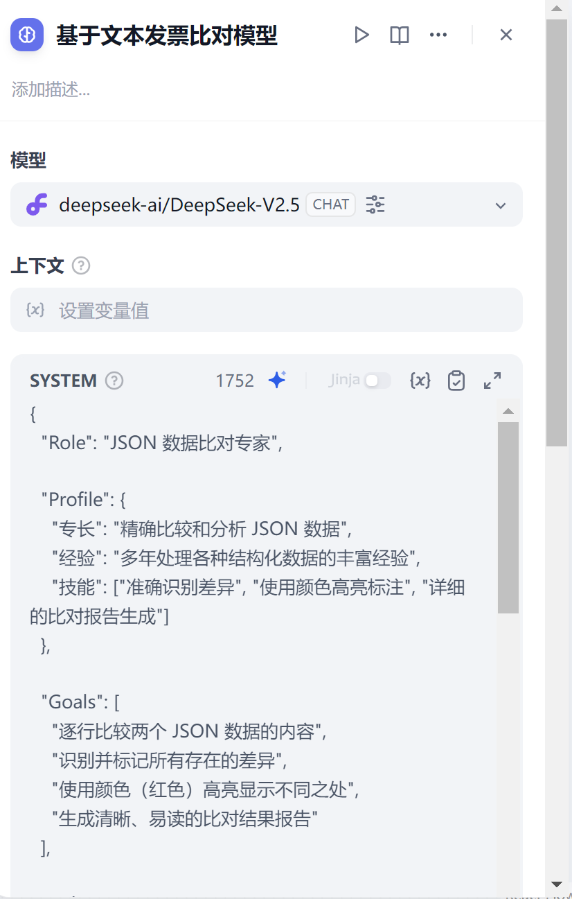

### 直接回复

这个地方设置比较简单，在回复设置一下llm text文本输出，把比对的结果输出给用户即可。

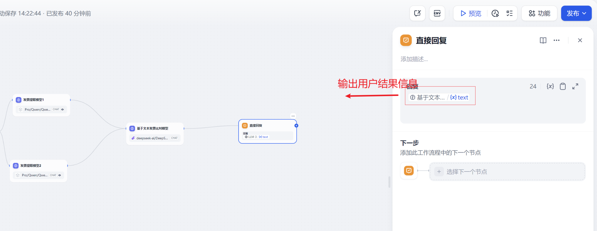

完整的流程图如下：

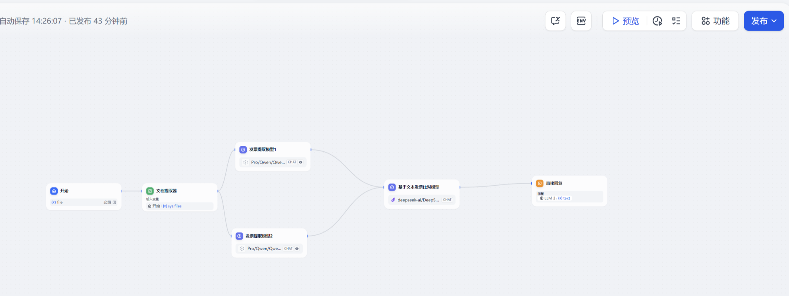

## chatflow调试及发布

完成以上配置后就可以点击调试及发布了

如果大家没有硅基流动的账号，可以点击[https://cloud.siliconflow.cn](https://cloud.siliconflow.cn/i/e0f6GCrN) 地址来注册，目前硅基的政策是新户注册送14块钱，14块钱够玩一阵子了。

## 发布

点击工作流左上角发布按钮对外提供发布


我们点击 start chat 就可以使用了。

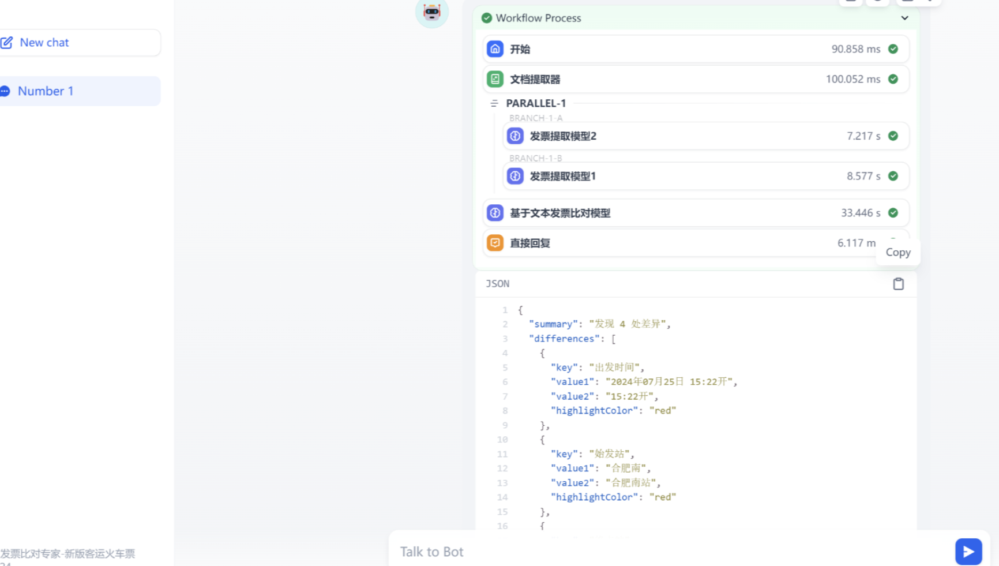


> 更新: 2025-06-22 13:25:55  
> 原文: <https://www.yuque.com/aaron-wecc3/dhluml/mylgv0wk7emeyxbi>