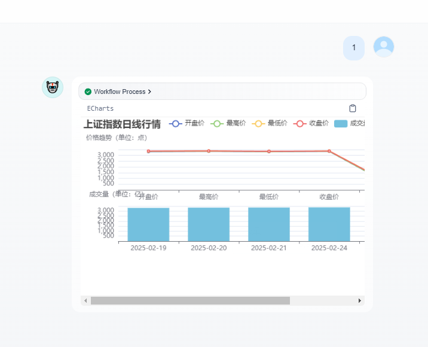
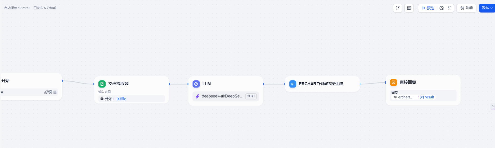
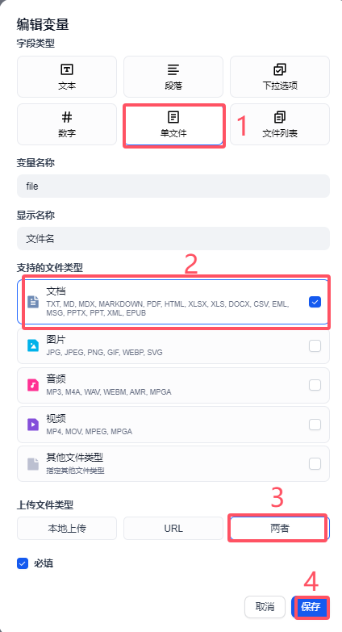
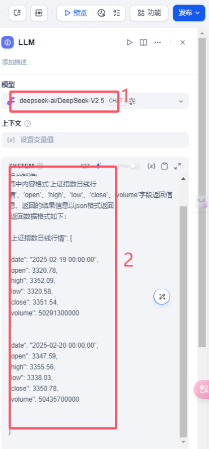
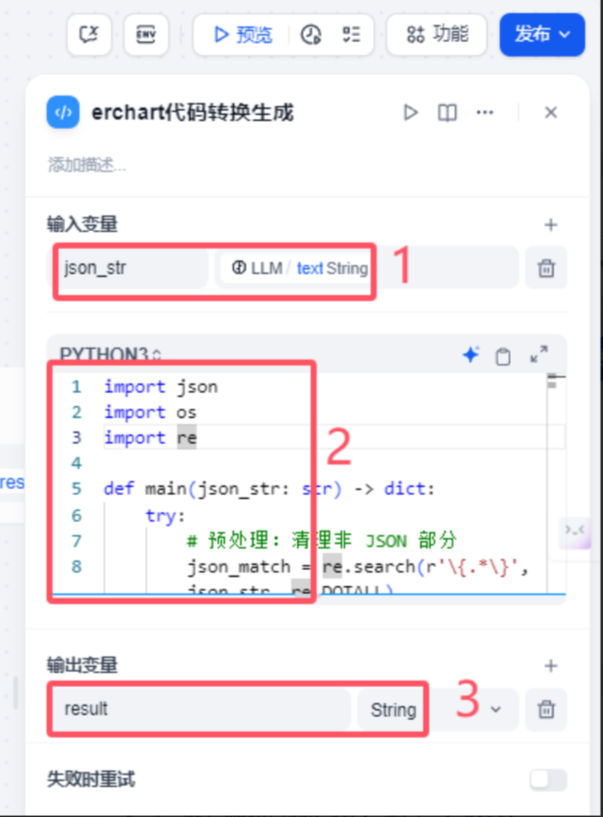
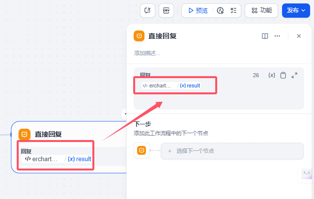

# 153.Dify搭建股票价格趋势智能体

# 课程内容
本次我们将基于Dify.AI的Workflow引擎，构建上证综指5日K线可视化组件。话不多说我们先看一下实现效果。



工作流展示



# 创建趋势图展示工作流
## 开始
首选我们先定义一个开始节点，这个开始节点需要设置1个文本上传输入参数，目前这个主要使用excel。所以我们设置文件类型。



按照上图设置一个file作为开始节点的输入参数。

## 文档提取器
这个地方我们需要接受开始节点上传的excel 文件，通过这个文档提取器提取文档里面的内容。输入变量是file


## LLM大语言模型
这个地方我们需要设置一个大语言模型，通过这个大语言模型提取 excel文本内容信息。这里模型我们选择deepseekv2.5的模型，使用硅基流动提供的deepseek模型，有的小伙伴可以问为什么不用v3 和R1模型呢？这里我们只提取文本内容，所以不需要非常厉害的模型。另外硅基最近流量比较大我们选个小模型这样反而速度更快点。

系统提示词

```yaml
你是一个文档提取专家，请根据用户上传文档内容{{#1740472111460.text#}}提取该表格里面的数据返回json格式数据。
其中内容格式‘上证指数日线行情’、‘open’、‘high’、‘low’、‘close’、‘volume’字段返回信息，返回的结果信息以json格式返回
 返回数据格式如下：
{
"上证指数日线行情": [
{
"date": "2025-02-19 00:00:00",
"open": 3320.78,
"high": 3352.09,
"low": 3320.58,
"close": 3351.54,
"volume": 50291300000
},
{
"date": "2025-02-20 00:00:00",
"open": 3347.59,
"high": 3355.56,
"low": 3338.03,
"close": 3350.78,
"volume": 50435700000
}
]
}
```

模型的其他设置这里没有过多讲解的地方。



## echarts代码转换生成
 这个地方是本次工作流的一个难点，主要的作用就是通过上个节点的大语言模型提取输出的json格式的数据通过python 代码和echarts来实现数据组装。

代码如下：

```python
import json
import os
import re

def main(json_str: str) -> dict:
    try:
        # 预处理：清理非 JSON 部分
        json_match = re.search(r'\{.*\}', json_str, re.DOTALL)
        if not json_match:
            return {"result": "Error: Invalid JSON format"}
        # 提取合法的 JSON 部分
        cleaned_json_str = json_match.group(0)
        # 解析JSON数据
        data = json.loads(cleaned_json_str)
        filename = data.get("filename", "stock_chart.html")
        stock_data = data.get("上证指数日线行情", [])
        # 准备数据格式
        dates = [item['date'].split(' ')[0] for item in stock_data]  # 提取日期部分（去掉时间）
        open_prices = [item['open'] for item in stock_data]
        close_prices = [item['close'] for item in stock_data]
        low_prices = [item['low'] for item in stock_data]
        high_prices = [item['high'] for item in stock_data]
        volumes = [item['volume'] / 1e8 for item in stock_data]  # 转换为亿单位
        # 构建ECharts配置
        echarts_config = {
            "title": {
                "text": "上证指数日线行情"
            },
            "legend": {
                "data": ["开盘价", "最高价", "最低价", "收盘价", "成交量"]
            },
            "tooltip": {},
            "dataset": {
                "source": [
                    ["日期", "开盘价", "最高价", "最低价", "收盘价", "成交量"],
                    *[[dates[i], open_prices[i], high_prices[i], low_prices[i], close_prices[i], volumes[i]]
                      for i in range(len(dates))]
                ]
            },
            "xAxis": [
                {"type": "category", "gridIndex": 0},
                {"type": "category", "gridIndex": 1}
            ],
            "yAxis": [
                {
                    "gridIndex": 0,
                    "name": "价格趋势（单位：点）"
                },
                {
                    "gridIndex": 1,
                    "name": "成交量（单位：亿）"
                }
            ],
            "grid": [
                {"bottom": "55%"},
                {"top": "55%"}
            ],
            "series": [
                # 第一个网格中的折线图系列
                {"type": "line", "seriesLayoutBy": "row", "name": "开盘价"},
                {"type": "line", "seriesLayoutBy": "row", "name": "最高价"},
                {"type": "line", "seriesLayoutBy": "row", "name": "最低价"},
                {"type": "line", "seriesLayoutBy": "row", "name": "收盘价"},
                # 第二个网格中的柱状图系列
                {"type": "bar", "xAxisIndex": 1, "yAxisIndex": 1, "name": "成交量"}
            ]
        }
        # 生成输出文件
        output = "echarts\n" + json.dumps(echarts_config, indent=2, ensure_ascii=False) + "\n"
        # 返回结果
        return {
            "result": output
        }
    except Exception as e:
        return {
            "result": f"Error: {str(e)}"
        }
```

 输入参数 json_str 输入值是大语言模型llm string值

 输出变量 result 数据类型是字符串string



## 直接回复
这个地方就比较简单，因为上个节点把数据拼装好后，这里就直接显示就可以了。



以上我们就完成工作流的搭建。

# 验证及测试
上面制作好的工作流（chatflow) 就可以发布出去了


# 总结
主要带大家了解了如何基于 Dify 的 Workflow 引擎构建上证综指 5 日 K 线可视化组件，详细介绍了使用 ECharts 实现股票价格趋势显示的工作流制作过程，通过定义开始节点、使用文档提取器、配置 LLM 大语言模型、进行 echarts 代码转换生成以及直接回复等步骤，完成了工作流的搭建，并进行了验证和测试。


> 更新: 2025-06-22 13:25:55  
> 原文: <https://www.yuque.com/aaron-wecc3/dhluml/vy2dbwvucguptcvv>