# 154.Dify根据API文档生成接口代码

# 课程内容
1. API接口文档的主要内容和重要性
2. API接口文档工作流实现
3. jina AI获取单页面和使用方法
4. 结合文档提取器、变量聚合器、大模型能力
5. 验证及测试在线api和离线api接口文档生成

# 1.前言
API接口文档（API Documentation）是一种技术文档，用于描述系统提供的接口信息，帮助开发者了解如何使用这些接口进行开发和维护。API接口文档通常由开发人员编写，并在项目开发过程中持续维护和更新。

### API接口文档的主要内容
API接口文档通常包含以下关键部分：

1. 概述
    1. API的基本信息和目的。
    2. 版本号和更新历史。
2. 认证
    1. 如何获取和使用API密钥或令牌。
    2. 认证流程和安全要求。
3. 端点（Endpoints）
    1. 接口地址和请求方法（如GET、POST、PUT、DELETE）。
4. 请求参数
    1. 参数字段名、类型、是否必填等。
5. 响应内容
    1. 返回数据格式和内容，包括成功和失败的情况。
6. 错误代码
    1. 可能出现的错误代码及其含义。
7. 示例
    1. 提供实际的请求和响应示例，帮助开发者理解接口的使用

### API接口文档的重要性
API接口文档是开发过程中不可或缺的一部分，它不仅帮助开发者快速理解和使用接口，还能提高团队协作效率，降低开发成本，并确保系统的稳定性和可维护性。

API接口文档是描述系统接口信息的技术文件，为开发者提供了详细的使用指南，是开发和维护系统的重要工具。

我们在很多网站上都看到过系统API在线文档。文档中包含的输入参数、输出参数、还有部分参考示例代码的。对技术人员来说通过文档可以快速实现调用该接口的测试代码。不过实际工作中及时文档写的比较详细了。但是我们在实现它的时候估计也会花费一点时间。此外有的文档并不一定提供各种编程语言对应的api示例代码。有没有办法导入在线或者离线的接口文档，一下就实现各种编程语言实现好的接口代码呢？今天就给大家带来实现api接口文档生成代码的dify工作流。

我们看一下工作流整体情况：

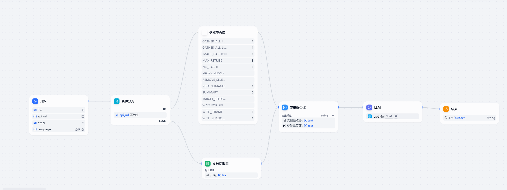

 上面的工作流有2个分支，一个是实现在线API文档，一个是用户上传已经有的离线版接口文档。（接口文档可以是PDF、word、markdown格式），用户通过上传接口文档后通过文档提取器或者jina AI 爬取在线文档，后面在发送给大语言模型，通过大模型转换输出接口文档对应的实现代码。下面给大家介绍下工作流是如何实现的。

# 2.工作流实现
我们这里创建一个工作流。

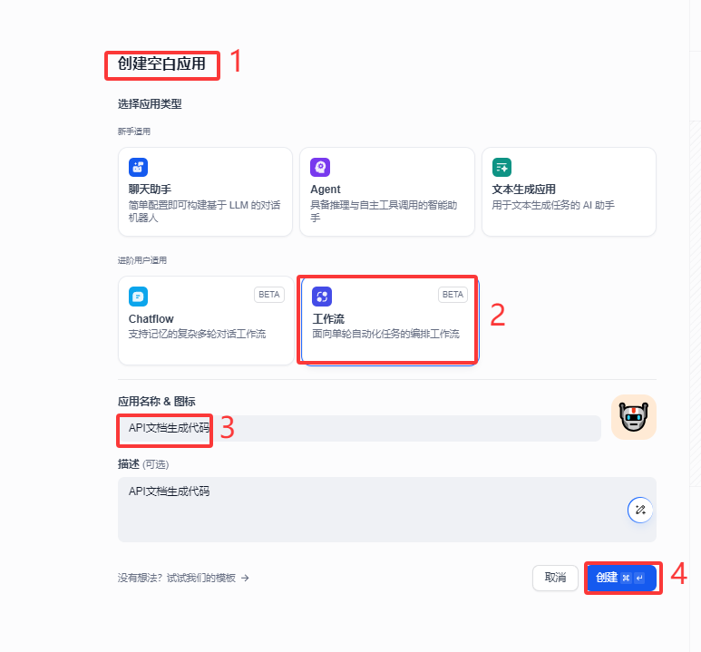

## 开始
 开始节点中我们这里设置4个值。 第一个值是 file,主要是用户上传的离线API 接口文档。

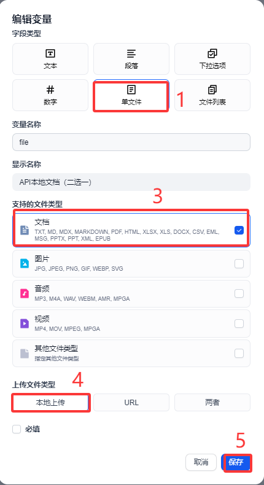

第二个参数我们接受用户输入的URL 这里我们设定文本类型。

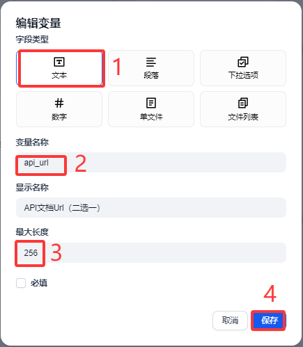

第三个参数主要接受用户输入的其他条件值，比如说 用户输入的 Authorization api 值，我们需要用户这个值后最后把它写带代码里面生成。避免生成的代码还需要修改等。这里我们设定段落，因为不确定用户输入哪些接口需要的特定的值。

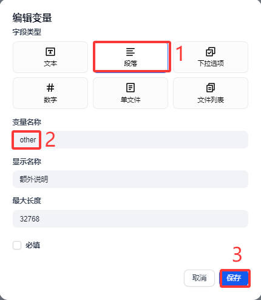

第四值 我们做成下拉选项，让用户根据API 接口生成对应的编程语言。这里我设定curl 、python、Java、goland、nodejs等几个主流的编程语言。这个选项我们设定必填项。

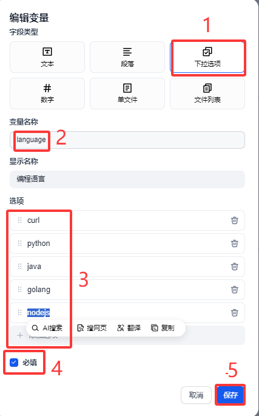

4个参考设定好后，开始节点内容如下：

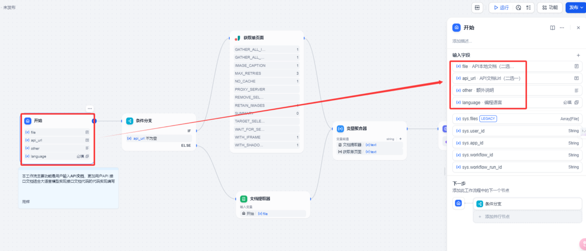

## 条件分支
这里我们做一下条件分支判断，目的是区分用户输入的是离线版本接口文档还是在线版本的API在线文档。我们使用api-url不为空作为判断依据

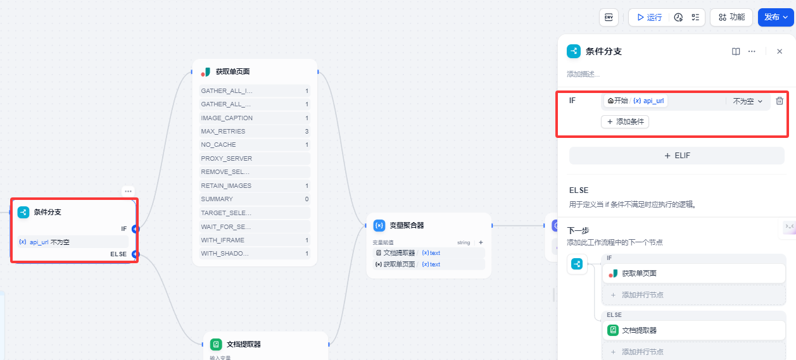

以上代码实现起来不算严谨，感兴趣的小伙伴可以在我们上面的工作流上修改和完善。

## jina AI获取单页面
这里我们需要一个jina AI的一个组件。这个组件主要的目的是用户输入的在线api 文档，这里我们使用302.AI 的官方在线文档接口—文/图生成视频

[https://302ai.apifox.cn/api-256199633](https://302ai.apifox.cn/api-256199633) 案例讲解。

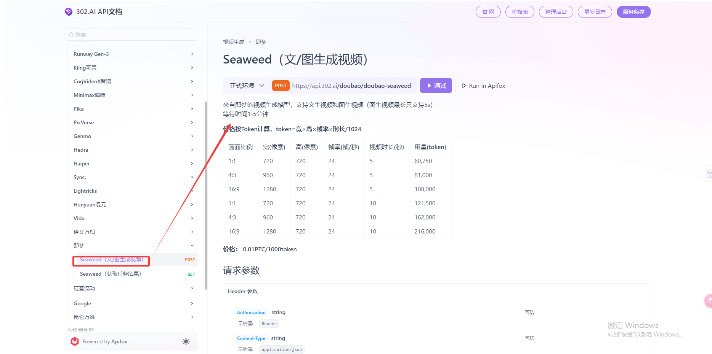

上面是一个标准的API 接口文档，我们需要利用jina AI来实现在线APi文档的抓取。

这里我们简单介绍一下这个Jina Reader

 jina-ai可以将网页转出markdown格式的文件，公司官方网[https://jina.ai/reader/](https://jina.ai/reader/)

### jina-ai 使用
 使用方法

1.访问网站[https://jina.ai/reader/](https://jina.ai/reader/)

 我们在左边输入需要抓取的URL链接，然后点击下面获取内容按钮，点击后右边就会把网页内容转换成markdown格式


1. 使用api 接口方式

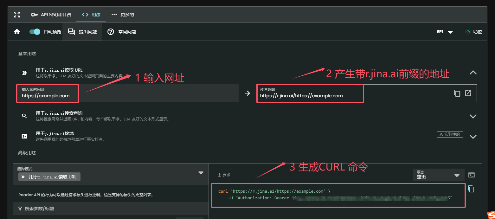

以上是在jina-ai网站上实现网页爬取。我们这里用到了dify工作流里面 jina-ai 内置组件来实现。

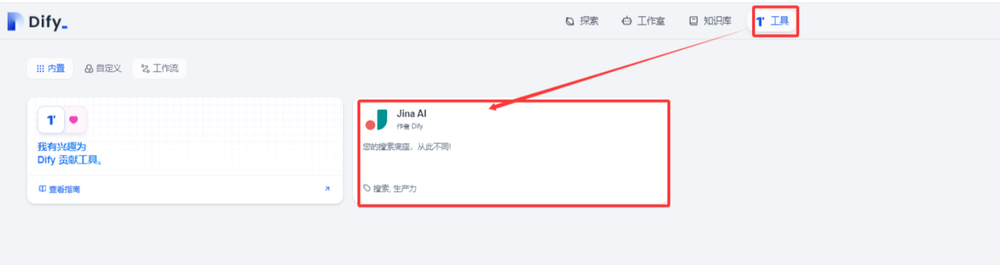

使用之前我们需要对这个组件授权添加apikey

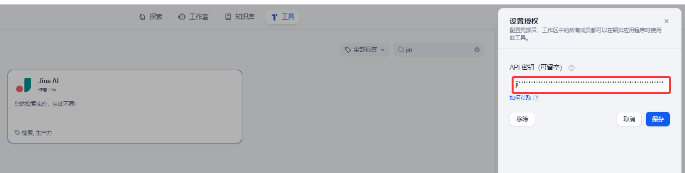

授权完成后，就变成可用状态

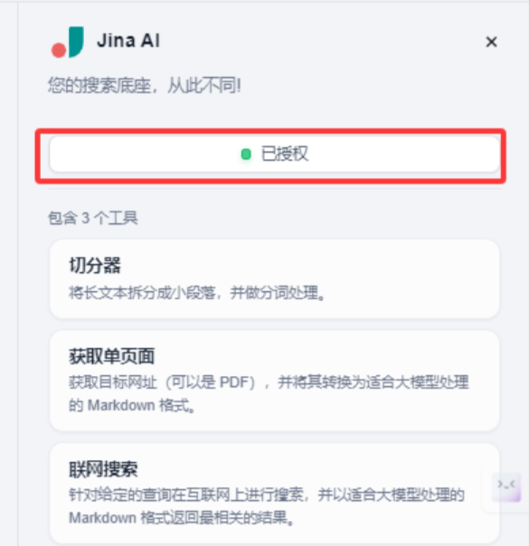

有的小伙伴可能会问，这个APIkey 在哪里获取，要钱吗？

我们可以在 [https://jina.ai/reader/](https://jina.ai/reader/) 网站上获取。目前这个api 送50万个（我测试使用基本上是够用的）

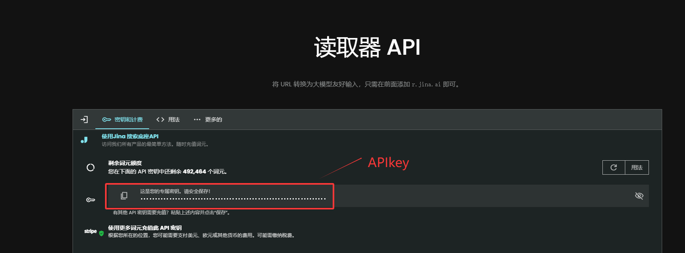

以上是关于jina-ai方面的知识，我们回到dify工作流中添加一个获取单页面的jina-ai ，如下图。

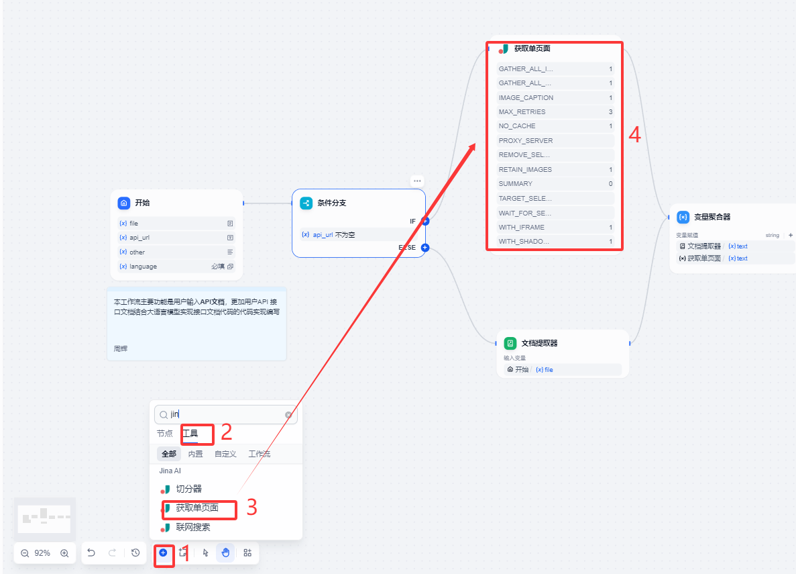

输入变量这里，我们主要是接受开始节点api_url，这个其实很好理解输入用户输入的网站地址信息让 jina-ai来爬取当前单个页面信息

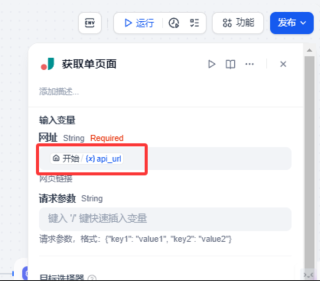

## 文档提取器
这个文档提取器在这里和上面jina AI 是一个并行关系，主要的目的是解析用户输入的离线的API 接口文档。这个组件用的比较多，我们这里就不做详细展开。

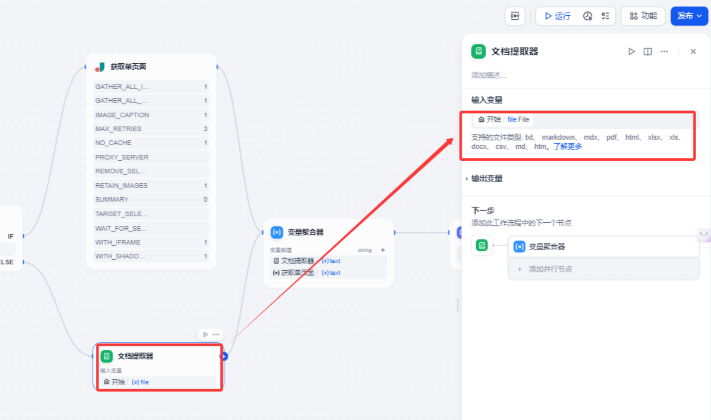

## 变量聚合器
主要目的是把文档提取器和网页获取的信息合并。本质上2个返回的结果都是接口文档内容信息。

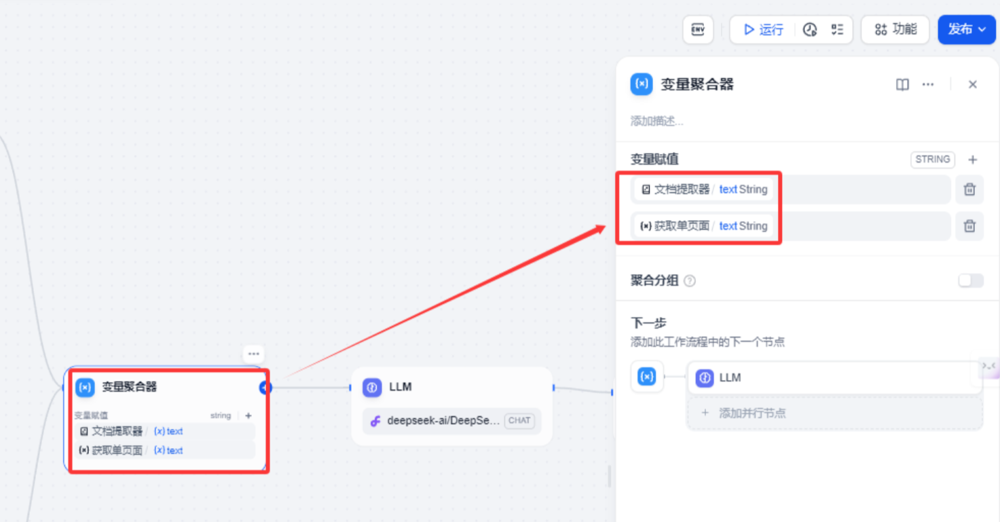

## llm大语言模型
这里我们使用llm大语言模型实现api 接口文档转换成代码实现文本生成。模型这块我们使用硅基流动提供的Qwen/QwQ-32B模型

系统提示词如下：

```markdown
# 你是一个软件工程师，帮助用户解读API文档并直接生成代码。
## 工作流程
1. 根据用户的要求解读API文档
2. 简要想用户介绍API文档中涉及到的接口
3. 根据用户的要求使用{{#1740959153996.language#}}编写测试代码

## 工作要求
1. 如果在输入的接口文档找没有找到接口，请向用户澄清。
2. 如果输入的接口文档中找到了多个接口，请向用户澄清具体是哪个接口。
3. 如果文档中涉及到了api-key或认证相关内容，可以使用用户提供加入到接口中。
4. 如果文档中提及了某些必须传入的参数和认证用的api-key，而用户没有提供，请告知用户未生成代码的具体原因，并询问用户该如何处理必需的参数。如：按照API文档的描述，在调用XX接口时，需要提供XX参数，并询问用户该如何处理？
5. 请注意API文档中描述的输入和输出参数的格式，严格按照文档中描述的格式组织代码。

## 输出格式
1. 编写测试代码
2. 解释每个输入参数和输出参数具体的含义
```

这里我们还需要输入用户提示词。

```markdown
接口文档内容如下{{#1740960349832.output#}}。
请使用 {{#1740959153996.language#}} 编写代码
用户要求：{{#1740959153996.other#}}
```

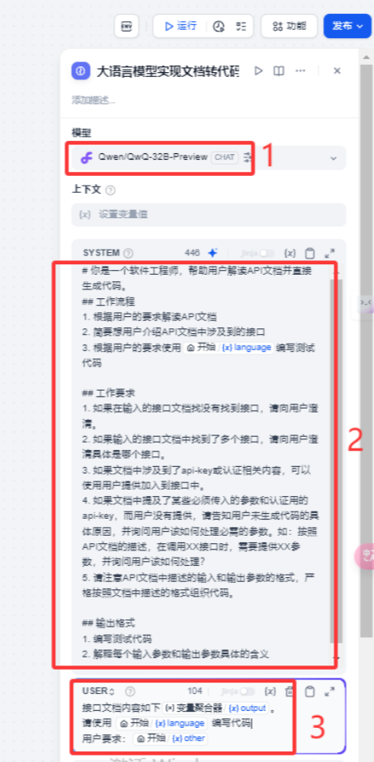

## 结束
后面的这个就是将大语言模型输出内容显示出来。

输出变量text 输出内容 text string

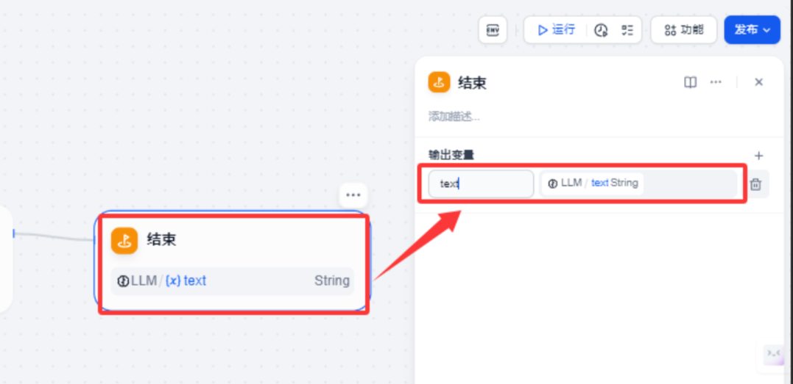

完成的工作流整体如下

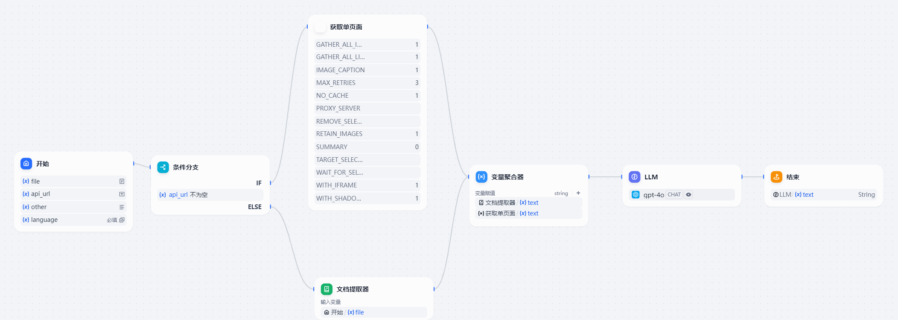

# 3.验证及测试
 因为流程中有2个测试点，离线文本接口和在线api接口。接下来我们分别测试一下。

## 3.1在线api接口
我们点击运行按钮，在API文档Ur 输入 api接口文档。这里我们以302.AI的一个文生视频文档接口为案例。

接口文档地址：[https://302ai.apifox.cn/api-256199633](https://302ai.apifox.cn/api-256199633)

额外说明： 我们填入接口需要的 Authorization Bearer xxx (方便生成的接口代码直接可以使用)

编程语言：选择python

点击开始运行按钮。

## 3.2 离线api接口
我们点击运行按钮，在API文档Ur 输入 api接口文档。这里我们以硅基流动I的一个文生图文档接口为案例。

额外说明： 我们填入接口需要的 Authorization Bearer xxx (方便生成的接口代码直接可以使用)

编程语言：选择python

点击开始运行按钮。


# 4.总结
今天主要带大家实现了从 API 接口文档生成代码的功能。详细介绍了整个工作流的实现步骤，工作流包含两个分支，分别处理在线 API 文档和离线接口文档


> 更新: 2025-06-30 09:36:11  
> 原文: <https://www.yuque.com/aaron-wecc3/dhluml/nu8u3622l04lmee3>