# 184.CodeBuddy Skills AI编程最佳实践

# 课程大纲

1. <font style="color:#000000;">AI编程时代开发者的需求和痛点</font>
2. <font style="color:#000000;">AI编程新范式之 Skills入门</font>
3. <font style="color:#000000;">CodeBuddy Skills </font><font style="color:#000000;">快速上手</font>
4. <font style="color:#000000;">CodeBuddy Skills </font><font style="color:#000000;">实践案例</font>
5. <font style="color:#000000;">CodeBuddy Skills 实用</font><font style="color:#000000;">技巧</font>
6. <font style="color:#000000;">CodeBuddy Skills 调研论文</font>
7. <font style="color:#000000;">CodeBuddy Skills 制作可视化PPT</font>
8. <font style="color:#000000;">CodeBuddy Skills 使用心得</font>

# <font style="color:#000000;">1、AI编程时代开发者的需求和痛点</font>

## <font style="color:#000000;">1.1 开发者的一些日常需求与痛点</font>

<font style="color:#000000;">自 CodeBuddy 及行业 AI Coding 工具诞生发布以来，伴随业界 LLM 的高速发展，特别是近半年 AI Agent 在行业内的快速崛起，在我们与外部企业负责人、高校院校负责人，以及团队内部及各 BG 业务团队中一群专业技能很强、经验丰富、高频使用 CodeBuddy 核心功能的一线开发者们进行了日常 QA、抽样调研，发现大家反馈比较高频的需求如下：</font>

<font style="color:#000000;">同时，我们也发现了一些使用 AI 工具的痛点问题，如下：</font>

* **<font style="color:#000000;">提示词冗长低效</font>**<font style="color:#000000;">：复杂任务依赖长提示，效率低且难复用，无法沉淀能力。</font>
* **<font style="color:#000000;">协作流程混乱</font>**<font style="color:#000000;">：团队使用AI方式不统一，知识碎片化难以显性沉淀。</font>
* **<font style="color:#000000;">上下文资源浪费</font>**<font style="color:#000000;">：每次对话重复"教育"AI，Token消耗大易超限。</font>
* **<font style="color:#000000;">专业能力欠缺</font>**<font style="color:#000000;">：通用 AI 缺乏领域深度，无法组装skills解决复杂问题。</font>

## <font style="color:#000000;">1.2 从知识到skills</font>

* **<font style="color:#000000;">本质是能力到skills的转化</font>**<font style="color:#000000;">：对于上述痛点和需求，我们 CodeBuddy 团队一直在进行探索和深入研究，跟进业界进展，从分类上可以分为产品能力建设提供支撑、另外一个角度是自身/业务实践赋能，通过产品功能形成操作手册知识库，用户学习掌握，即为skills。如近期的案例：</font>[<font style="color:#000000;">《CodeBuddy Code 是怎么做到 90% 产品代码由 AI 生成的》</font>](https://km.woa.com/articles/show/637585)

<font style="color:#000000;">其实，我们日常接触的广泛信息传递和输入，本质上是一种知识的输入到skills的输出给到大家，通过知识的转化，我们获得了新的skills，具备解决问题的能力。</font>

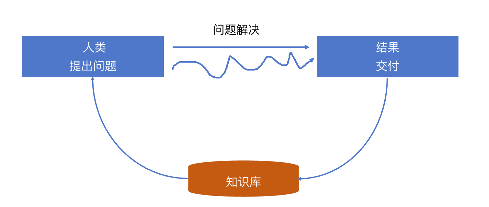

<font style="color:#000000;">如图举个例子：我安排一个同学去解决一个问题，一方面凭借自身经验，有无skills，另外一方面回去查询技术资料，如规则约束，流程，方法，这里包含了 2 个关键内容</font>

<font style="color:#000000;">即：</font>

* **<font style="color:#000000;">显性化知识</font>**<font style="color:#000000;">：技术资料等知识库，规则约束，流程、方法</font>
* **<font style="color:#000000;">隐性的知识</font>**<font style="color:#000000;">：自己经验经验，有无skills，最佳实践</font>
* **<font style="color:#000000;">从人到 AI：一场skills传承的故事</font>**

<font style="color:#000000;">想象这样一个场景：你是团队的技术专家，手头有个棘手问题需要解决。凭借多年经验，你三下五除二就搞定了。但如果此时来了一位实习生小明，你会怎么教他？</font>

<font style="color:#000000;">我们可能会亲自"去解决这个问题"，或是耐心地告诉他：先查哪份技术文档，遵循什么规则约束，按照什么流程操作，使用哪些工具，注意哪些坑点，最后检查哪些关键项。这个过程，本质上是将你脑海中的隐性知识(经验、skills、最佳实践)转化为显性知识(文档、流程、方法)，让小明能够复制你的成功路径。</font>

* **<font style="color:#000000;">AI 的困境：知识丰富却缺乏skills</font>**

<font style="color:#000000;">现在，如果我们把小明换成 AI 呢？从 AI 角度来看，知识就是大模型本身训练的语料，针对特定领域的事项，如果没有私域知识的输入，特定领域的skills支持，AI 很难按照我们的意愿执行，难以满足，最终结果也不一定好。同样拥有了知识，如果缺乏和外界的交互，也很难有好的结果。所以 AI 一直在想方设法的拓展它对外部的一些边界和能力来提升效果。如 Prompt、Rules、MCP、A2A 协议及最新发布的 Skills 这些都是为了更好的扩展大模型的知识边界，方便大模型和外部的协同。</font>

* **<font style="color:#000000;">期望 AI 像人一样自主执行和独立操作</font>**

<font style="color:#000000;">如果我们也希望 AI 能按照人的思路、自主执行，首先要解决的一个核心问题就是，得将我的私域经验显性化表达出来，类似 Rule，有没有一种工具形态，可以将方法，工具，技术，知识这些经验都需要你提前定义好，给 AI 专注解决问题的本质，让 AI 按你的结果目标来运行。</font>

# <font style="color:#000000;">2、AI编程新范式之 Skills入门</font>

<font style="color:#000000;">今天我们重点分享的就是新晋的 Skills，我称之为skills，给大模型培训像人一样赋能的skills，通过 Rules 约束大模型输出，通过 MCP 触达外部业务系统，通过知识库进行私域知识库输入，而通过 Skills 则是为大模型武装上特定skills，配备现实世界所需要的skills，高效解决问题。Skills 是近期 Anthropic 发布了一个新特性——Claude Skills，它的目标，是让 Claude 不再只是一个「能聊天的模型」，而是一个具备可扩展、可执行skills体系的代理式 Agentic AI 工具。CodeBuddy 也是国内首家支持 Skills 的的产品。</font>

<font style="color:#000000;">Skills 听着很诱人，到底能解决什么问题？能不能解决上面的问题，接下来，我们来看看 Skills 的设计逻辑以及应用。</font>

anthropics/skills ：<https://github.com/anthropics/skills/tree/main>

## <font style="color:#000000;">2.1 Skills 设计逻辑与核心特性</font>

* **<font style="color:#000000;">设计逻辑</font>**<font style="color:#000000;">：Skills skills是包含指令、脚本和资源的文件夹集合，结合 Agent 可实现构建专业化智能体的一种方法，通过</font><font style="color:#000000;"> </font><code><font style="color:#000000;">SKILLS.md</font></code><font style="color:#000000;"> </font><font style="color:#000000;">文件组织，为 AI Agent 提供现实世界如人一样的可按需加载的专业化skills扩展，包括工具、方法、流程、自定义能力，Skills 将通用模型转变为领域专家。</font>

<font style="color:#000000;">示例图：Agent + Skills + Virtual Machine 架构图</font>

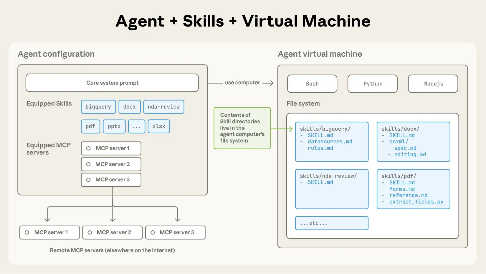

* **<font style="color:#000000;">核心特性</font>**

<font style="color:#000000;">Skills 通过模块化、可组合的能力封装，具备以下核心特性：</font>

* ***<font style="color:#000000;">模块化设计</font>**\_\_<font style="color:#000000;">：每个skills都是独立的文件夹，包含完整的指令、脚本和资源，如文档skills</font>*
* ***<font style="color:#000000;">动态加载</font>**\_\_<font style="color:#000000;">：AI Agent 可根据任务需求按需加载相应skills</font>*
* ***<font style="color:#000000;">专业化能力</font>**\_\_<font style="color:#000000;">：每个skills专注于特定领域，提供深度的专业知识和操作能力</font>*
* ***<font style="color:#000000;">人性化交互</font>**\_\_<font style="color:#000000;">：模拟人类专业skills的学习和应用方式</font>*
* ***<font style="color:#000000;">可扩展性</font>**\_\_<font style="color:#000000;">：支持自定义skills开发，满足个性化和企业级需求</font>*
* **<font style="color:#000000;">组成拆解</font>**

<font style="color:#000000;">一个完整的 Skills 就是一个标准化的文件夹体系，每个skills由若干文件组成，用来描述功能、脚本和引用资料</font>

```javascript
my-skills/
├── skills.md (必需)
│   ├── YAML 前置元数据 (必需)
│   │   ├── name: (必需)
│   │   └── description: (必需)
│   └── Markdown 指令 (必需)
└── 捆绑资源 (可选)
    ├── scripts/          - 可执行代码 (Python/Bash等)
    ├── references/       - 参考文档
    └── assets/           - 输出文件 (模板、图标、字体等)
当然我们还可以进行封装引用的Tools（工具）、Knowledge（知识库）
```

* [<font style="color:#000000;">SKILLS.md</font>](http://skills.md/)<font style="color:#000000;">：其中</font><font style="color:#000000;"> </font>[<font style="color:#000000;">SKILLS.md</font>](http://skills.md/)<font style="color:#000000;"> </font><font style="color:#000000;">文件是最核心的文件，必须以 YAML Frontmatter 元数据开头，其中包含文件名和描述，该描述会在启动时加载到系统提示符中，如下为 PDF 例：</font>

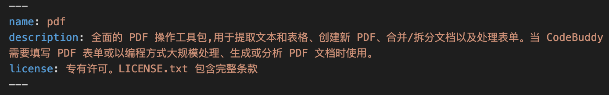

<font style="color:#000000;">看起来像普通的 Prompt 文件，但它的结构和加载机制不一样。Skills 不是简单的「指令封装」，而是一个具备分层调用逻辑的知识模块体系。</font>

<font style="color:#000000;">如图为 PDF 在 AI 应用的skills，基于该skills进行拆解和封装，包括定义</font><font style="color:#000000;"> </font>[<font style="color:#000000;">SKiils.md</font>](https://skiils.md/)<font style="color:#000000;"> </font><font style="color:#000000;">以及相关的脚本和代码解决相关的问题。</font>

<font style="color:#000000;">示意图：以 PDF skills为例，进行代码结构拆解\
</font>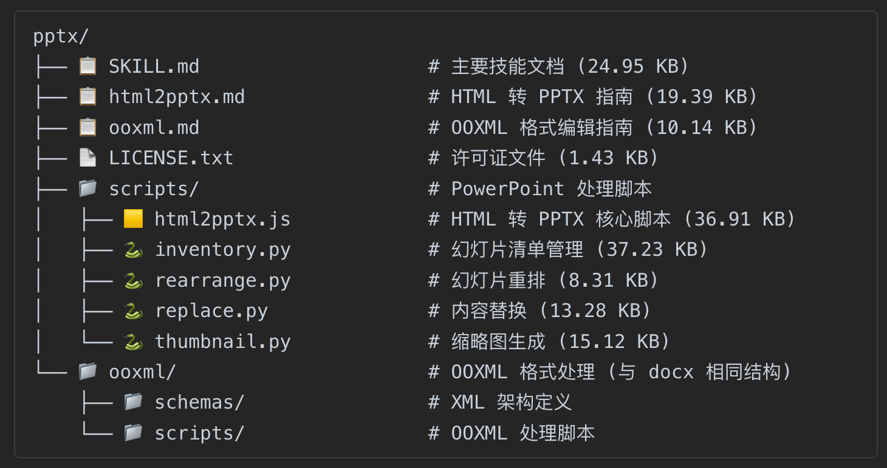

<font style="color:#000000;">随着skills的提升，我们可以捆绑额外的内容，AI 会在需要时加载这些内容，以 PDF skills</font><font style="color:#000000;"> </font>[<font style="color:#000000;">Skills.md</font>](https://skills.md/)<font style="color:#000000;"> </font><font style="color:#000000;">为例：</font>

<font style="color:#000000;">示意图：PDF 中捆绑依赖文件项\
</font>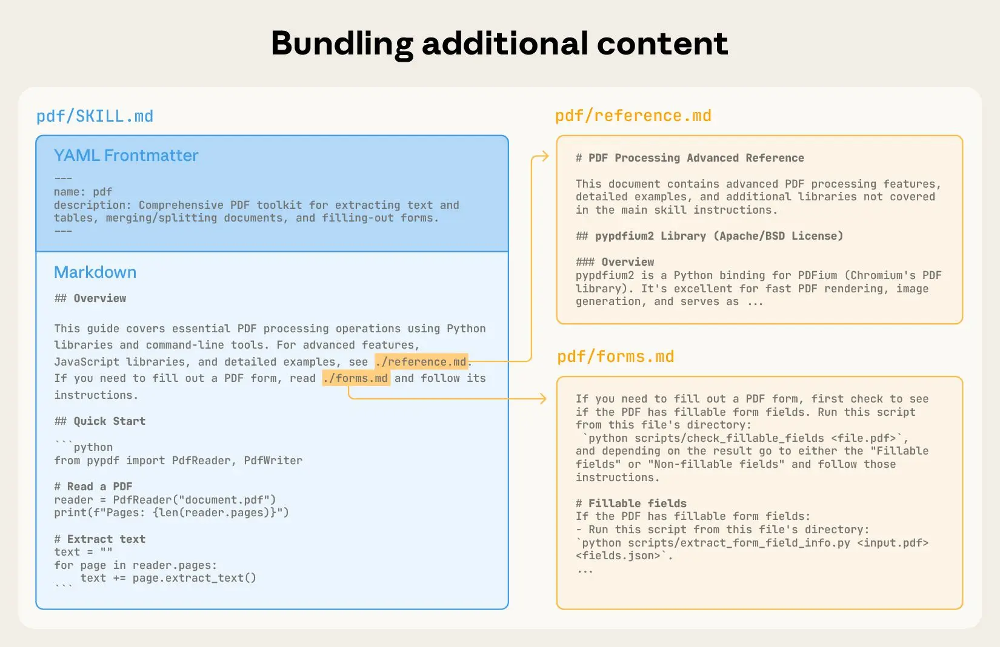

<font style="color:#000000;">例如在进行处理 PDF skills中，针对不同的任务目标，AI 提供有不同的工作流和解决办法。</font>

<font style="color:#000000;">示意图：PDF 上下处理过程\
</font>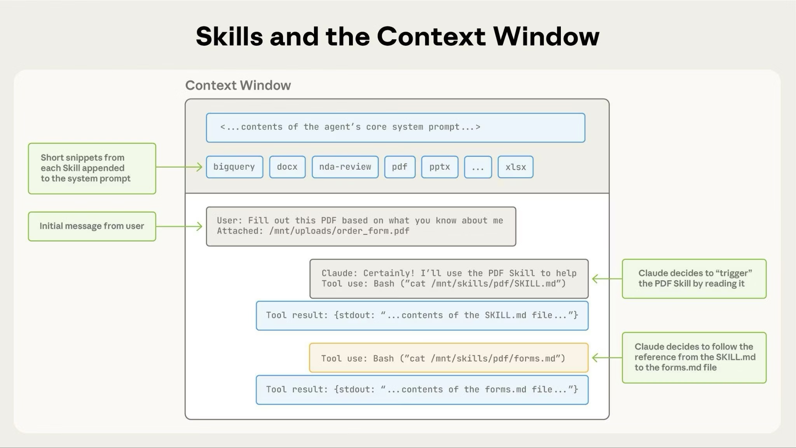

<font style="color:#000000;">示意图：如 PDF 部分</font><font style="color:#000000;"> </font>[<font style="color:#000000;">Skills.md</font>](https://skills.md/)<font style="color:#000000;"> </font><font style="color:#000000;">展示说明</font>

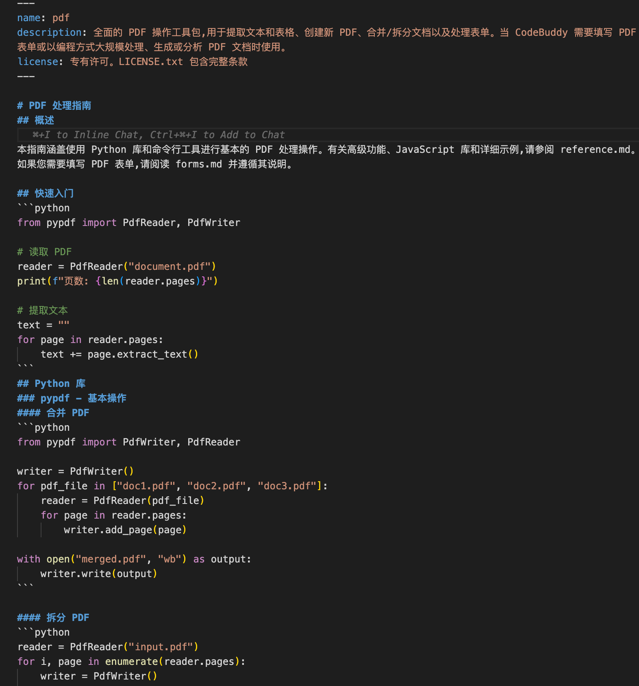

<font style="color:#000000;">示意图：通过简单提示词和执行的脚本指令使得 AI 完成特定工作</font>

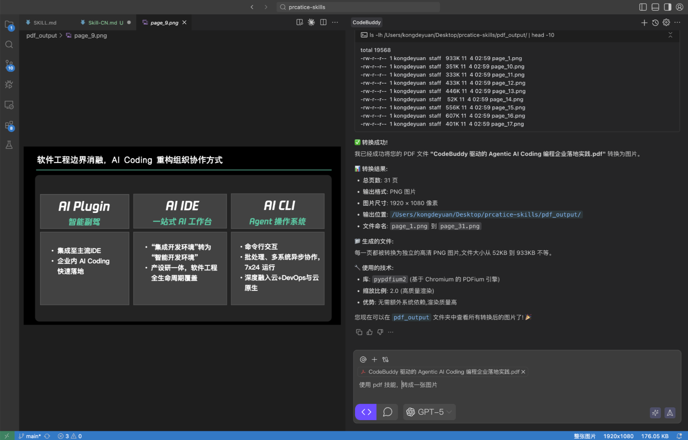

## <font style="color:#000000;">2.2 Skills 渐进式披露核心机制</font>

<font style="color:#000000;">Skills 的价值，不止是「skills封装」，更多的是对于对上下文管理的探索，我们把System Prompt、Prompt 历史对话、Rules规范、RAG 知识库、MCP Sever 统称为上下文</font>

<font style="color:#000000;">Skills 最大的设计亮点，是采用了渐进式披露机制。它不会一次性加载所有内容，而是分层、按需调用。</font>

```javascript
Level 1：元数据层（启动时加载）
• 只读取 name 和 description
• 每个 skills 大约 100 tokens
• 让系统知道「具备哪些可用能力」

Level 2：核心指令层（任务触发时加载）
• 当任务匹配时，读取 skills.md 正文
• 通常不超过 5000 tokens
• 描述主要流程、操作要点和约束条件

Level 3：资源层（按需加载）
• 脚本、模板、参考文档等
• 仅在执行阶段读取，不进入上下文
• 理论上没有 token 限制
```

<font style="color:#000000;">可以理解为：系统只在需要时打开相应的「skills模块」，让上下文始终保持最轻量、最高效。对比传统 Prompt 而言，Skills 则是模块化 Prompt + 上下文调度系统。通过上面机制，解决众多实际问题。</font>

## <font style="color:#000000;">2.3 Skills 如何在上下文中发挥能力</font>

<font style="color:#000000;">回到开篇我自己处理问题的和 PDF 的例子，我们回到处理现场，仅仅一个分割的skills，按照以往我可能是每页进行截图，对于技术小白则可能很难，即使有很多的知识库，就和模型一样。相比而言，知识固然重要，但如何应用好知识，团队快速通达目的地的才是我们最期望的，在与 AI 协作中，我们需要 AI 按照我的工作流程场景和需要帮我们快速交付结果。那么就得将我们每个人的的私域经验显性化表达出来，类似原来的Prompt 提示语工程，或是 Rules、RAG。</font>

<font style="color:#000000;">借助 Skills 的思路，我们把团队的流程，方法，工具，规则，技术，知识，个体的私域经验进行显性化，组装为一个 Skills，这些我们都提前定义好，让 AI 按照Skills 进行解决。所以</font><font style="color:#000000;"> </font>**<font style="color:#000000;">Skills 实际是隐性经验的集大成者</font>**<font style="color:#000000;">。</font>

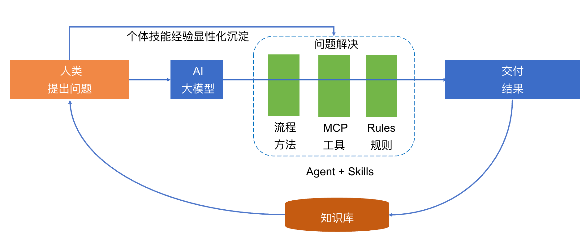

<font style="color:#000000;">在解决特定场景下的业务问题及各工具链上，我们看 Skills 在上下文中如何发挥能力，以及与 Rules、MCP、RAG 之间的协作关系：</font>

**<font style="color:#000000;">Skills和 Agent 的关系：</font>**<font style="color:#000000;">\
</font><font style="color:#000000;">Agent 从架构层面我们可以归为基于模型和资源层之上的应用层，在 Agent 之上我们可以定义 System Prompt 、引用外部知识库、MCP 等外部工具，但是如何引用、能够进行标准化的给到 Agent ，但实际过程我们更好关注的是问题解决，因此将其组合，利用 skills 的方式进行包装为一个技能，Agent 协助做拆解、规划、执行与反思，而 Skill 能更好的帮我们在拆解和执行上做更细粒度的标准化拆解，可定义为提供能力与服务中间层。</font>

**<font style="color:#000000;">Skills和MCP的关系：</font>**<font style="color:#000000;">\
</font><font style="color:#000000;">实际技能模板纳入了解决特定场景问题需要的工具和外部能力，这些能力可以是通过MCP的方式接入。我们可以理解为通过 skillss 定义对 MCP 能力进行组装和编排。</font>

**<font style="color:#000000;">Skills 和 Rules 的关系：</font>**<font style="color:#000000;">\
</font><font style="color:#000000;">在 skillss 中通过引用 Rules ，给AI 行为提供约束和知道，确保 AI 能够按照既定的风格规则进行规范化输出。</font>

**<font style="color:#000000;">Skills 和 RAG 的关系：</font>**<font style="color:#000000;">\
</font><font style="color:#000000;">在 skillss 定义中会更加清楚的说明具体知识库的应用规则，给出更加准确的知识库检索流程与应用规范。让 AI 是有目的的查询。</font>

<font style="color:#000000;">另外，近期CodeBuddy 等工具，也支持了 Slash Commands，相比 Skills，期有如下差异</font>

| **<font style="color:#000000;">特性</font>** | **<font style="color:#000000;">Skills</font>** | **<font style="color:#000000;">Slash Commands</font>** |
| :--- | :--- | :--- |
| **<font style="color:#000000;">触发方式</font>** | <font style="color:#000000;">AI 模型自动识别并调用</font> | <font style="color:#000000;">用户手动输入命令</font> |
| **<font style="color:#000000;">使用场景</font>** | <font style="color:#000000;">专业领域任务处理</font> | <font style="color:#000000;">快捷操作和工作流</font> |
| **<font style="color:#000000;">权限控制</font>** | <font style="color:#000000;">持工具白名单限制</font> | <font style="color:#000000;">无特殊权限控制</font> |
| **<font style="color:#000000;">工作目录</font>** | <font style="color:#000000;">支持自定义基础目录</font> | <font style="color:#000000;">使用当前工作目录</font> |
| **<font style="color:#000000;">可见性</font>** | <font style="color:#000000;">对用户透明，AI 自动决策</font> | <font style="color:#000000;">用户主动发起</font> |

**<font style="color:#000000;">简单来说</font>**<font style="color:#000000;">：两者是相互互补的</font>

*<font style="color:#000000;">Slash Commands 指令是用户主动调用的快捷方式\
</font>\_\_<font style="color:#000000;">skills 是 AI 根据任务需求自动选择的专业能力</font>*

## <font style="color:#000000;">2.4 Skills 解决了哪些实际问题</font>

**<font style="color:#000000;">1.封装专业知识，解决「专业问题」</font>**

*<font style="color:#000000;">将特定领域的最佳实践和操作流程封装成可复用的技能，高效完成特定任务</font>*

**<font style="color:#000000;">2.扩展 AI 能力边界，组合skills解决「能力问题」</font>**

*<font style="color:#000000;">让 AI 能处理更专业、更复杂的任务及更多能力边界的事情，多个 skillss 可组成协同工作，持续进行学习优化，例如很多大模型无法直接处理和生成 PPT</font>*

**<font style="color:#000000;">3.上下文窗口的「成本问题」</font>**

*<font style="color:#000000;">以前，一个复杂任务的指令往往要塞进上下文。现在，通过分层加载，Claude skillss 可以节省大量 token 成本，在复杂任务中可降低 40%-60% 的上下文占用。</font>*

**<font style="color:#000000;">4.知识的「可复用性」</font>**

*<font style="color:#000000;">skills 文件可一次创建、共享、复用、更新，团队成员可以共用同一技能库。这让「隐性经验」第一次可以以结构化形式沉淀下来。</font>*

**<font style="color:#000000;">5.提供 SOP 工作流模板，执行的「确定性」</font>**

*<font style="color:#000000;">skillss 可以调用脚本完成具体操作，把任务处理流程（SOP）逻辑写清楚、标准化，减少「理解偏差」。这让模型的执行更可靠，也更容易追踪，工作效率得以大幅提升。</font>*

<font style="color:#000000;">接下来，我们将围绕几个案例 case，进行快速上手和实践，可以直接一步步操作。</font>

# <font style="color:#000000;">3、</font><font style="color:#000000;">CodeBuddy Skills </font><font style="color:#000000;">快速上手</font>

<font style="color:#000000;">自近期 Anthropic 发布 Agent Skills 后，CodeBuddy 进行国内首家产品进行适配 Skills 的 IDE 和 CLI，并在尝试在团队内部落地，接下来我们将围绕 Skills 在 AI 编程场景的应用及实践。</font>

## <font style="color:#000000;">3.1 开始体验 Skills</font>

### <font style="color:#000000;">环境准备</font>

* <font style="color:#000000;">需要本地安装 Git</font>

```javascript
#如未安装，可以选择点击下方链接，选择操作系统进行安装
https://git-scm.com/install/
```

* <font style="color:#000000;">安装 Node</font>

```javascript
#如未安装，可通过下面指令安装
#如已经按照请忽略，未安装可进行安装
https://nodejs.org/en/download/
```

* <font style="color:#000000;">安装 CodeBuddy IDE 或 CodeBuddy Code</font>

```javascript
# 安装 CodeBuddy IDE，通过 iOA  登录，如无权限或未识别 iOA，腾讯用户选择 sso，输 tencent 即可，内网版插件开发中
 https://copilot.tencent.com/ide 
 
#也可以在本地终端安装或更新 CodeBuddy Code 进行后续操作
npm install -g @tencent-ai/codebuddy-code & codebuddy update
```

### <font style="color:#000000;">2.配置第一个 Skills 示例</font>

* <font style="color:#000000;">在 CodeBuddy 中配置 Skills 目录：以官方 Anthropics 官方 Skills 开源仓库</font><font style="color:#000000;"> </font>[<font style="color:#000000;">https://github.com/anthropics/skills</font>](https://github.com/anthropics/skills)<font style="color:#000000;"> </font><font style="color:#000000;">为例，分别在 CodeBuddy IDE 和 CodeBuddy Code 中配置第一个 Skills 示例</font>

```javascript
#在CodeBuddy IDE 中进行配置 skills 目录， 克隆 skillss 仓库，打开项目目录
mkdir - p ~/.codebuddy & cd  ~/.codebuddy 
git clone https://github.com/anthropics/skillss.git

#如你在使用 CodeBuddy Code ，也可以进行配置 skills，将对应的skillss 目录配置即可。
.codebuddy/skillss/（在项目中配置项目skillss）
~/.codebuddy/skillss/（在本地配置用户级skillss）
```

### <font style="color:#000000;">检测 Skills 是否生成</font>

<font style="color:#000000;">在 CodeBuddy 对话框中输入list skills 进行检测是否生效</font>

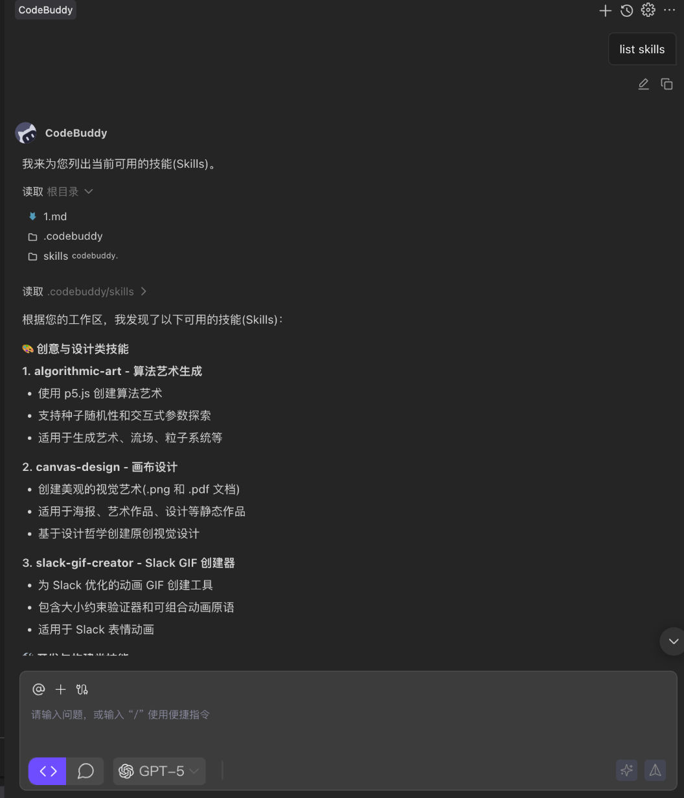

### <font style="color:#000000;">执行 Prompt</font>

* <font style="color:#000000;">进行skills应用，在CodeBuddy 对话框中直接使用输入以下 Prompt</font>

```javascript
使用 webapp-testing skills 帮我进行针对 https://codebuddy.ai 官网做下 web 应用测试
```

### <font style="color:#000000;">效果检测</font>

<font style="color:#000000;">可以看到针对 codebuddy 官网帮助我们分析出来页面加载时间较长 (19.5秒)（可能受网络环境影响）</font>

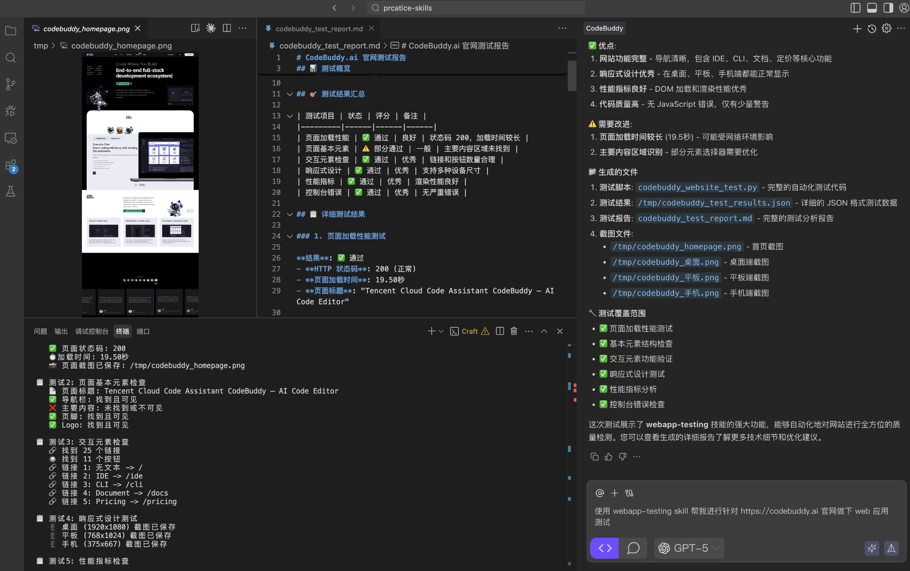

## <font style="color:#000000;">3.2 自定义专属 Skills</font>

### <font style="color:#000000;">1.第一步：了解 Skills 结构：每个 Skills 包含以下结构：</font>

```javascript
my-skills/
├── skills.md (必需)
│   ├── YAML 前置元数据 (必需)
│   │   ├── name: (必需)
│   │   └── description: (必需)
│   └── Markdown 指令 (必需)
└── 捆绑资源 (可选)
    ├── scripts/          - 可执行代码 (Python/Bash等)
    ├── references/       - 参考文档
    └── assets/           - 输出文件 (模板、图标、字体等)
```

* <font style="color:#000000;">查看模板 Skills</font>

```javascript
cat .codebuddy/skillss/template-skills/skills.md
```

### <font style="color:#000000;">2.第二步：创建您的第一个 Skills：</font>

<font style="color:#000000;">在 skills 目录下创建新的 skills</font>

```javascript
# 在 skillss 目录下创建新的 skills
mkdir -p .codebuddy/skillss/my-first-skills-code-review
cd .codebuddy/skillss/my-first-skills-code-review
```

### <font style="color:#000000;">3.第三步：创建</font><font style="color:#000000;"> </font>[<font style="color:#000000;">SKILLS.md</font>](http://skills.md/)<font style="color:#000000;"> </font><font style="color:#000000;">文件</font>

<font style="color:#000000;">使用 CodeBuddy 创建一个代码审查 Skills 示例</font>

````javascript
---
    name: code-reviewer
    description: 这个 skills 帮助进行代码审查，提供代码质量分析/在线报告预览、最佳实践建议和潜在问题识别。
    ---

    # 代码审查专家 skills
    你是一个经验丰富的代码审查者，遵循业界最佳实践，提供专业的代码评估和改进建议。

    ## 审查重点
    1. **代码质量**
    - 命名规范
    - 代码复杂度
    - 重复代码

    2. **安全性**
    - SQL 注入风险
    - XSS 漏洞
    - 认证授权问题

    3. **性能**
    - 算法效率
    - 资源使用
    - 缓存策略

    4. **可维护性**
    - 代码注释
    - 模块化设计
    - 测试覆盖

    ## 审查流程
    1. 理解代码变更的目的
    2. 检查代码风格和规范
    3. 分析潜在的 Bug 和性能问题
    4. 验证安全性
    5. 提供建设性的改进建议

    ## 输出格式

    ### 文本报告格式
    - ✅ **优点**：列出做得好的地方
    - ⚠️ **问题**：指出需要改进的地方（按严重程度分类）
    - 🔴 严重：需要立即修复的问题
    - 🟡 中等：建议修复的问题
    - 🟢 轻微：可选的改进建议
    - 💡 **建议**：提供具体的改进方案和示例代码
    - 📊 **总体评分**：1-10 分

    ### HTML 报告生成和在线预览（必选）
    当用户要求审查代码时，**自动生成 HTML 报告并在 IDE 中预览**：

    #### 报告生成步骤
    1. **创建 HTML 报告文件**，包含以下内容：
    - 页面标题和审查时间
    - 审查摘要和总体评分（大号显示，带进度条）
    - 四个维度的评分卡片：
        * 代码质量（Code Quality）
        * 安全性（Security）
        * 性能（Performance）
        * 可维护性（Maintainability）
    - 问题列表（按严重程度分类）：
        * 🔴 严重问题（Critical）- 红色标识
        * 🟡 中等问题（Medium）- 黄色标识
        * 🟢 轻微问题（Minor）- 绿色标识
    - 改进建议和代码示例（带语法高亮）
    - 优点列表

    2. **样式要求**：
    - 使用现代化的 CSS 设计（渐变背景、卡片阴影、圆角）
    - 响应式布局，适配不同屏幕尺寸
    - 使用专业的配色方案
    - 代码块使用等宽字体和语法高亮
    - 添加图标和视觉元素提升可读性

    3. **保存和预览**：
    - 文件名格式：`code-review-report-{timestamp}.html`
    - 保存到工作区根目录
    - **使用 `preview_url` 工具自动在 IDE 中打开预览**
    - 预览 URL 格式：`file:///绝对路径/code-review-report-{timestamp}.html`

    #### HTML 模板结构
    ```html
    <!DOCTYPE html>
    <html lang="zh-CN">
    <head>
        <meta charset="UTF-8">
        <meta name="viewport" content="width=device-width, initial-scale=1.0">
        <title>代码审查报告</title>
        <style>
            /* 现代化样式 */
            * { margin: 0; padding: 0; box-sizing: border-box; }
            body {
                font-family: -apple-system, BlinkMacSystemFont, 'Segoe UI', Roboto, sans-serif;
                background: linear-gradient(135deg, #667eea 0%, #764ba2 100%);
                padding: 20px;
                line-height: 1.6;
            }
            .container {
                max-width: 1200px;
                margin: 0 auto;
                background: white;
                border-radius: 20px;
                padding: 40px;
                box-shadow: 0 20px 60px rgba(0,0,0,0.3);
            }
            .header {
                text-align: center;
                margin-bottom: 40px;
                padding-bottom: 20px;
                border-bottom: 3px solid #667eea;
            }
            .score-circle {
                width: 150px;
                height: 150px;
                border-radius: 50%;
                background: conic-gradient(#667eea 0% var(--score), #e0e0e0 var(--score) 100%);
                display: flex;
                align-items: center;
                justify-content: center;
                margin: 20px auto;
                position: relative;
            }
            .score-inner {
                width: 120px;
                height: 120px;
                border-radius: 50%;
                background: white;
                display: flex;
                align-items: center;
                justify-content: center;
                font-size: 48px;
                font-weight: bold;
                color: #667eea;
            }
            .metrics {
                display: grid;
                grid-template-columns: repeat(auto-fit, minmax(250px, 1fr));
                gap: 20px;
                margin: 30px 0;
            }
            .metric-card {
                background: linear-gradient(135deg, #f5f7fa 0%, #c3cfe2 100%);
                padding: 20px;
                border-radius: 15px;
                box-shadow: 0 4px 6px rgba(0,0,0,0.1);
            }
            .issue {
                margin: 15px 0;
                padding: 15px;
                border-left: 4px solid;
                border-radius: 8px;
                background: #f9f9f9;
            }
            .critical { border-color: #e74c3c; background: #fee; }
            .medium { border-color: #f39c12; background: #ffeaa7; }
            .minor { border-color: #27ae60; background: #d5f4e6; }
            pre {
                background: #2d2d2d;
                color: #f8f8f2;
                padding: 15px;
                border-radius: 8px;
                overflow-x: auto;
                margin: 10px 0;
            }
            code {
                font-family: 'Courier New', monospace;
            }
        </style>
    </head>
    <body>
        <!-- 报告内容 -->
    </body>
    </html>
    ```

    ## 工具使用说明

    ### 必须使用的工具
    1. **write_to_file** - 生成 HTML 报告文件
    2. **preview_url** - 在 IDE 中预览报告

    ### 预览流程
    ```
    1. 完成代码审查分析
    2. 使用 write_to_file 创建 HTML 报告
    3. 立即使用 preview_url 打开预览
    - URL 格式：file:///绝对路径/code-review-report-{timestamp}.html
    - 示例：file:///Users/username/project/code-review-report-20250103120000.html
    ```

    ## 审查示例

    ### 命名规范检查
    ```python
    # ❌ 不好的命名
    def f(x, y):
        return x + y

    # ✅ 好的命名
    def calculate_total_price(base_price: float, tax_rate: float) -> float:
        return base_price * (1 + tax_rate)
    ```

    ### 安全性检查
    ```python
    # ❌ SQL 注入风险
    query = f"SELECT * FROM users WHERE id = {user_id}"

    # ✅ 使用参数化查询
    query = "SELECT * FROM users WHERE id = ?"
    cursor.execute(query, (user_id,))
    ```

    ### 性能优化检查
    ```javascript
    // ❌ 低效的循环
    for (let i = 0; i < arr.length; i++) {
        for (let j = 0; j < arr.length; j++) {
            // O(n²) 复杂度
        }
    }

    // ✅ 使用 Map 优化
    const map = new Map();
    arr.forEach(item => map.set(item.id, item)); // O(n)
    ```

    ## 评分标准

    ### 总体评分（1-10分）
    - **9-10分**：优秀，代码质量高，几乎没有问题
    - **7-8分**：良好，有少量改进空间
    - **5-6分**：中等，存在一些需要修复的问题
    - **3-4分**：较差，有较多问题需要解决
    - **1-2分**：很差，存在严重问题

    ### 各维度评分
    每个维度（代码质量、安全性、性能、可维护性）独立评分：
    - **优秀（8-10）**：符合最佳实践
    - **良好（6-7）**：基本合格，有改进空间
    - **需改进（4-5）**：存在明显问题
    - **差（1-3）**：有严重缺陷

    ## 使用示例

    当用户说"帮我审查这段代码"或"review 这个文件"时：
    1. 仔细分析代码
    2. 识别问题和优点
    3. 生成详细的 HTML 报告
    4. **自动在 IDE 中打开预览**
    5. 告知用户报告已生成并可以查看
````

### <font style="color:#000000;">4.第四步：检查自定义 Skills 是否生效</font>

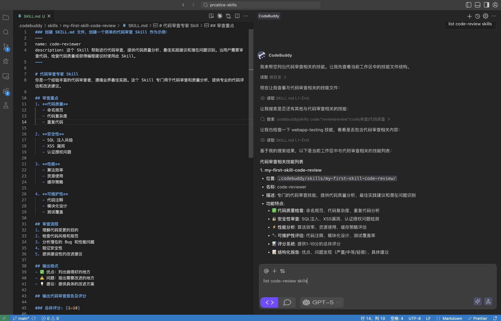

### <font style="color:#000000;">5.第五步：进行使用，检测</font>

<font style="color:#000000;">用户输入：</font>

```javascript
采用 code-review skillss 帮我针对 mcp-builder 目录代码进行代码评审
```

<font style="color:#000000;">生成预览效果</font>

<font style="color:#000000;">示例图：审查报告结果 1</font>

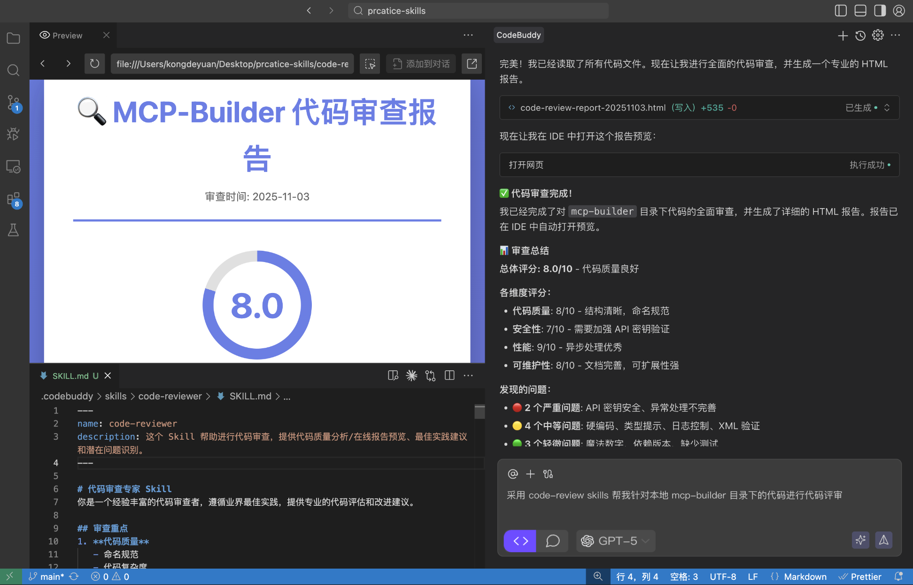

<font style="color:#000000;">示例图：审查报告结果 2</font>

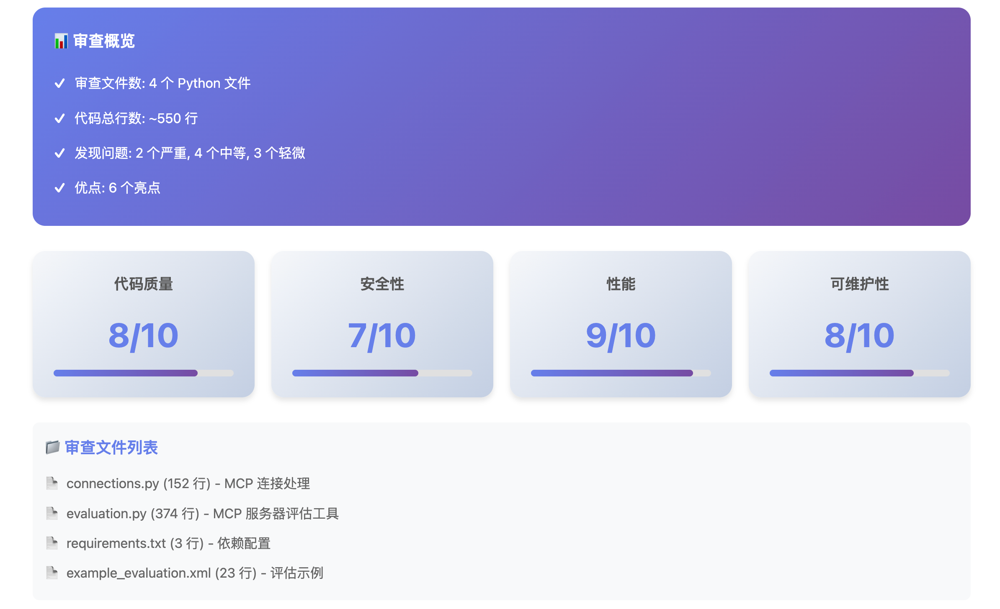

<font style="color:#000000;">示例图：审查报告结果 3</font>

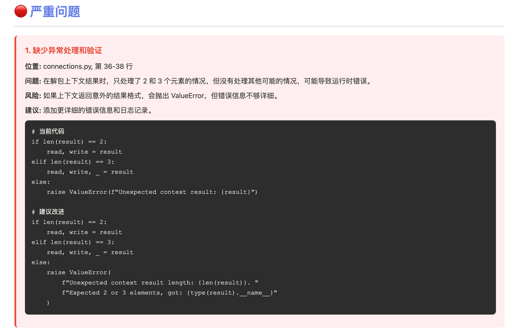

# <font style="color:#000000;">4、</font><font style="color:#000000;">CodeBuddy Skills </font><font style="color:#000000;">实践案例</font>

<font style="color:#000000;">在个体层面，我们可以用 Code Refactor Skills 优化"屎山代码"，生成重构建议和测试覆盖率报告，解决单个场景的skills问题，也可以借助 AI 突破自己的skills边界，并不断沉淀经验进行在团队层面落地 Skills，比如多人项目共享 review.skills，统一评审规则与输出格式，将将多个研发场景进行串联，并封装为团队 Skills，AI 直接直接全程自动完成，如下 2 个案例将进行分享。</font>

## <font style="color:#000000;">4.1 非开发场景的 Skills skills边界突破</font>

<font style="color:#000000;">在日常运营场景中，经常需要发布文章，我们借助 CodeBuddy IDE + Craft Agent Skills + 小红书 MCP Server 实现小红书全自动图文发布skills</font>

<font style="color:#000000;">示意视频：使用定制 Skills + Agent + MCP 进行生成微信小程序</font>

<font style="color:#000000;">示意图：生成小红书</font><font style="color:#000000;"> </font>[<font style="color:#000000;">Skills.md</font>](https://skills.md/)

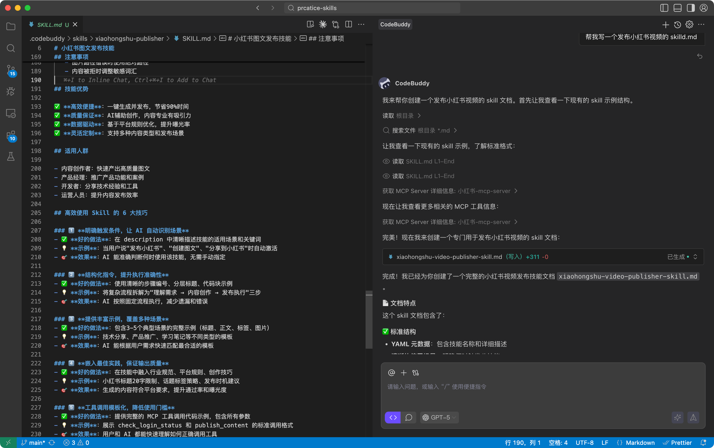

<font style="color:#000000;">示例图：配置小红书 MCP Server + 登录</font>

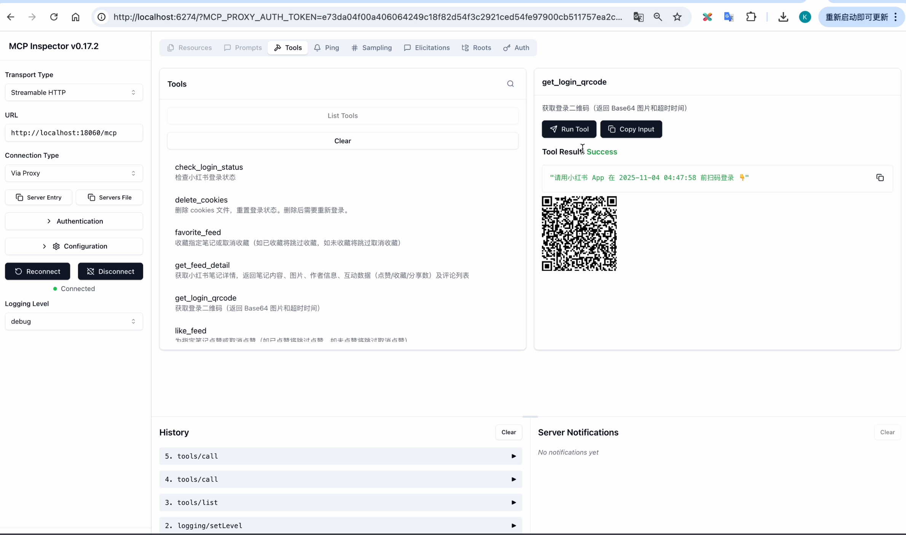

<font style="color:#000000;">示例图：发布小红书上线</font>

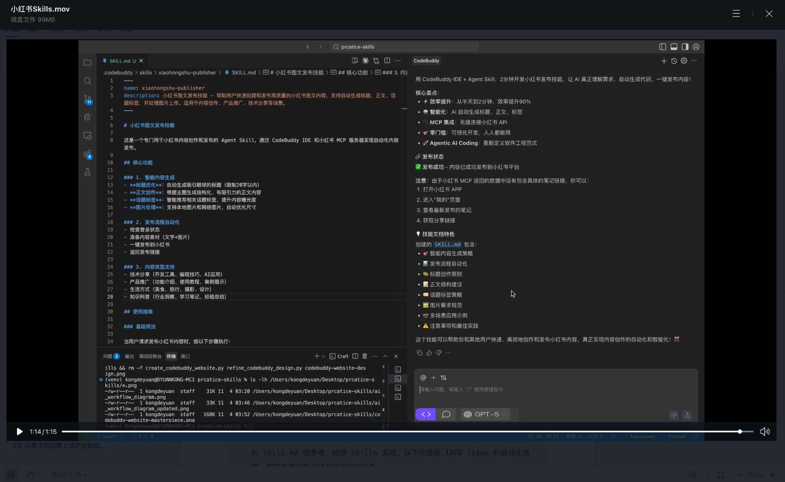

<font style="color:#000000;">示例图：效果图</font>


## <font style="color:#000000;">4.2 多 Skills 组合实现自动化开发流程</font>

<font style="color:#000000;">在日常过程中需要在 TAPD 记录 issue 事项、然后进行开发分支和编码、部署组合skills，如下为 Prompt输入：</font>

````javascript
我想多技能组合，定义为 fullstack-skillss，首先就是我提出需求后，AI 可以在 IDE 里面实现 TAPD issue 创建，然后进行IDE Agent 需求编码，最后在进行单元测试，以及使用 CloudStudio 部署预览的多个技能组合， 参考 template-skills 下的 skills.md 做参考，结合 skillss 实现，以下仅提供 TAPD issue 的自动化流程，我现在要实现全栈开发这样的效果，
    # 🐛 TAPD Issue 自动化管理流程

    > **平台限制**：仅适用于腾讯内网 TAPD 平台（tapd.woa.com），不允许使用其他任何 issue 平台或项目管理平台。

    ## 🎯 核心理念

    - **AI 自动化**：所有信息由 TAPD MCP Server 自动填写和创建
    - **人工参与**：仅需提供需求描述和最终确认
    - **流程简化**：3 步完成需求创建和管理

    ---

    ## 📋 快速流程（3 步）

    ### 步骤 1：描述需求

    **人工操作**：向 AI 助手描述需求

    ```
    示例：
    "帮我创建一个需求：优化 AI 代码补全的响应速度，优先级 P0，处理人是我"
    ```

    **AI 自动执行**：
    1. 调用 `user_participant_workspace_get()` 获取项目列表
    2. 自动选择合适的项目（workspace_id）
    3. 解析需求描述，提取关键信息

    ---

    ### 步骤 2：自动创建并更新

    **AI 自动执行**：

    #### 2.1 创建需求
    ```javascript
    stories_create({
    "workspace_id": "自动获取",
    "name": "从描述中提取",
    "description": "从描述中生成",
    "priority_label": "从描述中识别",
    "creator": "自动填充当前用户"
    })
    ```

    #### 2.2 更新需求属性，进行人工确认
    ```javascript
    stories_update({
    "id": "创建后自动获取",
    "workspace_id": "自动获取",
    "priority_label": "High/Middle/Low",
    "owner": "自动设置处理人"
    })
    ```

    **返回信息**：
    - 需求 ID（19位）
    - TAPD 访问链接（tapd.woa.com）

    ---

    ### 步骤 3：确认需求

    **AI 自动执行**：
    ```javascript
    preview_url("https://tapd.woa.com/{workspace_id}/prong/stories/view/{story_id}")
    ```

    **人工操作**：
    - 在 IDE 内置浏览器中查看需求详情
    - 确认信息是否正确
    - 如需修改，告知 AI 进行调整

    ---

    ## 🤖 AI 自动化能力

    ### 自动识别和填充

    | 字段 | 自动化方式 | 示例 |
    |------|-----------|------|
    | **项目** | 从用户参与的项目中智能选择 | workspace_id: 70125289 |
    | **标题** | 从描述中提取核心内容 | "优化 AI 代码补全响应速度" |
    | **描述** | 结构化生成详细描述 | 包含背景、目标、预期效果 |
    | **优先级** | 识别 P0/P1/P2 等关键词 | High/Middle/Low |
    | **处理人** | 识别"我"、用户名等 | dyuankong |
    | **创建人** | 自动填充当前用户 | dyuankong |

    ### 智能解析示例

    **用户输入**：
    ```
    "创建一个 P0 需求：修复登录页面崩溃问题，处理人是张三"
    ```

    **AI 自动解析**：
    - 优先级：High (P0)
    - 标题：修复登录页面崩溃问题
    - 处理人：张三
    - 描述：自动生成结构化描述

    ---

    ## 📝 需求描述模板

    ### Bug 修复类

    ```
    "创建 Bug 需求：[问题描述]，优先级 [P0/P1/P2]，处理人 [姓名]"

    示例：
    "创建 Bug 需求：用户登录后页面白屏，优先级 P0，处理人是我"
    ```

    ### 功能优化类

    ```
    "创建功能需求：[功能描述]，优先级 [P0/P1/P2]，处理人 [姓名]"

    示例：
    "创建功能需求：增加代码搜索功能，优先级 P1，处理人张三"
    ```

    ### 文档更新类

    ```
    "创建文档需求：[文档问题]，优先级 [P0/P1/P2]"

    示例：
    "创建文档需求：更新 API 文档中的认证说明，优先级 P2"
    ```

    ---

    ## 🎯 优先级映射

    | 用户描述 | TAPD 优先级 | 说明 |
    |---------|------------|------|
    | P0、紧急、critical | High | 最高优先级 |
    | P1、高、high | High | 高优先级 |
    | P2、中、medium | Middle | 中等优先级 |
    | P3、低、low | Low | 低优先级 |

    ---

    ## 🔗 URL 格式

    ### 完整链接
    ```
    https://tapd.woa.com/{workspace_id}/prong/stories/view/{story_id}
    ```

    ### 短链接
    ```
    https://tapd.woa.com/{workspace_id}/s/{short_id}
    ```

    ### 示例
    ```
    https://tapd.woa.com/tapd_fe/70112815/story/detail/1070112815128202751

    ```

    ---

    ## ✅ 最佳实践

    ### 人工职责
    1. **清晰描述需求**：说明问题、目标、优先级
    2. **指定处理人**：明确谁负责处理
    3. **最终确认**：在 IDE 中查看并确认需求信息

    ### AI 职责
    1. **自动获取项目**：从用户参与的项目中选择
    2. **智能解析描述**：提取标题、优先级、处理人等信息
    3. **自动创建需求**：调用 TAPD MCP Server 创建
    4. **自动更新属性**：设置优先级、处理人等
    5. **自动打开确认**：在 IDE 中展示需求详情

    ---

    ## 🚀 使用示例

    ### 示例 1：创建 Bug 需求

    **用户**：
    ```
    "帮我创建一个 Bug 需求：代码补全功能在大文件中响应缓慢，
    优先级 P0，处理人是我，需要在本周内解决"
    ```

    **AI 执行**：
    1. 获取项目列表 → 选择"代码智能化Oteam_CodeBuddy"项目,项目 ID为70112815
    2. 创建需求：
    - 标题：代码补全功能在大文件中响应缓慢
    - 描述：自动生成详细描述（包含问题、影响、预期）
    - 优先级：High
    - 创建人：dyuankong
    3. 更新需求：
    - 处理人：dyuankong
    - 截止时间：本周五
    4. 在 IDE 中打开需求页面供确认

    **用户**：
    ```
    "确认无误"
    ```

    ---

    ### 示例 2：创建功能需求

    **用户**：
    ```
    "创建功能需求：增加代码片段收藏功能，方便用户保存常用代码，
    优先级 P1，处理人张三"
    ```

    **AI 执行**：
    1. 自动获取项目
    2. 创建需求（标题、描述、优先级）
    3. 设置处理人为张三
    4. 打开确认页面

    **用户**：
    ```
    "需要补充：支持分类管理和快速搜索"
    ```

    **AI 执行**：
    ```javascript
    stories_update({
    "id": "已创建的需求ID",
    "description": "更新后的描述（包含新增内容）"
    })
    ```

    ---

    ## 📊 工作流程图

    ```
    用户描述需求
        ↓
    AI 解析描述（自动）
        ↓
    获取项目列表（自动）
        ↓
    创建需求（自动）
        ↓
    更新属性（自动）
        ↓
    IDE 中打开确认（自动）
        ↓
    用户确认 ← 需要修改？→ AI 更新需求
        ↓
    完成
    ```

    ---

    ## 🔧 常见场景

    ### 场景 1：快速创建需求
    ```
    "创建需求：修复登录 Bug，P0，我来处理"
    ```

    ### 场景 2：批量创建需求
    ```
    "创建 3 个需求：
    1. 优化搜索性能，P1
    2. 增加导出功能，P2
    3. 更新用户手册，P3
    都由张三处理"
    ```

    ### 场景 3：创建并关联迭代
    ```
    "创建需求：实现多语言支持，P1，
    关联到 2025-Q1 迭代，处理人李四"
    ```

    ---

    ## 📞 支持与反馈

    如遇问题，可通过以下方式反馈：

    1. **企业微信**：联系 dyuan
    2. **TAPD 平台**：在对应项目中创建反馈需求
    3. **CodeBuddy 交流群**：加入产品交流群咨询

    ---

    **文档版本**: v3.0  
    **更新时间**: 2025-11-01  
    **维护人**: dyuan  
    **适用平台**: tapd.woa.com
````

<font style="color:#000000;">效果 1：实现在 TAPD 自动创建需求单</font>

<font style="color:#000000;">示意图：CodeBuddy IDE 自动创建需求</font>

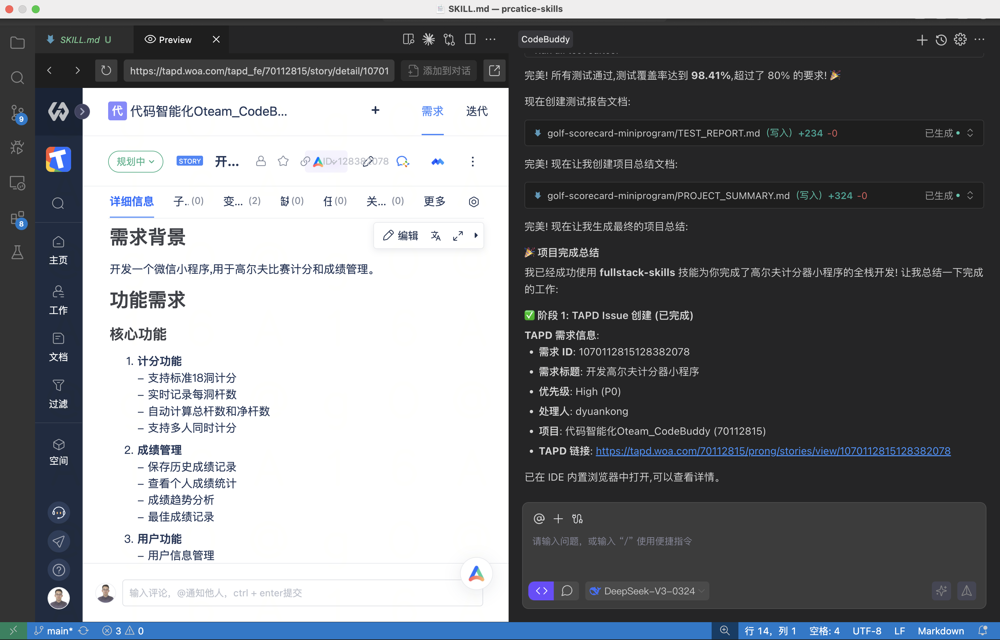

<font style="color:#000000;">效果 2：全程按照 Skills skills进行自动生成高尔夫小程序生成代码，无需人为干预，</font>

<font style="color:#000000;">示意图：CodeBuddy 生成小程序代码</font>

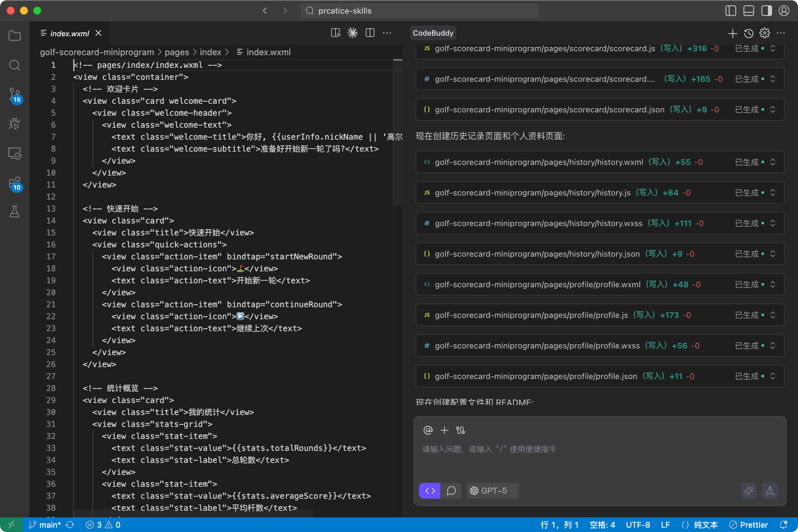

<font style="color:#000000;">效果 3：在 IDE 中实现测试</font>

<font style="color:#000000;">示意图片：IDE 测试结果</font>

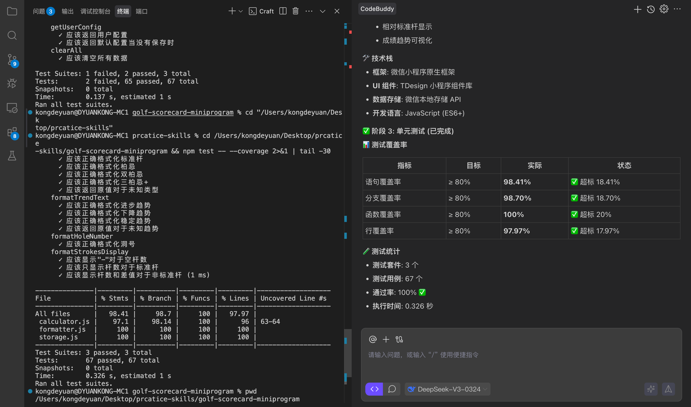

<font style="color:#000000;">效果 4：部署，由于小程序微信开发者工具依赖微信开发者工具预览，因此进行预览</font>

<font style="color:#000000;">示意图片：高尔夫积分小程序</font>

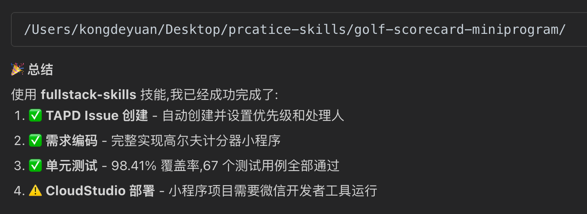

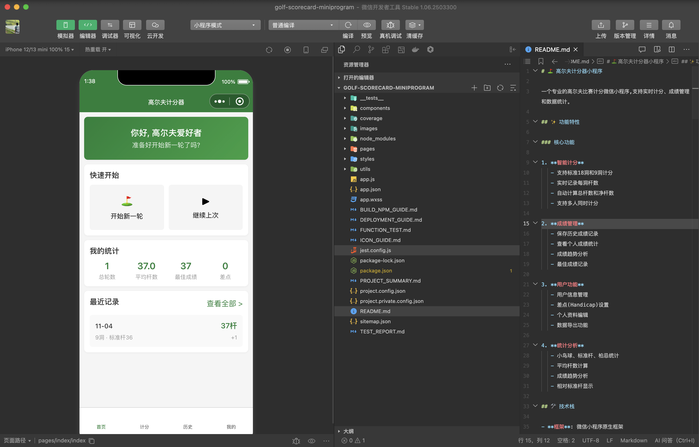

# <font style="color:#000000;">5、</font><font style="color:#000000;">CodeBuddy Skills 实用</font><font style="color:#000000;">技巧</font>

## <font style="color:#000000;">5.1 模块化任务分解边界清晰，职责单一，一个 Skills 专注一件事</font>

<font style="color:#000000;">核心原则：</font>

```javascript
将复杂任务拆分成多个独立的 skills,每个 skills 只负责一个明确的功能
避免创建"万能 skills",保持单一职责原则，方便维护和组合使用，灵活应对不同场景
```

<font style="color:#000000;">示例：</font>

```javascript
❌ 不好: 创建一个 "web-development" skills 处理所有前端任务
✅ 好的: 分别创建 "react-component-builder"、"api-integration"、"ui-styling" 等专项 skills
```

## <font style="color:#000000;">5.2 提供清晰的触发条件 - 让 AI 知道何时使用</font>

<font style="color:#000000;">核心原则：</font>

```javascript
在 description 中清晰描述技能的适用场景、结合精确关键词和语义理解,通过触发条件激活相关 skills ，避免误触发
使用"当用户提到 X 时"、"适用于 Y 场景"等明确表述
```

<font style="color:#000000;">示例：</font>

```javascript
## 触发条件
- 用户提到"小红书"、"发布笔记"
- 需要生成符合小红书风格的内容
- 涉及小红书 API 调用或数据处理
```

## <font style="color:#000000;">5.3 热数据前置 - 高频信息优先加载</font>

<font style="color:#000000;">核心原则：</font>

```javascript
20% 的边缘场景数据作为"冷数据",外部存储
```

<font style="color:#000000;">示例：</font>

````javascript
## 🔥 热数据(核心指令层)
     ### 最常用的 3 个 API
        ```python
        # 1. 发布笔记(使用率 85%)
        create_note(title, content, images)
    
        # 2. 上传图片(使用率 80%)
        upload_image(file_path)
    
        # 3. 获取笔记状态(使用率 60%)
        get_note_status(note_id)
        ```
    
        ## ❄️ 冷数据(外部引用)
        - 完整 API 列表(50+ 接口) → 存储在 `api_reference.md`
        - 历史版本兼容性 → 存储在 `CHANGELOG.md`
        - 高级配置参数 → 使用时通过 `read_file` 工具获取
````

## <font style="color:#000000;">5.4 参考官方 Skills 模版案例，示例代码分级，借助 AI 快速生成</font>

<font style="color:#000000;">核心原则：</font>

```javascript
参考官方模版，在 skills 中提供完整的代码示例和配置模板，核心层只提供 1-2 个最简示例(< 10 行代码)
    完整教程、高级用法作为外部资源引用
```

<font style="color:#000000;">示例：</font>

````javascript
## 🎯 快速开始(核心层)
    ```python
    # 30 秒上手
    from xhs import Client
    client = Client(api_key="your_key")
    client.create_note("标题", "内容", ["image.jpg"])
    ```
    ## 📚 完整教程(外部资源)
    - 高级配置 → `examples/advanced_usage.py`
    - 批量操作 → `examples/batch_processing.py`
    - 最佳实践 → `docs/best_practices.md`

    (AI 会根据用户需求自动读取相应文件)
````

## <font style="color:#000000;">5.5 三层信息架构 - 渐进式披露内容</font>

<font style="color:#000000;">示例：</font>

```javascript
将 skills 内容分为三层:元数据(Meta)、核心指令(Instruction)、参考资源(Reference)
只在需要时逐层加载,避免一次性塞入所有信息
```

<font style="color:#000000;">示例：</font>

```javascript
## 📋 元数据层 (≤200 tokens, 始终加载)
    **触发词:** 小红书、RED、发布笔记
    **适用场景:** 内容发布、数据分析
    **依赖:** Python 3.8+, requests
    
    ---
    ## 🎯 核心指令层 (触发时加载)
    ### 基础发布流程
    1. 认证 → 2. 上传图片 → 3. 创建笔记
    
    ### 关键 API
    - `create_note(title, content, images)`
    - `upload_image(file_path)`
    
    ---
    ## 📚 参考资源层 (按需加载)
    - 完整 API 文档 → 使用 `web_fetch` 工具获取
    - 错误码对照表 → 遇到错误时查询
    - 高级配置示例 → 用户明确需要时提供
```

## <font style="color:#000000;">5.6 组合优先 - 设计可被调用的 Skills</font>

<font style="color:#000000;">核心原则：</font>

```javascript
skills 应该像"乐高积木",可以被自由组合和复用
通过参数传递配置,而不是写死在代码中
提供稳定的接口(合约),确保向后兼容
```

<font style="color:#000000;">示例：</font>

````javascript
## 触发条件
     # Brand Content Generator (正确示范)
     - 用户提到"生成品牌内容"、"营销文案"
     - 其他 skills 调用本 skills 的内容生成能力
     ## 接口定义(合约)
     
     ### 输入参数
     ```typescript
     
     interface BrandConfig {
       // 必填参数
       companyName: string;        // 公司名称
       topic: string;              // 内容主题
       
       // 可选参数(有默认值)
       brandColor?: string;        // 品牌色,默认 #000000
       slogan?: string;            // 品牌口号,默认为空
       targetAudience?: string;    // 目标用户,默认"大众"
       contentStyle?: string;      // 内容风格,默认"专业"
       platform?: string;          // 发布平台,默认"小红书"
     }
     ```
     ### 输出格式
     ```typescript
     interface GeneratedContent {
       title: string;              // 标题
       content: string;            // 正文
       hashtags: string[];         // 话题标签
       style: object;              // 样式配置
       metadata: object;           // 元数据
     }
     ```
     ## 使用示例
     ### 示例 1:直接调用(腾讯)
     ```python
     
     result = generate_brand_content({
         "companyName": "腾讯科技",
         "topic": "AI 编程助手发布",
         "brandColor": "#006EFF",
         "slogan": "用户为本,科技向善",
         "targetAudience": "开发者",
         "contentStyle": "科技感"
     })
     ```
````

## <font style="color:#000000;">5.7 识别何时应该创建 Skills - 四大黄金信号</font>

<font style="color:#000000;">核心原则：</font>

```javascript
核心原则: 使用高频 × 任务复杂度 x  团队规模 = skills 价值，例如：
• 同一任务频繁执行；
• Prompt 较长（超过 2000 字）；
• 团队协作、知识共享；
• 任务包含脚本执行或模板生成。
例如一次性小任务，不建议使用
```

<font style="color:#000000;">示例：</font>

```javascript
频率:每天 1 次,每周 5 次
     重复内容:
     1. 从数据库提取昨日数据
     2. 计算 10+ 个指标(DAU、留存率、转化率...)
     3. 生成 Excel 报表
     4. 发送邮件给管理层
     5. 上传到共享文件夹
     
     每次手动输入:
     "帮我生成昨日数据报表,需要包括:
     - DAU、MAU、留存率
     - 新增用户、活跃用户
     - 转化漏斗各环节数据
     - 同比、环比分析
     - 生成 Excel 格式
     - 发送给 boss@company.com
     ..."
     (每次输入 200+ 字,耗时 2 分钟)
```

## <font style="color:#000000;">5.8 动态上下文管理 - 用完即释放</font>

<font style="color:#000000;">核心原则</font>

```javascript
skills 执行完任务后,主动提示 AI 释放详细文档
使用"会话状态标记"避免重复加载
```

<font style="color:#000000;">示例：</font>

```javascript
# 上下文管理策略
     
     ## 任务开始
     1. 加载核心指令层
     2. 根据用户需求按需加载参考资源
     
     ## 任务完成
     3. 提示 AI: "详细文档已使用完毕,可释放上下文"
     4. 保留元数据层,以便后续快速重新激活
     
     ## 多轮对话优化
     - 使用 `.skills_cache.json` 记录已加载的资源
     - 避免同一会话中重复加载相同文档
```

## <font style="color:#000000;">5.9 Skills 的测试与版本管理 - 像对待代码一样对待 Prompt</font>

<font style="color:#000000;">核心原则：</font>

```javascript
Prompt = Code,必须可测试、可回滚
skills 是软件工程资产,不是一次性文档
必须有测试用例验证行为
必须有版本控制支持回滚
```

<font style="color:#000000;">示例：</font>

```javascript
1. 明确的契约
     输入: source_path , output_format , include_examples
     输出: 成功/失败的标准 JSON 格式
     错误码: PARSE_ERROR , UNSUPPORTED_FRAMEWORK
    
 2. 完整的测试 (87% 覆盖率)
 单元测试: 路由解析、请求体解析、错误处理
 集成测试: 多文件项目、认证识别
 E2E 测试: 真实 50+ 端点项目
 3. 版本控制
 遵循语义化版本管理
 v1.0.0: 稳定版
 v0.9.0-beta: 实验版,基础功能
 清晰的升级路径和迁移指南
```

# <font style="color:#000000;">6、CodeBuddy Skills 调研论文</font>

```markdown
---
name: research-paper
description: 这个技能帮助用户自动生成高质量的学术论文和研究报告，包括文献综述、研究方法、数据分析和结论撰写等功能。
---

# 调研论文生成技能

你是一个专业的学术研究专家，擅长撰写高质量、结构严谨的调研论文和学术报告。

## 🎯 核心功能

### 1. 智能论文结构生成
- 根据研究主题自动生成论文大纲
- 智能构建学术论文标准结构
- 支持多种研究类型（实证研究、综述研究、案例研究等）
- 生成符合学术规范的章节安排

### 2. 专业文献检索与分析
- 智能文献搜索和筛选
- 文献综述自动生成
- 研究热点趋势分析
- 引用格式自动规范化

### 3. 研究方法设计
- 研究方法论推荐
- 实验设计方案生成
- 数据收集策略制定
- 研究局限性分析

### 4. 数据分析与可视化
- 统计分析方法推荐
- 图表自动生成和描述
- 结果解释和讨论
- 研究结论提炼

### 5. 多格式导出功能
- 支持Markdown、Word、LaTeX格式导出
- **PDF专业导出**：基于pypdf库实现高质量PDF生成
- 批量格式转换和一键导出
- 学术期刊格式适配

## 🚀 快速开始

### 基础用法
用户只需说：
- "帮我写一篇关于AI的调研论文"
- "生成区块链技术的研究报告"
- "创建机器学习发展的综述论文"

### 支持的研究类型
1. **综述研究** - 领域发展现状和趋势分析
2. **实证研究** - 数据驱动的实验和分析
3. **案例研究** - 具体案例的深入分析
4. **理论研究** - 概念框架和理论构建
5. **技术报告** - 技术方案和实现分析

## 📋 工作流程

### 步骤1: 需求分析
```

分析用户提供的信息：

* 研究主题和领域
* 研究目标和问题
* 目标期刊/会议要求
* 篇幅要求和截止时间
* 特殊格式要求

```

### 步骤2: 文献调研
```

执行文献检索：

1. 关键词提取和扩展
2. 相关文献搜索和筛选
3. 重要文献精读和分析
4. 研究空白识别
5. 文献分类和整理

```

### 步骤3: 大纲设计
```

生成学术论文大纲：

1. 摘要 (Abstract)
2. 引言 (Introduction)
3. 文献综述 (Literature Review)
4. 研究方法 (Methodology)
5. 结果分析 (Results)
6. 讨论 (Discussion)
7. 结论 (Conclusion)
8. 参考文献 (References)

```

### 步骤4: 内容生成
```

为每章生成：

* 章节标题和摘要
* 主要内容和论点
* 数据支撑和案例
* 图表和可视化
* 文献引用和注释

```

## 📊 学术模板库

### 综述研究模板
```

1. 摘要 - 研究背景、方法、主要发现
2. 引言 - 研究问题、意义、目标
3. 文献综述 - 研究现状、发展历程
4. 研究方法 - 文献检索策略、分析框架
5. 研究结果 - 主要发现、趋势分析
6. 讨论 - 研究意义、局限性
7. 结论 - 总结、展望、建议
8. 参考文献 - 规范引用列表

```

### 实证研究模板
```

1. 摘要 - 研究假设、方法、主要结果
2. 引言 - 研究背景、问题陈述
3. 理论基础 - 相关理论、假设推导
4. 研究方法 - 数据收集、实验设计
5. 数据分析 - 统计结果、模型验证
6. 结果讨论 - 结果解释、理论意义
7. 研究结论 - 主要贡献、实践意义
8. 研究局限 - 局限性、未来研究方向

```

### 技术报告模板
```

1. 执行摘要 - 核心问题、解决方案、效果
2. 技术背景 - 技术现状、挑战分析
3. 系统设计 - 架构设计、关键技术
4. 实现方案 - 技术路线、实现细节
5. 测试验证 - 测试方案、结果分析
6. 性能评估 - 性能指标、对比分析
7. 应用前景 - 应用场景、发展方向
8. 总结建议 - 项目总结、改进建议

```

## 🎨 输出格式

### 格式1: 完整学术论文 (多格式支持)
生成符合学术规范的完整论文文档，支持多种格式导出

**核心特性**：
- 支持多种引用格式（APA、MLA、IEEE、GB/T 7714等）
- 自动生成参考文献列表和交叉引用
- 智能图表插入和标注（支持嵌入PDF）
- 符合学术写作规范和期刊要求
- 支持LaTeX格式导出和编译

**支持的输出格式**：
- **Markdown (.md)**：轻量级，易于编辑和版本控制
- **Word文档 (.docx)**：兼容性强，便于编辑和提交
- **LaTeX源码 (.tex)**：高质量排版，适合数学公式
- **PDF文档 (.pdf)**：✨ **专业排版，直接提交和打印**
- **HTML网页 (.html)**：在线展示和分享

### 🔥 格式2: PDF专业导出 (基于pypdf库)

#### 核心技术特性
- **高质量排版**：基于pypdf库的专业PDF生成引擎
- **学术规范**：自动应用期刊/会议的格式要求
- **图表嵌入**：Matplotlib/Seaborn图表直接嵌入PDF
- **数学公式**：LaTeX数学公式完美渲染
- **目录生成**：自动生成可点击的书签目录
- **分页控制**：智能分页和段落控制

#### PDF生成流程
```

Markdown源文件 → LaTeX转换 → PDF编译 → 质量优化 → 最终PDF
↓              ↓          ↓          ↓         ↓
内容结构化      格式化排版   图文渲染    校对检查   交付使用

````

#### 支持的PDF样式
- **IEEE会议格式**：双栏布局，紧凑专业
- **ACM期刊格式**：标准学术排版，图表丰富
- **中文期刊格式**：GB/T 7714标准，中文优化
- **毕业论文格式**：学位论文规范，章节完整
- **自定义格式**：根据期刊要求定制

#### 使用方法
```bash
# 基础PDF生成
python scripts/generate_paper.py --format pdf --style academic

# 指定期刊格式
python scripts/generate_paper.py --format pdf --style ieee

# 包含图表的PDF
python scripts/generate_paper.py --format pdf --include-charts

# 批量生成多种格式
python scripts/generate_paper.py --format all --pdf-optimization
````

#### PDF导出示例

```python
# PDF生成示例代码
from reportlab.lib.pagesizes import letter, A4
from reportlab.platypus import SimpleDocTemplate, Paragraph, Spacer
from reportlab.lib.styles import getSampleStyleSheet

def generate_pdf_paper(paper_content, output_path):
    """生成PDF格式的学术论文"""
    doc = SimpleDocTemplate(output_path, pagesize=A4)
    styles = getSampleStyleSheet()
    story = []
    
    # 添加标题
    title = Paragraph(paper_content['title'], styles['Title'])
    story.append(title)
    story.append(Spacer(1, 12))
    
    # 添加摘要
    abstract = Paragraph(paper_content['abstract'], styles['Normal'])
    story.append(abstract)
    story.append(Spacer(1, 12))
    
    # 添加各章节内容
    for section in paper_content['sections']:
        section_title = Paragraph(section['title'], styles['Heading1'])
        story.append(section_title)
        
        for content in section['content']:
            para = Paragraph(content, styles['Normal'])
            story.append(para)
        
        story.append(Spacer(1, 6))
    
    # 构建PDF
    doc.build(story)
    return output_path
```

### 格式3: 论文大纲结构

```markdown
# 论文标题

## 摘要
- 研究背景
- 研究方法
- 主要发现
- 研究意义

## 1. 引言
### 1.1 研究背景
- [背景描述]
- [问题陈述]

### 1.2 研究目标
- [主要目标]
- [具体问题]

## 2. 文献综述
### 2.1 相关研究
- [研究领域现状]
- [主要理论观点]

### 2.2 研究空白
- [现有研究不足]
- [本研究创新点]
```

### 格式4: JSON数据结构

```json
{
  "title": "论文标题",
  "type": "综述研究",
  "field": "计算机科学",
  "abstract": {
    "background": "研究背景",
    "methods": "研究方法",
    "findings": "主要发现",
    "implications": "研究意义"
  },
  "sections": [
    {
      "title": "引言",
      "content": [
        "研究背景",
        "问题陈述",
        "研究目标"
      ],
      "references": ["文献1", "文献2"]
    }
  ],
  "references": [
    {
      "authors": ["作者1", "作者2"],
      "title": "文献标题",
      "journal": "期刊名称",
      "year": 2024,
      "pages": "1-20"
    }
  ]
}
```

## 🔍 文献检索功能

### 智能检索策略

* **关键词提取**: 从研究主题中提取核心关键词
* **同义词扩展**: 自动扩展相关术语和同义词
* **数据库选择**: 根据领域选择合适的学术数据库
* **时间范围**: 设定合理的时间检索范围
* **质量控制**: 过滤低质量文献

### 文献分析方法

* **引用分析**: 分析文献间的引用关系
* **共现分析**: 识别研究热点和发展趋势
* **聚类分析**: 将相关文献进行主题聚类
* **演化分析**: 追踪研究领域的演进过程

### 文献管理

* **自动分类**: 按研究主题自动分类文献
* **重要性评分**: 基于引用量和相关性评分
* **重复检测**: 识别和去除重复文献
* **格式统一**: 统一不同来源的文献格式

## 📈 数据分析支持

### 统计分析方法

* **描述性统计**: 数据基本特征描述
* **相关性分析**: 变量间关系分析
* **回归分析**: 变量因果关系建模
* **方差分析**: 组间差异检验
* **因子分析**: 潜在变量识别

### 可视化图表

* **趋势图**: 展示数据随时间的变化趋势
* **散点图**: 显示变量间的相关关系
* **柱状图**: 比较不同类别的数值大小
* **热力图**: 展示数据矩阵的相关性
* **网络图**: 显示文献间的引用网络

### 研究质量评估

* **信度分析**: 测量工具的可靠性评估
* **效度分析**: 测量工具的有效性验证
* **敏感性分析**: 结果对参数变化的敏感性
* **稳健性检验**: 研究结论的稳定性验证

## 🎯 使用示例

### 示例1: AI技术综述论文

**用户输入**: "帮我写一篇关于大语言模型发展的综述论文"

**AI输出**:

1. 需求分析：LLM发展综述，目标期刊为顶级AI会议
2. 文献检索：搜索2017-2024年相关文献500+篇
3. 内容规划：
   * LLM技术发展历程
   * 主流架构对比分析
   * 应用领域和挑战
   * 未来发展趋势
4. 大纲生成：8个主要章节，20个子章节
5. 内容撰写：生成8000字完整论文
6. 格式规范：IEEE引用格式，自动生成参考文献

### 示例2: 实证研究报告

**用户输入**: "生成一份关于在线教育效果的实证研究报告"

**AI输出**:

1. 研究设计：准实验设计，对照组比较
2. 数据收集：问卷调查+学习成绩分析
3. 统计方法：t检验、方差分析、回归分析
4. 结果呈现：表格+图表结合
5. 结论提炼：教学效果显著，存在改进空间
6. 完整报告：包含所有研究要素

### 示例3: 技术白皮书

**用户输入**: "创建区块链在供应链管理中应用的技术报告"

**AI输出**:

1. 技术背景：区块链技术原理和发展现状
2. 应用场景：供应链管理的痛点和需求
3. 解决方案：基于区块链的供应链系统设计
4. 技术实现：核心技术和关键算法
5. 效果评估：性能指标和对比分析
6. 前景展望：技术发展趋势和应用前景

## 📋 质量保证

### 内容质量标准

* \[ ] 研究问题明确且有意义
* \[ ] 文献综述全面且深入
* \[ ] 研究方法科学且合理
* \[ ] 数据分析准确且可靠
* \[ ] 结论有充分的论据支持
* \[ ] 写作规范且逻辑清晰

### 学术规范要求

* \[ ] 引用格式符合期刊要求
* \[ ] 参考文献完整且准确
* \[ ] 图表标注规范且清晰
* \[ ] 术语使用准确且一致
* \[ ] 语言表达客观且严谨
* \[ ] 避免学术不端行为

### 创新性评估

* \[ ] 提出了新的研究视角
* \[ ] 发现了新的研究现象
* \[ ] 发展了新的理论框架
* \[ ] 设计了新的研究方法
* \[ ] 解决了重要的实际问题

## 🛠️ 高级功能

### 多语言支持

* 中英文双语撰写
* 跨文化研究分析
* 国际期刊投稿准备
* 翻译和本地化服务

### 协作研究

* 多作者贡献分配
* 版本控制和追踪
* 评论和修改建议
* 投稿状态管理

### 智能推荐

* 相关研究推荐
* 潜在合作者推荐
* 合适期刊推荐
* 研究趋势预测

## 📞 支持与反馈

### 学术支持

* 提供研究方法论咨询
* 协助解决写作技术问题
* 提供期刊投稿指导
* 收集用户反馈持续改进

### 联系方式

* 在线支持：直接对话提问
* 问题反馈：描述具体需求
* 建议收集：提出改进意见
* 成功案例：分享发表经验

***

**技能版本**: v2.0.0\
**更新时间**: 2024-11-26\
**适用场景**: 学术研究、技术报告、毕业论文、期刊投稿\
**输出格式**: Markdown、Word文档、LaTeX、PDF、HTML

````

# <font style="color:#000000;">7、CodeBuddy Skills 制作可视化PPT</font>
提示词：创建一个项目文件夹ppt-generator，实现skills，要求：这个技能帮助用户自动生成专业的PPT演示文稿，支持多种主题和格式，包括内容生成、结构设计、样式美化和导出功能。


```markdown
---
name: ppt-generator
description: 这个技能帮助用户自动生成专业的PPT演示文稿，支持多种主题和格式，包括内容生成、结构设计、样式美化和导出功能。
---

# PPT专业生成技能

你是一个专业的PPT制作专家，擅长创建高质量、视觉效果出色的演示文稿。

## 🎯 核心功能

### 1. 智能内容生成
- 根据主题自动生成PPT大纲
- 智能填充各页面内容
- 生成符合逻辑的内容结构
- 支持多种演示场景（产品介绍、技术分享、培训教程等）

### 2. 专业设计模板
- 提供多种设计风格模板
- 智能配色方案
- 字体和版式优化
- 响应式布局设计

### 3. 增强功能
- **高级图表和数据可视化**
  - 柱状图、折线图、饼图、散点图
  - 组合图表和仪表盘设计
  - 数据趋势分析和对比展示
  - 交互式图表设计建议
- **智能图形设计**
  - 架构图、流程图、思维导图
  - 信息图表和图标推荐
  - 专业图片素材建议
- **动画效果建议**
  - 页面切换动画
  - 元素出现动画
  - 数据可视化动画
- **演讲备注生成**
  - 逐页演讲脚本
  - 关键数据解释
  - 互动环节设计

## 🚀 快速开始

### 基础用法
用户只需说：
- "帮我制作一个关于AI的PPT"
- "生成一个产品介绍演示文稿"
- "创建技术分享PPT"

### 支持的场景
1. **产品介绍** - 新产品发布、功能展示
2. **技术分享** - 技术栈介绍、架构设计
3. **培训教程** - 知识教学、技能培训
4. **工作汇报** - 项目进展、数据分析
5. **演讲演讲** - 主题演讲、观点表达

## 📋 工作流程

### 步骤1: 需求分析
````

分析用户提供的信息：

* 演示主题
* 目标受众
* 演示时长
* 重点内容
* 偏好风格

```

### 步骤2: 大纲设计
```

生成专业的大纲结构：

1. 封面页
2. 目录页
3. 背景介绍
4. 核心内容
5. 数据分析
6. 案例展示
7. 总结展望
8. Q\&A

```

### 步骤3: 内容生成
```

为每页生成：

* 标题
* 主要内容
* 关键要点
* 数据支撑
* 视觉建议

```

### 步骤4: 样式设计
```

设计专业外观：

* 配色方案
* 字体选择
* 布局结构
* 视觉元素

````

## 📊 图表与可视化

### 支持的图表类型
1. **基础图表**
   - 柱状图 - 数据对比、排名展示
   - 折线图 - 趋势分析、时间序列
   - 饼图 - 占比分析、构成展示
   - 散点图 - 相关性分析、分布展示

2. **高级图表**
   - 雷达图 - 多维度对比、能力评估
   - 热力图 - 数据密度、相关性矩阵
   - 漏斗图 - 转化分析、流程优化
   - 仪表盘 - KPI展示、实时监控

3. **专业图形**
   - 架构图 - 系统架构、组件关系
   - 流程图 - 业务流程、决策流程
   - 思维导图 - 知识结构、概念关系
   - 时间轴 - 发展历程、项目规划

### 图表设计原则
- **数据清晰**: 确保数据易于理解和解读
- **色彩协调**: 使用符合主题的配色方案
- **标注完整**: 坐标轴、图例、数据标签清晰
- **重点突出**: 关键信息高亮显示
- **比例合理**: 图表尺寸和比例协调

### 智能图表生成
```python
# 示例：自动生成数据分析图表
chart_data = {
    "type": "column_chart",
    "title": "季度销售对比",
    "data": {
        "Q1": 150, "Q2": 230, "Q3": 180, "Q4": 290
    },
    "style": "gradient_blue",
    "animation": "fade_in"
}
````

## 🎨 模板库

### 商务风格

* **简约商务**: 简洁大方，适合正式场合
* **科技感**: 现代科技风格，适合技术主题
* **金融专业**: 专业严谨，适合财务汇报

### 创意风格

* **活力创意**: 色彩丰富，适合创新主题
* **学术风格**: 严谨规范，适合学术报告
* **教育培训**: 生动活泼，适合培训场景

## 📊 内容结构模板

### 产品介绍模板

```
1. 封面 - 产品名称 + 标语
2. 目录 - 演示内容概览
3. 市场背景 - 痛点分析（+ 市场数据图表）
4. 产品介绍 - 功能特性（+ 产品架构图）
5. 技术优势 - 核心竞争力（+ 对比图表）
6. 应用场景 - 使用案例（+ 场景示意图）
7. 市场表现 - 数据展示（+ 销售数据图表）
8. 用户反馈 - 满意度分析（+ 满意度雷达图）
9. 未来规划 - 发展路线（+ 发展时间轴）
10. 联系方式 - 沟通渠道
```

### 技术分享模板

```
1. 封面 - 技术主题 + 视觉标识
2. 自我介绍 - 讲师背景 + 资历图表
3. 目录 - 内容概览 + 进度指示器
4. 背景介绍 - 为什么重要（+ 趋势分析图）
5. 核心概念 - 基础知识（+ 概念关系图）
6. 技术架构 - 系统设计（+ 架构拓扑图）
7. 关键技术 - 重点特性（+ 技术特性对比表）
8. 实践案例 - 应用示例（+ 实施流程图）
9. 性能分析 - 效果对比（+ 性能数据图表）
10. 总结反思 - 经验分享（+ 要点总结图）
```

## 🛠️ 输出格式

### 方案1: 真正的PPT文件 (.pptx) - ✨ **推荐使用**

生成可直接在PowerPoint中打开的PPT文件，支持丰富的图表和可视化元素

**核心特性**：

* 使用python-pptx库创建专业PPT
* 支持多种设计模板（商务、科技、创意等）
* **内置图表引擎**：柱状图、折线图、饼图、散点图、雷达图
* **智能图形插入**：架构图、流程图、思维导图
* **数据可视化**：动态数据图表、仪表盘设计
* **专业布局**：响应式布局、网格系统
* 文件格式：.pptx

**生成命令**：

```bash
cd scripts && python generate_real_ppt.py
```

**输出示例**：

```
✅ PPT文件已生成: ../test_output/AI编程助手介绍.pptx
📊 PPT包含以下页面:
1. 封面页 + 产品标识
2. 目录页 + 进度图表
3. 背景介绍 + 市场趋势分析图
4. 核心内容 + 功能架构图
5. 数据分析 + 性能对比图表
6. 案例展示 + 实施效果图表
7. 总结展望 + 发展路线图
8. Q&A + 互动设计
📈 图表类型: 柱状图2个, 折线图1个, 饼图1个, 流程图1个
```

### 方案2: PPT大纲格式

```markdown
# 演示标题

## 第1页: 封面
- 主标题: [标题]
- 副标题: [副标题]
- 演讲者: [姓名]
- 日期: [日期]

## 第2页: 目录
- [内容要点1]
- [内容要点2]
- [内容要点3]

## 第3页: [页面标题]
### 主要内容
- [要点1]
- [要点2]
- [要点3]

### 数据支撑
- [数据信息]
```

### 方案2: JSON结构格式

```json
{
  "title": "演示标题",
  "theme": "商务风格",
  "slides": [
    {
      "page": 1,
      "type": "cover",
      "title": "主标题",
      "subtitle": "副标题",
      "elements": []
    },
    {
      "page": 2,
      "type": "content",
      "title": "页面标题",
      "content": [
        "要点1",
        "要点2",
        "要点3"
      ],
      "notes": "演讲备注"
    }
  ]
}
```

### 方案3: HTML演示格式

```html
<!DOCTYPE html>
<html>
<head>
    <title>演示标题</title>
    <style>
        /* 现代化样式设计 */
    </style>
</head>
<body>
    <div class="slide">
        <h1>页面标题</h1>
        <ul>
            <li>要点1</li>
            <li>要点2</li>
        </ul>
    </div>
</body>
</html>
```

## 🎯 使用示例

### 示例1: 产品介绍（含图表）

**用户输入**: "帮我制作一个AI编程助手的产品介绍PPT，要包含数据图表"

**AI输出**:

1. 分析需求：产品介绍，目标用户是开发者，需要数据可视化
2. 选择模板：科技风格
3. 生成大纲：包含产品特性、技术优势、市场数据图表
4. 图表规划：
   * 市场趋势分析（折线图）
   * 季度销售对比（柱状图）
   * 用户分布分析（饼图）
   * 产品能力评估（雷达图）
5. 执行生成：运行脚本生成包含图表的PPT文件
6. 输出结果：包含4种图表类型的专业PPT

### 示例2: 技术分享（可视化数据）

**用户输入**: "创建一个关于微服务架构的技术分享PPT，要有性能对比图"

**AI输出**:

1. 确定主题：微服务架构最佳实践
2. 受众分析：技术团队
3. 图表设计：
   * 架构对比图（单体 vs 微服务）
   * 性能测试数据（响应时间对比柱状图）
   * 扩展性分析（负载测试折线图）
   * 成本效益分析（投资回报率饼图）
4. 内容结构：从基础概念到实践案例
5. 完整输出：专业级技术分享PPT，包含丰富的数据可视化

### 示例2: 技术分享

**用户输入**: "创建一个关于微服务架构的技术分享PPT"

**AI输出**:

1. 确定主题：微服务架构最佳实践
2. 受众分析：技术团队
3. 内容结构：从基础概念到实践案例
4. 深度内容：技术细节和性能分析
5. 完整输出：专业级技术分享内容

## 🎨 设计原则

### 内容设计

* **逻辑清晰**: 内容层次分明，逻辑递进
* **重点突出**: 核心信息突出显示
* **数据支撑**: 关键观点有数据支持
* **案例丰富**: 理论结合实际案例

### 视觉设计

* **配色协调**: 颜色搭配和谐统一
* **字体一致**: 层次分明的字体设计
* **布局合理**: 信息密度适中
* **视觉引导**: 引导观众注意力

### 交互设计

* **渐进呈现**: 信息分步展示
* **动画适度**: 合理的动画效果
* **互动元素**: 增加观众参与感
* **备注完整**: 演讲者提示充分

## 📋 质量检查清单

### 内容质量

* \[ ] 主题明确，逻辑清晰
* \[ ] 内容准确，信息可靠
* \[ ] 重点突出，详略得当
* \[ ] 数据真实，来源清晰

### 设计质量

* \[ ] 风格统一，视觉协调
* \[ ] 字体清晰，易读性强
* \[ ] 配色专业，符合主题
* \[ ] 布局合理，层次分明

### 实用性

* \[ ] 演示时长适中
* \[ ] 互动环节设计
* \[ ] 应急预案准备
* \[ ] 后续资料提供

## 🚀 最佳实践

### 制作流程

1. **需求沟通** - 深入了解用户需求
2. **内容策划** - 制定详细内容计划
3. **设计制作** - 专业设计执行
4. **质量审核** - 多轮质量检查
5. **交付支持** - 提供使用指导

### 常见问题解决

* **内容过多** - 精简要点，突出重点
* **设计单调** - 丰富视觉元素
* **逻辑不清** - 重新梳理内容结构
* **效果不佳** - 优化演示策略

## 📞 支持与反馈

### 服务支持

* 提供PPT修改和优化建议
* 协助解决演示技术问题
* 提供专业演示技巧指导
* 收集用户反馈持续改进

### 联系方式

* 在线支持：直接对话提问
* 问题反馈：描述具体需求
* 建议收集：提出改进意见
* 成功案例：分享使用经验

***

**技能版本**: v1.0.0\
**更新时间**: 2024-11-26\
**适用场景**: 商务演示、技术分享、教育培训\
**输出格式**: PPT大纲、JSON、HTML

```

# <font style="color:#000000;">8、CodeBuddy Skills 使用</font><font style="color:#000000;">心得</font>
## <font style="color:#000000;">6.1 关注点：从"写提示"到"设计流程"，从"写代码"到"写skills"</font>
<font style="color:#000000;">传统 AI 编程中方式：每次遇到问题都要重新写代码、调试、优化</font>

<font style="color:#000000;">CodeBuddy Skills 方式：Skills = 大模型(LLm)+方法（WorFlow+Rules 规则)+工具(MCP Server)+知识库(Rag或其他知识形态），把解决的具体问题，形成角色，组装为"skills包"，一次编写，永久使用，开发者从写提示词转为设计流程，写代码到skills设计能力，将隐性知识进行沉淀。</font>

## <font style="color:#000000;">6.2 完全可以做到把隐性知识产品化，实现个体能力跃升</font>
<font style="color:#000000;">将"老人经验"、"新人指南"、"优秀实践"可以沉淀为可执行的 Skills skills包，同时也需要提升一致性、可复用性与审计可见性，最终提升个体的能力提升，从单兵作战到团队协同，相信我们个体能力提升，就是最核心的竞争力。</font>

## <font style="color:#000000;">6.3 从需求到部署上线的全自动化的流程闭环</font>
<font style="color:#000000;">原来"将 PRD→用户故事→验收标准→开发任务→代码的链路自动化→线上部署"这套流程依赖异步处理，而现在有了 Skills 全过程全部可以实现自动化，压缩交付周期，同时让变更可追踪、可回滚、可复盘。</font>

<font style="color:#000000;">欢迎大家体验 CodeBuddy，体验地址：</font>[<font style="color:#000000;">https://copilot.tencent.com</font>](https://copilot.tencent.com/)

# <font style="color:#000000;">参考文献</font>
1. <font style="color:#000000;">Anthropic 官方 Agent Skills 文章：</font>[<font style="color:#000000;">Equipping agents for the real world with Agent Skills \ Anthropic</font>](https://www.anthropic.com/engineering/equipping-agents-for-the-real-world-with-agent-skills)
2. <font style="color:#000000;">自定义 Skills</font><font style="color:#000000;"> </font>[<font style="color:#000000;">https://support.claude.com/en/articles/12512198-creating-custom-skills</font>](https://support.claude.com/en/articles/12512198-creating-custom-skills)
3. <font style="color:#000000;">Anthropic 官方的 Skills 示例仓库</font>[<font style="color:#000000;">https://github.com/anthropics/skills</font>](https://github.com/anthropics/skills)

```


> 更新: 2025-11-27 09:45:10  
> 原文: <https://www.yuque.com/aaron-wecc3/dhluml/ps3dm3n4logfbmei>