# 20.如何使用AutoDL高效训练大模型

**示例代码**

[autodl-train.ppt](https://www.yuque.com/attachments/yuque/0/2025/ppt/1387387/1745159933730-4c9bc446-88a5-428d-ac59-97eb60be34b6.ppt)

*<font style="color:#DF2A3F;">注：将ppt后缀名改为zip后解压</font>*

python版本：3.10

***

**分享内容**

1. AutoDL介绍与快速开始
2. 如何选择GPU服务器
3. 如何使用JupyterLab和SSH远程连接
4. Conda环境安装与PyCharm远程开发

# 快速开始

AutoDL 是一个专注于提供深度学习算力的云平台。它通过提供高性能的 GPU 资源，帮助用户轻松应对复杂的深度学习任务，同时保持成本的可控性。

**为什么选择 AutoDL 云平台？**

平价好用：相比其他云平台，AutoDL 提供的算力价格更加亲民，适合预算有限的研究者和开发者。

高性能：支持多种高性能 GPU，如 NVIDIA Tesla V100、A100 等，确保训练速度和模型性能。

易用性：简洁的界面和丰富的文档，即使是初学者也能快速上手。

灵活性：支持按需付费和包年包月等多种计费方式，满足不同用户的需求。

**如何使用 AutoDL 云平台？**

注册账号：访问 AutoDL 官网，注册并登录账号。

选择算力：根据你的需求选择合适的 GPU 配置。

上传数据：将你的数据集上传到 AutoDL 云平台。

启动训练：编写或上传你的训练脚本，启动训练任务。

监控进度：通过平台提供的监控工具，实时查看训练进度和资源使用情况。

> AutoDL 实例中的数据（包括环境）在关机后将全部保存，开机后无需再次配置和上传数据。总而言之，实例在数据在，但是连续关机 15 天实例将被释放。

## 创建实例 [](#_2)

注册后进入控制台，在我的实例菜单下，点击租用新实例

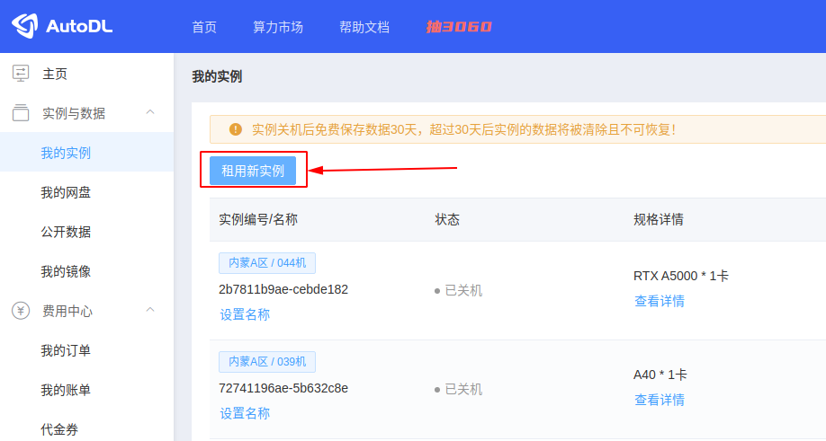

在租用实例页面：选择**计费方式**，选择合适的主机，选择要创建实例中的 GPU 数量，选择镜像（内置了不同的深度学习框架），最后创建即可

> 如果你需要更大的硬盘用于存放数据，那么请留意「硬盘」这列「最大可扩容」大小。数据盘等的路径请参考[文档](https://www.autodl.com/docs/env/)

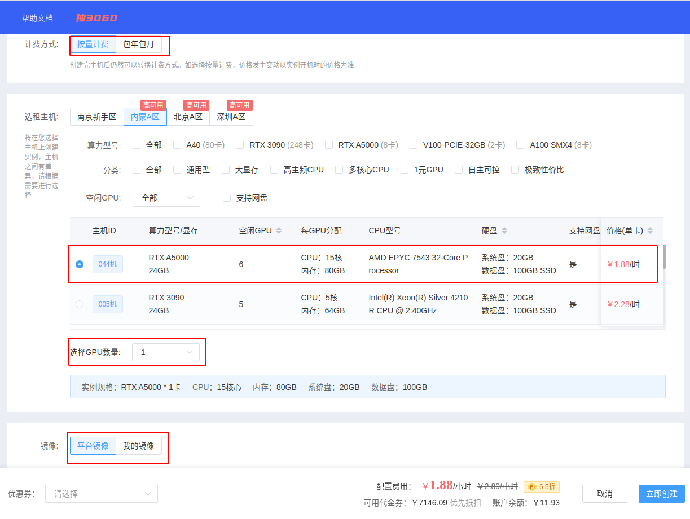

创建完成后等待开机，今后主要用到的操作入口见截图中

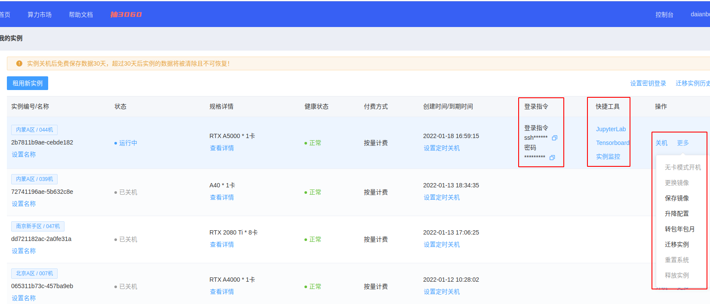

## 上传数据

开机后在这个正在运行中的实例上找到快捷工具：JupyterLab，点击打开，在下面的截图中找到上传按钮，即可上传数据。如需上传文件夹或更高级的上传方式等，请查阅[上传数据文档](https://www.autodl.com/docs/scp/)

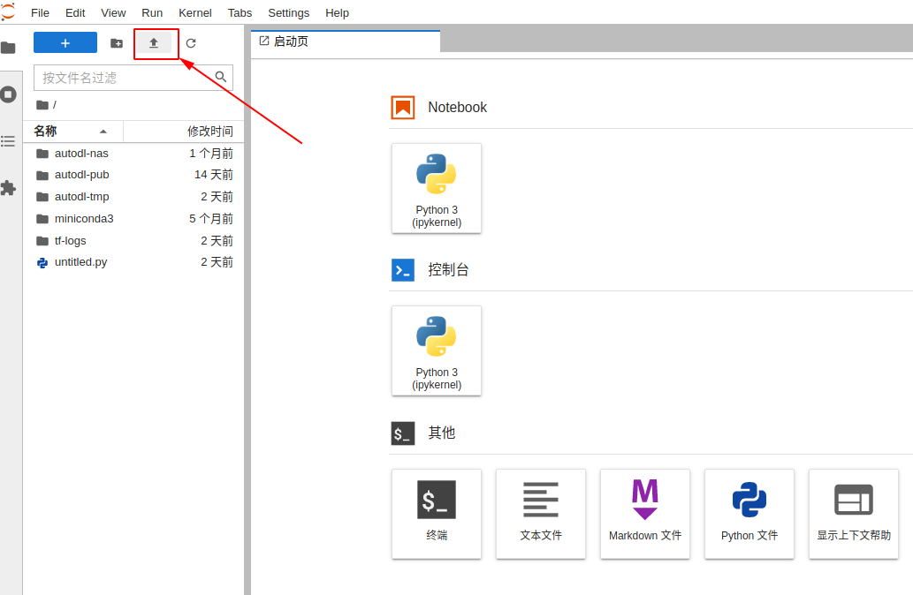

## 终端训练 [](#_4)

在打开的 JupyterLab 页面中打开终端。如需使用其他 IDE 远程开发，请参考 [VSCode(推荐)](https://www.autodl.com/docs/vscode/) 和 [PyCharm](https://www.autodl.com/docs/pycharm/)

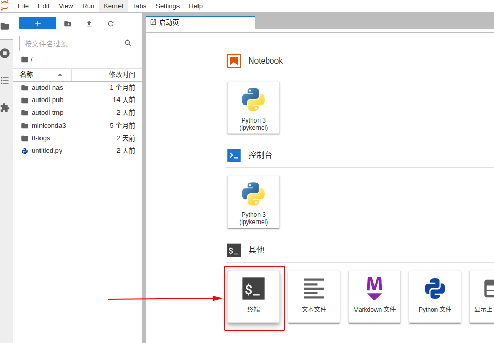

在终端中执行您的 Python 命令等完成训练

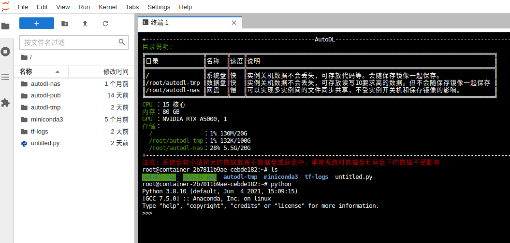

# 如何选择GPU

<font style="background-color:rgb(254, 246, 235);">如何排查性能瓶颈参考</font>[<font style="background-color:rgb(254, 246, 235);">文档</font>](https://www.autodl.com/docs/perf/)<font style="background-color:rgb(254, 246, 235);">。此外需注意3060、3090、3080Ti、A4000、A5000、A40、A100、A5000等安培架构的卡需要</font>**<font style="background-color:rgb(254, 246, 235);">cuda11.1</font>**<font style="background-color:rgb(254, 246, 235);">及以上才能使用（TitanXp、1080Ti、2080Ti、P40、V100没有要求），请使用较高版本的框架。</font>

<font style="color:rgba(0, 0, 0, 0.87);">AutoDL平台分配GPU、CPU、内存的机制为：按租用的GPU数量成比例分配CPU和内存，算力市场显示的CPU和内存均为每GPU分配的CPU和内存，如果租用两块GPU，那么CPU和内存就x2。此外GPU非共享，每个实例对GPU是独占的。</font>

## 一. 选择CPU[](https://www.autodl.com/docs/gpu/#cpu)

<font style="color:rgba(0, 0, 0, 0.87);">CPU非常重要！尽管CPU并不直接参与深度学习模型计算，但CPU需要提供大于模型训练吞吐的数据处理能力。比如，一台8卡NVIDIA V100的DGX服务器，训练ResNet-50 ImageNet图像分类的吞吐就达到8000张图像/秒，而扩展到16卡V100的DGX2服务器却没达到2倍的吞吐，说明这台DGX2服务器的CPU已经成为性能瓶颈了。</font>

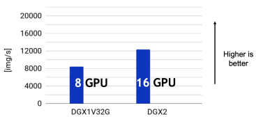

<font style="color:rgba(0, 0, 0, 0.87);">我们通常为每块GPU分配固定数量的CPU逻辑核心。理想情况下，模型计算吞吐随GPU数量线性增长，单GPU的合理CPU逻辑核心数分配可以直接线性扩展到多GPU上。AutoDL平台的算力实例提供了多种CPU分配规格。每块GPU应配备至少4~8核心的CPU，以满足多线程的异步数据读取。分配更多的核心通常不会再有很大的收益，此时的数据读取瓶颈通常源于Python的多进程切换与数据通信开销（如使用PyTorch DataLoader)。那么怎么省钱克服数据读取瓶颈呢，不妨在AutoDL平台试试C++和CUDA编写的NVIDIA DALI数据读取加速库吧。在我们的测试中，单核CPU实例的数据读取能力就超过了基于Python的八核心实例，真正做到了为模型训练保驾护航。</font>

<font style="color:rgba(0, 0, 0, 0.87);">AutoDL中高性能CPU的选择有：</font>

1. <font style="color:rgba(0, 0, 0, 0.87);">内蒙A区 A5000 / 3090 / A40用到的AMD EPYC 7543 CPU</font>
2. <font style="color:rgba(0, 0, 0, 0.87);">内蒙A区 A100用到的AMD EPYC 7763 CPU</font>
3. <font style="color:rgba(0, 0, 0, 0.87);">北京A区 3090用到的Intel(R) Xeon(R) Gold 6330 或 AMD EPYC 7642 CPU</font>
4. <font style="color:rgba(0, 0, 0, 0.87);">深圳A区 3090用到的Intel(R) Xeon(R) Gold 6330</font>

<font style="background-color:rgb(254, 246, 235);">服务器的CPU一般不如桌面CPU的主频高，但是核心数量多。因此您从以前使用桌面CPU切换到服务器CPU上后，需要充分利用多核心的性能，否则无法发挥服务器CPU的性能。如何利用</font>[<font style="background-color:rgb(254, 246, 235);">请戳</font>](https://www.autodl.com/docs/perf/)

## 二. 选择GPU[](https://www.autodl.com/docs/gpu/#gpu_1)

<font style="color:rgba(0, 0, 0, 0.87);">AutoDL平台上提供的GPU型号很多。我们按照GPU架构大致分为五类：</font>

1. <font style="color:rgba(0, 0, 0, 0.87);">NVIDIA Pascal架构的GPU，如TitanXp，GTX 10系列等。 这类GPU缺乏低精度的硬件加速能力，但却具备中等的单精度算力。由于价格便宜，适合用来练习训练小模型(如Cifar10)或调试模型代码。</font>
2. <font style="color:rgba(0, 0, 0, 0.87);">NVIDIA Volta/Turing架构的GPU，如GTX 20系列, Tesla V100等。 这类GPU搭载专为低精度(int8/float16)计算加速的TensorCore, 但单精度算力相较于上代提升不大。我们建议在实例上启用深度学习框架的混合精度训练来加速模型计算。 相较于单精度训练，混合精度训练通常能够提供2倍以上的训练加速。</font>
3. <font style="color:rgba(0, 0, 0, 0.87);">NVIDIA Ampere架构的GPU，如GTX 30系列，Tesla A40/A100等。 这类GPU搭载第三代TensorCore。相较于前一代，支持了TensorFloat32格式，可直接加速单精度训练 (PyTorch已默认开启)。但我们仍建议使用超高算力的float16半精度训练模型，可获得比上一代GPU更显著的性能提升。</font>
4. <font style="color:rgba(0, 0, 0, 0.87);">寒武纪 MLU 200系列加速卡。 暂不支持模型训练。使用该系列加速卡进行模型推理需要量化为int8进行计算。 并且需要安装适配寒武纪MLU的深度学习框架。</font>
5. <font style="color:rgba(0, 0, 0, 0.87);">华为 Ascend 系列加速卡。 支持模型训练及推理。但需安装MindSpore框架进行计算。</font>

<font style="color:rgba(0, 0, 0, 0.87);">GPU型号的选择并不困难。对于常用的深度学习模型，根据GPU对应精度的算力可大致推算GPU训练模型的性能。AutoDL平台标注并排名了每种型号GPU的算力，方便大家选择适合自己的GPU。</font>

<font style="color:rgba(0, 0, 0, 0.87);">GPU的数量选择与训练任务有关。一般我们认为模型的一次训练应当在24小时内完成，这样隔天就能训练改进之后的模型。以下是选择多GPU的一些建议：</font>

* <font style="color:rgba(0, 0, 0, 0.87);">1块GPU。适合一些数据集较小的训练任务，如Pascal VOC等。</font>
* <font style="color:rgba(0, 0, 0, 0.87);">2块GPU。同单块GPU，但是你可以一次跑两组参数或者把Batchsize扩大。</font>
* <font style="color:rgba(0, 0, 0, 0.87);">4块GPU。适合一些中等数据集的训练任务，如MS COCO等。</font>
* <font style="color:rgba(0, 0, 0, 0.87);">8块GPU。经典永流传的配置！适合各种训练任务，也非常方便复现论文结果。</font>
* <font style="color:rgba(0, 0, 0, 0.87);">我要更多！用于训练大参数模型、大规模调参或超快地完成模型训练。</font>

## 三. 选择内存[](https://www.autodl.com/docs/gpu/#_1)

<font style="color:rgba(0, 0, 0, 0.87);">内存在充足的情况下一般不影响性能，但是由于AutoDL的实例相比本地电脑对内存的使用有更严格的上限限制（本地电脑内存不足会使用硬盘虚拟内存，影响是速度下降），比如租用的实例分配的内存是64GB，程序在训练时最后将要使用64.1GB，此时超过限制的这一时刻进程会被系统Kill导致程序中断，因此如果对内存的容量要求大，请选择分配内存更多的主机或者租用多GPU实例。如果不确定内存的使用，那么可以在实例监控中观察内存使用情况。</font>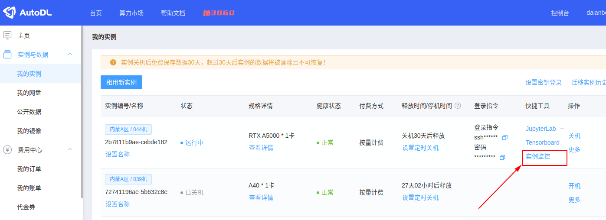

## 附GPU型号简介[](https://www.autodl.com/docs/gpu/#gpu_2)

| **型号** | **显存** | **单精(FP32)** | **半精(FP16)** | **详细参数** | **说明** |
| :--- | :--- | :--- | :--- | :--- | :--- |
| <font style="color:rgba(0, 0, 0, 0.87);">Tesla P40</font> | <font style="color:rgba(0, 0, 0, 0.87);">24GB</font> | <font style="color:rgba(0, 0, 0, 0.87);">11.76 T</font> | <font style="color:rgba(0, 0, 0, 0.87);">11.76 T</font> | [<font style="color:rgba(0, 0, 0, 0.87);">查看</font>](https://www.techpowerup.com/gpu-specs/tesla-p40.c2878) | <font style="color:rgba(0, 0, 0, 0.87);">比较老的Pascal架构GPU，对于cuda11.x之前且对大显存有需求的算法是非常不错的选择</font> |
| <font style="color:rgba(0, 0, 0, 0.87);">TITAN Xp</font> | <font style="color:rgba(0, 0, 0, 0.87);">12GB</font> | <font style="color:rgba(0, 0, 0, 0.87);">12.15 T</font> | <font style="color:rgba(0, 0, 0, 0.87);">12.15 T</font> | [<font style="color:rgba(0, 0, 0, 0.87);">查看</font>](https://www.techpowerup.com/gpu-specs/titan-xp.c2948) | <font style="color:rgba(0, 0, 0, 0.87);">比较老的Pascal架构GPU，用作入门比较合适</font> |
| <font style="color:rgba(0, 0, 0, 0.87);">1080 Ti</font> | <font style="color:rgba(0, 0, 0, 0.87);">11GB</font> | <font style="color:rgba(0, 0, 0, 0.87);">11.34 T</font> | <font style="color:rgba(0, 0, 0, 0.87);">11.34 T</font> | [<font style="color:rgba(0, 0, 0, 0.87);">查看</font>](https://www.techpowerup.com/gpu-specs/geforce-gtx-1080-ti.c2877) | <font style="color:rgba(0, 0, 0, 0.87);">和TITANXp同时代的卡，同样适合入门，但是11GB的显存偶尔会比较尴尬</font> |
| <font style="color:rgba(0, 0, 0, 0.87);">2080Ti</font> | <font style="color:rgba(0, 0, 0, 0.87);">11GB</font> | <font style="color:rgba(0, 0, 0, 0.87);">13.45 T</font> | <font style="color:rgba(0, 0, 0, 0.87);">53.8 T</font> | [<font style="color:rgba(0, 0, 0, 0.87);">查看</font>](https://www.techpowerup.com/gpu-specs/geforce-rtx-2080-ti.c3305) | <font style="color:rgba(0, 0, 0, 0.87);">图灵架构GPU，性能还不错，老一代型号中比较适合做混合精度计算的GPU。性价比高</font> |
| <font style="color:rgba(0, 0, 0, 0.87);">V100</font> | <font style="color:rgba(0, 0, 0, 0.87);">16/32GB</font> | <font style="color:rgba(0, 0, 0, 0.87);">15.7 T</font> | <font style="color:rgba(0, 0, 0, 0.87);">125 T</font> | [<font style="color:rgba(0, 0, 0, 0.87);">查看</font>](https://www.techpowerup.com/gpu-specs/tesla-v100s-pcie-32-gb.c3467) | <font style="color:rgba(0, 0, 0, 0.87);">老一代专业计算卡皇，半精性能高适合做混合精度计算</font> |
| <font style="color:rgba(0, 0, 0, 0.87);">3060</font> | <font style="color:rgba(0, 0, 0, 0.87);">12GB</font> | <font style="color:rgba(0, 0, 0, 0.87);">12.74 T</font> | <font style="color:rgba(0, 0, 0, 0.87);">约24T</font> | [<font style="color:rgba(0, 0, 0, 0.87);">查看</font>](https://www.techpowerup.com/gpu-specs/geforce-rtx-3060.c3682) | <font style="color:rgba(0, 0, 0, 0.87);">如果1080Ti的显存正好尴尬了，3060是不错的选择，适合新手。需要使用cuda11.x</font> |
| <font style="color:rgba(0, 0, 0, 0.87);">A4000</font> | <font style="color:rgba(0, 0, 0, 0.87);">16GB</font> | <font style="color:rgba(0, 0, 0, 0.87);">19.17 T</font> | <font style="color:rgba(0, 0, 0, 0.87);">约76T</font> | [<font style="color:rgba(0, 0, 0, 0.87);">查看</font>](https://www.techpowerup.com/gpu-specs/rtx-a4000.c3756) | <font style="color:rgba(0, 0, 0, 0.87);">显存和算力都比较均衡，适合进阶过程使用。需要使用cuda11.x</font> |
| <font style="color:rgba(0, 0, 0, 0.87);">3080Ti</font> | <font style="color:rgba(0, 0, 0, 0.87);">12GB</font> | <font style="color:rgba(0, 0, 0, 0.87);">34.10 T</font> | <font style="color:rgba(0, 0, 0, 0.87);">约70T</font> | [<font style="color:rgba(0, 0, 0, 0.87);">查看</font>](https://www.techpowerup.com/gpu-specs/geforce-rtx-3080-ti.c3735) | <font style="color:rgba(0, 0, 0, 0.87);">性能钢炮，如果对显存要求不高则是非常合适的选择。需要使用cuda11.x</font> |
| <font style="color:rgba(0, 0, 0, 0.87);">A5000</font> | <font style="color:rgba(0, 0, 0, 0.87);">24GB</font> | <font style="color:rgba(0, 0, 0, 0.87);">27.77T</font> | <font style="color:rgba(0, 0, 0, 0.87);">约117T</font> | [<font style="color:rgba(0, 0, 0, 0.87);">查看</font>](https://www.techpowerup.com/gpu-specs/rtx-a5000.c3748) | <font style="color:rgba(0, 0, 0, 0.87);">性能钢炮，如果觉得3080Ti的显存不够用A5000是合适的选择，并且半精算力高适合混合精度。需要使用cuda11.x</font> |
| <font style="color:rgba(0, 0, 0, 0.87);">3090</font> | <font style="color:rgba(0, 0, 0, 0.87);">24GB</font> | <font style="color:rgba(0, 0, 0, 0.87);">35.58 T</font> | <font style="color:rgba(0, 0, 0, 0.87);">约71T</font> | [<font style="color:rgba(0, 0, 0, 0.87);">查看</font>](https://www.techpowerup.com/gpu-specs/geforce-rtx-3090.c3622) | <font style="color:rgba(0, 0, 0, 0.87);">可以看做3080Ti的扩显存版。性能和显存大小都非常够用，适用性非常强，性价比首选。需要使用cuda11.x</font> |
| <font style="color:rgba(0, 0, 0, 0.87);">A40</font> | <font style="color:rgba(0, 0, 0, 0.87);">48GB</font> | <font style="color:rgba(0, 0, 0, 0.87);">37.42 T</font> | <font style="color:rgba(0, 0, 0, 0.87);">149.7 T</font> | [<font style="color:rgba(0, 0, 0, 0.87);">查看</font>](https://www.techpowerup.com/gpu-specs/a40-pcie.c3700) | <font style="color:rgba(0, 0, 0, 0.87);">可以看做是3090的扩显存版。算力和3090基本持平，因此根据显存大小进行选择。需要使用cuda11.x</font> |
| <font style="color:rgba(0, 0, 0, 0.87);">A100 SXM4</font> | <font style="color:rgba(0, 0, 0, 0.87);">40/80GB</font> | <font style="color:rgba(0, 0, 0, 0.87);">19.5 T</font> | <font style="color:rgba(0, 0, 0, 0.87);">312 T</font> | [<font style="color:rgba(0, 0, 0, 0.87);">查看</font>](https://www.techpowerup.com/gpu-specs/a100-sxm4-80-gb.c3746) | <font style="color:rgba(0, 0, 0, 0.87);">新一代专业计算卡皇，除了贵没缺点。显存大，非常适合做半精计算，因为有NVLink加持，多卡并行加速比非常高。需要使用cuda11.x</font> |
| <font style="color:rgba(0, 0, 0, 0.87);">4090</font> | <font style="color:rgba(0, 0, 0, 0.87);">24G</font> | <font style="color:rgba(0, 0, 0, 0.87);">82.58 T</font> | <font style="color:rgba(0, 0, 0, 0.87);">165.2 T</font> | [<font style="color:rgba(0, 0, 0, 0.87);">查看</font>](https://www.techpowerup.com/gpu-specs/geforce-rtx-4090.c3889) | <font style="color:rgba(0, 0, 0, 0.87);">新一代游戏卡皇，除显存比较小和多机多卡并行效率低的缺点外，性价比非常高</font> |

# JupyterLab

<font style="background-color:rgb(254, 246, 235);">⚠️</font><font style="background-color:rgb(254, 246, 235);">JupyterLab的工作目录为</font><code><font style="background-color:rgb(235, 239, 253);">/root</font></code><font style="background-color:rgb(254, 246, 235);">目录，而非</font><code><font style="background-color:rgb(235, 239, 253);">/</font></code><font style="background-color:rgb(254, 246, 235);">系统根目录</font>

## 基本功能介绍[](https://www.autodl.com/docs/jupyterlab/#_1)

<font style="color:rgba(0, 0, 0, 0.87);">JupyterLab界面说明</font>

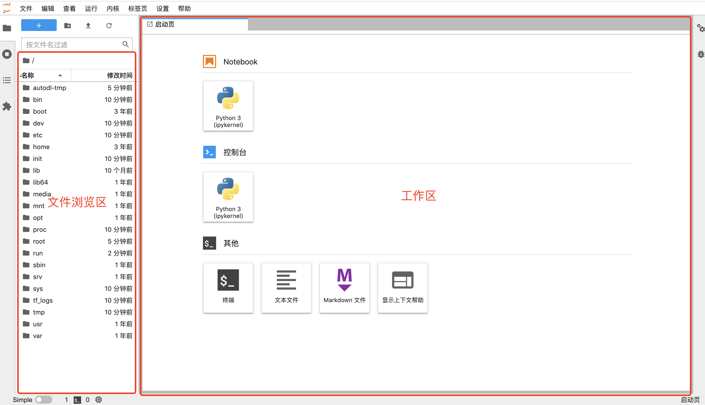

<font style="color:rgba(0, 0, 0, 0.87);">上传文件</font>

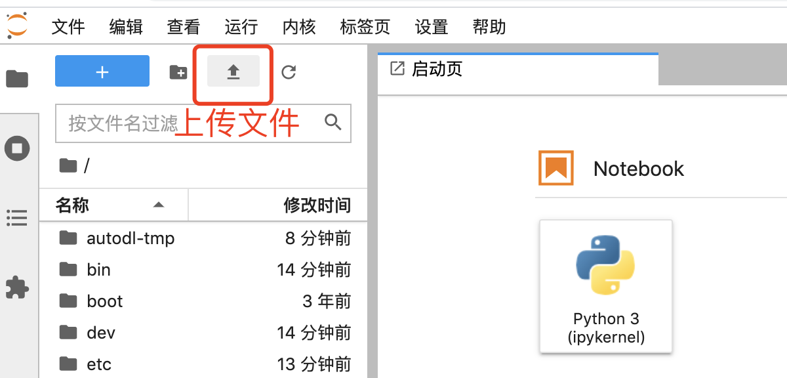

<font style="color:rgba(0, 0, 0, 0.87);">使用Notebook</font>

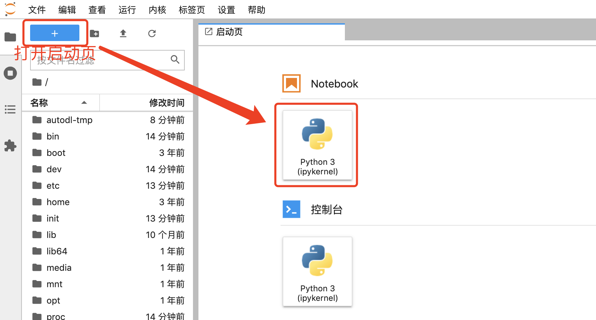

<font style="color:rgba(0, 0, 0, 0.87);">打开新终端</font>

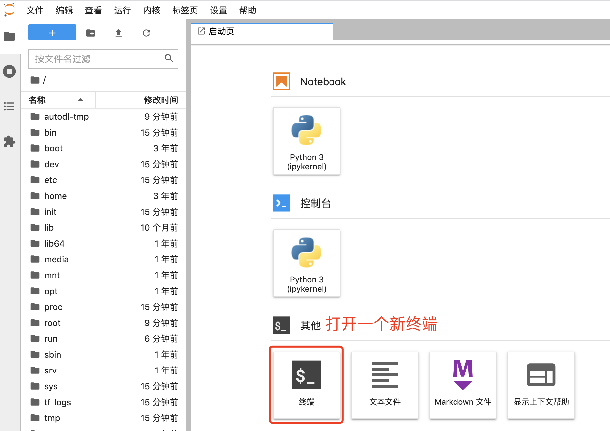

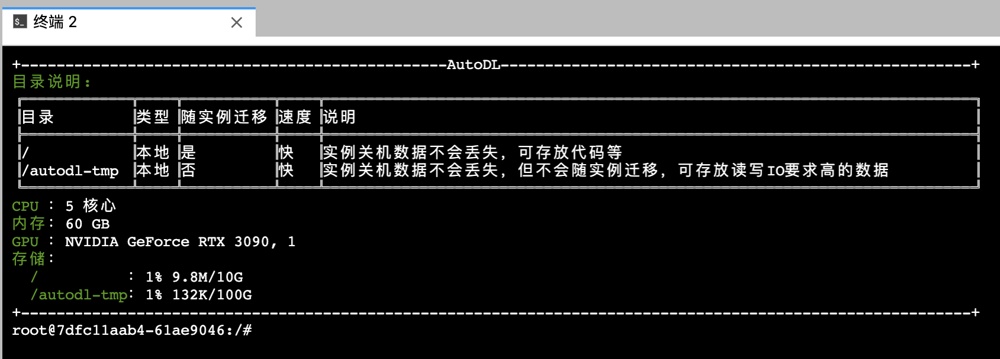

<font style="color:rgba(0, 0, 0, 0.87);">访问打开的终端或Notebook（JupyterLab在关闭终端/Notebook选项卡后默认不会终止，仍然在运行）</font>

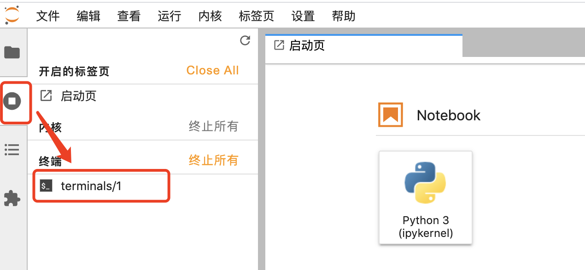

<font style="color:rgba(0, 0, 0, 0.87);">文件管理</font>

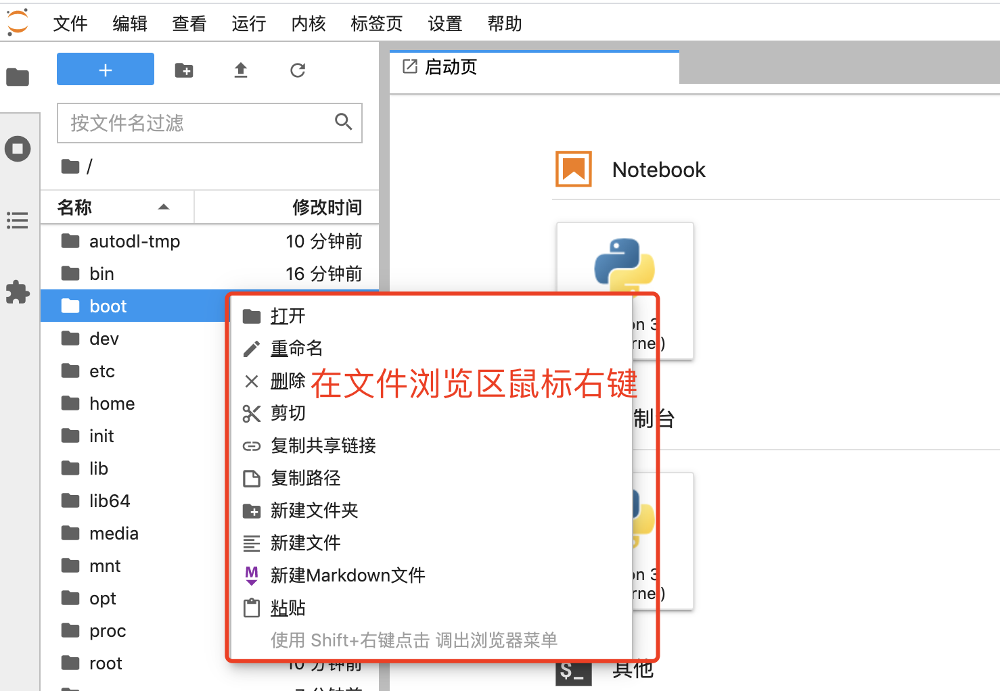

## 附：使用常见问题[](https://www.autodl.com/docs/jupyterlab/#_2)

<font style="color:rgba(0, 0, 0, 0.87);">如果用Notebook跑程序的同学会发现，隔了一段时间Notebook的日志不更新了。此时可以使用「日志控制台」的功能查看日志，演示一遍过程：</font>

<font style="color:rgba(0, 0, 0, 0.87);">如下一段程序执行起来后，刷新网页此时会发现日志不再更新</font>

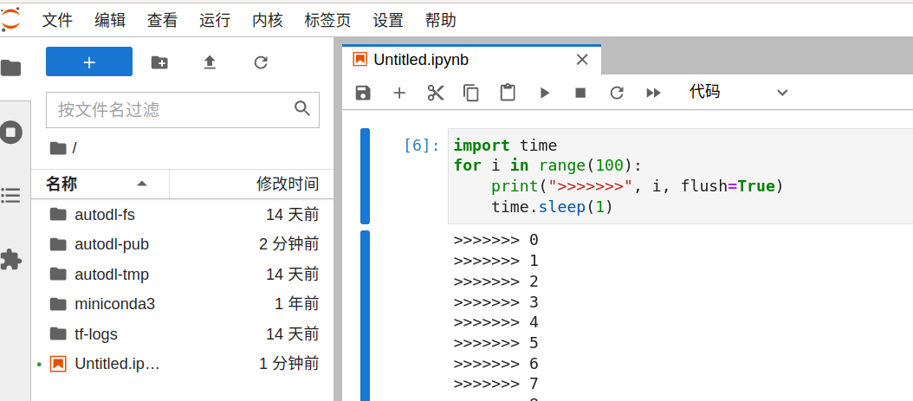

<font style="color:rgba(0, 0, 0, 0.87);">打开日志控制台：</font>

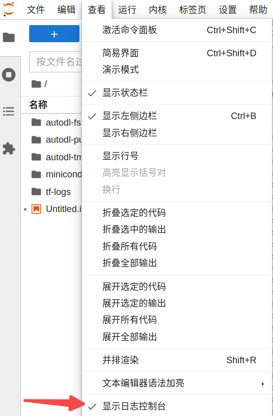

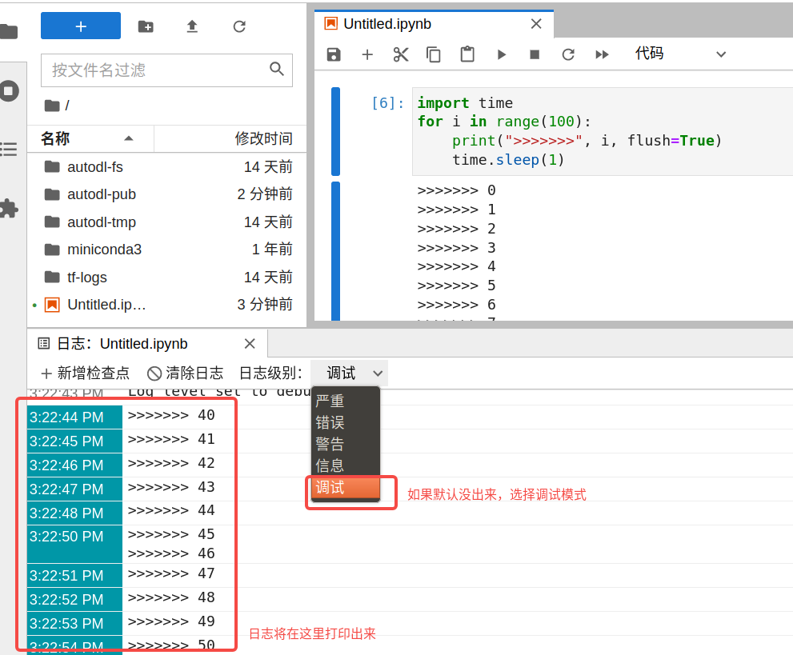

# SSH远程连接

***

<font style="background-color:rgb(254, 246, 235);">如果您是Windows用户，可以使用系统自带的Powershell/CMD登录，如果要更好的终端体验推荐下载使用</font>[<font style="background-color:rgb(254, 246, 235);">Cmder</font>](http://autodl-public.ks3-cn-beijing.ksyun.com/tool/cmder_mini.zip)<font style="background-color:rgb(254, 246, 235);">工具，免安装解压即用。或者使用</font>[<font style="background-color:rgb(254, 246, 235);">XShell工具</font>](https://www.autodl.com/docs/xshell/)<font style="background-color:rgb(254, 246, 235);">更佳。</font>

<font style="background-color:rgb(254, 246, 235);">如果是Mac用户，可以使用系统自带的Terminal完成SSH登录。</font>

## SSH登录[](https://www.autodl.com/docs/ssh/#ssh_1)

<font style="color:rgba(0, 0, 0, 0.87);">开机实例后，找到SSH登录指令</font>

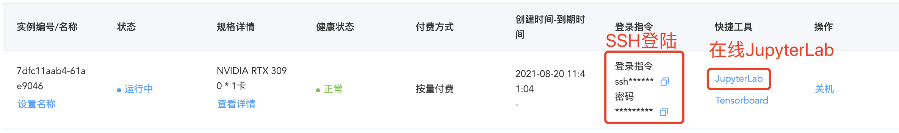

<font style="color:rgba(0, 0, 0, 0.87);">复制您的SSH登录指令，这里演示使用的是：</font><code><font style="background-color:rgb(235, 239, 253);">ssh -p 48332 root@region-3.autodl.com</font></code>

<font style="background-color:rgb(254, 246, 235);">在</font><code><font style="background-color:rgb(235, 239, 253);">ssh -p 48332 root@region-3.autodl.com</font></code><font style="background-color:rgb(254, 246, 235);">命令中， 各个参数的含义为：</font>

<font style="background-color:rgb(254, 246, 235);">用户名：root</font>

<font style="background-color:rgb(254, 246, 235);">主机host： region-3.autodl.com</font>

<font style="background-color:rgb(254, 246, 235);">端口号：48332</font>

<font style="color:rgba(0, 0, 0, 0.87);">在您的本地终端中输入该命令，输入密码进行登录。（</font>**<font style="color:rgba(0, 0, 0, 0.87);">注意：密码不会明文显示，正确输入后回车即可</font>**<font style="color:rgba(0, 0, 0, 0.87);">）</font>

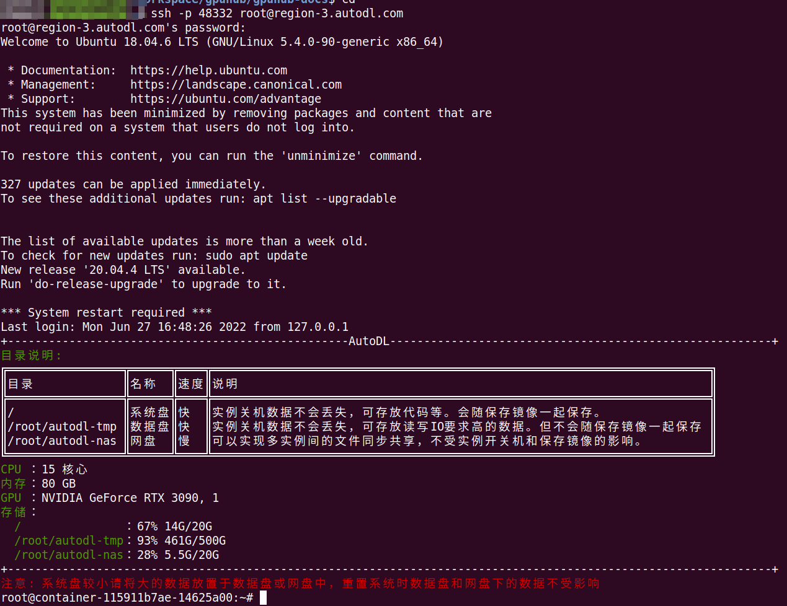

<font style="background-color:rgb(254, 246, 235);">⚠️</font><font style="background-color:rgb(254, 246, 235);">如果通过SSH登录后执行训练程序，请使用screen/tmux开守护进程，确保程序不受SSH连接中断影响程序执行！ 安装screen方法：apt-get update && apt-get install -y screen， tmux已内置。</font>

## 免密登录[](https://www.autodl.com/docs/ssh/#_1)

<font style="color:rgba(0, 0, 0, 0.87);">从我的实例->设置密钥登录入口进去配置SSH公钥。这样重启后或新创建的实例都能免密码登录，减少复制SSH登录密码的麻烦。密钥/公钥生成方法，请参考</font>[<font style="color:rgba(0, 0, 0, 0.87);">此链接</font>](https://git-scm.com/book/zh/v2/%E6%9C%8D%E5%8A%A1%E5%99%A8%E4%B8%8A%E7%9A%84-Git-%E7%94%9F%E6%88%90-SSH-%E5%85%AC%E9%92%A5)

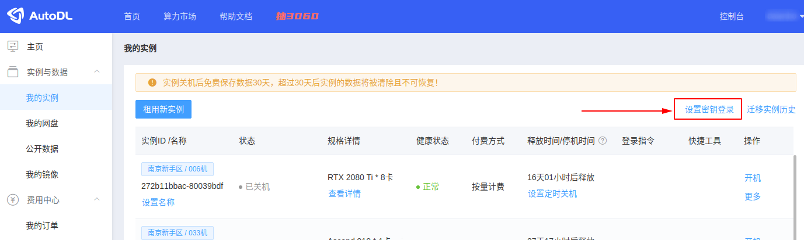

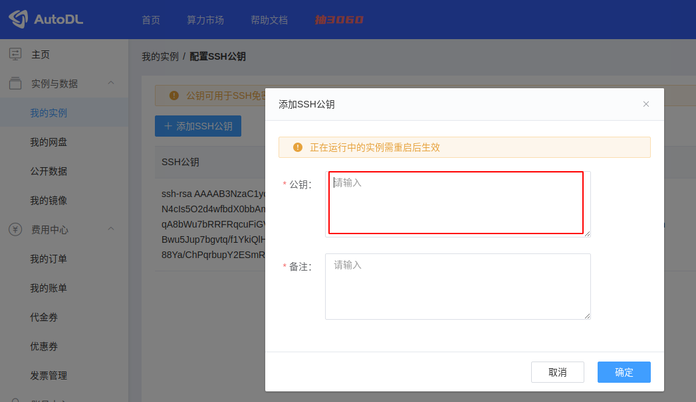

# Miniconda[](https://www.autodl.com/docs/miniconda/#miniconda)

平台内置的所有镜像都安装了Miniconda，安装路径为/root/miniconda3/。

如果您需要使用其他版本的CUDA或cuDNN，那么可以通过Miniconda简单几步完成环境构建，推荐您租用实例时选择miniconda镜像（内部未安装任何深度学习框架，保持运行环境干净，避免不必要的问题）

以下以构建TensorFlow 1.15.0版本的运行环境为例进行说明如何使用Conda构建需要的环境。

<font style="background-color:rgb(254, 246, 235);">如果需要将虚拟环境安装在数据盘，请参考文档最下方的方法</font>

## 创建虚拟环境[](https://www.autodl.com/docs/miniconda/#_1)

```plain
conda create -n tf python=3.7           # 构建一个虚拟环境，名为：tf
conda init bash && source /root/.bashrc # 更新bashrc中的环境变量
conda activate tf                       # 切换到创建的虚拟环境：tf
```

## 安装软件依赖[](https://www.autodl.com/docs/miniconda/#_2)

这里以安装tensorflow==1.15.0为例

```plain
# 切换conda虚拟环境后
conda install tensorflow-gpu==1.15.0     
# conda会自动解析依赖安装tensorflow 1.15.0版本需要的cuda和cudnn，无需自己独立安装

# 安装完使用Python进行简单的测试：
import tensorflow as tf 
hello = tf.constant('Hello, TensorFlow!') 
sess = tf.Session(config=tf.ConfigProto(log_device_placement=True))
print(sess.run(hello))
```

## Notebook环境切换[](https://www.autodl.com/docs/miniconda/#notebook)

如何在JupyterLab的Notebook中使用新的Conda环境

```plain
# 创建Conda新的虚拟环境（如已创建，请忽略！）
conda create -n tf python=3.7             # 构建一个虚拟环境，名为：tf
conda init bash && source /root/.bashrc   # 更新bashrc中的环境变量

# 将新的Conda虚拟环境加入jupyterlab中
conda activate tf                         # 切换到创建的虚拟环境：tf
conda install ipykernel
ipython kernel install --user --name=tf   # 设置kernel，--user表示当前用户，tf为虚拟环境名称
```

执行以上命令后，如果创建新的Notebook，那么可以选择名为tf的Notebook

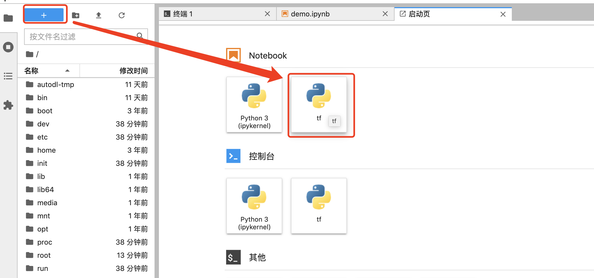

如果是已有的Notebook

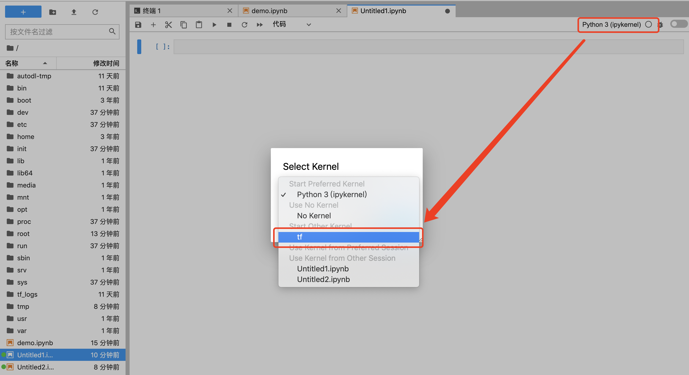

## 清除Conda虚拟环境[](https://www.autodl.com/docs/miniconda/#conda)

```plain
# 清除安装的环境
conda deactivate          # 退出当前(tf)环境到base环境
conda remove -n tf --all  # 清除tf环境
```

## 删除安装包和缓存[](https://www.autodl.com/docs/miniconda/#_3)

```plain
conda clean -y --all
```

## 安装虚拟环境到数据盘[](https://www.autodl.com/docs/miniconda/#_4)

执行以下命令设置将虚拟环境安装到<code><font style="background-color:rgb(235, 239, 253);">/root/autodl-tmp/conda/envs</font></code>， 包缓存到<code><font style="background-color:rgb(235, 239, 253);">/root/autodl-tmp/conda/pkgs</font></code>

```plain
mkdir -p /root/autodl-tmp/conda/pkgs
conda config --add pkgs_dirs /root/autodl-tmp/conda/pkgs

mkdir -p /root/autodl-tmp/conda/envs
conda config --add envs_dirs /root/autodl-tmp/conda/envs
```

验证是否生效

```plain
# 执行命令查看配置的路径是否在文件内容中
cat /root/.condarc
```

**取消设置安装虚拟环境到数据盘**\
编辑/root/.condarc文件，删除对应的路径所在行即可

# PyCharm远程开发[](https://www.autodl.com/docs/pycharm/#pycharm)

<font style="background-color:rgb(254, 246, 235);">警告：如果使用PyCharm直接执行或开终端执行训练程序，请在调试完成后最后通过screen/tmux工具开守护进程（参考文档：</font>[<font style="background-color:rgb(254, 246, 235);">守护进程</font>](https://www.autodl.com/docs/daemon/)<font style="background-color:rgb(254, 246, 235);">），确保程序不受SSH连接中断影响程序执行！</font>

## 远程项目开发[](https://www.autodl.com/docs/pycharm/#_1)

官方文档：[请戳](https://www.jetbrains.com/help/pycharm/configuring-remote-interpreters-via-ssh.html)

AutoDL使用方法：

**Step1**：确认您安装的PyCharm是社区版还是专业版，只有**专业版**才支持远程开发功能。

**Step2**：开机实例

复制自己实例的SSH指令，比如：<code><font style="background-color:rgb(235, 239, 253);">ssh -p 38076 root@region-1.autodl.com</font></code>

<font style="background-color:rgb(254, 246, 235);">在</font><code><font style="background-color:rgb(235, 239, 253);">ssh -p 38076 root@region-1.autodl.com</font></code><font style="background-color:rgb(254, 246, 235);">命令中， 各个参数的含义为：</font>

<font style="background-color:rgb(254, 246, 235);">用户名：root</font>

<font style="background-color:rgb(254, 246, 235);">HOST： region-1.autodl.com</font>

<font style="background-color:rgb(254, 246, 235);">端口号：38076</font>

**Step3**：配置PyCharm

\[File] -> \[Settings]，打开以下设置弹窗，搜索interpreter找到\[Python interpreter]设置项

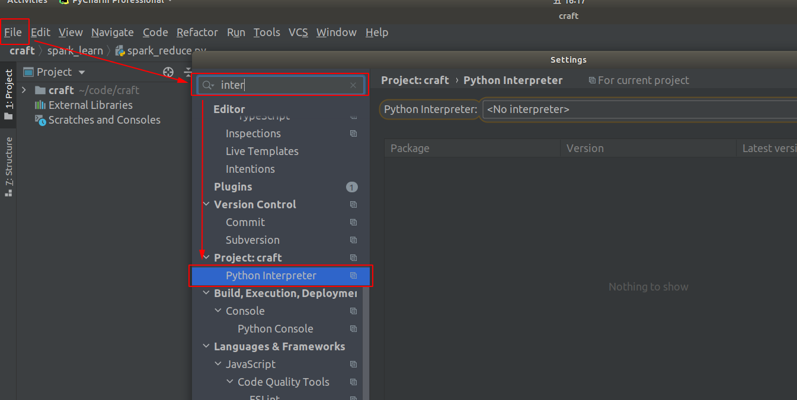

点击Add Interpreter，选择On SSH并点击 (PyCharm社区版本无该选项)

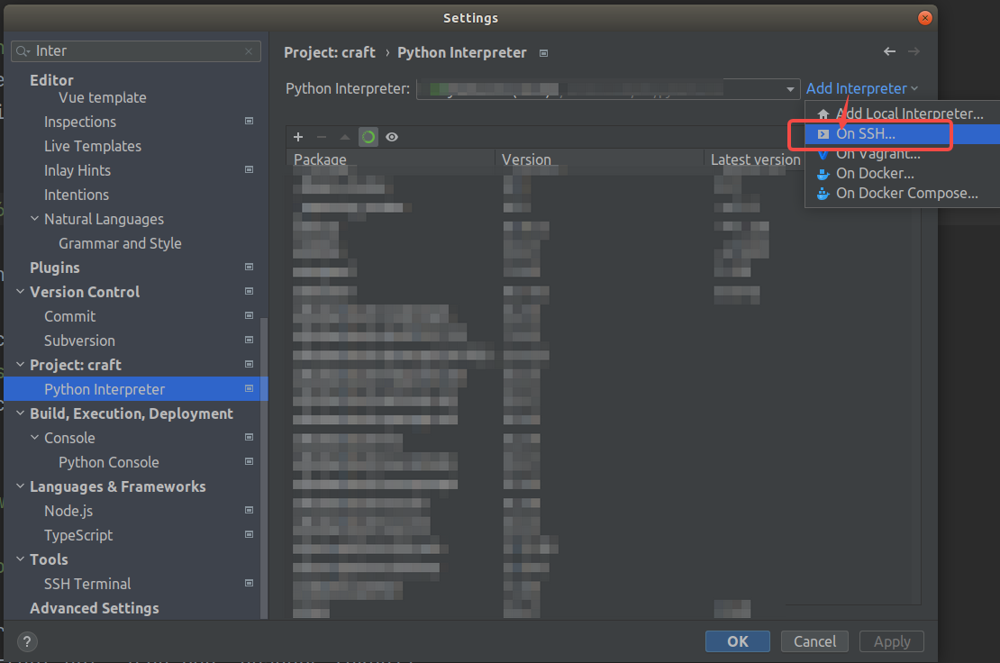

将实例SSH指令中的Host、Port与Username进行匹配和填写（Username均为root，Host和Port查看自己实例的SSH指令)

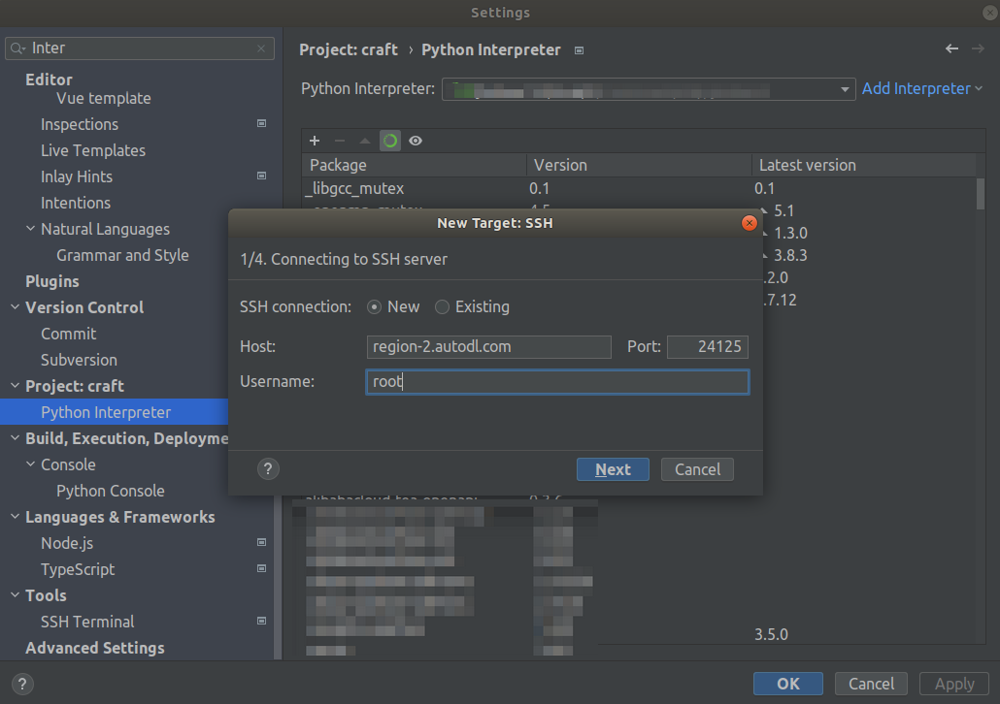

下一步：输入SSH的密码

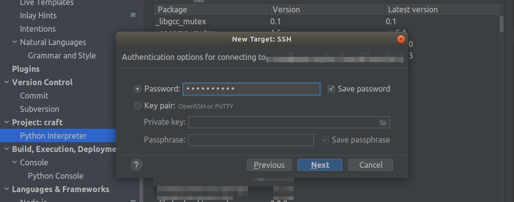

继续下一步，直到看到下面的弹窗。选择System Interpreter，配置远程Python解释器地址为<code><font style="background-color:rgb(235, 239, 253);">/root/miniconda3/bin/python</font></code>（如果您在miniconda中安装了其他的虚拟环境，那么虚拟环境的python解释器路径在/root/miniconda3/envs/{对应的虚拟环境名称}/bin/python）

配置同步目录，意思是本地项目和远程实例中的哪个目录进行关联，这里设置为实例的数据盘子目录：<code><font style="background-color:rgb(235, 239, 253);">/root/autodl-tmp/project/</font></code> （不建议使用默认的/tmp目录）

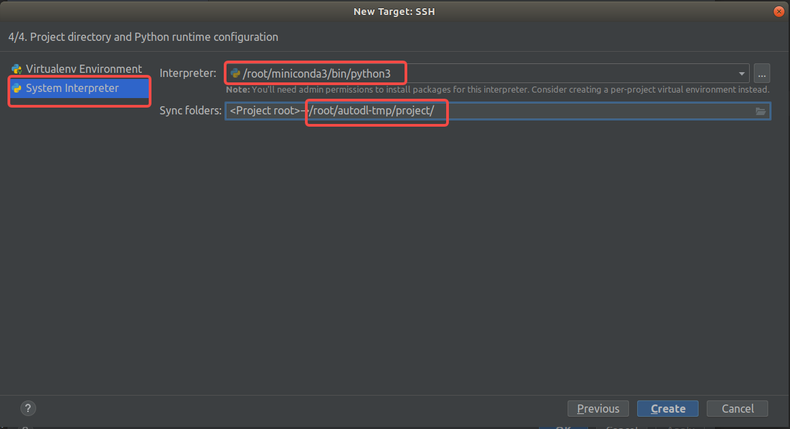

点击创建，如果配置均无误PyCharm会有小会配置过程，完成后即可远程开发。

如果您在运行时找不到Python文件，可能是没有自动同步代码，那么可以选择手动同步：

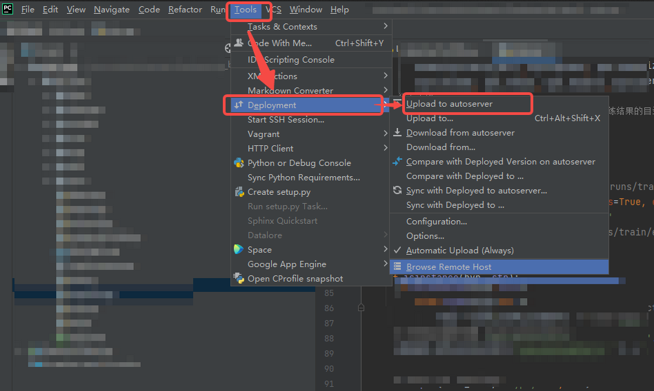

## 打开远程终端[](https://www.autodl.com/docs/pycharm/#_2)

配置好PyCharm远程开发后，可以在PyCharm的终端中下拉找到远程服务器打开远程终端：

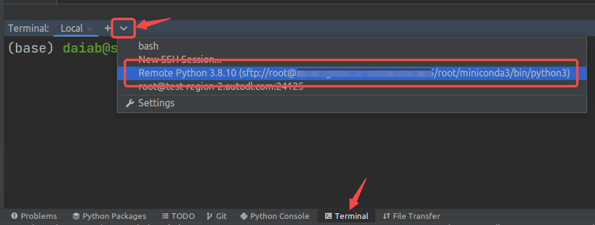

# 学术资源加速[](https://www.autodl.com/docs/network_turbo/#_1)

## 公开服务[](https://www.autodl.com/docs/network_turbo/#_2)

<font style="color:rgba(0, 0, 0, 0.87);">Github:</font><font style="color:rgba(0, 0, 0, 0.87);"> </font>[<font style="color:rgba(0, 0, 0, 0.87);">https://ghp.ci/</font>](https://ghp.ci/)

<font style="color:rgba(0, 0, 0, 0.87);">HuggingFace镜像站：</font>[<font style="color:rgba(0, 0, 0, 0.87);">https://hf-mirror.com/</font>](https://hf-mirror.com/)

## AutoDL内置服务[](https://www.autodl.com/docs/network_turbo/#autodl)

<font style="background-color:rgb(254, 246, 235);">声明：限于学术使用github和huggingface网络速度慢的问题，以下为方便用户学术用途使用相关资源提供的加速代理，不承诺稳定性保证。此外如遭遇恶意攻击等，将随时停止该加速服务</font>

<font style="color:rgba(0, 0, 0, 0.87);">以下为可以加速访问的学术资源地址：</font>

* <font style="color:rgba(0, 0, 0, 0.87);">github.com</font>
* <font style="color:rgba(0, 0, 0, 0.87);">githubusercontent.com</font>
* <font style="color:rgba(0, 0, 0, 0.87);">githubassets.com</font>
* <font style="color:rgba(0, 0, 0, 0.87);">huggingface.co</font>

<font style="color:rgba(0, 0, 0, 0.87);">如果在终端中使用：</font>

```plain
source /etc/network_turbo
```

<font style="color:rgba(0, 0, 0, 0.87);">如果是在Notebook中使用：</font>

```plain
import subprocess
import os

result = subprocess.run('bash -c "source /etc/network_turbo && env | grep proxy"', shell=True, capture_output=True, text=True)
output = result.stdout
for line in output.splitlines():
    if '=' in line:
        var, value = line.split('=', 1)
        os.environ[var] = value
```

**<font style="color:rgba(0, 0, 0, 0.87);">取消学术加速</font>**<font style="color:rgba(0, 0, 0, 0.87);">，如果不再需要建议关闭学术加速，因为该加速可能对正常网络造成一定影响</font>

```plain
unset http_proxy && unset https_proxy
```

### 速度对比[](https://www.autodl.com/docs/network_turbo/#_3)

<font style="color:rgba(0, 0, 0, 0.87);">未使用加速：</font>

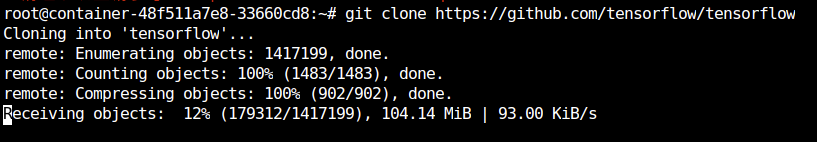

<font style="color:rgba(0, 0, 0, 0.87);">使用加速：</font>

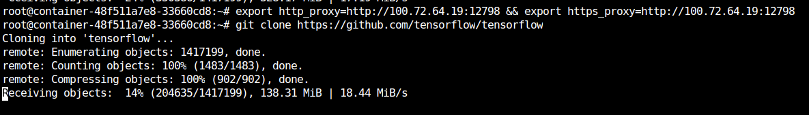


> 更新: 2025-04-20 22:38:53  
> 原文: <https://www.yuque.com/aaron-wecc3/dhluml/qmg2vccgi2px9oq2>