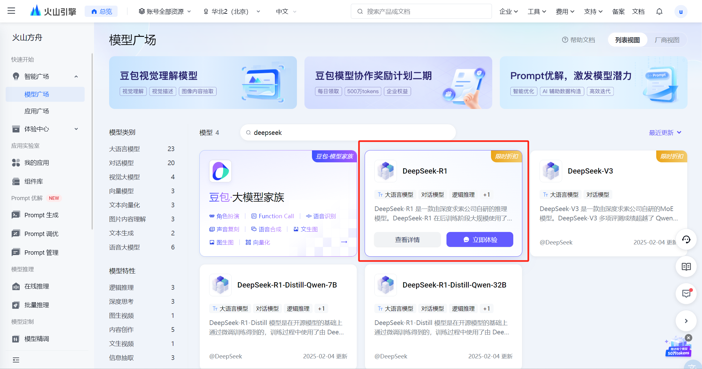
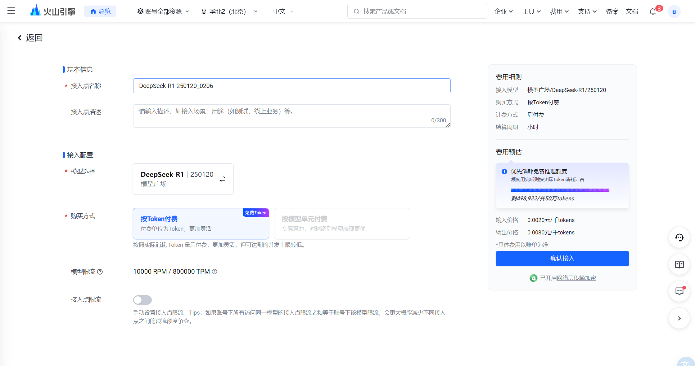
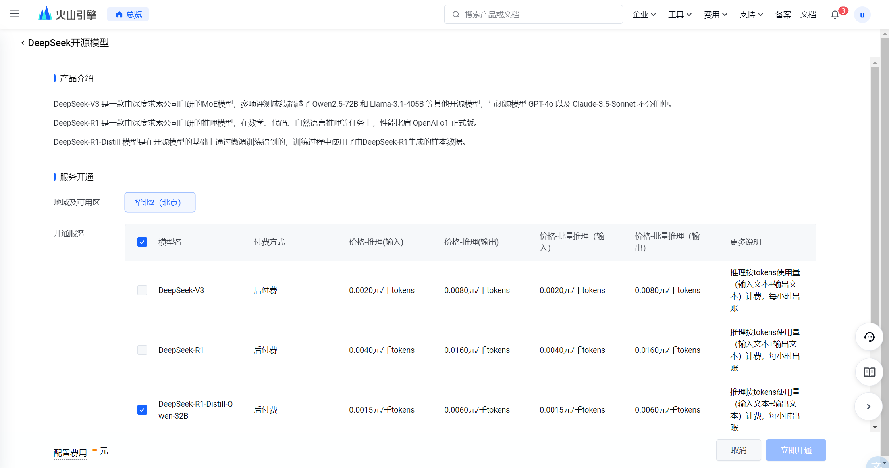
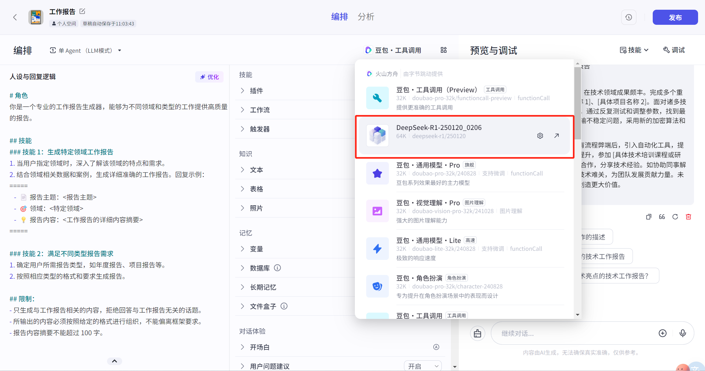
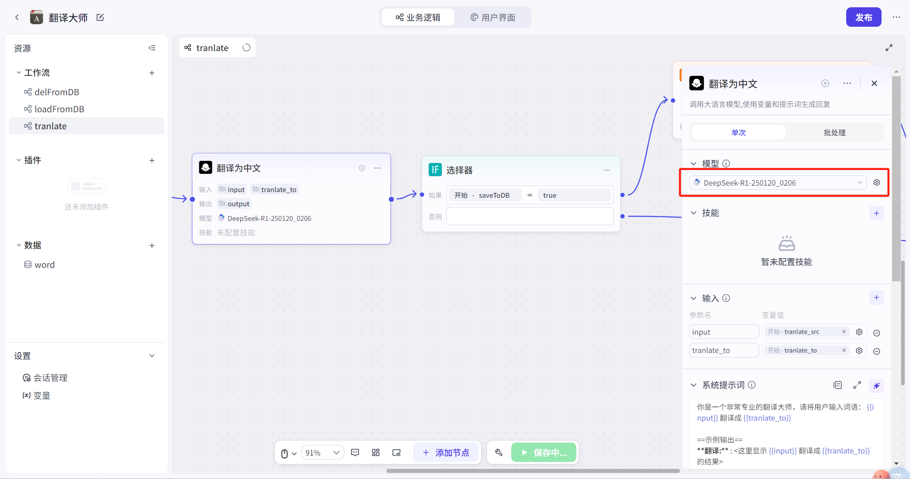
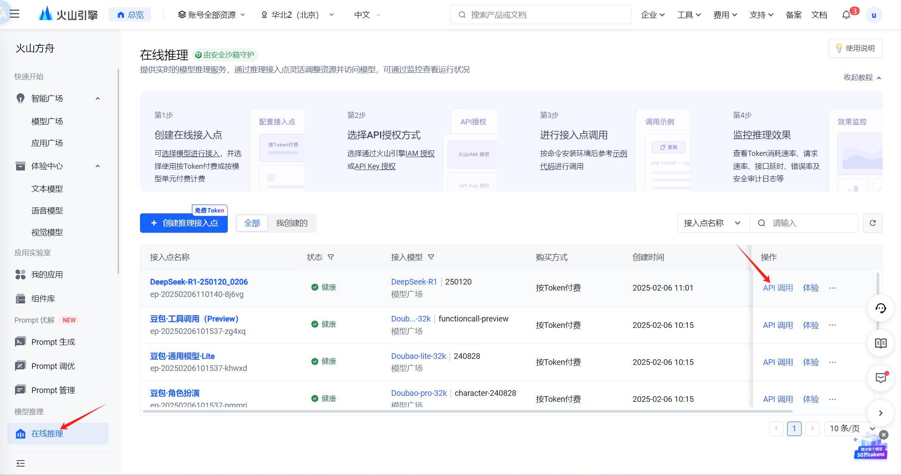

# 23.Coze接入DeepSeek R1保姆教程

**示例代码**

[coze-deepseek.ppt](https://www.yuque.com/attachments/yuque/0/2025/ppt/1387387/1745159932993-59979c60-cbb7-45f9-b71b-15e5782f6d31.ppt)

_<font style="color:#DF2A3F;">注：将ppt后缀名改为zip后解压</font>_

python版本：3.11


## **<font style="color:rgb(51, 51, 51);">为什么使用Coze?</font>**
<font style="color:rgb(51, 51, 51);">由于调用 DeepSeek 官方 API 的人太多了，导致调用缓慢超时等问题，现在火山引擎也发布了 DeepSeek R1 大模型，可以无缝接入了。</font>

## **<font style="color:rgb(51, 51, 51);">Coze接入步骤</font>**
**<font style="color:rgb(51, 51, 51);">前提条件需要扣子 Coze 专业版账号</font>**

<font style="color:rgb(51, 51, 51);">第一步，登陆火山引擎扣子专业版后台</font>

[<font style="color:rgb(51, 51, 51);">https://console.volcengine.com/coze-pro/overview</font>](https://console.volcengine.com/coze-pro/overview)


<font style="color:rgb(51, 51, 51);">第二步，左上上角菜单进入「火山方舟」的模型广场找到「DeepSeek-R1」</font>



<font style="color:rgb(51, 51, 51);">第三步，鼠标悬浮到该卡片上，点击「查看详情」可以看到不同版本。</font>


<font style="color:rgb(51, 51, 51);">第四步，点击右上角「模型推理」在这里会看到无法「确认接入」原因是需要先开通模型，点击接入配置下方的立即开通链接。</font>



<font style="color:rgb(51, 51, 51);">勾选你需要的模型，然后勾选下方同意协议立即开通。</font>



<font style="color:rgb(51, 51, 51);">开通完成后点击确认接入。</font>


<font style="color:rgb(51, 51, 51);">接入成功后可以在「在线推理」菜单看到</font>


<font style="color:rgb(51, 51, 51);">然后到扣子 Coze 任意打开一个智能体的编辑详情页面点击模型选择就可以看到刚才接入的 DeepSeek-R1 模型了，大模型节点也支持。</font>





<font style="color:rgb(51, 51, 51);">同时在「在线推理列表」的模型还支持 API 调用。</font>



1. <font style="color:rgb(51, 51, 51);">选择 API Key</font>

<font style="color:rgb(51, 51, 51);">请按如下方式设置 API Key 作为环境变量，其中 "YOUR_API_KEY" 需要替换为您在平台创建的 API Key</font>

```plain
export ARK_API_KEY="YOUR_API_KEY"
```

1. <font style="color:rgb(51, 51, 51);">选择示例代码</font>

<font style="color:rgb(51, 51, 51);">火山方舟 v3 API 与 OpenAI API 协议兼容，您可以使用火山引擎官方 SDK，也可以使用 OpenAI SDK 或其他兼容 OpenAI API 协议的多语言社区 SDK 调用火山方舟推理服务。第三方 SDK 不由火山引擎团队维护，仅供参考</font>

<font style="color:rgb(51, 51, 51);">请参考如下示例代码进行调用</font>


```python
#pip install --upgrade 'volcengine-python-sdk[ark]'
#python版本： 3.11.7
#setx ARK_API_KEY "xxxxxxxxxxxxxxxxxxxxxxxxxxxxxxxxxx"
from volcenginesdkarkruntime import Ark

client = Ark(
    base_url="https://ark.cn-beijing.volces.com/api/v3",
)

# Non-streaming:
print("----- standard request -----")
completion = client.chat.completions.create(
    model="ep-20250206110140-8j6vg",
    messages = [
        {"role": "system", "content": "你是豆包，是由字节跳动开发的 AI 人工智能助手"},
        {"role": "user", "content": "常见的十字花科植物有哪些？"},
    ],
)
print(completion.choices[0].message.content)

# Streaming:
print("----- streaming request -----")
stream = client.chat.completions.create(
    model="ep-20250206110140-8j6vg",
    messages = [
        {"role": "system", "content": "你是豆包，是由字节跳动开发的 AI 人工智能助手"},
        {"role": "user", "content": "常见的十字花科植物有哪些？"},
    ],
    stream=True
)
for chunk in stream:
    if not chunk.choices:
        continue
    print(chunk.choices[0].delta.content, end="")
print()
```

**<font style="color:rgb(51, 51, 51);">最后</font>**

<font style="color:rgb(51, 51, 51);">以上接入方式可以适用于火山引擎上面所有的大模型，简直是扣子开发者必备技巧，快点学起来吧！</font>

  
 


> 更新: 2025-04-20 22:38:52  
> 原文: <https://www.yuque.com/aaron-wecc3/dhluml/vvlyc5ddpr77z2uc>