# 24.基于DeepSeek R1搭建企业级知识库

## <font style="color:rgb(51, 51, 51);">Ollama 部署 DeepSeek-R1模型</font>
<font style="color:rgb(51, 51, 51);">使用 Ollama 部署 DeepSeek-R1 模型的步骤相对简单，以下是详细的部署流程：</font>

### <font style="color:rgb(51, 51, 51);">步骤 1: 安装 Ollama</font>
<font style="color:rgb(51, 51, 51);">官网：</font>[https://ollama.com/](https://ollama.com/)

<font style="color:rgb(51, 51, 51);">Ollama 是一个简单易用的工具，可以帮助我们轻松地将 DeepSeek-R1 部署到本地。首先，需要确保你的机器环境满足以下条件：</font>

+ <font style="color:rgb(51, 51, 51);">操作系统：Linux/MacOS 或 Windows</font>
+ <font style="color:rgb(51, 51, 51);">GPU：支持 2G 显存的显卡（如 GTX 1050 或其他类似显卡）</font>

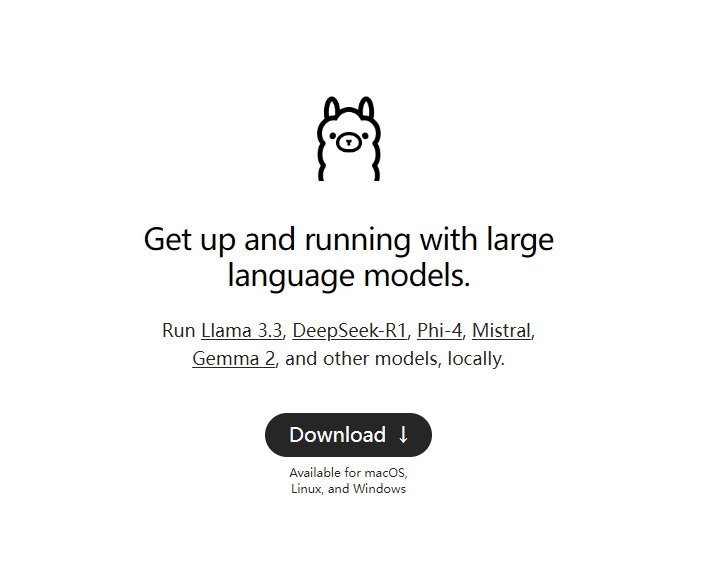

**<font style="color:rgb(51, 51, 51);">安装命令</font>**

<font style="color:rgb(51, 51, 51);">根据你的操作系统，执行以下命令来安装 Ollama。</font>

**<font style="color:rgb(51, 51, 51);">在 Linux 或 MacOS 上</font>**

```plain
curl -sSL https://ollama.com/download | bash
```

**<font style="color:rgb(51, 51, 51);">在 Windows 上</font>**

<font style="color:rgb(51, 51, 51);">下载 Ollama 安装包并按提示安装。</font>

**<font style="color:rgb(51, 51, 51);">配置环境</font>**

<font style="color:rgb(51, 51, 51);">安装完成后，确保你的环境配置正确。执行以下命令来验证：</font>

```plain
ollama --version
```

<font style="color:rgb(51, 51, 51);">如果显示版本信息，说明 Ollama 安装成功。</font>

### <font style="color:rgb(51, 51, 51);">步骤 2: 安装 DeepSeek-R1 模型</font>
1. **<font style="color:rgb(51, 51, 51);">打开终端或命令提示符</font>**<font style="color:rgb(51, 51, 51);">：根据你的操作系统打开命令行工具（macOS 用户使用 Terminal，Windows 用户使用 Command Prompt 或 PowerShell）。</font>
2. **<font style="color:rgb(51, 51, 51);">拉取模型</font>**<font style="color:rgb(51, 51, 51);">：在终端中输入以下命令下载 DeepSeek-R1 模型：</font>

```plain
ollama pull deepseek-r1:1.5b
```

<font style="color:rgb(51, 51, 51);">该命令会从 Ollama 的官方模型库中拉取 DeepSeek-R1 模型，并下载到本地。</font>

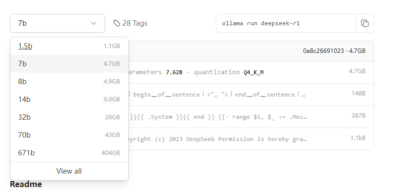

### <font style="color:rgb(51, 51, 51);">步骤 3: 启动模型</font>
1. **<font style="color:rgb(51, 51, 51);">运行 DeepSeek-R1 模型</font>**<font style="color:rgb(51, 51, 51);">：使用以下命令启动 DeepSeek-R1 模型：</font>

```plain
ollama run deepseek-r1:1.5b
```

<font style="color:rgb(51, 51, 51);">该命令会启动模型，并在本地环境中启动一个推理服务。</font>

<font style="color:rgb(51, 51, 51);"> </font>

## <font style="color:rgb(51, 51, 51);">Chatbox调用DeepSeek-R1接口</font>
<font style="color:rgb(51, 51, 51);">本地命令行使用还是不太直观，可以选择 Chatbox 进行网页端访问，提高可交互性。</font>

<font style="color:rgb(51, 51, 51);">Chatbox AI 是一款 AI 客户端应用和智能助手，支持众多先进的 AI 模型和 API，可在 Windows、MacOS、Android、iOS、Linux 和网页版上使用。</font>

<font style="color:rgb(51, 51, 51);">本地使用 Ollama 部署完成后，可以使用 Chatbox 进行调用。</font>


<font style="color:rgb(51, 51, 51);">1、打开官网：</font>[<font style="color:rgb(51, 51, 51);">https://chatboxai.app/zh</font>](https://chatboxai.app/zh)<font style="color:rgb(51, 51, 51);">，选择启动网页版。</font>


<font style="color:rgb(51, 51, 51);">2、选择本地模型，如果找不到，点击左侧的设置按钮。</font>

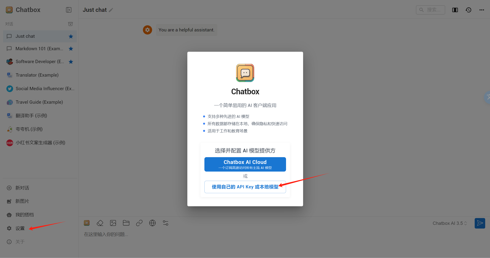

<font style="color:rgb(51, 51, 51);">3、选择 Ollama API。</font>

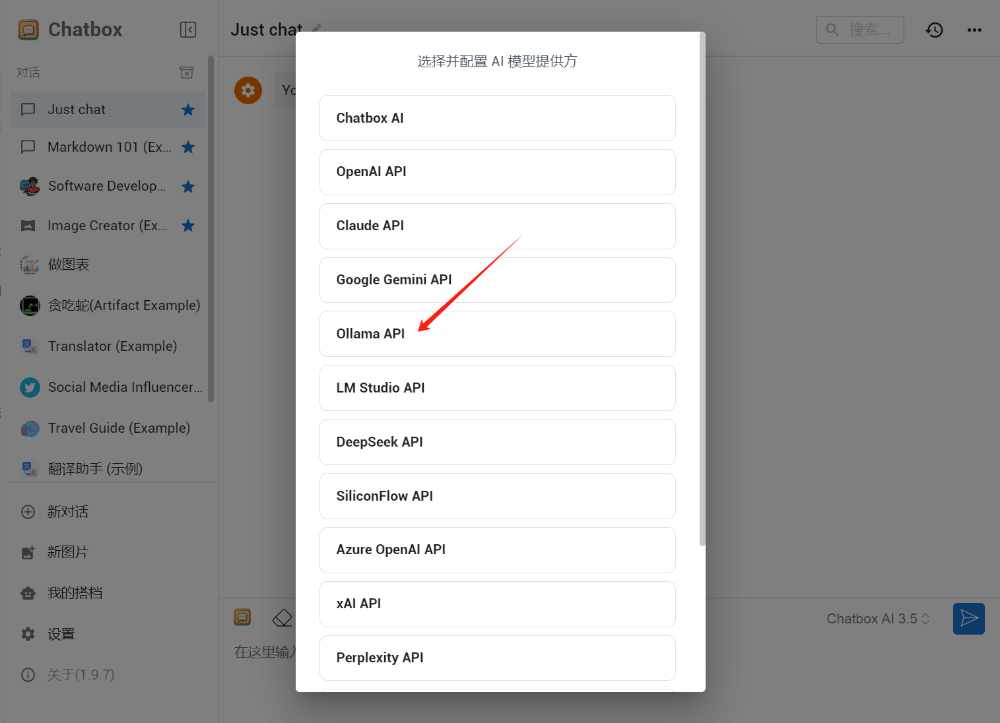

<font style="color:rgb(51, 51, 51);">4、选择模型，本地运行 Ollama 后会自动出现模型的选项，直接选择即可。</font>

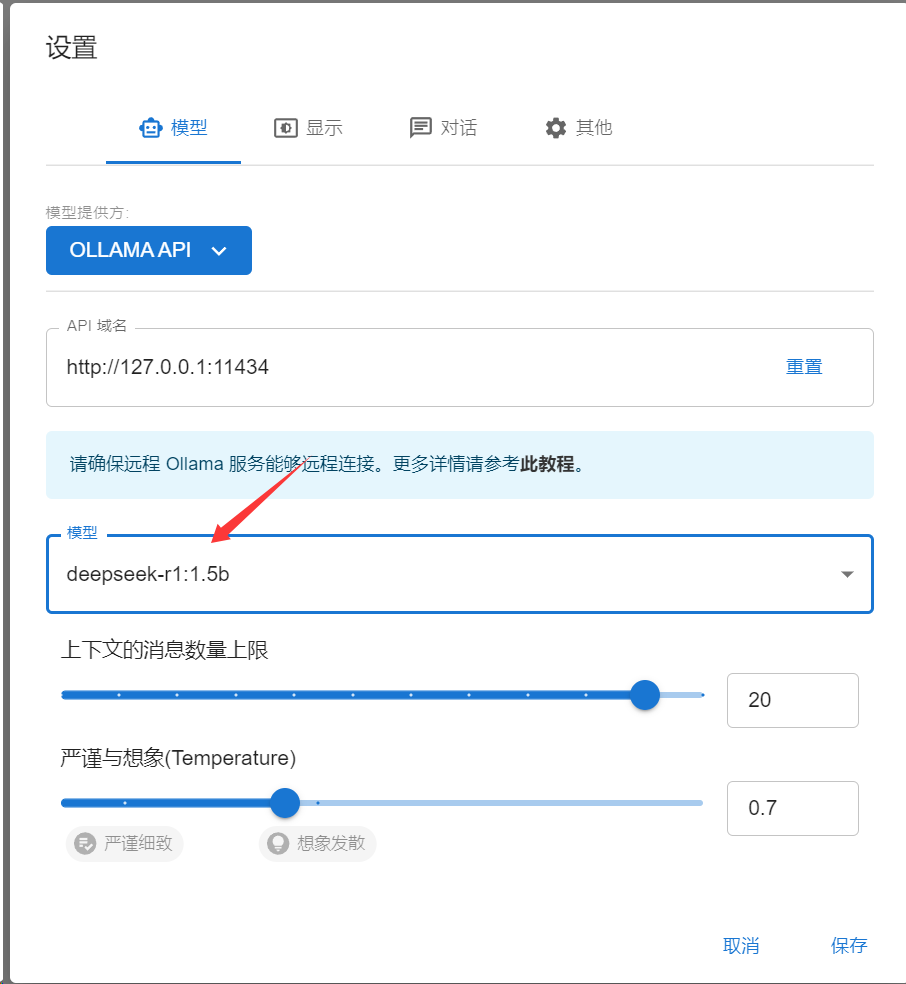

<font style="color:rgb(51, 51, 51);">5、点击 DISPLAY，选择简体中文，点击保存按钮。</font>

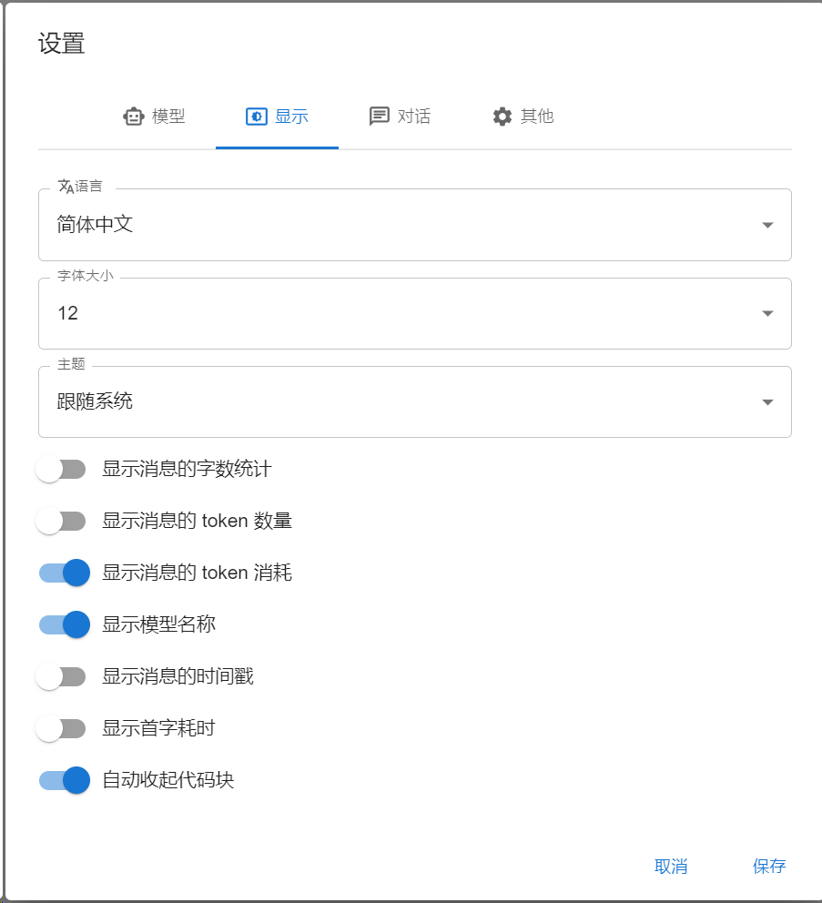

**在 Chatbox 中连接远程 Ollama 服务**

<font style="color:rgb(55, 65, 81);">除了可以轻松连接本地 Ollama 服务，Chatbox 也支持连接到运行在其他机器上的远程 Ollama 服务。</font>

<font style="color:rgb(55, 65, 81);">例如，你可以在家中的电脑上运行 Ollama 服务，并在手机或其他电脑上使用 Chatbox 客户端连接到这个服务。</font>

<font style="color:rgb(55, 65, 81);">你需要确保远程 Ollama 服务正确配置并暴露在当前网络中，以便 Chatbox 可以访问。</font>**默认情况下，需要对远程 Ollama 服务进行简单的配置**<font style="color:rgb(55, 65, 81);">。</font>

<font style="color:rgb(55, 65, 81);">默认情况下，Ollama 服务仅在本地运行，不对外提供服务。要使 Ollama 服务能够对外提供服务，你需要设置以下两个环境变量：</font>

```bash
OLLAMA_HOST=0.0.0.0
OLLAMA_ORIGINS=*
```

**在 MacOS 上配置**

1. <font style="color:rgb(55, 65, 81);">打开命令行终端，输入以下命令：</font>

```bash
launchctl setenv OLLAMA_HOST "0.0.0.0"
launchctl setenv OLLAMA_ORIGINS "*"
```

2. <font style="color:rgb(55, 65, 81);">重启 Ollama 应用，使配置生效。</font>

**在 Windows 上配置**

<font style="color:rgb(55, 65, 81);">在 Windows 上，Ollama 会继承你的用户和系统环境变量。</font>

1. <font style="color:rgb(55, 65, 81);">通过任务栏退出 Ollama。</font>
2. <font style="color:rgb(55, 65, 81);">打开设置（Windows 11）或控制面板（Windows 10），并搜索“环境变量”。</font>
3. <font style="color:rgb(55, 65, 81);">点击编辑你账户的环境变量。</font>

<font style="color:rgb(55, 65, 81);">为你的用户账户编辑或创建新的变量</font><font style="color:rgb(55, 65, 81);"> </font>**OLLAMA_HOST**<font style="color:rgb(55, 65, 81);">，值为</font><font style="color:rgb(55, 65, 81);"> </font>**0.0.0.0**<font style="color:rgb(55, 65, 81);">； 为你的用户账户编辑或创建新的变量</font><font style="color:rgb(55, 65, 81);"> </font>**OLLAMA_ORIGINS**<font style="color:rgb(55, 65, 81);">，值为</font><font style="color:rgb(55, 65, 81);"> </font>*****<font style="color:rgb(55, 65, 81);">。</font>

4. <font style="color:rgb(55, 65, 81);">点击确定/应用以保存设置。</font>
5. <font style="color:rgb(55, 65, 81);">从 Windows 开始菜单启动 Ollama 应用程序。</font>

<font style="color:rgb(51, 51, 51);"></font>

<font style="color:rgb(51, 51, 51);">6、在聊天窗口输入问题进行测试。</font>

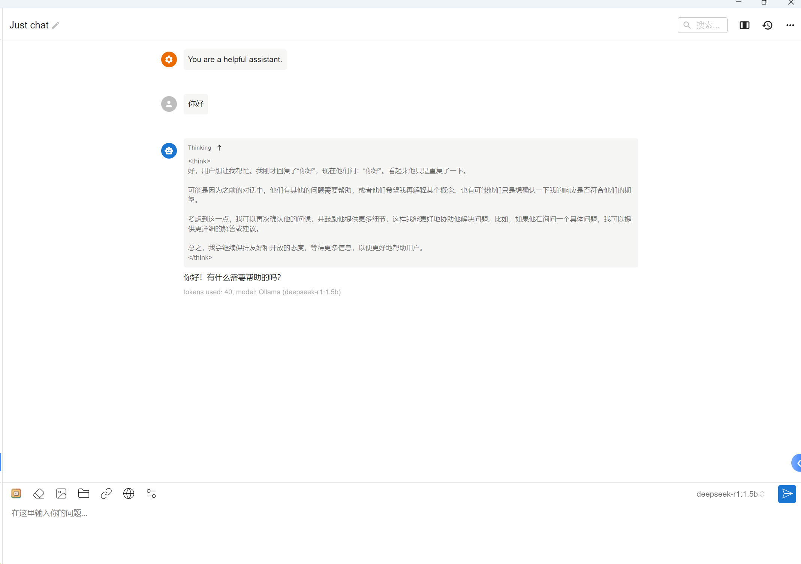

**<font style="color:rgb(51, 51, 51);">2.3 搭配 GPTs 使用</font>**

<font style="color:rgb(51, 51, 51);">1、点击左侧我的搭档</font>

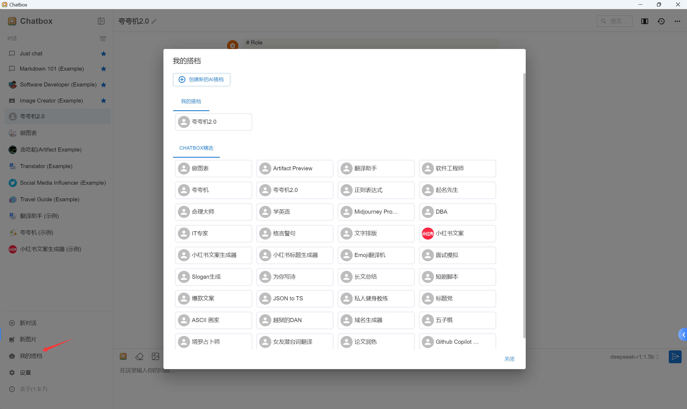

<font style="color:rgb(51, 51, 51);">2、选择一个你喜欢的应用，本示例选择夸夸机 2.0</font>

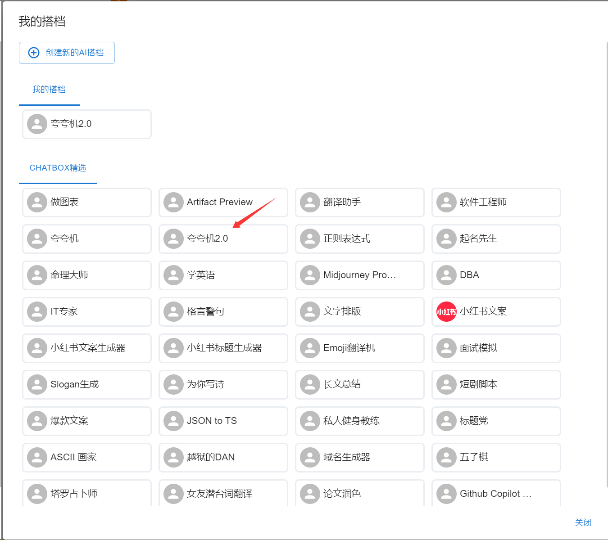

<font style="color:rgb(51, 51, 51);">3、随便输入一个场景，看看大模型的回答。比如自嘲、尴尬、夸张的场景，看看他怎么花样夸你。</font>

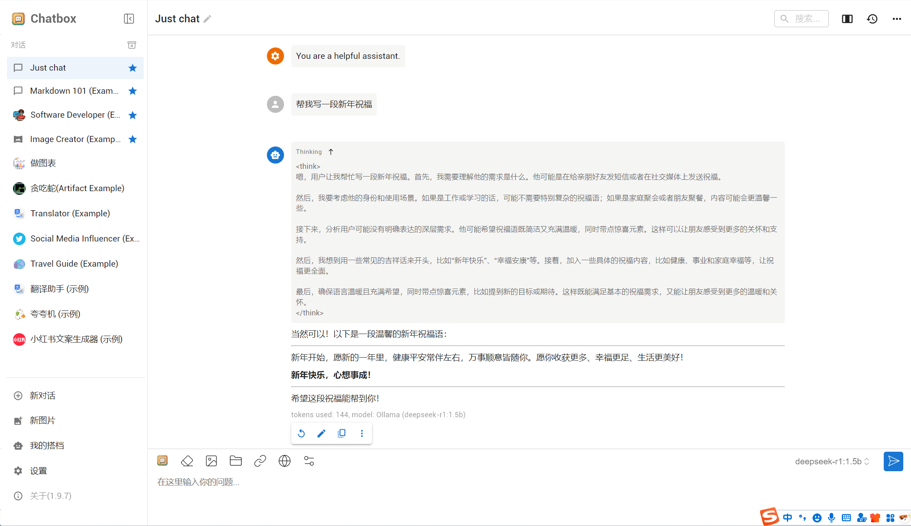

**<font style="color:rgb(51, 51, 51);"></font>**

## <font style="color:rgb(51, 51, 51);">DeepSeek 知识库搭建</font>
<font style="color:rgb(51, 51, 51);">我们还可以通过浏览器插件来访问本地部署的大模型，这个插件还支持本地知识库搭建。</font>

<font style="color:rgb(51, 51, 51);">1、安装插件 Page Assist，搜索插件后添加至 Chrome</font>


<font style="color:rgb(51, 51, 51);">2、选择本地搭建的模型，点击配置按钮，设置中文</font>

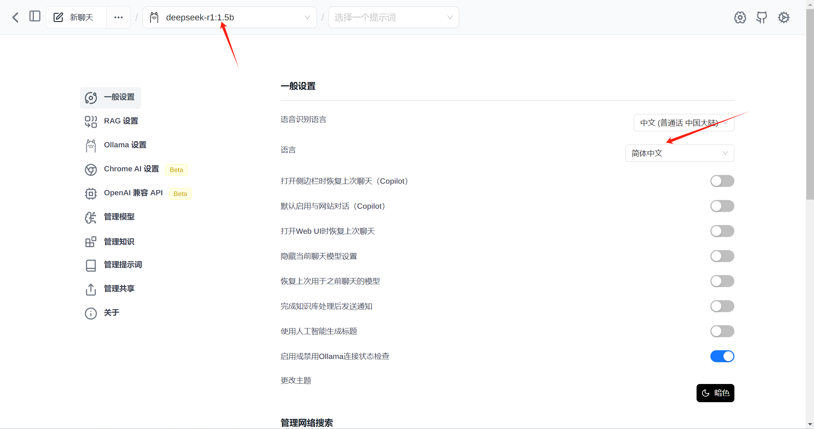

<font style="color:rgb(51, 51, 51);">3、RAG 设置，模型选择本地搭建的。</font>

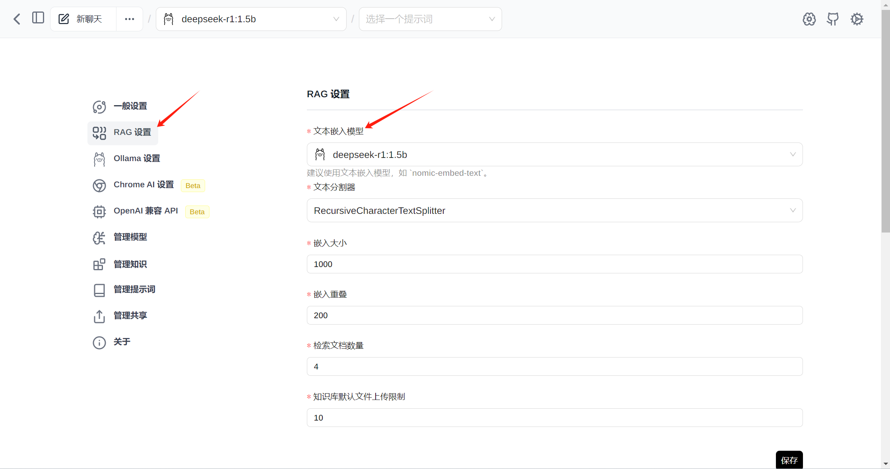

<font style="color:rgb(51, 51, 51);">4、点击左侧管理知识，可以添加本地知识库。</font>

<font style="color:rgb(51, 51, 51);">填写知识标题及上传文件，点击提交按钮。</font>

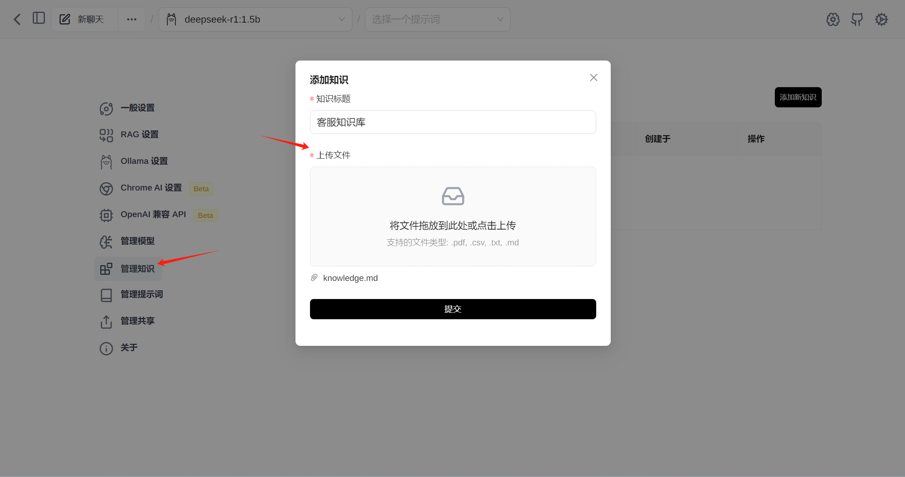

<font style="color:rgb(51, 51, 51);">状态为已完成就可以使用了。</font>

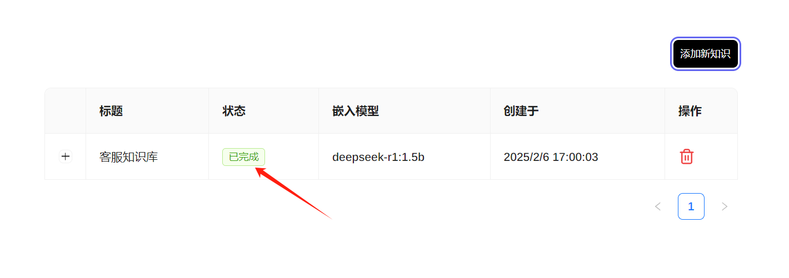

<font style="color:rgb(51, 51, 51);">新建聊天进行测试，在聊天窗口要记得点击右下角知识，选择刚才搭建的知识库名称，然后在上方看到就可以了。</font>

<font style="color:rgb(51, 51, 51);">对模型进行测试，看看是否可以根据知识库进行回答。</font>

<font style="color:rgb(51, 51, 51);">我问了一下《客服知识库》 如何查询账户余额？</font>

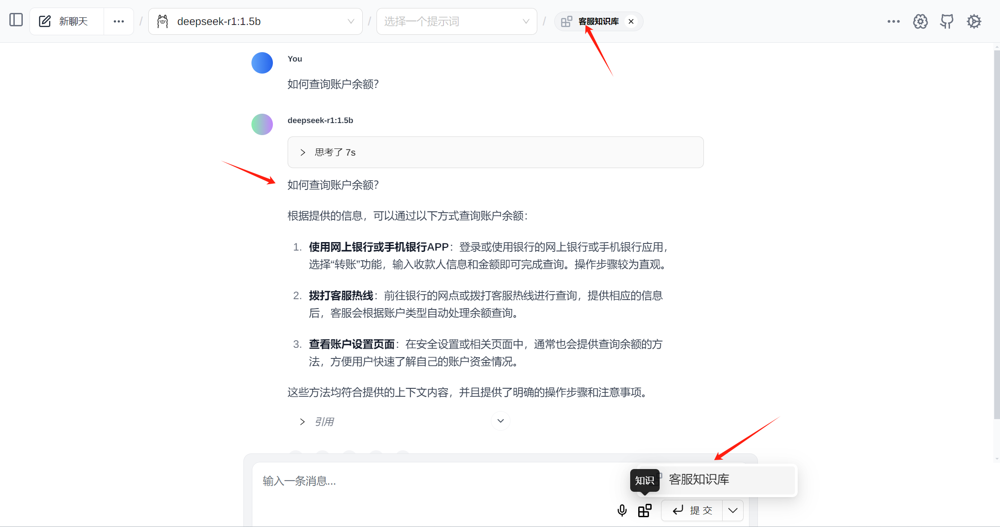

<font style="color:rgb(51, 51, 51);">思考完成后，模型给出了最终答案</font>


> 更新: 2025-04-20 22:38:52  
> 原文: <https://www.yuque.com/aaron-wecc3/dhluml/ofb2c8aqg7199kx0>