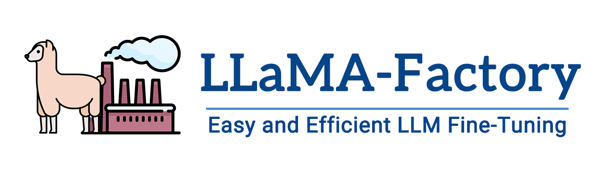
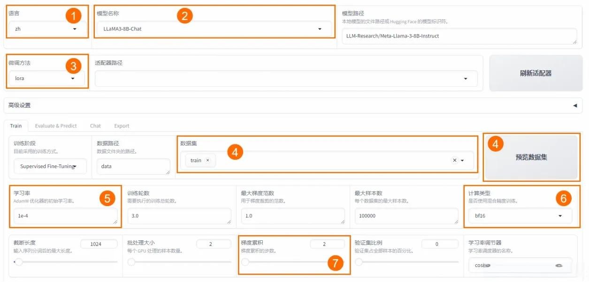
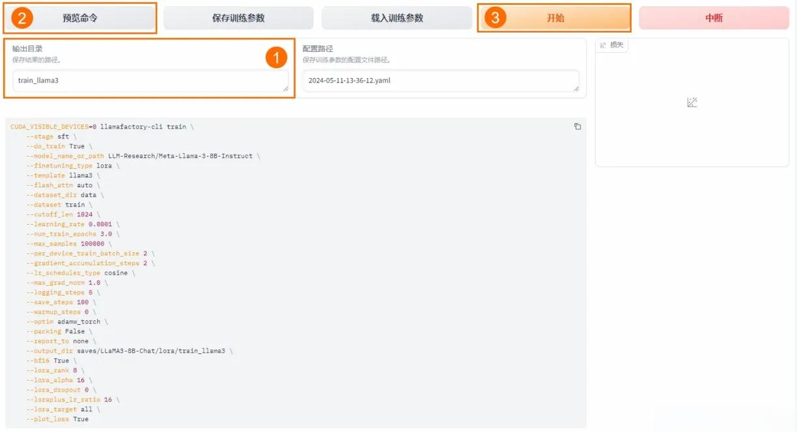
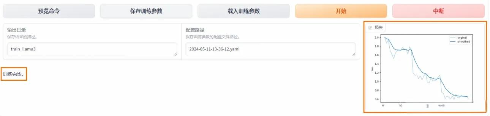
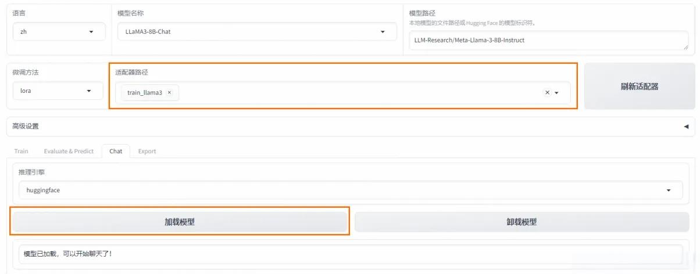
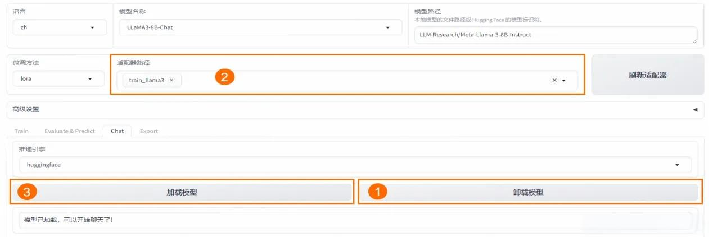

# 26.DeepSeek R1模型Lora微调训练

## <font style="color:rgb(51, 51, 51);">引言</font>

<font style="color:rgb(51, 51, 51);">随着</font>[<font style="color:rgb(51, 51, 51);">人工智能</font>](https://so.csdn.net/so/search?q=%E4%BA%BA%E5%B7%A5%E6%99%BA%E8%83%BD\&spm=1001.2101.3001.7020)<font style="color:rgb(51, 51, 51);">技术的飞速发展，大型语言模型（LLM）在自然语言处理（NLP）领域扮演着越来越重要的角色。然而，预训练的模型往往需要针对特定任务进行微调，以提高其在特定领域的性能。LLaMA-Factory 作为一个高效、易用的微调工具，为广大开发者提供了极大的便利。本次将详细介绍如何使用 LLaMA-Factory 从零开始微调大模型，帮助大家快速掌握这一技术。</font>

## <font style="color:rgb(51, 51, 51);">一、模型微调讲解</font>

### <font style="color:rgb(51, 51, 51);">1、什么是模型微调？</font>

<font style="color:rgb(51, 51, 51);">在深度学习领域，模型微调通常指的是在预训练模型的基础上进行的进一步训练。预训练模型是在大量数据上训练得到的，它已经学习到了语言的基本规律和丰富的特征表示。然而，这些模型可能并不直接适用于特定的任务或领域，因为它们可能缺乏对特定领域知识的理解和适应性。</font>

<font style="color:rgb(51, 51, 51);">模型微调通过在特定任务的数据集上继续训练预训练模型来进行，使得模型能够学习到与任务相关的特定特征和知识。这个过程通常涉及到模型权重的微幅调整，而不是从头开始训练一个全新的模型。</font>

### <font style="color:rgb(51, 51, 51);">2、微调的过程</font>

<font style="color:rgb(51, 51, 51);">微调过程主要包括以下几个步骤： </font>

1. <font style="color:rgb(51, 51, 51);">数据准备：收集和准备特定任务的数据集。 </font>
2. <font style="color:rgb(51, 51, 51);">模型选择：选择一个预训练模型作为基础模型。 </font>
3. <font style="color:rgb(51, 51, 51);">迁移学习：在新数据集上继续训练模型，同时保留预训练模型的知识。 </font>
4. <font style="color:rgb(51, 51, 51);">参数调整：根据需要调整模型的参数，如学习率、批大小等。 </font>
5. <font style="color:rgb(51, 51, 51);">模型评估：在验证集上评估模型的性能，并根据反馈进行调整。</font>

### <font style="color:rgb(51, 51, 51);">3、微调的优势</font>

<font style="color:rgb(51, 51, 51);">微调技术带来了多方面的优势：</font><font style="color:rgb(51, 51, 51);">资源效率：相比于从头开始训练模型，微调可以显著减少所需的数据量和计算资源。</font><font style="color:rgb(51, 51, 51);">快速部署：微调可以快速适应新任务，加速模型的部署过程。</font><font style="color:rgb(51, 51, 51);">性能提升：针对特定任务的微调可以提高模型的准确性和鲁棒性。</font><font style="color:rgb(51, 51, 51);">领域适应性：微调可以帮助模型更好地理解和适应特定领域的语言特点。</font>

<font style="color:rgb(51, 51, 51);">通过微调，可以使得预训练模型在这些任务上取得更好的性能，更好地满足实际应用的需求。</font>

## <font style="color:rgb(51, 51, 51);">二、LLaMA-Factory 讲解</font>

<font style="color:rgb(51, 51, 51);">LLaMA-Factory 是一个开源的模型微调框架，致力于简化大型</font>[<font style="color:rgb(51, 51, 51);">语言模型</font>](https://so.csdn.net/so/search?q=%E8%AF%AD%E8%A8%80%E6%A8%A1%E5%9E%8B\&spm=1001.2101.3001.7020)<font style="color:rgb(51, 51, 51);">的定制过程。它集成了多种训练策略和监控工具，提供了命令行和 WebUI 等多种交互方式，大幅降低了模型微调的技术门槛。</font>

### <font style="color:rgb(51, 51, 51);">1、核心功能</font>

* <font style="color:rgb(51, 51, 51);">多模型兼容：支持包括 LLama、Mistral、Falcon 在内的多种大型语言模型。</font>
* <font style="color:rgb(51, 51, 51);">训练方法多样：涵盖全参数微调及 LoRA 等先进的微调技术。</font>
* <font style="color:rgb(51, 51, 51);">用户界面友好：LLama Board 提供了一个直观的 Web 界面，使用户能够轻松调整模型设置。</font>
* <font style="color:rgb(51, 51, 51);">监控工具集成：与 TensorBoard 等工具集成，便于监控和分析训练过程。</font>

### <font style="color:rgb(51, 51, 51);">2、LLaMA-Factory 特点</font>

* <font style="color:rgb(51, 51, 51);">易用性：简化了机器学习算法的复杂性，通过图形界面即可控制模型微调。</font>
* <font style="color:rgb(51, 51, 51);">微调效率：支持 DPO、ORPO、PPO 和 SFT 等技术，提升了模型微调的效率和效果。</font>
* <font style="color:rgb(51, 51, 51);">参数调整灵活性：用户可根据需求轻松调整模型参数，如 dropout 率、epochs 等。</font>
* <font style="color:rgb(51, 51, 51);">多语言支持：界面支持英语、俄语和中文，面向全球用户提供服务。</font>

### <font style="color:rgb(51, 51, 51);">3、使用场景</font>

<font style="color:rgb(51, 51, 51);">LLaMA-Factory 适用于广泛的 NLP 任务，包括但不限于：</font>

* <font style="color:rgb(51, 51, 51);">文本分类：实现情感分析、主题识别等功能。</font>
* <font style="color:rgb(51, 51, 51);">序列标注：如 NER、词性标注等任务。</font>
* <font style="color:rgb(51, 51, 51);">文本生成：自动生成文本摘要、对话等。</font>
* <font style="color:rgb(51, 51, 51);">机器翻译：优化特定语言对的翻译质量。</font>

<font style="color:rgb(51, 51, 51);">LLaMA-Factory 通过其强大的功能和易用性，助力用户在</font>[<font style="color:rgb(51, 51, 51);">自然语言处理</font>](https://so.csdn.net/so/search?q=%E8%87%AA%E7%84%B6%E8%AF%AD%E8%A8%80%E5%A4%84%E7%90%86\&spm=1001.2101.3001.7020)<font style="color:rgb(51, 51, 51);">领域快速实现模型的定制和优化。</font>

## <font style="color:rgb(51, 51, 51);">三、安装 LLaMA Factory</font>

<font style="color:rgb(51, 51, 51);">在本章节中，我们将指导您如何安装和设置 LLaMA Factory，一个用于微调大型语言模型的工具。请按照以下步骤操作，以确保您能够顺利地使用 LLaMA Factory。</font>

### <font style="color:rgb(51, 51, 51);">1、准备工作</font>

<font style="color:rgb(51, 51, 51);">首先，确保您的开发环境中已经安装了 Python3.9 或更高版本。这可以通过 Python 的官方网站下载安装，或者使用包管理器进行安装。</font><font style="color:rgb(51, 51, 51);">1）显卡选择</font><font style="color:rgb(51, 51, 51);">24 GB 显存的 A10：建议使用至少这个规格的实例，或者更高规格的实例以满足可能更大的计算需求。</font><font style="color:rgb(51, 51, 51);">2）镜像选择：</font><font style="color:rgb(51, 51, 51);">PyTorch 深度学习框架版本为 2.1.2。Python 3.10、CUDA 11.2（cu121），CUDA 是 NVIDIA 提供的用于通用并行计算的编程模型和 API。、Ubuntu 22.04 LTS（长期支持版本）操作系统。</font>

### <font style="color:rgb(51, 51, 51);">2、获取 LLaMA-Factory</font>

<font style="color:rgb(51, 51, 51);">打开您的终端或命令行界面，然后执行以下命令来克隆 LLaMA-Factory 的代码仓库到本地：</font>

```plain
git clone --depth 1 https://github.com/hiyouga/LLaMA-Factory.git
```

<font style="color:rgb(51, 51, 51);">这将创建一个名为</font><code><font style="color:rgb(51, 51, 51);background-color:rgb(243, 244, 244);">LLaMA-Factory</font></code><font style="color:rgb(51, 51, 51);">的文件夹，包含所有必要的代码和文件。</font>

### <font style="color:rgb(51, 51, 51);">3、安装依赖</font>

<font style="color:rgb(51, 51, 51);">在安装 LLaMA-Factory 之前，您需要确保安装了所有必要的依赖。进入克隆的仓库目录，然后执行以下命令来安装依赖：</font>

```plain
cd LLaMA-Factory
pip install -e ".[torch,metrics]"
```

<font style="color:rgb(51, 51, 51);">这个命令将安装 LLaMA-Factory 及其所有必需的附加组件，用于模型的评估和分析。</font>

### <font style="color:rgb(51, 51, 51);">4、卸载可能冲突的包</font>

<font style="color:rgb(51, 51, 51);">如果在安装过程中与其他库发生冲突，您可能需要先卸载这些库。例如，如果</font><code><font style="color:rgb(51, 51, 51);background-color:rgb(243, 244, 244);">vllm</font></code><font style="color:rgb(51, 51, 51);">库与 LLaMA-Factory 不兼容，可以使用以下命令卸载：</font>

```plain
pip uninstall -y vllm
```

### <font style="color:rgb(51, 51, 51);">5、LLaMA-Factory 版本检查</font>

<font style="color:rgb(51, 51, 51);">安装完成后，您可以通过运行以下命令来检查 LLaMA-Factory 是否正确安装以及其版本号：</font>

```plain
llamafactory-cli version
```

<font style="color:rgb(51, 51, 51);">如果安装成功，您将看到类似以下的输出，显示 LLaMA Factory 的版本信息：</font>

```plain
[2024-07-19 10:25:22,857] [INFO] [real_accelerator.py:161:get_accelerator] Setting ds_accelerator to cuda (auto detect)
Welcome to LLaMA Factory, version 0.7.1.dev0
```

### <font style="color:rgb(51, 51, 51);">6、验证安装</font>

<font style="color:rgb(51, 51, 51);">为了确保 LLaMA Factory 能够正常工作，您可以运行一些基本的命令来测试其功能。例如，尝试运行 LLaMA Factory 提供的一些示例脚本，或者使用其命令行界面来查看帮助信息：</font>

```plain
llamafactory-cli --help
```

<font style="color:rgb(51, 51, 51);">这将列出所有可用的命令和选项，帮助您了解如何使用 LLaMA Factory。</font>

<font style="color:rgb(51, 51, 51);">注意事项</font>

* <font style="color:rgb(51, 51, 51);">确保您的网络连接稳定，以便顺利下载代码仓库和安装依赖。</font>
* <font style="color:rgb(51, 51, 51);">如果在安装过程中遇到问题，可以参考 LLaMA Factory 的官方文档或在社区中寻求帮助。</font>
* <font style="color:rgb(51, 51, 51);">在安装过程中，您可能需要根据您的系统环境和配置调整上述命令。</font>

<font style="color:rgb(51, 51, 51);">通过遵循上述步骤，您将能够成功安装并开始使用 LLaMA Factory 进行大型语言模型的微调。在接下来的章节中，我们将深入探讨如何使用 LLaMA Factory 进行模型微调的具体操作。</font>

## <font style="color:rgb(51, 51, 51);">四、数据集准备</font>

<font style="color:rgb(51, 51, 51);">LLaMA-Factory 提供了对多种数据集格式的支持，以适应不同类型的训练需求。本节将指导您如何准备和使用数据集进行模型微调。</font>

### <font style="color:rgb(51, 51, 51);">1、使用内置数据集</font>

<font style="color:rgb(51, 51, 51);">LLaMA-Factory 项目在</font><code><font style="color:rgb(51, 51, 51);background-color:rgb(243, 244, 244);">data</font></code><font style="color:rgb(51, 51, 51);">目录下内置了丰富的数据集，您可以直接使用这些数据集进行模型训练和测试。如果您不需要自定义数据集，可以跳过数据集准备步骤。</font>

### <font style="color:rgb(51, 51, 51);">2、自定义数据集准备</font>

<font style="color:rgb(51, 51, 51);">若需使用自定义数据集，您需要按照 LLaMA-Factory 支持的格式处理数据，并将其放置在</font><code><font style="color:rgb(51, 51, 51);background-color:rgb(243, 244, 244);">data</font></code><font style="color:rgb(51, 51, 51);">目录下。同时，您还需要修改</font><code><font style="color:rgb(51, 51, 51);background-color:rgb(243, 244, 244);">dataset_info.json</font></code><font style="color:rgb(51, 51, 51);">文件，以确保数据集被正确识别和加载。</font>

#### <font style="color:rgb(51, 51, 51);">2.1 下载示例数据集</font>

<font style="color:rgb(51, 51, 51);">以下是使用示例数据集的步骤，假设您使用的是 PAI 提供的多轮对话数据集：</font>

```plain
cd LLaMA-Factory
wget https://atp-modelzoo-sh.oss-cn-shanghai.aliyuncs.com/release/tutorials/llama_factory/data.zip
unzip data.zip -d data
```

#### <font style="color:rgb(51, 51, 51);">2.2 查看数据集结构</font>

<font style="color:rgb(51, 51, 51);">数据集通常包含多轮对话样本，每轮对话由用户指令和模型回答组成。微调过程中，模型将学习这些样本的回答风格，以适应特定的语言风格或角色扮演需求。例如，数据集中的一个样本可能如下所示：</font>

```plain
[
{
    "conversations": [
      {
        "from": "human",
        "value": "模仿西游记的孙悟空的语气和我聊天。如果你把水冻住，你会得到什么？"
      },
      {
        "from": "gpt",
        "value": "哈哈，这问题还难倒俺老孙吗？把水冻住就是变成冰啦！不过若是在取经的路上用得着这冰来做啥，比如过火焰山时，那可就是解渴消暑的好东西了！你觉得呢？还有没有更有趣的问题让俺老孙来解答？"
      },
      {
        "from": "human",
        "value": "那怎么做才可以把水冻住"
      },
      {
        "from": "gpt",
        "value": "哈哈，对俺老孙来说，这可是轻而易举的事情！只需将水放在凉快的地方，或者使用法力，一吹仙气，水便能迅速结冰啦！当然，在你的世界里，把水放进冰箱的冷冻室里等一阵子，水就会变成冰块了。要是嫌慢，可以尝试用点干冰或液氮什么的，不过得小心使用哈！毕竟不像俺老孙有抗寒法力。"
      }
    ]
}
]
```

## <font style="color:rgb(51, 51, 51);">五、模型微调</font>

### <font style="color:rgb(51, 51, 51);">1、启动 Web UI</font>

<font style="color:rgb(51, 51, 51);">使用以下命令启动 LLaMA-Factory 的 Web UI 界面，以便进行交互式模型微调：</font>

```plain
export USE_MODELSCOPE_HUB=1 && llamafactory-cli webui
```

<font style="color:rgb(51, 51, 51);">这将启动一个本地 Web 服务器，您可以通过访问</font><code><font style="color:rgb(51, 51, 51);background-color:rgb(243, 244, 244);">http://0.0.0.0:7860</font></code><font style="color:rgb(51, 51, 51);">来使用 Web UI。请注意，这是一个内网地址，只能在当前实例内部访问。</font>

### <font style="color:rgb(51, 51, 51);">2、配置参数</font>

<font style="color:rgb(51, 51, 51);">在 Web UI 中，您需要配置以下关键参数以进行模型微调：语言：选择模型支持的语言，例如</font><code><font style="color:rgb(51, 51, 51);background-color:rgb(243, 244, 244);">zh</font></code><font style="color:rgb(51, 51, 51);">。模型名称：选择要微调的模型，例如</font><code><font style="color:rgb(51, 51, 51);background-color:rgb(243, 244, 244);">LLaMA3-8B-Chat</font></code><font style="color:rgb(51, 51, 51);">。微调方法：选择微调技术，如</font><code><font style="color:rgb(51, 51, 51);background-color:rgb(243, 244, 244);">lora</font></code><font style="color:rgb(51, 51, 51);">。数据集：选择用于训练的数据集。学习率：设置模型训练的学习率。计算类型：根据 GPU 类型选择计算精度，如</font><code><font style="color:rgb(51, 51, 51);background-color:rgb(243, 244, 244);">bf16</font></code><font style="color:rgb(51, 51, 51);">或</font><code><font style="color:rgb(51, 51, 51);background-color:rgb(243, 244, 244);">fp16</font></code><font style="color:rgb(51, 51, 51);">。梯度累计：设置梯度累计的批次数。LoRA + 学习率比例：设置 LoRA + 的相对学习率。LoRA 作用模块：选择 LoRA 层挂载的模型部分。</font>

#### 训练指标

##### loss（损失）<font style="color:rgb(51, 51, 51);"></font>

```
- **含义**<font style="color:rgb(51, 51, 51);">：损失值是一个衡量模型预测与实际标签之间差异的指标。损失值越小，表示模型的预测结果越接近真实值。</font>
- **例子**<font style="color:rgb(51, 51, 51);">：假设我们在训练一个猫狗分类器，损失值为0.7493表示模型在当前训练状态下，预测结果与实际标签之间的差异程度。损失值越小，说明模型的预测越准确。</font>
```

##### grad（梯度）

**什么是梯度？**

```
1. **定义**：
    * 梯度是一个向量，表示函数在某一点的方向导数。它指示了函数在该点上升最快的方向。
    * 在数学上，梯度是一个多元函数的偏导数的集合。
2. **在神经网络中的作用**：
    * 在神经网络中，梯度用于更新模型的参数（如权重和偏置），以最小化损失函数。
    * 损失函数是一个衡量模型预测与真实标签之间差异的函数。通过最小化损失函数，模型的预测能力得以提高。
```

**梯度下降法**

```
1. **基本原理**：
    * 梯度下降法是一种优化算法，用于通过迭代更新模型参数来最小化损失函数。
    * 在每次迭代中，计算损失函数相对于每个参数的梯度，然后沿着梯度的反方向更新参数。
2. **更新公式**：
    * 参数更新的公式为：`θ = θ - α * ∇L(θ)`
    * 其中，`θ`是参数，`α`是学习率，`∇L(θ)`是损失函数关于参数的梯度。
3. **学习率**：
    * 学习率是一个超参数，决定了每次更新的步长。
    * 学习率过大可能导致训练不稳定，学习率过小则可能导致收敛速度慢。
```

**在代码中的体现**

在你的代码中，梯度的计算和应用主要体现在以下部分：

```python
# 反向传播，计算损失的梯度，用于更新模型参数。
loss.backward()

# 对梯度进行裁剪，防止梯度过大导致训练不稳定。
torch.nn.utils.clip_grad_norm_(model.parameters(), 1.0)

# 使用优化器更新模型的权重参数。
optimizer.step()

# 清空优化器中的梯度缓存，准备下一次迭代。
optimizer.zero_grad()
```

```
- `loss.backward()`：计算损失函数相对于模型参数的梯度。
- `torch.nn.utils.clip_grad_norm_()`：对梯度进行裁剪，防止梯度爆炸。
- `optimizer.step()`：根据计算出的梯度更新模型参数。
- `optimizer.zero_grad()`：清空梯度缓存，以免影响下一次迭代。
```

通过这些步骤，模型的参数在每次迭代中逐渐调整，以最小化损失函数，从而提高模型的性能。

##### grad_norm（梯度范数）

```
- **含义**<font style="color:rgb(51, 51, 51);">：梯度范数是一个衡量模型参数更新幅度的指标。它反映了模型在当前训练步骤中，参数调整的大小。过大的梯度可能导致训练不稳定。</font>
- **例子**<font style="color:rgb(51, 51, 51);">：在训练过程中，如果grad_norm为31.5907，说明模型参数在这一轮训练中调整的幅度较大。通常，我们希望梯度范数适中，以确保模型稳定收敛。</font>
```

##### learning_rate（学习率）：

```
- **含义**<font style="color:rgb(51, 51, 51);">：学习率是一个超参数，决定了模型在每次更新时，参数调整的步长。学习率过大可能导致模型不收敛，过小则可能导致训练速度过慢。</font>
- **例子**<font style="color:rgb(51, 51, 51);">：学习率为1.354e-05表示每次参数更新时，模型的调整步长非常小。这通常用于精细调整模型参数，以提高模型的精度。</font>
```

##### epoch（轮次）<font style="color:rgb(51, 51, 51);"></font>

```
- **含义**<font style="color:rgb(51, 51, 51);">：一个epoch表示模型已经完整地遍历了一遍训练数据集。通常，训练需要多个epoch以确保模型充分学习数据特征。</font>
- **例子**<font style="color:rgb(51, 51, 51);">：epoch为0.73表示模型已经完成了73%的第一轮训练。通常，我们会设置多轮训练以提高模型的性能。</font>
```

<font style="color:rgb(51, 51, 51);">这些参数帮助我们监控和调整模型的训练过程，以便获得更好的预测性能。</font>

### <font style="color:rgb(51, 51, 51);">3、开始微调</font>

<font style="color:rgb(51, 51, 51);">在 Web UI 中设置好参数后，您可以开始模型微调过程。微调完成后，您可以在界面上观察到训练进度和损失曲线。</font>

<font style="color:rgb(51, 51, 51);">1）将输出目录修改为 train_llama3，训练后的 LoRA 权重将会保存在此目录中。2）单击 “预览” 命令，可展示所有已配置的参数。如果您希望通过代码进行微调，可以复制这段命令，在命令行运行。3）单击 “开始”，启动模型微调。启动微调后需要等待大约 20 分钟，待模型下载完毕后，可在界面观察到训练进度和损失曲线。当显示训练完毕时，代表模型微调成功。</font>

## <font style="color:rgb(51, 51, 51);">六、对话测试</font>

<font style="color:rgb(51, 51, 51);">在 Web UI 的 Chat 页签下，加载微调后的模型进行对话测试。您可以输入文本与模型进行交互，并观察模型的回答是否符合预期。</font>

<font style="color:rgb(51, 51, 51);">在页面底部的对话框输入想要和模型对话的内容，单击提交，即可发送消息。发送后模型会逐字生成回答，从回答中可以发现模型学习到了数据集中的内容，能够恰当地模仿目标角色的语气进行对话。</font>

<font style="color:rgb(51, 51, 51);">单击卸载模型，单击取消适配器路径，然后单击加载模型，即可与微调前的原始模型聊天。</font>


> 更新: 2025-04-20 22:38:52  
> 原文: <https://www.yuque.com/aaron-wecc3/dhluml/uyyeq87q02gnrq4g>