# 27.AutoGen智能体开发平台快速入门

## 分享内容

AutoGen 是一个开源编程框架，用于构建 AI 代理并促进多个代理之间的合作以解决问题。AutoGen 旨在提供一个易于使用和灵活的框架，以加速代理型 AI 的开发和研究，就像 PyTorch 之于深度学习。它提供了诸如代理之间可以对话、LLM 和工具使用支持、自主和人机协作工作流以及多代理对话模式等功能。

## <font style="color:rgb(51, 51, 51);">环境准备</font>

### <font style="color:rgb(51, 51, 51);">1.部署 Autogen Studio</font>

项目地址：<https://github.com/microsoft/autogen>

官方文档：<https://microsoft.github.io/autogen/0.2/docs/autogen-studio/getting-started/>

中文文档：<https://www.aidoczh.com/autogen/docs/Getting-Started/>

一，Python 环境的准备

<font style="color:rgb(51, 51, 51);">AutoGen Studio 依赖 Python 环境，这里建议大家使用 Anaconda 去管理 Python 环境，避免环境之间的冲突问题。</font>

<font style="color:rgb(51, 51, 51);">有的小伙伴不懂 Python，但并不妨碍我们学习 AutoGen，只要按照步骤来，谁都可以搞定。</font>

**<font style="color:rgb(51, 51, 51);">下载安装 Conda</font>**

<font style="color:rgb(51, 51, 51);">点击 </font>[<font style="color:rgb(65, 131, 196);">mirrors.tuna.tsinghua.edu.cn/anaconda/archive/</font>](https://mirrors.tuna.tsinghua.edu.cn/anaconda/archive/)<font style="color:rgb(51, 51, 51);"> 进入到</font>[<font style="color:rgb(65, 131, 196);">清华大学</font>](https://so.csdn.net/so/search?q=%E6%B8%85%E5%8D%8E%E5%A4%A7%E5%AD%A6\&spm=1001.2101.3001.7020)<font style="color:rgb(51, 51, 51);">开源软件镜像站下载界面。</font>

<font style="color:rgb(51, 51, 51);">会发现有很多版本可选，用网页搜索功能搜索</font><code><font style="color:rgb(51, 51, 51);background-color:rgb(243, 244, 244);">2023.09-0</font></code><font style="color:rgb(51, 51, 51);">，以 windows 为例，下载 exe 安装文件。</font>

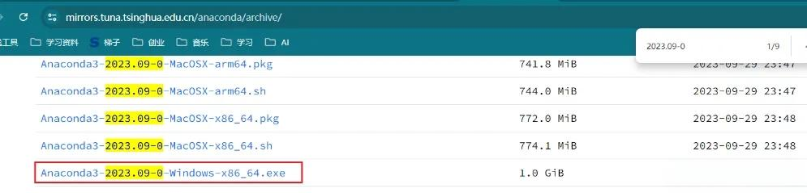

<font style="color:rgb(51, 51, 51);">下载完成之后点击 exe 文件进行安装，安装非常简单。</font>

**<font style="color:rgb(51, 51, 51);">使用 anaconda 创建 python 环境</font>**

<font style="color:rgb(51, 51, 51);">windows 开始菜单搜索栏，搜索 prompt，搜索结果中可以看应用</font><code><font style="color:rgb(51, 51, 51);background-color:rgb(243, 244, 244);">Aanconda Powershell Prompt</font></code><font style="color:rgb(51, 51, 51);">。</font>

<font style="color:rgb(51, 51, 51);">打开这个应用。</font>

<font style="color:rgb(51, 51, 51);">接下来，我们将使用这个工具创建一个特定版本的 Python 环境。</font>

<font style="color:rgb(51, 51, 51);">在打开的命令行工具中输入如下命令，然后回车。</font>

```plain
conda create -n autogenstudio python=3.10
```

<font style="color:rgb(119, 119, 119);">-n 后面是的 autogenstudio 是环境的名称，相当于一个标识，后续要用这个环境时通过这个名称进行查找python=3.10，是指定 python 的版本</font>

<font style="color:rgb(51, 51, 51);">执行命令创建环境的过程中，会有一次交互 (如下图)，命令行界面等待输入时，键盘输入字母</font><code><font style="color:rgb(51, 51, 51);background-color:rgb(243, 244, 244);">y</font></code><font style="color:rgb(51, 51, 51);">即可。</font>

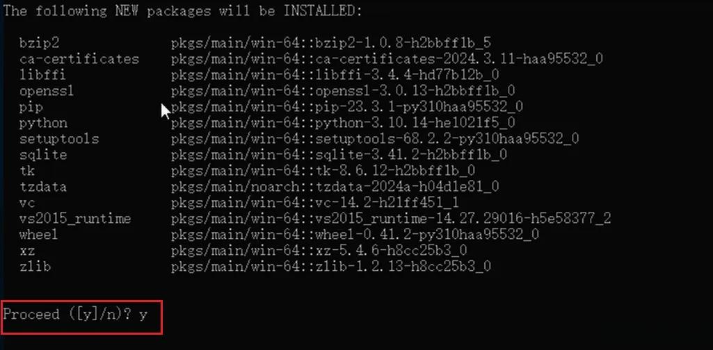

<font style="color:rgb(51, 51, 51);">稍等片刻，知道有如下输出，说明环境创建成功。</font>

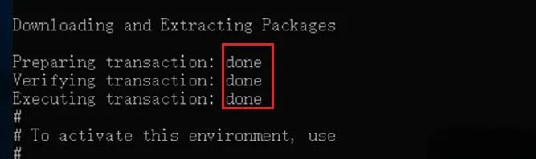

<font style="color:rgb(51, 51, 51);">接下来，输入如下命令，切换到创建好的环境。</font>

```plain
conda activate autogenstudio
```

<font style="color:rgb(51, 51, 51);">顾名思义，这个命令的含义是激活我们刚刚创建好的环境，这个环境的名称是autogenstudio。</font>

<font style="color:rgb(51, 51, 51);">到此为止，Python 环境已经准备好了，非常简单吧。</font>

**<font style="color:rgb(51, 51, 51);">安装 Autogen Studio</font>**

**<font style="color:rgb(51, 51, 51);">1，下载 autogen studio</font>**

<font style="color:rgb(51, 51, 51);">接下来我们需要安装 Autogen Studio。</font>

<font style="color:rgb(51, 51, 51);">那怎么安装呢？超级简单，在刚刚我们准备好的 python 环境中执行一个命令就好。</font>

```plain
pip install autogenstudio==0.1.5
```

<font style="color:rgb(51, 51, 51);">但如果直接这样执行的话，因为它会访问国外的网站完成下载，所以速度非常慢，慢到不能忍受。</font>

<font style="color:rgb(51, 51, 51);">所以我们需要让它去国内的镜像下载。</font>

<font style="color:rgb(51, 51, 51);">通过参数</font><code><font style="color:rgb(51, 51, 51);background-color:rgb(243, 244, 244);">-i</font></code><font style="color:rgb(51, 51, 51);">指定国内镜像地址，我们使用阿里云的镜像。</font>

<font style="color:rgb(51, 51, 51);">上述命令就变成如下这样了。</font>

```plain
pip install autogenstudio==0.1.5 -i https://mirrors.aliyun.com/pypi/simple
```

<font style="color:rgb(51, 51, 51);">回车执行命令。</font>


<font style="color:rgb(51, 51, 51);">速度相当 OK，很快就完成下载和安装了。</font>

**<font style="color:rgb(51, 51, 51);">2，启动 autogen studio</font>**

<font style="color:rgb(51, 51, 51);">下载之后，使用如下命令启动 autogen studio 服务。</font>

```plain
autogenstudio ui --port 6000
```

<font style="color:rgb(51, 51, 51);">回车执行命令。</font>

<font style="color:rgb(51, 51, 51);">有如下输出，说明启动成功。</font>

**<font style="color:rgb(51, 51, 51);">3，访问 autogen studio</font>**

<font style="color:rgb(51, 51, 51);">从开始准备环境，到部署启动 Autogen Studio，大约半小时可以搞定。</font>

<font style="color:rgb(51, 51, 51);">启动成功后，在浏览器输入如下地址。</font>

```plain
http://localhost:8081/build
```

<font style="color:rgb(51, 51, 51);">即可看到如下界面。</font>

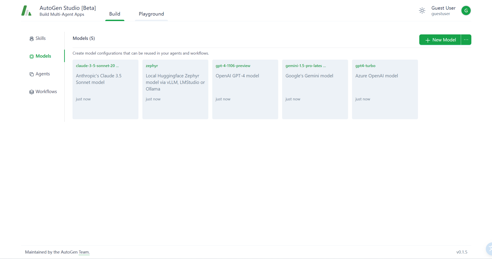

### <font style="color:rgb(51, 51, 51);">2.准备 Deepseek   API Key</font>

**<font style="color:rgb(51, 51, 51);">前提条件需要扣子 Coze 专业版账号</font>**

<font style="color:rgb(51, 51, 51);">第一步，登陆火山引擎扣子专业版后台</font>

[<font style="color:rgb(51, 51, 51);">https://console.volcengine.com/coze-pro/overview</font>](https://console.volcengine.com/coze-pro/overview)

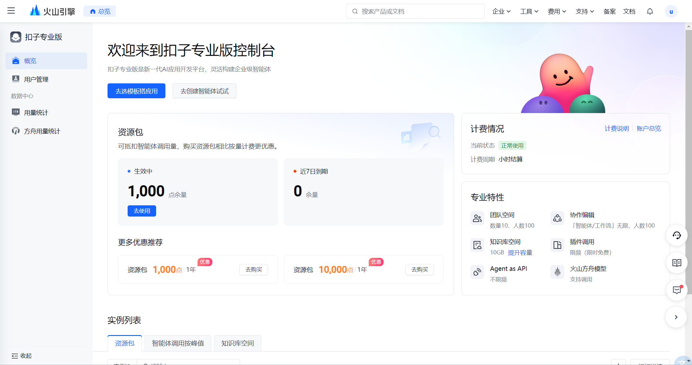

<font style="color:rgb(51, 51, 51);">第二步，左上上角菜单进入「火山方舟」的模型广场找到「DeepSeek-R1」</font>


<font style="color:rgb(51, 51, 51);">第三步，鼠标悬浮到该卡片上，点击「查看详情」可以看到不同版本。</font>

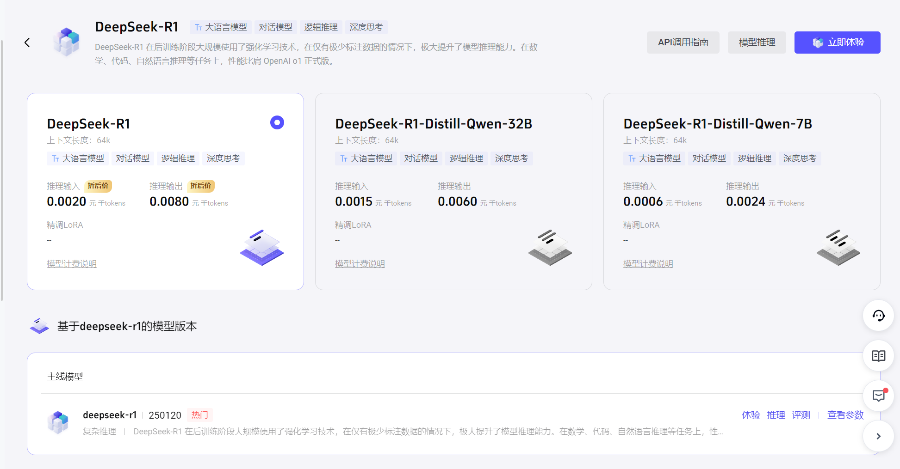

<font style="color:rgb(51, 51, 51);">第四步，点击右上角「模型推理」在这里会看到无法「确认接入」原因是需要先开通模型，点击接入配置下方的立即开通链接。</font>


<font style="color:rgb(51, 51, 51);">勾选你需要的模型，然后勾选下方同意协议立即开通。</font>


<font style="color:rgb(51, 51, 51);">开通完成后点击确认接入。</font>


<font style="color:rgb(51, 51, 51);">接入成功后可以在「在线推理」菜单看到</font>

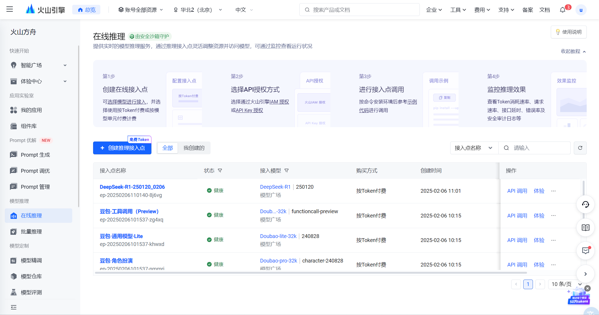

<font style="color:rgb(51, 51, 51);">同时在「在线推理列表」的模型还支持 API 调用。</font>

<font style="color:rgb(51, 51, 51);">选择 API Key</font>

<font style="color:rgb(51, 51, 51);">请按如下方式设置 API Key 作为环境变量，其中 "YOUR_API_KEY" 需要替换为您在平台创建的 API Key</font>

```plain
export ARK_API_KEY="YOUR_API_KEY"
```

<font style="color:rgb(51, 51, 51);">火山方舟 v3 API 与 OpenAI API 协议兼容，您可以使用火山引擎官方 SDK，也可以使用 OpenAI SDK 或其他兼容 OpenAI API 协议的多语言社区 SDK 调用火山方舟推理服务。第三方 SDK 不由火山引擎团队维护，仅供参考</font>

<font style="color:rgb(51, 51, 51);">请参考如下示例代码进行调用</font>

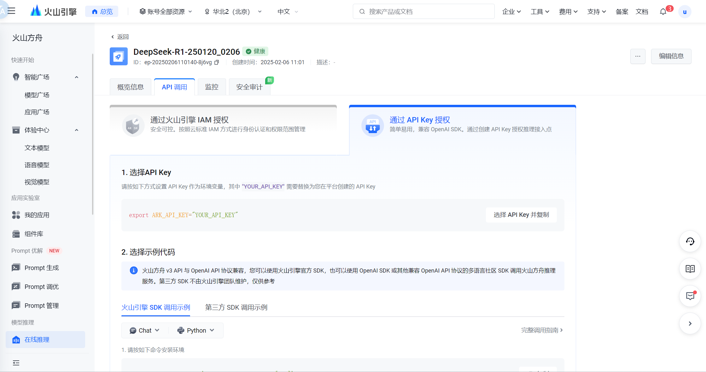

## <font style="color:rgb(51, 51, 51);">给 Autogen 的代理配置大脑</font>

<font style="color:rgb(51, 51, 51);">智能体相当于一家公司，公司的工作通常是由多个人协作完成的，与此类似，智能体的工作是由多个代理协作完成的，从这个角度来看，代理可以类比为人。</font>

<font style="color:rgb(51, 51, 51);">注意，Autogen 中，代理是非常核心的概念。</font>

<font style="color:rgb(51, 51, 51);">既然把代理比作人，那么它一定有思考能力和推理能力，也就是说，它一定有大脑。</font>

<font style="color:rgb(51, 51, 51);">对，只不过代理的大脑是大模型。在我们的这个实验中，选择 Deepseek 作为代理的大脑。</font>

<font style="color:rgb(51, 51, 51);">所以，接下来，就是给代理配置大脑。</font>

### <font style="color:rgb(51, 51, 51);">1，模型登记</font>

<font style="color:rgb(51, 51, 51);">就像员工入职登记信息一样，首先要在 Autogen Studio 界面上登记 Deepseek 的信息。</font>

<font style="color:rgb(51, 51, 51);">如下图，在 Autogen Studio 的界面上，按照如下步骤打开登记界面 。</font>

* <font style="color:rgb(51, 51, 51);">① 选择 Build</font>
* <font style="color:rgb(51, 51, 51);">② 选 models 菜单</font>
* <font style="color:rgb(51, 51, 51);">③ 点击 </font><code><font style="color:rgb(51, 51, 51);background-color:rgb(243, 244, 244);">New Model</font></code><font style="color:rgb(51, 51, 51);"> 按钮</font>

**<font style="color:rgb(51, 51, 51);">模型登记界面如下。</font>**

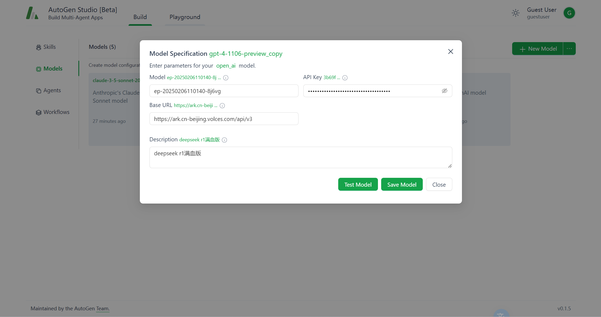

* <font style="color:rgb(51, 51, 51);">① 填写模型名称</font>
* <font style="color:rgb(51, 51, 51);">② API Key，把之前创建好的 API Key 复制粘贴到这里即可</font>
* <font style="color:rgb(51, 51, 51);">③ 接口地址，直接复制粘贴，不要修改：</font><https://ark.cn-beijing.volces.com/api/v3>
* <font style="color:rgb(51, 51, 51);">④ 备注，按需填写即可</font>

<font style="color:rgb(51, 51, 51);">登记完成后，点击 </font><code><font style="color:rgb(51, 51, 51);background-color:rgb(243, 244, 244);">Test Model</font></code><font style="color:rgb(51, 51, 51);"> 进行测试，校验信息是否准确。有如下提示，说明模型登记成功，点击</font><code><font style="color:rgb(51, 51, 51);background-color:rgb(243, 244, 244);">保存</font></code><font style="color:rgb(51, 51, 51);">即可。</font>


### <font style="color:rgb(51, 51, 51);">2，给代理配置大脑</font>

<font style="color:rgb(51, 51, 51);">目前，仅仅登记了大脑的信息，接下来得给代理装上这个大脑。</font>

<font style="color:rgb(51, 51, 51);">代理是怎么来的呢？</font>

<font style="color:rgb(51, 51, 51);">我们要打造的智能体 - AI 旅游规划师，是 Autogen Studio 中自带的智能体，所有的代理都已经创建好了，只是这些代理目前都没有大脑。</font>

<font style="color:rgb(51, 51, 51);">如下图，点击①Agents 菜单，切换到代理列表界面，</font><code><font style="color:rgb(51, 51, 51);background-color:rgb(243, 244, 244);">需要给如图所示2~6一共五个代理配置大脑</font></code><font style="color:rgb(51, 51, 51);">。</font>

<font style="color:rgb(51, 51, 51);">注意，第一个</font><code><font style="color:rgb(51, 51, 51);background-color:rgb(243, 244, 244);">代理user_proxy不需要大脑</font></code><font style="color:rgb(51, 51, 51);">，user_proxy 只是前端接待和指令执行者，不需要动脑子。</font>


<font style="color:rgb(51, 51, 51);">以给代理 default_assistant 配置大脑为例，演示步骤，其他代理类似。</font>

* <font style="color:rgb(51, 51, 51);">① 点击代理 default_assistant</font>
* <font style="color:rgb(51, 51, 51);">② 在弹出的浮窗中点击 Models，切换到模型选择界面</font>
* <font style="color:rgb(51, 51, 51);">③ 点击</font><code><font style="color:rgb(51, 51, 51);background-color:rgb(243, 244, 244);">add</font></code><font style="color:rgb(51, 51, 51);">按钮</font>

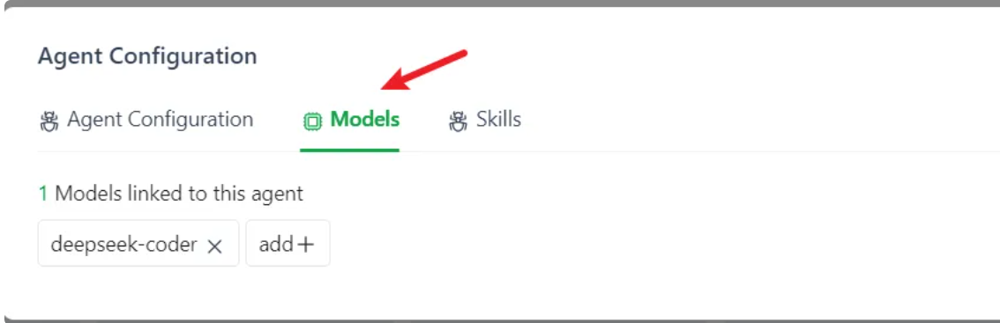

* <font style="color:rgb(51, 51, 51);">④ 在弹出的下来列表中选择 deepseek-code 模型作为代理的大脑</font>

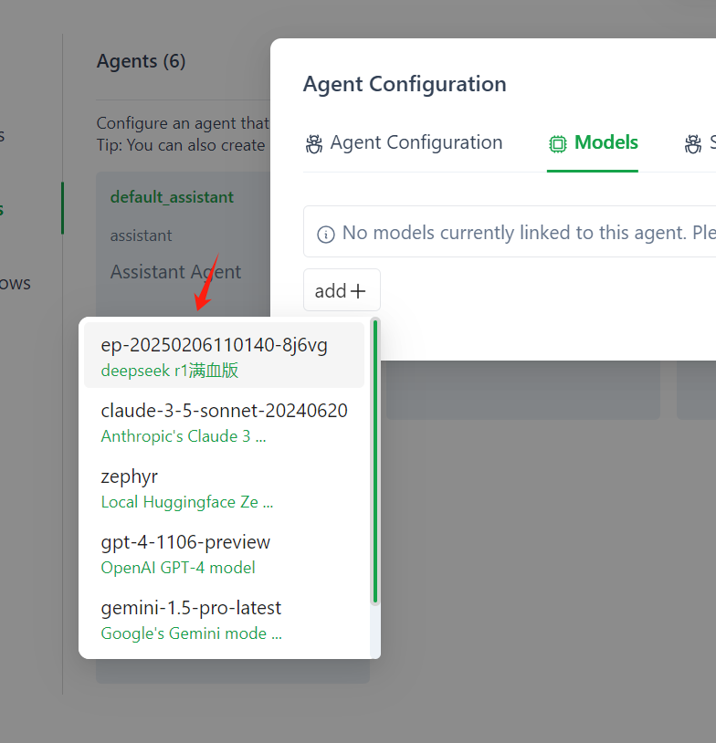

<font style="color:rgb(51, 51, 51);">其实，到此位置，我们的智能体已经打造完成，接下来可以让 AI 旅游规划师开始工作了。</font>


> 更新: 2025-04-20 22:38:52  
> 原文: <https://www.yuque.com/aaron-wecc3/dhluml/mtrp60obr10bq7fn>