# 28.DeepSeek结合AutoGen构建多Agent应用

## 分享内容

通过打造一款 AI 旅游规划师，通俗易懂、深入浅出的讲清楚 AI 应用的大方向 - Agent 智能体 - 的原理。

无需科学上网，无需付费API，无需编程能力，一小时即可部署、搭建一款复杂的、多代理交互的 AI 智能体 - 旅游规划师，通过观察它的工作流程，深入连接 AI 智能体的本质和原理。

## <font style="color:rgb(51, 51, 51);">环境准备</font>

### <font style="color:rgb(51, 51, 51);">1.本地部署 Autogen Studio</font>

项目地址：<https://github.com/microsoft/autogen>

官方文档：<https://microsoft.github.io/autogen/0.2/docs/autogen-studio/getting-started/>

中文文档：<https://www.aidoczh.com/autogen/docs/Getting-Started/>

参考《AutoGen智能体开发平台快速入门》

一，Python 环境的准备

<font style="color:rgb(51, 51, 51);">AutoGen Studio 依赖 Python 环境，这里建议大家使用 Anaconda 去管理 Python 环境，避免环境之间的冲突问题。</font>

<font style="color:rgb(51, 51, 51);">有的小伙伴不懂 Python，但并不妨碍我们学习 AutoGen，只要按照步骤来，谁都可以搞定。</font>

**<font style="color:rgb(51, 51, 51);">下载安装 Conda</font>**

<font style="color:rgb(51, 51, 51);">点击 </font>[<font style="color:rgb(65, 131, 196);">mirrors.tuna.tsinghua.edu.cn/anaconda/archive/</font>](https://mirrors.tuna.tsinghua.edu.cn/anaconda/archive/)<font style="color:rgb(51, 51, 51);"> 进入到</font>[<font style="color:rgb(65, 131, 196);">清华大学</font>](https://so.csdn.net/so/search?q=%E6%B8%85%E5%8D%8E%E5%A4%A7%E5%AD%A6\&spm=1001.2101.3001.7020)<font style="color:rgb(51, 51, 51);">开源软件镜像站下载界面。</font>

<font style="color:rgb(51, 51, 51);">会发现有很多版本可选，用网页搜索功能搜索</font><code><font style="color:rgb(51, 51, 51);background-color:rgb(243, 244, 244);">2023.09-0</font></code><font style="color:rgb(51, 51, 51);">，以 windows 为例，下载 exe 安装文件。</font>


<font style="color:rgb(51, 51, 51);">下载完成之后点击 exe 文件进行安装，安装非常简单。</font>

**<font style="color:rgb(51, 51, 51);">使用 anaconda 创建 python 环境</font>**

<font style="color:rgb(51, 51, 51);">windows 开始菜单搜索栏，搜索 prompt，搜索结果中可以看应用</font><code><font style="color:rgb(51, 51, 51);background-color:rgb(243, 244, 244);">Aanconda Powershell Prompt</font></code><font style="color:rgb(51, 51, 51);">。</font>

<font style="color:rgb(51, 51, 51);">打开这个应用。</font>

<font style="color:rgb(51, 51, 51);">接下来，我们将使用这个工具创建一个特定版本的 Python 环境。</font>

<font style="color:rgb(51, 51, 51);">在打开的命令行工具中输入如下命令，然后回车。</font>

```plain
conda create -n autogenstudio python=3.10
```

<font style="color:rgb(119, 119, 119);">-n 后面是的 autogenstudio 是环境的名称，相当于一个标识，后续要用这个环境时通过这个名称进行查找python=3.10，是指定 python 的版本</font>

<font style="color:rgb(51, 51, 51);">执行命令创建环境的过程中，会有一次交互 (如下图)，命令行界面等待输入时，键盘输入字母</font><code><font style="color:rgb(51, 51, 51);background-color:rgb(243, 244, 244);">y</font></code><font style="color:rgb(51, 51, 51);">即可。</font>


<font style="color:rgb(51, 51, 51);">稍等片刻，知道有如下输出，说明环境创建成功。</font>


<font style="color:rgb(51, 51, 51);">接下来，输入如下命令，切换到创建好的环境。</font>

```plain
conda activate autogenstudio
```

<font style="color:rgb(51, 51, 51);">顾名思义，这个命令的含义是激活我们刚刚创建好的环境，这个环境的名称是autogenstudio。</font>

<font style="color:rgb(51, 51, 51);">到此为止，Python 环境已经准备好了，非常简单吧。</font>

**<font style="color:rgb(51, 51, 51);">安装 Autogen Studio</font>**

**<font style="color:rgb(51, 51, 51);">1，下载 autogen studio</font>**

<font style="color:rgb(51, 51, 51);">接下来我们需要安装 Autogen Studio。</font>

<font style="color:rgb(51, 51, 51);">那怎么安装呢？超级简单，在刚刚我们准备好的 python 环境中执行一个命令就好。</font>

```plain
pip install autogenstudio==0.1.5
```

<font style="color:rgb(51, 51, 51);">但如果直接这样执行的话，因为它会访问国外的网站完成下载，所以速度非常慢，慢到不能忍受。</font>

<font style="color:rgb(51, 51, 51);">所以我们需要让它去国内的镜像下载。</font>

<font style="color:rgb(51, 51, 51);">通过参数</font><code><font style="color:rgb(51, 51, 51);background-color:rgb(243, 244, 244);">-i</font></code><font style="color:rgb(51, 51, 51);">指定国内镜像地址，我们使用阿里云的镜像。</font>

<font style="color:rgb(51, 51, 51);">上述命令就变成如下这样了。</font>

```plain
pip install autogenstudio==0.1.5 -i https://mirrors.aliyun.com/pypi/simple
```

<font style="color:rgb(51, 51, 51);">回车执行命令。</font>

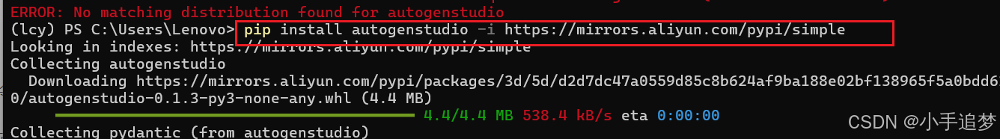

<font style="color:rgb(51, 51, 51);">速度相当 OK，很快就完成下载和安装了。</font>

**<font style="color:rgb(51, 51, 51);">2，启动 autogen studio</font>**

<font style="color:rgb(51, 51, 51);">下载之后，使用如下命令启动 autogen studio 服务。</font>

```plain
autogenstudio ui --port 6000
```

<font style="color:rgb(51, 51, 51);">回车执行命令。</font>

<font style="color:rgb(51, 51, 51);">有如下输出，说明启动成功。</font>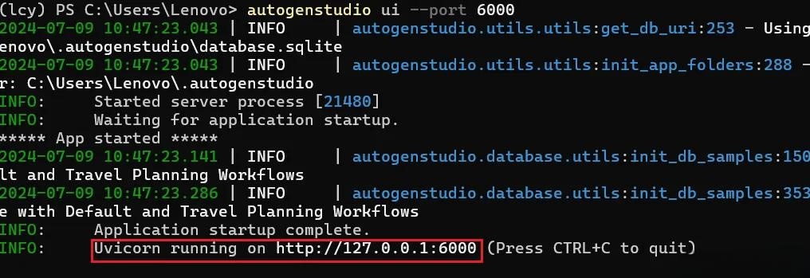

**<font style="color:rgb(51, 51, 51);">3，访问 autogen studio</font>**

<font style="color:rgb(51, 51, 51);">从开始准备环境，到部署启动 Autogen Studio，大约半小时可以搞定。</font>

<font style="color:rgb(51, 51, 51);">启动成功后，在浏览器输入如下地址。</font>

```plain
http://localhost:8081/build
```

<font style="color:rgb(51, 51, 51);">即可看到如下界面。</font>


### <font style="color:rgb(51, 51, 51);">2.本地部署 Deepseek </font>

<font style="color:rgb(51, 51, 51);">使用 Ollama 部署 DeepSeek-R1 模型的步骤相对简单，以下是详细的部署流程：</font>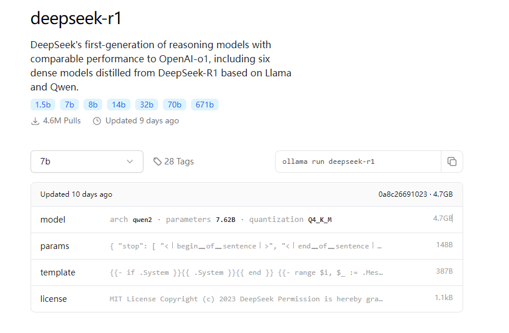

#### <font style="color:rgb(51, 51, 51);">步骤 1: 安装 Ollama</font>

1. **<font style="color:rgb(51, 51, 51);">下载 Ollama</font>**<font style="color:rgb(51, 51, 51);">：首先，访问 </font>[<font style="color:rgb(51, 51, 51);">Ollama 官方网站</font>](https://ollama.com/)<font style="color:rgb(51, 51, 51);"> 下载适用于你的操作系统（Windows 或 macOS）的版本。</font>
2. **<font style="color:rgb(51, 51, 51);">安装 Ollama</font>**<font style="color:rgb(51, 51, 51);">：按照安装向导完成安装过程。</font>

#### <font style="color:rgb(51, 51, 51);">步骤 2: 安装 DeepSeek-R1 模型</font>

1. **<font style="color:rgb(51, 51, 51);">打开终端或命令提示符</font>**<font style="color:rgb(51, 51, 51);">：根据你的操作系统打开命令行工具（macOS 用户使用 Terminal，Windows 用户使用 Command Prompt 或 PowerShell）。</font>
2. **<font style="color:rgb(51, 51, 51);">拉取模型</font>**<font style="color:rgb(51, 51, 51);">：在终端中输入以下命令下载 DeepSeek-R1 模型：</font>

```plain
ollama pull deepseek-r1:1.5b
```

<font style="color:rgb(51, 51, 51);">该命令会从 Ollama 的官方模型库中拉取 DeepSeek-R1 模型，并下载到本地。</font>


#### <font style="color:rgb(51, 51, 51);">步骤 3: 启动模型</font>

1. **<font style="color:rgb(51, 51, 51);">运行 DeepSeek-R1 模型</font>**<font style="color:rgb(51, 51, 51);">：使用以下命令启动 DeepSeek-R1 模型：</font>

```plain
ollama run deepseek-r1:1.5b
```

<font style="color:rgb(51, 51, 51);">该命令会启动模型，并在本地环境中启动一个推理服务。</font>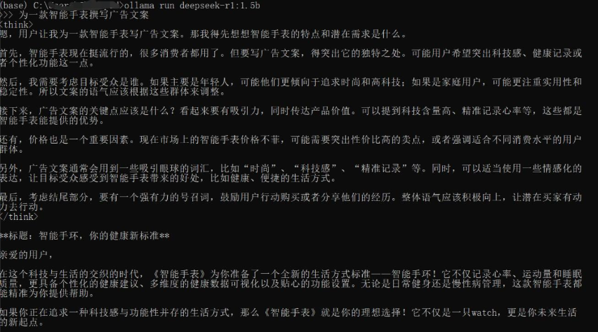

ollama api地址：<http://localhost:11434/v1>

#### <font style="color:rgb(51, 51, 51);">步骤 4: 配置 Open WebUI</font>

1. **<font style="color:rgb(51, 51, 51);">安装 Open WebUI</font>**<font style="color:rgb(51, 51, 51);">：确保你的系统已经安装了 Open WebUI。如果没有安装，可以通过以下命令进行安装：</font>

<font style="color:rgb(51, 51, 51);">先安装conda，参考：</font><https://blog.csdn.net/LiuRuiaby35646/article/details/140517410>

```plain
conda create -n open-webui python=3.11.0
activate open-webui

pip install open-webui
```

2. **<font style="color:rgb(51, 51, 51);">配置 WebUI</font>**<font style="color:rgb(51, 51, 51);">：运行以下命令启动 Open WebUI：</font>

```plain
open-webui serve
```

<font style="color:rgb(51, 51, 51);">启动后，你可以通过浏览器访问 WebUI 界面，通常是 </font><code><font style="color:rgb(51, 51, 51);background-color:rgb(243, 244, 244);">http://localhost:8080</font></code><font style="color:rgb(51, 51, 51);">。</font>

## <font style="color:rgb(51, 51, 51);">给 Autogen 的代理配置大脑</font>

<font style="color:rgb(51, 51, 51);">智能体相当于一家公司，公司的工作通常是由多个人协作完成的，与此类似，智能体的工作是由多个代理协作完成的，从这个角度来看，代理可以类比为人。</font>

<font style="color:rgb(51, 51, 51);">注意，Autogen 中，代理是非常核心的概念。</font>

<font style="color:rgb(51, 51, 51);">既然把代理比作人，那么它一定有思考能力和推理能力，也就是说，它一定有大脑。</font>

<font style="color:rgb(51, 51, 51);">对，只不过代理的大脑是大模型。在我们的这个实验中，选择 Deepseek 作为代理的大脑。</font>

<font style="color:rgb(51, 51, 51);">所以，接下来，就是给代理配置大脑。</font>

### <font style="color:rgb(51, 51, 51);">1.模型登记</font>

<font style="color:rgb(51, 51, 51);">就像员工入职登记信息一样，首先要在 Autogen Studio 界面上登记 Deepseek 的信息。</font>

<font style="color:rgb(51, 51, 51);">如下图，在 Autogen Studio 的界面上，按照如下步骤打开登记界面 。</font>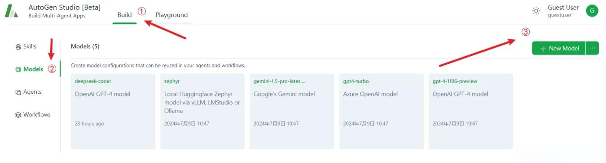

* <font style="color:rgb(51, 51, 51);">① 选择 Build</font>
* <font style="color:rgb(51, 51, 51);">② 选 models 菜单</font>
* <font style="color:rgb(51, 51, 51);">③ 点击 </font><code><font style="color:rgb(51, 51, 51);background-color:rgb(243, 244, 244);">New Model</font></code><font style="color:rgb(51, 51, 51);"> 按钮</font>

**<font style="color:rgb(51, 51, 51);">模型登记界面如下。</font>**

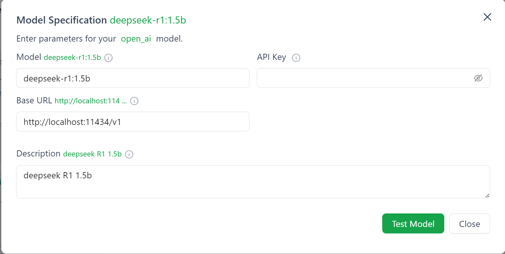

* <font style="color:rgb(51, 51, 51);">① 填写模型名称</font>
* <font style="color:rgb(51, 51, 51);">② API Key，把之前创建好的 API Key 复制粘贴到这里即可</font>
* <font style="color:rgb(51, 51, 51);">③ 接口地址，直接复制粘贴，不要修改：</font><http://localhost:11434/v1>
* <font style="color:rgb(51, 51, 51);">④ 备注，按需填写即可</font>

<font style="color:rgb(51, 51, 51);">登记完成后，点击 </font><code><font style="color:rgb(51, 51, 51);background-color:rgb(243, 244, 244);">Test Model</font></code><font style="color:rgb(51, 51, 51);"> 进行测试，校验信息是否准确。有如下提示，说明模型登记成功，点击</font><code><font style="color:rgb(51, 51, 51);background-color:rgb(243, 244, 244);">保存</font></code><font style="color:rgb(51, 51, 51);">即可。</font>

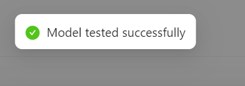

### <font style="color:rgb(51, 51, 51);">2.给代理配置大脑</font>

<font style="color:rgb(51, 51, 51);">目前，仅仅登记了大脑的信息，接下来得给代理装上这个大脑。</font>

<font style="color:rgb(51, 51, 51);">代理是怎么来的呢？</font>

<font style="color:rgb(51, 51, 51);">我们要打造的智能体 - AI 旅游规划师，是 Autogen Studio 中自带的智能体，所有的代理都已经创建好了，只是这些代理目前都没有大脑。</font>

<font style="color:rgb(51, 51, 51);">如下图，点击①Agents 菜单，切换到代理列表界面，</font><code><font style="color:rgb(51, 51, 51);background-color:rgb(243, 244, 244);">需要给如图所示2~6一共五个代理配置大脑</font></code><font style="color:rgb(51, 51, 51);">。</font>

<font style="color:rgb(51, 51, 51);">注意，第一个</font><code><font style="color:rgb(51, 51, 51);background-color:rgb(243, 244, 244);">代理user_proxy不需要大脑</font></code><font style="color:rgb(51, 51, 51);">，user_proxy 只是前端接待和指令执行者，不需要动脑子。</font>

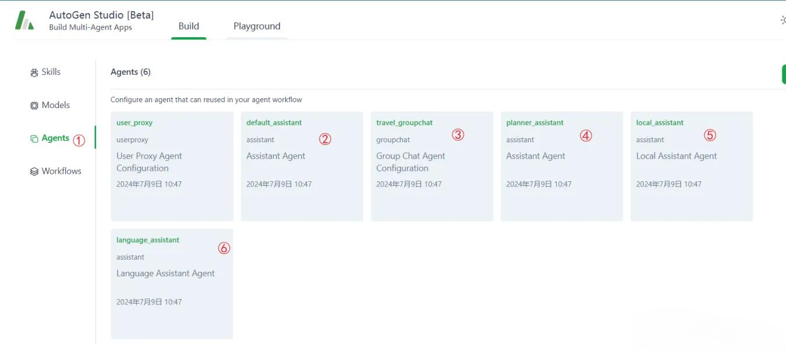

<font style="color:rgb(51, 51, 51);">以给代理 default_assistant 配置大脑为例，演示步骤，其他代理类似。</font>

* <font style="color:rgb(51, 51, 51);">① 点击代理 default_assistant</font>
* <font style="color:rgb(51, 51, 51);">② 在弹出的浮窗中点击 Models，切换到模型选择界面</font>
* <font style="color:rgb(51, 51, 51);">③ 点击</font><code><font style="color:rgb(51, 51, 51);background-color:rgb(243, 244, 244);">add</font></code><font style="color:rgb(51, 51, 51);">按钮</font>


* <font style="color:rgb(51, 51, 51);">④ 在弹出的下来列表中选择 deepseek-code 模型作为代理的大脑</font>

<http://localhost:11434/v1>

<font style="color:rgb(51, 51, 51);">其实，到此位置，我们的智能体已经打造完成，接下来可以让 AI 旅游规划师开始工作了。</font>

## <font style="color:rgb(51, 51, 51);">构建多Agent应用</font>

### <font style="color:rgb(51, 51, 51);">1.AI 旅游规划师workflow</font>

<font style="color:rgb(51, 51, 51);">先来看看 AI 旅游规划师的真实面目。</font>

<font style="color:rgb(51, 51, 51);">到目前，我们仅仅知道代理，代理和 AI 旅游规划师的关系是什么呢？</font>

<font style="color:rgb(51, 51, 51);">简单的说，AI 旅游规划师的工作是有多个代理合作完成的。</font>

<font style="color:rgb(51, 51, 51);">代理之间的协作是由 workflow 工作流定义的。</font>

<font style="color:rgb(51, 51, 51);">切换到工作流界面，如下图。</font>

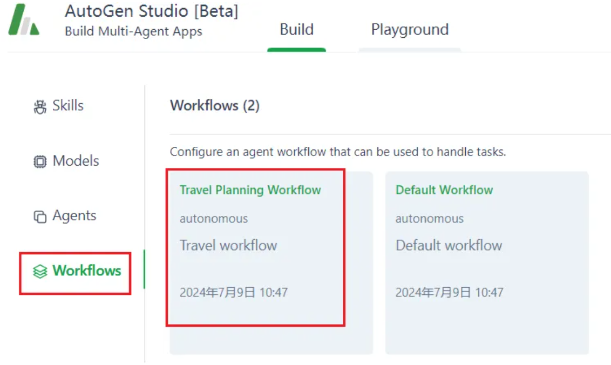

<font style="color:rgb(51, 51, 51);">点击上图中的</font><code><font style="color:rgb(51, 51, 51);background-color:rgb(243, 244, 244);">Travel Planning Workflow</font></code><font style="color:rgb(51, 51, 51);">，进入其配置界面，选择界面上的 Agents 卡片。</font>

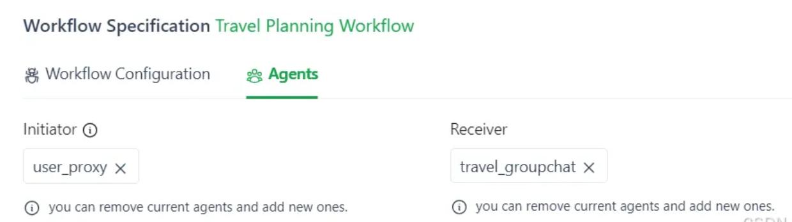

* **<font style="color:rgb(51, 51, 51);">default_assistant</font>**<font style="color:rgb(51, 51, 51);">，是个有用的人工智能助手。使用你的编码和语言技能来解决任务。在以下情况下，建议用户执行 Python 代码 (在 Python 代码块中) 或 shell 脚本 (在 sh 代码块中)。</font>
  * <font style="color:rgb(51, 51, 51);">1、当你需要收集信息时，使用代码输出你需要的信息，例如，浏览或搜索网页，下载 / 阅读文件，打印网页或文件的内容，获取当前日期 / 时间，检查操作系统。当足够的信息被打印出来，任务就可以根据你的语言技能来解决了，你就可以自己解决这个任务</font>
  * <font style="color:rgb(51, 51, 51);">2、当需要使用代码执行某项任务时，请使用该代码执行该任务并输出结果。聪明地完成任务。如果需要，逐步解决任务。如果没有提供计划，首先解释你的计划。清楚哪一步使用代码，哪一步使用您的语言技能。使用代码时，必须指示代码块中的脚本类型。除了执行您建议的代码之外，用户不能提供任何其他反馈或执行任何其他操作。用户无法修改代码。所以不要建议用户修改不完整的代码。如果不打算由用户执行，则不要使用代码块。如果希望用户在执行之前将代码保存到文件中，请将 # filename: <filename> 作为第一行放在代码块中。不要在一个响应中包含多个代码块。不要要求用户复制和粘贴结果。相反，在相关时使用 “print” 函数作为输出。检查用户返回的执行结果。如果结果表明存在错误，请修复错误并再次输出代码。建议使用完整代码而不是部分代码或代码更改。如果错误无法修复，或者在代码成功执行之后任务仍未得到解决，请分析问题，重新审视您的假设，收集您需要的额外信息，并考虑一种不同的尝试方法。当你找到答案时，仔细核实答案。如果可能的话，在你的回答中包括可核实的证据。当所有事情都完成后，最后回复 “TERMINATE”。</font>
* **<font style="color:rgb(51, 51, 51);">user_proxy</font>**<font style="color:rgb(51, 51, 51);">，这个代理的角色是 initiator(发起人)，它的功能是接收用户的任务，把任务交给 Receiver 进行分析、拆解</font>
* **<font style="color:rgb(51, 51, 51);">travel_groupchat</font>**<font style="color:rgb(51, 51, 51);">，这个代理的角色是 Receiver，它的功能是把 Initiator 代理分配过来的任务进行理解、拆解</font>
* **<font style="color:rgb(51, 51, 51);">language_assistant</font>**<font style="color:rgb(51, 51, 51);">，是一个很有帮助的助手，可以回顾旅行计划，提供重要的 / 关键的提示，如何最好地处理语言或沟通挑战的反馈给特定的目的地。如果计划中已经包含了语言技巧，那么您可以提到该计划是令人满意的，并且具有合理性。</font>
* **<font style="color:rgb(51, 51, 51);">local_assistant</font>**<font style="color:rgb(51, 51, 51);">，您是一个本地助理，可以为用户推荐本地活动或要访问的地点，并且可以利用所提供的任何上下文信息。你可以推荐当地的活动、参观的地方、吃饭的餐馆等等。您还可以提供有关天气、当地事件等的信息。你可以提供当地的信息，但你不能提出一个完整的旅行计划。您只能提供有关本地区域的信息。</font>
* **<font style="color:rgb(51, 51, 51);">planner_assistant</font>**<font style="color:rgb(51, 51, 51);">：一个有用的助手，可以为用户提供旅行计划，并利用所提供的任何上下文信息。你是主要的协调人，将收到来自其他代理 (当地助理，语言助理) 的建议或意见。您必须确保最终计划集成了来自其他代理或团队成员的建议。你的最终反应必须是完整的计划。当计划完成并且集成了所有透视图时，可以使用 TERMINATE 进行响应。</font>

<font style="color:rgb(51, 51, 51);">前面不是说涉及多个代理吗？这里明明只有两个代理。</font>

<font style="color:rgb(51, 51, 51);">要回答这个问题，得回到 Agents 界面，点击代理</font><code><font style="color:rgb(51, 51, 51);background-color:rgb(243, 244, 244);">travel_groupchat</font></code><font style="color:rgb(51, 51, 51);">。</font>

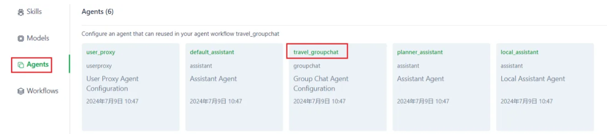

<font style="color:rgb(51, 51, 51);">在代理</font><code><font style="color:rgb(51, 51, 51);background-color:rgb(243, 244, 244);">travel_groupchat</font></code><font style="color:rgb(51, 51, 51);">的配置界面上选择 Agents 卡片，可以看到在这里关联其他 Agent。</font>

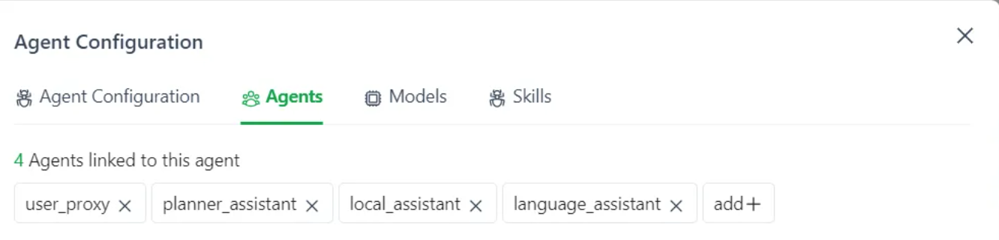<font style="color:rgb(51, 51, 51);">相当于代理</font><code><font style="color:rgb(51, 51, 51);background-color:rgb(243, 244, 244);">travel_groupchat</font></code><font style="color:rgb(51, 51, 51);">是个 Leader，管理着很多员工。</font>

### <font style="color:rgb(51, 51, 51);">2.AI 旅游规划师执行任务</font>

<font style="color:rgb(51, 51, 51);">Autogen Studio 上的 Playgournd 就是智能体的表演舞台，接下来我们把旅游规划师请上舞台。</font>

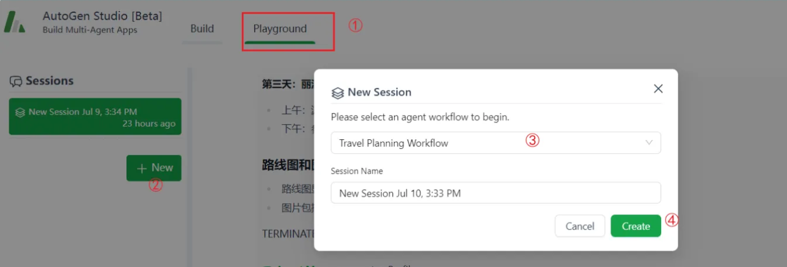

* <font style="color:rgb(51, 51, 51);">① 选择卡片 Playground</font>
* <font style="color:rgb(51, 51, 51);">② 点击左侧</font><code><font style="color:rgb(51, 51, 51);background-color:rgb(243, 244, 244);">+New</font></code><font style="color:rgb(51, 51, 51);">按钮</font>
* <font style="color:rgb(51, 51, 51);">③ 选择工作流</font><code><font style="color:rgb(51, 51, 51);background-color:rgb(243, 244, 244);">Travel Planning Workflow</font></code>
* <font style="color:rgb(51, 51, 51);">④ 点击按钮</font><code><font style="color:rgb(51, 51, 51);background-color:rgb(243, 244, 244);">Create</font></code>

<font style="color:rgb(51, 51, 51);">现在就可以给旅游规划师下任务。</font>

### <font style="color:rgb(51, 51, 51);">3.AI 旅游规划师执行效果</font>

<font style="color:rgb(51, 51, 51);">我给旅游规划师下达了这样一个任务。</font>

```plain
制定去云南旅游的3天计划
```

<font style="color:rgb(51, 51, 51);">这是智能体给我的响应，当然，这不重要。</font>

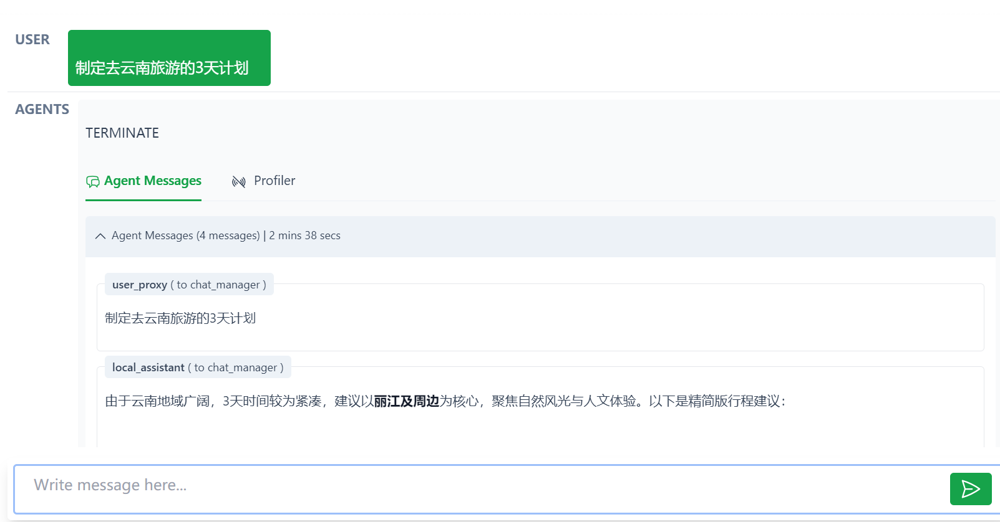

<font style="color:rgb(51, 51, 51);">关键的地方，在于对话的最下面，点开</font><code><font style="color:rgb(51, 51, 51);background-color:rgb(243, 244, 244);">Agent Messages</font></code><font style="color:rgb(51, 51, 51);">。</font>

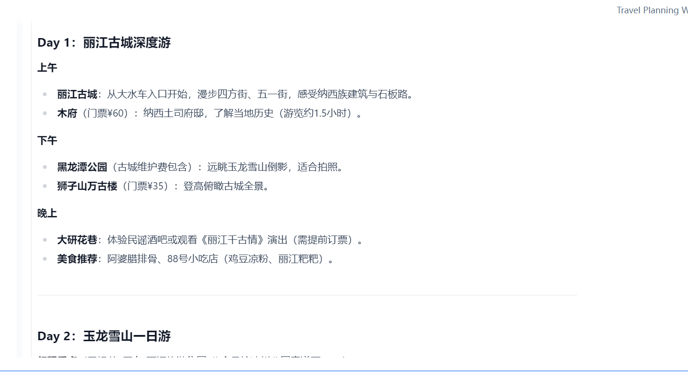

<code><font style="color:rgb(51, 51, 51);background-color:rgb(243, 244, 244);">Agent Messages</font></code><font style="color:rgb(51, 51, 51);">展示了为了完成这个任务，多个 Agent 之间发生的对话，就像一个公司的某个部门完成一个任务一样，多个同事要进行多轮复杂的、网站的交流。</font>

<font style="color:rgb(51, 51, 51);">如下图，这个过程，至少有二个代理参与，但他们的对话过程对用户来说，是不透明的。</font>

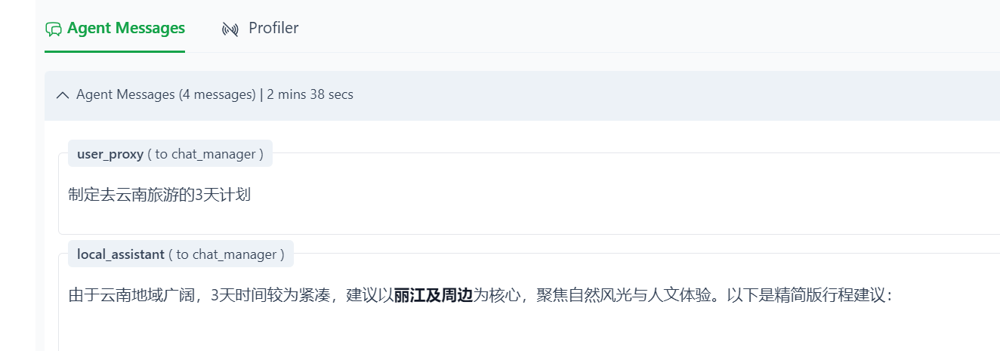

<font style="color:rgb(51, 51, 51);">用户就是提出问题，等待答案。</font>

## <font style="color:rgb(51, 51, 51);">总结</font>

<font style="color:rgb(51, 51, 51);">当然，具备生产力的智能体会更加复杂，但也是在这个原理之上，设计更为复杂的工作流，每个代理具备更多的能力，甚至是具备物理世界的能力，比如动手术、诊断、搬东西、采购、运输等等。</font>

<font style="color:rgb(51, 51, 51);">可以想象，随之 AI 的能力越来越强，智能体落地的可能性就越来越大。</font>

<font style="color:rgb(51, 51, 51);">目前 AI 的发展虽然如火如荼，但是并没有杀手级别的应用出现，如果没有应用，就不可能真正的进入 AI 时代。智能体极有可能是 AI 应用落地的最佳形态。</font>


> 更新: 2025-04-20 22:38:52  
> 原文: <https://www.yuque.com/aaron-wecc3/dhluml/tm7geexuhe563hqg>