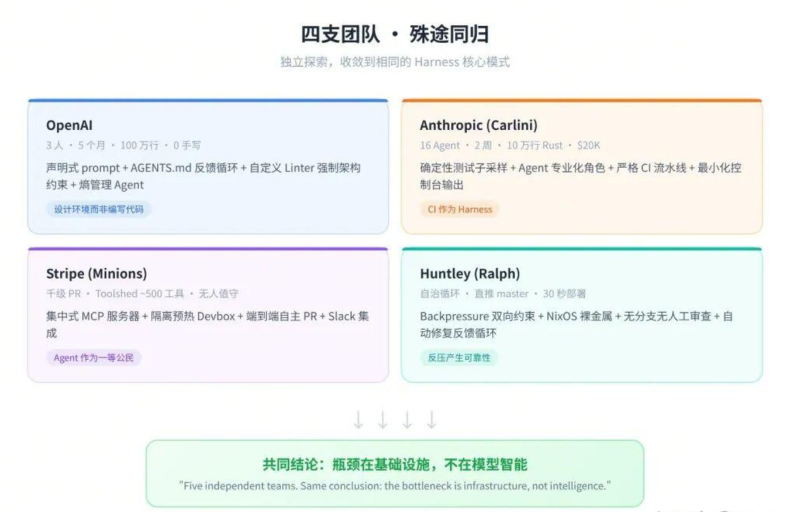
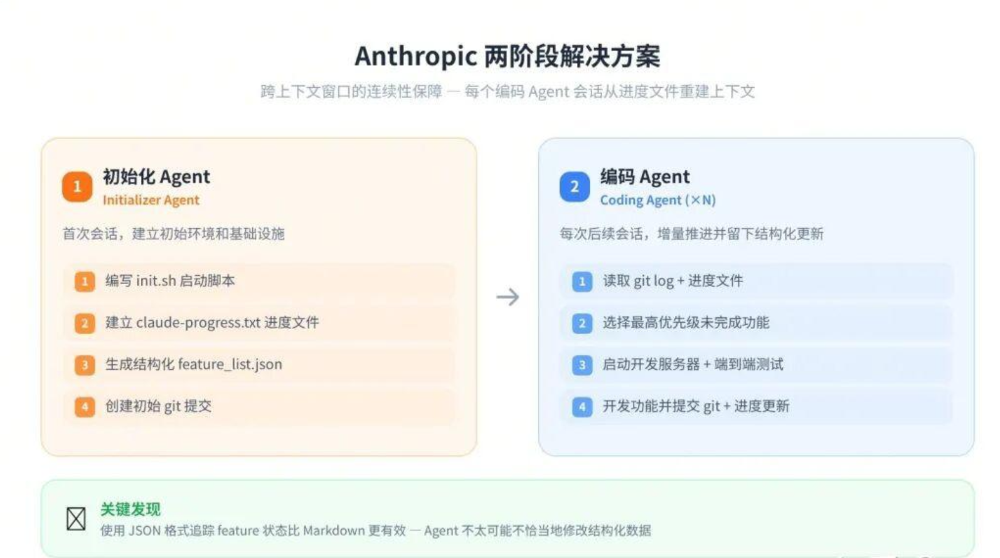

# 285.Harness Engineering 从入门到精通实战

## <font style="color:rgb(51, 51, 51);background-color:rgb(250, 252, 253);">什么是 Harness Engineering ？</font>

AI 模型已经能写出 100 万行代码。真正的挑战不再是让它写得更好，而是**怎么驾驭它稳定、可靠、不失控地工作**。这套围绕 AI 智能体构建约束、反馈与控制系统的方法论，就是 2026 年初迅速席卷工程圈的新范式——**Harness Engineering（驾驭工程）**。

**Harness Engineering（驾驭工程）**是围绕 AI 智能体设计和构建**约束机制、反馈回路、工作流控制和持续改进循环**的系统工程实践。

它不优化模型本身，而是优化模型运行的环境。核心哲学八个字：**人类掌舵，智能体执行（Human Steer, Agent Execute）**。

Harness一词来自马具——缰绳、马鞍、嚼子——这是一套引导强大但不可预测的动物的完整装备。**驾驭工程不是去削弱 AI 的能力，而是为它打造一套黄金缰绳，让它跑得又快又稳。**


<font style="color:rgb(51, 51, 51);background-color:rgb(250, 252, 253);">这个概念由 HashiCorp 联合创始人 Mitchell Hashimoto 在 2026 年 2 月 5 日首次提出，六天后 OpenAI 在百万行代码实验报告中正式采用这一术语，随后 Martin Fowler 撰文深度分析，一个月内成为开发者社区的高频词。</font>

*<font style="color:rgb(90, 48, 16);background-color:rgb(255, 249, 245);">harness engineering is the idea that anytime you find an agent makes a mistake, you take the time to engineer a solution such that the agent will not make that mistake again in the future.</font>*

*<font style="color:rgb(90, 48, 16);background-color:rgb(255, 249, 245);">—— Mitchell Hashimoto</font>*

<font style="color:rgb(51, 51, 51);background-color:rgb(250, 252, 253);">这句话的潜台词是：</font>**<font style="color:rgb(51, 51, 51);background-color:rgb(250, 252, 253);">Agent 的每一次失败，都是环境设计不完善的信号。</font>**<font style="color:rgb(51, 51, 51);background-color:rgb(250, 252, 253);">正确的回应不是换一个更强的模型，而是重新设计它运行的环境。</font>

<font style="color:rgb(51, 51, 51);background-color:rgb(250, 252, 253);"></font>

<font style="color:rgb(51, 51, 51);background-color:rgb(250, 252, 253);">Mitchell Hashimoto 《My AI Adoption Journey》 原文链接</font>

<https://mitchellh.com/writing/my-ai-adoption-journey>

OpenAI  《<font style="color:rgb(24, 25, 28);">Harness engineering: leveraging Codex in an agent-first world</font>》原文链接

<https://openai.com/index/harness-engineering/>

<font style="color:rgb(24, 25, 28);">Anthropic 原文链接</font>

* Effective harnesses for long-running agents\
  <https://www.anthropic.com/engineering/effective-harnesses-for-long-running-agents>
* Harness design for long-running application development\
  <https://www.anthropic.com/engineering/harness-design-long-running-apps>

LangChain 《The Anatomy of an Agent Harness》 原文链接\
<https://www.langchain.com/blog/the-anatomy-of-an-agent-harness>

Martin Fowler 原文链接

* Harness Engineering - first thoughts\
  <https://martinfowler.com/articles/exploring-gen-ai/harness-engineering-memo.html>
* Harness engineering for coding agent users\
  <https://martinfowler.com/articles/harness-engineering.html>

## <font style="color:rgb(51, 51, 51);background-color:rgb(250, 252, 253);">为什么需要 Harness Engineering ?</font>

**<font style="color:rgb(224, 123, 57);background-color:rgb(250, 252, 253);">100万</font>**<font style="color:rgb(85, 85, 85);background-color:rgb(250, 252, 253);">OpenAI 团队 5 个月产出代码行数</font>

**<font style="color:rgb(224, 123, 57);background-color:rgb(250, 252, 253);">0行</font>**<font style="color:rgb(85, 85, 85);background-color:rgb(250, 252, 253);">工程师手动编写的代码</font>

**<font style="color:rgb(224, 123, 57);background-color:rgb(250, 252, 253);">3~7人</font>**<font style="color:rgb(85, 85, 85);background-color:rgb(250, 252, 253);">团队规模，人均每日 3.5 个 PR</font>

**<font style="color:rgb(224, 123, 57);background-color:rgb(250, 252, 253);">30 → 5</font>**<font style="color:rgb(85, 85, 85);background-color:rgb(250, 252, 253);">LangChain 仅改 Harness，Terminal Bench 排名跃升</font>

<font style="color:rgb(51, 51, 51);background-color:rgb(250, 252, 253);">LangChain 的案例尤其有说服力：底层模型一个参数都没动，</font>**<font style="color:rgb(51, 51, 51);background-color:rgb(250, 252, 253);">仅仅通过优化外部驾驭环境</font>**<font style="color:rgb(51, 51, 51);background-color:rgb(250, 252, 253);">（文档结构、验证回路、追踪系统），编码 Agent 在 Terminal Bench 2.0 的得分从 52.8% 飙升至 66.5%，全球排名从第 30 位跃升至第 5 位。</font>

<font style="color:rgb(51, 51, 51);background-color:rgb(250, 252, 253);">五个独立团队也得出了相同结论：</font>**<font style="color:rgb(51, 51, 51);background-color:rgb(250, 252, 253);">瓶颈不在模型智能，而在基础设施。</font>**

**<font style="color:rgb(51, 51, 51);background-color:rgb(250, 252, 253);"></font>**

**<font style="color:rgb(51, 51, 51);background-color:rgb(250, 252, 253);">Harness 与传统框架的关系</font>**

<font style="color:rgb(51, 51, 51);background-color:rgb(250, 252, 253);">Harness 不是 SDK、脚手架或 Agent 框架的替代品，而是</font>**<font style="color:rgb(51, 51, 51);background-color:rgb(250, 252, 253);">位于它们之上的一层</font>**<font style="color:rgb(51, 51, 51);background-color:rgb(250, 252, 253);">：</font>

<font style="color:rgb(51, 51, 51);background-color:rgb(250, 252, 253);">传统框架解决的是</font>**<font style="color:rgb(51, 51, 51);background-color:rgb(250, 252, 253);">如何构建 AI 智能体</font>**<font style="color:rgb(51, 51, 51);background-color:rgb(250, 252, 253);">，而驾驭层解决的是完全不同的问题：</font>**<font style="color:rgb(51, 51, 51);background-color:rgb(250, 252, 253);">智能体如何可靠地运行</font>**<font style="color:rgb(51, 51, 51);background-color:rgb(250, 252, 253);">。</font>

<font style="color:rgb(51, 51, 51);background-color:rgb(250, 252, 253);">模型正在逐渐吸收框架约 80% 的功能（智能体定义、消息路由、任务生命周期……），但剩余 20%——</font>**<font style="color:rgb(51, 51, 51);background-color:rgb(250, 252, 253);">持久化、确定性重放、成本控制、可观测性、错误恢复</font>**<font style="color:rgb(51, 51, 51);background-color:rgb(250, 252, 253);">——正是驾驭层存在的价值。</font>

## <font style="color:rgb(51, 51, 51);background-color:rgb(250, 252, 253);">AI 工程范式的三次跃迁</font>

<font style="color:rgb(51, 51, 51);background-color:rgb(250, 252, 253);">要理解驾驭工程为何重要，需要先看清楚我们是怎么一步步走到这里的。</font>

| <font style="color:rgb(255, 255, 255);">范式</font> | <font style="color:rgb(255, 255, 255);">核心问题</font> | <font style="color:rgb(255, 255, 255);">优化对象</font> | <font style="color:rgb(255, 255, 255);">交互模式</font> |
| --- | --- | --- | --- |
| **<font style="color:rgb(51, 51, 51);">提示词工程</font>** | <font style="color:rgb(51, 51, 51);">怎么把话说清楚</font> | <font style="color:rgb(51, 51, 51);">Prompt 的措辞、格式、示例</font> | <font style="color:rgb(51, 51, 51);">一问一答</font> |
| **<font style="color:rgb(51, 51, 51);">上下文工程</font>** | <font style="color:rgb(51, 51, 51);">怎么给 AI 喂信息</font> | <font style="color:rgb(51, 51, 51);">文档、代码片段、历史对话</font> | <font style="color:rgb(51, 51, 51);">信息注入 → 生成</font> |
| **<font style="color:rgb(51, 51, 51);">驾驭工程</font>** | <font style="color:rgb(51, 51, 51);">怎么让 Agent 可靠工作</font> | <font style="color:rgb(51, 51, 51);">约束、反馈回路、控制系统</font> | <font style="color:rgb(51, 51, 51);">人类掌舵，Agent 执行</font> |

<font style="color:rgb(51, 51, 51);background-color:rgb(250, 252, 253);">一个好记的类比：</font>

* <font style="color:rgb(51, 51, 51);background-color:rgb(250, 252, 253);">Prompt Engineering ——</font><font style="color:rgb(51, 51, 51);background-color:rgb(250, 252, 253);"> </font>**<font style="color:rgb(51, 51, 51);background-color:rgb(250, 252, 253);">对马喊话的技巧</font>**
* <font style="color:rgb(51, 51, 51);background-color:rgb(250, 252, 253);">Context Engineering ——</font><font style="color:rgb(51, 51, 51);background-color:rgb(250, 252, 253);"> </font>**<font style="color:rgb(51, 51, 51);background-color:rgb(250, 252, 253);">给马看的地图</font>**
* <font style="color:rgb(51, 51, 51);background-color:rgb(250, 252, 253);">Harness Engineering ——</font><font style="color:rgb(51, 51, 51);background-color:rgb(250, 252, 253);"> </font>**<font style="color:rgb(51, 51, 51);background-color:rgb(250, 252, 253);">给马造一条高速公路，配上护栏、限速牌和加油站</font>**


***

## <font style="color:rgb(51, 51, 51);background-color:rgb(250, 252, 253);">Agent 常见失败模式</font>

<font style="color:rgb(24, 25, 28);">Anthropic 原文链接</font>

* Effective harnesses for long-running agents\
  <https://www.anthropic.com/engineering/effective-harnesses-for-long-running-agents>
* Harness design for long-running application development\
  <https://www.anthropic.com/engineering/harness-design-long-running-apps>

<font style="color:rgb(51, 51, 51);background-color:rgb(250, 252, 253);">Anthropic 工程师在长时间运行 Agent 的过程中，总结了三种典型的翻车姿势，正是驾驭工程要解决的核心痛点：</font>

**<font style="color:rgb(192, 64, 10);">失败模式 1：试图一步到位（One-shotting）</font>**

<font style="color:rgb(51, 51, 51);">Agent 倾向于在一个会话里把所有功能都做完。结果是上下文窗口耗尽，留下一堆没有文档的半成品代码，下一个会话启动时只能花大量时间猜测之前发生了什么。</font>

**<font style="color:rgb(192, 64, 10);">失败模式 2：过早宣布胜利</font>**

<font style="color:rgb(51, 51, 51);">在项目后期，当部分功能已经完成后，Agent 会环顾四周，看到已有进展就直接宣布任务完成——即使还有大量功能未实现。</font>

**<font style="color:rgb(192, 64, 10);">失败模式 3：过早标记功能完成</font>**

<font style="color:rgb(51, 51, 51);">在没有明确提示的情况下，Agent 写完代码就标记为完成，却没有做端到端测试。单元测试或 curl 命令通过了不代表功能真正可用。</font>

<font style="color:rgb(51, 51, 51);background-color:rgb(250, 252, 253);">此外，智能体还有一个危险特性：</font>**<font style="color:rgb(51, 51, 51);background-color:rgb(250, 252, 253);">它非常擅长模式复制</font>**<font style="color:rgb(51, 51, 51);background-color:rgb(250, 252, 253);">。代码库里有什么模式，它就忠实地复制并放大——包括坏模式和架构漂移。这意味着不加约束的 Agent 会以惊人的速度积累技术债务。</font>

## <font style="color:rgb(51, 51, 51);background-color:rgb(250, 252, 253);">Harness 核心组件</font>

<font style="color:rgb(51, 51, 51);">综合 OpenAI、Anthropic、LangChain 和 Martin Fowler 的实践，Harness 可以归纳出一些核心组件</font>

### <font style="color:rgb(51, 51, 51);background-color:rgb(250, 252, 253);">上下文工程（Context Engineering）——新员工手册</font>

<font style="color:rgb(51, 51, 51);">就像给新员工一本详细的工作手册，</font>**<font style="color:rgb(51, 51, 51);">AGENTS.md</font>**<font style="color:rgb(51, 51, 51);"> 是 AI 智能体进入代码仓库时看到的第一份指南。但这不是一本静态的 1000 页说明书——上下文是稀缺资源，过多的指导反而会挤掉任务、代码和相关文档的空间，变成陈旧规则的坟场。</font>

<font style="color:rgb(51, 51, 51);">更好的做法是：提供一个稳定、小巧的入口点，然后教 Agent 根据当前任务按需检索和拉取更多的上下文。Mitchell Hashimoto 的 Ghostty 项目 AGENTS.md 里每一行都对应一个历史 Agent 失败案例——文档是活的反馈循环，不是静态制品。</font>

**<font style="color:rgb(51, 51, 51);">核心原则</font>**<font style="color:rgb(51, 51, 51);">：Agent 应当恰好获得当前任务所需的上下文——不多不少。</font>

<font style="color:rgb(51, 51, 51);">每个团队都独立发现，将所有指令塞进一个文件无法扩展。解决方案是</font>**<font style="color:rgb(51, 51, 51);">分层上下文与渐进式披露</font>**<font style="color:rgb(51, 51, 51);">：</font>

**<font style="color:rgb(51, 51, 51);">OpenAI</font>**<font style="color:rgb(51, 51, 51);"> 使用 AGENTS.md 作为动态反馈循环文件，每当 Agent 遇到失败时更新。</font>

**<font style="color:rgb(51, 51, 51);">Anthropic</font>**<font style="color:rgb(51, 51, 51);"> 使用大量 README 和每次会话频繁更新的进度文件。</font>

**<font style="color:rgb(51, 51, 51);">Horthy</font>**<font style="color:rgb(51, 51, 51);"> 倡导 "频繁有意识压缩"（Frequent Intentional Compaction）。</font>

**<font style="color:rgb(51, 51, 51);">Vasilopoulos（2026 论文）</font>**<font style="color:rgb(51, 51, 51);">将上下文形式化为三层：热记忆（Hot Memory）、领域专家（Domain Experts）、冷记忆知识库（Cold-Memory Knowledge）。</font>

**<font style="color:rgb(51, 51, 51);">实践建议——三层上下文体系</font>**<font style="color:rgb(51, 51, 51);">：</font>

| <font style="color:rgb(51, 51, 51);">层级</font> | <font style="color:rgb(51, 51, 51);">加载时机</font> | <font style="color:rgb(51, 51, 51);">内容示例</font> | <font style="color:rgb(51, 51, 51);">上下文占用</font> |
| :--- | :--- | :--- | :--- |
| <font style="color:rgb(51, 51, 51);">Tier 1：会话常驻</font> | <font style="color:rgb(51, 51, 51);">每次会话自动加载</font> | <font style="color:rgb(51, 51, 51);">AGENTS.md / CLAUDE.md，项目结构概览</font> | <font style="color:rgb(51, 51, 51);">最小</font> |
| <font style="color:rgb(51, 51, 51);">Tier 2：按需加载</font> | <font style="color:rgb(51, 51, 51);">特定子 Agent 或技能被调用时</font> | <font style="color:rgb(51, 51, 51);">专业化 Agent 的上下文、领域知识</font> | <font style="color:rgb(51, 51, 51);">中等</font> |
| <font style="color:rgb(51, 51, 51);">Tier 3：持久化知识库</font> | <font style="color:rgb(51, 51, 51);">Agent 主动查询时</font> | <font style="color:rgb(51, 51, 51);">研究文档、规格说明、历史会话</font> | <font style="color:rgb(51, 51, 51);">按需</font> |

### <font style="color:rgb(51, 51, 51);">Agent 专业化（Agent Specialization）</font>

**<font style="color:rgb(51, 51, 51);">核心原则</font>**<font style="color:rgb(51, 51, 51);">：专注于特定领域、拥有受限工具的 Agent 优于拥有全部权限的通用 Agent。</font>

**<font style="color:rgb(51, 51, 51);">Carlini</font>**<font style="color:rgb(51, 51, 51);">（Anthropic C 编译器项目）将 Agent 专业化为编译器核心、去重、性能优化和文档四类角色。</font>

**<font style="color:rgb(51, 51, 51);">Vasilopoulos</font>**<font style="color:rgb(51, 51, 51);"> 部署了 19 个领域特定 Agent。</font>

**<font style="color:rgb(51, 51, 51);">Huntley</font>**<font style="color:rgb(51, 51, 51);"> 使用子 Agent 来保持主 Agent 上下文的清洁。</font>

<font style="color:rgb(51, 51, 51);">专业化不仅是组织性的——它本身就是上下文管理策略。每个专家因为携带更少的无关信息，所以运行在 "Smart Zone" 内。</font>

**<font style="color:rgb(51, 51, 51);">实践中的角色分工</font>**<font style="color:rgb(51, 51, 51);">：</font>

| <font style="color:rgb(51, 51, 51);">Agent 角色</font> | <font style="color:rgb(51, 51, 51);">职责范围</font> | <font style="color:rgb(51, 51, 51);">工具权限</font> |
| :--- | :--- | :--- |
| <font style="color:rgb(51, 51, 51);">研究 Agent</font> | <font style="color:rgb(51, 51, 51);">探索代码库、分析实现细节</font> | <font style="color:rgb(51, 51, 51);">只读（Read, Grep, Glob）</font> |
| <font style="color:rgb(51, 51, 51);">规划 Agent</font> | <font style="color:rgb(51, 51, 51);">将需求分解为结构化任务</font> | <font style="color:rgb(51, 51, 51);">只读，无写入权限</font> |
| <font style="color:rgb(51, 51, 51);">执行 Agent</font> | <font style="color:rgb(51, 51, 51);">实现单个具体任务</font> | <font style="color:rgb(51, 51, 51);">限定范围的读写权限</font> |
| <font style="color:rgb(51, 51, 51);">审查 Agent</font> | <font style="color:rgb(51, 51, 51);">审计完成的工作，标记问题</font> | <font style="color:rgb(51, 51, 51);">只读 + 标记权限</font> |
| <font style="color:rgb(51, 51, 51);">调试 Agent</font> | <font style="color:rgb(51, 51, 51);">修复审查发现的问题</font> | <font style="color:rgb(51, 51, 51);">限定范围的修复权限</font> |
| <font style="color:rgb(51, 51, 51);">清理 Agent</font> | <font style="color:rgb(51, 51, 51);">对抗熵积累，清理低质量代码</font> | <font style="color:rgb(51, 51, 51);">读写权限</font> |

### <font style="color:rgb(51, 51, 51);">持久化记忆（Persistent Memory）</font>

**<font style="color:rgb(51, 51, 51);">核心原则</font>**<font style="color:rgb(51, 51, 51);">：进度持久化在文件系统上，而非上下文窗口中。每次新 Agent 会话从零开始，通过文件系统制品重建上下文。</font>

<font style="color:rgb(51, 51, 51);">Anthropic 解决这一问题的方案堪称经典：</font>

**<font style="color:rgb(51, 51, 51);">初始化 Agent</font>**<font style="color:rgb(51, 51, 51);">：首次会话使用专门的 prompt，要求模型建立初始环境——init.sh 脚本、claude-progress.txt 进度文件和初始 git 提交。</font>

**<font style="color:rgb(51, 51, 51);">编码 Agent</font>**<font style="color:rgb(51, 51, 51);">：后续每次会话要求模型在做出增量进展的同时，留下结构化更新。</font>

<font style="color:rgb(51, 51, 51);">每个编码 Agent 的典型会话启动流程如下：</font>

1. <font style="color:rgb(51, 51, 51);">运行 pwd 查看工作目录</font>
2. <font style="color:rgb(51, 51, 51);">读取 git log 和进度文件，了解最近的工作</font>
3. <font style="color:rgb(51, 51, 51);">读取 feature list 文件，选择最高优先级的未完成功能</font>
4. <font style="color:rgb(51, 51, 51);">启动开发服务器，运行基础端到端测试</font>
5. <font style="color:rgb(51, 51, 51);">确认基本功能正常后，开始新功能开发</font>

<font style="color:rgb(51, 51, 51);">关键发现：</font>**<font style="color:rgb(51, 51, 51);">使用 JSON 格式追踪 feature 状态比 Markdown 更有效</font>**<font style="color:rgb(51, 51, 51);">，因为 Agent 不太可能不恰当地修改或覆盖结构化数据。</font>

### <font style="color:rgb(51, 51, 51);">结构化执行（Structured Execution）</font>

**<font style="color:rgb(51, 51, 51);">核心原则</font>**<font style="color:rgb(51, 51, 51);">：将思考与执行分离。研究和规划在受控阶段进行，执行基于验证过的计划，验证通过自动化反馈（测试、Linter、CI）和人类审查完成。</font>

<font style="color:rgb(51, 51, 51);">所有团队都施加了刻意的执行序列：</font>**<font style="color:rgb(51, 51, 51);">理解 → 规划 → 执行 → 验证</font>**<font style="color:rgb(51, 51, 51);">。</font>

**<font style="color:rgb(51, 51, 51);">OpenAI</font>**<font style="color:rgb(51, 51, 51);"> 使用声明式 prompt 和反馈回路。轻量的计划用于小变更，复杂工作通过带有进度和决策日志的执行计划完成，并检入仓库。</font>

**<font style="color:rgb(51, 51, 51);">Huntley</font>**<font style="color:rgb(51, 51, 51);"> 将规划模式与构建模式分离。</font>

**<font style="color:rgb(51, 51, 51);">Horthy</font>**<font style="color:rgb(51, 51, 51);"> 的 Research-Plan-Implement 工作流围绕上下文管理精心设计。</font>

**<font style="color:rgb(51, 51, 51);">人工检查点的价值</font>**<font style="color:rgb(51, 51, 51);">：审查计划远比审查代码快。当规格正确时，实现自然可靠。当规格有误时，可以在 500 行代码生成之前及时纠正。</font>

### <font style="color:rgb(51, 51, 51);">架构约束（Architecture Constraints）——缰绳</font>

<font style="color:rgb(51, 51, 51);">OpenAI 团队建立了严格的层级依赖模型：</font>

**<font style="color:rgb(51, 51, 51);">Types → Config → Repo → Service → Runtime → UI</font>**

<font style="color:rgb(51, 51, 51);">下层不能反向依赖上层。所有架构规则被编码为</font>**<font style="color:rgb(51, 51, 51);">自定义 Linter 规则</font>**<font style="color:rgb(51, 51, 51);">，违反即 CI 阻止合并——无论代码是人写的还是 AI 写的。</font>

<font style="color:rgb(51, 51, 51);">有个关键细节：Linter 的错误信息本身也是上下文工程。它不只说你违反了规则 X，而是解释为什么这个规则存在、正确做法是什么，这样 Agent 读到错误后就能自我理解并修正，不需要人类介入。</font>

### <font style="color:rgb(51, 51, 51);">反馈循环（Feedback Loop）——智能体审智能体</font>

<font style="color:rgb(51, 51, 51);">传统开发中，人类工程师负责代码审查（Code Review）。在驾驭工程中，这个工作变成了智能体对智能体的方式：Codex 在本地审核自身更改，请求额外审查，循环往复直到通过。</font>

<font style="color:rgb(51, 51, 51);">反馈循环中的钩子可以运行预定义的测试套件，并在失败时带着错误信息循环回到模型，或者提示模型独立评估其代码。如果 AI 写的测试用例通过了带有 Bug 的代码，Harness 就会判定测试无效，强迫它重新思考测试边界。</font>

### <font style="color:rgb(51, 51, 51);">熵管理（Entropy Management）——垃圾回收</font>

<font style="color:rgb(51, 51, 51);">随着时间推移，软件系统会逐渐混乱（熵增），技术债务会积累。OpenAI 采用持续小额偿还的策略，而不是等问题严重时集中处理——他们把这个方法形象地称为</font>**<font style="color:rgb(51, 51, 51);">垃圾回收</font>**<font style="color:rgb(51, 51, 51);">，并认为技术债务就像高息贷款。</font>

<font style="color:rgb(51, 51, 51);">具体措施：定期运行后台 Codex 任务扫描偏差、更新质量等级、发起针对性重构 PR。此外还有一个专门的 </font>**<font style="color:rgb(51, 51, 51);">Doc-gardening Agent</font>**<font style="color:rgb(51, 51, 51);">（文档园丁代理），在后台自动扫描文档与代码之间的不一致，发现过时内容就自动提交 PR 修复——Agent 为 Agent 维护文档。</font>

## <font style="color:rgb(51, 51, 51);background-color:rgb(250, 252, 253);">Harness 业界最佳</font><font style="color:rgb(51, 51, 51);">实战案例</font>



### <font style="color:rgb(51, 51, 51);">OpenAI：百万行代码的零手写实验</font>

**<font style="color:rgb(51, 51, 51);">实验概况</font>**<font style="color:rgb(51, 51, 51);">：</font>

| <font style="color:rgb(51, 51, 51);">指标</font> | <font style="color:rgb(51, 51, 51);">数值</font> |
| :--- | :--- |
| <font style="color:rgb(51, 51, 51);">团队规模</font> | <font style="color:rgb(51, 51, 51);">3 名工程师</font> |
| <font style="color:rgb(51, 51, 51);">持续时间</font> | <font style="color:rgb(51, 51, 51);">5 个月（2025.8 起）</font> |
| <font style="color:rgb(51, 51, 51);">代码规模</font> | <font style="color:rgb(51, 51, 51);">约 100 万行</font> |
| <font style="color:rgb(51, 51, 51);">手写代码</font> | <font style="color:rgb(51, 51, 51);">0 行（设计约束）</font> |
| <font style="color:rgb(51, 51, 51);">合并 PR 数</font> | <font style="color:rgb(51, 51, 51);">约 1,500 个</font> |
| <font style="color:rgb(51, 51, 51);">日均 PR / 人</font> | <font style="color:rgb(51, 51, 51);">3.5 个</font> |
| <font style="color:rgb(51, 51, 51);">效率提升</font> | <font style="color:rgb(51, 51, 51);">约 10 倍</font> |

**<font style="color:rgb(51, 51, 51);">五大 Harness 原则</font>**<font style="color:rgb(51, 51, 51);">：</font>

**<font style="color:rgb(51, 51, 51);">原则 1：设计环境，而非编写代码。</font>**<font style="color:rgb(51, 51, 51);">工程师的工作转向为 Agent 准备高效运行的环境。当 Agent 卡住时，不是 "更加努力"，而是诊断 "缺少什么能力" 并让 Agent 自己构建该能力。</font>

**<font style="color:rgb(51, 51, 51);">原则 2：机械化地执行架构约束。</font>**<font style="color:rgb(51, 51, 51);">他们为每个领域定义了依赖方向——Types → Config → Repo → Service → Runtime → UI——并用自定义 Linter 和结构测试自动检测违规。文档中记录是不够的；如果不能机械化地强制执行，Agent 就会偏离。</font>

**<font style="color:rgb(51, 51, 51);">原则 3：将代码仓库作为唯一事实源。</font>**<font style="color:rgb(51, 51, 51);">写在 Slack 讨论或 Google Docs 中的知识对 Agent 来说等于不存在。所有团队知识都作为版本控制的制品放置在仓库中。</font>

**<font style="color:rgb(51, 51, 51);">原则 4：将可观测性连接到 Agent。</font>**<font style="color:rgb(51, 51, 51);">他们将 Chrome DevTools 连接到运行时，使 Agent 能够捕获 DOM 快照和截图。通过赋予查询日志和指标的能力，"将启动时间降至 800ms 以下" 变成了可度量的目标。</font>

**<font style="color:rgb(51, 51, 51);">原则 5：对抗熵。</font>**<font style="color:rgb(51, 51, 51);">最初团队每周五花 20% 的时间手动清理 "AI Slop"（低质量生成物）。这后来被自动化为 Codex 运行的后台任务——清理吞吐量与代码生成吞吐量成正比扩展。</font>

**<font style="color:rgb(51, 51, 51);">自定义 Linter 的巧妙设计</font>**<font style="color:rgb(51, 51, 51);">：当 Agent 违反架构约束时，错误消息不仅标记违规——</font>**<font style="color:rgb(51, 51, 51);">还告诉 Agent 如何修复</font>**<font style="color:rgb(51, 51, 51);">。工具在 Agent 工作时同时 "教会" 它。</font>

### <font style="color:rgb(51, 51, 51);">Anthropic：16 个 Agent 构建 C 编译器</font>

<font style="color:rgb(51, 51, 51);">Carlini 的 C 编译器项目可能是目前最硬核的 Agent 自主开发压力测试.</font>

**<font style="color:rgb(51, 51, 51);">项目数据</font>**<font style="color:rgb(51, 51, 51);">：</font>

| <font style="color:rgb(51, 51, 51);">指标</font> | <font style="color:rgb(51, 51, 51);">数值</font> |
| :--- | :--- |
| <font style="color:rgb(51, 51, 51);">持续时间</font> | <font style="color:rgb(51, 51, 51);">约 2 周</font> |
| <font style="color:rgb(51, 51, 51);">并行 Agent 数</font> | <font style="color:rgb(51, 51, 51);">16 个 Claude Opus 4.6 实例</font> |
| <font style="color:rgb(51, 51, 51);">Claude Code 会话数</font> | <font style="color:rgb(51, 51, 51);">约 2,000</font> |
| <font style="color:rgb(51, 51, 51);">产出 Rust 代码量</font> | <font style="color:rgb(51, 51, 51);">100,000 行</font> |
| <font style="color:rgb(51, 51, 51);">GCC torture test 通过率</font> | <font style="color:rgb(51, 51, 51);">99%</font> |
| <font style="color:rgb(51, 51, 51);">可编译的真实项目</font> | <font style="color:rgb(51, 51, 51);">150+ (PostgreSQL, Redis, FFmpeg, CPython, Linux 6.9 Kernel 等)</font> |
| <font style="color:rgb(51, 51, 51);">总 API 成本</font> | <font style="color:rgb(51, 51, 51);">约 $20,000</font> |

**<font style="color:rgb(51, 51, 51);">关键 Harness 设计</font>**<font style="color:rgb(51, 51, 51);">：</font>

**<font style="color:rgb(51, 51, 51);">上下文窗口污染缓解</font>**<font style="color:rgb(51, 51, 51);">：最小化控制台输出，日志写入文件，使用 grep 友好的错误格式（ERROR: \[reason] 单行），预计算聚合统计而非输出原始数据。</font>

**<font style="color:rgb(51, 51, 51);">Agent 时间盲区</font>**<font style="color:rgb(51, 51, 51);">：Claude "无法感知时间，如果放任不管，会乐于花几个小时运行测试而不是推进工作。" 解决方案：确定性测试子采样。每个 Agent 运行随机 1-10% 的测试，但子采样对单个 Agent 是确定性的，跨 VM 是随机的——所以集体覆盖了完整的测试套件。</font>

**<font style="color:rgb(51, 51, 51);">专业化而非通用化</font>**<font style="color:rgb(51, 51, 51);">：随着项目成熟，Agent 承担了专门角色——核心编译器工作、去重（LLM 生成的代码经常重新实现已有功能）、性能优化、代码质量和文档。</font>

**<font style="color:rgb(51, 51, 51);">CI 作为 Harness</font>**<font style="color:rgb(51, 51, 51);">：接近尾声时，Claude 在实现新功能时频繁破坏现有功能。修复方案是一个更严格的 CI 流水线——</font>**<font style="color:rgb(51, 51, 51);">用 Harness 层面的解决方案应对模型层面的问题</font>**<font style="color:rgb(51, 51, 51);">。</font>

<font style="color:rgb(51, 51, 51);">Carlini 自己的总结很到位："我必须不断提醒自己，我是在为 Claude 写这个测试框架，不是为自己写。"</font>

### <font style="color:rgb(51, 51, 51);">Anthropic：长时间运行 Agent 的有效 Harness</font>

<font style="color:rgb(51, 51, 51);">Anthropic 工程团队从另一个角度切入——</font>**<font style="color:rgb(51, 51, 51);">跨上下文窗口的连续性问题</font>**<font style="color:rgb(51, 51, 51);">——来研究 Harness 设计.</font>

**<font style="color:rgb(51, 51, 51);">核心痛点</font>**<font style="color:rgb(51, 51, 51);">：长时间跑的 Agent 必须在一个个独立会话里工作，每次新会话启动时对前一次做了什么一无所知。就像一个项目组全是轮班工程师，每个人上岗时对之前的进展一脸懵。</font>

**<font style="color:rgb(51, 51, 51);">两阶段解决方案</font>**<font style="color:rgb(51, 51, 51);">：</font>

**<font style="color:rgb(51, 51, 51);">初始化 Agent</font>**<font style="color:rgb(51, 51, 51);">：使用专门的 prompt 建立初始环境，包括 init.sh 脚本、claude-progress.txt 进度日志和初始 git 提交。</font>

**<font style="color:rgb(51, 51, 51);">编码 Agent</font>**<font style="color:rgb(51, 51, 51);">：每次后续会话要求模型做出增量进展，然后留下结构化更新。</font>

**<font style="color:rgb(51, 51, 51);">四大失败模式与对策</font>**<font style="color:rgb(51, 51, 51);">：</font>

| <font style="color:rgb(51, 51, 51);">问题</font> | <font style="color:rgb(51, 51, 51);">初始化 Agent 的行为</font> | <font style="color:rgb(51, 51, 51);">编码 Agent 的行为</font> |
| :--- | :--- | :--- |
| <font style="color:rgb(51, 51, 51);">过早宣布项目完成</font> | <font style="color:rgb(51, 51, 51);">建立功能列表文件：基于输入规格建立结构化 JSON 文件</font> | <font style="color:rgb(51, 51, 51);">会话开始时读取功能列表，选择单个功能开始工作</font> |
| <font style="color:rgb(51, 51, 51);">环境中遗留 bug 或未文档化的进度</font> | <font style="color:rgb(51, 51, 51);">编写初始 git 仓库和进度记录文件</font> | <font style="color:rgb(51, 51, 51);">开始时读取进度文件和 git 日志；结束时提交 git 和进度更新</font> |
| <font style="color:rgb(51, 51, 51);">过早标记功能为完成</font> | <font style="color:rgb(51, 51, 51);">建立功能列表文件</font> | <font style="color:rgb(51, 51, 51);">自我验证所有功能，仅在仔细测试后才标记为 "passing"</font> |
| <font style="color:rgb(51, 51, 51);">需要花时间弄清如何运行应用</font> | <font style="color:rgb(51, 51, 51);">编写可启动开发服务器的 init.sh 脚本</font> | <font style="color:rgb(51, 51, 51);">会话开始时读取 init.sh</font> |

**<font style="color:rgb(51, 51, 51);">浏览器自动化测试</font>**<font style="color:rgb(51, 51, 51);">：为 Claude 提供 Puppeteer MCP 等测试工具后，Agent 能够识别和修复仅从代码层面无法看到的 bug，显著提升了端到端验证的效果。</font>



### <font style="color:rgb(51, 51, 51);">Stripe：千级 PR 的 Minions 系统</font>

<font style="color:rgb(51, 51, 51);">Stripe 的 Minions 是目前看到的最成熟的</font>**<font style="color:rgb(51, 51, 51);">无人值守并行化</font>**<font style="color:rgb(51, 51, 51);">实践：开发者在 Slack 里发个任务，Agent 从写代码到跑通 CI 再到提 PR 全程包办，人只在最后审查环节介入.</font>

**<font style="color:rgb(51, 51, 51);">关键架构要素</font>**<font style="color:rgb(51, 51, 51);">：</font>

**<font style="color:rgb(51, 51, 51);">Toolshed MCP 服务器</font>**<font style="color:rgb(51, 51, 51);">：Minions 连接到 Stripe 的集中式 MCP 服务器，提供近 500 个工具，覆盖内部系统和 SaaS 平台。</font>

**<font style="color:rgb(51, 51, 51);">隔离的预热 Devbox</font>**<font style="color:rgb(51, 51, 51);">：与人类工程师使用相同的开发环境，但与生产和互联网隔离。</font>

**<font style="color:rgb(51, 51, 51);">重要的一点</font>**<font style="color:rgb(51, 51, 51);">：Agent 需要和人类工程师一样的上下文和工具——不是事后补上的集成，而是一开始就得是一等公民。</font>

**<font style="color:rgb(51, 51, 51);">Hashimoto 的 Ghostty 实践</font>**<font style="color:rgb(51, 51, 51);">：</font>

<font style="color:rgb(51, 51, 51);">Hashimoto 指出 Ghostty 项目中 AGENTS.md 文件的每一行都对应着一个过去的 Agent 失败案例——现在被永久预防。他的核心工作模式：</font>

<font style="color:rgb(51, 51, 51);">每天最后 30 分钟启动一个或多个 Agent</font>

<font style="color:rgb(51, 51, 51);">Agent 在非工作时间做出一些正向进展，为第二天早上提供 "暖启动"</font>

<font style="color:rgb(51, 51, 51);">约 10-20% 的正常工作日有后台 Agent 运行</font>

**<font style="color:rgb(51, 51, 51);">Huntley 的 Ralph Wiggum Loop</font>**<font style="color:rgb(51, 51, 51);">：</font>

<font style="color:rgb(51, 51, 51);">Huntley 的自治循环 while :; do cat PROMPT.md | claude-code; done 因其简洁而广为流传。但其核心不是循环——而是</font>**<font style="color:rgb(51, 51, 51);">反压（Backpressure）</font>**<font style="color:rgb(51, 51, 51);">：</font>

**<font style="color:rgb(51, 51, 51);">上游反压</font>**<font style="color:rgb(51, 51, 51);">：确定性设置、一致的上下文分配、现有代码模式引导模型走向首选实现。</font>

**<font style="color:rgb(51, 51, 51);">下游反压</font>**<font style="color:rgb(51, 51, 51);">：测试、类型检查、Lint、构建、安全扫描器和自定义验证器拒绝无效工作。</font>

<font style="color:rgb(51, 51, 51);">他的生产设置在 NixOS 上运行裸金属。Agent 直接推送到 master。没有分支。没有人工代码审查。部署在 30 秒内完成。如果出错，反馈循环直接馈入活跃会话进行自我修复。</font>

## <font style="color:rgb(51, 51, 51);background-color:rgb(250, 252, 253);">Harness 行业应用落地准则</font>

<font style="color:rgb(51, 51, 51);background-color:rgb(250, 252, 253);">综合 OpenAI、Anthropic、LangChain、Stripe、HashiCorp 等多个独立信息源，业界在以下六个方面已形成明确共识：</font>

| <font style="color:rgb(255, 255, 255);">#</font> | <font style="color:rgb(255, 255, 255);">共识</font> | <font style="color:rgb(255, 255, 255);">核心观点</font> |
| --- | --- | --- |
| <font style="color:rgb(51, 51, 51);">1</font> | **<font style="color:rgb(51, 51, 51);">瓶颈在基础设施，不在模型智能</font>** | <font style="color:rgb(51, 51, 51);">五个独立团队得出相同结论。仅改变 Harness 工具格式，就能让模型得分从 6.7% 跳到 68.3%</font> |
| <font style="color:rgb(51, 51, 51);">2</font> | **<font style="color:rgb(51, 51, 51);">文档必须是活的反馈循环</font>** | <font style="color:rgb(51, 51, 51);">静态文档是坟场，动态文档才有价值。让后台 Agent 定期清理过时文档并提交 PR</font> |
| <font style="color:rgb(51, 51, 51);">3</font> | **<font style="color:rgb(51, 51, 51);">思考与执行分离</font>** | <font style="color:rgb(51, 51, 51);">复杂任务不可能在单个上下文窗口内完成，需要 Orchestrator + Worker 分层架构，状态持久化到外部存储</font> |
| <font style="color:rgb(51, 51, 51);">4</font> | **<font style="color:rgb(51, 51, 51);">上下文不是越多越好</font>** | <font style="color:rgb(51, 51, 51);">上下文是稀缺资源。巨大的指令文件会挤掉任务空间，应按需检索、动态注入</font> |
| <font style="color:rgb(51, 51, 51);">5</font> | **<font style="color:rgb(51, 51, 51);">约束必须自动化</font>** | <font style="color:rgb(51, 51, 51);">人工 Review 是瓶颈。护栏要编码为 Linter、CI、类型系统，让机器来执行而非人</font> |
| <font style="color:rgb(51, 51, 51);">6</font> | **<font style="color:rgb(51, 51, 51);">工程师角色在转变</font>** | <font style="color:rgb(51, 51, 51);">从代码的编写者变成环境的建筑师。最大的工程挑战是设计让 Agent 可靠工作的控制系统</font> |

***

## <font style="color:rgb(51, 51, 51);">Harness 项目开发应用实战</font>

\*\*需求：基于 \*\***<font style="background-color:rgb(250, 252, 253);">Harness Engineering 从0到1开发一个Java项目</font>**

技术栈：Spring Boot 2.7.x + Java 1.8 + Maven 3.6.3

| **组件** | **版本** | **说明** |
| :--- | :--- | :--- |
| JDK | 1.8 | 不使用 record / var / text blocks 等 Java 9+ 语法 |
| Spring Boot | 2.7.x（如 2.7.18） | 最后一个支持 Java 8 的 LTS 主版本 |
| Spring Framework | 5.3.x | 由 Spring Boot 2.7 传递依赖 |
| Maven | 3.6.3 | 由 maven-enforcer-plugin 强制约束 |
| JUnit | 5.x（Jupiter） | 兼容 Java 8 |
| ArchUnit | 1.3.0 | 运行时要求 Java 8+ |
| Checkstyle | 9.3 | **最后一个支持 Java 8 运行的版本**，10.x 起要求 Java 11 |
| SpotBugs | 4.7.x | 兼容 Java 8 |
| JaCoCo | 0.8.11 | 兼容 Java 8 字节码 |
| Lombok | 1.18.30 | 用于消解 Java 8 缺乏 <code><font style="background-color:rgb(243, 244, 244);">record</font></code><br/> 带来的样板代码 |
| MySQL | 5.7（如 5.7.44） | 使用 <code><font style="background-color:rgb(243, 244, 244);">utf8mb4</font></code><br/> 字符集；连接 URL 必须带 <code><font style="background-color:rgb(243, 244, 244);">serverTimezone</font></code><br/> 与 <code><font style="background-color:rgb(243, 244, 244);">useSSL=false</font></code> |
| mysql-connector-java | 8.0.33 | SB 2.7 BOM 默认版本；驱动类 <code><font style="background-color:rgb(243, 244, 244);">com.mysql.cj.jdbc.Driver</font></code><br/>，向下兼容 MySQL 5.7 |
| MyBatis-Plus | 3.5.3.2 | 兼容 SB 2.7 + Java 8；提供 <code><font style="background-color:rgb(243, 244, 244);">BaseMapper</font></code><br/> / 条件构造器 / 分页插件，starter 名 <code><font style="background-color:rgb(243, 244, 244);">mybatis-plus-boot-starter</font></code> |
| MyBatis | 3.5.10 | 由 MyBatis-Plus 传递依赖；保持与 Plus 版本对齐，不要单独覆盖 |
| Flyway | 8.5.x | SB 2.7 默认版本；MySQL 5.7 走 <code><font style="background-color:rgb(243, 244, 244);">flyway-mysql</font></code><br/> 子模块 |

### 落地路线图：三步走

在动手之前，先画清楚路线。Harness Engineering 的落地不是 "一把梭"，而是渐进式的：

```plain
阶段1: 信息层（1-2天）         阶段2: 约束层（3-5天）         阶段3: 自动化层（1-2周）
┌───────────────────┐       ┌───────────────────┐       ┌───────────────────┐
│ AGENTS.md 地图模式  │  →    │ 分层架构 + Linter   │  →    │ Agent 自验证闭环    │
│ docs/ 结构化文档    │       │ CI 约束检查         │       │ 后台清理 Agent      │
│ 编码规范文档化      │       │ 错误信息含修复指令   │       │ JaCoCo/截图自动验证 │
└───────────────────┘       └───────────────────┘       └───────────────────┘
  适合：所有项目               适合：中期项目                适合：长期维护项目
  收益：Agent 输出一致性 ↑     收益：代码质量可控            收益：人工审查量 ↓↓↓
```

**不要一步到位。** 很多人失败就在于想一次性搭完所有基础设施。阶段1 已经能带来显著提升，阶段2 是质变点，阶段3 是锦上添花。

### 阶段1：信息层——让 Agent "看得懂" 你的项目

#### AGENTS.md：写地图，不写百科全书

OpenAI 用 "地图模式" 替代超长指令文件。这里给出可以直接拷贝使用的模板。

**反面教材**（别这么写）：

```plain
# ❌ 错误示范：把所有内容塞进一个文件
我们使用 Spring Boot 2.7.18 + Java 1.8 + Maven 3.6.3 + MySQL 5.7...
类命名使用 PascalCase，方法用 camelCase，常量用 UPPER_SNAKE_CASE...
ORM 用 MyBatis-Plus，迁移用 Flyway，缓存用 Caffeine...
（后面还有 500 行）
```

问题：挤占上下文窗口、难以维护、Agent 很难定位需要的信息。

**正确做法**（直接用）：

```plain
# AGENTS.md

## 项目简介
[一句话] 这是一个面向中小企业的在线项目管理平台，基于 Spring Boot 2.7 + Java 1.8 + MySQL 5.7。

## 技术栈基线（不允许擅自升级）
- JDK: 1.8，不可使用 Java 9+ 语法（record/var/text blocks）
- Spring Boot: 2.7.x，不可升 3.x（Spring 6 要求 JDK 17）
- Maven: 3.6.3，由 enforcer 强制
- 数据库: MySQL 5.7（utf8mb4），不可升 8.x（生产环境为 5.7）
- 持久化: MyBatis-Plus 3.5.x（基于 MyBatis 3.5）+ Flyway（含 flyway-mysql 子模块），不引入 JPA / Hibernate

## 快速导航
| 你想做什么 | 去哪里看 |
|-----------|---------|
| 了解系统架构 | docs/architecture/overview.md |
| 了解模块边界和依赖规则 | docs/architecture/boundaries.md |
| 了解编码规范 | docs/conventions/README.md |
| 了解当前迭代任务 | docs/plans/current-sprint.md |
| 了解 API 规范 | docs/reference/api-spec.yaml |
| 了解错误码 | docs/reference/error-codes.md |
| 了解测试规范 | docs/conventions/testing.md |

## 硬性规则（必须遵守，CI 会验证）
1. 依赖方向：domain → config → mapper → service → controller
2. 横切关注点（auth/log/telemetry）只能通过 Spring 注入，禁止 `new` 实例化
3. 单文件（.java） ≤ 300 行；单方法 ≤ 50 行
4. 禁止 `System.out.println` / `e.printStackTrace()`，统一使用 SLF4J `Logger`
5. 禁止裸 `RestTemplate` / `HttpURLConnection`，统一通过 `ApiClient` 抽象
6. 禁止字段级 `@Autowired`，必须构造器注入（推荐 Lombok `@RequiredArgsConstructor`）
7. 新增代码必须有对应 JUnit 5 测试，行覆盖率 ≥ 80%

## 提交规范
- feat: 新功能
- fix: 修复
- refactor: 重构
- docs: 文档
- test: 测试
```

**关键设计原则**：

* **AGENTS.md 控制在 50-100 行**。超过就说明你在写百科全书了
* **"你想做什么 → 去哪里看"** 比 "这是什么" 更有效——面向任务而非面向知识
* **硬性规则单独列出**，这些是 CI 会强制验证的，不是 "建议"

#### docs/ 目录：结构化知识库

```plain
docs/
├── architecture/
│   ├── overview.md
│   ├── boundaries.md
│   └── data-flow.md
│
├── conventions/
│   ├── README.md
│   ├── naming.md
│   ├── error-handling.md
│   ├── testing.md
│   └── logging.md
│
├── design/
│   ├── feature-auth.md
│   ├── feature-search.md
│   └── feature-billing.md
│
├── plans/
│   ├── current-sprint.md
│   └── backlog.md
│
└── reference/
    ├── api-spec.yaml
    └── error-codes.md
```

**每个文档的头部都加上元信息**：

```plain
---
last_updated: 2026-03-28
status: active          # active | deprecated | draft
owner: @zhangsan
---
```

这样 doc-gardening Agent 可以自动扫描过期文档。

#### 设计文档模板

Agent 执行复杂功能前，先写设计文档。以下是模板：

````plain
# Feature: [功能名称]

## Status: 📝 Draft | 📋 Approved | 🚧 In Progress | ✅ Implemented

## 目标
一句话描述这个功能要解决什么问题。

## 非目标
明确列出这次不做什么（防止 Agent 扩大范围）。

## 技术方案

### 涉及的模块
- domain/      : 新增 XXX 实体（@TableName）与 DTO
- mapper/      : 新增 XXXMapper extends BaseMapper<XXX>
- service/     : 新增 XXXService 业务逻辑
- controller/  : 新增 /api/xxx 端点

### 数据模型变更
```sql
-- 如有数据库变更，写在这里（Flyway 迁移脚本路径：src/main/resources/db/migration/V__xxx.sql）
````

### API 变更

```http
POST /api/xxx
  Request:  { ... }
  Response: { ... }
```

## 验收标准

* 标准 1：具体的、可验证的
* 标准 2：具体的、可验证的
* 测试覆盖率 ≥ 80%

## 依赖

* 依赖 feature-auth（已实现 ✅）

````

**为什么要这么做**：Agent 拿到一个功能需求后，先填写这个模板（或人工填写），审批通过后再动手写代码。这就是"明确意图"的工程化实现。

### 阶段2：约束层——让 Agent "不能犯错"
Spring Boot 2.7 工程上的标准包结构：

```plain
src/main/java/com/example/app/
├── domain/         # 领域模型与 DTO（不依赖任何业务包；纯 POJO + MyBatis-Plus Entity）
│   ├── model/      # MyBatis-Plus Entity（@TableName / @TableId / @TableField）/ Value Object
│   └── dto/        # Request/Response/Command/Query（Java 8 用 Lombok @Value 模拟 record）
├── config/         # Spring 配置类、@ConfigurationProperties、@MapperScan、MybatisPlusInterceptor（只依赖 domain）
├── mapper/         # MyBatis-Plus Mapper 接口（extends BaseMapper<T>；只依赖 domain、config）
├── service/        # 业务逻辑（依赖 domain、config、mapper）
├── controller/     # REST Controller、@ControllerAdvice 全局异常处理
└── infrastructure/ # 横切关注点：ApiClient、日志、指标、安全
````

下面给出具体的 Linter 配置。

#### 分层依赖检查

##### Java 1.8 + Spring Boot 项目：用 ArchUnit

新增依赖（<code><font style="background-color:rgb(243, 244, 244);">pom.xml</font></code>）：

```plain
<dependency>
    <groupId>com.tngtech.archunit</groupId>
    <artifactId>archunit-junit5</artifactId>
    <version>1.3.0</version>
    <scope>test</scope>
</dependency>
```

新增架构测试（<code><font style="background-color:rgb(243, 244, 244);">src/test/java/com/example/app/architecture/LayerDependencyTest.java</font></code>）：

```plain
package com.example.app.architecture;

import com.tngtech.archunit.core.importer.ImportOption;
import com.tngtech.archunit.junit.AnalyzeClasses;
import com.tngtech.archunit.junit.ArchTest;
import com.tngtech.archunit.lang.ArchRule;

import static com.tngtech.archunit.library.Architectures.layeredArchitecture;
import static com.tngtech.archunit.lang.syntax.ArchRuleDefinition.noClasses;

@AnalyzeClasses(
    packages = "com.example.app",
    importOptions = ImportOption.DoNotIncludeTests.class
)
public class LayerDependencyTest {

    @ArchTest
    public static final ArchRule layered = layeredArchitecture()
        .consideringAllDependencies()
        .layer("Domain").definedBy("..domain..")
        .layer("Config").definedBy("..config..")
        .layer("Mapper").definedBy("..mapper..")
        .layer("Service").definedBy("..service..")
        .layer("Controller").definedBy("..controller..")
        .layer("Infrastructure").definedBy("..infrastructure..")

        .whereLayer("Controller").mayNotBeAccessedByAnyLayer()
        .whereLayer("Service").mayOnlyBeAccessedByLayers("Controller")
        .whereLayer("Mapper").mayOnlyBeAccessedByLayers("Service")
        .as(
            "❌ 层级依赖违规。\n" +
            "✅ FIX: Controller 必须经 Service，Service 通过 MyBatis-Plus Mapper 访问数据。\n" +
            "📖 See: docs/architecture/boundaries.md"
        );

    @ArchTest
    public static final ArchRule controllerMustNotUseMapper = noClasses()
        .that().resideInAPackage("..controller..")
        .should().dependOnClassesThat().resideInAPackage("..mapper..")
        .as(
            "❌ Controller 不得直接依赖 Mapper。\n" +
            "✅ FIX: 在 Service 中编排数据访问，Controller 仅持有 Service 引用。\n" +
            "📖 See: docs/architecture/boundaries.md"
        );

    @ArchTest
    public static final ArchRule noFieldInjection = noClasses()
        .should().beAnnotatedWith("org.springframework.beans.factory.annotation.Autowired")
        .as(
            "❌ 禁止字段级 @Autowired。\n" +
            "✅ FIX: 构造器注入：\n" +
            "   @RequiredArgsConstructor\n" +
            "   public class UserService {\n" +
            "       private final UserMapper userMapper;\n" +
            "   }\n" +
            "📖 See: docs/conventions/di.md"
        );
}
```

注意：示例中字段一律用 <code><font style="background-color:rgb(243, 244, 244);">public static final</font></code>（而不是包私有），是因为 Java 8 + JUnit 5 的字段访问要求；Spring Boot 2.7 + ArchUnit 1.3 在 Java 8 上完全可用。

#### 自定义 Linter 规则：错误信息即 Prompt

这是 Harness Engineering 最有杠杆的实践之一。核心思路：**每条 Linter 报错都必须包含三要素——问题是什么、怎么修、去哪看文档。**

以 ArchUnit 自定义规则为例，禁止直接使用 <code><font style="background-color:rgb(243, 244, 244);">RestTemplate</font></code> / <code><font style="background-color:rgb(243, 244, 244);">HttpURLConnection</font></code>（要求统一通过 <code><font style="background-color:rgb(243, 244, 244);">ApiClient</font></code>）：

```plain
@ArchTest
public static final ArchRule noRawHttpClient = noClasses()
    .should().dependOnClassesThat()
        .haveFullyQualifiedName("org.springframework.web.client.RestTemplate")
    .orShould().dependOnClassesThat()
        .haveFullyQualifiedName("java.net.HttpURLConnection")
    .orShould().dependOnClassesThat()
        .haveFullyQualifiedName("org.apache.http.client.HttpClient")
    .as(
        "❌ 禁止直接使用 RestTemplate / HttpURLConnection / Apache HttpClient。\n" +
        "✅ FIX: 注入统一的 API Client：\n" +
        "   private final ApiClient apiClient;  // 构造器注入\n" +
        "   Foo foo = apiClient.get(\"/endpoint\", Foo.class);\n" +
        "📖 See: docs/conventions/api-calls.md"
    );
```

或用 Checkstyle 的正则规则，禁止 <code><font style="background-color:rgb(243, 244, 244);">System.out.println</font></code> / <code><font style="background-color:rgb(243, 244, 244);">e.printStackTrace()</font></code>（注意 Java 8 兼容须用 Checkstyle 9.3）：

```plain
<module name="RegexpSinglelineJava">
    <property name="format" value="System\.out\.println"/>
    <property name="message"
              value="❌ 禁止 System.out.println。
✅ FIX: private static final Logger log = LoggerFactory.getLogger(X.class);
       log.info(&quot;message {}&quot;, arg);
📖 See: docs/conventions/logging.md"/>
</module>

<module name="RegexpSinglelineJava">
    <property name="format" value="\.printStackTrace\(\)"/>
    <property name="message"
              value="❌ 禁止 e.printStackTrace()。
✅ FIX: log.error(&quot;context message&quot;, e);
📖 See: docs/conventions/logging.md"/>
</module>
```

**一个万能公式**：

```plain
❌ [什么错了]
✅ FIX: [怎么改，给出代码片段]
📖 See: [哪个文档有详细说明]
```

Agent 看到这种报错，不需要任何额外提示就能自动修复。**你写的每一条 Linter 规则，本质上都是一个自动触发的 Prompt。**

#### 完整 pom.xml 关键片段

```plain
<?xml version="1.0" encoding="UTF-8"?>
<project xmlns="http://maven.apache.org/POM/4.0.0">
    <modelVersion>4.0.0</modelVersion>

    <parent>
        <groupId>org.springframework.boot</groupId>
        <artifactId>spring-boot-starter-parent</artifactId>
        <version>2.7.18</version>
        <relativePath/>
    </parent>

    <groupId>com.example</groupId>
    <artifactId>taskapp</artifactId>
    <version>0.0.1-SNAPSHOT</version>

    <properties>
        <java.version>1.8</java.version>
        <maven.compiler.source>1.8</maven.compiler.source>
        <maven.compiler.target>1.8</maven.compiler.target>
        <project.build.sourceEncoding>UTF-8</project.build.sourceEncoding>

        <!-- 工具版本（均锁定为 Java 8 兼容版本） -->
        <archunit.version>1.3.0</archunit.version>
        <checkstyle.version>9.3</checkstyle.version>
        <maven-checkstyle-plugin.version>3.3.1</maven-checkstyle-plugin.version>
        <spotbugs-maven-plugin.version>4.7.3.6</spotbugs-maven-plugin.version>
        <jacoco.version>0.8.11</jacoco.version>
        <maven-enforcer-plugin.version>3.4.1</maven-enforcer-plugin.version>
        <lombok.version>1.18.30</lombok.version>
        <mybatis-plus.version>3.5.3.2</mybatis-plus.version>
    </properties>

    <dependencies>
        <dependency>
            <groupId>org.springframework.boot</groupId>
            <artifactId>spring-boot-starter-web</artifactId>
        </dependency>
        <!-- 持久化：MyBatis-Plus（替代 Spring Data JPA + Hibernate） -->
        <dependency>
            <groupId>com.baomidou</groupId>
            <artifactId>mybatis-plus-boot-starter</artifactId>
            <version>${mybatis-plus.version}</version>
        </dependency>
        <dependency>
            <groupId>mysql</groupId>
            <artifactId>mysql-connector-java</artifactId>
            <scope>runtime</scope>
        </dependency>
        <dependency>
            <groupId>org.springframework.boot</groupId>
            <artifactId>spring-boot-starter-validation</artifactId>
        </dependency>
        <dependency>
            <groupId>org.springframework.boot</groupId>
            <artifactId>spring-boot-starter-actuator</artifactId>
        </dependency>
        <dependency>
            <groupId>org.projectlombok</groupId>
            <artifactId>lombok</artifactId>
            <version>${lombok.version}</version>
            <scope>provided</scope>
        </dependency>

        <dependency>
            <groupId>org.springframework.boot</groupId>
            <artifactId>spring-boot-starter-test</artifactId>
            <scope>test</scope>
        </dependency>
        <dependency>
            <groupId>com.tngtech.archunit</groupId>
            <artifactId>archunit-junit5</artifactId>
            <version>${archunit.version}</version>
            <scope>test</scope>
        </dependency>
    </dependencies>

    <build>
        <plugins>
            <!-- 锁定 Maven 与 JDK 版本：不达标直接构建失败 -->
            <plugin>
                <groupId>org.apache.maven.plugins</groupId>
                <artifactId>maven-enforcer-plugin</artifactId>
                <version>${maven-enforcer-plugin.version}</version>
                <executions>
                    <execution>
                        <id>enforce-tooling</id>
                        <goals><goal>enforce</goal></goals>
                        <configuration>
                            <rules>
                                <requireMavenVersion>
                                    <version>[3.6.3,)</version>
                                    <message>
                                        ❌ Maven 版本过低。
                                        ✅ FIX: 使用 Maven 3.6.3 及以上（项目基线）。
                                        📖 See: docs/conventions/build.md
                                    </message>
                                </requireMavenVersion>
                                <requireJavaVersion>
                                    <version>[1.8,9)</version>
                                    <message>
                                        ❌ JDK 版本不符。
                                        ✅ FIX: 使用 JDK 1.8 编译；不要升级到 9+。
                                        📖 See: docs/conventions/build.md
                                    </message>
                                </requireJavaVersion>
                            </rules>
                        </configuration>
                    </execution>
                </executions>
            </plugin>

            <!-- Checkstyle：必须显式指定 9.3，否则 maven-checkstyle-plugin 会拉取 Java 11+ 版本 -->
            <plugin>
                <groupId>org.apache.maven.plugins</groupId>
                <artifactId>maven-checkstyle-plugin</artifactId>
                <version>${maven-checkstyle-plugin.version}</version>
                <dependencies>
                    <dependency>
                        <groupId>com.puppycrawl.tools</groupId>
                        <artifactId>checkstyle</artifactId>
                        <version>${checkstyle.version}</version>
                    </dependency>
                </dependencies>
                <configuration>
                    <configLocation>config/checkstyle/checkstyle.xml</configLocation>
                    <consoleOutput>true</consoleOutput>
                    <failsOnError>true</failsOnError>
                    <violationSeverity>warning</violationSeverity>
                </configuration>
                <executions>
                    <execution>
                        <phase>verify</phase>
                        <goals><goal>check</goal></goals>
                    </execution>
                </executions>
            </plugin>

            <!-- SpotBugs -->
            <plugin>
                <groupId>com.github.spotbugs</groupId>
                <artifactId>spotbugs-maven-plugin</artifactId>
                <version>${spotbugs-maven-plugin.version}</version>
                <configuration>
                    <effort>Max</effort>
                    <threshold>Low</threshold>
                    <failOnError>true</failOnError>
                </configuration>
                <executions>
                    <execution>
                        <phase>verify</phase>
                        <goals><goal>check</goal></goals>
                    </execution>
                </executions>
            </plugin>

            <!-- JaCoCo 覆盖率 ≥ 80% -->
            <plugin>
                <groupId>org.jacoco</groupId>
                <artifactId>jacoco-maven-plugin</artifactId>
                <version>${jacoco.version}</version>
                <executions>
                    <execution><goals><goal>prepare-agent</goal></goals></execution>
                    <execution>
                        <id>jacoco-check</id>
                        <phase>verify</phase>
                        <goals><goal>check</goal></goals>
                        <configuration>
                            <rules>
                                <rule>
                                    <element>BUNDLE</element>
                                    <limits>
                                        <limit>
                                            <counter>LINE</counter>
                                            <value>COVEREDRATIO</value>
                                            <minimum>0.80</minimum>
                                        </limit>
                                    </limits>
                                </rule>
                            </rules>
                        </configuration>
                    </execution>
                </executions>
            </plugin>
        </plugins>
    </build>
</project>
```

#### Checkstyle 配置（<code><font style="background-color:rgb(243, 244, 244);">config/checkstyle/checkstyle.xml</font></code>）

```plain
<?xml version="1.0"?>
<!DOCTYPE module PUBLIC
        "-//Checkstyle//DTD Checkstyle Configuration 1.3//EN"
        "https://checkstyle.org/dtds/configuration_1_3.dtd">
<module name="Checker">
    <property name="severity" value="error"/>

    <module name="FileLength">
        <property name="max" value="300"/>
        <message key="maxLen.file"
                 value="❌ 文件超过 300 行。
✅ FIX: 拆分为更小的类，把辅助方法移至 *Helper 或 infrastructure。
📖 See: docs/conventions/file-size.md"/>
    </module>

    <module name="TreeWalker">
        <module name="MethodLength">
            <property name="max" value="50"/>
            <property name="countEmpty" value="false"/>
            <message key="maxLen.method"
                     value="❌ 方法超过 50 行。
✅ FIX: 抽取私有方法或将职责下沉到 Service / Domain。
📖 See: docs/conventions/method-size.md"/>
        </module>

        <module name="RegexpSinglelineJava">
            <property name="format" value="System\.out\.println"/>
            <property name="message"
                      value="❌ 禁止 System.out.println。
✅ FIX: private static final Logger log = LoggerFactory.getLogger(X.class);
📖 See: docs/conventions/logging.md"/>
        </module>

        <module name="RegexpSinglelineJava">
            <property name="format" value="\.printStackTrace\(\)"/>
            <property name="message"
                      value="❌ 禁止 e.printStackTrace()。
✅ FIX: log.error(&quot;context message&quot;, e);
📖 See: docs/conventions/logging.md"/>
        </module>
    </module>
</module>
```

#### CI 管线配置：完整的 Agent 护栏

```plain
name: Agent Guardrails

on: [pull_request]

jobs:
  quality-gates:
    runs-on: ubuntu-latest
    steps:
      - uses: actions/checkout@v4

      - name: Set up JDK 1.8
        uses: actions/setup-java@v4
        with:
          distribution: 'temurin'
          java-version: '8'
          cache: maven

      # GitHub Actions runner 默认 Maven 版本可能与基线不一致，强制对齐 3.6.3
      - name: Set up Maven 3.6.3
        uses: stCarolas/setup-maven@v5
        with:
          maven-version: 3.6.3

      - name: Verify tooling
        run: |
          java -version
          mvn -v

      # 编译 + 单测 + Checkstyle + SpotBugs + JaCoCo (>= 80%) + ArchUnit
      # 全部绑定到 verify 阶段，一次执行；enforcer 会顺带验证 Maven/JDK 版本
      - name: Build & Verify
        run: mvn -B clean verify

      - name: Architecture Check (ArchUnit, 单独打日志)
        run: mvn -B test -Dtest='*ArchTest,LayerDependencyTest'

      - name: File Size Check
        shell: bash
        run: |
          find src/main/java -name '*.java' | while read f; do
            lines=$(wc -l < "$f")
            if [ "$lines" -gt 300 ]; then
              echo "❌ $f 有 $lines 行（上限 300）"
              echo "✅ FIX: 拆分为更小的类，将辅助方法移至 *Helper 或 infrastructure。"
              echo "📖 See: docs/conventions/file-size.md"
              exit 1
            fi
          done

      - name: Doc Freshness
        shell: bash
        run: |
          find docs/design/ -name '*.md' | while read f; do
            last_mod=$(git log -1 --format=%ct "$f")
            now=$(date +%s)
            days_old=$(( (now - last_mod) / 86400 ))
            if [ "$days_old" -gt 60 ]; then
              echo "⚠️ $f 已 ${days_old} 天未更新，可能已过期"
            fi
          done
```

#### 把主观品味翻译成机械规则

| **团队口头约定** | **机械化规则** | **实现方式** |
| :--- | :--- | :--- |
| "方法要短" | 单方法 ≤ 50 行 | Checkstyle <code><font style="background-color:rgb(243, 244, 244);">MethodLength</font></code> |
| "文件要短" | 单文件 ≤ 300 行 | Checkstyle <code><font style="background-color:rgb(243, 244, 244);">FileLength</font></code> |
| "日志要规范" | 禁止 <code><font style="background-color:rgb(243, 244, 244);">System.out</font></code><br/> / <code><font style="background-color:rgb(243, 244, 244);">printStackTrace</font></code> | Checkstyle 正则规则 |
| "HTTP 调用要统一" | 禁止裸 <code><font style="background-color:rgb(243, 244, 244);">RestTemplate</font></code><br/> / <code><font style="background-color:rgb(243, 244, 244);">HttpURLConnection</font></code> | ArchUnit 自定义规则 |
| "Controller 要纯" | Controller 不得直接调 Mapper | ArchUnit 分层规则 |
| "依赖要构造器注入" | 禁止字段级 <code><font style="background-color:rgb(243, 244, 244);">@Autowired</font></code> | ArchUnit 注解检查 |
| "不要污染全局" | 禁止 <code><font style="background-color:rgb(243, 244, 244);">public static</font></code><br/> 非 final 字段 | SpotBugs <code><font style="background-color:rgb(243, 244, 244);">MS_*</font></code><br/> 规则族 |
| "测试要充分" | 行覆盖率 ≥ 80% | JaCoCo <code><font style="background-color:rgb(243, 244, 244);">coverage check</font></code> |
| "锁定构建工具版本" | Maven ≥ 3.6.3，JDK = 1.8 | maven-enforcer-plugin |

**经验法则**：如果一条规则在 Code Review 中被提过 3 次以上，就应该写成 Linter 规则。

### 阶段3：自动化层——让 Agent 自我验证和自我修复

#### 后台清理 Agent：定时任务模板

```plain
# 任务：代码库卫生清理

请执行以下检查，对每个发现的问题生成独立的修复 PR：

## 检查清单
1. **超长文件**：找出 src/main/java/ 下超过 300 行的 .java 文件，拆分为更小的类
2. **缺失测试**：找出 src/main/java/ 下没有对应 *Test.java 的类，补充基础测试
3. **未使用的 import**：清理所有未使用的 import 语句
4. **TODO/FIXME**：列出所有 TODO 和 FIXME，超过 30 天未处理则生成清理 PR
5. **重复代码**：找出高度相似的代码段（>10行），提取为共享工具类（infrastructure/）
6. **过时文档**：检查 docs/design/ 中状态为 Draft 但已超过 30 天的文档
7. **Checkstyle/SpotBugs 历史告警**：清理 mvn verify 中累积的非阻塞告警

## 约束
- 每个修复作为独立 PR，不要混在一起
- 每个 PR 修改后必须确保 `mvn -B clean verify` 通过
- PR 标题格式：`chore(cleanup): [具体描述]`
- 不允许使用 Java 9+ 语法（record/var/text blocks），保持 JDK 1.8 兼容
- 不允许升级 Spring Boot 主版本（保持 2.7.x）
- 如果不确定某个修改是否安全，跳过并在 PR 中标注原因
```

#### Git Worktree 自动化脚本

```plain
#!/bin/bash

BRANCH=$1
WORKTREE_DIR="/tmp/agent-verify-$(date +%s)"

echo "🔧 创建 worktree: $WORKTREE_DIR"
git worktree add "$WORKTREE_DIR" "$BRANCH"

cd "$WORKTREE_DIR"

echo "🔍 校验工具链版本..."
java -version 2>&1 | grep '"1.8' || { echo "❌ 必须使用 JDK 1.8"; exit 1; }
mvn -v | grep 'Apache Maven 3.6.3' || { echo "❌ 必须使用 Maven 3.6.3"; exit 1; }

echo "📦 编译并跑全量校验（enforcer + Checkstyle + SpotBugs + ArchUnit + 单测 + JaCoCo）..."
mvn -B clean verify || { echo "❌ mvn verify 失败"; exit 1; }

echo "🚀 启动 Spring Boot 应用做健康检查..."
mvn -B spring-boot:run > /tmp/app.log 2>&1 &
APP_PID=$!

# 等待应用启动（默认 8080，actuator 健康检查）
for i in {1..30}; do
  sleep 2
  if curl -sf http://localhost:8080/actuator/health | grep -q '"status":"UP"'; then
    echo "✅ 健康检查通过"
    kill $APP_PID 2>/dev/null
    cd -
    git worktree remove "$WORKTREE_DIR"
    echo "✅ 所有验证通过"
    exit 0
  fi
done

echo "❌ 应用启动失败或健康检查未通过，最近日志："
tail -n 50 /tmp/app.log
kill $APP_PID 2>/dev/null
exit 1
```

#### 可观测性接入：让 Agent 能 "看日志"

在本地开发环境部署一个轻量级的可观测性堆栈：

```plain
version: '3.8'

services:
  loki:
    image: grafana/loki:2.9.0
    ports: ["3100:3100"]

  promtail:
    image: grafana/promtail:2.9.0
    volumes:
      - ./logs:/var/log/app
      - ./promtail-config.yml:/etc/promtail/config.yml

  prometheus:
    image: prom/prometheus:latest
    ports: ["9090:9090"]
    volumes:
      - ./prometheus.yml:/etc/prometheus/prometheus.yml

  grafana:
    image: grafana/grafana:latest
    ports: ["3001:3000"]
    depends_on: [loki, prometheus]
```

Spring Boot 2.7 侧只需开启 Actuator + Micrometer Prometheus（已包含在 actuator starter 中）：

```plain
# application.yml
management:
  endpoints:
    web:
      exposure:
        include: health,info,metrics,prometheus
  metrics:
    tags:
      application: ${spring.application.name}
```

同时在 <code><font style="background-color:rgb(243, 244, 244);">application.yml</font></code> 中给出 MyBatis-Plus 与数据源的最小可工作配置（与 Hibernate <code><font style="background-color:rgb(243, 244, 244);">MySQL57Dialect</font></code> 无关；不再使用 <code><font style="background-color:rgb(243, 244, 244);">spring.jpa.*</font></code>）：

```plain
spring:
  datasource:
    url: jdbc:mysql://localhost:3306/taskapp?useSSL=false&serverTimezone=Asia/Shanghai&characterEncoding=utf8mb4&allowPublicKeyRetrieval=true
    username: app
    password: ${DB_PASSWORD}
    driver-class-name: com.mysql.cj.jdbc.Driver
  flyway:
    enabled: true
    locations: classpath:db/migration
    baseline-on-migrate: true

mybatis-plus:
  mapper-locations: classpath*:/mapper/**/*.xml
  type-aliases-package: com.example.app.domain.model
  global-config:
    db-config:
      id-type: auto
      logic-delete-field: deleted
      logic-not-delete-value: 0
      logic-delete-value: 1
  configuration:
    map-underscore-to-camel-case: true
    cache-enabled: false
```

<code><font style="background-color:rgb(243, 244, 244);">@MapperScan</font></code> 与分页插件单独放在 <code><font style="background-color:rgb(243, 244, 244);">config/MybatisPlusConfig.java</font></code>，以便 ArchUnit 仅在 <code><font style="background-color:rgb(243, 244, 244);">..config..</font></code> 这一层看到它：

```plain
@Configuration
@MapperScan("com.example.app.mapper")
public class MybatisPlusConfig {

    @Bean
    public MybatisPlusInterceptor mybatisPlusInterceptor() {
        MybatisPlusInterceptor interceptor = new MybatisPlusInterceptor();
        interceptor.addInnerInterceptor(new PaginationInnerInterceptor(DbType.MYSQL));
        return interceptor;
    }
}
```

并在 <code><font style="background-color:rgb(243, 244, 244);">logback-spring.xml</font></code> 中启用 JSON 结构化日志（<code><font style="background-color:rgb(243, 244, 244);">logstash-logback-encoder</font></code>），落盘到 <code><font style="background-color:rgb(243, 244, 244);">./logs/</font></code> 供 Promtail 抓取。

Agent 排错时可以用这样的 Prompt：

```plain
应用在 /api/users 端点返回 500 错误。
请查看 Loki 日志（http://localhost:3100）中最近 5 分钟的错误日志，
对照 Spring Boot 的 traceId 找到完整调用链，
定位根因并修复。修复后重新跑 `mvn -B clean verify` 与对应的 *Test 验证。
```

### 开源工具推荐：按落地阶段选择

#### 工具全景图

```plain
┌─────────────────────────────────┐
                        │  你的项目代码仓库（Spring Boot 2.7 / JDK8） │
                        └─────────────┬───────────────────┘
                                      │
              ┌───────────────────────┼───────────────────────┐
              │                       │                       │
    ┌─────────▼─────────┐  ┌─────────▼─────────┐  ┌─────────▼─────────┐
    │  阶段1: 信息层   │  │  阶段2: 约束层   │  │ 阶段3: 自动化层  │
    │                    │  │                    │  │                    │
    │ • AGENTS.md        │  │ • ArchUnit         │  │ • Git Worktree     │
    │ • docs/ 结构       │  │ • Checkstyle 9.3   │  │ • Actuator + Loki  │
    │ • Aider Repo Map   │  │ • SpotBugs/JaCoCo  │  │ • Prometheus       │
    │                    │  │ • maven-enforcer   │  │                    │
    └────────────────────┘  └────────────────────┘  └────────────────────┘
              │                       │                       │
              └───────────────────────┼───────────────────────┘
                                      │
                        ┌─────────────▼───────────────────┐
                        │      Agent 工具（选一个）          │
                        │                                   │
                        │  Aider │ Cline │ Claude Code │    │
                        │  OpenHands │ Cursor │ Codex       │
                        └───────────────────────────────────┘
```

#### Agent 工具对比与选型

| **工具** | **Stars** | **类型** | **最适合的场景** | **Harness 友好度** |
| :--- | :--- | :--- | :--- | :--- |
| [**Aider**](https://github.com/Aider-AI/aider) | 30k+ | CLI 结对编程 | 个人开发者，终端党 | ⭐⭐⭐⭐⭐ |
| [**Cline**](https://github.com/cline/cline) | 40k+ | VS Code Agent | 小团队，需要 Plan/Act 模式 | ⭐⭐⭐⭐ |
| [**Claude Code**](https://claude.ai/code) | - | CLI Agent | 深度自主任务（6h+ 连续工作） | ⭐⭐⭐⭐⭐ |
| [**OpenHands**](https://github.com/All-Hands-AI/OpenHands) | 50k+ | 平台 | 团队级部署，需要沙箱隔离 | ⭐⭐⭐⭐⭐ |
| [**SWE-agent**](https://github.com/princeton-nlp/SWE-agent) | 15k+ | CLI Agent | 自动修复 GitHub Issue | ⭐⭐⭐ |
| [**Superpowers**](https://github.com/obra/superpowers) | 127k | 技能框架 | 强制 TDD + 子 Agent 模式 | ⭐⭐⭐⭐⭐ |

**怎么选**：

* **个人项目，想快速体验** → Aider。30 分钟上手，Repo Map 天然实现 "渐进式披露"，可配置 <code><font style="background-color:rgb(243, 244, 244);">mvn verify</font></code> 作为自动反馈回路。

```plain
pip install aider-chat
cd your-spring-project && aider --model gpt-4o --test-cmd "mvn -B clean verify"
```

* **团队项目，需要流程控制** → Cline + Superpowers。Plan/Act 模式让你审批 Agent 的计划再执行，Superpowers 强制 TDD。
* **生产级，需要完全隔离** → OpenHands。Docker 沙箱确保 Agent 操作不影响主环境，模型无关。

#### Superpowers 深度解析

Superpowers 是目前 Harness Engineering 思想最完整的开源实现。

**核心流程**：

```plain
┌──────────────────────────────────────────────────────┐
│  1. Brainstorming → 苏格拉底式追问，确保需求清晰        │
│  2. Git Worktree → 自动创建隔离分支                   │
│  3. Writing Plans → 拆解为 2-5 分钟的微任务清单         │
│  4. Subagent-Driven Development → 子 Agent 并行       │
│  5. Test-Driven Development（强制！）RED→GREEN→REFAC  │
│  6. Code Review → 自动按规范检查代码质量                │
│  7. Finishing Branch → 全测试通过 → 合并 → 清理 worktree│
└──────────────────────────────────────────────────────┘
```

**杀手特性——强制 TDD**：如果检测到 Agent 在测试之前写了实现代码，直接删除那段代码，强制从测试开始。这保证每段代码都有验证，正是 Harness Engineering "Verify" 环节的核心。

#### 学习资源

| **资源** | **类型** | **适合谁** | **链接** |
| :--- | :--- | :--- | :--- |
| **deusyu/harness-engineering** | GitHub 学习指南 | 从零入门 | [GitHub](https://github.com/deusyu/harness-engineering) |
| **harness-engineering.ai** | 知识图谱（883 实体） | 快速了解生态全貌 | [Website](https://harness-engineering.ai/) |
| **OpenAI 原文** | 博客 | 理解原始思想 | [OpenAI](https://openai.com/index/harness-engineering/) |

### 实战案例：从零搭建一个 Harness 环境

以一个 **Spring Boot 2.7.18 + Java 1.8 + Maven 3.6.3 + MySQL 5.7** 的项目为例，走完 阶段1 + 阶段2 的核心步骤。

#### Step 1：初始化项目结构（5 分钟）

```plain
# 用 Spring Initializr 生成 Spring Boot 2.7.18 + JDK 1.8 + Maven 工程
# https://start.spring.io/  Project: Maven; Language: Java; SB: 2.7.18; Java: 8
# Dependencies: Web, Validation, Actuator, Lombok（MyBatis-Plus 与 mysql-connector-java 通过 pom.xml 显式引入）

mkdir -p docs/{architecture,conventions,design,plans,reference}

cat > AGENTS.md << 'EOF'
# AGENTS.md

## 项目简介
任务管理 Web 应用，基于 Spring Boot 2.7 + Java 1.8 + MySQL 5.7 + MyBatis-Plus 3.5.x。

## 技术栈基线（不允许擅自升级）
- JDK: 1.8（不可使用 Java 9+ 语法）
- Spring Boot: 2.7.x（不可升 3.x）
- Maven: 3.6.3（由 enforcer 强制）

## 快速导航
| 你想做什么 | 去哪里看 |
|-----------|---------|
| 了解系统架构 | docs/architecture/overview.md |
| 了解编码规范 | docs/conventions/README.md |
| 了解当前任务 | docs/plans/current-sprint.md |

## 硬性规则
1. 依赖方向：domain → config → mapper → service → controller
2. 禁止 System.out / printStackTrace，统一 SLF4J 结构化日志
3. 单文件 ≤ 300 行；单方法 ≤ 50 行
4. 新功能必须有 JUnit 5 测试，覆盖率 ≥ 80%
5. HTTP 调用使用统一的 ApiClient（构造器注入）
6. 禁止字段级 @Autowired，使用 @RequiredArgsConstructor
7. DTO 用 Lombok @Value（替代 record），Entity 用 MyBatis-Plus @TableName
EOF
```

#### Step 2：写架构文档（5 分钟）

```plain
cat > docs/architecture/overview.md << 'EOF'
# 架构总览

## 包结构

```

src/main/java/com/example/taskapp/
├── domain/         # 领域模型与 DTO（不依赖任何业务包）
│   ├── model/      # MyBatis-Plus Entity（@TableName / @TableId / @TableField）/ Value Object
│   └── dto/        # Request / Response（Lombok @Value 不可变 POJO）
├── config/         # Spring 配置类、@ConfigurationProperties、@MapperScan、MybatisPlusInterceptor
├── mapper/         # MyBatis-Plus Mapper 接口（extends BaseMapper<T>）
├── service/        # 业务逻辑（@RequiredArgsConstructor 构造器注入）
├── controller/     # REST Controller、@ControllerAdvice 全局异常处理
└── infrastructure/ # 横切关注点：ApiClient、日志、指标、安全

````

## 依赖规则
- domain          → 不依赖任何业务包
- config          → 仅依赖 domain
- mapper          → 仅依赖 domain、config、infrastructure
- service         → 仅依赖 domain、config、mapper、infrastructure
- controller      → 仅依赖 domain、config、service、infrastructure
- controller      → **禁止**直接依赖 mapper
- infrastructure  → 仅依赖 domain、config

## Bean 装配
- 严格构造器注入（禁用字段级 @Autowired）
- 推荐使用 Lombok @RequiredArgsConstructor + private final 字段

## DTO 风格（Java 8 没有 record）
```java
import lombok.Value;

@Value
public class UserResponse {
    Long id;
    String name;
    String email;
}
````

EOF

````

#### Step 3：配置约束（10 分钟）
1. 在 `<font style="background-color:rgb(243, 244, 244);">pom.xml</font>` 中加入 3.3 节给出的完整插件配置（enforcer + checkstyle 9.3 + spotbugs + jacoco + archunit）
2. 创建 `<font style="background-color:rgb(243, 244, 244);">config/checkstyle/checkstyle.xml</font>`（参考 3.4 节）
3. 创建 `<font style="background-color:rgb(243, 244, 244);">src/test/java/com/example/taskapp/architecture/LayerDependencyTest.java</font>`（参考 3.1 节）

#### Step 4：配置 CI（8 分钟）
```plain
mkdir -p .github/workflows
cat > .github/workflows/harness-checks.yml << 'EOF'
name: Harness Checks
on: [pull_request]

jobs:
  check:
    runs-on: ubuntu-latest
    steps:
      - uses: actions/checkout@v4
      - uses: actions/setup-java@v4
        with:
          distribution: 'temurin'
          java-version: '8'
          cache: maven
      - uses: stCarolas/setup-maven@v5
        with:
          maven-version: 3.6.3
      - run: mvn -v
      - run: mvn -B clean verify
      - name: File size check
        shell: bash
        run: |
          find src/main/java -name '*.java' | while read f; do
            lines=$(wc -l < "$f")
            if [ "$lines" -gt 300 ]; then
              echo "❌ $f: $lines lines (max 300)"
              echo "✅ FIX: Split into smaller classes"
              exit 1
            fi
          done
EOF
````

#### Step 5：验证（2 分钟）

让 Agent 执行一个简单任务，验证 Harness 是否生效：

```plain
任务：在 service/ 中添加一个 UserService.getById(Long id) 方法。
要求：
- 在 domain/dto 中定义 UserResponse（用 Lombok @Value，因 Java 8 无 record）
- 通过 UserMapper（extends MyBatis-Plus BaseMapper<User>）访问数据，必要时配合 LambdaQueryWrapper
- 找不到时抛出 UserNotFoundException，由 GlobalExceptionHandler 映射为 404
- UserService 用 @RequiredArgsConstructor 构造器注入 UserMapper
- 编写 JUnit 5 + Mockito 单元测试

预期：
✅ Agent 在 domain/dto 用 @Value 定义 UserResponse（不能用 record）
✅ Agent 在 service/ 中实现，构造器注入 UserMapper
✅ Agent 写了对应单元测试，覆盖率 ≥ 80%
❌ 如果 Agent 用了 record / var / text blocks，maven-compiler-plugin 报错
❌ 如果本地 Maven 不是 3.6.3+ 或 JDK 不是 1.8，maven-enforcer-plugin 报错
❌ 如果 Agent 在 controller/ 中直接 @Autowired UserMapper，ArchUnit 报错
❌ 如果 Agent 引入 spring-boot-starter-data-jpa / @Entity / EntityManager，违反技术栈基线
❌ 如果 Agent 用 System.out.println 打日志，Checkstyle 报错
❌ 如果文件超过 300 行 / 方法超过 50 行，Checkstyle 报错
❌ 如果 Agent 字段注入 @Autowired，ArchUnit 报错
```

### 踩坑指南：容易犯的一些错误

#### AGENTS.md 写太长

**症状**：Agent 的输出质量反而下降了，经常忽略部分规则。

**原因**：上下文窗口被指令文件占满，留给 "正事" 的空间不够。

**解法**：砍到 50-100 行。如果超过，把内容移到 docs/ 并在 AGENTS.md 中只留链接。

#### Linter 规则太多，Agent 陷入死循环

**症状**：Agent 修了一个 Checkstyle 错误，又触发了另一个 ArchUnit 错误，反复循环。

**解法**：

* 逐条添加 Linter 规则，每加一条都让 Agent 试跑一遍
* 确保每条规则的 FIX 信息**给出具体代码片段**
* 互相冲突的规则只保留一条

#### Java 版本与依赖版本踩坑（Java 8 专属）

**症状**：升级了 Checkstyle 或某个依赖后，本地 <code><font style="background-color:rgb(243, 244, 244);">mvn verify</font></code> 抛 <code><font style="background-color:rgb(243, 244, 244);">UnsupportedClassVersionError</font></code>。

**原因**：很多工具的最新版已不再支持 Java 8 运行时（Checkstyle 10+、Spring 6+、Maven 4+ 等）。

**解法**：

* <code><font style="background-color:rgb(243, 244, 244);">pom.xml</font></code> 中显式锁定 Java 8 兼容版本（参考 3.3 节版本表）
* <code><font style="background-color:rgb(243, 244, 244);">dependabot.yml</font></code> 配置 <code><font style="background-color:rgb(243, 244, 244);">ignore</font></code> 阻止误升级：

```plain
version: 2
updates:
  - package-ecosystem: maven
    directory: "/"
    schedule:
      interval: weekly
    ignore:
      - dependency-name: "com.puppycrawl.tools:checkstyle"
        update-types: ["version-update:semver-major"]
      - dependency-name: "org.springframework.boot:*"
        update-types: ["version-update:semver-major"]
```

#### 架构约束太严，阻碍合理的跨层调用

**症状**：某些合理的代码模式被 ArchUnit 拦截，团队开始绕过规则。

**解法**：设置 "豁免白名单" 机制：

```plain
@ArchTest
public static final ArchRule controllerMustNotUseMapperExceptLegacy = noClasses()
    .that().resideInAPackage("..controller..")
    .and().resideOutsideOfPackage("..controller.legacy..")
    .should().dependOnClassesThat().resideInAPackage("..mapper..");
```

#### Doc-gardening 没人管，文档比不写还误导

**症状**：Agent 参考了过时文档，写出的代码基于错误的假设。

**解法**：

* 在 CI 中加文档新鲜度检查（见 3.5 节）
* 每两周跑一次 doc-gardening Agent
* 设计文档加 <code><font style="background-color:rgb(243, 244, 244);">status</font></code> 字段，过期的标记为 <code><font style="background-color:rgb(243, 244, 244);">deprecated</font></code>

#### 过度依赖 Agent，忘了 "审查环境"

**解法**：每周花 30 分钟做一次 "环境审查"：

* 最近一周的 CI 失败率是否上升？
* Checkstyle / ArchUnit 规则是否覆盖了新出现的 bad pattern？
* AGENTS.md 和 docs/ 是否跟代码库一致？
* 是否有人尝试升级 SB 3.x / Java 11+？

### Harness Engineering 落地清单

```plain
□ 阶段1: 信息层
  □ 创建 AGENTS.md（50-100 行，含 JDK/SB/Maven 版本基线）
  □ 建立 docs/ 结构化目录
  □ 编写架构文档 + 编码规范文档
  □ 设计文档模板（含 Status 标记）

□ 阶段2: 约束层
  □ 配置 maven-enforcer-plugin（锁定 JDK 1.8 + Maven 3.6.3）
  □ 配置 ArchUnit（分层依赖 + 禁字段注入 + 禁裸 HTTP 客户端）
  □ 配置 Checkstyle 9.3 + 自定义错误信息（必须显式声明版本）
  □ 配置 SpotBugs + JaCoCo（行覆盖率 ≥ 80%）
  □ CI: setup-java@8 + setup-maven@3.6.3 + mvn -B clean verify
  □ 把团队口头约定翻译成机械规则

□ 阶段3: 自动化层（可选，长期项目推荐）
  □ Git Worktree 隔离验证脚本（含 spring-boot:run + actuator/health）
  □ 后台清理 Agent 定时任务
  □ 可观测性堆栈（Actuator + Micrometer + Loki + Prometheus）
  □ 文档新鲜度自动检查
  □ Dependabot 配置（防止误升级到 Java 11+ 工具版本）

□ 持续维护
  □ 每周 30 分钟"环境审查"
  □ 每月回顾并更新 ArchUnit / Checkstyle 规则
  □ 每两周运行 doc-gardening Agent
```

**记住**：Harness Engineering 的核心不是搭建复杂的基础设施，而是一个简单的闭环——**约束 → 告知 → 验证 → 纠正**。从 AGENTS.md 和一条 ArchUnit 规则开始，比什么都不做强一百倍。

***

### 附录 A：Java 1.8 版本约束速查

| **限制项** | **替代方案** |
| :--- | :--- |
| ❌ 没有 <code><font style="background-color:rgb(243, 244, 244);">record</font></code><br/>（Java 14+） | ✅ Lombok <code><font style="background-color:rgb(243, 244, 244);">@Value</font></code><br/>（不可变） / <code><font style="background-color:rgb(243, 244, 244);">@Data</font></code><br/>（可变） |
| ❌ 没有 <code><font style="background-color:rgb(243, 244, 244);">var</font></code><br/>（Java 10+） | ✅ 显式声明类型，必要时用 IDEA 的 <code><font style="background-color:rgb(243, 244, 244);">inline</font></code><br/> 简化 |
| ❌ 没有 text blocks <code><font style="background-color:rgb(243, 244, 244);">"""</font></code><br/>（Java 13+） | ✅ 字符串拼接 <code><font style="background-color:rgb(243, 244, 244);">+ "\n" +</font></code><br/> 或 <code><font style="background-color:rgb(243, 244, 244);">String.join("\n", ...)</font></code> |
| ❌ 没有 <code><font style="background-color:rgb(243, 244, 244);">Optional.isEmpty()</font></code><br/>（Java 11+） | ✅ 用 <code><font style="background-color:rgb(243, 244, 244);">!opt.isPresent()</font></code> |
| ❌ 没有 <code><font style="background-color:rgb(243, 244, 244);">String.isBlank()</font></code><br/>（Java 11+） | ✅ 用 Apache Commons Lang <code><font style="background-color:rgb(243, 244, 244);">StringUtils.isBlank(s)</font></code> |
| ❌ 没有 <code><font style="background-color:rgb(243, 244, 244);">Stream.toList()</font></code><br/>（Java 16+） | ✅ 用 <code><font style="background-color:rgb(243, 244, 244);">.collect(Collectors.toList())</font></code> |
| ❌ 没有 <code><font style="background-color:rgb(243, 244, 244);">Map.of()</font></code><br/> 不可变 Map（Java 9+） | ✅ 用 Guava <code><font style="background-color:rgb(243, 244, 244);">ImmutableMap.of(...)</font></code> |
| ❌ 没有 <code><font style="background-color:rgb(243, 244, 244);">List.of()</font></code><br/>（Java 9+） | ✅ 用 <code><font style="background-color:rgb(243, 244, 244);">Collections.unmodifiableList(Arrays.asList(...))</font></code> |
| ❌ 没有 sealed class（Java 17+） | ✅ 用 abstract class + 包私有构造器 |
| ❌ 没有 pattern matching for instanceof（Java 16+） | ✅ 传统 <code><font style="background-color:rgb(243, 244, 244);">if (x instanceof Foo) { Foo f = (Foo) x; ... }</font></code> |

**要点回顾**：Java 1.8 + SpringBoot 2.7 + Maven 3.6.3 这套组合的最大风险是**工具链版本飘移**——任何一个依赖升到要求 Java 11 的版本就会破坏构建。所以 <code><font style="background-color:rgb(243, 244, 244);">maven-enforcer-plugin</font></code> 与 Dependabot ignore 配置不是可选项，而是 Harness 闭环里的**第零道防线**。

### 实战案例：基于<font style="color:rgb(51, 51, 51);background-color:rgb(250, 252, 253);">Harness Engineering 开发项目</font>

以Java开源项目RuoYi为例：<https://gitee.com/y_project/RuoYi-Vue>

将上述 <font style="color:rgb(51, 51, 51);">Harness 工作流应用到实际项目开发中</font>

<font style="color:rgb(51, 51, 51);">Step 1：初始化项目结构</font>

<font style="color:rgb(51, 51, 51);">Step 2：写架构文档</font>

<font style="color:rgb(51, 51, 51);">Step 3：配置约束</font>

<font style="color:rgb(51, 51, 51);">Step 4：配置 CI</font>

<font style="color:rgb(51, 51, 51);">Step 5：验证</font>

## <font style="color:rgb(51, 51, 51);background-color:rgb(250, 252, 253);">Harness Engineering </font><font style="color:rgb(51, 51, 51);">总结</font>

<font style="color:rgb(51, 51, 51);background-color:rgb(250, 252, 253);">Harness Engineering 不是某一家公司的实验，而是整个行业正在经历的范式转移。</font>

**<font style="color:rgb(160, 96, 0);background-color:rgb(255, 251, 234);">Birgitta Böckeler 的总结最为精辟：</font>**

<font style="color:rgb(90, 66, 0);background-color:rgb(255, 251, 234);">为了获得更高的 AI 自主性，运行时必须受到更严格的约束。增加信任需要的不是更多自由，而是更多限制。</font>

<font style="color:rgb(90, 66, 0);background-color:rgb(255, 251, 234);">就像高速公路上的护栏——正是因为有护栏，你才敢踩到 120 码。</font>

| <font style="color:rgb(255, 255, 255);">核心组件</font> | <font style="color:rgb(255, 255, 255);">解决的问题</font> | <font style="color:rgb(255, 255, 255);">代表实践</font> |
| --- | --- | --- |
| **<font style="color:rgb(51, 51, 51);">上下文工程</font>**<font style="color:rgb(51, 51, 51);"> </font><font style="color:rgb(26, 58, 140);background-color:rgb(232, 240, 255);">Context</font> | <font style="color:rgb(51, 51, 51);">Agent 不知道该看什么、怎么找</font> | <font style="color:rgb(51, 51, 51);">AGENTS.md 活文档、按需检索</font> |
| **<font style="color:rgb(51, 51, 51);">架构约束</font>**<font style="color:rgb(51, 51, 51);"> </font><font style="color:rgb(91, 44, 141);background-color:rgb(245, 239, 254);">Constraints</font> | <font style="color:rgb(51, 51, 51);">Agent 复制并放大坏模式</font> | <font style="color:rgb(51, 51, 51);">分层依赖、自定义 Linter、CI 强制阻断</font> |
| **<font style="color:rgb(51, 51, 51);">反馈循环</font>**<font style="color:rgb(51, 51, 51);"> </font><font style="color:rgb(26, 90, 42);background-color:rgb(234, 250, 241);">Feedback</font> | <font style="color:rgb(51, 51, 51);">Agent 不知道自己做错了</font> | <font style="color:rgb(51, 51, 51);">Agent-to-Agent Review、自动测试套件</font> |
| **<font style="color:rgb(51, 51, 51);">熵管理</font>**<font style="color:rgb(51, 51, 51);"> </font><font style="color:rgb(138, 58, 0);background-color:rgb(255, 240, 224);">Entropy</font> | <font style="color:rgb(51, 51, 51);">技术债务和文档腐烂</font> | <font style="color:rgb(51, 51, 51);">Doc-gardening Agent、持续垃圾回收</font> |

<font style="color:rgb(51, 51, 51);background-color:rgb(250, 252, 253);">软件开发的未来，可能不再是关于我们能写多快多好的代码，而是关于</font>**<font style="color:rgb(51, 51, 51);background-color:rgb(250, 252, 253);">我们能设计多聪明、多鲁棒的系统来驾驭 AI 代理的巨大能量</font>**<font style="color:rgb(51, 51, 51);background-color:rgb(250, 252, 253);">。</font>

<font style="color:rgb(51, 51, 51);background-color:rgb(250, 252, 253);">工程师的价值正在从执行者转变为赋能者和系统思考者 —— 从构建产品转向构建能够构建产品的工厂。</font>

<font style="color:rgb(51, 51, 51);background-color:rgb(250, 252, 253);"></font>

<font style="color:rgb(51, 51, 51);background-color:rgb(250, 252, 253);"></font>


> 更新: 2026-05-20 20:02:32  
> 原文: <https://www.yuque.com/aaron-wecc3/dhluml/lasegy25krvdct8f>