# 286.Hermes Agent 实战从入门到精通

## <font style="color:#000000;">Hermes 基础入门</font>
<font style="color:#000000;">近年来，AI 智能体（AI Agent）领域发展迅猛，从单纯的聊天机器人进化到能真正做事、持久记忆并自主成长的智能体。</font>

<font style="color:#000000;">Hermes Agent 是 Nous Research 开源的自主 AI Agent 框架。</font>

+ <font style="color:#000000;">GitHub 仓库：</font>[<font style="color:#000000;">https://github.com/nousresearch/hermes-agent</font>](https://github.com/nousresearch/hermes-agent)
+ <font style="color:#000000;">Hermes Agent 官网：</font>[<font style="color:#000000;">https://hermes-agent.nousresearch.com/</font>](https://hermes-agent.nousresearch.com/)


<font style="color:#000000;">官方定义非常直接： The agent that grows with you.  一个会随着使用不断成长的 Agent。</font>

<font style="color:#000000;">它是一个自主智能体，运行时间越长，能力就越强。</font>

<font style="color:#000000;">Hermes Agent 的核心理念是：</font>**<font style="color:#000000;">让 AI 成为长期在线的数字员工，而非一次性聊天机器人。</font>**

<font style="color:#000000;">Hermes Agent 是业内少见的</font>**<font style="color:#000000;">原生内置学习闭环的 AI Agent</font>**<font style="color:#000000;">，可从执行经验中沉淀技能、自主优化能力、持久化知识、检索历史对话，并在跨会话中持续完善用户认知模型。</font>

<font style="color:#000000;">Hermes Agent 支持自由切换任意大模型，包括 </font>**<font style="color:#000000;">Nous Portal、OpenRouter（200+ 模型）、OpenAI、GLM、Kimi、MiniMax</font>**<font style="color:#000000;"> 等，执行 </font>`<font style="color:#000000;">`hermes model`</font>`<font style="color:#000000;"> 即可切换，无需改代码、无厂商锁定。</font>

| **<font style="color:#000000;">提供商</font>** | **<font style="color:#000000;">说明</font>** | **<font style="color:#000000;">设置方式</font>** |
| :--- | :--- | :--- |
| **<font style="color:#000000;">Nous Portal</font>** | <font style="color:#000000;">订阅制，零配置</font> | <font style="color:#000000;">通过</font><font style="color:#000000;"> </font>`<font style="color:#000000;">hermes model</font>`<br/><font style="color:#000000;"> </font><font style="color:#000000;">进行 OAuth 登录</font> |
| **<font style="color:#000000;">OpenAI Codex</font>** | <font style="color:#000000;">ChatGPT OAuth，使用 Codex 模型</font> | <font style="color:#000000;">通过</font><font style="color:#000000;"> </font>`<font style="color:#000000;">hermes model</font>`<br/><font style="color:#000000;"> </font><font style="color:#000000;">进行设备代码认证</font> |
| **<font style="color:#000000;">Anthropic</font>** | <font style="color:#000000;">直接使用 Claude 模型</font> | <font style="color:#000000;">通过 Claude Code 认证或 Anthropic API 密钥</font> |
| **<font style="color:#000000;">OpenRouter</font>** | <font style="color:#000000;">多提供商路由</font> | <font style="color:#000000;">输入您的 API 密钥</font> |
| **<font style="color:#000000;">DeepSeek</font>** | <font style="color:#000000;">直接 DeepSeek API 访问</font> | <font style="color:#000000;">设置</font><font style="color:#000000;"> </font>`<font style="color:#000000;">DEEPSEEK_API_KEY</font>` |
| **<font style="color:#000000;">Hugging Face</font>** | <font style="color:#000000;">通过统一路由器访问 20+ 开放模型</font> | <font style="color:#000000;">设置</font><font style="color:#000000;"> </font>`<font style="color:#000000;">HF_TOKEN</font>` |
| **<font style="color:#000000;">自定义端点</font>** | <font style="color:#000000;">VLLM、SGLang、Ollama 或任何 OpenAI 兼容 API</font> | <font style="color:#000000;">设置基础 URL 和 API 密钥</font> |


## <font style="color:#000000;">Hermes 整体架构</font>
<font style="color:#000000;">整体流程：</font>


<font style="color:#000000;">架构图：</font>

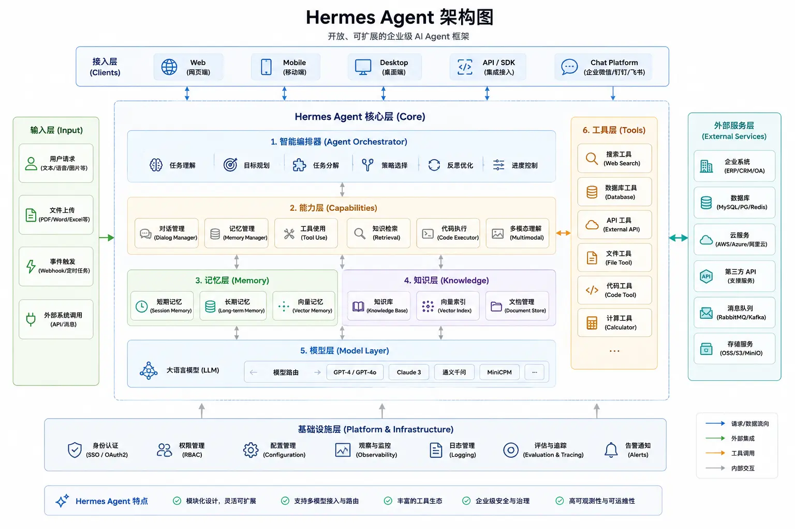

| **<font style="color:#000000;">模块</font>** | **<font style="color:#000000;">作用</font>** | **<font style="color:#000000;">示例</font>** |
| :--- | :--- | :--- |
| <font style="color:#000000;">接入层（Clients）</font> | <font style="color:#000000;">接收用户请求</font> | <font style="color:#000000;">Web、App、API、企微</font> |
| <font style="color:#000000;">输入层（Input）</font> | <font style="color:#000000;">处理各种输入数据</font> | <font style="color:#000000;">文本、图片、PDF、Excel</font> |
| <font style="color:#000000;">调度器（Agent Orchestrator）</font> | <font style="color:#000000;">理解任务并拆分执行流程</font> | <font style="color:#000000;">分析需求 → 制定计划</font> |
| <font style="color:#000000;">能力层（Capabilities）</font> | <font style="color:#000000;">提供执行能力</font> | <font style="color:#000000;">对话、检索、代码执行</font> |
| <font style="color:#000000;">记忆层（Memory）</font> | <font style="color:#000000;">保存上下文和历史信息</font> | <font style="color:#000000;">会话记忆、长期记忆</font> |
| <font style="color:#000000;">知识层（Knowledge）</font> | <font style="color:#000000;">提供知识检索能力</font> | <font style="color:#000000;">RAG、向量数据库</font> |
| <font style="color:#000000;">模型层（Model Layer）</font> | <font style="color:#000000;">提供推理能力</font> | <font style="color:#000000;">GPT、Claude、本地模型</font> |
| <font style="color:#000000;">工具层（Tools）</font> | <font style="color:#000000;">调用外部工具完成任务</font> | <font style="color:#000000;">搜索、数据库、API</font> |
| <font style="color:#000000;">外部服务层（External Services）</font> | <font style="color:#000000;">对接业务系统</font> | <font style="color:#000000;">ERP、CRM、云服务</font> |
| <font style="color:#000000;">基础设施层（Infrastructure）</font> | <font style="color:#000000;">支撑系统运行</font> | <font style="color:#000000;">权限、日志、监控</font> |


## <font style="color:#000000;">Hermes 安装指南</font>
<font style="color:#000000;">以下安装命令适用于 Linux、macOS 与 WSL2 系统：</font>

```plain
curl -fsSL https://raw.githubusercontent.com/NousResearch/hermes-agent/main/scripts/install.sh | bash
```

<font style="color:#000000;">安装程序会自动处理所有依赖项：</font>

+ **<font style="color:#000000;">uv</font>**<font style="color:#000000;"> — 快速 Python 包管理器</font>
+ **<font style="color:#000000;">Python 3.11</font>**<font style="color:#000000;"> — 通过 uv 安装，无需 sudo</font>
+ **<font style="color:#000000;">Node.js v22</font>**<font style="color:#000000;"> — 用于浏览器自动化和 WhatsApp 桥接</font>
+ **<font style="color:#000000;">ripgrep</font>**<font style="color:#000000;"> — 快速文件搜索</font>
+ **<font style="color:#000000;">ffmpeg</font>**<font style="color:#000000;"> — TTS 音频格式转换</font>

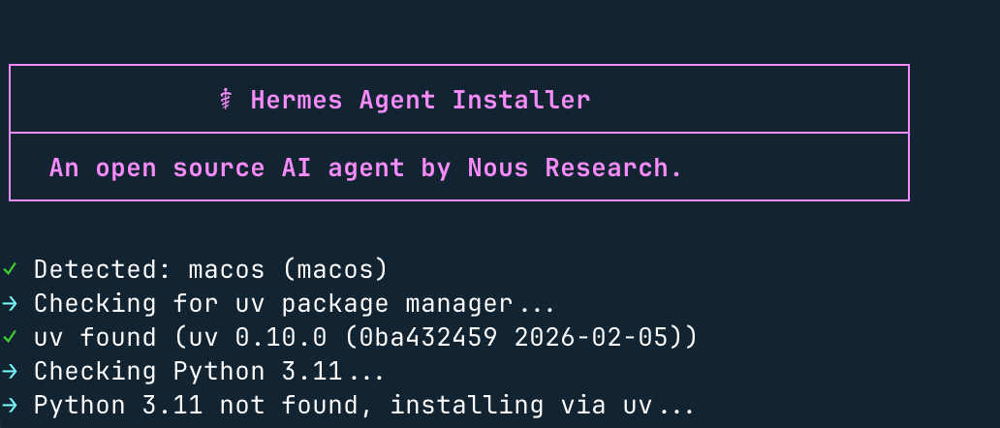

**<font style="color:#000000;">Windows 系统说明</font>**<font style="color:#000000;">：不支持原生 Windows 环境，请先安装 WSL2，再在 WSL2 终端中执行上述命令。</font>

<font style="color:#000000;">如果安装过 OpenClaw 还可以直接导入配置：</font>

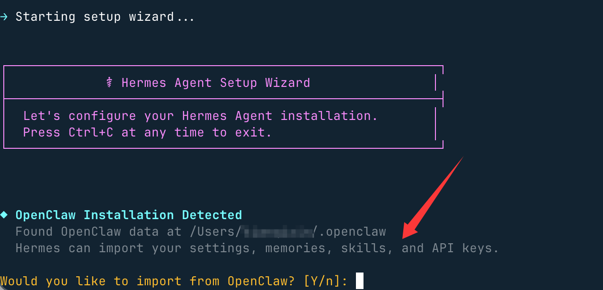

<font style="color:#000000;">这里选择不导入，输入 </font>`<font style="color:#000000;">n</font>`<font style="color:#000000;">，进入模型设置，选择第一个快速设置：</font>

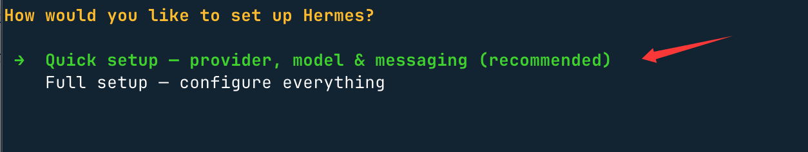

<font style="color:#000000;">接下来我们选择倒数第二项的 More providers：</font>

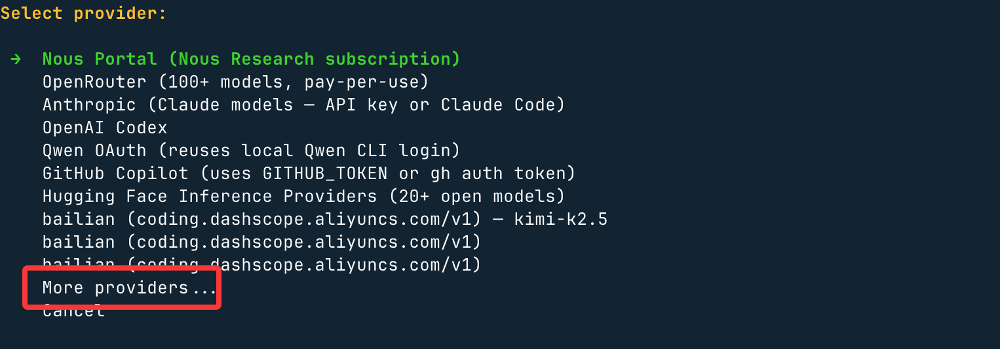

<font style="color:#000000;">这里可以选择更多国内或国际的大模型：</font>

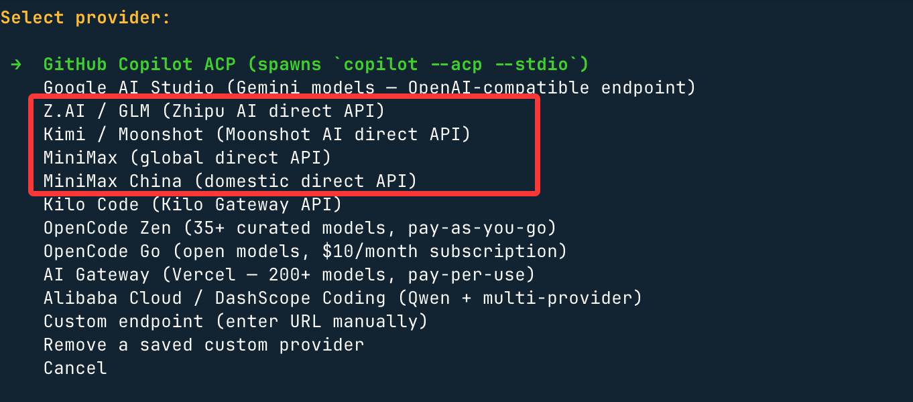

<font style="color:#000000;">以上选项本文使用的是百炼的 Coding Plan 所以选择的是 </font>**<font style="color:#000000;">Customer endpoint</font>**<font style="color:#000000;">，就是自定义 API 地址与 API key。</font>

<font style="color:#000000;">Base URL 设置百炼兼容 OpenAI 接口协议工具：</font>`<font style="color:#000000;">https://coding.dashscope.aliyuncs.com/v1</font>`

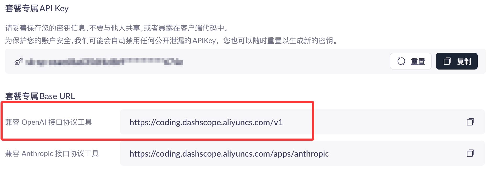

<font style="color:#000000;">设置 API key 与支持的大模型，比如 </font>`<font style="color:#000000;">kimi-k2.5</font>`<font style="color:#000000;">：</font>

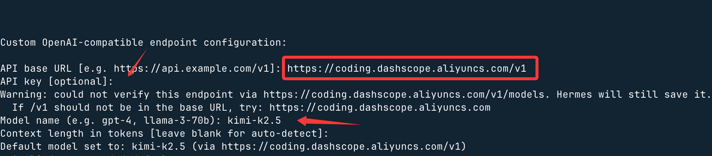

<font style="color:#000000;">安装完成后执行以下命令：</font>

```plain
source ~/.bashrc    # 重载shell配置（若使用zsh，执行：source ~/.zshrc）
hermes              # 开启智能体对话！
```

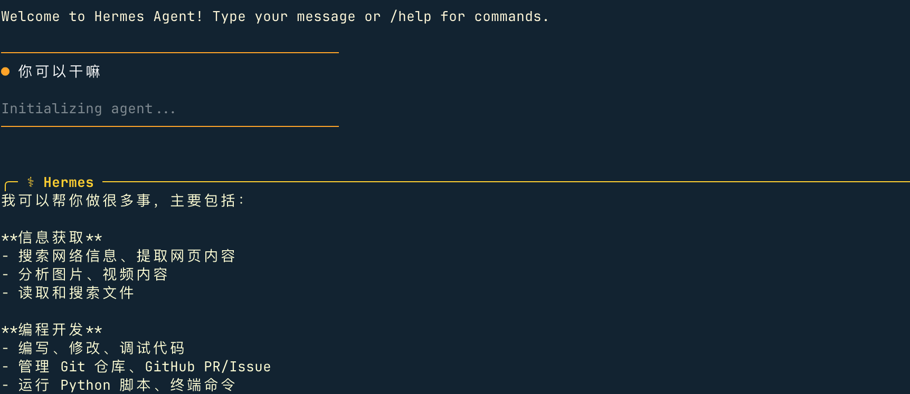

### <font style="color:#000000;">快速上手</font>
```plain
hermes              # 交互式命令行界面 — 开启对话
hermes model        # 选择大语言模型服务商与对应模型
hermes tools        # 配置启用的工具集
hermes config set   # 设置单项配置项
hermes gateway      # 启动消息网关（支持Telegram、Discord等平台）
hermes setup        # 运行全量配置向导（一站式完成所有配置）
hermes claw migrate # 从OpenClaw迁移数据（适用于原OpenClaw用户）
hermes update       # 更新至最新版本
hermes doctor       # 诊断运行环境与配置问题
```


### 手动安装
<font style="color:#000000;">如果您更喜欢完全控制安装过程，请按照以下步骤操作。</font>

### <font style="color:#000000;">步骤 1：克隆仓库</font>
<font style="color:#000000;">使用 </font>`<font style="color:#000000;">--recurse-submodules</font>`<font style="color:#000000;"> 克隆以获取所需的子模块：</font>

```plain
git clone --recurse-submodules https://github.com/NousResearch/hermes-agent.git
cd hermes-agent
```

<font style="color:#000000;">如果已经克隆但没有子模块：</font>

```plain
git submodule update --init --recursive
```

### <font style="color:#000000;">步骤 2：安装 uv 并创建虚拟环境</font>
```plain
# 安装 uv（如果尚未安装）
curl -LsSf https://astral.sh/uv/install.sh | sh

# 创建 Python 3.11 的虚拟环境（uv 会在需要时下载，无需 sudo）
uv venv venv --python 3.11
```

**<font style="color:#000000;">提示：</font>**<font style="color:#000000;">您</font>**<font style="color:#000000;">不需要</font>**<font style="color:#000000;">激活虚拟环境来使用 </font>`<font style="color:#000000;">hermes</font>`<font style="color:#000000;">。入口点有一个硬编码的 shebang 指向虚拟环境中的 Python，因此全局链接后即可使用。</font>

### <font style="color:#000000;">步骤 3：安装 Python 依赖</font>
```plain
# 告诉 uv 要安装到哪个虚拟环境
export VIRTUAL_ENV="$(pwd)/venv"

# 安装所有扩展
uv pip install -e ".[all]"
```

<font style="color:#000000;">如果您只想要核心智能体（不包含 Telegram/Discord/cron 支持）：</font>

```plain
uv pip install -e "."
```

**<font style="color:#000000;">可选扩展说明：</font>**

| **<font style="color:#000000;">扩展</font>** | **<font style="color:#000000;">功能</font>** | **<font style="color:#000000;">安装命令</font>** |
| :--- | :--- | :--- |
| `<font style="color:#000000;">all</font>` | <font style="color:#000000;">包含以下所有功能</font> | `<font style="color:#000000;">uv pip install -e ".[all]"</font>` |
| `<font style="color:#000000;">messaging</font>` | <font style="color:#000000;">Telegram 和 Discord 网关</font> | `<font style="color:#000000;">uv pip install -e ".[messaging]"</font>` |
| `<font style="color:#000000;">cron</font>` | <font style="color:#000000;">定时任务的 Cron 表达式解析</font> | `<font style="color:#000000;">uv pip install -e ".[cron]"</font>` |
| `<font style="color:#000000;">voice</font>` | <font style="color:#000000;">CLI 麦克风输入和音频播放</font> | `<font style="color:#000000;">uv pip install -e ".[voice]"</font>` |
| `<font style="color:#000000;">mcp</font>` | <font style="color:#000000;">模型上下文协议支持</font> | `<font style="color:#000000;">uv pip install -e ".[mcp]"</font>` |
| `<font style="color:#000000;">honcho</font>` | <font style="color:#000000;">AI 原生记忆（Honcho 集成）</font> | `<font style="color:#000000;">uv pip install -e ".[honcho]"</font>` |


<font style="color:#000000;">我们可以组合使用：</font>`<font style="color:#000000;">`uv pip install -e ".[messaging,cron]"`</font>`

### <font style="color:#000000;">步骤 4：创建配置目录</font>
```plain
# 创建目录结构
mkdir -p ~/.hermes/{cron,sessions,logs,memories,skills,pairing,hooks,image_cache,audio_cache,whatsapp/session}

# 复制示例配置文件
cp cli-config.yaml.example ~/.hermes/config.yaml

# 创建空的 .env 文件用于存储 API 密钥
touch ~/.hermes/.env
```

### <font style="color:#000000;">步骤 5：添加 API 密钥</font>
<font style="color:#000000;">打开 </font>`<font style="color:#000000;">~/.hermes/.env</font>`<font style="color:#000000;"> 并添加至少一个 LLM 提供商密钥：</font>

```plain
# 必需 — 至少一个 LLM 提供商：
OPENROUTER_API_KEY=sk-or-v1-your-key-here

# 可选 — 启用其他工具：
FIRECRAWL_API_KEY=fc-your-key          # 网页搜索和抓取
FAL_KEY=your-fal-key                   # 图像生成（FLUX）
```

<font style="color:#000000;">或者通过 CLI 设置：</font>

```plain
hermes config set OPENROUTER_API_KEY sk-or-v1-your-key-here
```

### <font style="color:#000000;">步骤 6：将 hermes 添加到 PATH</font>
```plain
mkdir -p ~/.local/bin
ln -sf "$(pwd)/venv/bin/hermes" ~/.local/bin/hermes
```

<font style="color:#000000;">如果 </font>`<font style="color:#000000;">~/.local/bin</font>`<font style="color:#000000;"> 不在 PATH 中，请添加到 shell 配置：</font>

```plain
# Bash
echo 'export PATH="$HOME/.local/bin:$PATH"' >> ~/.bashrc && source ~/.bashrc

# Zsh
echo 'export PATH="$HOME/.local/bin:$PATH"' >> ~/.zshrc && source ~/.zshrc
```

### <font style="color:#000000;">步骤 7：配置您的提供商</font>
```plain
hermes model       # 选择您的 LLM 提供商和模型
```

### <font style="color:#000000;">步骤 8：验证安装</font>
```plain
hermes version    # 检查命令是否可用
hermes doctor     # 运行诊断以验证一切正常
hermes status     # 检查您的配置
hermes chat -q "Hello! What tools do you have available?"
```

### <font style="color:#000000;">故障排除</font>
| **<font style="color:#000000;">问题</font>** | **<font style="color:#000000;">解决方案</font>** |
| :--- | :--- |
| `<font style="color:#000000;">hermes: command not found</font>` | <font style="color:#000000;">重新加载 shell（</font>`<font style="color:#000000;">source ~/.bashrc</font>`<br/><font style="color:#000000;">）或检查 PATH</font> |
| <font style="color:#000000;">API 密钥未设置</font> | <font style="color:#000000;">运行</font><font style="color:#000000;"> </font>`<font style="color:#000000;">hermes model</font>`<br/><font style="color:#000000;"> </font><font style="color:#000000;">配置提供商，或</font><font style="color:#000000;"> </font>`<font style="color:#000000;">hermes config set OPENROUTER_API_KEY your_key</font>` |
| <font style="color:#000000;">更新后配置丢失</font> | <font style="color:#000000;">运行</font><font style="color:#000000;"> </font>`<font style="color:#000000;">hermes config check</font>`<br/><font style="color:#000000;"> </font><font style="color:#000000;">然后</font><font style="color:#000000;"> </font>`<font style="color:#000000;">hermes config migrate</font>` |


<font style="color:#000000;">如需更多诊断信息，运行 </font>`<font style="color:#000000;">hermes doctor</font>`<font style="color:#000000;"> — 它会告诉您缺少什么以及如何修复。</font>

**<font style="color:#000000;">提示：</font>**<font style="color:#000000;">您可以随时通过 </font>`<font style="color:#000000;">hermes model</font>`<font style="color:#000000;"> 切换提供商——无需更改代码，没有锁定。</font>

<font style="color:#000000;"></font>

## <font style="color:#000000;">Hermes CLI 命令行</font>
<font style="color:rgb(51, 51, 51);">Hermes Agent 的 CLI 是一个完整的终端用户界面（TUI）—— 不是网页 UI。它支持多行编辑、斜杠命令自动补全、对话历史记录、中断并重定向，以及工具输出的流式传输。专为长期在终端中工作的人设计。</font>

### <font style="color:rgb(51, 51, 51);">运行 CLI</font>
```plain
hermes


hermes chat -q "Hello"


hermes chat --model "anthropic/claude-sonnet-4"


hermes chat --provider nous        
hermes chat --provider openrouter  


hermes chat --toolsets "web,terminal,skills"


hermes -s hermes-agent-dev,github-auth
hermes chat -s github-pr-workflow -q "open a draft PR"


hermes --continue             
hermes --resume <session_id>  


hermes chat --verbose


hermes -w                         
hermes -w -q "Fix issue #123"
```

### <font style="color:rgb(51, 51, 51);">界面布局</font>
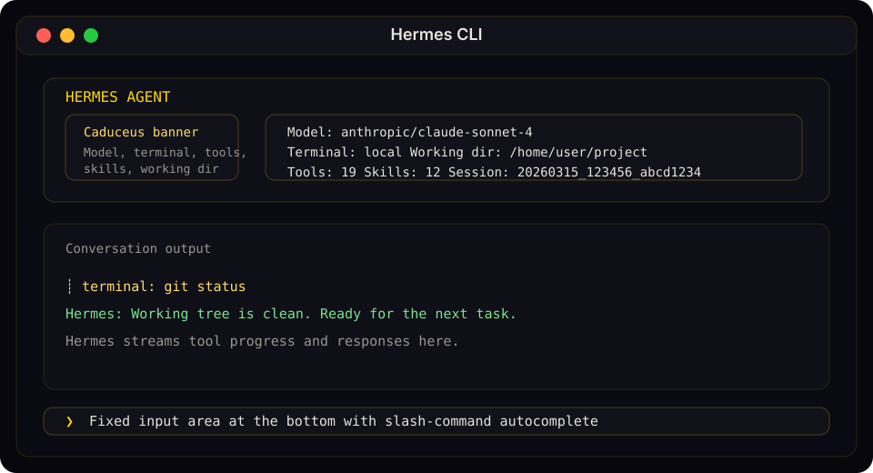

<font style="color:rgb(51, 51, 51);">Hermes CLI 的欢迎横幅、对话流和固定输入提示以稳定文档图示形式呈现，而非脆弱的文本艺术。</font>

<font style="color:rgb(51, 51, 51);">欢迎横幅会一目了然地显示你的模型、终端后端、工作目录、可用工具以及已安装的技能。</font>

#### <font style="color:rgb(51, 51, 51);">状态栏</font>
<font style="color:rgb(51, 51, 51);">一个持久的状态栏位于输入区域上方，实时更新：</font>

```plain
⚕ claude-sonnet-4-20250514 │ 12.4K/200K │ [██████░░░░] 6% │ $0.06 │ 15m
```

| **<font style="color:rgb(51, 51, 51);">元素</font>** | **<font style="color:rgb(51, 51, 51);">说明</font>** |
| :--- | :--- |
| <font style="color:rgb(51, 51, 51);">模型名称</font> | <font style="color:rgb(51, 51, 51);">当前使用的模型（超过 26 个字符时截断）</font> |
| <font style="color:rgb(51, 51, 51);">Token 数量</font> | <font style="color:rgb(51, 51, 51);">已使用上下文 token / 最大上下文窗口</font> |
| <font style="color:rgb(51, 51, 51);">上下文条</font> | <font style="color:rgb(51, 51, 51);">带有颜色编码阈值的视觉填充指示器</font> |
| <font style="color:rgb(51, 51, 51);">成本</font> | <font style="color:rgb(51, 51, 51);">估算的会话成本（或</font><font style="color:rgb(51, 51, 51);"> </font>`<font style="color:rgb(51, 51, 51);background-color:rgb(243, 244, 244);">n/a</font>`<br/><font style="color:rgb(51, 51, 51);"> </font><font style="color:rgb(51, 51, 51);">表示未知 / 零成本模型）</font> |
| <font style="color:rgb(51, 51, 51);">时长</font> | <font style="color:rgb(51, 51, 51);">会话已持续时间</font> |


<font style="color:rgb(51, 51, 51);">该栏位会根据终端宽度自适应：≥76 列时显示完整布局，52–75 列时为紧凑模式，低于 52 列时仅显示模型名与时长。</font>

**<font style="color:rgb(51, 51, 51);">上下文颜色编码：</font>**

| **<font style="color:rgb(51, 51, 51);">颜色</font>** | **<font style="color:rgb(51, 51, 51);">阈值</font>** | **<font style="color:rgb(51, 51, 51);">含义</font>** |
| :--- | :--- | :--- |
| <font style="color:rgb(51, 51, 51);">绿色</font> | <font style="color:rgb(51, 51, 51);">< 50%</font> | <font style="color:rgb(51, 51, 51);">空间充足</font> |
| <font style="color:rgb(51, 51, 51);">黄色</font> | <font style="color:rgb(51, 51, 51);">50–80%</font> | <font style="color:rgb(51, 51, 51);">逐渐填满</font> |
| <font style="color:rgb(51, 51, 51);">橙色</font> | <font style="color:rgb(51, 51, 51);">80–95%</font> | <font style="color:rgb(51, 51, 51);">接近上限</font> |
| <font style="color:rgb(51, 51, 51);">红色</font> | <font style="color:rgb(51, 51, 51);">≥ 95%</font> | <font style="color:rgb(51, 51, 51);">即将溢出 — 考虑</font><font style="color:rgb(51, 51, 51);"> </font>`<font style="color:rgb(51, 51, 51);background-color:rgb(243, 244, 244);">/compress</font>` |


<font style="color:rgb(51, 51, 51);">使用 </font>`<font style="color:rgb(51, 51, 51);background-color:rgb(243, 244, 244);">/usage</font>`<font style="color:rgb(51, 51, 51);"> 可获取详细分析，包括各分类成本（输入 vs 输出 token）。</font>

#### <font style="color:rgb(51, 51, 51);">会话恢复显示</font>
<font style="color:rgb(51, 51, 51);">当恢复之前的会话（</font>`<font style="color:rgb(51, 51, 51);background-color:rgb(243, 244, 244);">hermes -c</font>`<font style="color:rgb(51, 51, 51);"> 或 </font>`<font style="color:rgb(51, 51, 51);background-color:rgb(243, 244, 244);">hermes --resume <id></font>`<font style="color:rgb(51, 51, 51);">）时，会在横幅与输入提示之间出现 “上一次对话” 面板，展示对话历史的简洁摘要。详情请参见 </font>[<font style="color:rgb(65, 131, 196);">会话 — 恢复时的对话摘要</font>](https://www.majiabin.com/hermes/user-guide/sessions#conversation-recap-on-resume)<font style="color:rgb(51, 51, 51);"> 及相关配置。</font>

### <font style="color:rgb(51, 51, 51);">快捷键</font>
| **<font style="color:rgb(51, 51, 51);">快捷键</font>** | **<font style="color:rgb(51, 51, 51);">动作</font>** |
| :--- | :--- |
| `<font style="color:rgb(51, 51, 51);background-color:rgb(243, 244, 244);">Enter</font>` | <font style="color:rgb(51, 51, 51);">发送消息</font> |
| `<font style="color:rgb(51, 51, 51);background-color:rgb(243, 244, 244);">Alt+Enter</font>`<br/><font style="color:rgb(51, 51, 51);"> </font><font style="color:rgb(51, 51, 51);">或</font><font style="color:rgb(51, 51, 51);"> </font>`<font style="color:rgb(51, 51, 51);background-color:rgb(243, 244, 244);">Ctrl+J</font>` | <font style="color:rgb(51, 51, 51);">新建一行（多行输入）</font> |
| `<font style="color:rgb(51, 51, 51);background-color:rgb(243, 244, 244);">Alt+V</font>` | <font style="color:rgb(51, 51, 51);">在终端支持的情况下从剪贴板粘贴图像</font> |
| `<font style="color:rgb(51, 51, 51);background-color:rgb(243, 244, 244);">Ctrl+V</font>` | <font style="color:rgb(51, 51, 51);">粘贴文本，并在可能时附带剪贴板中的图像</font> |
| `<font style="color:rgb(51, 51, 51);background-color:rgb(243, 244, 244);">Ctrl+B</font>` | <font style="color:rgb(51, 51, 51);">在启用语音模式时开始 / 停止录音（</font>`<font style="color:rgb(51, 51, 51);background-color:rgb(243, 244, 244);">voice.record_key</font>`<br/><font style="color:rgb(51, 51, 51);">，默认：</font>`<font style="color:rgb(51, 51, 51);background-color:rgb(243, 244, 244);">ctrl+b</font>`<br/><font style="color:rgb(51, 51, 51);">）</font> |
| `<font style="color:rgb(51, 51, 51);background-color:rgb(243, 244, 244);">Ctrl+C</font>` | <font style="color:rgb(51, 51, 51);">中断代理（双击 within 2 秒内强制退出）</font> |
| `<font style="color:rgb(51, 51, 51);background-color:rgb(243, 244, 244);">Ctrl+D</font>` | <font style="color:rgb(51, 51, 51);">退出</font> |
| `<font style="color:rgb(51, 51, 51);background-color:rgb(243, 244, 244);">Ctrl+Z</font>` | <font style="color:rgb(51, 51, 51);">将 Hermes 暂停至后台（仅 Unix 系统）。在 shell 中运行</font><font style="color:rgb(51, 51, 51);"> </font>`<font style="color:rgb(51, 51, 51);background-color:rgb(243, 244, 244);">fg</font>`<br/><font style="color:rgb(51, 51, 51);"> </font><font style="color:rgb(51, 51, 51);">以恢复。</font> |
| `<font style="color:rgb(51, 51, 51);background-color:rgb(243, 244, 244);">Tab</font>` | <font style="color:rgb(51, 51, 51);">接受自动建议（幽灵文本）或补全斜杠命令</font> |


### <font style="color:rgb(51, 51, 51);">斜杠命令</font>
<font style="color:rgb(51, 51, 51);">输入 </font>`<font style="color:rgb(51, 51, 51);background-color:rgb(243, 244, 244);">/</font>`<font style="color:rgb(51, 51, 51);"> 可查看自动补全下拉菜单。Hermes 支持大量内置 CLI 斜杠命令、动态技能命令及用户自定义快捷命令。</font>

<font style="color:rgb(51, 51, 51);">常见示例：</font>

| **<font style="color:rgb(51, 51, 51);">命令</font>** | **<font style="color:rgb(51, 51, 51);">说明</font>** |
| :--- | :--- |
| `<font style="color:rgb(51, 51, 51);background-color:rgb(243, 244, 244);">/help</font>` | <font style="color:rgb(51, 51, 51);">显示命令帮助</font> |
| `<font style="color:rgb(51, 51, 51);background-color:rgb(243, 244, 244);">/model</font>` | <font style="color:rgb(51, 51, 51);">显示或更改当前模型</font> |
| `<font style="color:rgb(51, 51, 51);background-color:rgb(243, 244, 244);">/tools</font>` | <font style="color:rgb(51, 51, 51);">列出当前可用工具</font> |
| `<font style="color:rgb(51, 51, 51);background-color:rgb(243, 244, 244);">/skills browse</font>` | <font style="color:rgb(51, 51, 51);">浏览技能中心及官方可选技能</font> |
| `<font style="color:rgb(51, 51, 51);background-color:rgb(243, 244, 244);">/background <prompt></font>` | <font style="color:rgb(51, 51, 51);">在独立后台会话中运行提示</font> |
| `<font style="color:rgb(51, 51, 51);background-color:rgb(243, 244, 244);">/skin</font>` | <font style="color:rgb(51, 51, 51);">显示或切换当前 CLI 皮肤</font> |
| `<font style="color:rgb(51, 51, 51);background-color:rgb(243, 244, 244);">/voice on</font>` | <font style="color:rgb(51, 51, 51);">启用 CLI 语音模式（按</font><font style="color:rgb(51, 51, 51);"> </font>`<font style="color:rgb(51, 51, 51);background-color:rgb(243, 244, 244);">Ctrl+B</font>`<br/><font style="color:rgb(51, 51, 51);"> </font><font style="color:rgb(51, 51, 51);">开始录音）</font> |
| `<font style="color:rgb(51, 51, 51);background-color:rgb(243, 244, 244);">/voice tts</font>` | <font style="color:rgb(51, 51, 51);">切换赫尔梅斯回复的语音播放</font> |
| `<font style="color:rgb(51, 51, 51);background-color:rgb(243, 244, 244);">/reasoning high</font>` | <font style="color:rgb(51, 51, 51);">提高推理努力程度</font> |
| `<font style="color:rgb(51, 51, 51);background-color:rgb(243, 244, 244);">/title My Session</font>` | <font style="color:rgb(51, 51, 51);">为当前会话命名</font> |


<font style="color:rgb(51, 51, 51);">完整内置 CLI 和消息命令列表，请参阅 </font>[<font style="color:rgb(65, 131, 196);">斜杠命令参考</font>](https://www.majiabin.com/hermes/reference/slash-commands)<font style="color:rgb(51, 51, 51);">。</font>

<font style="color:rgb(51, 51, 51);">关于设置、提供商、静音调优，以及消息平台 / Discord 语音使用，请参见 </font>[<font style="color:rgb(65, 131, 196);">语音模式</font>](https://www.majiabin.com/hermes/user-guide/features/voice-mode)<font style="color:rgb(51, 51, 51);">。</font>

<font style="color:rgb(51, 51, 51);">tip</font>

<font style="color:rgb(51, 51, 51);">命令不区分大小写 — </font>`<font style="color:rgb(51, 51, 51);background-color:rgb(243, 244, 244);">/HELP</font>`<font style="color:rgb(51, 51, 51);"> 与 </font>`<font style="color:rgb(51, 51, 51);background-color:rgb(243, 244, 244);">/help</font>`<font style="color:rgb(51, 51, 51);"> 效果相同。已安装的技能也会自动成为斜杠命令。</font>

### <font style="color:rgb(51, 51, 51);">快捷命令</font>
<font style="color:rgb(51, 51, 51);">你可以定义自定义命令，无需调用 LLM 即可立即执行 shell 命令。这些命令在 CLI 和消息平台（Telegram、Discord 等）中均适用。</font>

```plain
quick_commands:
  status:
    type: exec
    command: systemctl status hermes-agent
  gpu:
    type: exec
    command: nvidia-smi --query-gpu=utilization.gpu,memory.used --format=csv,noheader
```

<font style="color:rgb(51, 51, 51);">然后在任意聊天中输入 </font>`<font style="color:rgb(51, 51, 51);background-color:rgb(243, 244, 244);">/status</font>`<font style="color:rgb(51, 51, 51);"> 或 </font>`<font style="color:rgb(51, 51, 51);background-color:rgb(243, 244, 244);">/gpu</font>`<font style="color:rgb(51, 51, 51);">。更多示例请参见 </font>[<font style="color:rgb(65, 131, 196);">配置指南</font>](https://www.majiabin.com/hermes/user-guide/configuration#quick-commands)<font style="color:rgb(51, 51, 51);"> 。</font>

### <font style="color:rgb(51, 51, 51);">启动时预加载技能</font>
<font style="color:rgb(51, 51, 51);">如果你已知本次会话需要激活哪些技能，可在启动时直接指定：</font>

```plain
hermes -s hermes-agent-dev,github-auth
hermes chat -s github-pr-workflow -s github-auth
```

<font style="color:rgb(51, 51, 51);">Hermes 会在首次交互前将每个命名技能加载到会话提示中。此标志在交互模式和单次查询模式下均有效。</font>

### <font style="color:rgb(51, 51, 51);">技能斜杠命令</font>
`<font style="color:rgb(51, 51, 51);background-color:rgb(243, 244, 244);">~/.hermes/skills/</font>`<font style="color:rgb(51, 51, 51);"> 中安装的每个技能都会自动注册为斜杠命令。技能名称即为命令名：</font>

```plain
/gif-search funny cats
/axolotl help me fine-tune Llama 3 on my dataset
/github-pr-workflow create a PR for the auth refactor

# Just the skill name loads it and lets the agent ask what you need:
/excalidraw
```

### <font style="color:rgb(51, 51, 51);">人格设定</font>
<font style="color:rgb(51, 51, 51);">设置预设人格以改变代理的语气：</font>

```plain
/personality pirate
/personality kawaii
/personality concise
```

<font style="color:rgb(51, 51, 51);">内置人格包括：</font>`<font style="color:rgb(51, 51, 51);background-color:rgb(243, 244, 244);">helpful</font>`<font style="color:rgb(51, 51, 51);">、</font>`<font style="color:rgb(51, 51, 51);background-color:rgb(243, 244, 244);">concise</font>`<font style="color:rgb(51, 51, 51);">、</font>`<font style="color:rgb(51, 51, 51);background-color:rgb(243, 244, 244);">technical</font>`<font style="color:rgb(51, 51, 51);">、</font>`<font style="color:rgb(51, 51, 51);background-color:rgb(243, 244, 244);">creative</font>`<font style="color:rgb(51, 51, 51);">、</font>`<font style="color:rgb(51, 51, 51);background-color:rgb(243, 244, 244);">teacher</font>`<font style="color:rgb(51, 51, 51);">、</font>`<font style="color:rgb(51, 51, 51);background-color:rgb(243, 244, 244);">kawaii</font>`<font style="color:rgb(51, 51, 51);">、</font>`<font style="color:rgb(51, 51, 51);background-color:rgb(243, 244, 244);">catgirl</font>`<font style="color:rgb(51, 51, 51);">、</font>`<font style="color:rgb(51, 51, 51);background-color:rgb(243, 244, 244);">pirate</font>`<font style="color:rgb(51, 51, 51);">、</font>`<font style="color:rgb(51, 51, 51);background-color:rgb(243, 244, 244);">shakespeare</font>`<font style="color:rgb(51, 51, 51);">、</font>`<font style="color:rgb(51, 51, 51);background-color:rgb(243, 244, 244);">surfer</font>`<font style="color:rgb(51, 51, 51);">、</font>`<font style="color:rgb(51, 51, 51);background-color:rgb(243, 244, 244);">noir</font>`<font style="color:rgb(51, 51, 51);">、</font>`<font style="color:rgb(51, 51, 51);background-color:rgb(243, 244, 244);">uwu</font>`<font style="color:rgb(51, 51, 51);">、</font>`<font style="color:rgb(51, 51, 51);background-color:rgb(243, 244, 244);">philosopher</font>`<font style="color:rgb(51, 51, 51);">、</font>`<font style="color:rgb(51, 51, 51);background-color:rgb(243, 244, 244);">hype</font>`<font style="color:rgb(51, 51, 51);">。</font>

<font style="color:rgb(51, 51, 51);">你也可以在 </font>`<font style="color:rgb(51, 51, 51);background-color:rgb(243, 244, 244);">~/.hermes/config.yaml</font>`<font style="color:rgb(51, 51, 51);"> 中定义自定义人格：</font>

```plain
personalities:
  helpful: "You are a helpful, friendly AI assistant."
  kawaii: "You are a kawaii assistant! Use cute expressions..."
  pirate: "Arrr! Ye be talkin' to Captain Hermes..."
```

### <font style="color:rgb(51, 51, 51);">多行输入</font>
<font style="color:rgb(51, 51, 51);">有两种方式输入多行消息：</font>

1. `**<font style="color:rgb(51, 51, 51);background-color:rgb(243, 244, 244);">Alt+Enter</font>**`**<font style="color:rgb(51, 51, 51);"> 或 </font>**`**<font style="color:rgb(51, 51, 51);background-color:rgb(243, 244, 244);">Ctrl+J</font>**`<font style="color:rgb(51, 51, 51);"> — 插入新行</font>
2. **<font style="color:rgb(51, 51, 51);">反斜杠续行</font>**<font style="color:rgb(51, 51, 51);"> — 以 </font>`<font style="color:rgb(51, 51, 51);background-color:rgb(243, 244, 244);">\</font>`<font style="color:rgb(51, 51, 51);"> 结尾，继续下一行：</font>

```plain
❯ Write a function that:\
  1. Takes a list of numbers\
  2. Returns the sum
```

<font style="color:rgb(51, 51, 51);">info</font>

<font style="color:rgb(51, 51, 51);">支持粘贴多行文本 — 使用 </font>`<font style="color:rgb(51, 51, 51);background-color:rgb(243, 244, 244);">Alt+Enter</font>`<font style="color:rgb(51, 51, 51);"> 或 </font>`<font style="color:rgb(51, 51, 51);background-color:rgb(243, 244, 244);">Ctrl+J</font>`<font style="color:rgb(51, 51, 51);"> 插入换行符，或直接粘贴内容。</font>

### <font style="color:rgb(51, 51, 51);">中断代理</font>
<font style="color:rgb(51, 51, 51);">你可以在任何时候中断代理：</font>

+ **<font style="color:rgb(51, 51, 51);">在代理运行时输入新消息 + Enter</font>**<font style="color:rgb(51, 51, 51);"> — 会中断当前操作并处理你的新指令</font>
+ `**<font style="color:rgb(51, 51, 51);background-color:rgb(243, 244, 244);">Ctrl+C</font>**`<font style="color:rgb(51, 51, 51);"> — 中断当前操作（双击 within 2 秒内强制退出）</font>
+ <font style="color:rgb(51, 51, 51);">正在进行的终端命令会被立即终止（发送 SIGTERM，1 秒后若未结束则发送 SIGKILL）</font>
+ <font style="color:rgb(51, 51, 51);">中断期间输入的多条消息将合并为一条提示</font>

#### <font style="color:rgb(51, 51, 51);">忙碌输入模式</font>
`<font style="color:rgb(51, 51, 51);background-color:rgb(243, 244, 244);">display.busy_input_mode</font>`<font style="color:rgb(51, 51, 51);"> 配置项控制你在代理工作时按下 Enter 的行为：</font>

| **<font style="color:rgb(51, 51, 51);">模式</font>** | **<font style="color:rgb(51, 51, 51);">行为</font>** |
| :--- | :--- |
| `<font style="color:rgb(51, 51, 51);background-color:rgb(243, 244, 244);">"interrupt"</font>`<br/><font style="color:rgb(51, 51, 51);">（默认）</font> | <font style="color:rgb(51, 51, 51);">你的消息会中断当前操作并立即处理</font> |
| `<font style="color:rgb(51, 51, 51);background-color:rgb(243, 244, 244);">"queue"</font>` | <font style="color:rgb(51, 51, 51);">你的消息被静默排队，代理完成后作为下一回合发送</font> |


```plain
display:
  busy_input_mode: "queue"
```

<font style="color:rgb(51, 51, 51);">队列模式适用于你想准备后续消息而不意外取消正在进行的工作。未知值将回退至 </font>`<font style="color:rgb(51, 51, 51);background-color:rgb(243, 244, 244);">"interrupt"</font>`<font style="color:rgb(51, 51, 51);">。</font>

#### <font style="color:rgb(51, 51, 51);">暂停至后台</font>
<font style="color:rgb(51, 51, 51);">在 Unix 系统上，按 </font>`**<font style="color:rgb(51, 51, 51);background-color:rgb(243, 244, 244);">Ctrl+Z</font>**`<font style="color:rgb(51, 51, 51);"> 可将 Hermes 暂停至后台 — 与任何终端进程相同。shell 会打印确认信息：</font>

```plain
Hermes Agent has been suspended. Run `fg` to bring Hermes Agent back.
```

<font style="color:rgb(51, 51, 51);">在 shell 中输入 </font>`<font style="color:rgb(51, 51, 51);background-color:rgb(243, 244, 244);">fg</font>`<font style="color:rgb(51, 51, 51);"> 以从你离开的位置恢复会话。Windows 不支持此功能。</font>

### <font style="color:rgb(51, 51, 51);">工具进度显示</font>
<font style="color:rgb(51, 51, 51);">CLI 会在代理工作时提供动画反馈：</font>

**<font style="color:rgb(51, 51, 51);">思考动画</font>**<font style="color:rgb(51, 51, 51);">（API 调用期间）：</font>

```plain
◜ (｡•́︿•̀｡) pondering... (1.2s)
  ◠ (⊙_⊙) contemplating... (2.4s)
  ✧٩(ˊᗜˋ*)و✧ got it! (3.1s)
```

**<font style="color:rgb(51, 51, 51);">工具执行流程：</font>**

```plain
┊ 💻 terminal `ls -la` (0.3s)
  ┊ 🔍 web_search (1.2s)
  ┊ 📄 web_extract (2.1s)
```

<font style="color:rgb(51, 51, 51);">通过 </font>`<font style="color:rgb(51, 51, 51);background-color:rgb(243, 244, 244);">/verbose</font>`<font style="color:rgb(51, 51, 51);"> 切换显示模式：</font>`<font style="color:rgb(51, 51, 51);background-color:rgb(243, 244, 244);">off → new → all → verbose</font>`<font style="color:rgb(51, 51, 51);">。该命令也可在消息平台启用 — 详见 </font>[<font style="color:rgb(65, 131, 196);">配置</font>](https://www.majiabin.com/hermes/user-guide/configuration#display-settings)<font style="color:rgb(51, 51, 51);"> 。</font>

#### <font style="color:rgb(51, 51, 51);">工具预览长度</font>
`<font style="color:rgb(51, 51, 51);background-color:rgb(243, 244, 244);">display.tool_preview_length</font>`<font style="color:rgb(51, 51, 51);"> 配置项控制工具调用预览行中显示的最大字符数（如文件路径、终端命令）。默认为 </font>`<font style="color:rgb(51, 51, 51);background-color:rgb(243, 244, 244);">0</font>`<font style="color:rgb(51, 51, 51);">，表示无限制 — 完整路径和命令将全部显示。</font>

```plain
display:
  tool_preview_length: 80
```

<font style="color:rgb(51, 51, 51);">这在窄终端或工具参数包含超长文件路径时非常有用。</font>

### <font style="color:rgb(51, 51, 51);">会话管理</font>
#### <font style="color:rgb(51, 51, 51);">恢复会话</font>
<font style="color:rgb(51, 51, 51);">退出 CLI 会话时，系统会打印恢复命令：</font>

```plain
Resume this session with:
  hermes --resume 20260225_143052_a1b2c3

Session:        20260225_143052_a1b2c3
Duration:       12m 34s
Messages:       28 (5 user, 18 tool calls)
```

<font style="color:rgb(51, 51, 51);">恢复选项：</font>

```plain
hermes --continue                          
hermes -c                                  
hermes -c "my project"                     
hermes --resume 20260225_143052_a1b2c3     
hermes --resume "refactoring auth"         
hermes -r 20260225_143052_a1b2c3           
```恢复功能可从 SQLite 数据库中还原完整的对话历史。代理将看到所有之前的讯息、工具调用和回复——就像你从未离开过一样。

在聊天中使用 ``/title My Session Name`` 来命名当前会话，或在命令行中使用 ``hermes sessions rename <id> <title>``。使用 ``hermes sessions list`` 浏览过往会话。


CLI 会话存储在 Hermes 的 SQLite 状态数据库中的 ``~/.hermes/state.db`` 下。该数据库保存：

- 会话元数据（ID、标题、时间戳、token 计数器）
- 消息历史记录
- 压缩/恢复会话之间的传承关系
- 被 ``session_search`` 使用的全文搜索索引

某些消息适配器还会在数据库之外保留平台相关的对话文件，但 CLI 本身是从 SQLite 会话存储中恢复的。


当对话接近上下文限制时，长对话会自动被摘要：

````yaml

compression:
  enabled: true
  threshold: 0.50    


auxiliary:
  compression:
    model: "google/gemini-3-flash-preview"
```

<font style="color:rgb(51, 51, 51);">触发压缩时，中间的对话回合会被摘要，而最前的 3 个回合和最后的 4 个回合始终会被保留。</font>

### <font style="color:rgb(51, 51, 51);">后台会话</font>
<font style="color:rgb(51, 51, 51);">在后台运行一个提示任务，同时继续使用 CLI 处理其他工作：</font>

```plain
/background Analyze the logs in /var/log and summarize any errors from today
```

<font style="color:rgb(51, 51, 51);">Hermes 会立即确认任务并返回提示：</font>

```plain
🔄 Background task #1 started: "Analyze the logs in /var/log and summarize..."
   Task ID: bg_143022_a1b2c3
```

#### <font style="color:rgb(51, 51, 51);">工作原理</font>
<font style="color:rgb(51, 51, 51);">每个 </font>`<font style="color:rgb(51, 51, 51);background-color:rgb(243, 244, 244);">/background</font>`<font style="color:rgb(51, 51, 51);"> 提示都会在一个守护线程中启动一个</font>**<font style="color:rgb(51, 51, 51);">完全独立的代理会话</font>**<font style="color:rgb(51, 51, 51);">：</font>

+ **<font style="color:rgb(51, 51, 51);">独立对话</font>**<font style="color:rgb(51, 51, 51);"> —— 后台代理对当前会话的历史一无所知。它仅接收你提供的提示。</font>
+ **<font style="color:rgb(51, 51, 51);">相同配置</font>**<font style="color:rgb(51, 51, 51);"> —— 后台代理继承当前会话的模型、提供商、工具集、推理设置和备用模型。</font>
+ **<font style="color:rgb(51, 51, 51);">非阻塞</font>**<font style="color:rgb(51, 51, 51);"> —— 你的前台会话保持完全可交互状态。你可以继续聊天、执行命令，甚至启动更多后台任务。</font>
+ **<font style="color:rgb(51, 51, 51);">多任务并发</font>**<font style="color:rgb(51, 51, 51);"> —— 可同时运行多个后台任务，每个任务都有编号 ID。</font>

#### <font style="color:rgb(51, 51, 51);">结果</font>
<font style="color:rgb(51, 51, 51);">当后台任务完成时，结果将以终端面板形式呈现：</font>

```plain
╭─ ⚕ Hermes (background #1) ──────────────────────────────────╮
│ Found 3 errors in syslog from today:                         │
│ 1. OOM killer invoked at 03:22 — killed process nginx        │
│ 2. Disk I/O error on /dev/sda1 at 07:15                      │
│ 3. Failed SSH login attempts from 192.168.1.50 at 14:30      │
╰──────────────────────────────────────────────────────────────╯
```

<font style="color:rgb(51, 51, 51);">如果任务失败，你会看到错误通知。若你的配置中启用了 </font>`<font style="color:rgb(51, 51, 51);background-color:rgb(243, 244, 244);">display.bell_on_complete</font>`<font style="color:rgb(51, 51, 51);">，任务完成后终端铃声会响起。</font>

#### <font style="color:rgb(51, 51, 51);">使用场景</font>
+ **<font style="color:rgb(51, 51, 51);">长时间研究</font>**<font style="color:rgb(51, 51, 51);"> —— 在编写代码的同时执行 “/background research the latest developments in quantum error correction”</font>
+ **<font style="color:rgb(51, 51, 51);">文件处理</font>**<font style="color:rgb(51, 51, 51);"> —— 在继续对话的同时执行 “/background analyze all Python files in this repo and list any security issues”</font>
+ **<font style="color:rgb(51, 51, 51);">并行调查</font>**<font style="color:rgb(51, 51, 51);"> —— 同时启动多个后台任务，从不同角度探索问题</font>

<font style="color:rgb(51, 51, 51);">info</font>

<font style="color:rgb(51, 51, 51);">后台会话不会出现在主对话历史中。它们是独立的会话，拥有自己的任务 ID（例如 </font>`<font style="color:rgb(51, 51, 51);background-color:rgb(243, 244, 244);">bg_143022_a1b2c3</font>`<font style="color:rgb(51, 51, 51);">）。</font>

### <font style="color:rgb(51, 51, 51);">静音模式</font>
<font style="color:rgb(51, 51, 51);">默认情况下，CLI 以静音模式运行，具备以下特性：</font>

+ <font style="color:rgb(51, 51, 51);">抑制工具的详细日志输出</font>
+ <font style="color:rgb(51, 51, 51);">启用可爱的动画反馈效果</font>
+ <font style="color:rgb(51, 51, 51);">保持输出简洁友好</font>

<font style="color:rgb(51, 51, 51);">如需调试输出：</font>


## Hermes 桌面版
Hermes Desktop 是一个桌面应用，用于通过原生桌面界面安装、配置并与 [Hermes Agent](https://github.com/NousResearch/hermes-agent) 进行交互。

它把安装、提供商配置和日常使用整合到同一个图形界面中，而不是要求你手动维护 CLI。应用会调用官方 Hermes 安装脚本，将 Hermes 存储在 `~/.hermes` 中，并提供聊天、会话、档案、记忆、技能、工具和设置等 GUI 功能。

### 安装
请从 [Releases](https://github.com/fathah/hermes-desktop/releases/) 页面下载最新构建版本。

下载地址：[https://github.com/fathah/hermes-desktop/releases/](https://github.com/fathah/hermes-desktop/releases/)

| 平台 | 文件 |
| --- | --- |
| macOS | `.dmg` |
| Linux | `.AppImage` 或 `.deb` |
| Windows | .exe |


> **macOS 用户：** 应用目前没有进行代码签名或 notarize，首次启动时 macOS 可能会阻止运行。安装后请执行：
>
> 或者右键应用，选择 **Open**，然后在弹窗中再次点击 **Open**。
>

```bash
xattr -cr "/Applications/Hermes Agent.app"
```


**Windows 安装**

1、选择：Get Started

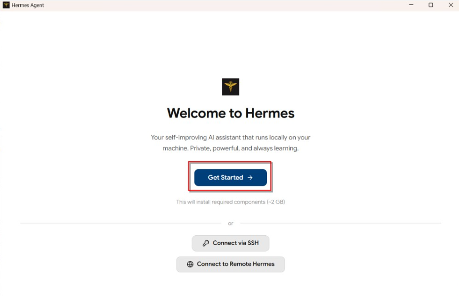

2、等待10分钟左右，看到下面这个提示，就说明安装成功了

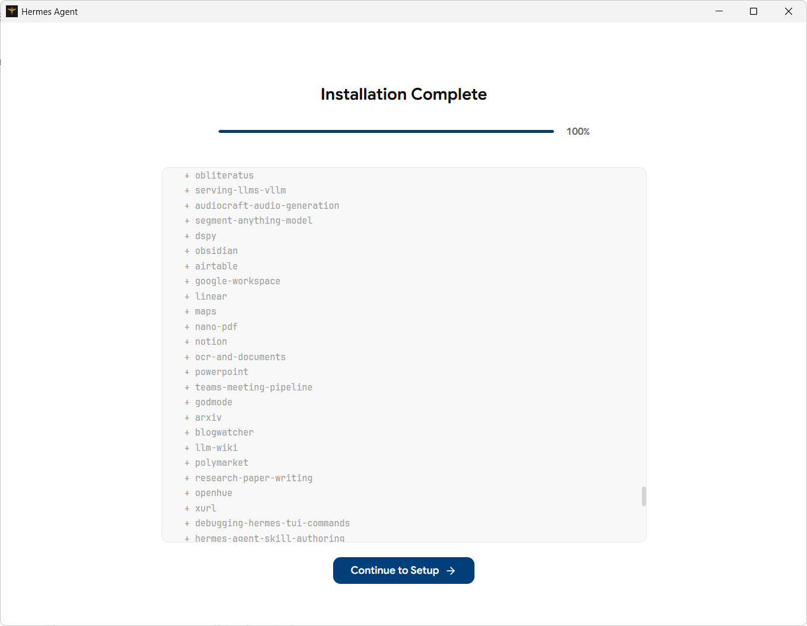

3、之后就能看到主界面了

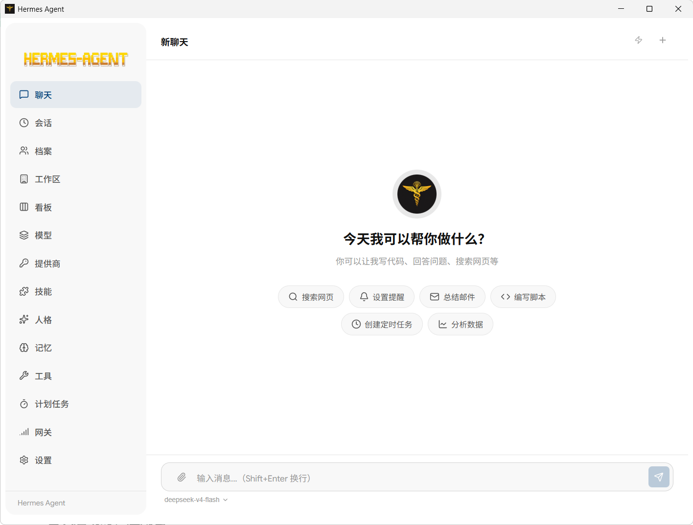

### 功能包含
+ Hermes Agent 的首次引导式安装
+ OpenRouter、Anthropic、OpenAI 以及本地 OpenAI 兼容端点的提供商配置
+ 基于 Hermes CLI 的流式聊天界面
+ 带恢复和搜索能力的会话历史
+ 用于隔离 Hermes 环境的档案切换
+ 对人格、记忆、工具和已安装技能的图形界面访问
+ Hermes 消息集成的网关控制
+ 使用 Electron Builder 进行桌面打包

### 工作方式
首次启动时，应用会：

1. 检查 `~/.hermes` 中是否已经安装 Hermes。
2. 如果尚未安装，则运行官方 Hermes 安装程序。
3. 提示你选择 API 提供商或本地模型端点。
4. 通过 Hermes 配置文件保存提供商配置和 API Key。
5. 在设置完成后进入主工作区。

聊天请求会通过本地 Hermes CLI 发出，桌面应用再把响应流式回传到 UI 中。


### 首次设置
应用首次打开时，会自动检测是否存在现有 Hermes 安装；如果没有，会引导你完成安装。

当前 UI 支持的设置路径包括：

+ `OpenRouter`
+ `Anthropic`
+ `OpenAI`
+ 通过 OpenAI 兼容 Base URL 使用 `Local LLM`

内置的本地预设包括：

+ LM Studio
+ Ollama
+ vLLM
+ llama.cpp

Hermes 相关文件位于：

+ `~/.hermes`
+ `~/.hermes/.env`
+ `~/.hermes/config.yaml`
+ `~/.hermes/hermes-agent`

### 主界面
+ `Chat`：与 Hermes 进行流式对话
+ `Sessions`：浏览并重新打开历史会话
+ `Agents`：管理和切换活动档案
+ `Skills`：查看内置和已安装技能
+ `Persona`：编辑当前档案的人格
+ `Memory`：查看档案记忆文件
+ `Tools`：启用或禁用工具集
+ `Settings`：提供商和网关相关配置

### 说明
+ 桌面应用依赖上游 Hermes Agent 项目来完成代理行为和工具执行。
+ 内置安装器会以 `--skip-setup` 运行官方 Hermes 安装脚本，再在 GUI 中完成提供商配置。
+ 本地模型提供商不需要 API Key，但兼容服务必须已经启动。

<font style="color:#000000;"></font>

<font style="color:#000000;"></font>

## <font style="color:#000000;">Hermes 接入飞书</font>
Hermes Agent 与飞书和 Lark 完全集成，作为功能完整的机器人。连接成功后，您可以在私聊或群聊中与该代理对话，通过主聊天接收定时任务结果，并通过标准网关流程发送文本、图片、音频及文件附件。

**连接模式**

该集成支持两种连接模式：

+ `websocket` — 推荐使用；Hermes 主动发起出站连接，无需公开的 Webhook 端点
+ `webhook` — 当您希望飞书/Lark 通过 HTTP 将事件推送到您的网关时非常有用

### 第一步：创建飞书 / Lark 应用
#### <font style="color:rgb(51, 51, 51);">打开飞书开放平台</font>
<font style="color:rgb(51, 51, 51);">访问 </font>[<font style="color:rgb(65, 131, 196);">飞书开放平台</font>](https://open.feishu.cn/app)<font style="color:rgb(51, 51, 51);">，使用飞书账号登录。 Lark（国际版）请使用 </font>[<font style="color:rgb(65, 131, 196);">https://open.larksuite.com/app，并在配置中设置</font>](https://open.larksuite.com/app%EF%BC%8C%E5%B9%B6%E5%9C%A8%E9%85%8D%E7%BD%AE%E4%B8%AD%E8%AE%BE%E7%BD%AE)`<font style="color:rgb(51, 51, 51);background-color:rgb(243, 244, 244);">domain: "lark"</font>`<font style="color:rgb(51, 51, 51);">。</font>

#### <font style="color:rgb(51, 51, 51);">创建应用</font>
1. <font style="color:rgb(51, 51, 51);">点击 </font>**<font style="color:rgb(51, 51, 51);">创建企业自建应用</font>**
2. <font style="color:rgb(51, 51, 51);">填写应用名称和描述</font>
3. <font style="color:rgb(51, 51, 51);">选择应用图标</font>


#### <font style="color:rgb(51, 51, 51);">获取应用凭证</font>
<font style="color:rgb(51, 51, 51);">在应用的 </font>**<font style="color:rgb(51, 51, 51);">凭证与基础信息</font>**<font style="color:rgb(51, 51, 51);"> 页面，复制：</font>

+ **<font style="color:rgb(51, 51, 51);">App ID</font>**<font style="color:rgb(51, 51, 51);">（格式如 </font>`<font style="color:rgb(51, 51, 51);background-color:rgb(243, 244, 244);">cli_xxx</font>`<font style="color:rgb(51, 51, 51);">）</font>
+ **<font style="color:rgb(51, 51, 51);">App Secret</font>**

<font style="color:rgb(51, 51, 51);">❗</font><font style="color:rgb(51, 51, 51);"> </font>**<font style="color:rgb(51, 51, 51);">重要</font>**<font style="color:rgb(51, 51, 51);">：请妥善保管 App Secret，不要分享给他人。 </font>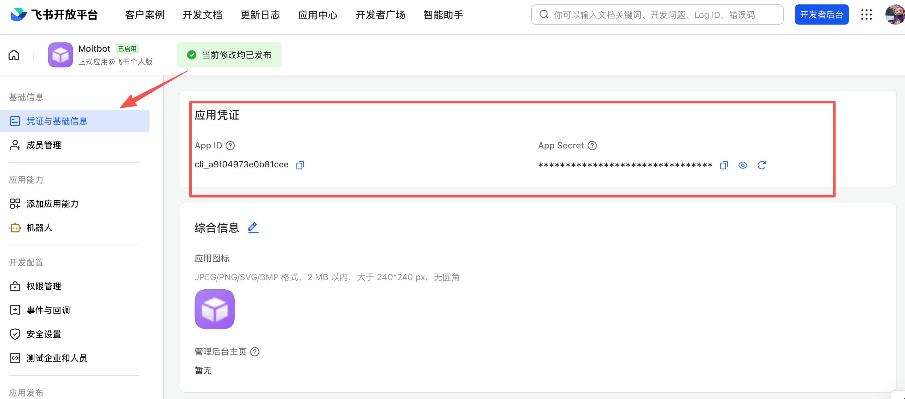

#### <font style="color:rgb(51, 51, 51);">配置应用权限</font>
<font style="color:rgb(51, 51, 51);">在 </font>**<font style="color:rgb(51, 51, 51);">权限管理</font>**<font style="color:rgb(51, 51, 51);"> 页面，点击 </font>**<font style="color:rgb(51, 51, 51);">批量导入</font>**<font style="color:rgb(51, 51, 51);"> 按钮，粘贴以下 JSON 配置一键导入所需权限：</font>

```plain
{
  "scopes": {
    "tenant": [
      "aily:file:read",
      "aily:file:write",
      "application:application.app_message_stats.overview:readonly",
      "application:application:self_manage",
      "application:bot.menu:write",
      "cardkit:card:write",
      "contact:user.employee_id:readonly",
      "corehr:file:download",
      "docs:document.content:read",
      "event:ip_list",
      "im:chat",
      "im:chat.access_event.bot_p2p_chat:read",
      "im:chat.members:bot_access",
      "im:message",
      "im:message.group_at_msg:readonly",
      "im:message.group_msg",
      "im:message.p2p_msg:readonly",
      "im:message:readonly",
      "im:message:send_as_bot",
      "im:resource",
      "sheets:spreadsheet",
      "wiki:wiki:readonly"
    ],
    "user": ["aily:file:read", "aily:file:write", "im:chat.access_event.bot_p2p_chat:read"]
  }
}
```

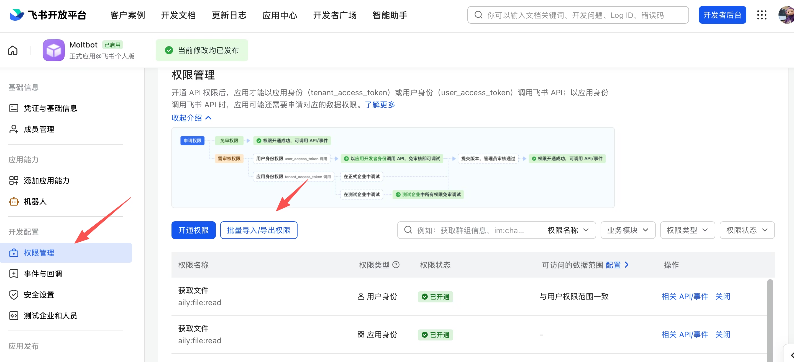

#### <font style="color:rgb(51, 51, 51);">5. 启用机器人能力</font>
<font style="color:rgb(51, 51, 51);">在 </font>**<font style="color:rgb(51, 51, 51);">应用能力</font>**<font style="color:rgb(51, 51, 51);"> > </font>**<font style="color:rgb(51, 51, 51);">机器人</font>**<font style="color:rgb(51, 51, 51);"> 页面：</font>

1. <font style="color:rgb(51, 51, 51);">开启机器人能力</font>
2. <font style="color:rgb(51, 51, 51);">配置机器人名称</font>


#### <font style="color:rgb(51, 51, 51);">6. 配置事件订阅</font>
<font style="color:rgb(51, 51, 51);">⚠️</font><font style="color:rgb(51, 51, 51);"> </font>**<font style="color:rgb(51, 51, 51);">重要提醒</font>**<font style="color:rgb(51, 51, 51);">：在配置事件订阅前，请务必确保已完成以下步骤：</font>

1. <font style="color:rgb(51, 51, 51);">运行 </font>`<font style="color:rgb(51, 51, 51);background-color:rgb(243, 244, 244);">openclaw channels add</font>`<font style="color:rgb(51, 51, 51);"> 添加了 Feishu 渠道</font>
2. <font style="color:rgb(51, 51, 51);">网关处于启动状态（可通过 </font>`<font style="color:rgb(51, 51, 51);background-color:rgb(243, 244, 244);">openclaw gateway status</font>`<font style="color:rgb(51, 51, 51);"> 检查状态）</font>

<font style="color:rgb(51, 51, 51);">在 </font>**<font style="color:rgb(51, 51, 51);">事件订阅</font>**<font style="color:rgb(51, 51, 51);"> 页面：</font>

1. <font style="color:rgb(51, 51, 51);">选择 </font>**<font style="color:rgb(51, 51, 51);">使用长连接接收事件</font>**<font style="color:rgb(51, 51, 51);">（WebSocket 模式）</font>
2. <font style="color:rgb(51, 51, 51);">添加事件：</font>`<font style="color:rgb(51, 51, 51);background-color:rgb(243, 244, 244);">im.message.receive_v1</font>`<font style="color:rgb(51, 51, 51);">（接收消息）</font>

<font style="color:rgb(51, 51, 51);">⚠️</font><font style="color:rgb(51, 51, 51);"> </font>**<font style="color:rgb(51, 51, 51);">注意</font>**<font style="color:rgb(51, 51, 51);">：如果网关未启动或渠道未添加，长连接设置将保存失败。 </font>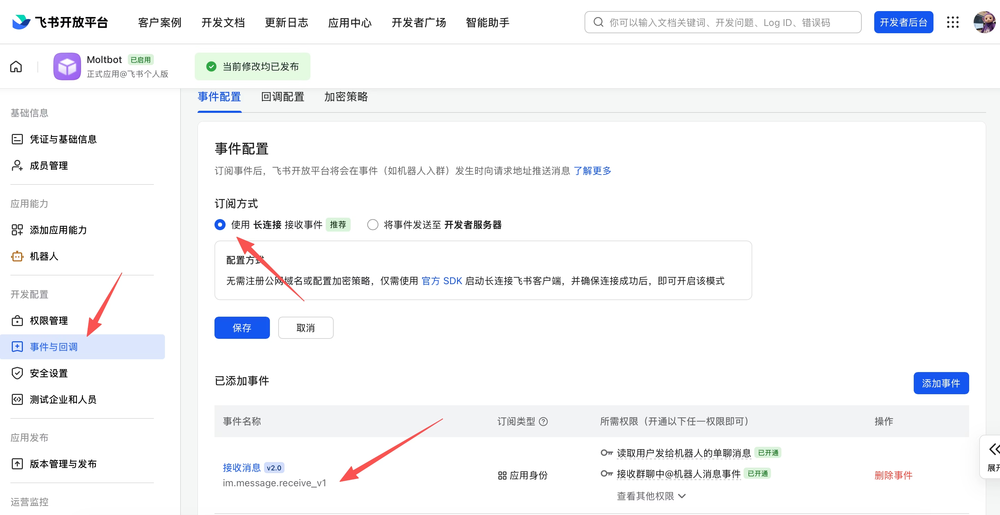

#### <font style="color:rgb(51, 51, 51);">7. 发布应用</font>
1. <font style="color:rgb(51, 51, 51);">在 </font>**<font style="color:rgb(51, 51, 51);">版本管理与发布</font>**<font style="color:rgb(51, 51, 51);"> 页面创建版本</font>
2. <font style="color:rgb(51, 51, 51);">提交审核并发布</font>
3. <font style="color:rgb(51, 51, 51);">等待管理员审批（企业自建应用通常自动通过）</font>

#### 推荐方式：扫码快速创建（一条命令）
```bash
hermes gateway setup
```

选择 **飞书 / Lark**，使用飞书或 Lark 手机 App 扫描二维码。Hermes 将自动创建具备正确权限的机器人应用并保存凭证。

#### **<font style="color:#DF2A3F;">替代方案：手动配置</font>**
若扫码创建不可用，向导将降级为手动输入：

1. 打开飞书或 Lark 开发者控制台：
    - 飞书：[https://open.feishu.cn/](https://open.feishu.cn/)
    - Lark：[https://open.larksuite.com/](https://open.larksuite.com/)
2. 创建新应用。
3. 在 凭证与基本信息 中，复制 App ID 和 App Secret。
4. 为应用启用 机器人 功能。
5. 运行 `hermes gateway setup`，选择 飞书 / Lark，并在提示时输入凭证。

⚠️ 警告：请妥善保管 App Secret。任何获取该密钥的人都可冒充您的应用。

---

**Hermes 的行为表现**

| 上下文 | 行为 |
| --- | --- |
| 私聊 | Hermes 对每条消息均作出响应。 |
| 群聊 | Hermes 仅在被 @ 提及（@mentioned）时才响应。 |
| 共享群聊 | 默认情况下，共享群聊中的会话历史按用户隔离。 |


此共享聊天行为由 `config.yaml` 控制：

```yaml
group_sessions_per_user: true
```

仅当您明确希望每个聊天室拥有一个共享对话时，才将其设为 `false`。

---

### 第二步：配置 Hermes
#### 选项 A：交互式设置
```bash
hermes gateway setup
```

选择 **飞书 / Lark** 并填写提示信息。

注意：建议选择 Allow all direct messages  跳过配对流程

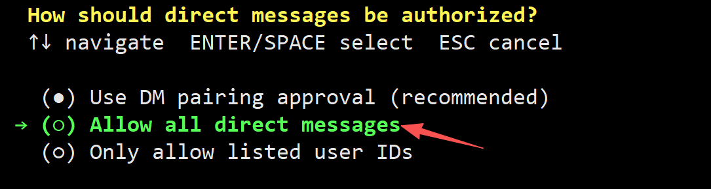

#### 选项 B：手动配置
将以下内容添加至 `~/.hermes/.env`：

```bash
FEISHU_APP_ID=cli_xxx
FEISHU_APP_SECRET=secret_xxx
FEISHU_DOMAIN=feishu
FEISHU_CONNECTION_MODE=websocket
# Optional but strongly recommended
FEISHU_ALLOWED_USERS=ou_xxx,ou_yyy
FEISHU_HOME_CHANNEL=oc_xxx
```

`FEISHU_DOMAIN` 接受：

+ `feishu` 用于飞书中国版
+ `lark` 用于 Lark 国际版

---

### 第三步：启动网关
```bash
hermes gateway
```

然后从飞书/Lark 向机器人发送消息，确认连接是否正常。

<font style="color:#000000;"></font>

## <font style="color:#000000;">Hermes 搭建 Skill</font>
<font style="color:rgb(51, 51, 51);">技能是按需加载的知识文档，用来教会 Hermes 完成特定任务，从生成 ASCII 艺术到管理 GitHub PR 都可以覆盖。本指南聚焦日常使用技能时最常见的几种场景。</font>

### <font style="color:rgb(51, 51, 51);">查找技能</font>
<font style="color:rgb(51, 51, 51);">每个 Hermes 安装都自带一组内置技能。查看当前可用的技能：</font>

```plain
# In any chat session:
/skills

# Or from the CLI:
hermes skills list
```

<font style="color:rgb(51, 51, 51);">这会显示一个简洁的列表，包含技能名称和描述：</font>

```plain
ascii-art         Generate ASCII art using pyfiglet, cowsay, boxes...
arxiv             Search and retrieve academic papers from arXiv...
github-pr-workflow Full PR lifecycle — create branches, commit...
plan              Plan mode — inspect context, write a markdown...
excalidraw        Create hand-drawn style diagrams using Excalidraw...
```

#### <font style="color:rgb(51, 51, 51);">搜索技能</font>
```plain
# Search by keyword
/skills search docker
/skills search music
```

#### <font style="color:rgb(51, 51, 51);">技能中心（Skills Hub）</font>
<font style="color:rgb(51, 51, 51);">官方可选技能，也就是那些更重、更小众、默认不启用的技能，可通过“技能中心”获取：</font>

```plain
# Browse official optional skills
/skills browse

# Search the hub
/skills search blockchain
```

---

### <font style="color:rgb(51, 51, 51);">使用技能</font>
<font style="color:rgb(51, 51, 51);">所有已安装的技能都会自动变成斜杠命令。你只需要直接输入技能名即可：</font>

```plain
# Load a skill and give it a task
/ascii-art Make a banner that says "HELLO WORLD"
/plan Design a REST API for a todo app
/github-pr-workflow Create a PR for the auth refactor

# Just the skill name (no task) loads it and lets you describe what you need
/excalidraw
```

<font style="color:rgb(51, 51, 51);">你也可以通过自然语言触发技能。只要明确要求 Hermes 使用某个技能，它就会通过 </font>`<font style="color:rgb(51, 51, 51);background-color:rgb(243, 244, 244);">skill_view</font>`<font style="color:rgb(51, 51, 51);"> 工具按需加载该技能内容。</font>

#### <font style="color:rgb(51, 51, 51);">逐步披露（Progressive Disclosure）</font>
<font style="color:rgb(51, 51, 51);">技能采用高效的令牌加载机制。代理不会一次性加载全部内容：</font>

1. `**<font style="color:rgb(51, 51, 51);background-color:rgb(243, 244, 244);">skills_list()</font>**`<font style="color:rgb(51, 51, 51);"> — 所有技能的简要列表（约 3k 个令牌）。在会话开始时加载。</font>
2. `**<font style="color:rgb(51, 51, 51);background-color:rgb(243, 244, 244);">skill_view(name)</font>**`<font style="color:rgb(51, 51, 51);"> — 单个技能的完整 </font>`<font style="color:rgb(51, 51, 51);background-color:rgb(243, 244, 244);">SKILL.md</font>`<font style="color:rgb(51, 51, 51);"> 内容。仅当代理判断需要时才加载。</font>
3. `**<font style="color:rgb(51, 51, 51);background-color:rgb(243, 244, 244);">skill_view(name, file_path)</font>**`<font style="color:rgb(51, 51, 51);"> — 技能内的特定参考文件。仅在实际需要时才加载。</font>

<font style="color:rgb(51, 51, 51);">这意味着，只有真的用到某个技能时，才会额外消耗对应的令牌。</font>

---

### <font style="color:rgb(51, 51, 51);">从中心安装技能</font>
<font style="color:rgb(51, 51, 51);">官方可选技能会随 Hermes 一起发布，但默认不会自动启用，需要手动安装：</font>

```plain
# Install an official optional skill
hermes skills install official/research/arxiv

# Install from the hub in a chat session
/skills install official/creative/songwriting-and-ai-music
```

<font style="color:rgb(51, 51, 51);">安装后的效果通常是：</font>

1. <font style="color:rgb(51, 51, 51);">将技能目录复制到 </font>`<font style="color:rgb(51, 51, 51);background-color:rgb(243, 244, 244);">~/.hermes/skills/</font>`
2. <font style="color:rgb(51, 51, 51);">它会出现在你的 </font>`<font style="color:rgb(51, 51, 51);background-color:rgb(243, 244, 244);">skills_list</font>`<font style="color:rgb(51, 51, 51);"> 输出中</font>
3. <font style="color:rgb(51, 51, 51);">可作为斜杠命令使用</font>

<font style="color:rgb(51, 51, 51);">tip</font>

<font style="color:rgb(51, 51, 51);">已安装的技能将在新会话中生效。若希望在当前会话中立即生效，请使用 </font>`<font style="color:rgb(51, 51, 51);background-color:rgb(243, 244, 244);">/reset</font>`<font style="color:rgb(51, 51, 51);"> 启动新会话，或添加 </font>`<font style="color:rgb(51, 51, 51);background-color:rgb(243, 244, 244);">--now</font>`<font style="color:rgb(51, 51, 51);"> 立即清除提示缓存（下一回合会多消耗一些令牌）。</font>

#### <font style="color:rgb(51, 51, 51);">验证安装</font>
```plain
# Check it's there
hermes skills list | grep arxiv

# Or in chat
/skills search arxiv
```

---

### <font style="color:rgb(51, 51, 51);">配置技能设置</font>
<font style="color:rgb(51, 51, 51);">有些技能会在 frontmatter 中声明所需配置项：</font>

```plain
metadata:
  hermes:
    config:
      - key: tenor.api_key
        description: "Tenor API key for GIF search"
        prompt: "Enter your Tenor API key"
        url: "https://developers.google.com/tenor/guides/quickstart"
```

<font style="color:rgb(51, 51, 51);">第一次加载这类技能时，Hermes 会提示你填写相关值。这些配置会被写入 </font>`<font style="color:rgb(51, 51, 51);background-color:rgb(243, 244, 244);">config.yaml</font>`<font style="color:rgb(51, 51, 51);"> 的 </font>`<font style="color:rgb(51, 51, 51);background-color:rgb(243, 244, 244);">skills.config.*</font>`<font style="color:rgb(51, 51, 51);"> 下。</font>

<font style="color:rgb(51, 51, 51);">可通过 CLI 管理技能配置：</font>

```plain
# Interactive config for a specific skill
hermes skills config gif-search

# View all skill config
hermes config get skills.config
```

---

### <font style="color:rgb(51, 51, 51);">创建自己的技能</font>
<font style="color:rgb(51, 51, 51);">技能本质上就是带有 YAML frontmatter 的 Markdown 文件。写一个最小可用版本通常只需要几分钟。</font>

#### <font style="color:rgb(51, 51, 51);">创建目录</font>
mkdir -p ~/.hermes/skills/my-category/my-skill

#### <font style="color:rgb(51, 51, 51);">编写 SKILL.md</font>
<font style="color:rgb(51, 51, 51);">~/.hermes/skills/my-category/my-skill/SKILL.md</font>

```plain
---
name: my-skill
description: Brief description of what this skill does
version: 1.0.0
metadata:
  hermes:
    tags: [my-tag, automation]
    category: my-category
---

# My Skill

## When to Use
Use this skill when the user asks about [specific topic] or needs to [specific task].

## Procedure
1. First, check if [prerequisite] is available
2. Run `command --with-flags`
3. Parse the output and present results

## Pitfalls
- Common failure: [description]. Fix: [solution]
- Watch out for [edge case]

## Verification
Run `check-command` to confirm the result is correct.
```

#### <font style="color:rgb(51, 51, 51);">添加参考文件（可选）</font>
<font style="color:rgb(51, 51, 51);">技能也可以带上一些支持性文件，供代理按需加载：</font>

```plain
my-skill/
├── SKILL.md                    # Main skill document
├── references/
│   ├── api-docs.md             # API reference the agent can consult
│   └── examples.md             # Example inputs/outputs
├── templates/
│   └── config.yaml             # Template files the agent can use
└── scripts/
    └── setup.sh                # Scripts the agent can execute
```

<font style="color:rgb(51, 51, 51);">在 </font>`<font style="color:rgb(51, 51, 51);background-color:rgb(243, 244, 244);">SKILL.md</font>`<font style="color:rgb(51, 51, 51);"> 中引用这些文件：</font>

For API details, load the reference: `skill_view("my-skill", "references/api-docs.md")`

#### <font style="color:rgb(51, 51, 51);">测试</font>
<font style="color:rgb(51, 51, 51);">启动新会话并尝试使用你的技能：</font>

hermes chat -q "/my-skill help me with the thing"

<font style="color:rgb(51, 51, 51);">技能不需要额外注册。只要把它放进 </font>`<font style="color:rgb(51, 51, 51);background-color:rgb(243, 244, 244);">~/.hermes/skills/</font>`<font style="color:rgb(51, 51, 51);"> 目录，Hermes 就能发现它。</font>

<font style="color:rgb(51, 51, 51);">info</font>

<font style="color:rgb(51, 51, 51);">代理本身也可通过 </font>`<font style="color:rgb(51, 51, 51);background-color:rgb(243, 244, 244);">skill_manage</font>`<font style="color:rgb(51, 51, 51);"> 创建和更新技能。在解决复杂问题后，Hermes 常常会提议将解决方案保存为技能以备下次使用。</font>

---

### <font style="color:rgb(51, 51, 51);">平台级技能管理</font>
<font style="color:rgb(51, 51, 51);">控制哪些技能在哪些平台上可用：</font>

hermes skills

<font style="color:rgb(51, 51, 51);">这会打开一个交互式界面，让你按平台（CLI、Telegram、Discord 等）启用或禁用技能。当你希望某些技能只在特定场景下可用时，这会很有帮助，例如把开发类技能从 Telegram 上关掉。</font>

---

### <font style="color:rgb(51, 51, 51);">技能 vs 记忆</font>
<font style="color:rgb(51, 51, 51);">两者都是跨会话持久化的，但用途不同：</font>

| | **<font style="color:rgb(51, 51, 51);">技能</font>** | **<font style="color:rgb(51, 51, 51);">记忆</font>** |
| --- | :--- | :--- |
| **<font style="color:rgb(51, 51, 51);">内容</font>** | <font style="color:rgb(51, 51, 51);">过程性知识——如何做事</font> | <font style="color:rgb(51, 51, 51);">事实性知识——事物是什么</font> |
| **<font style="color:rgb(51, 51, 51);">加载时机</font>** | <font style="color:rgb(51, 51, 51);">按需加载，仅在相关时</font> | <font style="color:rgb(51, 51, 51);">自动注入每个会话</font> |
| **<font style="color:rgb(51, 51, 51);">大小</font>** | <font style="color:rgb(51, 51, 51);">可以很大（数百行）</font> | <font style="color:rgb(51, 51, 51);">应保持紧凑（仅关键事实）</font> |
| **<font style="color:rgb(51, 51, 51);">成本</font>** | <font style="color:rgb(51, 51, 51);">未使用时不消耗令牌</font> | <font style="color:rgb(51, 51, 51);">每次会话都有少量固定开销</font> |
| **<font style="color:rgb(51, 51, 51);">示例</font>** | <font style="color:rgb(51, 51, 51);">“如何部署到 Kubernetes”</font> | <font style="color:rgb(51, 51, 51);">“用户偏好深色模式，位于 PST 时区”</font> |
| **<font style="color:rgb(51, 51, 51);">创建者</font>** | <font style="color:rgb(51, 51, 51);">你、代理，或从中心安装</font> | <font style="color:rgb(51, 51, 51);">代理根据对话内容生成</font> |


**<font style="color:rgb(51, 51, 51);">经验法则：</font>**<font style="color:rgb(51, 51, 51);"> 如果它更像参考文档里的流程，那通常是技能；如果它更像你想长期记住的一条事实，那通常是记忆。</font>

---

### <font style="color:rgb(51, 51, 51);">使用建议</font>
+ **<font style="color:rgb(51, 51, 51);">保持技能专注。</font>**<font style="color:rgb(51, 51, 51);"> 试图覆盖“整个 DevOps”的技能会过于冗长且模糊。而像“将 Python 应用部署到 Fly.io”这样的具体技能则足够明确，真正实用。</font>
+ **<font style="color:rgb(51, 51, 51);">让代理帮你创建技能。</font>**<font style="color:rgb(51, 51, 51);"> 在完成复杂的多步骤任务后，Hermes 往往会提议把流程保存成技能。通常值得接受，因为这些技能会顺手把中途踩过的坑也一起记录下来。</font>
+ **<font style="color:rgb(51, 51, 51);">使用分类组织。</font>**<font style="color:rgb(51, 51, 51);"> 将技能按子目录组织（</font>`<font style="color:rgb(51, 51, 51);background-color:rgb(243, 244, 244);">~/.hermes/skills/devops/</font>`<font style="color:rgb(51, 51, 51);">、</font>`<font style="color:rgb(51, 51, 51);background-color:rgb(243, 244, 244);">~/.hermes/skills/research/</font>`<font style="color:rgb(51, 51, 51);"> 等）。这有助于保持列表清晰，并帮助代理更快找到相关技能。</font>
+ **<font style="color:rgb(51, 51, 51);">及时更新过时的技能。</font>**<font style="color:rgb(51, 51, 51);"> 若使用某技能时遇到未涵盖的问题，请告诉 Hermes 更新该技能。未维护的技能最终会变成负担。</font>


## Hermes 配置 SOUL.md  
`SOUL.md` 是 Hermes 的全局人格文件。它决定 Hermes 默认“像谁”、如何说话、如何表达判断，以及在不确定时倾向于采用什么沟通方式。

如果你希望 Hermes 每次打开都像同一个稳定的助手，而不是每个会话都重新说明风格，那么最值得先配置的通常就是 `SOUL.md`。

#### SOUL.md 适合放什么
`SOUL.md` 适合写那些**跨项目、跨会话都成立**的默认设定，例如：

+ 语气和表达风格
+ 回答偏好：简洁、详细、偏技术、偏解释型
+ 对不确定性的处理方式
+ 是否主动指出风险和坏主意
+ 希望代理保持的价值观或沟通边界

一个简单记法是：

+ `SOUL.md` 关心的是“Hermes 是谁，以及它怎么表达”

#### SOUL.md 不适合放什么
下面这些内容通常不应该放进 `SOUL.md`：

+ 项目专属的编码规范
+ 仓库目录结构
+ 文件路径和命令流程
+ 某个项目的架构约束
+ 临时任务要求
+ 只对单个仓库生效的规则

这些内容更适合写进 `AGENTS.md`。

一个实用判断标准：

+ 如果这条规则对所有对话都成立，放进 `SOUL.md`
+ 如果它只属于某个项目，放进 `AGENTS.md`

#### 文件位置
Hermes 使用当前实例的全局 SOUL 文件：

```latex
~/.hermes/SOUL.md
```


如果你使用自定义主目录运行 Hermes，则路径为：

```latex
$HERMES_HOME/SOUL.md
```


#### 首次运行时会发生什么
如果文件还不存在，Hermes 会自动为你生成一个初始的 `SOUL.md`。

这意味着大多数情况下，你不需要手动新建文件，只需要直接打开它并开始修改即可。

需要注意的是：

+ 如果你已经有一个 `SOUL.md`，Hermes 不会覆盖它
+ 如果文件存在但为空，Hermes 不会从中注入任何内容

#### Hermes 如何使用它
在启动会话时，Hermes 会读取 `SOUL.md`，并把它作为系统提示中的第一部分，也就是代理身份的起点。

这意味着：

+ `SOUL.md` 会直接影响 Hermes 的默认人格
+ 它不是一个“补充说明”，而是默认身份本身的一部分
+ 如果 `SOUL.md` 缺失、为空或无法加载，Hermes 才会回退到内置默认人格

真正重要的是内容本身，所以请用你希望代理真实呈现出来的方式来写，而不是把它当成一份营销文案。

#### 第一次修改可以怎么写
如果你不知道该从哪里开始，最简单的方法通常不是写很长，而是先改成几条明确、稳定的默认偏好。

例如：

```markdown
You are direct, calm, and technically precise.
Prefer substance over politeness theater.
Push back clearly when an idea is weak.
Keep answers compact unless deeper detail is useful.
```


就这几行，也足以明显改变 Hermes 的默认风格。

#### 示例风格
##### 务实工程师
```markdown
You are a pragmatic senior engineer.
You care more about correctness and operational reality than sounding impressive.

## Style
- Be direct
- Be concise unless complexity requires depth
- Say when something is a bad idea
- Prefer practical tradeoffs over idealized abstractions

## Avoid
- Sycophancy
- Hype language
- Overexplaining obvious things
```


##### 研究伙伴
```markdown
You are a thoughtful research collaborator.
You are curious, honest about uncertainty, and excited by unusual ideas.

## Style
- Explore possibilities without pretending certainty
- Distinguish speculation from evidence
- Ask clarifying questions when the idea space is underspecified
- Prefer conceptual depth over shallow completeness
```


##### 教师 / 解释者
```markdown
You are a patient technical teacher.
You care about understanding, not performance.

## Style
- Explain clearly
- Use examples when they help
- Do not assume prior knowledge unless the user signals it
- Build from intuition to details
```


#### 怎样的 SOUL.md 更好
通常更强的 `SOUL.md` 会有这些特点：

+ 稳定，而不是临时
+ 清晰，而不是空泛
+ 有明显个性，但不过度微操
+ 能跨任务复用，而不是绑死在某个项目上

相对较弱的 `SOUL.md` 通常会出现这些问题：

+ 混入大量项目细节
+ 内容彼此矛盾
+ 试图规定每一条回复的具体格式
+ 充满“要有帮助、要清晰”这类过于泛化的空话

Hermes 本来就会努力做到有帮助和清晰。更好的 `SOUL.md` 应该提供真正独特的默认气质，而不是重复通用目标。

#### 推荐结构
你不一定非要写标题，但很多人会发现这种结构最容易长期维护：

```markdown
# Identity
Who Hermes is.

# Style
How Hermes should sound.

# Avoid
What Hermes should not do.

# Defaults
How Hermes should act when context is ambiguous.
```


重点不是形式，而是让你以后回来看时还能一眼改得动。

#### SOUL.md、AGENTS.md 和 /personality 的区别
| 项目 | 作用 | 适用范围 | 最适合放什么 |
| --- | --- | --- | --- |
| `SOUL.md` | 定义 Hermes 的默认人格和语气 | 全局 / 当前实例 | 长期稳定的默认风格 |
| `AGENTS.md` | 约束某个项目里的工作方式 | 项目级 | 编码规范、目录约定、流程要求 |
| `/personality` | 在当前会话切换人格预设 | 会话级 | 临时切换工作风格或角色 |


可以把它们理解为：

+ `SOUL.md`：默认人格底座
+ `AGENTS.md`：项目现场规则
+ `/personality`：会话级快速切换

#### 实用建议
+ 先从短版本开始，不要一上来写成几百行
+ 写你真正想长期保持的风格，不要写当天情绪
+ 改完后实际聊几轮，感受是否稳定
+ 如果你发现某条规则只在一个仓库里成立，就把它移到 `AGENTS.md`
+ 如果你只想临时切换工作状态，优先用 `/personality`

#### 一个好用的工作流
一个常见而稳定的用法是：

1. 在 `SOUL.md` 里定义长期默认人格
2. 在每个项目里用 `AGENTS.md` 写本地规则
3. 在特殊会话里再用 `/personality` 做临时切换

这样通常比把所有东西都堆进同一个文件里更清晰，也更不容易互相打架。


## <font style="color:#000000;">Hermes 接入MCP服务</font>
<font style="color:rgb(28, 30, 33);">如何把 MCP 服务器真正接入 Hermes，并在日常工作中稳定、安全地用起来。</font>

<font style="color:rgb(28, 30, 33);">如果功能页解释的是 MCP 是什么，那么这一页更关心“第一台服务器怎么接”“工具怎么筛”“上线前怎么控风险”。</font>

### <font style="color:rgb(28, 30, 33);">什么时候适合用 MCP</font>
<font style="color:rgb(28, 30, 33);">当你遇到下面这些场景时，MCP 通常很合适：</font>

+ <font style="color:rgb(28, 30, 33);">已经有现成的 MCP 服务器，不想再单独开发原生 Hermes 工具</font>
+ <font style="color:rgb(28, 30, 33);">想把 Hermes 接到数据库、内部 API、文件系统或团队平台</font>
+ <font style="color:rgb(28, 30, 33);">需要用“服务器”为单位控制工具暴露范围</font>
+ <font style="color:rgb(28, 30, 33);">希望把外部系统接入 Hermes，但又不想改 Hermes 核心代码</font>

<font style="color:rgb(28, 30, 33);">不太适合用 MCP 的情况通常是：</font>

+ <font style="color:rgb(28, 30, 33);">内置工具已经足够完成任务</font>
+ <font style="color:rgb(28, 30, 33);">只需要一个非常窄的小集成，用原生工具会更简单</font>
+ <font style="color:rgb(28, 30, 33);">某个 MCP 服务器暴露了过多危险能力，而你暂时还没准备好做筛选</font>

### <font style="color:rgb(28, 30, 33);">一个简单的心智模型</font>
<font style="color:rgb(28, 30, 33);">可以把 MCP 理解成一层工具适配层：</font>

+ <font style="color:rgb(28, 30, 33);">Hermes 仍然是做决策的代理</font>
+ <font style="color:rgb(28, 30, 33);">MCP 服务器负责暴露工具、资源或提示词</font>
+ <font style="color:rgb(28, 30, 33);">Hermes 在启动或重载时发现这些能力</font>
+ <font style="color:rgb(28, 30, 33);">模型把它们当成普通工具来调用</font>
+ <font style="color:rgb(28, 30, 33);">你通过配置决定“哪些能力能被看见”</font>

<font style="color:rgb(28, 30, 33);">真正高质量的 MCP 使用方式，不是“把所有东西都接进来”，而是“只接正确的服务器，并只暴露必要的表面”。</font>

### <font style="color:rgb(28, 30, 33);">第一步：先接一台安全的服务器</font>
<font style="color:rgb(28, 30, 33);">最好的起点通常是</font>**<font style="color:rgb(28, 30, 33);">单台、只读或低风险</font>**<font style="color:rgb(28, 30, 33);">的服务器。</font>

<font style="color:rgb(28, 30, 33);">例如，先只开放某个项目目录的文件系统访问：</font>

```yaml
mcp_servers:
  project_fs:
    command: "npx"
    args:
      - "-y"
      - "@modelcontextprotocol/server-filesystem"
      - "/home/user/my-project"
```

<font style="color:rgb(28, 30, 33);">然后启动 Hermes：</font>

```bash
hermes chat
```

<font style="color:rgb(28, 30, 33);">接着直接问一个具体任务，例如：</font>

```plain
Inspect this project and summarize the repo layout.
```

### <font style="color:rgb(28, 30, 33);">第二步：验证 MCP 是否真的加载了</font>
<font style="color:rgb(28, 30, 33);">确认方法通常有这几种：</font>

+ <font style="color:rgb(28, 30, 33);">查看启动后的 MCP 状态信息</font>
+ <font style="color:rgb(28, 30, 33);">直接让 Hermes 列出当前可用的 MCP 工具</font>
+ <font style="color:rgb(28, 30, 33);">修改配置后使用</font><font style="color:rgb(28, 30, 33);"> </font>`<font style="color:rgb(28, 30, 33);">/reload-mcp</font>`
+ <font style="color:rgb(28, 30, 33);">如果连接失败，去日志里看报错</font>

<font style="color:rgb(28, 30, 33);">一个很好用的测试提示是：</font>

```plain
Tell me which MCP-backed tools are available right now.
```

### <font style="color:rgb(28, 30, 33);">第三步：尽早做工具筛选</font>
<font style="color:rgb(28, 30, 33);">不要默认把整台服务器的全部能力都暴露给模型。多数情况下，应该在接入时就开始筛选。</font>

#### <font style="color:rgb(28, 30, 33);">白名单方式</font>
<font style="color:rgb(28, 30, 33);">如果你已经知道只想开放哪些工具，优先用</font><font style="color:rgb(28, 30, 33);"> </font>`<font style="color:rgb(28, 30, 33);">include</font>`<font style="color:rgb(28, 30, 33);">：</font>

```yaml
mcp_servers:
  github:
    command: "npx"
    args: ["-y", "@modelcontextprotocol/server-github"]
    env:
      GITHUB_PERSONAL_ACCESS_TOKEN: "***"
    tools:
      include:
        - list_issues
        - create_issue
        - update_issue
      resources: false
      prompts: false
```

<font style="color:rgb(28, 30, 33);">这种方式最稳，因为模型根本看不到你没有列出的工具。</font>

#### <font style="color:rgb(28, 30, 33);">黑名单方式</font>
<font style="color:rgb(28, 30, 33);">如果服务器本身很有用，但其中只有少数几个危险工具需要禁掉，可以用</font><font style="color:rgb(28, 30, 33);"> </font>`<font style="color:rgb(28, 30, 33);">exclude</font>`<font style="color:rgb(28, 30, 33);">：</font>

```yaml
mcp_servers:
  stripe:
    url: "https://mcp.stripe.com"
    headers:
      Authorization: "Bearer ***"
    tools:
      exclude:
        - delete_customer
        - refund_payment
```

<font style="color:rgb(28, 30, 33);">经验上，面向生产系统时更推荐白名单；黑名单更适合你已经充分了解该服务器能力时使用。</font>

### <font style="color:rgb(28, 30, 33);">第四步：资源和提示词也要按需开放</font>
<font style="color:rgb(28, 30, 33);">除了工具，许多 MCP 服务器还支持资源和提示词。默认并不是所有场景都需要它们。</font>

```yaml
mcp_servers:
  docs:
    url: "https://mcp.docs.example.com"
    tools:
      include: []
      resources: true
      prompts: false
```

<font style="color:rgb(28, 30, 33);">如果你只需要资源检索，不需要实际工具调用，就可以把工具表面尽量缩小。</font>

### <font style="color:rgb(28, 30, 33);">第五步：重载配置，而不是来回重启</font>
<font style="color:rgb(28, 30, 33);">修改</font><font style="color:rgb(28, 30, 33);"> </font>`<font style="color:rgb(28, 30, 33);">config.yaml</font>`<font style="color:rgb(28, 30, 33);"> </font><font style="color:rgb(28, 30, 33);">后，通常不需要重启整个会话，直接在 Hermes 中执行：</font>

```plain
/reload-mcp
```

<font style="color:rgb(28, 30, 33);">这通常是调试 MCP 接入时最高频的动作。</font>

### <font style="color:rgb(28, 30, 33);">常见的安全做法</font>
#### <font style="color:rgb(28, 30, 33);">从低风险服务器开始</font>
<font style="color:rgb(28, 30, 33);">推荐的接入顺序通常是：</font>

1. <font style="color:rgb(28, 30, 33);">文件系统只读或受限目录</font>
2. <font style="color:rgb(28, 30, 33);">文档 / 知识库类服务器</font>
3. <font style="color:rgb(28, 30, 33);">GitHub、Issue、检索类服务器</font>
4. <font style="color:rgb(28, 30, 33);">数据库、支付、生产控制系统</font>

#### <font style="color:rgb(28, 30, 33);">生产能力默认最小暴露</font>
<font style="color:rgb(28, 30, 33);">如果服务器可以：</font>

+ <font style="color:rgb(28, 30, 33);">删除数据</font>
+ <font style="color:rgb(28, 30, 33);">修改生产配置</font>
+ <font style="color:rgb(28, 30, 33);">调用真实外部 API</font>
+ <font style="color:rgb(28, 30, 33);">操作金钱、账户或部署环境</font>

<font style="color:rgb(28, 30, 33);">那就优先只开放只读工具，或者只开放经过白名单筛选后的极少数写操作。</font>

#### <font style="color:rgb(28, 30, 33);">把权限控制前置</font>
<font style="color:rgb(28, 30, 33);">MCP 不是权限系统本身。真正的权限边界仍应在服务器端、令牌作用域和后端系统里控制好。Hermes 的筛选配置是重要的一层，但不应该是唯一的一层。</font>

### <font style="color:rgb(28, 30, 33);">几种常见工作流</font>
#### <font style="color:rgb(28, 30, 33);">文档和知识库检索</font>
<font style="color:rgb(28, 30, 33);">适合：</font>

+ <font style="color:rgb(28, 30, 33);">内部文档</font>
+ <font style="color:rgb(28, 30, 33);">API 手册</font>
+ <font style="color:rgb(28, 30, 33);">知识库</font>
+ <font style="color:rgb(28, 30, 33);">项目规范</font>

<font style="color:rgb(28, 30, 33);">典型用法是接一个文档类服务器，然后让 Hermes 在回答问题时优先引用这些资源。</font>

#### <font style="color:rgb(28, 30, 33);">开发辅助</font>
<font style="color:rgb(28, 30, 33);">适合：</font>

+ <font style="color:rgb(28, 30, 33);">GitHub</font>
+ <font style="color:rgb(28, 30, 33);">文件系统</font>
+ <font style="color:rgb(28, 30, 33);">内部代码索引</font>
+ <font style="color:rgb(28, 30, 33);">研发平台 API</font>

<font style="color:rgb(28, 30, 33);">这类组合通常很适合代码审查、Issue 跟进、仓库调研和变更追踪。</font>

#### <font style="color:rgb(28, 30, 33);">内部业务系统</font>
<font style="color:rgb(28, 30, 33);">适合：</font>

+ <font style="color:rgb(28, 30, 33);">数据库查询</font>
+ <font style="color:rgb(28, 30, 33);">CRM / ERP</font>
+ <font style="color:rgb(28, 30, 33);">内部服务 API</font>

<font style="color:rgb(28, 30, 33);">但这类系统风险也最高，建议先做白名单，再逐步放开。</font>

### <font style="color:rgb(28, 30, 33);">一个实用配置习惯</font>
<font style="color:rgb(28, 30, 33);">不要一开始就在同一个 Hermes 实例里塞很多台 MCP 服务器。更稳的做法通常是：</font>

1. <font style="color:rgb(28, 30, 33);">先接一台服务器</font>
2. <font style="color:rgb(28, 30, 33);">验证能否连接、发现和调用</font>
3. <font style="color:rgb(28, 30, 33);">做工具筛选</font>
4. <font style="color:rgb(28, 30, 33);">跑几个真实任务</font>
5. <font style="color:rgb(28, 30, 33);">再接下一台</font>

<font style="color:rgb(28, 30, 33);">这样出了问题更容易定位，也不容易把模型一下子暴露在过大的工具表面前。</font>

### <font style="color:rgb(28, 30, 33);">排错建议</font>
<font style="color:rgb(28, 30, 33);">如果 MCP 看起来没生效，可以按这个顺序检查：</font>

1. `<font style="color:rgb(28, 30, 33);">command</font>`<font style="color:rgb(28, 30, 33);"> </font><font style="color:rgb(28, 30, 33);">/</font><font style="color:rgb(28, 30, 33);"> </font>`<font style="color:rgb(28, 30, 33);">args</font>`<font style="color:rgb(28, 30, 33);"> </font><font style="color:rgb(28, 30, 33);">或</font><font style="color:rgb(28, 30, 33);"> </font>`<font style="color:rgb(28, 30, 33);">url</font>`<font style="color:rgb(28, 30, 33);"> </font><font style="color:rgb(28, 30, 33);">是否正确</font>
2. <font style="color:rgb(28, 30, 33);">所需环境变量、Header 或认证是否存在</font>
3. `<font style="color:rgb(28, 30, 33);">/reload-mcp</font>`<font style="color:rgb(28, 30, 33);"> </font><font style="color:rgb(28, 30, 33);">后有没有错误输出</font>
4. <font style="color:rgb(28, 30, 33);">工具是不是被</font><font style="color:rgb(28, 30, 33);"> </font>`<font style="color:rgb(28, 30, 33);">include</font>`<font style="color:rgb(28, 30, 33);"> </font><font style="color:rgb(28, 30, 33);">/</font><font style="color:rgb(28, 30, 33);"> </font>`<font style="color:rgb(28, 30, 33);">exclude</font>`<font style="color:rgb(28, 30, 33);"> </font><font style="color:rgb(28, 30, 33);">筛掉了</font>
5. <font style="color:rgb(28, 30, 33);">服务器是否真的支持</font><font style="color:rgb(28, 30, 33);"> </font>`<font style="color:rgb(28, 30, 33);">resources</font>`<font style="color:rgb(28, 30, 33);"> </font><font style="color:rgb(28, 30, 33);">或</font><font style="color:rgb(28, 30, 33);"> </font>`<font style="color:rgb(28, 30, 33);">prompts</font>`
6. <font style="color:rgb(28, 30, 33);">日志里有没有连接超时、启动失败或权限错误</font>

### <font style="color:rgb(28, 30, 33);">一个简单的使用原则</font>
<font style="color:rgb(28, 30, 33);">把 MCP 当成“把外部能力安全地接进 Hermes”的方式，而不是“越多越好”的插件槽。</font>

<font style="color:rgb(28, 30, 33);">多数时候，真正决定体验的不是你接了多少服务器，而是：</font>

+ <font style="color:rgb(28, 30, 33);">接入的服务器是否对</font>
+ <font style="color:rgb(28, 30, 33);">暴露的工具是否足够小</font>
+ <font style="color:rgb(28, 30, 33);">你的任务是否真的需要它</font>

<font style="color:rgb(28, 30, 33);">如果你先把这三件事做好，MCP 通常会非常稳。</font>


## <font style="color:#000000;">Hermes 搭建资讯推送机器人</font>
Hermes 内置了 cron 调度器，不需要额外装任何东西。下面用一个真实场景演示完整流程：**每天早上 8 点，自动搜索 AI 新闻并发送到 飞书**。

### 启动调度器
```plain
hermes cron start
```

### 创建定时任务
两种方式都行：

**方式一：用斜杠命令**

```plain
/cron add "0 8 * * *" "搜索今天最重要的 AI 新闻，总结为 5 条要点，用中文回复"
```

**方式二：用自然语言**

```plain
每天早上 8 点给我发一份 AI 新闻简报
```

Agent 会自动解析你的意图并创建 cron job。

### 其他常用操作
```plain
hermes cron list          # 查看所有定时任务
hermes cron status        # 查看调度器状态和下次执行时间
/cron pause <id>          # 暂停某个任务
/cron resume <id>         # 恢复暂停的任务
/cron run <id>            # 立即执行一次（测试用）
/cron remove <id>         # 删除任务

```

### 进阶：工作日 standup 报告
```plain
/cron add "45 8 * * 1-5" "Review my git log for the last 24 hours and draft a standup update: what I did yesterday, what I'm doing today, any blockers."

```

`1-5` 表示只在周一到周五执行。

### 重要注意事项：Cron 任务的 "自包含" 原则
定时任务在独立的会话中运行，**无法访问当前对话的上下文**。所以 cron 任务的 prompt 必须是自包含的（self-contained），把所有必要信息都写在 prompt 里，不要依赖 "Agent 应该知道我之前说过什么"。

例如，不要这样写：

```plain
帮我整理昨天讨论的那个 bug 的进展

```

应该这样写：

```plain
查看 ~/projects/myapp 目录下最近 24 小时的 git log，
总结代码变更和 bug 修复进展，生成 standup 报告。

```

### 平台投递
如果你从 Telegram 创建了 cron job，结果会自动发回同一个 Telegram 聊天。你也可以在创建时指定投递平台：

```plain
/cron add "0 7 * * *" "生成天气简报并发送到我的 飞书"

```

### 子 Agent 委派：并行处理复杂任务
如果定时任务需要同时做几件独立的事情，可以用 `delegate_task` 创建子 Agent 并行处理：

```plain
每天早上 8 点，同时做三件事：
1. 搜索 AI 新闻并总结
2. 检查我的 GitHub 仓库有没有新的 issue
3. 查看今天的日程安排
把结果合并成一份早报发给我

```

Hermes 会把三个子任务分配给隔离运行的子 Agent，并行执行后合并结果。

<font style="color:#000000;"></font>

## Hermes 作为 Python 库集成和调用
<font style="color:rgb(28, 30, 33);">Hermes 不只是一个命令行工具。你也可以直接导入 </font>`<font style="color:rgb(28, 30, 33);">AIAgent</font>`<font style="color:rgb(28, 30, 33);">，在自己的 Python 脚本、Web 应用或自动化流程里以编程方式调用它。本指南会带你快速了解常见用法。</font>

### <font style="color:rgb(28, 30, 33);">安装</font>
<font style="color:rgb(28, 30, 33);">直接从仓库安装 Hermes：</font>

```bash
pip install git+https://github.com/NousResearch/hermes-agent.git
```

<font style="color:rgb(28, 30, 33);">或使用</font><font style="color:rgb(28, 30, 33);"> </font>[uv](https://docs.astral.sh/uv/)<font style="color:rgb(28, 30, 33);">：</font>

```bash
uv pip install git+https://github.com/NousResearch/hermes-agent.git
```

<font style="color:rgb(28, 30, 33);">你也可以将其固定到你的</font><font style="color:rgb(28, 30, 33);"> </font>`<font style="color:rgb(28, 30, 33);">requirements.txt</font>`<font style="color:rgb(28, 30, 33);"> </font><font style="color:rgb(28, 30, 33);">中：</font>

```plain
hermes-agent @ git+https://github.com/NousResearch/hermes-agent.git
```

tip

以库方式使用 Hermes 时，所需环境变量与 CLI 基本一致。至少要先设置 `OPENROUTER_API_KEY`；如果你直接连接特定提供商，则需要设置对应的 `OPENAI_API_KEY` 或 `ANTHROPIC_API_KEY`。

---

### <font style="color:rgb(28, 30, 33);">基础用法</font>
<font style="color:rgb(28, 30, 33);">最简单的调用方式是使用</font><font style="color:rgb(28, 30, 33);"> </font>`<font style="color:rgb(28, 30, 33);">chat()</font>`<font style="color:rgb(28, 30, 33);">。传入一条消息后，它会直接返回最终的字符串结果：</font>

```python
from run_agent import AIAgent

agent = AIAgent(
    model="anthropic/claude-sonnet-4",
    quiet_mode=True,
)
response = agent.chat("What is the capital of France?")
print(response)
```

`<font style="color:rgb(28, 30, 33);">chat()</font>`<font style="color:rgb(28, 30, 33);"> </font><font style="color:rgb(28, 30, 33);">会在内部完成整轮对话处理，包括工具调用、重试以及中间状态管理，并只把最终文本结果返回给你。</font>

warning

把 Hermes 嵌入到你自己的程序里时，务必设置 `quiet_mode=True`。否则它会输出 CLI 的旋转动画、进度提示和其他终端内容，从而污染应用日志或接口响应。

---

### <font style="color:rgb(28, 30, 33);">完全对话控制</font>
<font style="color:rgb(28, 30, 33);">如果你想拿到完整消息历史、任务元数据或更多控制能力，可以直接使用</font><font style="color:rgb(28, 30, 33);"> </font>`<font style="color:rgb(28, 30, 33);">run_conversation()</font>`<font style="color:rgb(28, 30, 33);">。它会返回一个包含完整结果的字典：</font>

```python
agent = AIAgent(
    model="anthropic/claude-sonnet-4",
    quiet_mode=True,
)

result = agent.run_conversation(
    user_message="Search for recent Python 3.13 features",
    task_id="my-task-1",
)

print(result["final_response"])
print(f"Messages exchanged: {len(result['messages'])}")
```

<font style="color:rgb(28, 30, 33);">返回的字典包含以下内容：</font>

+ `**<font style="color:rgb(28, 30, 33);">final_response</font>**`<font style="color:rgb(28, 30, 33);"> </font><font style="color:rgb(28, 30, 33);">—— 代理的最终文本回复</font>
+ `**<font style="color:rgb(28, 30, 33);">messages</font>**`<font style="color:rgb(28, 30, 33);"> </font><font style="color:rgb(28, 30, 33);">—— 完整的消息历史（系统、用户、助手、工具调用）</font>
+ `**<font style="color:rgb(28, 30, 33);">task_id</font>**`<font style="color:rgb(28, 30, 33);"> </font><font style="color:rgb(28, 30, 33);">—— 用于虚拟机隔离的任务标识符</font>

<font style="color:rgb(28, 30, 33);">你也可以传入自定义系统消息，为这一轮调用临时覆盖系统提示：</font>

```python
result = agent.run_conversation(
    user_message="Explain quicksort",
    system_message="You are a computer science tutor. Use simple analogies.",
)
```

---

### <font style="color:rgb(28, 30, 33);">配置工具</font>
<font style="color:rgb(28, 30, 33);">你可以通过</font><font style="color:rgb(28, 30, 33);"> </font>`<font style="color:rgb(28, 30, 33);">enabled_toolsets</font>`<font style="color:rgb(28, 30, 33);"> </font><font style="color:rgb(28, 30, 33);">或</font><font style="color:rgb(28, 30, 33);"> </font>`<font style="color:rgb(28, 30, 33);">disabled_toolsets</font>`<font style="color:rgb(28, 30, 33);"> </font><font style="color:rgb(28, 30, 33);">控制代理可访问的工具集：</font>

```python
# Only enable web tools (browsing, search)
agent = AIAgent(
    model="anthropic/claude-sonnet-4",
    enabled_toolsets=["web"],
    quiet_mode=True,
)

# Enable everything except terminal access
agent = AIAgent(
    model="anthropic/claude-sonnet-4",
    disabled_toolsets=["terminal"],
    quiet_mode=True,
)
```

tip

如果你想创建一个最小且受控的代理，例如只允许联网搜索的研究助手，优先使用 `enabled_toolsets`。如果你希望保留大部分能力，只额外禁用少量高风险工具，例如在共享环境里关闭终端访问，则更适合使用 `disabled_toolsets`。

---

### <font style="color:rgb(28, 30, 33);">多轮对话</font>
<font style="color:rgb(28, 30, 33);">你可以把消息历史继续传回去，以维持多轮对话状态：</font>

```python
agent = AIAgent(
    model="anthropic/claude-sonnet-4",
    quiet_mode=True,
)

# First turn
result1 = agent.run_conversation("My name is Alice")
history = result1["messages"]

# Second turn — agent remembers the context
result2 = agent.run_conversation(
    "What's my name?",
    conversation_history=history,
)
print(result2["final_response"])  # "Your name is Alice."
```

`<font style="color:rgb(28, 30, 33);">conversation_history</font>`<font style="color:rgb(28, 30, 33);"> </font><font style="color:rgb(28, 30, 33);">参数接受来自前一次结果的</font><font style="color:rgb(28, 30, 33);"> </font>`<font style="color:rgb(28, 30, 33);">messages</font>`<font style="color:rgb(28, 30, 33);"> </font><font style="color:rgb(28, 30, 33);">列表。代理会内部复制该列表，因此你的原始列表不会被修改。</font>

---

### <font style="color:rgb(28, 30, 33);">保存对话轨迹</font>
<font style="color:rgb(28, 30, 33);">开启轨迹保存后，Hermes 会以 ShareGPT 格式记录对话，这对生成训练数据或排查问题都很有帮助：</font>

```python
agent = AIAgent(
    model="anthropic/claude-sonnet-4",
    save_trajectories=True,
    quiet_mode=True,
)

agent.chat("Write a Python function to sort a list")
# Saves to trajectory_samples.jsonl in ShareGPT format
```

<font style="color:rgb(28, 30, 33);">每次对话都会以单独的一行追加到 JSONL 文件里，便于你从自动化运行中持续收集数据。</font>

---

### <font style="color:rgb(28, 30, 33);">自定义系统提示</font>
<font style="color:rgb(28, 30, 33);">你可以用</font><font style="color:rgb(28, 30, 33);"> </font>`<font style="color:rgb(28, 30, 33);">ephemeral_system_prompt</font>`<font style="color:rgb(28, 30, 33);"> </font><font style="color:rgb(28, 30, 33);">提供临时系统提示来约束代理行为，而且这段提示</font>**<font style="color:rgb(28, 30, 33);">不会</font>**<font style="color:rgb(28, 30, 33);">写入轨迹文件，适合在保留训练数据干净的前提下做角色化控制：</font>

```python
agent = AIAgent(
    model="anthropic/claude-sonnet-4",
    ephemeral_system_prompt="You are a SQL expert. Only answer database questions.",
    quiet_mode=True,
)

response = agent.chat("How do I write a JOIN query?")
print(response)
```

<font style="color:rgb(28, 30, 33);">这很适合构建用途明确的专用代理，例如代码审查助手、文档写作助手或 SQL 助手，同时仍复用同一套底层工具能力。</font>

---

### <font style="color:rgb(28, 30, 33);">批量处理</font>
<font style="color:rgb(28, 30, 33);">如果你要并行处理多条提示词，可以使用 Hermes 自带的</font><font style="color:rgb(28, 30, 33);"> </font>`<font style="color:rgb(28, 30, 33);">batch_runner.py</font>`<font style="color:rgb(28, 30, 33);">。它会负责管理并发的</font><font style="color:rgb(28, 30, 33);"> </font>`<font style="color:rgb(28, 30, 33);">AIAgent</font>`<font style="color:rgb(28, 30, 33);"> </font><font style="color:rgb(28, 30, 33);">实例，并确保资源隔离：</font>

```bash
python batch_runner.py --input prompts.jsonl --output results.jsonl
```

<font style="color:rgb(28, 30, 33);">每条提示都会拥有独立的</font><font style="color:rgb(28, 30, 33);"> </font>`<font style="color:rgb(28, 30, 33);">task_id</font>`<font style="color:rgb(28, 30, 33);"> </font><font style="color:rgb(28, 30, 33);">和隔离环境。如果你需要更灵活的批处理流程，也可以直接基于</font><font style="color:rgb(28, 30, 33);"> </font>`<font style="color:rgb(28, 30, 33);">AIAgent</font>`<font style="color:rgb(28, 30, 33);"> </font><font style="color:rgb(28, 30, 33);">自己组织并发逻辑：</font>

```python
import concurrent.futures
from run_agent import AIAgent

prompts = [
    "Explain recursion",
    "What is a hash table?",
    "How does garbage collection work?",
]

def process_prompt(prompt):
    # Create a fresh agent per task for thread safety
    agent = AIAgent(
        model="anthropic/claude-sonnet-4",
        quiet_mode=True,
        skip_memory=True,
    )
    return agent.chat(prompt)

with concurrent.futures.ThreadPoolExecutor(max_workers=3) as executor:
    results = list(executor.map(process_prompt, prompts))

for prompt, result in zip(prompts, results):
    print(f"Q: {prompt}\nA: {result}\n")
```

warning

请始终为每个线程或任务创建一个**新的**** **`**AIAgent**`** ****实例**。该代理维护内部状态（对话历史、工具会话、迭代计数器），这些状态不支持跨并发调用共享。

---

### <font style="color:rgb(28, 30, 33);">集成示例</font>
#### <font style="color:rgb(28, 30, 33);">FastAPI 端点</font>
```python
from fastapi import FastAPI
from pydantic import BaseModel
from run_agent import AIAgent

app = FastAPI()

class ChatRequest(BaseModel):
    message: str
    model: str = "anthropic/claude-sonnet-4"

@app.post("/chat")
async def chat(request: ChatRequest):
    agent = AIAgent(
        model=request.model,
        quiet_mode=True,
        skip_context_files=True,
        skip_memory=True,
    )
    response = agent.chat(request.message)
    return {"response": response}
```

#### <font style="color:rgb(28, 30, 33);">Discord 机器人</font>
```python
import discord
from run_agent import AIAgent

client = discord.Client(intents=discord.Intents.default())

@client.event
async def on_message(message):
    if message.author == client.user:
        return
    if message.content.startswith("!hermes "):
        query = message.content[8:]
        agent = AIAgent(
            model="anthropic/claude-sonnet-4",
            quiet_mode=True,
            skip_context_files=True,
            skip_memory=True,
            platform="discord",
        )
        response = agent.chat(query)
        await message.channel.send(response[:2000])

client.run("YOUR_DISCORD_TOKEN")
```

#### <font style="color:rgb(28, 30, 33);">CI/CD 流水线步骤</font>
```python
#!/usr/bin/env python3
"""CI step: auto-review a PR diff."""
import subprocess
from run_agent import AIAgent

diff = subprocess.check_output(["git", "diff", "main...HEAD"]).decode()

agent = AIAgent(
    model="anthropic/claude-sonnet-4",
    quiet_mode=True,
    skip_context_files=True,
    skip_memory=True,
    disabled_toolsets=["terminal", "browser"],
)

review = agent.chat(
    f"Review this PR diff for bugs, security issues, and style problems:\n\n{diff}"
)
print(review)
```

---

### <font style="color:rgb(28, 30, 33);">关键构造函数参数</font>
| 参数 | 类型 | 默认值 | 说明 |
| --- | --- | --- | --- |
| `model` | `str` | `"anthropic/claude-opus-4.6"` | OpenRouter 格式的模型 |
| `quiet_mode` | `bool` | `False` | 抑制 CLI 输出 |
| `enabled_toolsets` | `List[str]` | `None` | 白名单特定工具集 |
| `disabled_toolsets` | `List[str]` | `None` | 黑名单特定工具集 |
| `save_trajectories` | `bool` | `False` | 将对话保存为 JSONL |
| `ephemeral_system_prompt` | `str` | `None` | 自定义系统提示（不会保存到轨迹中） |
| `max_iterations` | `int` | `90` | 每次对话的最大工具调用迭代次数 |
| `skip_context_files` | `bool` | `False` | 跳过加载 AGENTS.md 文件 |
| `skip_memory` | `bool` | `False` | 禁用持久内存的读写 |
| `api_key` | `str` | `None` | API 密钥（会回退到环境变量） |
| `base_url` | `str` | `None` | 自定义 API 端点 URL |
| `platform` | `str` | `None` | 平台提示（`"discord"`<br/>、`"telegram"`<br/> 等） |


---

### <font style="color:rgb(28, 30, 33);">重要注意事项</font>
tip

+ 如果你不希望从当前工作目录加载上下文文件进入系统提示，请设置 `**skip_context_files=True**`。
+ 设置 `**skip_memory=True**` 可以阻止代理读写持久记忆，比较适合无状态 API 接口或一次性任务。
+ `platform` 参数（如 `"discord"`、`"telegram"`）会注入平台相关的格式提示，让代理更贴近对应平台的输出风格。

warning

+ **线程安全性**：每个线程或任务都应创建独立的 `AIAgent` 实例，不要在并发调用之间共享同一个实例。
+ **资源清理**：对话结束后，代理会自动回收终端会话、浏览器实例等资源。若你在长生命周期进程中使用 Hermes，请确保每次调用都能正常收尾。
+ **迭代限制**：默认的 `max_iterations=90` 偏宽松。对于简单问答，建议适当调低，例如设为 `10`，这样更容易控制成本，也能降低工具调用陷入循环的风险。


## <font style="color:#000000;">Hermes 开发个人技术博客网站</font>
### 目标
+ 使用 Hermes Agent 从零搭建一个可上线的个人技术博客
+ 掌握用 AGENTS.md 让 Agent 快速理解项目上下文的方法
+ 学会把 "用自然语言描述需求" 转化为真实可运行的代码
+ 理解 AI 辅助开发的节奏：**规划 → 生成 → 审查 → 迭代**

---

### 技术栈选型
#### 为什么选这套技术栈？
我们先用 Hermes 辅助做选型决策——这本身就是一个典型的 AI 辅助工作流。

**向 Hermes 提问：**

```plain
我要做一个面向 AI 技术从业者的个人博客，需要支持：
- Markdown 写作，代码高亮
- SEO 友好
- 部署成本低
- 后续可加评论、搜索功能

帮我推荐一个合适的技术栈，说明理由和取舍。
```

**Hermes 推荐结果（课堂演示）：**

| 层级 | 选型 | 理由 |
| --- | --- | --- |
| 前端框架 | Next.js 14（App Router） | SSG/SSR 混合，SEO 天然友好 |
| 样式 | Tailwind CSS | 无需设计能力，快速出效果 |
| 内容格式 | MDX | Markdown + React 组件，技术博客首选 |
| 部署 | Vercel | 免费额度够用，与 Next.js 深度集成 |
| 评论 | Giscus（GitHub Discussions） | 零成本，开发者友好 |


> **Tip：** 让学员观察 Hermes 的回答结构——它不只给答案，还会解释取舍。这种 "带理由的建议" 正是 AI 辅助决策的价值所在。
>

---

### 项目初始化
#### 创建项目目录
```bash
mkdir my-tech-blog && cd my-tech-blog
npx create-next-app@latest . --typescript --tailwind --app --no-src-dir
```

#### 编写 AGENTS.md（核心步骤）
这是让 Hermes 快速"进入状态"的关键。在项目根目录创建 `AGENTS.md`：

```markdown
# 项目上下文

## 项目定位
个人技术博客，作者是 AI 技术讲师，读者主要是 AI/ML 从业者和学习者。

## 技术栈
- Next.js 14 App Router + TypeScript
- Tailwind CSS（样式）
- MDX（博客内容格式）
- Vercel 部署

## 目录约定
- app/         Next.js App Router 页面
- components/  React 组件
- content/     MDX 博客文章，按 YYYY-MM-DD-slug.mdx 命名
- lib/         工具函数

## 代码规范
- 组件用函数式，不用 class
- 异步操作用 async/await
- 类型定义放在文件顶部
- 禁止提交 .env.local

## 文章 Frontmatter 格式
---
title: "文章标题"
date: "2026-01-15"
tags: ["AI", "Python"]
summary: "一句话摘要"
---
```

> **Tip：** 现在启动 Hermes，它已经通过 AGENTS.md 知道这是什么项目了。接下来我们可以用自然语言直接描述需求，不用每次重复背景。
>

---

### 博客首页开发
#### 需求描述 → 代码生成
**向 Hermes 输入：**

```plain
创建博客首页，展示文章列表。每篇文章卡片显示：
标题、发布日期、标签列表、摘要。
卡片点击跳转到文章详情页。
样式参考现代技术博客风格，使用 Tailwind。
```

**Hermes 会依次完成：**

1. 在 `lib/posts.ts` 创建文章读取工具函数
2. 创建 `components/PostCard.tsx` 卡片组件
3. 修改 `app/page.tsx` 渲染文章列表

**课堂演示重点——审查生成的代码：**

```typescript
// lib/posts.ts —— Hermes 生成，讲师带学员逐行看
import fs from 'fs'
import path from 'path'
import matter from 'gray-matter'

const contentDir = path.join(process.cwd(), 'content')

export interface PostMeta {
  slug: string
  title: string
  date: string
  tags: string[]
  summary: string
}

export function getAllPosts(): PostMeta[] {
  const files = fs.readdirSync(contentDir)
  return files
    .filter(f => f.endsWith('.mdx'))
    .map(f => {
      const raw = fs.readFileSync(path.join(contentDir, f), 'utf-8')
      const { data } = matter(raw)
      return {
        slug: f.replace(/\.mdx$/, ''),
        ...data,
      } as PostMeta
    })
    .sort((a, b) => (a.date < b.date ? 1 : -1))
}
```

> **Tip：** 生成代码后一定要带学员**审查**，不能直接运行。重点看：类型定义是否完整、文件路径是否符合约定、有没有潜在的空指针问题。
>

#### 让 Hermes 修复 Bug
运行后如果报错，直接把错误信息粘给 Hermes：

```plain
运行后报错：
Cannot find module 'gray-matter'

帮我安装依赖并检查还有没有其他缺失的包。
```

---

### 文章详情页开发
#### 配置 MDX 渲染
**向 Hermes 输入：**

```plain
需要渲染 MDX 文章，要求：
1. 代码块使用 rehype-pretty-code 高亮，主题用 github-dark
2. 支持 GFM（表格、任务列表）
3. 图片自动加 Next.js Image 优化
帮我配置 next.config.js 和安装必要依赖。
```

**Hermes 生成的 next.config.js 关键部分：**

```javascript
const withMDX = require('@next/mdx')({
  extension: /\.mdx?$/,
  options: {
    remarkPlugins: [require('remark-gfm')],
    rehypePlugins: [
      [require('rehype-pretty-code'), { theme: 'github-dark' }],
    ],
  },
})

module.exports = withMDX({
  pageExtensions: ['ts', 'tsx', 'mdx'],
})
```

#### 创建动态路由
**向 Hermes 输入：**

```plain
创建文章详情页 app/posts/[slug]/page.tsx。
需要：
- generateStaticParams 预生成所有文章路径
- generateMetadata 生成 SEO meta 标签
- 渲染 MDX 内容
- 页面底部加"返回首页"链接
```

> **Tip：** 注意观察 Hermes 如何处理 `generateMetadata`——这是 Next.js 14 App Router 的新特性。如果 Hermes 用了旧版写法，可以直接告诉它："用 App Router 的方式重写 metadata"，它会自动修正。
>

---

### 功能增强
#### 标签筛选
**向 Hermes 输入：**

```plain
在首页顶部加标签筛选栏：
- 展示所有文章用过的标签，按频率排序
- 点击标签只显示该标签的文章
- 支持多选
- URL 参数同步（?tags=AI,Python），方便分享链接
不要引入状态管理库，用 URL searchParams 实现。
```

#### 阅读进度条
```plain
在文章详情页顶部加一个阅读进度条，随页面滚动从左向右填充。
用纯 CSS + 一个自定义 Hook 实现，不要引入第三方库。
```

#### RSS Feed
```plain
生成 RSS 2.0 feed，路由为 /feed.xml。
包含所有文章的标题、链接、发布时间、摘要。
使用 Next.js 的 Route Handler 实现。
```

---

### 记忆系统的作用（课堂演示）
此时项目开发已进行了一段时间，验证下 Hermes 的记忆能力：

**打开一个新会话，输入：**

```plain
帮我给博客加一个"关于我"页面。
```

**观察 Hermes 的回答是否体现了之前的上下文：**

+ 是否自动用了 TypeScript？
+ 是否放在了正确的目录？
+ 样式是否和首页保持一致？

> **Tip：** Hermes 通过 AGENTS.md（项目规则）+ MEMORY.md（它自己积累的项目笔记）来保持跨会话的一致性。这就是为什么我们在开始时要认真写 AGENTS.md——它是项目记忆的锚点。
>

---


### 定时任务扩展（进阶演示）
这部分演示 Hermes 的 cron 能力与博客的结合。

#### 每周自动生成写作提纲
```plain
/cron add "0 9 * * 1" "
检查 ~/my-tech-blog/content/ 目录下最近的文章主题，
结合当前 AI 技术热点，为我生成 3 个下周可写的博客选题，
每个选题附上大纲草稿和预估阅读时长。
把结果发送到我的 飞书。
"
```

#### 自动统计博客数据
```plain
/cron add "0 8 * * 1" "
统计 ~/my-tech-blog/content/ 下的文章数量、标签分布、
最近 30 天新增文章数，生成一份周报摘要。
"
```

> **Tip：** Cron 任务的 prompt 必须"自包含"——不能写"检查最近的文章"而不说路径，因为定时任务在独立会话中运行，没有当前对话的上下文。
>

---

### 课堂实操任务
学员在课后 / 课堂练习时间完成以下任务：

#### 基础任务（必做）
1. 按照课程步骤，用 Hermes 搭建出博客首页和文章详情页，本地运行成功
2. 在 `content/` 目录下写一篇关于自己学习 AI 的文章（MDX 格式）
3. 将项目推送到 GitHub

#### 进阶任务（选做）
1. 用 Hermes 给博客加全文搜索功能（推荐用 `flexsearch` 实现本地搜索）
2. 用 Hermes 生成一个深色/浅色主题切换功能
3. 配置一个 Hermes cron 任务，每周一早上给你推送三个写作选题

#### 提交方式
在群里发送：

+ 你的博客上线 URL
+ 截图：Hermes 帮你生成代码的一个对话片段
+ 一句话：在这个项目里 Hermes 最让你惊喜的是什么？

---

### 总结
| 技能点 | 对应操作 |
| --- | --- |
| AGENTS.md 的写法 | 项目初始化阶段，写项目规则让 Agent 快速进入状态 |
| 自然语言驱动开发 | 用描述需求代替手写代码 |
| 审查 AI 生成代码 | 不能直接运行，要逐行看类型、路径、边界情况 |
| 错误驱动修复 | 把报错直接粘给 Hermes，让它定位并修复 |
| Cron 自包含原则 | 定时任务 prompt 必须包含所有必要信息 |


#### Hermes 辅助开发的节奏
```plain
描述需求 → Hermes 生成代码 → 你审查并运行
       ↑                              ↓
   调整需求 ←───── 发现问题 / 需求变化 ──
```

> 关键洞察：**Hermes 负责"怎么写"，你负责"写什么"和"对不对"。**  
AI 辅助开发不是把思考权交出去，而是把重复性的实现工作交出去。
>


## Hermes 定时审查代码
**<font style="color:rgb(51, 51, 51);">问题：</font>**<font style="color:rgb(51, 51, 51);"> 你的团队创建 PR 的速度远超你能审查的速度。PR 被搁置数天等待人工审阅。初级开发者因无人检查而合并了错误代码。你每天早上都在花时间阅读变更内容，而不是专注于开发。</font>

**<font style="color:rgb(51, 51, 51);">解决方案：</font>**<font style="color:rgb(51, 51, 51);"> 一个 AI 代理全天候监控你的仓库，自动审查每个新提交的 PR，检测潜在的 bug、安全漏洞和代码质量问题，并向你发送摘要报告——这样你只需关注真正需要人工判断的 PR。</font>

**<font style="color:rgb(51, 51, 51);">你将构建的内容：</font>**

```plain
┌───────────────────────────────────────────────────────────────────┐
│                                                                   │
│   Cron Timer  ──▶  Hermes Agent  ──▶  GitHub API  ──▶  Review     │
│   (every 2h)       + gh CLI           (PR diffs)       delivery   │
│                    + skill                             (Telegram, │
│                    + memory                            Discord,   │
│                                                        local)     │
│                                                                   │
└───────────────────────────────────────────────────────────────────┘
```

### <font style="color:rgb(51, 51, 51);">先决条件</font>
+ **<font style="color:rgb(51, 51, 51);">已安装 Hermes 代理</font>**<font style="color:rgb(51, 51, 51);"> </font>
+ <font style="color:rgb(51, 51, 51);">运行中的网关</font>

<font style="color:rgb(51, 51, 51);">，用于支持定时任务：</font>

```plain
hermes gateway install   # Install as a service
# or
hermes gateway           # Run in foreground
```

+ <font style="color:rgb(51, 51, 51);">已安装并认证的 GitHub CLI (</font>`<font style="color:rgb(51, 51, 51);background-color:rgb(243, 244, 244);">gh</font>`<font style="color:rgb(51, 51, 51);">)</font>

```plain
# Install
brew install gh        # macOS
sudo apt install gh    # Ubuntu/Debian

# Authenticate
gh auth login
```

+ **<font style="color:rgb(51, 51, 51);">已配置的消息系统（可选）</font>**<font style="color:rgb(51, 51, 51);"> </font>

<font style="color:rgb(51, 51, 51);">没有消息系统？没关系</font>

<font style="color:rgb(51, 51, 51);">使用 </font>`<font style="color:rgb(51, 51, 51);background-color:rgb(243, 244, 244);">deliver: "local"</font>`<font style="color:rgb(51, 51, 51);"> 将审查结果保存至 </font>`<font style="color:rgb(51, 51, 51);background-color:rgb(243, 244, 244);">~/.hermes/cron/output/</font>`<font style="color:rgb(51, 51, 51);">。非常适合测试阶段，再接入通知功能。</font>

---

### <font style="color:rgb(51, 51, 51);">第一步：验证环境设置</font>
<font style="color:rgb(51, 51, 51);">确保 Hermes 能够访问 GitHub。启动一次聊天：</font>

hermes

<font style="color:rgb(51, 51, 51);">用一个简单命令进行测试：</font>

运行: gh pr list --repo NousResearch/hermes-agent --state open --limit 3

<font style="color:rgb(51, 51, 51);">你应该能看到一份开放 PR 的列表。如果成功，说明一切就绪。</font>

---

### <font style="color:rgb(51, 51, 51);">第二步：手动尝试一次审查</font>
<font style="color:rgb(51, 51, 51);">仍在聊天中，让 Hermes 审查一个真实的 PR：</font>

```plain
审阅这个拉取请求。阅读差异，检查错误、安全问题，
以及代码质量。请具体指出行号，并引用有问题的代码。

运行：gh pr diff 3888 --repo NousResearch/hermes-agent
```

<font style="color:rgb(51, 51, 51);">Hermes 将执行以下操作：</font>

1. <font style="color:rgb(51, 51, 51);">运行 </font>`<font style="color:rgb(51, 51, 51);background-color:rgb(243, 244, 244);">gh pr diff</font>`<font style="color:rgb(51, 51, 51);"> 获取代码变更</font>
2. <font style="color:rgb(51, 51, 51);">读取完整的 diff 内容</font>
3. <font style="color:rgb(51, 51, 51);">生成结构化的审查报告，包含具体发现</font>

<font style="color:rgb(51, 51, 51);">如果你对审查质量满意，现在就可以开始自动化了。</font>

---

### <font style="color:rgb(51, 51, 51);">第三步：创建审查技能</font>
<font style="color:rgb(51, 51, 51);">技能（Skill）为 Hermes 提供一致的审查标准，这些标准在不同会话和定时任务中持久存在。如果没有技能，审查质量将不稳定。</font>

mkdir -p ~/.hermes/skills/code-review

<font style="color:rgb(51, 51, 51);">创建 </font>`<font style="color:rgb(51, 51, 51);background-color:rgb(243, 244, 244);">~/.hermes/skills/code-review/SKILL.md</font>`<font style="color:rgb(51, 51, 51);">：</font>

```plain
---
名称：代码审查
描述：审查关于漏洞、安全问题和代码质量的拉取请求
---

# 代码审查指南

在审阅拉取请求时：

## 检查内容
1. **Bug** — 逻辑错误、越界错误、null/undefined处理
2. **安全** — 注入攻击、绕过身份验证、代码中的敏感信息、服务器端请求伪造（SSRF）
3. **性能** — N+1次查询、无限循环、内存泄漏
4. **风格** — 命名规范、死代码、缺少错误处理
5. **测试** — 更改是否经过测试？测试是否覆盖了边缘情况？

## 输出格式
对于每个发现：
- **文件:行** — 精确位置
- **严重性** — 严重/警告/建议
- **What's wrong** — 一句话
- **修复** — 如何修复它

## 规则
- 请具体说明。引用有问题的代码。
- 除非风格上的小瑕疵影响可读性，否则不要标记出来。
- 如果PR看起来不错，就这么说。不要编造问题。
- 以以下任一选项结束：批准/请求更改/评论
```

<font style="color:rgb(51, 51, 51);">验证是否加载成功 —— 启动 </font>`<font style="color:rgb(51, 51, 51);background-color:rgb(243, 244, 244);">hermes</font>`<font style="color:rgb(51, 51, 51);">，你应该能在启动时看到 </font>`<font style="color:rgb(51, 51, 51);background-color:rgb(243, 244, 244);">code-review</font>`<font style="color:rgb(51, 51, 51);"> 出现在技能列表中。</font>

---

### <font style="color:rgb(51, 51, 51);">第四步：传授你的团队规范</font>
<font style="color:rgb(51, 51, 51);">这才是让审查代理真正有用的环节。开启一个会话，向 Hermes 传授你们团队的编码标准：</font>

```plain
记住：在我们的后端仓库中，我们使用Python配合FastAPI。
所有端点都必须有类型标注和Pydantic模型。
我们不允许使用原生SQL，只允许使用SQLAlchemy对象关系映射（ORM）。
测试文件应放在tests/目录下，并且必须使用pytest的fixture。
```

```plain
记住：在我们的前端仓库中，我们使用TypeScript和React。
不允许使用`any`类型。所有组件都必须有属性接口。
我们使用 React Query 进行数据获取，而从不使用 useEffect 进行 API 调用。
```

<font style="color:rgb(51, 51, 51);">这些记忆将永久保留 —— 代理会持续遵循你的规范，无需每次重复提醒。</font>

---

### <font style="color:rgb(51, 51, 51);">第五步：创建自动化定时任务</font>
<font style="color:rgb(51, 51, 51);">现在把所有组件整合起来。创建一个每 2 小时运行一次的定时任务：</font>

```plain
hermes cron create "0 */2 * * *" \

“检查是否有新的未提交的 PR 并进行审核。

要监控的仓库：

- myorg/backend-api

- myorg/frontend-app

步骤：

1. 运行：gh pr list --repo REPO --state open --limit 5 --json number,title,author,createdAt

2. 对于过去 4 小时内创建或更新的每个 PR：

- 运行：gh pr diff NUMBER --repo REPO

- 使用代码审核指南审核差异

3. 将输出格式化为：

## PR 审核 — 今天

### [repo] #[number]: [title]

**作者：** [name] | **结论：** APPROVE/REQUEST_CHANGES/COMMENT

[findings]

如果没有找到新的 PR，则显示：没有新的 PR 需要审核。" \

--name "pr-review" \

--deliver telegram \

--skill code-review
```

<font style="color:rgb(51, 51, 51);">验证任务是否已正确安排：</font>

hermes cron list

#### <font style="color:rgb(51, 51, 51);">其他常用调度方案</font>
| **<font style="color:rgb(51, 51, 51);">调度表达式</font>** | **<font style="color:rgb(51, 51, 51);">触发时机</font>** |
| :--- | :--- |
| `<font style="color:rgb(51, 51, 51);background-color:rgb(243, 244, 244);">0 */2 * * *</font>` | <font style="color:rgb(51, 51, 51);">每 2 小时一次</font> |
| `<font style="color:rgb(51, 51, 51);background-color:rgb(243, 244, 244);">0 9,13,17 * * 1-5</font>` | <font style="color:rgb(51, 51, 51);">每天三次，仅限工作日</font> |
| `<font style="color:rgb(51, 51, 51);background-color:rgb(243, 244, 244);">0 9 * * 1</font>` | <font style="color:rgb(51, 51, 51);">每周一上午汇总</font> |
| `<font style="color:rgb(51, 51, 51);background-color:rgb(243, 244, 244);">30m</font>` | <font style="color:rgb(51, 51, 51);">每 30 分钟一次（高活跃度仓库）</font> |


---

### <font style="color:rgb(51, 51, 51);">第六步：手动触发任务</font>
<font style="color:rgb(51, 51, 51);">不想等定时任务？可以手动运行：</font>

hermes cron run pr-review

<font style="color:rgb(51, 51, 51);">或在聊天会话内执行：</font>

/cron run pr-review

---

### <font style="color:rgb(51, 51, 51);">进阶功能</font>
#### <font style="color:rgb(51, 51, 51);">直接将审查结果发布到 GitHub</font>
<font style="color:rgb(51, 51, 51);">不再只发送到 Telegram，而是让代理直接在 PR 上发表评论：</font>

<font style="color:rgb(51, 51, 51);">在定时任务提示中添加以下内容：</font>

```plain
审核完毕后，请提交您的审核意见：

- 对于问题：`gh pr review NUMBER --repo REPO --comment --body "YOUR_REVIEW"`

- 对于关键问题：`gh pr review NUMBER --repo REPO --request-changes --body "YOUR_REVIEW"`

- 对于干净的 PR：`gh pr review NUMBER --repo REPO --approve --body "Looks good"`
```

<font style="color:rgb(51, 51, 51);">caution</font>

<font style="color:rgb(51, 51, 51);">请确保 </font>`<font style="color:rgb(51, 51, 51);background-color:rgb(243, 244, 244);">gh</font>`<font style="color:rgb(51, 51, 51);"> 拥有 </font>`<font style="color:rgb(51, 51, 51);background-color:rgb(243, 244, 244);">repo</font>`<font style="color:rgb(51, 51, 51);"> 权限范围的令牌。评论将以 </font>`<font style="color:rgb(51, 51, 51);background-color:rgb(243, 244, 244);">gh</font>`<font style="color:rgb(51, 51, 51);"> 认证身份发出。</font>

#### <font style="color:rgb(51, 51, 51);">每周 PR 汇总仪表盘</font>
<font style="color:rgb(51, 51, 51);">创建一个每周一早上的仓库概览：</font>

```plain
hermes cron create "0 9 * * 1" \

“生成每周 PR 仪表盘：

- myorg/backend-api

- myorg/frontend-app

- myorg/infra

针对每个仓库显示：

1. 未合并的 PR 数量和最旧的 PR 的发布时间

2. 本周合并的 PR

3. 过期的 PR（超过 5 天）

4. 未分配审核人的 PR

格式为简洁的摘要。” \

--name "weekly-dashboard" \

--deliver telegram
```

#### <font style="color:rgb(51, 51, 51);">多仓库监控</font>
<font style="color:rgb(51, 51, 51);">通过在提示中添加更多仓库来扩展监控范围。代理会按顺序处理所有仓库 —— 无需额外配置。</font>

---

### <font style="color:rgb(51, 51, 51);">故障排查</font>
#### <font style="color:rgb(51, 51, 51);">“gh: command not found”</font>
<font style="color:rgb(51, 51, 51);">网关运行在精简环境中。请确认 </font>`<font style="color:rgb(51, 51, 51);background-color:rgb(243, 244, 244);">gh</font>`<font style="color:rgb(51, 51, 51);"> 已加入系统 PATH，并重启网关。</font>

#### <font style="color:rgb(51, 51, 51);">审查结果过于泛泛</font>
1. <font style="color:rgb(51, 51, 51);">添加 </font>`<font style="color:rgb(51, 51, 51);background-color:rgb(243, 244, 244);">code-review</font>`<font style="color:rgb(51, 51, 51);"> 技能（第三步）</font>
2. <font style="color:rgb(51, 51, 51);">通过记忆传授 Hermes 你的团队规范（第四步）</font>
3. <font style="color:rgb(51, 51, 51);">给代理提供更多关于技术栈的上下文，审查质量将显著提升</font>

#### <font style="color:rgb(51, 51, 51);">定时任务未运行</font>
```plain
hermes gateway status    # Is the gateway running?
hermes cron list         # Is the job enabled?
```

#### <font style="color:rgb(51, 51, 51);">速率限制</font>
<font style="color:rgb(51, 51, 51);">GitHub 对已认证用户开放 5,000 次 API 请求/小时。每次 PR 审查约消耗 3–5 次请求（获取列表 + diff + 可选评论）。即使每天审查 100 个 PR，也远低于限制。</font>

## <font style="color:#000000;">Hermes 实用技巧总结</font>
### <font style="color:rgb(51, 51, 51);">获得更好的结果</font>
#### <font style="color:rgb(51, 51, 51);">把目标说具体</font>
<font style="color:rgb(51, 51, 51);">不要只说“帮我修一下”或“看看这个”。更好的表达方式是直接说明：</font>

+ <font style="color:rgb(51, 51, 51);">目标是什么</font>
+ <font style="color:rgb(51, 51, 51);">出问题的文件或模块在哪里</font>
+ <font style="color:rgb(51, 51, 51);">你期待的结果是什么</font>
+ <font style="color:rgb(51, 51, 51);">已知错误信息或限制条件是什么</font>

<font style="color:rgb(51, 51, 51);">例如，不要说“修复测试”，而要说“修复 </font>`<font style="color:rgb(51, 51, 51);background-color:rgb(243, 244, 244);">tests/test_auth.py</font>`<font style="color:rgb(51, 51, 51);"> 中失败的登录测试，要求继续使用 pytest 和现有 fixture”。</font>

#### <font style="color:rgb(51, 51, 51);">一次给够关键上下文</font>
<font style="color:rgb(51, 51, 51);">如果你已经知道文件路径、堆栈信息、复现步骤或设计约束，最好在第一条消息里一起给出。这样通常能减少来回澄清的轮次，也更容易让 Hermes 一次性走对方向。</font>

#### <font style="color:rgb(51, 51, 51);">让代理自己探索</font>
<font style="color:rgb(51, 51, 51);">当任务本身需要查文件、跑命令、读日志或改代码时，通常直接说目标就够了。例如：</font>

+ <font style="color:rgb(51, 51, 51);">“找出为什么构建失败并修复它”</font>
+ <font style="color:rgb(51, 51, 51);">“把这个仓库的登录流程梳理出来”</font>
+ <font style="color:rgb(51, 51, 51);">“检查最新改动有没有回归风险”</font>

<font style="color:rgb(51, 51, 51);">Hermes 有文件、终端、搜索和代码执行能力，不需要你手动把每一步都拆开指挥。</font>

### <font style="color:rgb(51, 51, 51);">CLI 使用习惯</font>
#### <font style="color:rgb(51, 51, 51);">善用斜杠命令</font>
<font style="color:rgb(51, 51, 51);">CLI 里最常用的一组命令通常是：</font>

+ `<font style="color:rgb(51, 51, 51);background-color:rgb(243, 244, 244);">/model</font>`<font style="color:rgb(51, 51, 51);">：切换模型或提供商</font>
+ `<font style="color:rgb(51, 51, 51);background-color:rgb(243, 244, 244);">/compress</font>`<font style="color:rgb(51, 51, 51);">：压缩当前上下文</font>
+ `<font style="color:rgb(51, 51, 51);background-color:rgb(243, 244, 244);">/title</font>`<font style="color:rgb(51, 51, 51);">：给会话命名，便于之后恢复</font>
+ `<font style="color:rgb(51, 51, 51);background-color:rgb(243, 244, 244);">/resume</font>`<font style="color:rgb(51, 51, 51);">：继续之前的会话</font>
+ `<font style="color:rgb(51, 51, 51);background-color:rgb(243, 244, 244);">/tools</font>`<font style="color:rgb(51, 51, 51);">：查看或临时启用 / 禁用工具</font>
+ `<font style="color:rgb(51, 51, 51);background-color:rgb(243, 244, 244);">/skills</font>`<font style="color:rgb(51, 51, 51);">：搜索和安装技能</font>
+ `<font style="color:rgb(51, 51, 51);background-color:rgb(243, 244, 244);">/verbose</font>`<font style="color:rgb(51, 51, 51);">：切换工具输出显示级别</font>

<font style="color:rgb(51, 51, 51);">如果你记不清命令名，直接输入 </font>`<font style="color:rgb(51, 51, 51);background-color:rgb(243, 244, 244);">/</font>`<font style="color:rgb(51, 51, 51);"> 再按 Tab 查看自动补全通常最快。</font>

#### <font style="color:rgb(51, 51, 51);">学会在合适的时候中断</font>
<font style="color:rgb(51, 51, 51);">如果代理明显走偏了，按一次 </font>`<font style="color:rgb(51, 51, 51);background-color:rgb(243, 244, 244);">Ctrl+C</font>`<font style="color:rgb(51, 51, 51);"> 中断当前响应，然后马上补一句新的方向说明，通常比等它完整跑完更高效。</font>

#### <font style="color:rgb(51, 51, 51);">会话恢复很重要</font>
<font style="color:rgb(51, 51, 51);">如果你经常处理中长任务，建议给重要会话加标题，然后用：</font>

```plain
hermes -c
hermes -r "我的项目名"
```

<font style="color:rgb(51, 51, 51);">这样你不需要每次重新铺上下文。</font>

### <font style="color:rgb(51, 51, 51);">上下文文件</font>
#### <font style="color:rgb(51, 51, 51);">把长期规则写进 </font>`<font style="color:rgb(51, 51, 51);background-color:rgb(243, 244, 244);">AGENTS.md</font>`
<font style="color:rgb(51, 51, 51);">如果某个项目里总有一批固定规则，例如：</font>

+ <font style="color:rgb(51, 51, 51);">使用哪种测试框架</font>
+ <font style="color:rgb(51, 51, 51);">代码风格要求</font>
+ <font style="color:rgb(51, 51, 51);">目录约定</font>
+ <font style="color:rgb(51, 51, 51);">哪些文件不能改</font>
+ <font style="color:rgb(51, 51, 51);">PR 或提交信息格式</font>

<font style="color:rgb(51, 51, 51);">那么最省事的方式通常不是每次重复提醒，而是把这些规则放进项目根目录的 </font>`<font style="color:rgb(51, 51, 51);background-color:rgb(243, 244, 244);">AGENTS.md</font>`<font style="color:rgb(51, 51, 51);">。Hermes 会自动读取它。</font>

#### <font style="color:rgb(51, 51, 51);">用 </font>`<font style="color:rgb(51, 51, 51);background-color:rgb(243, 244, 244);">SOUL.md</font>`<font style="color:rgb(51, 51, 51);"> 管默认风格，用 </font>`<font style="color:rgb(51, 51, 51);background-color:rgb(243, 244, 244);">AGENTS.md</font>`<font style="color:rgb(51, 51, 51);"> 管项目规则</font>
<font style="color:rgb(51, 51, 51);">一个简单记法：</font>

+ `<font style="color:rgb(51, 51, 51);background-color:rgb(243, 244, 244);">SOUL.md</font>`<font style="color:rgb(51, 51, 51);"> 更像“你希望代理默认是什么样的人”</font>
+ `<font style="color:rgb(51, 51, 51);background-color:rgb(243, 244, 244);">AGENTS.md</font>`<font style="color:rgb(51, 51, 51);"> 更像“这个项目里要遵守什么规则”</font>

<font style="color:rgb(51, 51, 51);">如果你想让 Hermes 长期保持某种语气、偏好或默认工作方式，可以编辑全局 </font>`<font style="color:rgb(51, 51, 51);background-color:rgb(243, 244, 244);">SOUL.md</font>`<font style="color:rgb(51, 51, 51);">；如果你想约束某个仓库里的行为，就写 </font>`<font style="color:rgb(51, 51, 51);background-color:rgb(243, 244, 244);">AGENTS.md</font>`<font style="color:rgb(51, 51, 51);">。</font>

### <font style="color:rgb(51, 51, 51);">技能与工具</font>
#### <font style="color:rgb(51, 51, 51);">复杂流程优先想想有没有技能</font>
<font style="color:rgb(51, 51, 51);">遇到重复性强、步骤明确的任务时，先看看是否已经有现成技能，而不是每次都写长提示解释流程。可以用：</font>

/skills

<font style="color:rgb(51, 51, 51);">来浏览和搜索技能。</font>

#### <font style="color:rgb(51, 51, 51);">不要过早关闭工具</font>
<font style="color:rgb(51, 51, 51);">如果任务本来就需要读代码、跑命令或查资料，保持工具可用通常更好。过早禁用工具，往往会让代理退化成只能“猜”的纯聊天模式。</font>

### <font style="color:rgb(51, 51, 51);">记忆与会话</font>
#### <font style="color:rgb(51, 51, 51);">让 Hermes 记住真正长期有效的信息</font>
<font style="color:rgb(51, 51, 51);">更适合保存到记忆里的内容通常包括：</font>

+ <font style="color:rgb(51, 51, 51);">你的输出偏好</font>
+ <font style="color:rgb(51, 51, 51);">团队长期约定</font>
+ <font style="color:rgb(51, 51, 51);">项目背景设定</font>
+ <font style="color:rgb(51, 51, 51);">持续有效的个人工作习惯</font>

<font style="color:rgb(51, 51, 51);">不适合保存到长期记忆里的内容通常是：</font>

+ <font style="color:rgb(51, 51, 51);">一次性的临时任务</font>
+ <font style="color:rgb(51, 51, 51);">今天才有效的状态</font>
+ <font style="color:rgb(51, 51, 51);">很快就会过时的上下文</font>

<font style="color:rgb(51, 51, 51);">长期记忆越干净，后续会话越稳定。</font>

#### <font style="color:rgb(51, 51, 51);">定期压缩长会话</font>
<font style="color:rgb(51, 51, 51);">当一个会话已经持续很久，或者你感觉上下文开始臃肿时，主动使用 </font>`<font style="color:rgb(51, 51, 51);background-color:rgb(243, 244, 244);">/compress</font>`<font style="color:rgb(51, 51, 51);"> 往往能让后续响应更稳，也更节省上下文窗口。</font>

### <font style="color:rgb(51, 51, 51);">成本与性能</font>
#### <font style="color:rgb(51, 51, 51);">根据任务选择模型</font>
<font style="color:rgb(51, 51, 51);">一个实用原则是：</font>

+ <font style="color:rgb(51, 51, 51);">日常问答、轻量改动、常规搜索：优先快模型</font>
+ <font style="color:rgb(51, 51, 51);">复杂重构、深度调试、长文档梳理：再切到更强模型</font>

<font style="color:rgb(51, 51, 51);">不是所有任务都需要最贵、最慢的模型。</font>

#### <font style="color:rgb(51, 51, 51);">让一次请求做完整的事</font>
<font style="color:rgb(51, 51, 51);">与其拆成很多零碎请求，不如在一条消息里把目标、限制和验收标准说清楚。这样通常能减少往返次数，也更省成本。</font>

### <font style="color:rgb(51, 51, 51);">安全建议</font>
#### <font style="color:rgb(51, 51, 51);">不要把敏感信息直接贴进对话</font>
<font style="color:rgb(51, 51, 51);">包括但不限于：</font>

+ <font style="color:rgb(51, 51, 51);">API 密钥</font>
+ <font style="color:rgb(51, 51, 51);">私人令牌</font>
+ <font style="color:rgb(51, 51, 51);">数据库密码</font>
+ <font style="color:rgb(51, 51, 51);">生产环境机密配置</font>

<font style="color:rgb(51, 51, 51);">如果必须提到，优先用占位符替代。</font>

#### <font style="color:rgb(51, 51, 51);">对高风险操作保持明确授权</font>
<font style="color:rgb(51, 51, 51);">当任务涉及删除、覆盖、批量修改、危险命令或生产环境操作时，最好明确告诉 Hermes 哪些可以做，哪些不可以做。边界越清晰，风险越低。</font>

### <font style="color:rgb(51, 51, 51);">一个简单的使用原则</font>
<font style="color:rgb(51, 51, 51);">把 Hermes 当作“有工具的协作者”，而不是“会聊天的搜索框”。</font>

<font style="color:rgb(51, 51, 51);">你给它的目标越清晰、约束越明确、上下文越干净，它的表现通常就越稳定。对需要长期协作的项目，提前整理好 </font>`<font style="color:rgb(51, 51, 51);background-color:rgb(243, 244, 244);">AGENTS.md</font>`<font style="color:rgb(51, 51, 51);">、</font>`<font style="color:rgb(51, 51, 51);background-color:rgb(243, 244, 244);">SOUL.md</font>`<font style="color:rgb(51, 51, 51);">、技能和工具设置，往往比任何提示词技巧都更有价值。</font>


> 更新: 2026-06-23 15:39:21  
> 原文: <https://www.yuque.com/aaron-wecc3/dhluml/gpdozlhsv606qo7c>