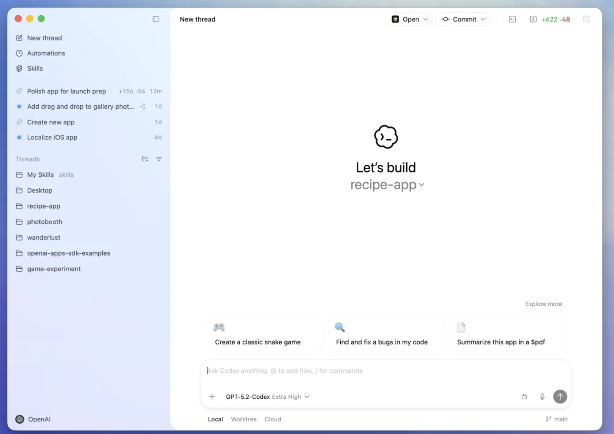
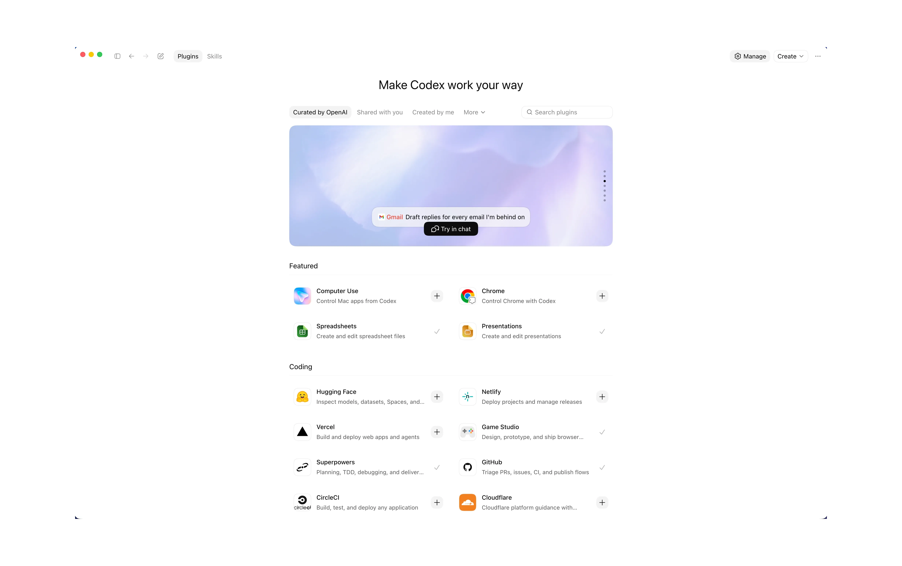
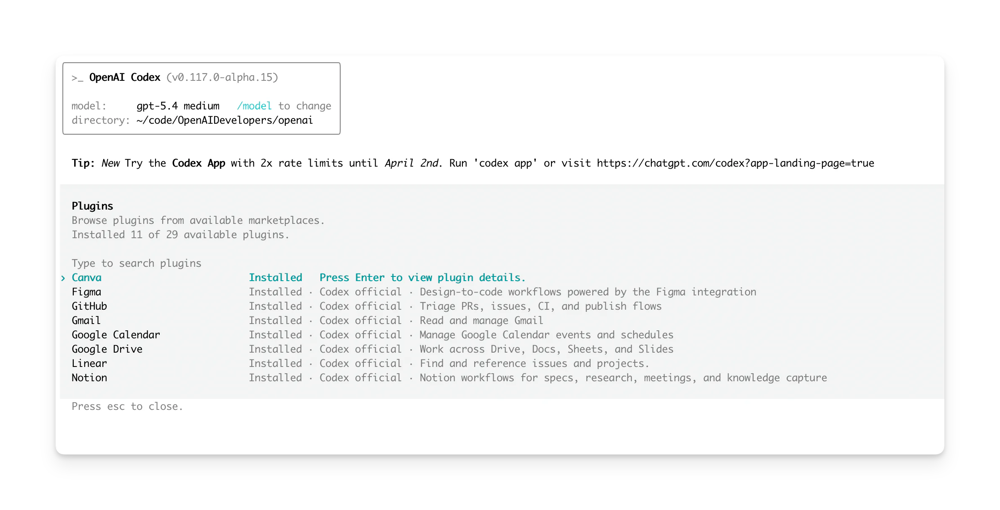
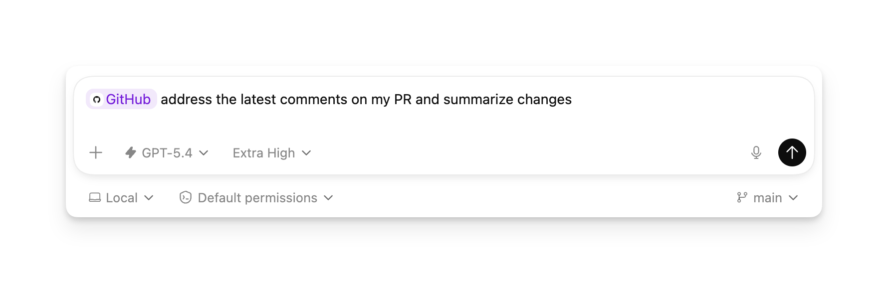
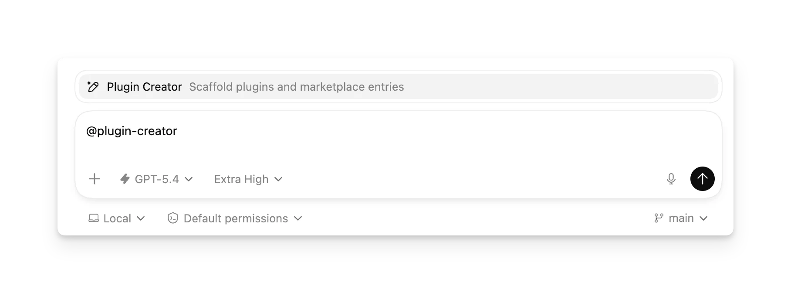
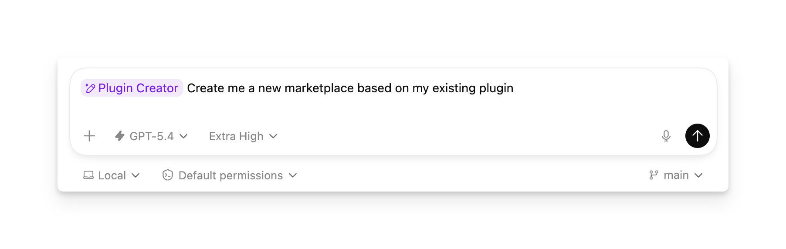
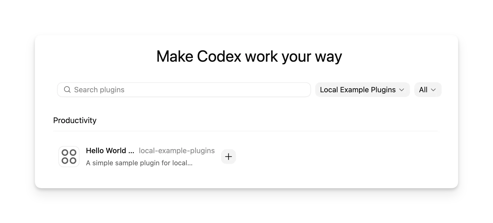

# 287.Codex 实战从入门到精通

#

# Codex 核心能力与工程化设计思想揭秘

## Codex 概述

官方文档：<https://developers.openai.com/codex>

项目地址：<https://github.com/openai/codex>



Codex 是 OpenAI 面向软件开发的编码智能体。ChatGPT Plus、Pro、Business、Edu 和 Enterprise 计划都包含 Codex。它可以帮助你：

* **编写代码** ：描述你想构建的内容，Codex 会生成符合你意图的代码，并适配你现有项目的结构与约定。
* **理解陌生代码库** ：Codex 可以阅读并解释复杂或遗留代码，帮助你更快理解团队如何组织系统。
* **审查代码** ：Codex 会分析代码，识别潜在 bug、逻辑错误和未处理的边界情况。
* **调试并修复问题** ：当系统出问题时，Codex 可以帮助你追踪失败点、定位根因并提出有针对性的修复方案。
* **自动化开发任务** ：Codex 可以执行重构、测试、迁移、初始化等重复性工作流，让你专注于更高层级的工程决策。

## Codex 核心能力

Codex是一个无论你在哪里编写代码都能协作的智能体，从并行线程、Git 评审到工作树、自动化和本地环境，这些都是 Codex 中最常用的核心能力入口。


## Codex 工程化设计思想

OpenAI 的 Codex（以及现代 AI 编码助手如 OpenAI Code/Codex 等衍生 Agent）已从简单的“代码补全”演进为具备深度工程化设计思想的 **全栈开发伙伴**。其核心工程化设计思想主要包含以下几个支柱：

**1. 规范工程取代提示词工程 (Specification Engineering)**

AI 软件开发的核心瓶颈已从编写代码转向传达意图。Codex 提倡将**规范 (Specification)** 作为“真理之源”。

* **结构化输入：** 摒弃模糊的自然语言，采用“目标 + 边界 + 验收标准”的结构。
* **代码编译规范：** 复杂的业务逻辑会被先行转化为可被 AI 严格执行的参数化指令或架构蓝图。

**2. 意图拆解与 Agent Loop (任务循环)**

Codex 不单单是单向生成代码，而是通过 Agent 循环机制模拟人类工程师的开发过程：

* **Plan (计划模式)：** 优先输出执行方案，交由人类确认后再动手编码，避免无效返工。
* **Act (执行模式)：** 将大任务拆解为细粒度的函数或模块编写。
* **Review (审查模式)：** 结合上下文分析潜在的 Bug、安全性问题或性能瓶颈。

**3. 上下文工程 (Context Engine)**

为了理解庞大的软件工程项目，Codex 的工程架构优化了上下文的管理机制：

* **精简向量检索：** 对整个代码库进行语义切片，只向模型注入与当前任务（如特定文件、相关依赖）最相关的元数据，突破 Context Window 限制。
* **AST（抽象语法树）感知：** 结合代码的树状结构理解依赖引用，避免盲目拼接文本导致的上下文污染。

**4. 外部工具协同 (Tool Orchestration)**

工程化设计中，Codex 具备强大的环境交互能力，使其不仅仅是一个文本生成器：

* **自主执行：** 被赋予了终端环境的控制权，能够调用编译器、调试器、包管理器或直接运行测试用例。
* **自愈闭环：** 当代码报错时，Codex 会自主读取 Error Log（错误日志），定位根因并完成自动修复。

# Codex 快速搭建与项目案例实战

我们可以在 IDE、CLI 或云端开始使用 Codex，每个 ChatGPT 套餐都包含 Codex。

也可以使用 OpenAI API key 登录，并通过 API credits 使用 Codex。

## 安装 Codex CLI

Codex CLI 支持 macOS、Windows 和 Linux。

在 macOS 或 Linux 上，使用独立安装器：

```plain
curl -fsSL https://chatgpt.com/codex/install.sh | sh
```

在 Windows 上运行：

```plain
powershell -ExecutionPolicy ByPass -c "irm https://chatgpt.com/codex/install.ps1 | iex"
```

你也可以用 npm 或 Homebrew 安装 Codex CLI：

```plain
npm install -g @openai/codex
```

```plain
brew install --cask codex
```

## 安装 Codex App

下载地址：<https://chatgpt.com/zh-Hans-CN/codex/>


## 打开 Codex 并登录

下载安装完成后，打开 Codex，并使用你的 ChatGPT 账号或 OpenAI API key 登录。

如果你使用 OpenAI API key 登录，某些功能可能不可用，例如云端线程。

## 选择项目

选择一个你希望 Codex 参与工作的项目文件夹。

如果你以前用过 Codex App、CLI 或 IDE 扩展，这里还会显示你之前处理过的项目。

## 发送消息

选好项目后，确认已选中 Local（本地模式），让 Codex 在你的机器上工作，然后向 Codex 发送第一条消息。

你可以询问 Codex 关于这个项目的问题，也可以让它帮助处理你电脑上的一般性开发任务。下面是一些示例：

告诉我这个项目是做什么的

在这个仓库里实现一个经典的 Snake 游戏

以最小且高置信度的改动修复我代码库里的 bug

如果你需要更多灵感，可以查看[Codex 用例](https://www.codex-docs.com/getting-started/use-cases/)；

# Codex CLI 高效交互指南与规范拆解

Codex 支持的不止是聊天式工作流。使用本指南了解每项能力能解锁什么，以及它适合在什么场景中使用。

## 以交互模式运行

Codex 会以全屏终端 UI 启动。你可以与它一起迭代，它能读取仓库、修改代码并运行命令。只要你希望在对话式工作流中实时审视 Codex 的动作，就适合使用这种方式。

```plain
codex
```

你也可以在命令行中直接指定一条初始提示词。

```plain
codex "Explain this codebase to me"
```

会话打开后，你可以：

* 直接在输入框中发送提示词、代码片段或截图。
* 观看 Codex 在改动前先解释自己的计划，并在过程中内联批准或拒绝步骤。
* 在 TUI 中阅读带语法高亮的 Markdown 代码块和 diff，并用 <code><font style="background-color:rgb(243, 244, 244);">/theme</font></code> 预览和保存自己偏好的主题。
* 使用 <code><font style="background-color:rgb(243, 244, 244);">/clear</font></code> 清空终端并开启新聊天，或按 Ctrl+L 只清屏而不开始新对话。
* 使用 <code><font style="background-color:rgb(243, 244, 244);">/copy</font></code> 或按 Ctrl+O 复制最近一条已完成的 Codex 输出。如果当前 turn 仍在运行，它会复制最近一次完成的输出，而不是正在生成中的文本。
* 当 Codex 正在运行时，按 Tab 可以为下一轮排队后续文本、斜杠命令或 <code><font style="background-color:rgb(243, 244, 244);">!</font></code> shell 命令。
* 用 Up/Down 浏览输入框中的草稿历史；Codex 会恢复之前的草稿文本和图片占位。
* 按 Ctrl+R 可以从输入框中搜索提示词历史；按 Enter 接受匹配结果，或按 Esc 取消。
* 完成后按 Ctrl+C 或使用 <code><font style="background-color:rgb(243, 244, 244);">/exit</font></code> 关闭交互式会话。

## 恢复会话

Codex 会把对话记录保存在本地，这样你就可以从上次停下的地方继续，而不必反复补充上下文。想在同一仓库状态和同一套指令下重新打开早先的线程时，请使用 <code><font style="background-color:rgb(243, 244, 244);">resume</font></code> 子命令。

* <code><font style="background-color:rgb(243, 244, 244);">codex resume</font></code> 会打开最近交互式会话的选择器。高亮某次运行可以先看摘要，按 Enter 即可重新打开。
* <code><font style="background-color:rgb(243, 244, 244);">codex resume --all</font></code> 会显示当前工作目录之外的会话，因此你可以恢复任意本地运行记录。
* <code><font style="background-color:rgb(243, 244, 244);">codex resume --last</font></code> 会跳过选择器，直接恢复当前工作目录下最近一次会话；如果再加上 <code><font style="background-color:rgb(243, 244, 244);">--all</font></code>，则会忽略当前工作目录过滤。
* <code><font style="background-color:rgb(243, 244, 244);">codex resume <SESSION_ID></font></code> 会恢复指定会话。你可以从选择器、<code><font style="background-color:rgb(243, 244, 244);">/status</font></code>，或 <code><font style="background-color:rgb(243, 244, 244);">~/.codex/sessions/</font></code> 里的文件名中找到这个 ID。

非交互式自动化运行也可以恢复：

```plain
codex exec resume --last "Fix the race conditions you found"
codex exec resume 7f9f9a2e-1b3c-4c7a-9b0e-.... "Implement the plan"
```

每次恢复后的运行都会保留原始对话记录、计划历史和审批记录，因此 Codex 能在你补充新指令时继续利用此前上下文。如果你需要在恢复前调整环境，可以用 <code><font style="background-color:rgb(243, 244, 244);">--cd</font></code> 修改工作目录，或用 <code><font style="background-color:rgb(243, 244, 244);">--add-dir</font></code> 添加额外根目录。

## 模型与推理

对于 Codex 中的大多数任务，推荐使用 <code><font style="background-color:rgb(243, 244, 244);">gpt-5.5</font></code>。它是 OpenAI 最新的前沿模型，最适合复杂编码、计算机操作、知识工作和研究工作流，并且在多步骤任务上的规划、工具使用和持续推进能力更强。对于追求额外速度的任务，ChatGPT Pro 订阅者还可以使用研究预览版 <code><font style="background-color:rgb(243, 244, 244);">GPT-5.3-Codex-Spark</font></code>。

你可以在会话中通过 <code><font style="background-color:rgb(243, 244, 244);">/model</font></code> 切换模型，也可以在启动 CLI 时直接指定模型。

```plain
codex --model gpt-5.5
```

## 图片输入

附加截图或设计稿，让 Codex 在阅读你的提示词时一并读取图像细节。你既可以把图片粘贴进交互式输入框，也可以在命令行里直接传入文件。

```plain
codex -i screenshot.png "Explain this error"
```

```plain
codex --image img1.png,img2.jpg "Summarize these diagrams"
```

Codex 支持 PNG、JPEG 等常见格式。对于两张或更多图片，使用逗号分隔文件名，并配合文字说明补充上下文。

## 图片生成

你可以要求 Codex 直接在 CLI 中生成或编辑图片。这适合图标、banner、插图、sprite sheet 和占位图等素材。如果你希望 Codex 转换或扩展现有素材，请在提示词中附上参考图。

你可以用自然语言提出请求，也可以在提示词中包含 <code><font style="background-color:rgb(243, 244, 244);">$imagegen</font></code> 来显式调用图片生成技能。

内置图片生成使用 <code><font style="background-color:rgb(243, 244, 244);">gpt-image-2</font></code>，计入你的通用 Codex 使用限制；根据图片质量和尺寸不同，平均会以不含图片生成的类似 turn 的 3-5 倍的速度消耗套餐包含额度。详情见[定价](https://developers.openai.com/codex/pricing#image-generation-usage-limits)。提示词技巧和模型细节见[图片生成指南](https://developers.openai.com/api/docs/guides/image-generation)。

如果要大批量生成图片，请在环境变量中设置 <code><font style="background-color:rgb(243, 244, 244);">OPENAI_API_KEY</font></code>，并要求 Codex 通过 API 生成图片，这样会按 API 价格计费。

## 语法高亮与主题

TUI 会对带围栏的 Markdown 代码块和文件 diff 做语法高亮，让代码在评审和调试时更容易浏览。

使用 <code><font style="background-color:rgb(243, 244, 244);">/theme</font></code> 打开主题选择器，实时预览主题，并把你的选择保存到 <code><font style="background-color:rgb(243, 244, 244);">~/.codex/config.toml</font></code> 中的 <code><font style="background-color:rgb(243, 244, 244);">tui.theme</font></code>。你也可以把自定义 <code><font style="background-color:rgb(243, 244, 244);">.tmTheme</font></code> 文件放到 <code><font style="background-color:rgb(243, 244, 244);">$CODEX_HOME/themes</font></code> 下，再在选择器中选用。

## 运行本地代码评审

在 CLI 中输入 <code><font style="background-color:rgb(243, 244, 244);">/review</font></code>，即可打开 Codex 的评审预设。CLI 会启动一个专用评审智能体，读取你选择的 diff，并在不改动工作树的前提下，输出带优先级、可执行的问题列表。默认情况下它使用当前会话模型；如果要覆盖，可在 <code><font style="background-color:rgb(243, 244, 244);">config.toml</font></code> 中设置 <code><font style="background-color:rgb(243, 244, 244);">review_model</font></code>。

* **对比某个基线分支进行评审**：让你选择一个本地分支。Codex 会找到它与上游分支的 merge base，读取 diff，并在你打开 pull request 前指出最大的风险。
* **评审未提交改动**：检查所有已暂存、未暂存和未跟踪的变更，帮助你在提交前发现问题。
* **评审某个提交**：列出最近的提交，让 Codex 读取你选定 SHA 对应的精确改动集。
* **自定义评审指令**：接受你自己的表述，例如 “重点关注可访问性回归”，并用同一套评审器执行。

每次运行都会作为对话记录中独立的一轮出现，因此你可以随着代码演进反复运行评审，并比较反馈差异。

## Web 搜索

Codex 自带第一方 Web 搜索工具。对于 Codex CLI 中的本地任务，默认会启用 Web 搜索，并优先从 Web 搜索缓存提供结果。这个缓存是 OpenAI 维护的网页结果索引，因此 <code><font style="background-color:rgb(243, 244, 244);">cached</font></code> 模式返回的是预索引结果，而不是实时抓取页面。这能降低来自任意实时内容的提示词注入风险，但你仍应把 Web 结果视为不可信输入。如果你使用的是 <code><font style="background-color:rgb(243, 244, 244);">--yolo</font></code> 或其他[完全访问沙箱设置](https://www.codex-docs.com/administration/agent-approvals-security/#run-without-approval-prompts)，Web 搜索会默认切到实时结果。若要抓取最新数据，可以在单次运行时传入 <code><font style="background-color:rgb(243, 244, 244);">--search</font></code>，或者在[配置基础](https://www.codex-docs.com/configuration/config-file/config-basic/)中设置 <code><font style="background-color:rgb(243, 244, 244);">web_search = "live"</font></code>。你也可以把它设为 <code><font style="background-color:rgb(243, 244, 244);">web_search = "disabled"</font></code> 以关闭该工具。

每次 Codex 做网页检索时，你都会在对话记录或 <code><font style="background-color:rgb(243, 244, 244);">codex exec --json</font></code> 输出中看到 <code><font style="background-color:rgb(243, 244, 244);">web_search</font></code> 条目。

## 直接用输入提示词运行

如果你只需要一个快速答案，可以直接带一条提示词运行 Codex，跳过交互式 UI。

```plain
codex "explain this codebase"
```

Codex 会读取当前工作目录、生成计划，并把响应流式输出回终端后退出。你也可以搭配 <code><font style="background-color:rgb(243, 244, 244);">--path</font></code> 等参数指定目标目录，或用 <code><font style="background-color:rgb(243, 244, 244);">--model</font></code> 提前调好行为。

## 审批模式

审批模式定义了在不需要你停下来确认的前提下，Codex 能做多少事情。你可以在交互式会话中通过 <code><font style="background-color:rgb(243, 244, 244);">/permissions</font></code> 动态切换模式。

* **Auto（自动，默认）**：允许 Codex 在工作目录内读取文件、编辑代码并运行命令；如果要访问工作目录之外的内容或使用网络，仍会先请求你确认。
* **Read-only（只读）**：让 Codex 保持在偏咨询型模式。它可以浏览文件，但在你批准计划前不会改动文件或运行命令。
* **Full Access（完全访问）**：允许 Codex 跨机器范围工作，并可带网络访问，且无需额外确认。只应在你信任该仓库和任务时使用。

Codex 始终会保留完整的动作记录，因此你仍然可以按照平常的 Git 工作流做评审或回滚改动。

## 脚本化 Codex

通过 <code><font style="background-color:rgb(243, 244, 244);">exec</font></code> 子命令，你可以把 Codex 接入自动化工作流，或集成进现有脚本。它会以非交互方式运行 Codex，并把最终计划与结果输出到 <code><font style="background-color:rgb(243, 244, 244);">stdout</font></code>。

```plain
codex exec "fix the CI failure"
```

你可以把 <code><font style="background-color:rgb(243, 244, 244);">exec</font></code> 和 Shell 脚本组合起来，构建自己的工作流，例如自动更新变更日志、整理 issue，或在 pull request 发出前执行编辑性检查。

##

## 提示与快捷方式

* 在输入框中键入 <code><font style="background-color:rgb(243, 244, 244);">@</font></code>，可以对工作区根目录执行模糊文件搜索；按 Tab 或 Enter 即可把高亮路径插入消息。
* 当 Codex 正在运行时，按 Enter 会把新指令注入当前 turn；按 Tab 则会把后续输入排队到下一轮执行。排队输入可以是普通提示词、<code><font style="background-color:rgb(243, 244, 244);">/review</font></code> 这类斜杠命令，也可以是 <code><font style="background-color:rgb(243, 244, 244);">!</font></code> shell 命令。Codex 会在这些排队斜杠命令运行时解析它们。
* 在一行前加上 <code><font style="background-color:rgb(243, 244, 244);">!</font></code> 可以直接运行本地 shell 命令，例如 <code><font style="background-color:rgb(243, 244, 244);">!ls</font></code>。Codex 会把输出当作用户提供的命令结果处理，同时仍遵守你的审批和沙箱设置。
* 当输入框为空时，连续按两次 Esc 可以编辑上一条用户消息；继续按 Esc 可以沿着转录记录继续向前回退，然后按 Enter 从那个点分叉。
* 使用 <code><font style="background-color:rgb(243, 244, 244);">codex --cd <path></font></code>，你可以在任意目录下启动 Codex，并直接把指定路径设为工作根目录，无需先手动 <code><font style="background-color:rgb(243, 244, 244);">cd</font></code>。当前路径会显示在 TUI 页眉中。
* 当你需要跨多个项目协调修改时，可以用 <code><font style="background-color:rgb(243, 244, 244);">--add-dir</font></code> 暴露更多可写根目录，例如 <code><font style="background-color:rgb(243, 244, 244);">codex --cd apps/frontend --add-dir ../backend --add-dir ../shared</font></code>。
* 最好在启动 Codex 前就把环境准备好，这样它不会浪费 token 去探测需要激活什么。例如，先激活 Python 虚拟环境或其他语言环境、启动必需的守护进程，并提前导出你希望使用的环境变量。

# Codex 斜杠指令体系与业务场景调度实战

斜杠命令让你可以用键盘优先的方式快速控制 Codex。在输入框中输入 `/` 会打开斜杠命令弹出菜单；选中某个命令后，Codex 就能在不离开终端的情况下执行切换模型、调整权限、压缩长对话等操作。

本页会说明如何：

* 找到适合当前任务的内置斜杠命令
* 用 `/model`、`/fast`、`/personality`、`/permissions`、`/approve`、`/raw`、`/agent`、`/status` 等命令调整正在进行中的会话

## 内置斜杠命令

Codex 内置了以下命令。打开斜杠命令弹出菜单后，开始输入命令名即可过滤列表。

当某个任务已经在运行时，你可以输入斜杠命令并按 `Tab`，把它排队到下一轮执行。Codex 会在实际运行时再解析这些排队的斜杠命令，因此命令菜单和错误会在当前 turn 结束后显示。排队前，斜杠补全仍然可用。

| 命令 | 用途 | 何时使用 |
| --- | --- | --- |
| [/permissions](https://www.codex-docs.com/using-codex/cli/slash-commands/#update-permissions-with-permissions) | 设置 Codex 在不先询问的情况下可以做什么。 | 想在会话中途放宽或收紧审批要求时，例如在 `Auto`<br/> 和 `Read Only`<br/> 之间切换。 |
| [/ide](https://www.codex-docs.com/using-codex/cli/slash-commands/#include-ide-context-with-ide) | 包含打开文件、当前选区和其他 IDE 上下文。 | 想把编辑器上下文带进下一条提示词，而不重新解释 IDE 里打开了什么时。 |
| [/keymap](https://www.codex-docs.com/using-codex/cli/slash-commands/#remap-tui-shortcuts-with-keymap) | 重新映射 TUI 快捷键。 | 想查看自定义快捷键绑定并把它们持久写入 `config.toml`<br/> 时。 |
| [/vim](https://www.codex-docs.com/using-codex/cli/slash-commands/#toggle-vim-mode-with-vim) | 切换输入框的 Vim 模式。 | 想在 Vim normal / insert 行为和默认输入编辑模式之间切换时。 |
| [/sandbox-add-read-dir](https://www.codex-docs.com/using-codex/cli/slash-commands/#grant-sandbox-read-access-with-sandbox-add-read-dir) | 为额外目录授予沙箱读权限（仅 Windows）。 | 某些命令需要读取当前可读根目录之外的绝对路径时，用它解锁。 |
| [/agent](https://www.codex-docs.com/using-codex/cli/slash-commands/#switch-agent-threads-with-agent) | 切换当前激活的智能体线程。 | 想查看或继续某个已生成的子智能体线程时。 |
| [/apps](https://www.codex-docs.com/using-codex/cli/slash-commands/#browse-apps-with-apps) | 浏览 Apps（连接器），并把它们插入提示词。 | 想先把某个 App 以 `$app-slug`<br/> 的形式附加进提示词，再让 Codex 调用它时使用。 |
| [/plugins](https://www.codex-docs.com/using-codex/cli/slash-commands/#browse-plugins-with-plugins) | 浏览已安装和可发现的插件。 | 想检查插件工具、安装建议插件，或管理哪些插件可用时使用。 |
| [/hooks](https://www.codex-docs.com/using-codex/cli/slash-commands/#view-lifecycle-hooks-with-hooks) | 查看和管理生命周期 hooks。 | 想检查当前会话加载了哪些 hook 配置时。 |
| [/clear](https://www.codex-docs.com/using-codex/cli/slash-commands/#clear-the-terminal-and-start-a-new-chat-with-clear) | 清空终端，并开始一个新聊天。 | 想同时重置可见 UI 和当前对话时。 |
| [/compact](https://www.codex-docs.com/using-codex/cli/slash-commands/#keep-transcripts-lean-with-compact) | 总结当前可见对话，以释放 token。 | 长会话后压缩对话记录，保留重点并腾出上下文空间。 |
| [/copy](https://www.codex-docs.com/using-codex/cli/slash-commands/#copy-the-latest-response-with-copy) | 复制最近一次已完成的 Codex 输出。 | 想直接拿到最近一条完成回复或计划文本，而不手动选中复制；也可以按 Ctrl+O。 |
| [/diff](https://www.codex-docs.com/using-codex/cli/slash-commands/#review-changes-with-diff) | 显示 Git diff，包括 Git 尚未追踪的文件。 | 在提交或运行测试前，先审查 Codex 改了什么。 |
| [/exit](https://www.codex-docs.com/using-codex/cli/slash-commands/#exit-the-cli-with-quit-or-exit) | 退出 CLI（等价于 `/quit`<br/>）。 | 作为 `/quit`<br/> 的另一种写法使用；两者都会直接退出会话。 |
| [/experimental](https://www.codex-docs.com/using-codex/cli/slash-commands/#toggle-experimental-features-with-experimental) | 切换实验性功能。 | 想在 CLI 中开启可选能力，例如子智能体。 |
| [/approve](https://www.codex-docs.com/using-codex/cli/slash-commands/#approve-an-auto-review-denial-with-approve) | 批准最近一次 auto review 拒绝后的重试。 | 想让 Codex 重试被自动评审拒绝的命令或动作时。 |
| [/memories](https://www.codex-docs.com/using-codex/cli/slash-commands/#configure-memories-with-memories) | 配置记忆使用和生成。 | 想在不离开 TUI 的情况下开启或关闭记忆注入 / 生成时。 |
| [/skills](https://www.codex-docs.com/using-codex/cli/slash-commands/#use-skills-with-skills) | 浏览和使用技能。 | 想选择相关本地技能来改善特定任务行为时。 |
| [/feedback](https://www.codex-docs.com/using-codex/cli/slash-commands/#send-feedback-with-feedback) | 向 Codex 维护团队发送日志。 | 想报告问题或分享诊断信息时。 |
| [/init](https://www.codex-docs.com/using-codex/cli/slash-commands/#generate-agentsmd-with-init) | 在当前目录生成 `AGENTS.md`<br/> 骨架。 | 想为仓库或子目录留下长期生效的操作指令时。 |
| [/logout](https://www.codex-docs.com/using-codex/cli/slash-commands/#sign-out-with-logout) | 退出 Codex 登录状态。 | 在共享机器上清理本地凭据。 |
| [/mcp](https://www.codex-docs.com/using-codex/cli/slash-commands/#list-mcp-tools-with-mcp) | 列出已配置的 Model Context Protocol（MCP）工具。 | 想确认本会话可用的外部工具能力时；添加 `verbose`<br/> 可查看 MCP server 详情。 |
| [/mention](https://www.codex-docs.com/using-codex/cli/slash-commands/#highlight-files-with-mention) | 把文件附加到当前对话。 | 想让 Codex 下一步重点查看某个文件或目录。 |
| [/model](https://www.codex-docs.com/using-codex/cli/slash-commands/#set-the-active-model-with-model) | 选择当前使用的模型，以及可用时的推理强度。 | 在执行任务前切换模型，例如在通用模型和深度推理模型之间切换。 |
| [/fast](https://www.codex-docs.com/using-codex/cli/slash-commands/#toggle-fast-mode-with-fast) | 为受支持模型切换快速模式（Fast mode）。 | 打开 / 关闭快速模式，或检查当前线程是否处于快速模式。 |
| [/plan](https://www.codex-docs.com/using-codex/cli/slash-commands/#switch-to-plan-mode-with-plan) | 切换到规划模式，并可选择立即附带一条提示词。 | 想先让 Codex 给出执行计划，再进入实现阶段时。 |
| [/goal](https://www.codex-docs.com/using-codex/cli/slash-commands/#set-or-view-a-task-goal-with-goal) | 设置、暂停、恢复、查看或清除任务目标。 | 让 Codex 在较大的任务运行期间持续跟踪一个目标。 |
| [/personality](https://www.codex-docs.com/using-codex/cli/slash-commands/#set-a-communication-style-with-personality) | 设定响应风格。 | 想让 Codex 更简洁、更解释型，或更偏协作式，而不改写原提示词。 |
| [/ps](https://www.codex-docs.com/using-codex/cli/slash-commands/#check-background-terminals-with-ps) | 查看实验性的后台终端及其最近输出。 | 想不离开主对话记录就查看长任务进度时。 |
| [/stop](https://www.codex-docs.com/using-codex/cli/slash-commands/#stop-background-terminals-with-stop) | 停止所有后台终端。 | 想取消当前会话启动的后台终端任务时。 |
| [/fork](https://www.codex-docs.com/using-codex/cli/slash-commands/#fork-the-current-conversation-with-fork) | 把当前对话分叉成新线程。 | 想在不丢失当前对话记录的情况下平行探索另一种做法。 |
| [/side](https://www.codex-docs.com/using-codex/cli/slash-commands/#start-a-side-conversation-with-side) | 启动一个临时侧边会话（side conversation）。 | 想在不打断主线程记录的情况下提出一个聚焦追问。 |
| [/raw](https://www.codex-docs.com/using-codex/cli/slash-commands/#toggle-raw-scrollback-with-raw) | 切换 raw scrollback 模式。 | 想在查看长输出时让终端选中和复制更少受格式化影响。 |
| [/resume](https://www.codex-docs.com/using-codex/cli/slash-commands/#resume-a-saved-conversation-with-resume) | 从 session 列表中恢复某个已保存对话。 | 想继续之前的 CLI 会话，而不从头开始时。 |
| [/new](https://www.codex-docs.com/using-codex/cli/slash-commands/#start-a-new-conversation-with-new) | 在同一个 CLI 会话里开启一个新对话。 | 想在同一仓库中切换新任务，但不退出 CLI。 |
| [/quit](https://www.codex-docs.com/using-codex/cli/slash-commands/#exit-the-cli-with-quit-or-exit) | 退出 CLI。 | 想立即离开当前会话时。 |
| [/review](https://www.codex-docs.com/using-codex/cli/slash-commands/#ask-for-a-working-tree-review-with-review) | 让 Codex 审查当前工作树。 | 当 Codex 完成任务后，或你想让它再看一遍本地改动时。 |
| [/status](https://www.codex-docs.com/using-codex/cli/slash-commands/#inspect-the-session-with-status) | 显示当前会话配置和 token 使用情况。 | 用来确认当前模型、审批策略、可写目录和上下文余量。 |
| [/debug-config](https://www.codex-docs.com/using-codex/cli/slash-commands/#inspect-config-layers-with-debug-config) | 打印配置层叠与 requirements 诊断信息。 | 需要排查配置优先级、策略要求或实验性网络约束时。 |
| [/statusline](https://www.codex-docs.com/using-codex/cli/slash-commands/#configure-footer-items-with-statusline) | 交互式配置 TUI 底部状态栏项。 | 想挑选并重排底部状态栏中显示的 model / context / limits / git / tokens / session 等信息时。 |
| [/title](https://www.codex-docs.com/using-codex/cli/slash-commands/#configure-terminal-title-items-with-title) | 交互式配置终端窗口或标签标题项。 | 想把项目、状态、线程、分支、模型或任务进度等信息显示到终端标题中时。 |
| [/theme](https://www.codex-docs.com/using-codex/cli/slash-commands/#choose-a-syntax-theme-with-theme) | 选择语法高亮主题。 | 想预览并保存终端语法高亮主题时。 |

`/quit` 和 `/exit` 都会退出 CLI。退出前请确认你已经保存或提交了重要工作。

使用 `/permissions` 调整 Codex 在不先询问的情况下可以做什么。只有当你需要重试最近被自动评审拒绝的动作时，才使用 `/approve`。

## 用斜杠命令控制当前会话

下面这些工作流可以帮助你在不重启 Codex 的情况下持续调整会话。

### 用 `/model` 设置当前模型

1. 启动 Codex 并打开输入框。
2. 输入 `/model` 并按 Enter。
3. 从弹出菜单中选择 `gpt-4.1-mini`、`gpt-4.1` 等模型。

预期结果：Codex 会在对话记录中确认模型已切换。你也可以运行 `/status` 再确认一次。

### 用 `/personality` 设置沟通风格

使用 `/personality` 可以在不重写提示词的情况下调整 Codex 的表达方式。

1. 在当前对话中输入 `/personality` 并按 Enter。
2. 从弹出菜单中选择一种风格。

预期结果：Codex 会在对话记录中确认新的风格，并在后续回复中持续采用它。

Codex 支持 `friendly`、`pragmatic` 和 `none` 三种沟通风格（personality）。使用 `none` 可关闭沟通风格指令。

如果当前模型不支持沟通风格专用指令，Codex 会隐藏这个命令。

### 用 `/plan` 切换到规划模式

1. 输入 `/plan` 并按 Enter，把当前对话切换到规划模式。
2. 你也可以直接附带一段内联提示词，例如 `/plan Propose a migration plan for this service`。
3. 使用内联 `/plan` 参数时，你也可以粘贴内容或附加图片。

预期结果：Codex 会进入规划模式，并把你可选提供的内联提示词作为第一条规划请求。

当某个任务已经在运行时，`/plan` 会暂时不可用。

### 用 `/goal` 设置或查看任务目标

1. 输入 `/goal <objective>` 设置目标，例如 `/goal Finish the migration and keep tests green`。
2. 输入 `/goal` 查看当前目标。
3. 使用 `/goal pause`、`/goal resume` 或 `/goal clear` 暂停、恢复或移除目标。

预期结果：Codex 会在工作继续推进时，把该目标持续附加到活动线程上。

目标内容必须非空，且最多 4,000 个字符。对于更长的指令，请把细节放进文件，并让目标指向该文件。

### 用 `/experimental` 切换实验性功能

1. 输入 `/experimental` 并按 Enter。
2. 切换你想启用的功能，例如 Apps 或 Guardian approval；如果 Codex 提示需要重启，则按提示执行。

预期结果：Codex 会把你的功能选择写入配置，并在重启后生效。

### 用 `/approve` 批准 auto review 拒绝后的重试

当自动评审拒绝了最近一次动作，而你希望 Codex 重试一次时，可以使用 `/approve`。

1. 输入 `/approve`。
2. 当 Codex 显示相关被拒绝动作时，确认重试。

预期结果：Codex 会在当前会话策略下重试该被拒绝动作一次。

### 用 `/memories` 配置记忆

1. 输入 `/memories`。
2. 选择 Codex 应该使用已有记忆、生成新记忆，还是保持记忆行为关闭。

预期结果：Codex 会更新后续会话使用的相关记忆设置。

### 用 `/skills` 使用技能

1. 输入 `/skills`。
2. 选择你希望 Codex 应用的技能。

预期结果：Codex 会插入所选技能上下文，让下一条请求遵循该技能的说明。

### 用 `/clear` 清空终端并开始新聊天

1. 输入 `/clear` 并按 Enter。

预期结果：Codex 会清空终端、重置当前可见的对话记录，并在同一个 CLI 会话中启动一个全新的聊天。

与 **Ctrl**+**L** 不同，`/clear` 会开启一个新对话。

**Ctrl**+**L** 只会清空终端显示，不会清空当前聊天。任务运行中时，这两个动作都会被禁用。

### 用 `/permissions` 更新权限

1. 输入 `/permissions` 并按 Enter。
2. 选择与你当前风险偏好匹配的审批预设，例如无人值守运行时可选 `Auto`，想先审查改动时可选 `Read Only`。

预期结果：Codex 会公布新的策略，后续动作都会遵守更新后的审批模式，直到你再次修改。

###

### 用 `/vim` 切换 Vim 模式

1. 输入 `/vim`。
2. 继续在输入框中编辑。

预期结果：Codex 会为当前会话切换输入框 Vim 模式。若要让新会话默认使用 Vim 模式，请在 `config.toml` 中设置 `tui.vim_mode_default = true`。

### 用 `/copy` 复制最新回复

1. 输入 `/copy` 并按 Enter。

预期结果：Codex 会把最近一条已完成的输出复制到剪贴板。

如果当前 turn 仍在运行，`/copy` 会复制最近一条已完成的输出，而不是正在生成中的回复。在第一条完整输出产生之前，以及回滚刚结束后，这个命令不可用。

你也可以在主 TUI 中按 **Ctrl**+**O**，不打开斜杠命令菜单也能复制最近一次已完成回复。

### 用 `/raw` 切换 raw scrollback

1. 输入 `/raw`、`/raw on` 或 `/raw off`。

预期结果：Codex 会切换 raw scrollback 模式，让终端选中和复制更直接。你也可以使用默认 **Alt**+**R** 绑定，或通过 `tui.raw_output_mode = true` 持久化默认值。

### 用 `/sandbox-add-read-dir` 授予沙箱读权限

这个命令只在 Windows 原生 CLI 中可用。

1. 输入 `/sandbox-add-read-dir C:\absolute\directory\path` 并按 Enter。
2. 确认该路径是一个存在的绝对目录。

预期结果：Codex 会刷新 Windows 沙箱策略，并为后续在沙箱中运行的命令授予该目录的读权限。

### 用 `/status` 查看当前会话

1. 在任意对话中输入 `/status`。
2. 查看输出中的当前模型、审批策略、可写根目录和 token 使用情况。

预期结果：你会看到一段类似 `codex status` 的摘要，用来确认 Codex 正在你预期的位置和配置下运行。

### 用 `/debug-config` 查看配置层

1. 输入 `/debug-config`。
2. 查看输出中的配置层顺序、启用状态和策略来源。

预期结果：Codex 会打印各层配置诊断，以及策略细节，例如 `allowed_approval_policies`、`allowed_sandbox_modes`、`mcp_servers`、`rules`、`enforce_residency` 和 `experimental_network`（若已配置）。

当某个生效设置与你在 `config.toml` 中看到的不一致时，这份输出很适合拿来排查原因。

### 用 `/statusline` 配置底部状态栏项目

1. 输入 `/statusline`。
2. 用选择器切换并重排项目，然后确认。

预期结果：底部状态栏会立刻更新，并把配置持久写入 `config.toml` 中的 `tui.status_line`。

可显示的状态栏项包括 model、model+reasoning、context 统计、rate limits、Git branch、token 计数、session id、当前目录 / 项目根，以及 Codex 版本。

### 用 `/title` 配置终端标题项

1. 输入 `/title`。
2. 用选择器切换并重排项目，然后确认。

预期结果：终端窗口或标签标题会立刻更新，并把配置持久写入 `config.toml` 中的 `tui.terminal_title`。

可显示的标题项包括 app 名称、项目、加载指示器、状态、线程、Git 分支、模型和任务进度。

### 用 `/theme` 选择语法主题

1. 输入 `/theme`。
2. 从选择器中预览主题，然后确认。

预期结果：Codex 会更新语法高亮，并把选择持久写入 `config.toml` 中的 `tui.theme`。

### 用 `/keymap` 重新映射 TUI 快捷键

使用 `/keymap` 可以查看、更新并持久保存 TUI 的快捷键绑定。

1. 输入 `/keymap`。
2. 选择要修改的快捷键 context 和 action。
3. 输入新的绑定，或移除现有绑定。

预期结果：Codex 会更新当前 keymap，并把自定义绑定写入 `config.toml` 中的 `tui.keymap`。

快捷键绑定使用 `ctrl-a`、`shift-enter`、`page-down` 这类名称。特定上下文的绑定会覆盖 `tui.keymap.global`；空绑定列表表示解除该动作绑定。

### 用 `/ps` 查看后台终端

1. 输入 `/ps`。
2. 查看后台终端列表及其状态。

预期结果：Codex 会展示每个后台终端的命令，以及最多三行最近、非空输出，方便你快速判断进度。

只有在启用了 `unified_exec` 时才会出现后台终端；否则列表可能为空。

### 用 `/stop` 停止后台终端

1. 输入 `/stop`。
2. 如果 Codex 在停止前要求确认，就按提示确认。

预期结果：Codex 会停止当前会话中的所有后台终端。`/clean` 仍可作为 `/stop` 的别名使用。

### 用 `/compact` 精简对话记录

1. 在一次较长的对话后输入 `/compact`。
2. 当 Codex 提示是否要总结当前对话时，确认即可。

预期结果：Codex 会用一段简洁摘要替换较早的 turns，在保留关键细节的同时释放上下文。

### 用 `/diff` 审查改动

1. 输入 `/diff` 查看 Git diff。
2. 在 CLI 内滚动输出，审查改动和新增文件。

预期结果：Codex 会显示已暂存的改动、未暂存的改动，以及 Git 尚未开始追踪的文件，帮助你决定要保留什么。

### 用 `/mention` 高亮文件

1. 输入 `/mention` 后跟路径，例如 `/mention src/lib/api.ts`。
2. 从弹出菜单中选择匹配结果。

预期结果：Codex 会把该文件加入当前对话，使后续 turn 能直接引用它。

### 用 `/new` 开启新对话

1. 输入 `/new` 并按 Enter。

预期结果：Codex 会在同一个 CLI 会话中开启一个全新对话，让你无需退出终端就能切换到另一项任务。

与 `/clear` 不同，`/new` 不会先清空当前终端显示。

### 用 `/resume` 恢复已保存对话

1. 输入 `/resume` 并按 Enter。
2. 从保存的会话选择器中选中你要恢复的对话。

预期结果：Codex 会载入你所选对话的完整记录，让你从原来的进度继续，而不会丢掉历史内容。

### 用 `/fork` 分叉当前对话

1. 输入 `/fork` 并按 Enter。

预期结果：Codex 会把当前对话复制成一个带有新 ID 的线程，原始对话记录保持不变，因此你可以并行探索另一种方案。

如果你要 fork 的不是当前对话，而是某个已保存 session，请在终端中运行 `codex fork`，打开 session picker。

### 用 `/side` 启动侧边会话（side conversation）

使用 `/side` 可以从当前对话启动一个临时分叉，而不离开主任务。

1. 输入 `/side` 打开侧边会话。
2. 也可以附带行内文本，例如 `/side Check whether this plan has an obvious risk`。
3. 这个聚焦插曲结束后，返回父线程。

预期结果：Codex 会打开一个转录记录与父线程分离的侧边会话。处于侧边模式时，TUI 仍会显示父线程状态，方便你确认主任务是否仍在运行。

`/side` 不能在另一个侧边会话内使用，也不能在评审模式中使用。

### 用 `/init` 生成 `AGENTS.md`

1. 在你希望 Codex 查找长期指令的目录中运行 `/init`。
2. 查看生成的 `AGENTS.md`，再按仓库约定继续编辑。

预期结果：Codex 会创建一个可继续完善并提交、供后续会话使用的 `AGENTS.md` 骨架。

### 用 `/review` 审查工作树

1. 输入 `/review`。
2. 如果你还想查看精确的文件改动，可继续运行 `/diff`。

预期结果：Codex 会总结它在当前工作树中发现的问题，重点关注行为变化与缺失测试。默认使用当前 session 的 model，除非你在 `config.toml` 中单独设置了 `review_model`。

### 用 `/mcp` 列出 MCP 工具

1. 输入 `/mcp`。
2. 查看列表，确认当前有哪些 MCP server 和工具可用。

预期结果：你会看到当前会话中 Codex 可调用的 MCP 工具列表。

使用 `/mcp verbose` 可以包含详细的服务端诊断信息。如果传入的参数不是 `verbose`，Codex 会显示命令用法。

### 用 `/apps` 浏览 Apps

1. 输入 `/apps`。
2. 从列表中选择一个 App。

预期结果：Codex 会把 App mention 以 `$app-slug` 的形式插入输入框，这样你就可以立刻要求 Codex 调用它。

### 用 `/plugins` 浏览插件

1. 输入 `/plugins`。
2. 选择一个插件市场标签页，然后选中某个插件，查看它的能力或可用动作。

预期结果：Codex 会打开插件浏览器，让你查看已安装插件、当前配置允许发现的插件，以及已安装插件状态。在已安装插件上按 **Space** 可以切换它的启用状态。

### 用 `/hooks` 查看生命周期 hooks

1. 输入 `/hooks`。
2. 查看当前会话中已加载的生命周期 hook 配置。

预期结果：Codex 会显示当前会话可运行的 hooks。

### 用 `/agent` 切换智能体线程

1. 输入 `/agent` 并按 Enter。
2. 从选择器中选中你要查看或继续的线程。

预期结果：Codex 会切换当前激活线程，让你查看或继续该智能体的工作。

### 用 `/feedback` 发送反馈

1. 输入 `/feedback` 并按 Enter。
2. 按提示选择是否附带日志或其他诊断信息。

预期结果：Codex 会收集所需诊断信息，并把它提交给维护团队。

### 用 `/logout` 退出登录

1. 输入 `/logout` 并按 Enter。

预期结果：Codex 会清除当前用户会话在本地保存的凭据。

### 用 `/quit` 或 `/exit` 退出 CLI

1. 输入 `/quit` 或 `/exit` 并按 Enter。

预期结果：Codex 会立即退出。退出前请先保存或提交重要工作。

# Codex AGENTS.md 配置与架构设计

通过全局说明、项目覆盖、目录层级规则和备用文件来定制智能体行为、评审重点与团队协作约定。

Codex 会在开始任何工作前读取 <code><font style="background-color:rgb(243, 244, 244);">AGENTS.md</font></code> 文件。通过把全局指导和项目级覆盖层叠起来，你就能在每次打开任意仓库时，都从一致的工作预期开始。

## Codex 如何发现这些指导

Codex 启动时会整理出一条本次运行要使用的指令链。这个过程每次运行都会重新执行；在终端界面（TUI）中，通常就是每次新建会话时重新构建。查找顺序如下：

1. **全局层：** 先检查 Codex 主目录（默认是 <code><font style="background-color:rgb(243, 244, 244);">~/.codex</font></code>，也可以通过 <code><font style="background-color:rgb(243, 244, 244);">CODEX_HOME</font></code> 指定）。如果存在 <code><font style="background-color:rgb(243, 244, 244);">AGENTS.override.md</font></code>，就使用它；否则再读取 <code><font style="background-color:rgb(243, 244, 244);">AGENTS.md</font></code>。这一层只会采用找到的第一个非空文件。
2. **项目层：** 然后从项目根目录（通常是 Git 根目录）一路检查到当前工作目录。如果没有找到项目根，就只检查当前目录。沿途每一级目录都会按 <code><font style="background-color:rgb(243, 244, 244);">AGENTS.override.md</font></code>、<code><font style="background-color:rgb(243, 244, 244);">AGENTS.md</font></code>、<code><font style="background-color:rgb(243, 244, 244);">project_doc_fallback_filenames</font></code> 中定义的备用文件名这一顺序查找；每个目录最多只会纳入一个文件。
3. **合并顺序：** 最后，Codex 会按 “从根到当前目录” 的顺序把这些文件拼接起来。越靠近当前目录的文件越靠后，因此会覆盖前面更通用的说明。

空文件会被跳过。合并后的总大小一旦达到 <code><font style="background-color:rgb(243, 244, 244);">project_doc_max_bytes</font></code> 设定的上限（默认 32 KiB），Codex 就不会再继续加入更多文件，如果触到上限，可以调大限制，或把指令拆到更深一层的目录中。

## 创建全局指导

在 Codex 主目录中创建持久默认值，这样每个仓库都会继承你的工作约定。

1. 确保目录存在：

```plain
mkdir -p ~/.codex
```

2. 创建 <code><font style="background-color:rgb(243, 244, 244);">~/.codex/AGENTS.md</font></code>，写入可复用偏好：

```plain
# ~/.codex/AGENTS.md

## 工作约定

- 修改 JavaScript 文件后，始终运行 `npm test`。
- 安装依赖时优先使用 `pnpm`。
- 添加新的生产依赖前先征求确认。
```

3. 在任意目录运行 Codex，确认它已加载该文件：

```plain
codex --ask-for-approval never "Summarize the current instructions."
```

预期结果：Codex 会在给出工作建议前，先引用 <code><font style="background-color:rgb(243, 244, 244);">~/.codex/AGENTS.md</font></code> 中的条目。

当你需要临时性的全局覆盖，而又不想删除基础文件时，可以使用 <code><font style="background-color:rgb(243, 244, 244);">~/.codex/AGENTS.override.md</font></code>。删除这个覆盖文件后，就会恢复共享指导。

## 分层组织项目说明

仓库级文件可以让 Codex 感知项目规范，同时继续继承你的全局默认值。

1. 在仓库根目录添加一个 <code><font style="background-color:rgb(243, 244, 244);">AGENTS.md</font></code>，写入基础约定：

```plain
# AGENTS.md

## 仓库通用约定

- 在创建 pull request 前运行 `npm run lint`。
- 修改行为时，在 `docs/` 中记录对外公共工具的变化。
```

2. 当某些团队需要不同规则时，在嵌套目录中添加覆盖文件。例如在 <code><font style="background-color:rgb(243, 244, 244);">services/payments/</font></code> 下创建 <code><font style="background-color:rgb(243, 244, 244);">AGENTS.override.md</font></code>：

```plain
# services/payments/AGENTS.override.md

## payments 服务规则

- 使用 `make test-payments`，不要使用 `npm test`。
- 轮换 API key 前，必须先通知安全频道。
```

3. 从 <code><font style="background-color:rgb(243, 244, 244);">payments</font></code> 目录启动 Codex：

```plain
codex --cd services/payments --ask-for-approval never "List the instruction sources you loaded."
```

预期结果：Codex 会先报告全局文件，再报告仓库根目录 <code><font style="background-color:rgb(243, 244, 244);">AGENTS.md</font></code>，最后报告 <code><font style="background-color:rgb(243, 244, 244);">payments</font></code> 目录下的覆盖文件。

Codex 的搜索会在到达当前目录时停止，因此应把覆盖文件尽量放在靠近专门化工作的地方。

添加全局文件和 <code><font style="background-color:rgb(243, 244, 244);">payments</font></code> 专属覆盖文件后，仓库结构示例如下：

* AGENTS.md 仓库通用约定
* services/
  * payments/
    * AGENTS.md 因为存在覆盖文件，所以会被忽略
    * AGENTS.override.md payments 服务规则
    * README.md
  * search/

## 自定义备用文件名

如果你的仓库已经在使用其他文件名（例如 <code><font style="background-color:rgb(243, 244, 244);">TEAM_GUIDE.md</font></code>），你可以把它加入备用列表，让 Codex 也把它当作说明文件。

1. 编辑你的 Codex 配置：

```plain
# ~/.codex/config.toml
project_doc_fallback_filenames = ["TEAM_GUIDE.md", ".agents.md"]
project_doc_max_bytes = 65536
```

2. 重启 Codex，或者运行一条新的命令，让更新后的配置被加载。

这样一来，Codex 就会按以下顺序检查每个目录：<code><font style="background-color:rgb(243, 244, 244);">AGENTS.override.md</font></code>、<code><font style="background-color:rgb(243, 244, 244);">AGENTS.md</font></code>、<code><font style="background-color:rgb(243, 244, 244);">TEAM_GUIDE.md</font></code>、<code><font style="background-color:rgb(243, 244, 244);">.agents.md</font></code>。不在这个列表中的文件名不会参与说明文件发现。更大的字节上限则允许合并更多指导内容后再截断。

设置好备用列表后，Codex 会把这些替代文件也视作说明文件：

* TEAM_GUIDE.md 通过备用列表发现
* .agents.md 根目录中的备用文件
* support/
  * AGENTS.override.md 覆盖备用文件中的指导
  * playbooks/

如果你希望使用不同配置档，例如某个项目专用的自动化账号，可以设置 <code><font style="background-color:rgb(243, 244, 244);">CODEX_HOME</font></code> 环境变量：

```plain
CODEX_HOME=$(pwd)/.codex codex exec "List active instruction sources"
```

预期结果：输出会列出相对于自定义 <code><font style="background-color:rgb(243, 244, 244);">.codex</font></code> 目录的文件路径。

## 验证你的设置

* 在仓库根目录运行 <code><font style="background-color:rgb(243, 244, 244);">codex --ask-for-approval never "Summarize the current instructions."</font></code>。正常情况下，Codex 会按优先级复述全局和项目级指导。
* 使用 <code><font style="background-color:rgb(243, 244, 244);">codex --cd subdir --ask-for-approval never "Show which instruction files are active."</font></code>，确认嵌套目录中的覆盖文件是否成功覆盖了更上层规则。
* 如果你需要审计 Codex 实际加载了哪些说明文件，可以查看 <code><font style="background-color:rgb(243, 244, 244);">~/.codex/log/codex-tui.log</font></code>，或者在开启会话日志时检查最近的 <code><font style="background-color:rgb(243, 244, 244);">session-*.jsonl</font></code>。
* 如果说明看起来像是旧的，请在目标目录里重启 Codex。Codex 会在每次运行时重新构建指令链，在 TUI 中则是在每次会话开始时重建，所以没有需要手工清理的缓存。

## 排查发现问题

* **什么都没有加载：** 检查你是否位于目标仓库内，并确认 <code><font style="background-color:rgb(243, 244, 244);">codex status</font></code> 显示的工作区根目录符合预期；同时确认说明文件不是空文件。
* **出现了错误指导：** 优先检查目录树更高层，或 Codex 主目录下，是否存在 <code><font style="background-color:rgb(243, 244, 244);">AGENTS.override.md</font></code>。
* **Codex 忽略了备用文件名：** 检查 <code><font style="background-color:rgb(243, 244, 244);">project_doc_fallback_filenames</font></code> 是否拼写正确，并在修改配置后重新启动 Codex。
* **指令被截断：** 提高 <code><font style="background-color:rgb(243, 244, 244);">project_doc_max_bytes</font></code>，或把大文件拆到更深层的目录中。
* **配置档混淆：** 先执行 <code><font style="background-color:rgb(243, 244, 244);">echo $CODEX_HOME</font></code>，确认 Codex 实际读取的是哪个主目录。

# Codex Rules 体系构建与代码可控性治理

使用 OpenAI Codex Rules 控制哪些命令可以在沙箱外执行，了解命令匹配、权限边界、审批策略和团队安全控制方法。

使用 rules 可以控制 Codex 哪些命令允许在 sandbox 之外运行。

## 创建 rules 文件

1. 在当前激活配置层旁边的 <code><font style="background-color:rgb(243, 244, 244);">rules/</font></code> 目录下创建一个 <code><font style="background-color:rgb(243, 244, 244);">.rules</font></code> 文件，例如 <code><font style="background-color:rgb(243, 244, 244);">~/.codex/rules/default.rules</font></code>。
2. 添加一条规则。下面这个例子会在允许 <code><font style="background-color:rgb(243, 244, 244);">gh pr view</font></code> 于沙箱外运行前先提示用户确认。

```plain
# Prompt before running commands with the prefix `gh pr view` outside the sandbox.
prefix_rule(
    # The prefix to match.
    pattern = ["gh", "pr", "view"],

    # The action to take when Codex requests to run a matching command.
    decision = "prompt",

    # Optional rationale for why this rule exists.
    justification = "Viewing PRs is allowed with approval",

    # `match` and `not_match` are optional "inline unit tests" where you can
    # provide examples of commands that should (or should not) match this rule.
    match = [
        "gh pr view 7888",
        "gh pr view --repo openai/codex",
        "gh pr view 7888 --json title,body,comments",
    ],
    not_match = [
        # Does not match because the `pattern` must be an exact prefix.
        "gh pr --repo openai/codex view 7888",
    ],
)
```

3. 重启 Codex。

Codex 会在启动时扫描每个激活配置层下的 <code><font style="background-color:rgb(243, 244, 244);">rules/</font></code> 目录，包括[团队配置](https://www.codex-docs.com/administration/enterprise/admin-setup/#team-config)位置和用户层 <code><font style="background-color:rgb(243, 244, 244);">~/.codex/rules/</font></code>。位于 <code><font style="background-color:rgb(243, 244, 244);"><repo>/.codex/rules/</font></code> 的项目本地规则只会在项目 <code><font style="background-color:rgb(243, 244, 244);">.codex/</font></code> 配置层受信任时加载。

当你在 TUI 中把某条命令加入允许列表时，Codex 会把规则写入用户层的 <code><font style="background-color:rgb(243, 244, 244);">~/.codex/rules/default.rules</font></code>，这样后续运行就可以跳过同类提示。

启用 Smart approvals（智能审批）时，Codex 在升级权限请求期间可能会为你建议一条 <code><font style="background-color:rgb(243, 244, 244);">prefix_rule</font></code>。接受前，请仔细检查它建议的命令前缀。

管理员也可以通过 [requirements.toml](https://www.codex-docs.com/administration/enterprise/managed-configuration/#admin-enforced-requirements-requirementstoml) 强制下发更严格的 <code><font style="background-color:rgb(243, 244, 244);">prefix_rule</font></code>。

## 理解规则字段

<code><font style="background-color:rgb(243, 244, 244);">prefix_rule()</font></code> 支持这些字段：

* <code><font style="background-color:rgb(243, 244, 244);">pattern</font></code>（必填）：一个非空列表，用来定义要匹配的命令前缀。列表中的每个元素可以是：
  * 一个字面量字符串，例如 <code><font style="background-color:rgb(243, 244, 244);">"pr"</font></code>
  * 一个由多个字面量构成的并集，例如 <code><font style="background-color:rgb(243, 244, 244);">["view", "list"]</font></code>，表示在这一参数位置匹配多个备选值
* <code><font style="background-color:rgb(243, 244, 244);">decision</font></code>（默认值为 <code><font style="background-color:rgb(243, 244, 244);">"allow"</font></code>）：当规则命中时要采取的动作。如果多条规则同时命中，Codex 会采用最严格的决策（<code><font style="background-color:rgb(243, 244, 244);">forbidden</font></code> > <code><font style="background-color:rgb(243, 244, 244);">prompt</font></code> > <code><font style="background-color:rgb(243, 244, 244);">allow</font></code>）。
  * <code><font style="background-color:rgb(243, 244, 244);">allow</font></code>：不提示，直接在 sandbox 外运行命令
  * <code><font style="background-color:rgb(243, 244, 244);">prompt</font></code>：每次命中都先请求确认
  * <code><font style="background-color:rgb(243, 244, 244);">forbidden</font></code>：不提示，直接阻止该请求
* <code><font style="background-color:rgb(243, 244, 244);">justification</font></code>（可选）：非空的人类可读说明。Codex 可能会在 approval 提示或拒绝消息中显示它。如果使用 <code><font style="background-color:rgb(243, 244, 244);">forbidden</font></code>，适合在这里顺带给出一个推荐替代方案，例如 <code><font style="background-color:rgb(243, 244, 244);">"Use \</font></code>rg<code><font style="background-color:rgb(243, 244, 244);">instead of</font></code>grep<code><font style="background-color:rgb(243, 244, 244);">."</font></code>
* <code><font style="background-color:rgb(243, 244, 244);">match</font></code> 和 <code><font style="background-color:rgb(243, 244, 244);">not_match</font></code>（默认都是 <code><font style="background-color:rgb(243, 244, 244);">[]</font></code>）：在加载 rules 时由 Codex 校验的命令示例，用来在规则真正生效前发现配置错误

当 Codex 评估一条待运行命令时，它会把命令的参数数组与 <code><font style="background-color:rgb(243, 244, 244);">pattern</font></code> 做比较。在内部，Codex 会把命令视为一个参数列表，类似 <code><font style="background-color:rgb(243, 244, 244);">execvp(3)</font></code> 接收到的形式。

## Shell wrapper 与复合命令

有些工具会把多条 shell 命令包装成一次调用，例如：

```plain
["bash", "-lc", "git add . && rm -rf /"]
```

由于这种调用会把多个动作隐藏在一段字符串里，Codex 会对 <code><font style="background-color:rgb(243, 244, 244);">bash -lc</font></code>、<code><font style="background-color:rgb(243, 244, 244);">bash -c</font></code> 以及对应的 <code><font style="background-color:rgb(243, 244, 244);">zsh</font></code> / <code><font style="background-color:rgb(243, 244, 244);">sh</font></code> 变体做特殊处理。

### Codex 何时可以安全拆分脚本

如果 shell 脚本只是由下列元素组成的线性命令链：

* 纯字面量单词，不包含变量展开、<code><font style="background-color:rgb(243, 244, 244);">VAR=...</font></code>、<code><font style="background-color:rgb(243, 244, 244);">$FOO</font></code>、<code><font style="background-color:rgb(243, 244, 244);">*</font></code> 等特殊语法
* 只通过安全运算符连接，例如 <code><font style="background-color:rgb(243, 244, 244);">&&</font></code>、<code><font style="background-color:rgb(243, 244, 244);">||</font></code>、<code><font style="background-color:rgb(243, 244, 244);">;</font></code> 或 <code><font style="background-color:rgb(243, 244, 244);">|</font></code>

那么 Codex 会使用 tree-sitter 解析它，并在应用 rules 前把它拆成多条独立命令。

上面的脚本会被视为两条命令：

* <code><font style="background-color:rgb(243, 244, 244);">["git", "add", "."]</font></code>
* <code><font style="background-color:rgb(243, 244, 244);">["rm", "-rf", "/"]</font></code>

Codex 会分别用你的 rules 评估每条命令，并以最严格的结果为准。

即使你允许 <code><font style="background-color:rgb(243, 244, 244);">pattern=["git", "add"]</font></code>，Codex 也不会自动放行 <code><font style="background-color:rgb(243, 244, 244);">git add . && rm -rf /</font></code>，因为其中的 <code><font style="background-color:rgb(243, 244, 244);">rm -rf /</font></code> 会被单独评估，从而阻止整个调用被自动允许。

这可以防止危险命令混在安全命令后面一起 “偷渡” 执行。

### Codex 何时不会拆分脚本

如果脚本使用了更复杂的 shell 特性，例如：

* 重定向，例如 <code><font style="background-color:rgb(243, 244, 244);">></font></code>、<code><font style="background-color:rgb(243, 244, 244);">>></font></code>、<code><font style="background-color:rgb(243, 244, 244);"><</font></code>
* 替换表达式，例如 <code><font style="background-color:rgb(243, 244, 244);">$(...)</font></code> 或反引号
* 环境变量赋值，例如 <code><font style="background-color:rgb(243, 244, 244);">FOO=bar</font></code>
* 通配符模式，例如 <code><font style="background-color:rgb(243, 244, 244);">*</font></code>、<code><font style="background-color:rgb(243, 244, 244);">?</font></code>
* 控制流，例如 <code><font style="background-color:rgb(243, 244, 244);">if</font></code>、<code><font style="background-color:rgb(243, 244, 244);">for</font></code>，或带赋值的 <code><font style="background-color:rgb(243, 244, 244);">&&</font></code>

那么 Codex 就不会尝试解释或拆分它。

在这种情况下，整次调用会被当作：

```plain
["bash", "-lc", "<full script>"]
```

并按**一次单独调用**整体应用你的 rules。

这种处理方式意味着：在可以安全拆分时，Codex 会按单条命令逐项评估；在不能安全拆分时，则采用更保守的整体判断。

## 测试规则文件

使用 <code><font style="background-color:rgb(243, 244, 244);">codex execpolicy check</font></code> 可以测试 rules 对某条命令会产生什么效果：

```plain
codex execpolicy check --pretty \
  --rules ~/.codex/rules/default.rules \
  -- gh pr view 7888 --json title,body,comments
```

这个命令会输出 JSON，展示最严格的决策结果以及命中的规则，其中也包括命中规则里的 <code><font style="background-color:rgb(243, 244, 244);">justification</font></code>。你可以传多个 <code><font style="background-color:rgb(243, 244, 244);">--rules</font></code> 来组合多份规则文件；加上 <code><font style="background-color:rgb(243, 244, 244);">--pretty</font></code> 则会得到格式化输出。

## 理解规则语言

<code><font style="background-color:rgb(243, 244, 244);">.rules</font></code> 文件使用的是 Starlark（参见 [language spec](https://github.com/bazelbuild/starlark/blob/master/spec.md)）。它的语法看起来像 Python，但设计目标是安全执行，因此 rules 引擎可以在不产生副作用的前提下运行它，例如不会触碰文件系统。

# Codex MCP 核心协议配置与业务系统无缝对接

模型上下文协议（MCP）用于把模型连接到工具和上下文。你可以用它让 Codex 访问第三方文档，或让它与浏览器、Figma 等开发工具交互。

Codex CLI 和 IDE 扩展都支持 MCP servers。

支持的 MCP 能力

***

* **STDIO server：** 以本地进程方式运行、通过命令启动的 MCP server。
  * 支持环境变量
* **streamable HTTP server：** 通过固定地址访问的 MCP server。
  * 支持 Bearer token 认证
  * 支持 OAuth 认证；对于支持 OAuth 的 MCP server，可以运行 `codex mcp login <server-name>`
* **Server instructions：** Codex 会读取初始化期间返回的 MCP `instructions` 字段，并把它作为 server 级指导，与该 server 的工具一起使用。

如果你构建或维护供 Codex 使用的 MCP server，可以用 `instructions` 描述跨工具工作流、约束和适用于整个 server 的速率限制。请让前 512 个字符自成一体，确保 Codex 在决定如何使用该 server 时能读到最重要的指导。

将 Codex 连接到 MCP server

***

Codex 会把 MCP 配置和其他设置一起保存在 `config.toml` 中。默认位置是 `~/.codex/config.toml`；你也可以把 MCP server 配置在项目级 `.codex/config.toml` 中，但只有在该项目被标记为可信时才会生效。

CLI 和 IDE 扩展共享这一份配置。也就是说，MCP server 只需配置一次，就可以在两个 Codex 客户端之间切换使用，而无需重复设置。

配置 MCP server 有两种方式：

1. **使用 CLI：** 运行 `codex mcp` 来添加和管理 MCP servers。
2. **直接编辑 **`config.toml`**：** 直接修改 `~/.codex/config.toml`，或可信项目中的 `.codex/config.toml`。

### 使用 CLI 配置

#### 添加 MCP server

```plain
codex mcp add <server-name> --env VAR1=VALUE1 --env VAR2=VALUE2 -- <stdio server-command>

```

例如，如果要添加 Context7 这个面向开发文档的免费 MCP server，可以运行：

```plain
codex mcp add context7 -- npx -y @upstash/context7-mcp

```

#### 其他 CLI 命令

如果你想查看所有 MCP 子命令，可以运行 `codex mcp --help`。

#### 终端界面（TUI）

在 `codex` TUI 中，可以使用 `/mcp` 查看当前激活的 MCP servers。

### 使用 `config.toml` 配置

如果你需要更细粒度的控制，可以直接编辑 `~/.codex/config.toml`，或项目级 `.codex/config.toml`。在 IDE 扩展中，可以从齿轮菜单进入 **MCP settings**，然后选择 **Open config.toml**。

每个 MCP server 都通过一个 `[mcp_servers.<server-name>]` 表来定义。

#### STDIO server

* `command`（必填）：启动该 MCP server 的命令。
* `args`（可选）：传给 MCP server 的参数。
* `env`（可选）：为 MCP server 设置的环境变量。
* `env_vars`（可选）：允许转发给 MCP server 的环境变量名。
* `cwd`（可选）：启动 MCP server 时使用的工作目录。
* `experimental_environment`（可选）：设为 `remote` 时，如果可用，会通过远程执行器环境启动 stdio server。

`env_vars` 可以包含普通变量名，也可以包含带来源的对象：

```plain
env_vars = ["LOCAL_TOKEN", { name = "REMOTE_TOKEN", source = "remote" }]

```

字符串项和 `source = "local"` 会从 Codex 的本地环境读取；`source = "remote"` 会从远程执行器环境读取，并且需要远程 MCP stdio。

#### streamable HTTP server

* `url`（必填）：MCP server 地址。
* `bearer_token_env_var`（可选）：要放进 `Authorization` 头里的 bearer token 所对应的环境变量名。
* `http_headers`（可选）：静态 HTTP headers 映射。
* `env_http_headers`（可选）：从环境变量取值的 HTTP headers 映射。

#### 其他配置项

* `startup_timeout_sec`（可选）：MCP server 启动超时，单位为秒；默认是 `10`。
* `tool_timeout_sec`（可选）：单次工具调用超时，单位为秒；默认是 `60`。
* `enabled`（可选）：设为 `false` 可在保留配置的同时停用该 MCP server。
* `required`（可选）：设为 `true` 时，如果这个已启用的 MCP server 无法初始化，Codex 启动会直接失败。
* `enabled_tools`（可选）：工具允许列表。
* `disabled_tools`（可选）：工具 denylist；会在 `enabled_tools` 之后应用。
* `default_tools_approval_mode`（可选）：该 server 中工具的默认审批行为。支持的值为 `auto`、`prompt` 和 `approve`。
* `tools.<tool>.approval_mode`（可选）：单个工具的审批行为覆盖。

如果你的 OAuth 提供方要求固定回调端口，可以在 `config.toml` 顶层设置 `mcp_oauth_callback_port`。如果不设置，Codex 会绑定一个临时端口。

如果你的 MCP OAuth 流程必须使用固定回调地址，例如远程 Devbox 的 ingress URL 或自定义回调路径，可以设置 `mcp_oauth_callback_url`。Codex 会把它用作 OAuth 的 `redirect_uri`，同时仍使用 `mcp_oauth_callback_port` 控制本地监听端口。本地回调地址，例如 `localhost`，会绑定到本地接口；非本地回调地址则会绑定到 `0.0.0.0`，以便回调可以从外部访问到宿主机。

如果 MCP server 声明了 “支持的权限范围”（`scopes_supported`），Codex 在 OAuth 授权登录时会优先使用 MCP server 声明的 “权限范围”（`scopes`）；只有在 MCP server 没有声明时，才会回退到 `config.toml` 中配置的权限范围。

#### `config.toml` 示例

```plain
[mcp_servers.context7]
command = "npx"
args = ["-y", "@upstash/context7-mcp"]
env_vars = ["LOCAL_TOKEN"]

[mcp_servers.context7.env]
MY_ENV_VAR = "MY_ENV_VALUE"

```

```plain
# Optional MCP OAuth callback overrides (used by `codex mcp login`)
mcp_oauth_callback_port = 5555
mcp_oauth_callback_url = "https://devbox.example.internal/callback"

```

```plain
[mcp_servers.figma]
url = "https://mcp.figma.com/mcp"
bearer_token_env_var = "FIGMA_OAUTH_TOKEN"
http_headers = { "X-Figma-Region" = "us-east-1" }

```

```plain
[mcp_servers.chrome_devtools]
url = "http://localhost:3000/mcp"
enabled_tools = ["open", "screenshot"]
disabled_tools = ["screenshot"] # applied after enabled_tools
default_tools_approval_mode = "prompt"
startup_timeout_sec = 20
tool_timeout_sec = 45
enabled = true

[mcp_servers.chrome_devtools.tools.open]
approval_mode = "approve"

```

### 插件提供的 MCP server

已安装插件可以在插件 manifest 中打包 MCP server。这些 server 会由插件启动，因此用户配置不会设置它们的 transport command。用户配置仍然可以在 `plugins.<plugin>.mcp_servers.<server>` 下控制开关状态和工具策略。

```plain
[plugins."sample@test".mcp_servers.sample]
enabled = true
default_tools_approval_mode = "prompt"
enabled_tools = ["read", "search"]

[plugins."sample@test".mcp_servers.sample.tools.search]
approval_mode = "approve"

```

常见的 MCP server 示例

***

MCP server 的生态还在持续扩展。下面是一些常见示例：

* [OpenAI Docs MCP](https://developers.openai.com/learn/docs-mcp)：搜索和读取 OpenAI 开发者文档。
* [Context7](https://github.com/upstash/context7)：连接到保持最新的开发者文档。
* Figma [Local](https://developers.figma.com/docs/figma-mcp-server/local-server-installation/) 和 [Remote](https://developers.figma.com/docs/figma-mcp-server/remote-server-installation/)：访问你的 Figma 设计稿。
* [Playwright](https://www.npmjs.com/package/@playwright/mcp)：通过 Playwright 控制并检查浏览器。
* [Chrome Developer Tools](https://github.com/ChromeDevTools/chrome-devtools-mcp/)：控制并检查 Chrome。
* [Sentry](https://docs.sentry.io/product/sentry-mcp/#codex)：访问 Sentry 日志。
* [GitHub](https://github.com/github/github-mcp-server)：完成 `git` 之外的 GitHub 操作，例如 pull request 和 issue 管理。

# Codex SubAgents 多智能体协同与复杂任务分发

了解如何在 OpenAI Codex 中使用和配置子智能体，覆盖任务拆分、角色定义、并行探索、执行编排和多智能体协作的适用场景。

Codex 可以通过并行启动多个专用智能体，并在最后汇总各自的结果，来运行子智能体工作流。这种方式尤其适合并行度高的复杂任务，例如大规模代码库探索，或按步骤推进的多阶段功能实现。

借助子智能体工作流，你还可以按任务类型定义自己的自定义智能体，并为它们指定不同的模型配置和开发者指令。

## 可用性

当前版本的 Codex 默认启用子智能体工作流。

目前子智能体活动会显示在 Codex App 和 CLI 中；IDE 扩展的可视化支持后续会补上。

Codex 只会在你**明确要求**时生成子智能体。因为每个子智能体都会独立进行模型调用和工具调用，所以相比单智能体运行，子智能体工作流会消耗更多 token。

## 典型工作流

Codex 负责所有编排工作，包括：

* 生成新的子智能体
* 给不同智能体路由后续指令
* 等待结果
* 关闭子线程

当多个智能体并行运行时，Codex 会等待所有要求的结果都返回后，再给出一份汇总答复。

例如，你可以在当前项目中尝试下面这段提示词：

```plain
我想针对当前 PR（此分支与主分支对比）审查以下几点。针对每个要点生成一个代理，等待所有代理完成，并汇总每个要点的结果。
1. 安全问题
2. 代码质量
3. Bug
4. 竞态条件
5. 测试不稳定性
6. 代码可维护性
```

## 管理子智能体

* 在 CLI 中使用 <code><font style="background-color:rgb(243, 244, 244);">/agent</font></code>，可以在活跃智能体线程之间切换，并查看正在运行的线程。
* 你也可以直接要求 Codex 去引导某个正在运行的子智能体、停止它，或关闭已经完成的智能体线程。

## 审批与沙箱控制

子智能体会继承你当前会话的沙箱策略。

在交互式 CLI 中，即使你当前停留在主线程里，审批请求也可能来自一个暂时不在前台的智能体线程。审批浮层会显示来源线程标签；如果你想先切过去再决定是否批准，可以按 <code><font style="background-color:rgb(243, 244, 244);">o</font></code> 打开对应线程。

在非交互流程中，或者任何 “无法弹出新的审批” 的运行环境里，只要某个动作需要新的批准，这个动作就会失败，错误会被抛回父工作流。

Codex 在生成子智能体时，也会重新应用父 <code><font style="background-color:rgb(243, 244, 244);">turn</font></code> 的实时运行时覆盖项，包括你在当前会话里通过 <code><font style="background-color:rgb(243, 244, 244);">/permissions</font></code> 改的设置，或者类似 <code><font style="background-color:rgb(243, 244, 244);">--yolo</font></code> 这样的全局开关。即使选中的自定义智能体文件里写了不同的默认值，这些父级实时覆盖也仍然优先。

你也可以为单个[自定义智能体](#custom-agents)单独覆盖沙箱配置，例如强制把某个智能体限定在只读模式。

## 自定义智能体

Codex 自带三种内建智能体：

* <code><font style="background-color:rgb(243, 244, 244);">default</font></code>：通用回退智能体。
* <code><font style="background-color:rgb(243, 244, 244);">worker</font></code>：偏执行，适合实现和修复类任务。
* <code><font style="background-color:rgb(243, 244, 244);">explorer</font></code>：偏只读，适合代码库探索类任务。

如果你要定义自己的智能体，可以在下面两个目录之一中放置独立的 TOML 文件：

* 个人级：<code><font style="background-color:rgb(243, 244, 244);">~/.codex/agents/</font></code>
* 项目级：<code><font style="background-color:rgb(243, 244, 244);">.codex/agents/</font></code>

每个文件定义一个自定义智能体。Codex 会把它作为一个 “额外配置层” 应用到生成的会话中，所以自定义智能体能覆盖的键，基本与普通 <code><font style="background-color:rgb(243, 244, 244);">config.toml</font></code> 可覆盖项一致。

每个自定义智能体文件都必须定义：

* <code><font style="background-color:rgb(243, 244, 244);">name</font></code>
* <code><font style="background-color:rgb(243, 244, 244);">description</font></code>
* <code><font style="background-color:rgb(243, 244, 244);">developer_instructions</font></code>

像 <code><font style="background-color:rgb(243, 244, 244);">nickname_candidates</font></code>、<code><font style="background-color:rgb(243, 244, 244);">model</font></code>、<code><font style="background-color:rgb(243, 244, 244);">model_reasoning_effort</font></code>、<code><font style="background-color:rgb(243, 244, 244);">sandbox_mode</font></code>、<code><font style="background-color:rgb(243, 244, 244);">mcp_servers</font></code>、<code><font style="background-color:rgb(243, 244, 244);">skills.config</font></code> 这样的字段都是可选的；如果省略，就继承父会话。

### 全局设置

全局子智能体设置仍然写在主配置的 <code><font style="background-color:rgb(243, 244, 244);">[agents]</font></code> 下，详见[配置优先级](https://www.codex-docs.com/configuration/config-file/config-basic/#configuration-precedence)。

| **字段** | **类型** | **必需** | **说明** |
| :--- | :--- | :--- | :--- |
| <code><font style="background-color:rgb(243, 244, 244);">agents.max_threads</font></code> | <code><font style="background-color:rgb(243, 244, 244);">number</font></code> | 否 | 允许同时打开的智能体线程上限。 |
| <code><font style="background-color:rgb(243, 244, 244);">agents.max_depth</font></code> | <code><font style="background-color:rgb(243, 244, 244);">number</font></code> | 否 | 智能体生成嵌套深度；根会话深度从 0 开始。 |
| <code><font style="background-color:rgb(243, 244, 244);">agents.job_max_runtime_seconds</font></code> | <code><font style="background-color:rgb(243, 244, 244);">number</font></code> | 否 | <code><font style="background-color:rgb(243, 244, 244);">spawn_agents_on_csv</font></code><br/> 中每个 <code><font style="background-color:rgb(243, 244, 244);">worker</font></code><br/> 的默认超时。 |

补充说明：

* <code><font style="background-color:rgb(243, 244, 244);">agents.max_threads</font></code> 默认是 <code><font style="background-color:rgb(243, 244, 244);">6</font></code>。
* <code><font style="background-color:rgb(243, 244, 244);">agents.max_depth</font></code> 默认是 <code><font style="background-color:rgb(243, 244, 244);">1</font></code>。这允许直接子智能体继续生成一层子智能体，但会阻止更深层的递归。除非你确实需要递归委派，否则建议保持默认值；提高这个值会放大 token 消耗、延迟和本地资源占用。
* <code><font style="background-color:rgb(243, 244, 244);">agents.job_max_runtime_seconds</font></code> 是可选项。未设置时，<code><font style="background-color:rgb(243, 244, 244);">spawn_agents_on_csv</font></code> 会回退到每个 <code><font style="background-color:rgb(243, 244, 244);">worker</font>``<font style="background-color:rgb(243, 244, 244);">1800</font></code> 秒的默认超时。
* 如果某个自定义智能体的 <code><font style="background-color:rgb(243, 244, 244);">name</font></code> 与内建智能体重名，例如 <code><font style="background-color:rgb(243, 244, 244);">explorer</font></code>，则你的自定义智能体会优先生效。

### 自定义智能体文件结构

| **字段** | **类型** | **必需** | **说明** |
| :--- | :--- | :--- | :--- |
| <code><font style="background-color:rgb(243, 244, 244);">name</font></code> | <code><font style="background-color:rgb(243, 244, 244);">string</font></code> | 是 | Codex 在生成或引用该智能体时使用的名字。 |
| <code><font style="background-color:rgb(243, 244, 244);">description</font></code> | <code><font style="background-color:rgb(243, 244, 244);">string</font></code> | 是 | 给 Codex 的人类可读说明，用来提示它何时应选择该智能体。 |
| <code><font style="background-color:rgb(243, 244, 244);">developer_instructions</font></code> | <code><font style="background-color:rgb(243, 244, 244);">string</font></code> | 是 | 定义该智能体行为的核心指令。 |
| <code><font style="background-color:rgb(243, 244, 244);">nickname_candidates</font></code> | <code><font style="background-color:rgb(243, 244, 244);">string[]</font></code> | 否 | 可选昵称池，用于在界面中显示更易读的智能体名称。 |

你也可以在自定义智能体文件中加入其他 <code><font style="background-color:rgb(243, 244, 244);">config.toml</font></code> 支持的键，例如 <code><font style="background-color:rgb(243, 244, 244);">model</font></code>、<code><font style="background-color:rgb(243, 244, 244);">model_reasoning_effort</font></code>、<code><font style="background-color:rgb(243, 244, 244);">sandbox_mode</font></code>、<code><font style="background-color:rgb(243, 244, 244);">mcp_servers</font></code> 和 <code><font style="background-color:rgb(243, 244, 244);">skills.config</font></code>。

Codex 识别自定义智能体依赖的是 <code><font style="background-color:rgb(243, 244, 244);">name</font></code> 字段，而不是文件名。通常让文件名和 <code><font style="background-color:rgb(243, 244, 244);">name</font></code> 一致是最省事的做法，但最终还是以 <code><font style="background-color:rgb(243, 244, 244);">name</font></code> 为准。

### 显示昵称

如果你希望 Codex 在界面中给同一类智能体显示更可读的昵称，可以使用 <code><font style="background-color:rgb(243, 244, 244);">nickname_candidates</font></code>。这在同时运行很多个同类自定义智能体时特别有用，可以避免界面上出现大量重复名称。

昵称只影响展示层；Codex 在内部识别和生成智能体时，依然使用 <code><font style="background-color:rgb(243, 244, 244);">name</font></code>。

<code><font style="background-color:rgb(243, 244, 244);">nickname_candidates</font></code> 必须是非空、去重后的列表。昵称只允许使用 <code><font style="background-color:rgb(243, 244, 244);">ASCII</font></code> 字母、数字、空格、连字符和下划线。

示例：

```plain
name = "reviewer"
description = "PR reviewer focused on correctness, security, and missing tests."
developer_instructions = """
Review code like an owner.
Prioritize correctness, security, behavior regressions, and missing test coverage.
"""
nickname_candidates = ["Atlas", "Delta", "Echo"]
```

在实际界面中，Codex App 和 CLI 可以显示这些昵称，而底层智能体类型仍然是 <code><font style="background-color:rgb(243, 244, 244);">reviewer</font></code>。

### 自定义智能体示例

好的自定义智能体应当足够窄、足够明确。每个智能体都应该有清晰职责、匹配其职责的工具面，以及避免它漂移到相邻工作的开发者指令。

#### 示例 1：PR 评审

这种模式会把 PR 评审拆分给三个各自聚焦的自定义智能体：

* <code><font style="background-color:rgb(243, 244, 244);">pr_explorer</font></code>：负责梳理代码库并收集证据。
* <code><font style="background-color:rgb(243, 244, 244);">reviewer</font></code>：负责检查正确性、安全性和测试风险。
* <code><font style="background-color:rgb(243, 244, 244);">docs_researcher</font></code>：通过专用 MCP server 核对框架或 API 文档。

项目配置（<code><font style="background-color:rgb(243, 244, 244);">.codex/config.toml</font></code>）：

```plain
[agents]
max_threads = 6
max_depth = 1
```

<code><font style="background-color:rgb(243, 244, 244);">.codex/agents/pr-explorer.toml</font></code>：

```plain
name = "pr_explorer"
description = "Read-only codebase explorer for gathering evidence before changes are proposed."
model = "gpt-5.3-codex-spark"
model_reasoning_effort = "medium"
sandbox_mode = "read-only"
developer_instructions = """
Stay in exploration mode.
Trace the real execution path, cite files and symbols, and avoid proposing fixes unless the parent agent asks for them.
Prefer fast search and targeted file reads over broad scans.
"""
```

<code><font style="background-color:rgb(243, 244, 244);">.codex/agents/reviewer.toml</font></code>：

```plain
name = "reviewer"
description = "PR reviewer focused on correctness, security, and missing tests."
model = "gpt-5.4"
model_reasoning_effort = "high"
sandbox_mode = "read-only"
developer_instructions = """
Review code like an owner.
Prioritize correctness, security, behavior regressions, and missing test coverage.
Lead with concrete findings, include reproduction steps when possible, and avoid style-only comments unless they hide a real bug.
"""
```

<code><font style="background-color:rgb(243, 244, 244);">.codex/agents/docs-researcher.toml</font></code>：

```plain
name = "docs_researcher"
description = "Documentation specialist that uses the docs MCP server to verify APIs and framework behavior."
model = "gpt-5.4-mini"
model_reasoning_effort = "medium"
sandbox_mode = "read-only"
developer_instructions = """
Use the docs MCP server to confirm APIs, options, and version-specific behavior.
Return concise answers with links or exact references when available.
Do not make code changes.
"""

[mcp_servers.openaiDeveloperDocs]
url = "https://developers.openai.com/mcp"
```

这套配置适合如下提示词：

```plain
Review this branch against main. Have pr_explorer map the affected code paths, reviewer find real risks, and docs_researcher verify the framework APIs that the patch relies on.
```

## 用子智能体处理 CSV 批量任务（实验性）

这个工作流仍属实验性能力，后续可能变化。<code><font style="background-color:rgb(243, 244, 244);">spawn_agents_on_csv</font></code> 适合 “每一行对应一个相似工作项” 的批量任务：Codex 会读取 CSV，按行生成 <code><font style="background-color:rgb(243, 244, 244);">worker</font></code> 子智能体，等待所有任务完成，然后把结果重新导出成 CSV。

它很适合用于重复性审计类工作，例如：

* 按行审查文件、包或服务
* 检查一组事故、PR 或迁移目标
* 为大量相似输入生成结构化摘要

这个工具接受的核心参数包括：

* <code><font style="background-color:rgb(243, 244, 244);">csv_path</font></code>：源 CSV 路径
* <code><font style="background-color:rgb(243, 244, 244);">instruction</font></code>：<code><font style="background-color:rgb(243, 244, 244);">worker</font></code> 提示词模板，其中可以使用 <code><font style="background-color:rgb(243, 244, 244);">{column_name}</font></code> 占位
* <code><font style="background-color:rgb(243, 244, 244);">id_column</font></code>：当你希望用某一列作为稳定的 <code><font style="background-color:rgb(243, 244, 244);">item id</font></code> 时使用
* <code><font style="background-color:rgb(243, 244, 244);">output_schema</font></code>：当每个 <code><font style="background-color:rgb(243, 244, 244);">worker</font></code> 都需要返回固定结构的 JSON 对象时使用
* <code><font style="background-color:rgb(243, 244, 244);">output_csv_path</font></code>、<code><font style="background-color:rgb(243, 244, 244);">max_concurrency</font></code> 和 <code><font style="background-color:rgb(243, 244, 244);">max_runtime_seconds</font></code>：用于控制整个批量任务

每个 <code><font style="background-color:rgb(243, 244, 244);">worker</font></code> 都必须**恰好调用一次**<code><font style="background-color:rgb(243, 244, 244);">report_agent_job_result</font></code>。如果 <code><font style="background-color:rgb(243, 244, 244);">worker</font></code> 在退出前没有上报结果，Codex 会在导出的 CSV 里把这一行标记为错误。

示例提示词：

```plain
Create /tmp/components.csv with columns path,owner and one row per frontend component.

Then call spawn_agents_on_csv with:
- csv_path: /tmp/components.csv
- id_column: path
- instruction: "Review {path} owned by {owner}. Return JSON with keys path, risk, summary, and follow_up via report_agent_job_result."
- output_csv_path: /tmp/components-review.csv
- output_schema: an object with required string fields path, risk, summary, and follow_up
```

如果通过 <code><font style="background-color:rgb(243, 244, 244);">codex exec</font></code> 运行，批量任务执行期间 Codex 会在 <code><font style="background-color:rgb(243, 244, 244);">stderr</font></code> 输出单行进度信息。导出的 CSV 除了原始列数据，还会附加 <code><font style="background-color:rgb(243, 244, 244);">job_id</font></code>、<code><font style="background-color:rgb(243, 244, 244);">item_id</font></code>、<code><font style="background-color:rgb(243, 244, 244);">status</font></code>、<code><font style="background-color:rgb(243, 244, 244);">last_error</font></code> 和 <code><font style="background-color:rgb(243, 244, 244);">result_json</font></code> 等元数据。

相关运行时设置包括：

* <code><font style="background-color:rgb(243, 244, 244);">agents.max_threads</font></code>：限制同时保持打开状态的智能体线程数量。
* <code><font style="background-color:rgb(243, 244, 244);">agents.job_max_runtime_seconds</font></code>：设置 CSV 并行分发任务中每个 <code><font style="background-color:rgb(243, 244, 244);">worker</font></code> 的默认超时。若本次调用显式传了 <code><font style="background-color:rgb(243, 244, 244);">max_runtime_seconds</font></code>，则以调用级覆盖为准。
* <code><font style="background-color:rgb(243, 244, 244);">sqlite_home</font></code>：控制 Codex 存放 SQLite 运行时状态的位置，这些状态会被用于智能体作业及其导出结果。

#### 示例 2：前端集成调试

这个模式特别适合 UI 回归、浏览器流程不稳定，或横跨应用代码与运行中产品的集成问题。

项目配置（<code><font style="background-color:rgb(243, 244, 244);">.codex/config.toml</font></code>）：

```plain
[agents]
max_threads = 6
max_depth = 1
```

<code><font style="background-color:rgb(243, 244, 244);">.codex/agents/code-mapper.toml</font></code>：

```plain
name = "code_mapper"
description = "Read-only codebase explorer for locating the relevant frontend and backend code paths."
model = "gpt-5.4-mini"
model_reasoning_effort = "medium"
sandbox_mode = "read-only"
developer_instructions = """
Map the code that owns the failing UI flow.
Identify entry points, state transitions, and likely files before the worker starts editing.
"""
```

<code><font style="background-color:rgb(243, 244, 244);">.codex/agents/browser-debugger.toml</font></code>：

```plain
name = "browser_debugger"
description = "UI debugger that uses browser tooling to reproduce issues and capture evidence."
model = "gpt-5.4"
model_reasoning_effort = "high"
sandbox_mode = "workspace-write"
developer_instructions = """
Reproduce the issue in the browser, capture exact steps, and report what the UI actually does.
Use browser tooling for screenshots, console output, and network evidence.
Do not edit application code.
"""

[mcp_servers.chrome_devtools]
url = "http://localhost:3000/mcp"
startup_timeout_sec = 20
```

<code><font style="background-color:rgb(243, 244, 244);">.codex/agents/ui-fixer.toml</font></code>：

```plain
name = "ui_fixer"
description = "Implementation-focused agent for small, targeted fixes after the issue is understood."
model = "gpt-5.3-codex-spark"
model_reasoning_effort = "medium"
developer_instructions = """
Own the fix once the issue is reproduced.
Make the smallest defensible change, keep unrelated files untouched, and validate only the behavior you changed.
"""

[[skills.config]]
path = "/Users/me/.agents/skills/docs-editor/SKILL.md"
enabled = false
```

这套配置适合如下提示词：

```plain
Investigate why the settings modal fails to save. Have browser_debugger reproduce it, code_mapper trace the responsible code path, and ui_fixer implement the smallest fix once the failure mode is clear.
```

# Codex 高阶插件体系集成与研发工作流赋能

在 Codex 中用插件把技能、应用和 MCP server 打包成可复用工作流

## 概览

插件会把技能、应用集成和 MCP server 打包成可复用的工作流，供 Codex 安装和调用。

你可以用插件扩展 Codex 的能力，例如：

* 安装 Gmail 插件，让 Codex 读取和管理 Gmail
* 安装 Google Drive 插件，让 Codex 在 Drive、Docs、Sheets 和 Slides 之间协同工作
* 安装 Slack 插件，让 Codex 总结频道内容或起草回复

一个插件可以包含：

* **技能：** 面向特定任务的可复用指令。Codex 会在需要时加载它们，从而遵循正确步骤，并使用对应的参考资料或辅助脚本。
* **应用：** 连接 GitHub、Slack、Google Drive 等工具，让 Codex 能读取这些工具中的信息，并在其中执行操作。
* **MCP server：** 为 Codex 提供更多工具或共享上下文的服务，通常来自本地项目之外的系统。

你可以通过 marketplace source 发布插件来共享插件，例如为项目或团队准备的仓库 marketplace。关于 marketplace 设置、打包和分发方式

## 使用和安装插件

### Codex App 中的插件目录

在 Codex App 中打开 **Plugins（插件）**，即可浏览并安装精选插件。



插件目录会把插件分成几类：

* **Curated by OpenAI（OpenAI 精选）：** 面向所有 Codex 用户开放的重点插件。
* **Shared with you（与你共享）：** 由 ChatGPT 工作区其他成员分享给你的插件。
* **Created by you（由你创建）：** 你创建或添加到自己工作区的插件。

### CLI 中的插件目录

在 Codex CLI 中，运行下面的命令即可打开插件列表：

```plain
codex
/plugins
```



CLI 插件浏览器会按插件市场分组展示插件。你可以用插件市场标签页切换来源，打开某个插件查看详情，安装或卸载 marketplace 条目，并在已安装插件上按 Space 切换启用状态。

### 安装并使用插件

打开插件目录后：

1. 搜索或浏览某个插件，然后打开它的详情页。
2. 选择安装按钮。在应用中点击加号或 **Add to Codex**；在 CLI 中选择 <code><font style="background-color:rgb(243, 244, 244);">Install plugin</font></code>。
3. 如果插件依赖外部应用，按提示完成连接。有些插件会在安装阶段要求认证，有些则会等到你第一次使用时再要求。
4. 安装完成后，新开一个线程，请求 Codex 使用该插件。

安装后，你可以直接在提示词输入框里使用插件：



* **直接描述任务：** 直接说出你想得到的结果，例如 “总结今天未读的 Gmail 线程” 或“从 Google Drive 拉取最新发布说明”。如果你希望 Codex 自己选择合适的已安装工具，这种方式更合适。
* **指定某个插件：** 输入 <code><font style="background-color:rgb(243, 244, 244);">@</font></code>，显式调用某个插件或它打包的技能。如果你希望精确指定使用哪个插件或技能，请参考 [Codex App 命令](https://www.codex-docs.com/using-codex/app/commands/) 和 [技能](https://www.codex-docs.com/configuration/skills/)。

### 权限与数据共享如何运作

安装插件会让对应工作流在 Codex 中可用，但你现有的[审批设置](https://www.codex-docs.com/administration/agent-approvals-security/)仍然生效。任何已连接的外部服务，也仍然遵守它们各自的认证、隐私和数据共享策略。

* 插件打包的技能会在安装完成后立刻可用。
* 如果插件包含应用，Codex 可能会在安装阶段或你第一次使用时，提示你在 ChatGPT 中安装或登录这些应用。
* 如果插件包含 MCP server，它们可能还需要额外设置或认证后才能使用。
* 当 Codex 通过插件中的应用发送数据时，该应用自身的条款和隐私政策仍然适用。

### 卸载或停用插件

如果要卸载插件，可以在插件浏览器中重新打开该插件，然后选择 **Uninstall plugin（卸载插件）**。

卸载插件会把插件包从 Codex 中移除，但插件附带的 apps 仍会保留在 ChatGPT 中，直到你在那里单独管理它们。

如果你想保留插件、但暂时停用它，可以在 <code><font style="background-color:rgb(243, 244, 244);">~/.codex/config.toml</font></code> 中把该条目设为 <code><font style="background-color:rgb(243, 244, 244);">enabled = false</font></code>，然后重启 Codex：

```plain
[plugins."gmail@openai-curated"]
enabled = false
```

## Codex 构建插件

如果你仍然只是在单个仓库或个人工作流里迭代，一个本地技能往往就足够了。只有当你希望把这个工作流分享给团队、把应用集成、MCP 配置或生命周期 hooks 一起打包，或发布成稳定的可安装包时，再考虑做成插件。

# Codex 企业级专属插件开发与打包分发

## 使用 <code><font style="background-color:rgb(243, 244, 244);">@plugin-creator</font></code> 创建插件

最快的方式是直接使用内置的 <code><font style="background-color:rgb(243, 244, 244);">@plugin-creator</font></code> 技能。



它会自动生成必须的 <code><font style="background-color:rgb(243, 244, 244);">.codex-plugin/plugin.json</font></code> 清单文件，也可以顺手生成一个本地插件市场条目，方便你立即测试。如果你已经有一个插件目录，也可以继续用 <code><font style="background-color:rgb(243, 244, 244);">@plugin-creator</font></code> 把它接到本地插件市场中。



### 构建你自己的精选插件列表

插件市场清单（marketplace）是一个描述插件列表的 JSON 目录。<code><font style="background-color:rgb(243, 244, 244);">@plugin-creator</font></code> 可以先为单个插件生成一份 marketplace，之后你可以持续往同一个 marketplace 中追加条目，形成一个面向仓库、团队或个人工作流的精选插件列表。

在 Codex 中，每份 marketplace 都会作为插件目录里的一个可选来源出现。

* 仓库级 marketplace：<code><font style="background-color:rgb(243, 244, 244);">$REPO_ROOT/.agents/plugins/marketplace.json</font></code>
* 个人级 marketplace：<code><font style="background-color:rgb(243, 244, 244);">~/.agents/plugins/marketplace.json</font></code>

使用时，在 <code><font style="background-color:rgb(243, 244, 244);">plugins[]</font></code> 下为每个插件添加一条记录，把 <code><font style="background-color:rgb(243, 244, 244);">source.path</font></code> 指向插件目录，并使用相对于 marketplace 根目录的 <code><font style="background-color:rgb(243, 244, 244);">./</font></code> 前缀路径。<code><font style="background-color:rgb(243, 244, 244);">interface.displayName</font></code> 则控制 Codex 在插件市场选择器中显示的名称。完成后重启 Codex，打开插件目录，选中该 marketplace，就可以浏览和安装这份精选列表中的插件。

你不需要为每个插件单独维护一份 marketplace。一个 marketplace 完全可以在测试阶段只暴露一个插件，之后再逐步扩展成一个更完整的精选目录。



### 从 CLI 添加 marketplace

如果你希望 Codex 代你安装并跟踪 marketplace 来源，而不是手动编辑 <code><font style="background-color:rgb(243, 244, 244);">config.toml</font></code>，可以使用 <code><font style="background-color:rgb(243, 244, 244);">codex plugin marketplace add</font></code>。

```plain
codex plugin marketplace add owner/repo
codex plugin marketplace add owner/repo --ref main
codex plugin marketplace add https://github.com/example/plugins.git --sparse .agents/plugins
codex plugin marketplace add ./local-marketplace-root
```

Marketplace 来源可以是 GitHub 简写（<code><font style="background-color:rgb(243, 244, 244);">owner/repo</font></code> 或 <code><font style="background-color:rgb(243, 244, 244);">owner/repo@ref</font></code>）、HTTP / HTTPS Git URL、SSH Git URL，或本地 marketplace 根目录。使用 <code><font style="background-color:rgb(243, 244, 244);">--ref</font></code> 可以固定 Git ref；对 Git-backed marketplace 仓库，可以重复传入 <code><font style="background-color:rgb(243, 244, 244);">--sparse PATH</font></code> 来使用 sparse checkout。<code><font style="background-color:rgb(243, 244, 244);">--sparse</font></code> 只适用于 Git marketplace 来源。

如需查看、刷新或移除已经配置的 marketplace：

```plain
codex plugin marketplace list
codex plugin marketplace upgrade
codex plugin marketplace upgrade marketplace-name
codex plugin marketplace remove marketplace-name
```

<code><font style="background-color:rgb(243, 244, 244);">codex plugin marketplace list</font></code> 会打印 Codex 当前会考虑的每个 marketplace，以及它解析出的根路径，包括本地默认 marketplace 和已配置的 marketplace 快照。

### 手动创建插件

你可以从一个只打包单个技能的最小插件开始。

1. 创建插件目录，并在 <code><font style="background-color:rgb(243, 244, 244);">.codex-plugin/plugin.json</font></code> 中放入清单文件。

```plain
mkdir -p my-first-plugin/.codex-plugin
```

<code><font style="background-color:rgb(243, 244, 244);">my-first-plugin/.codex-plugin/plugin.json</font></code>

```plain
{
  "name": "my-first-plugin",
  "version": "1.0.0",
  "description": "Reusable greeting workflow",
  "skills": "./skills/"
}
```

<code><font style="background-color:rgb(243, 244, 244);">name</font></code> 建议使用稳定的 kebab-case。Codex 会把它作为插件标识符和组件命名空间。

2. 在 <code><font style="background-color:rgb(243, 244, 244);">skills/<skill-name>/SKILL.md</font></code> 下添加一个技能。

```plain
mkdir -p my-first-plugin/skills/hello
```

<code><font style="background-color:rgb(243, 244, 244);">my-first-plugin/skills/hello/SKILL.md</font></code>

```plain
---
name: hello
description: Greet the user with a friendly message.
---

Greet the user warmly and ask how you can help.
```

3. 把这个插件加入某个插件市场清单。你可以用 <code><font style="background-color:rgb(243, 244, 244);">@plugin-creator</font></code> 自动生成，也可以按下文的[精选插件列表](#build-your-own-curated-plugin-list)方式手动接入。

之后，你可以再按需加入 MCP 配置、应用集成或插件市场元数据。

### 手动安装本地插件

你可以根据插件面向的范围，选择仓库级插件市场清单或个人级插件市场清单。

把插件市场清单文件放到 <code><font style="background-color:rgb(243, 244, 244);">$REPO_ROOT/.agents/plugins/marketplace.json</font></code>，并把插件目录放到 <code><font style="background-color:rgb(243, 244, 244);">$REPO_ROOT/plugins/</font></code> 下。

**仓库级示例**

步骤 1：把插件复制到 <code><font style="background-color:rgb(243, 244, 244);">$REPO_ROOT/plugins/my-plugin</font></code>。

```plain
mkdir -p ./plugins
cp -R /absolute/path/to/my-plugin ./plugins/my-plugin
```

步骤 2：创建或更新 <code><font style="background-color:rgb(243, 244, 244);">$REPO_ROOT/.agents/plugins/marketplace.json</font></code>，让 <code><font style="background-color:rgb(243, 244, 244);">source.path</font></code> 用带 <code><font style="background-color:rgb(243, 244, 244);">./</font></code> 前缀的相对路径指向该插件目录：

```plain
{
  "name": "local-repo",
  "plugins": [
    {
      "name": "my-plugin",
      "source": {
        "source": "local",
        "path": "./plugins/my-plugin"
      },
      "policy": {
        "installation": "AVAILABLE",
        "authentication": "ON_INSTALL"
      },
      "category": "Productivity"
    }
  ]
}
```

步骤 3：重启 Codex，确认插件已经出现在插件目录中。

marketplace 文件决定的是 “插件从哪里加载”，所以上述目录只是示例，并不是固定要求。Codex 会把 <code><font style="background-color:rgb(243, 244, 244);">source.path</font></code> 解释为相对于 marketplace 根目录的路径，而不是相对于 <code><font style="background-color:rgb(243, 244, 244);">.agents/plugins/</font></code> 目录的路径。

修改本地插件后，请同步更新 marketplace 指向的插件目录，并重启 Codex，让本地安装副本能够加载新文件。

创建插件并添加到 Codex 后，你可以在 Codex App 中把它分享给 ChatGPT 工作区的其他成员。

1. 在 Codex App 中打开 **Plugins（插件）**。
2. 进入 **Created by you（由你创建）**，并打开插件详情页。
3. 选择 **Share（共享）**。
4. 添加工作区成员，或复制共享链接。
5. 选择谁可以访问，然后发送邀请或链接。

被分享的人可以在插件目录的 **Shared with you（与你共享）** 下找到该插件。把本地插件分享给工作区，不等于把它发布到公开 Plugin Directory。共享插件会留在你的工作区和组织边界内；未登录该工作区的账号无法访问。若你希望通过仓库或 CLI 分发，请使用 marketplace；若你希望让选定队友从 Codex App 安装插件，请使用工作区共享。

工作区管理员可以在 cloud-managed requirements 中加入 <code><font style="background-color:rgb(243, 244, 244);">plugin_sharing = false</font></code>，禁用插件共享：

```plain
plugin_sharing = false
```

### 插件市场元数据

如果你维护仓库级 marketplace，请使用 <code><font style="background-color:rgb(243, 244, 244);">$REPO_ROOT/.agents/plugins/marketplace.json</font></code>；如果是个人级 marketplace，请使用 <code><font style="background-color:rgb(243, 244, 244);">~/.agents/plugins/marketplace.json</font></code>。marketplace 文件控制的是 Codex 中的插件排序和安装策略。它既可以只描述一个测试中的插件，也可以描述一整组你希望一起展示的精选插件。在把插件加入 marketplace 之前，请先确认它的 <code><font style="background-color:rgb(243, 244, 244);">version</font></code>、发布者元数据，以及安装界面的展示文案已经准备好给其他开发者看。

```plain
{
  "name": "local-example-plugins",
  "interface": {
    "displayName": "Local Example Plugins"
  },
  "plugins": [
    {
      "name": "my-plugin",
      "source": {
        "source": "local",
        "path": "./plugins/my-plugin"
      },
      "policy": {
        "installation": "AVAILABLE",
        "authentication": "ON_INSTALL"
      },
      "category": "Productivity"
    },
    {
      "name": "research-helper",
      "source": {
        "source": "local",
        "path": "./plugins/research-helper"
      },
      "policy": {
        "installation": "AVAILABLE",
        "authentication": "ON_INSTALL"
      },
      "category": "Productivity"
    }
  ]
}
```

* 使用顶层 <code><font style="background-color:rgb(243, 244, 244);">name</font></code> 作为 marketplace 的稳定标识。
* 使用 <code><font style="background-color:rgb(243, 244, 244);">interface.displayName</font></code> 作为 Codex 中显示的 marketplace 标题。
* 在 <code><font style="background-color:rgb(243, 244, 244);">plugins</font></code> 下为每个插件添加一个对象，构成这份精选目录。
* 让每个插件条目的 <code><font style="background-color:rgb(243, 244, 244);">source.path</font></code> 指向你希望 Codex 加载的插件目录。仓库级安装通常会放在 <code><font style="background-color:rgb(243, 244, 244);">./plugins/</font></code> 下；个人级安装常见布局则是 <code><font style="background-color:rgb(243, 244, 244);">./.codex/plugins/<plugin-name></font></code>。
* 让 <code><font style="background-color:rgb(243, 244, 244);">source.path</font></code> 保持相对于 marketplace 根目录、使用 <code><font style="background-color:rgb(243, 244, 244);">./</font></code> 开头，并确保路径落在该根目录之内。
* 对本地条目，<code><font style="background-color:rgb(243, 244, 244);">source</font></code> 也可以直接是普通字符串路径，例如 <code><font style="background-color:rgb(243, 244, 244);">"./plugins/my-plugin"</font></code>。
* 每个插件条目都应包含 <code><font style="background-color:rgb(243, 244, 244);">policy.installation</font></code>、<code><font style="background-color:rgb(243, 244, 244);">policy.authentication</font></code> 和 <code><font style="background-color:rgb(243, 244, 244);">category</font></code>。
* <code><font style="background-color:rgb(243, 244, 244);">policy.installation</font></code> 常见值包括 <code><font style="background-color:rgb(243, 244, 244);">AVAILABLE</font></code>、<code><font style="background-color:rgb(243, 244, 244);">INSTALLED_BY_DEFAULT</font></code> 和 <code><font style="background-color:rgb(243, 244, 244);">NOT_AVAILABLE</font></code>。
* 用 <code><font style="background-color:rgb(243, 244, 244);">policy.authentication</font></code> 决定认证发生在安装时还是第一次使用时。

marketplace 决定的是 Codex 从哪里加载插件。即使你的插件并不在上述示例目录里，本地 <code><font style="background-color:rgb(243, 244, 244);">source.path</font></code> 也可以指向别的位置。一个 marketplace 文件既可以放在你正在开发插件的仓库里，也可以放在独立的 marketplace 仓库里；同一个 marketplace 文件既可以只指向一个插件，也可以同时指向多个插件。

Marketplace 条目也可以指向 Git-backed 插件来源。当插件位于仓库根目录时使用 <code><font style="background-color:rgb(243, 244, 244);">"source": "url"</font></code>；当插件位于子目录时使用 <code><font style="background-color:rgb(243, 244, 244);">"source": "git-subdir"</font></code>：

```plain
{
  "name": "remote-helper",
  "source": {
    "source": "git-subdir",
    "url": "https://github.com/example/codex-plugins.git",
    "path": "./plugins/remote-helper",
    "ref": "main"
  },
  "policy": {
    "installation": "AVAILABLE",
    "authentication": "ON_INSTALL"
  },
  "category": "Productivity"
}
```

Git-backed 条目可以使用 <code><font style="background-color:rgb(243, 244, 244);">ref</font></code> 或 <code><font style="background-color:rgb(243, 244, 244);">sha</font></code> selector。如果 Codex 无法解析某个 marketplace 条目的 source，它会跳过该插件条目，而不是让整个 marketplace 加载失败。

### Codex 如何使用插件市场

插件 marketplace 是 Codex 可以读取并安装的 JSON 目录。

Codex 可以从以下位置读取 marketplace 文件：

* 官方 Plugin Directory 背后的精选 marketplace
* 仓库级 marketplace：<code><font style="background-color:rgb(243, 244, 244);">$REPO_ROOT/.agents/plugins/marketplace.json</font></code>
* legacy-compatible marketplace：<code><font style="background-color:rgb(243, 244, 244);">$REPO_ROOT/.claude-plugin/marketplace.json</font></code>
* 个人级 marketplace：<code><font style="background-color:rgb(243, 244, 244);">~/.agents/plugins/marketplace.json</font></code>

只要插件通过 marketplace 暴露出来，Codex 就可以安装它。Codex 会把插件安装到：

```plain
~/.codex/plugins/cache/$MARKETPLACE_NAME/$PLUGIN_NAME/$VERSION/
```

对于本地插件，<code><font style="background-color:rgb(243, 244, 244);">$VERSION</font></code> 会是 <code><font style="background-color:rgb(243, 244, 244);">local</font></code>。Codex 运行时读取的是这份缓存副本，而不是直接从 marketplace 条目里声明的位置运行。

每个插件都可以单独启用或禁用；Codex 会把它们的开关状态保存在 <code><font style="background-color:rgb(243, 244, 244);">~/.codex/config.toml</font></code> 中。

## 打包与分发插件

### 插件结构

每个插件都必须在 <code><font style="background-color:rgb(243, 244, 244);">.codex-plugin/plugin.json</font></code> 中提供清单文件。除此之外，它还可以包含 <code><font style="background-color:rgb(243, 244, 244);">skills/</font></code> 目录、用于生命周期 hooks 的 <code><font style="background-color:rgb(243, 244, 244);">hooks/</font></code> 目录、指向应用或连接器的 <code><font style="background-color:rgb(243, 244, 244);">.app.json</font></code>、指向 MCP 服务端的 <code><font style="background-color:rgb(243, 244, 244);">.mcp.json</font></code>，以及用于展示插件的资源文件。

```plain
my-plugin/
├── .codex-plugin/
│   └── plugin.json          # 必需：插件清单文件
├── skills/
│   └── my-skill/
│       └── SKILL.md         # 可选：技能指令
├── hooks/
│   └── hooks.json           # 可选：生命周期 hooks
├── .app.json                # 可选：app 或 connector 映射
├── .mcp.json                # 可选：MCP server 配置
└── assets/                  # 可选：图标、logo、截图
```

<code><font style="background-color:rgb(243, 244, 244);">.codex-plugin/</font></code> 目录里只应该放 <code><font style="background-color:rgb(243, 244, 244);">plugin.json</font></code>。<code><font style="background-color:rgb(243, 244, 244);">skills/</font></code>、<code><font style="background-color:rgb(243, 244, 244);">hooks/</font></code>、<code><font style="background-color:rgb(243, 244, 244);">assets/</font></code>、<code><font style="background-color:rgb(243, 244, 244);">.mcp.json</font></code> 和 <code><font style="background-color:rgb(243, 244, 244);">.app.json</font></code> 都应该放在插件根目录。

已发布插件通常会使用比最小脚手架示例更完整的 manifest。manifest 主要承担三项职责：

* 标识插件本身
* 指向它打包的技能、应用、MCP 服务端或 hooks
* 提供安装界面所需的描述、图标和法务链接等元数据

下面是一份完整的 manifest 示例：

```plain
{
  "name": "my-plugin",
  "version": "0.1.0",
  "description": "Bundle reusable skills and app integrations.",
  "author": {
    "name": "Your team",
    "email": "team@example.com",
    "url": "https://example.com"
  },
  "homepage": "https://example.com/plugins/my-plugin",
  "repository": "https://github.com/example/my-plugin",
  "license": "MIT",
  "keywords": ["research", "crm"],
  "skills": "./skills/",
  "mcpServers": "./.mcp.json",
  "apps": "./.app.json",
  "hooks": "./hooks/hooks.json",
  "interface": {
    "displayName": "My Plugin",
    "shortDescription": "Reusable skills and apps",
    "longDescription": "Distribute skills and app integrations together.",
    "developerName": "Your team",
    "category": "Productivity",
    "capabilities": ["Read", "Write"],
    "websiteURL": "https://example.com",
    "privacyPolicyURL": "https://example.com/privacy",
    "termsOfServiceURL": "https://example.com/terms",
    "defaultPrompt": [
      "Use My Plugin to summarize new CRM notes.",
      "Use My Plugin to triage new customer follow-ups."
    ],
    "brandColor": "#10A37F",
    "composerIcon": "./assets/icon.png",
    "logo": "./assets/logo.png",
    "screenshots": ["./assets/screenshot-1.png"]
  }
}
```

<code><font style="background-color:rgb(243, 244, 244);">.codex-plugin/plugin.json</font></code> 是必需的入口文件。其他清单字段都是可选的，但对正式发布的插件来说，这些字段通常都会用到。

### Manifest 字段

顶层字段用于定义包元数据，并指向插件打包的组件：

* <code><font style="background-color:rgb(243, 244, 244);">name</font></code>、<code><font style="background-color:rgb(243, 244, 244);">version</font></code> 和 <code><font style="background-color:rgb(243, 244, 244);">description</font></code> 用于标识插件
* <code><font style="background-color:rgb(243, 244, 244);">author</font></code>、<code><font style="background-color:rgb(243, 244, 244);">homepage</font></code>、<code><font style="background-color:rgb(243, 244, 244);">repository</font></code>、<code><font style="background-color:rgb(243, 244, 244);">license</font></code> 和 <code><font style="background-color:rgb(243, 244, 244);">keywords</font></code> 提供发布者与发现相关元数据
* <code><font style="background-color:rgb(243, 244, 244);">skills</font></code>、<code><font style="background-color:rgb(243, 244, 244);">mcpServers</font></code>、<code><font style="background-color:rgb(243, 244, 244);">apps</font></code> 和 <code><font style="background-color:rgb(243, 244, 244);">hooks</font></code> 指向相对于插件根目录的组件入口
* <code><font style="background-color:rgb(243, 244, 244);">interface</font></code> 控制安装界面如何展示这个插件

<code><font style="background-color:rgb(243, 244, 244);">interface</font></code> 对象用于定义安装界面元数据：

* <code><font style="background-color:rgb(243, 244, 244);">displayName</font></code>、<code><font style="background-color:rgb(243, 244, 244);">shortDescription</font></code> 和 <code><font style="background-color:rgb(243, 244, 244);">longDescription</font></code> 控制标题和描述文案
* <code><font style="background-color:rgb(243, 244, 244);">developerName</font></code>、<code><font style="background-color:rgb(243, 244, 244);">category</font></code> 和 <code><font style="background-color:rgb(243, 244, 244);">capabilities</font></code> 提供发布者与能力信息
* <code><font style="background-color:rgb(243, 244, 244);">websiteURL</font></code>、<code><font style="background-color:rgb(243, 244, 244);">privacyPolicyURL</font></code> 和 <code><font style="background-color:rgb(243, 244, 244);">termsOfServiceURL</font></code> 提供外部链接
* <code><font style="background-color:rgb(243, 244, 244);">defaultPrompt</font></code>、<code><font style="background-color:rgb(243, 244, 244);">brandColor</font></code>、<code><font style="background-color:rgb(243, 244, 244);">composerIcon</font></code>、<code><font style="background-color:rgb(243, 244, 244);">logo</font></code> 和 <code><font style="background-color:rgb(243, 244, 244);">screenshots</font></code> 控制启动提示和视觉呈现

### 路径规则

* 让 manifest 中的路径都保持相对于插件根目录，并使用 <code><font style="background-color:rgb(243, 244, 244);">./</font></code> 开头。
* <code><font style="background-color:rgb(243, 244, 244);">composerIcon</font></code>、<code><font style="background-color:rgb(243, 244, 244);">logo</font></code> 和 <code><font style="background-color:rgb(243, 244, 244);">screenshots</font></code> 这类视觉资源，尽量统一放到 <code><font style="background-color:rgb(243, 244, 244);">./assets/</font></code> 下。
* <code><font style="background-color:rgb(243, 244, 244);">skills</font></code> 应指向打包技能的目录，<code><font style="background-color:rgb(243, 244, 244);">apps</font></code> 应指向 <code><font style="background-color:rgb(243, 244, 244);">.app.json</font></code>，<code><font style="background-color:rgb(243, 244, 244);">mcpServers</font></code> 应指向 <code><font style="background-color:rgb(243, 244, 244);">.mcp.json</font></code>，<code><font style="background-color:rgb(243, 244, 244);">hooks</font></code> 应指向生命周期 hooks。
* 已启用的插件可以在技能、MCP server 和应用之外同时包含生命周期 hooks。
* 如果插件把 hooks 放在 <code><font style="background-color:rgb(243, 244, 244);">./hooks/hooks.json</font></code>，就不需要在 <code><font style="background-color:rgb(243, 244, 244);">.codex-plugin/plugin.json</font></code> 中写 <code><font style="background-color:rgb(243, 244, 244);">hooks</font></code> 条目；Codex 会自动检查这个默认文件。

### 发布官方公共插件

把插件加入官方 Plugin Directory 的能力即将推出。

官方公共插件的自助发布与管理能力也即将推出。

# 基于 Codex 全流程开发 RAG 智能客服系统

需求：我们要做一个**银行智能客服系统**。用户在网页里提问（如"如何查询账户余额？"），系统会：

1. 从**行业知识库**中检索最相关的内容；
2. 让大模型基于检索到的内容生成**有依据的回答**；
3. 在界面上**流式**展示回答，并把"调用了哪个知识库、检索到什么"过程透明地展示给用户。

### 系统最终架构图

```plain
┌───────────────────────────────────────────────────────────┐
│                     rag.py  (Streamlit 入口)                │
│              侧边栏 Logo + 多页面导航（对话 / 设置）         │
└───────────────┬───────────────────────────┬───────────────┘
                │                           │
        ┌───────▼────────┐         ┌────────▼─────────────┐
        │ rag_chat_page  │         │ knowledge_base_page  │
        │  智能客服对话   │         │   行业知识库管理      │
        │ (LangGraph)    │         │ (上传/切分/向量化)    │
        └───────┬────────┘         └────────┬─────────────┘
                │                           │
        ┌───────▼────────┐                  │
        │ naive_rag_tool │◄─────────────────┘
        │  检索工具(Tool) │     共用向量库 kb/<name>/vectorstore
        └───────┬────────┘
                │
        ┌───────▼─────────────────────────────────────────┐
        │ utils.py  模型接入层                              │
        │ OpenAI / Ollama / Xinference 的 LLM & Embedding  │
        └───────┬─────────────────────────────────────────┘
                │
        ┌───────▼────────┐     ┌──────────────────────────┐
        │ Chroma 向量库   │     │ OpenAI Embedding / Chat   │
        └────────────────┘     └──────────────────────────┘
```

### 核心技术栈

| **技术** | **作用** |
| :--- | :--- |
| **Streamlit** | 快速构建 Web 交互界面 |
| **LangChain** | 模型接入、文档加载与切分、检索工具封装 |
| **LangGraph** | 构建 Agent 状态机（<code><font style="background-color:rgb(243, 244, 244);">StateGraph</font></code><br/>），实现"模型 ↔ 工具"循环 |
| **Chroma** | 本地向量数据库，持久化存储知识库 |
| **OpenAI / Ollama / Xinference** | 多平台 LLM 与 Embedding 模型 |

### 为什么用 Codex 开发

* Codex 是**智能体（Agent）**，不仅生成代码，还能**读项目、改文件、跑命令、修 Bug**。
* 我们采用**分步交付**：每一步给一个清晰的提示词（Prompt），产出一个模块，验证后再进入下一步——这正是工程化使用 AI 编程的正确姿势。

## Codex 与环境准备

### 安装 Codex

```plain
# 通过 npm 全局安装
npm install -g @openai/codex

# 验证安装
codex --version
```

### 配置 API Key

```plain
# 方式一：环境变量
export OPENAI_API_KEY="sk-xxxxxxxxxxxxxxxxxxxx"

# 方式二：登录引导
codex login
```

Windows PowerShell 下设置环境变量：

```plain
setx OPENAI_API_KEY "sk-xxxxxxxxxxxxxxxxxxxx"
setx OPENAI_BASE_URL "https://api.openai.com/v1"
```

注意：<code><font style="background-color:rgb(243, 244, 244);">setx</font></code> 设置后需重启终端/IDE 才能生效。

### 启动 Codex 并理解工作模式

```plain
# 进入你的项目目录
cd rag-customer

# 启动交互式会话
codex
```

Codex 常用的三种审批模式（按需选择）：

| **模式** | **说明** | **适用场景** |
| :--- | :--- | :--- |
| **Suggest（建议）** | 每次改动都需你确认 | 教学演示、初学者，安全可控 |
| **Auto Edit（自动编辑）** | 自动改文件，但执行命令需确认 | 熟练后提速 |
| **Full Auto（全自动）** | 自动改文件 + 自动跑命令 | 信任度高的批量任务 |

## 需求拆解与架构设计（用 Codex 做技术方案）

不要一上来就让 Codex"写一个智能客服系统"。要先让它和你一起**做技术方案**，把大需求拆成小步骤。这是 AI 协作开发的第一步——**对齐认知**。

### 提示词：让 Codex 输出技术方案

**🔹**\*\* Prompt（架构设计）\*\*

```plain
我要开发一个 RAG 智能客服系统，技术栈限定为：
- Web 界面：Streamlit
- Agent 编排：LangGraph
- 向量库：Chroma
- 模型：支持 OpenAI / Ollama / Xinference 三个平台，Embedding 默认用 OpenAI

功能需求：
1. 一个"知识库管理"页面：可以新建知识库、上传 Markdown 文档、自动切分并向量化入库。
2. 一个"智能客服对话"页面：用户提问后，Agent 自动调用知识库检索工具，
   基于检索结果生成回答，支持流式输出，并展示工具调用过程。
3. 多知识库可选，对话时可以勾选启用哪些知识库。

请先不要写代码。请你输出：
(1) 推荐的项目目录结构；
(2) 每个模块的职责划分；
(3) 建议的开发步骤顺序（从底层到上层）。
```

### Codex 给出的方案（预期产出）

Codex 会建议如下**目录结构**，这也是我们后续要逐步实现的蓝图：

```plain
rag-customer/
├── rag.py                      # Streamlit 主入口，页面导航
├── requirements.txt            # 依赖清单
├── utils.py                    # 模型接入层（LLM / Embedding）+ 通用工具
├── tools/
│   ├── __init__.py
│   └── naive_rag_tool.py       # 基于 Chroma 的 RAG 检索工具
├── webui/
│   ├── __init__.py
│   ├── knowledge_base_page.py  # 知识库管理页面
│   └── rag_chat_page.py        # 智能客服对话页面
├── kb/                         # 知识库根目录（运行时生成）
│   └── <知识库名>/
│       ├── files/              # 原始文档
│       └── vectorstore/        # Chroma 持久化向量库
└── img/                        # Logo 等静态资源
```

**开发步骤顺序（自底向上）：**

1. 初始化项目 + 依赖 → 2. 模型接入层 <code><font style="background-color:rgb(243, 244, 244);">utils.py</font></code> → 3. RAG 检索工具 → 4. 知识库管理页面 → 5. 对话页面 + Agent → 6. 主入口导航 → 7. 运行调试。

**要点：** 自底向上开发的好处是——每一层都可以**独立验证**（如 <code><font style="background-color:rgb(243, 244, 244);">utils.py</font></code> 写完就能 <code><font style="background-color:rgb(243, 244, 244);">python utils.py</font></code> 测试），不会等到最后才发现问题。

***

## Step 1：项目初始化与依赖管理

### 本步目标

创建项目骨架和 <code><font style="background-color:rgb(243, 244, 244);">requirements.txt</font></code>，把环境跑起来。

### 提示词

**🔹**\*\* Prompt（初始化项目骨架）\*\*

```plain
请在当前目录创建上面方案确定的项目骨架：
- 创建 tools/、webui/、img/ 目录，并为 tools/ 和 webui/ 添加空的 __init__.py
- 创建一个 requirements.txt，包含以下依赖及锁定版本：
  langchain-openai==0.2.9, langchain-community==0.3.12, ollama==0.4.4,
  xinference-client==1.1.0, streamlit==1.41.1, langgraph==0.2.59,
  tiktoken==0.8.0, chromadb==0.5.23, langchain==0.3.12,
  langchain-text-splitters==0.3.3, langchain-ollama==0.2.2,
  langchain-chroma==0.1.4, langchain-core==0.3.27, openai==1.55.0,
  chardet==5.2.0, onnxruntime
- 创建一个 README.md，写明环境创建、依赖安装、运行命令、配置 OpenAI 环境变量的方法。
```

### 产出：<code><font style="background-color:rgb(243, 244, 244);">requirements.txt</font></code>（核心依赖）

```plain
langchain-openai==0.2.9
langchain-community==0.3.12
ollama==0.4.4
xinference-client==1.1.0
streamlit==1.41.1
langgraph==0.2.59
tiktoken==0.8.0
chromadb==0.5.23
langchain==0.3.12
langchain-text-splitters==0.3.3
langchain-ollama==0.2.2
langchain-chroma==0.1.4
langchain-core==0.3.27
openai==1.55.0
chardet==5.2.0
onnxruntime
```

### 验证

```plain
conda create -n agent python=3.10 -y
conda activate agent
pip install -r requirements.txt
```

**要点：** 强调**锁定版本号**的重要性。LangChain 生态版本迭代快，不锁版本极易出现 API 不兼容。让 Codex 生成依赖时一定要带上版本号。

***

## Step 2：模型接入层 utils.py

这是整个系统的"地基"——把对 OpenAI / Ollama / Xinference 的差异封装起来，上层只管调用统一接口。

### 本步目标

实现以下函数：

* <code><font style="background-color:rgb(243, 244, 244);">get_llm_models(platform)</font></code>：列出某平台可用的对话模型
* <code><font style="background-color:rgb(243, 244, 244);">get_embedding_models(platform)</font></code>：列出某平台可用的 Embedding 模型
* <code><font style="background-color:rgb(243, 244, 244);">get_chatllm(platform, model, ...)</font></code>：返回一个 LangChain Chat 模型对象
* <code><font style="background-color:rgb(243, 244, 244);">get_embedding_model(platform, model, ...)</font></code>：返回一个 Embedding 模型对象
* <code><font style="background-color:rgb(243, 244, 244);">get_kb_names()</font></code>：列出 <code><font style="background-color:rgb(243, 244, 244);">kb/</font></code> 目录下的所有知识库
* <code><font style="background-color:rgb(243, 244, 244);">get_img_base64(file_name)</font></code>：把图片转成 base64（供 Streamlit Logo 用）
* <code><font style="background-color:rgb(243, 244, 244);">show_graph(graph)</font></code>：在页面上可视化 LangGraph 流程图

### 提示词

**🔹**\*\* Prompt（模型接入层）\*\*

```plain
请创建 utils.py，实现一个多平台模型接入层。要求：

1. 定义常量 PLATFORMS = ["OpenAI", "Ollama", "Xinference"]。

2. get_chatllm(platform_type, model, base_url="", api_key="", temperature=0.1)：
   - OpenAI：用 langchain_openai.ChatOpenAI，base_url 默认 https://api.openai.com/v1，
     api_key 默认从环境变量 OPENAI_API_KEY 读取，开启 streaming=True。
   - Ollama：用 langchain_ollama.ChatOllama，base_url 默认 http://127.0.0.1:11434。
   - Xinference：base_url 默认 http://127.0.0.1:9997/v1，用 OpenAI 兼容接口。

3. get_embedding_model(platform_type="Ollama", model="text-embedding-ada-002", base_url, api_key)：
   - OpenAI：用 langchain_openai.OpenAIEmbeddings。
   - Ollama：用 langchain_ollama.OllamaEmbeddings。
   - Xinference：用 langchain_community 的 XinferenceEmbeddings。

4. get_llm_models / get_embedding_models：
   - Ollama：用 ollama.Client(host=base_url).list() 列出模型，
     对话模型排除 families 含 "bert" 的，Embedding 模型只保留含 "bert" 的。
   - Xinference：用 xinference_client.RESTfulClient，按 model_type 过滤。
   - OpenAI：直接返回 ['gpt-4o', 'gpt-3.5-turbo']。
   - 连接失败要用 st.toast 提示错误并返回空列表，不要抛异常。

5. get_kb_names()：返回当前文件同级 kb/ 目录下的所有子目录名；目录不存在则创建。

6. get_img_base64(file_name)：读取同级 img/ 目录下的图片，返回
   "data:image/png;base64,<编码>" 字符串（注意 Windows 路径兼容）。

7. show_graph(graph)：用 streamlit_flow 把 LangGraph 的节点和边渲染成树状流程图。

每个函数都要写中文注释，方便教学讲解。
```

### 产出：核心代码片段

**统一的对话模型工厂 **<code>**<font style="background-color:rgb(243, 244, 244);">get_chatllm</font>**</code>**：**

```plain
def get_chatllm(
        platform_type: Literal[tuple(PLATFORMS)],
        model: str,
        base_url: str = "",
        api_key: str = "",
        temperature: float = 0.1
):
    if platform_type == "Ollama":
        if not base_url:
            base_url = "http://127.0.0.1:11434"
        return ChatOllama(temperature=temperature, model=model, base_url=base_url)
    elif platform_type == "Xinference":
        if not base_url:
            base_url = "http://127.0.0.1:9997/v1"
        if not api_key:
            api_key = "EMPTY"
    elif platform_type == "OpenAI":
        if not base_url:
            base_url = "https://api.openai.com/v1"
        if not api_key:
            api_key = os.getenv('OPENAI_API_KEY')

    # OpenAI / Xinference 都走 OpenAI 兼容接口
    return ChatOpenAI(
        temperature=temperature,
        model_name=model,
        streaming=True,
        base_url=base_url,
        api_key=api_key,
    )
```

**Embedding 模型工厂 **<code>**<font style="background-color:rgb(243, 244, 244);">get_embedding_model</font>**</code>**：**

```plain
def get_embedding_model(
        platform_type: Literal[tuple(PLATFORMS)] = "Ollama",
        model: str = "text-embedding-ada-002",
        base_url: str = os.getenv('OPENAI_BASE_URL'),
        api_key: str = os.getenv('OPENAI_API_KEY'),
):
    if platform_type == "Ollama":
        from langchain_ollama import OllamaEmbeddings
        return OllamaEmbeddings(base_url=base_url or "http://127.0.0.1:11434/", model=model)
    elif platform_type == "Xinference":
        from langchain_community.embeddings.xinference import XinferenceEmbeddings
        return XinferenceEmbeddings(server_url=base_url or "http://127.0.0.1:9997/v1", model_uid=model)
    else:  # OpenAI
        from langchain_openai import OpenAIEmbeddings
        return OpenAIEmbeddings(base_url=base_url, api_key=api_key, model=model)
```

**知识库目录扫描 **<code>**<font style="background-color:rgb(243, 244, 244);">get_kb_names</font>**</code>**：**

```plain
def get_kb_names():
    kb_root = os.path.join(os.path.dirname(__file__), "kb")
    if not os.path.exists(kb_root):
        os.mkdir(kb_root)
    return [f for f in os.listdir(kb_root) if os.path.isdir(os.path.join(kb_root, f))]
```

### 验证

python utils.py   # 文件末尾的 **main** 会打印 Ollama 的 Embedding 模型列表

**要点：**

1. **"适配器模式"思想**——<code><font style="background-color:rgb(243, 244, 244);">get_chatllm</font></code> 用一组 <code><font style="background-color:rgb(243, 244, 244);">if/elif</font></code> 屏蔽了不同平台的差异，这是接入多模型的经典做法。
2. **OpenAI 兼容接口的威力**——Xinference 也走 <code><font style="background-color:rgb(243, 244, 244);">ChatOpenAI</font></code>，因为它提供 OpenAI 兼容的 API，只是 <code><font style="background-color:rgb(243, 244, 244);">base_url</font></code> 不同。
3. **延迟导入（lazy import）**——<code><font style="background-color:rgb(243, 244, 244);">OllamaEmbeddings</font></code> 等在函数内部 <code><font style="background-color:rgb(243, 244, 244);">import</font></code>，避免没装某个库时整个模块加载失败。

***

## Step 3：RAG 检索工具 naive_rag_tool.py

这一步把"向量检索"封装成 LangGraph Agent 能直接调用的**工具（Tool）**。这是 RAG 的核心。

### 本步目标

实现 <code><font style="background-color:rgb(243, 244, 244);">get_naive_rag_tool(vectorstore_name)</font></code>：传入知识库名，返回一个可被 Agent 调用的检索工具。

### 提示词

**🔹**\*\* Prompt（RAG 检索工具）\*\*

```plain
请创建 tools/naive_rag_tool.py，实现 get_naive_rag_tool(vectorstore_name) 函数：

1. 用 langchain_chroma.Chroma 连接已有向量库：
   - collection_name = vectorstore_name
   - embedding_function 用 utils.get_embedding_model(platform_type="OpenAI")
   - persist_directory 指向 项目根目录/kb/<vectorstore_name>/vectorstore

2. 把向量库转成 retriever：
   - search_type = "similarity_score_threshold"
   - search_kwargs = {"k": 3, "score_threshold": 0.15}

3. 用 langchain.tools.retriever.create_retriever_tool 创建工具：
   - 工具名为 "<vectorstore_name>_knowledge_base_tool"
   - 描述为 "search and return information about <vectorstore_name>"

4. 自定义工具的返回格式：把检索到的若干文档整理成
   {"已知内容 1": "...", "已知内容 2": "..."} 这样的字典，
   并去掉每段开头注入的 source 路径前缀。

在 __init__.py 里导出 get_naive_rag_tool。
```

### 产出：核心代码

```plain
from langchain.tools.retriever import create_retriever_tool
import os
from utils import get_embedding_model

def get_naive_rag_tool(vectorstore_name):
    from langchain_chroma import Chroma

    # 1. 连接持久化的 Chroma 向量库
    vectorstore = Chroma(
        collection_name=vectorstore_name,
        embedding_function=get_embedding_model(platform_type="OpenAI"),
        persist_directory=os.path.join(
            os.path.dirname(os.path.dirname(__file__)),
            "kb", vectorstore_name, "vectorstore"
        ),
    )

    # 2. 转成带相似度阈值的检索器
    retriever = vectorstore.as_retriever(
        search_type="similarity_score_threshold",
        search_kwargs={"k": 3, "score_threshold": 0.15},
    )

    # 3. 封装为 Agent 可调用的工具
    retriever_tool = create_retriever_tool(
        retriever,
        f"{vectorstore_name}_knowledge_base_tool",
        f"search and return information about {vectorstore_name}",
    )
    retriever_tool.response_format = "content"

    # 4. 自定义返回结构：编号 + 去掉 source 前缀
    retriever_tool.func = lambda query: {
        f"已知内容 {inum + 1}": doc.page_content.replace(doc.metadata["source"] + "\n\n", "")
        for inum, doc in enumerate(retriever.invoke(query))
    }
    return retriever_tool
```

<code><font style="background-color:rgb(243, 244, 244);">tools/__init__.py</font></code>：

from tools.naive_rag_tool import get_naive_rag_tool

**要点：**

1. <code>**<font style="background-color:rgb(243, 244, 244);">score_threshold</font>**</code>\*\* 的作用\*\*——只返回相似度高于 0.15 的结果，过滤掉不相关内容，避免"幻觉素材"。
2. **工具名约定**——<code><font style="background-color:rgb(243, 244, 244);"><kb>_knowledge_base_tool</font></code> 这个后缀很关键，后面对话页面会用它来反推知识库名展示给用户。
3. <code>**<font style="background-color:rgb(243, 244, 244);">create_retriever_tool</font>**</code>\*\* 是 LangChain 的语法糖\*\*——它把一个检索器自动包装成符合 Agent <code><font style="background-color:rgb(243, 244, 244);">bind_tools</font></code> 规范的工具，省去手写 schema。

***

## Step 4：知识库管理页面

让用户能"喂数据"给系统：新建知识库 → 上传 Markdown → 切分 → 向量化入库。

### 本步目标

实现 <code><font style="background-color:rgb(243, 244, 244);">knowledge_base_page()</font></code>：包含"新建知识库"和"向已有知识库上传文件"两个分支。

### 提示词

**🔹**\*\* Prompt（知识库管理页面）\*\*

```plain
请创建 webui/knowledge_base_page.py，实现 knowledge_base_page() Streamlit 页面：

【知识库选择】
- 用 utils.get_kb_names() 获取已有知识库，下拉框选项为 ["新建知识库"] + 已有列表。

【新建知识库分支】
- 表单：知识库名称(英文)、向量库类型(Chroma)、知识库描述、
  Embedding 平台(PLATFORMS)、Embedding 模型(get_embedding_models 动态获取)。
- 点击"创建知识库"后，在 kb/<name>/ 下创建 files/ 和 vectorstore/ 子目录；
  已存在则报错；成功后写入 session_state 并 st.rerun() 刷新。

【上传文件分支（选中已有知识库时）】
- 文件上传控件，只允许 md 格式，支持多文件。
- 点击"上传"后：
  1. 把文件保存到 kb/<name>/files/。
  2. 用 DirectoryLoader + TextLoader(autodetect_encoding=True) 加载文档。
  3. 用 MarkdownTextSplitter(chunk_size=500, chunk_overlap=100) 切分。
  4. 给每个分块的 page_content 前面拼上它的 source 路径（用于溯源）。
  5. 清理 Chroma 系统缓存后，用 Chroma 向量库 add_documents 入库，
     embedding 用 get_embedding_model(platform_type="OpenAI")。
  6. 成功后 st.success 提示。

用 st.status 包裹配置/上传过程，体验更好。所有逻辑写中文注释。
```

### 产出：核心代码（文件入库逻辑）

```plain
if upload:
    # 1. 保存上传的文件到 files/ 目录
    for file in files:
        with open(os.path.join(file_storage_path, file.name), "wb") as f:
            f.write(file.getvalue())

    # 2. 加载文档（自动检测编码，兼容中文）
    from langchain_community.document_loaders import DirectoryLoader, TextLoader
    loader = DirectoryLoader(
        file_storage_path,
        glob=[f"**/{file.name}" for file in files],
        show_progress=True,
        use_multithreading=True,
        loader_cls=TextLoader,
        loader_kwargs={"autodetect_encoding": True},
    )
    docs_list = loader.load()

    # 3. Markdown 感知切分
    text_splitter = MarkdownTextSplitter(chunk_size=500, chunk_overlap=100)
    doc_splits = text_splitter.split_documents(docs_list)

    # 4. 把 source 路径注入正文开头，便于检索结果溯源
    for doc in doc_splits:
        doc.page_content = doc.metadata["source"] + "\n\n" + doc.page_content

    # 5. 清缓存 + 入库
    import chromadb.api
    chromadb.api.client.SharedSystemClient.clear_system_cache()
    vectorstore = Chroma(
        collection_name=selected_kb,
        embedding_function=get_embedding_model(platform_type="OpenAI"),
        persist_directory=vs_path,
    )
    vectorstore.add_documents(doc_splits)
    st.success("上传文件成功")
```

**要点：**

1. \*\*为什么用 \*\*<code>**<font style="background-color:rgb(243, 244, 244);">MarkdownTextSplitter</font>**</code>——它能感知 Markdown 的标题层级，比纯字符切分更"语义完整"。<code><font style="background-color:rgb(243, 244, 244);">chunk_overlap=100</font></code> 保证上下文不被切断。
2. **source 前缀注入 + 检索时还原**——这是一个巧妙设计：入库时把来源拼进正文（让 Embedding 也"看到"来源），检索返回时再用 <code><font style="background-color:rgb(243, 244, 244);">replace</font></code> 去掉（参见 Step 3）。
3. <code>**<font style="background-color:rgb(243, 244, 244);">clear_system_cache()</font>**</code>\*\* 的坑\*\*——Chroma 在 Streamlit 多次 rerun 时容易出现客户端缓存冲突，清缓存可避免报错。**这是个典型的"踩坑后让 Codex 修"的点**，运行调试章节会讲。

***

## Step 5：RAG 对话页面与 LangGraph Agent

全系统最核心的一章：用 LangGraph 搭建"模型 ↔ 工具"的 Agent 循环，实现自动检索 + 流式回答。

### LangGraph Agent 工作原理

```plain
用户提问
      │
      ▼
  ┌────────┐  需要检索？(tools_condition)
  │ agent  │──────── yes ────────►┌───────┐
  │(调模型) │                      │ tools │ 调用知识库检索工具
  └────────┘◄─────────────────────└───────┘
      │ no（已能回答）
      ▼
   生成最终回答（流式）
```

* <code><font style="background-color:rgb(243, 244, 244);">agent</font></code> 节点：调用绑定了工具的大模型，模型自己决定"要不要检索、检索什么"。
* <code><font style="background-color:rgb(243, 244, 244);">tools</font></code> 节点：执行检索工具，把结果塞回消息历史。
* <code><font style="background-color:rgb(243, 244, 244);">tools_condition</font></code>：LangGraph 内置的条件判断——模型若发起 tool_call 就去 <code><font style="background-color:rgb(243, 244, 244);">tools</font></code>，否则结束。
* <code><font style="background-color:rgb(243, 244, 244);">tools → agent</font></code> 形成循环：检索完再回到模型，让它基于检索结果作答。

### 提示词

**🔹**\*\* Prompt（构建 LangGraph Agent）\*\*

```plain
请创建 webui/rag_chat_page.py。先实现 get_rag_graph(platform, model, temperature, selected_kbs, KBS)：

1. 根据 selected_kbs 从 KBS 字典取出对应的检索工具列表 tools，创建 ToolNode。
2. 定义 call_model(state)：用 utils.get_chatllm 取得模型，bind_tools(tools)，
   对 state["messages"] 调用并返回 {"messages": [响应]}。
3. 用 langgraph 的 StateGraph(MessagesState) 构建图：
   - 添加 "agent" 节点(call_model) 和 "tools" 节点(tool_node)。
   - add_conditional_edges("agent", tools_condition)。
   - add_edge("tools", "agent")。
   - set_entry_point("agent")。
4. 用 MemorySaver 作为 checkpointer 编译并返回 app。
```

**🔹**\*\* Prompt（流式响应 + 工具调用过程展示）\*\*

```plain
继续在 rag_chat_page.py 中实现 graph_response(graph, input)：
用 graph.invoke(..., stream_mode="messages") 流式遍历事件：
- 遇到 AIMessageChunk：若包含 tool_calls，往 session_state["rag_tool_calls"]
  记录一条"正在查询..."状态（知识库名 = 工具名去掉 _knowledge_base_tool 后缀）；
  然后 yield 这段内容。
- 遇到 ToolMessage：用 st.status 展示"已调用 X 知识库 + 检索结果"，
  并把结果存进 session_state。

再实现 rag_chat_page() 页面：
- 用 get_kb_names() + get_naive_rag_tool() 构建 KBS 字典。
- 侧边栏可多选启用的知识库；底部有模型配置弹窗(平台/模型/temperature/历史长度)、
  输入框、清空按钮。
- 用户提问后调用 get_rag_chat_response，用 st.write_stream 流式展示助手回答，
  并维护带工具调用记录的对话历史。
```

### 产出：Agent 图构建（核心）

```plain
def get_rag_graph(platform, model, temperature, selected_kbs, KBS):
    tools = [KBS[k] for k in selected_kbs]
    tool_node = ToolNode(tools)

    def call_model(state):
        llm = get_chatllm(platform, model, temperature=temperature)
        llm_with_tools = llm.bind_tools(tools)        # 关键：把检索工具绑定给模型
        return {"messages": [llm_with_tools.invoke(state["messages"])]}

    workflow = StateGraph(MessagesState)
    workflow.add_node("agent", call_model)
    workflow.add_node("tools", tool_node)
    workflow.add_conditional_edges("agent", tools_condition)  # 模型决定是否检索
    workflow.add_edge("tools", "agent")                       # 检索完回到模型
    workflow.set_entry_point("agent")

    checkpointer = MemorySaver()                              # 记忆多轮对话
    return workflow.compile(checkpointer=checkpointer)
```

### 产出：流式响应处理（节选）

```plain
def graph_response(graph, input):
    for event in graph.invoke(
            {"messages": input},
            config={"configurable": {"thread_id": 42}},
            stream_mode="messages",
    ):
        if type(event[0]) == AIMessageChunk:
            if len(event[0].tool_calls):
                st.session_state["rag_tool_calls"].append({
                    "status": "正在查询...",
                    "knowledge_base": event[0].tool_calls[0]["name"].replace("_knowledge_base_tool", ""),
                    "query": ""
                })
            yield event[0].content                    # 流式吐字
        elif type(event[0]) == ToolMessage:
            with st.status("正在查询...", expanded=True) as s:
                st.write("已调用 `", event[0].name.replace("_knowledge_base_tool", ""), "` 知识库进行查询")
                st.write("知识库检索结果：")
                st.code(event[0].content, wrap_lines=True)
                s.update(label="已完成知识库检索！", expanded=False)
```

**要点：**

1. <code>**<font style="background-color:rgb(243, 244, 244);">bind_tools</font>**</code>\*\* 是工具调用的开关\*\*——只有绑定后，模型才"知道"自己有哪些工具可用，并能输出结构化的 <code><font style="background-color:rgb(243, 244, 244);">tool_calls</font></code>。
2. <code>**<font style="background-color:rgb(243, 244, 244);">stream_mode="messages"</font>**</code>——这是实现"打字机效果"的关键，逐 token 返回。
3. <code>**<font style="background-color:rgb(243, 244, 244);">thread_id</font>**</code>\*\* + \*\*<code>**<font style="background-color:rgb(243, 244, 244);">MemorySaver</font>**</code>——配合实现多轮记忆，相同 <code><font style="background-color:rgb(243, 244, 244);">thread_id</font></code> 的对话共享上下文。
4. **过程透明化**——把工具调用过程用 <code><font style="background-color:rgb(243, 244, 244);">st.status</font></code> 展示出来，是企业级客服系统建立用户信任的重要设计。

***

## Step 6：主入口与多页面导航

### 提示词

**🔹**\*\* Prompt（主入口）\*\*

```plain
请创建 rag.py 作为 Streamlit 主入口：
- 侧边栏用 st.logo 显示 Logo（用 utils.get_img_base64 读取 img/ 下的图片）。
- 用 st.navigation 组织两个分组：
  "对话" 分组 → rag_chat_page（标题"智能客服"，chat 图标）；
  "设置" 分组 → knowledge_base_page（标题"行业知识库"，library_books 图标）。
- 调用 pg.run() 启动。
```

### 产出

```plain
import streamlit as st
from webui import rag_chat_page, knowledge_base_page
from utils import get_img_base64

if __name__ == "__main__":
    with st.sidebar:
        st.logo(
            get_img_base64("chatchat_lite_logo.png"),
            size="large",
            icon_image=get_img_base64("chatchat_lite_small_logo.png"),
        )

    pg = st.navigation({
        "对话": [
            st.Page(rag_chat_page, title="智能客服", icon=":material/chat:"),
        ],
        "设置": [
            st.Page(knowledge_base_page, title="行业知识库", icon=":material/library_books:"),
        ]
    })
    pg.run()
```

<code><font style="background-color:rgb(243, 244, 244);">webui/__init__.py</font></code>：

```plain
from webui.rag_chat_page import rag_chat_page
from webui.knowledge_base_page import knowledge_base_page
```

**要点：**<code><font style="background-color:rgb(243, 244, 244);">st.navigation</font></code> + <code><font style="background-color:rgb(243, 244, 244);">st.Page</font></code> 是 Streamlit 1.36+ 的多页面 API，比传统 <code><font style="background-color:rgb(243, 244, 244);">pages/</font></code> 目录更灵活，可以用代码动态组织页面分组。

***

## Step 7：运行、调试与排错（让 Codex 修 Bug）

这一章是 Codex 真正的价值所在——**它不仅能写代码，更能帮你修代码**。

### 启动项目

```plain
# 先配置好 OpenAI 环境变量
streamlit run rag.py
```

浏览器自动打开后：

1. 进入"行业知识库" → 新建知识库 <code><font style="background-color:rgb(243, 244, 244);">bank</font></code> → 上传 <code><font style="background-color:rgb(243, 244, 244);">bank.md</font></code> → 等待向量化完成；
2. 回到"智能客服" → 勾选 <code><font style="background-color:rgb(243, 244, 244);">bank</font></code> 知识库 → 输入"如何查询账户余额？"。

### 常见报错与"修 Bug 提示词"

**要点：** 真实开发中报错是常态。下面演示如何把报错原文丢给 Codex 让它定位修复。

**🔹**\*\* Prompt（修复 Chroma 缓存报错）\*\*

```plain
我在上传文件第二次入库时报错：
"An instance of Chroma already exists for ... with different settings"。
请定位 webui/knowledge_base_page.py 中的问题并修复，
要求在创建 Chroma 实例前清理系统缓存。
```

Codex 会在 <code><font style="background-color:rgb(243, 244, 244);">add_documents</font></code> 前补上：

```plain
import chromadb.api
chromadb.api.client.SharedSystemClient.clear_system_cache()
```

**🔹**\*\* Prompt（检索为空 / 阈值问题）\*\*

```plain
对话时模型总是说"没有查到相关内容"。我怀疑是检索阈值太高。
请检查 tools/naive_rag_tool.py 的 search_kwargs，
把 score_threshold 调低到 0.15、k 调成 3，并解释这两个参数的含义。
```

**🔹**\*\* Prompt（让 Codex 自己跑起来排查）\*\*

```plain
请帮我运行 `streamlit run rag.py` 之前，先用 `python -c "import utils"` 和
`python -c "import webui"` 检查所有模块能否正常导入，
如果有 ImportError 或版本不兼容，请定位并修复。
```

### 调试技巧：让 Codex 解释代码

**🔹**\*\* Prompt（理解既有代码）\*\*

```plain
请逐行解释 webui/rag_chat_page.py 中 graph_response 函数的执行流程，
特别是它如何区分 AIMessageChunk 和 ToolMessage，
以及 session_state["rag_tool_calls"] 是怎么积累工具调用记录的。
```

**要点：** Codex 是很好的"代码讲解员"。接手别人的项目、或忘了自己几天前写的逻辑时，让它解释一遍效率极高。

***

# Codex 体系实战复盘总结

把这一章作为课程的"方法论升华"，让学员带走可复用的经验。

### 黄金法则：分步交付，单步验证

❌ 反面教材：

帮我写一个完整的 RAG 智能客服系统。

→ 产出庞大、难以验证、出错难定位。

✅ 正确姿势：把大需求拆成 7 个 Step，**每步只交付一个模块，验证通过再继续**（正是本课程的结构）。

### 好提示词的四要素

| **要素** | **说明** | **示例** |
| :--- | :--- | :--- |
| **目标明确** | 说清要"做什么文件、什么函数" | "创建 utils.py，实现 get_chatllm 函数" |
| **约束清晰** | 指定库、版本、参数、默认值 | "用 langchain_openai.ChatOpenAI，streaming=True" |
| **输入输出** | 描述函数签名和返回结构 | "返回 {'已知内容 1': '...'} 字典" |
| **附加要求** | 注释、风格、错误处理 | "写中文注释；连接失败用 st.toast 提示不要抛异常" |

### 善用 Codex 的"智能体"能力

* **让它读项目**："先阅读 utils.py 和 tools/，理解现有接口后再写对话页面。"
* **让它跑命令**："安装依赖后运行 <code><font style="background-color:rgb(243, 244, 244);">python utils.py</font></code> 验证模型列表能正常返回。"
* **让它修 Bug**：把**完整报错堆栈**贴给它，比只说"报错了"有效得多。
* **让它做重构**："把 utils.py 里重复的 base_url 默认值逻辑抽成一个辅助函数。"

### 上下文管理

* 用 <code><font style="background-color:rgb(243, 244, 244);">AGENTS.md</font></code> / <code><font style="background-color:rgb(243, 244, 244);">README.md</font></code> 沉淀项目规范（技术栈、目录约定、代码风格），Codex 会自动参考。
* 长会话中适时提醒它当前所处的步骤和已完成的模块，避免"上下文漂移"。

### 安全与审查

* **代码审查不可省**：AI 生成的代码必须人工 review，尤其是涉及文件写入、密钥、删除操作的部分。
* 课堂演示用 **Suggest 模式**，让每一处改动可见可控。

##

### 课后作业

1. **新增"网络搜索"工具**：用 Codex 为 Agent 增加一个 DuckDuckGo 搜索工具（依赖已在 <code><font style="background-color:rgb(243, 244, 244);">requirements.txt</font></code>），让知识库查不到时能联网兜底。
2. **增加回答引用**：让助手在回答末尾标注"本回答参考自知识库：bank"。
3. **可观测性**：用 <code><font style="background-color:rgb(243, 244, 244);">utils.show_graph</font></code> 把当前对话的 LangGraph 流程图渲染到侧边栏。

### 思考题

* 本项目用了 <code><font style="background-color:rgb(243, 244, 244);">similarity_score_threshold</font></code> 检索。如果换成 <code><font style="background-color:rgb(243, 244, 244);">mmr</font></code>（最大边际相关）会有什么不同？请用 Codex 实验并对比。
* 如何让系统支持"对话中途切换知识库"而不丢失历史？

***

### 附录：完整开发流程速查表

| **Step** | **模块** | **关键提示词主题** | **验证方式** |
| :--- | :--- | :--- | :--- |
| 0 | 架构设计 | "输出目录结构和开发顺序，先别写代码" | 评审方案 |
| 1 | <code><font style="background-color:rgb(243, 244, 244);">requirements.txt</font></code> | "创建骨架 + 锁版本依赖" | <code><font style="background-color:rgb(243, 244, 244);">pip install</font></code> |
| 2 | <code><font style="background-color:rgb(243, 244, 244);">utils.py</font></code> | "多平台模型接入层" | <code><font style="background-color:rgb(243, 244, 244);">python utils.py</font></code> |
| 3 | <code><font style="background-color:rgb(243, 244, 244);">tools/naive_rag_tool.py</font></code> | "Chroma 检索工具封装" | 单元调用 |
| 4 | <code><font style="background-color:rgb(243, 244, 244);">webui/knowledge_base_page.py</font></code> | "新建/上传/切分/入库" | 上传 bank.md |
| 5 | <code><font style="background-color:rgb(243, 244, 244);">webui/rag_chat_page.py</font></code> | "LangGraph Agent + 流式响应" | 提问测试 |
| 6 | <code><font style="background-color:rgb(243, 244, 244);">rag.py</font></code> | "多页面导航入口" | <code><font style="background-color:rgb(243, 244, 244);">streamlit run</font></code> |
| 7 | 调试 | "贴报错让 Codex 修复" | 端到端跑通 |

***

**结语**：本课程的核心不是"让 AI 替你写代码"，而是教会你**像架构师一样思考、像工程师一样验证、像产品经理一样拆解需求**，再用 Codex 把这套工程化方法落地。掌握"分步交付 + 单步验证 + 精准提示"，你就能用 Codex 高效开发任何复杂应用。

# Codex 最佳实践经验提炼

帮助你更快上手 Codex、并得到更稳定结果的实践方法

如果你刚接触 Codex，或者刚开始使用编码智能体，这份指南可以帮助你更快得到更好的结果。它覆盖了让 Codex 在 [CLI](https://www.codex-docs.com/using-codex/cli/)、[IDE 扩展](https://www.codex-docs.com/using-codex/ide/) 和 [Codex App](https://www.codex-docs.com/using-codex/app/) 中都更有效的核心习惯，包括提示词、规划、验证、MCP、技能和自动化。

当你不把 Codex 当作一次性的助手，而是把它当作一个会随着时间被你不断配置和优化的队友时，它通常表现最好。

一个很有用的思路是：先提供正确的任务上下文；用 <code><font style="background-color:rgb(243, 244, 244);">AGENTS.md</font></code> 保存持久指导；把 Codex 配置成适合你工作流的样子；通过 MCP 连接外部系统；把重复工作沉淀成技能；再把稳定流程自动化。

## 首次上手的重点：上下文与提示词

即使你的提示词还不够完美，Codex 已经足够强大，仍然能给出有价值的结果。很多时候，你只要给它一个困难问题，即便准备工作很少，也能得到不错的输出。清晰的[提示词](https://www.codex-docs.com/getting-started/concepts/prompting/)不是获得价值的前提，但它确实会让结果更可靠，尤其是在大型代码库或高风险任务中。

如果你在大型或复杂仓库中工作，最大的提效点往往是：给 Codex 正确的任务上下文，并把你希望它完成什么描述得足够清楚。

一个很实用的默认模板，是在提示词中包含四件事：

* **目标（Goal）：** 你想改什么，或者想构建什么？
* **上下文（Context）：** 这项任务相关的文件、目录、文档、示例或报错是什么？你也可以用 <code><font style="background-color:rgb(243, 244, 244);">@</font></code> 提及特定文件作为上下文。
* **约束（Constraints）：** Codex 需要遵守哪些标准、架构约束、安全要求或团队约定？
* **完成条件（Done when）：** 在任务完成前，应该满足什么条件？例如测试通过、行为发生预期变化，或某个问题不再复现。

这样可以帮助 Codex 保持范围清晰、减少臆测，并产出更容易评审的工作结果。

推理强度应根据任务难度来选，并结合你的实际工作流测试哪种设置最好。不同用户、不同任务，最优设置往往并不相同。

* <code><font style="background-color:rgb(243, 244, 244);">Low</font></code>：适合追求速度、范围明确的任务。
* <code><font style="background-color:rgb(243, 244, 244);">Medium</font></code> 或 <code><font style="background-color:rgb(243, 244, 244);">High</font></code>：适合更复杂的改动或调试任务。
* <code><font style="background-color:rgb(243, 244, 244);">Extra High</font></code>：适合长时间运行、更依赖智能体执行、推理负担更重的任务。

## 对复杂任务，先做计划

如果任务复杂、含糊，或者很难一次性描述清楚，先让 Codex 规划，再让它开始写代码。

几种常见做法都很有效：

**使用计划模式：** 对多数用户来说，这是最简单也最有效的方式。计划模式让 Codex 在实现之前先收集上下文、提出澄清问题，并建立更扎实的计划。可通过 <code><font style="background-color:rgb(243, 244, 244);">/plan</font></code> 或 Shift+Tab 切换。

**让 Codex 先 “采访” 你：** 如果你只知道自己想要什么的大概方向，却说不清楚细节，可以先让 Codex 反过来问你问题。告诉它挑战你的假设，把模糊想法打磨成具体方案，然后再开始写代码。

**使用 **<code>**<font style="background-color:rgb(243, 244, 244);">PLANS.md</font>**</code>** 模板：** 对于更进阶的工作流，你可以让 Codex 遵循 <code><font style="background-color:rgb(243, 244, 244);">PLANS.md</font></code> 或执行计划模板，来处理更长、更分阶段的任务。

## 用 AGENTS.md 让指导可复用

当某种提示词模式开始稳定有效，下一步就是不要每次都手动重复它。这时就该使用 [AGENTS.md](https://www.codex-docs.com/configuration/agents/) 了。

你可以把 <code><font style="background-color:rgb(243, 244, 244);">AGENTS.md</font></code> 理解成面向智能体的开放格式 README。它会自动进入上下文，也是编码你和团队希望 Codex 在仓库中如何工作的最佳位置。

一个好的 <code><font style="background-color:rgb(243, 244, 244);">AGENTS.md</font></code> 应该覆盖：

* 仓库结构和重要目录
* 如何运行这个项目
* 构建、测试和 lint 命令
* 工程约定与 PR 预期
* 约束条件和禁止事项
* 什么才算完成，以及如何验证结果

CLI 中的 <code><font style="background-color:rgb(243, 244, 244);">/init</font></code> 斜杠命令是快速起手命令，它会在当前目录生成一个基础版 <code><font style="background-color:rgb(243, 244, 244);">AGENTS.md</font></code>。这是很好的起点，但你仍然应该按团队真实的构建、测试、评审和交付方式来修改它。

你可以在不同层级创建 <code><font style="background-color:rgb(243, 244, 244);">AGENTS.md</font></code>：一个位于 <code><font style="background-color:rgb(243, 244, 244);">~/.codex</font></code> 的全局 <code><font style="background-color:rgb(243, 244, 244);">AGENTS.md</font></code> 用于个人默认偏好；一个仓库级文件用于团队共享标准；还可以在子目录中放更具体的局部规则。如果当前目录附近存在更具体的文件，它会拥有更高优先级。

保持务实。一个短小、准确的 <code><font style="background-color:rgb(243, 244, 244);">AGENTS.md</font></code>，远比一个冗长却空泛的文件有用。先从最基础的规则开始，只有当你发现某类错误反复出现时，再把新规则写进去。

如果 <code><font style="background-color:rgb(243, 244, 244);">AGENTS.md</font></code> 变得太大，就把主文件保持精简，并引用一些任务专用的 markdown 文件，例如规划、代码评审或架构指南。

## 通过配置让 Codex 更稳定

配置是让 Codex 在不同会话和不同使用端上行为更一致的主要手段之一。例如，你可以为模型选择、推理强度、沙箱模式、审批策略和 MCP 设置默认值，也可以把配置档案专属覆盖值放进独立的 <code><font style="background-color:rgb(243, 244, 244);">$CODEX_HOME/profile-name.config.toml</font></code> 文件。

一个常见的起步模式是：

* 把个人默认配置放在 <code><font style="background-color:rgb(243, 244, 244);">~/.codex/config.toml</font></code>（可在 Codex App 中通过 Settings（设置） → Configuration → Open <code><font style="background-color:rgb(243, 244, 244);">config.toml</font></code> 打开）
* 把仓库专属行为放在 <code><font style="background-color:rgb(243, 244, 244);">.codex/config.toml</font></code>
* 只有在一次性场景下才使用命令行覆盖参数（如果你使用 CLI）

[config.toml](https://www.codex-docs.com/configuration/config-file/config-basic/) 是你定义持久偏好的地方，例如 MCP server、多智能体设置和功能开关。配置档案专属覆盖值放在独立的 <code><font style="background-color:rgb(243, 244, 244);">$CODEX_HOME/profile-name.config.toml</font></code> 文件中。

Codex 自带操作系统级的沙箱，并且有两个关键旋钮可控：审批模式决定 Codex 什么时候必须向你请求执行权限；沙箱模式决定 Codex 能否在目录中读写，以及智能体可以访问哪些文件。

如果你刚开始接触编码智能体，建议先使用默认权限。默认情况下尽量收紧审批和沙箱，只有当某个受信任仓库或工作流确实需要更高权限时，再逐步放开。

CLI、IDE 和 Codex App 共用同一套配置层。更多信息见[示例配置](https://www.codex-docs.com/configuration/config-file/sample-config/)。

## 通过测试与评审提高可靠性

不要只停留在 “让 Codex 改代码” 这一步。还要让它在需要时补测试、运行相关检查、确认结果，并在你接受改动前先做评审。

Codex 可以替你执行这个循环，但前提是它知道什么叫 “做好了”。这种标准既可以来自提示词，也可以来自 <code><font style="background-color:rgb(243, 244, 244);">AGENTS.md</font></code>。

这可以包括：

* 为这次改动编写或更新测试
* 运行合适的测试套件
* 检查 lint、格式化或类型检查结果
* 确认最终行为符合需求
* 审查 diff，查找 bug、回归或高风险模式

另一个有用的选项是 <code><font style="background-color:rgb(243, 244, 244);">/review</font></code> 斜杠命令，它提供了几种评审代码的方式：

* 基于某个基准分支做类似 PR 的评审
* 评审未提交的改动
* 评审某个 commit
* 使用自定义评审指令

在合适的指令下，Codex 不只会生成代码，也能帮你**测试它、检查它、审查它**。

如果你和团队拥有一个 <code><font style="background-color:rgb(243, 244, 244);">code_review.md</font></code> 文件，并在 <code><font style="background-color:rgb(243, 244, 244);">AGENTS.md</font></code> 中引用它，那么 Codex 在评审时也会遵循那份指导。这是很适合希望在多个仓库和贡献者之间保持评审一致性的团队模式。

如果你使用 GitHub Cloud，还可以让 Codex 为你的 PR 运行[代码评审](https://www.codex-docs.com/using-codex/integrations/github/)。在 OpenAI，Codex 会评审 100% 的 PR。你既可以开启自动评审，也可以在需要时通过 <code><font style="background-color:rgb(243, 244, 244);">@Codex</font></code> 触发。

## 用 MCP 获取外部上下文

当 Codex 需要的上下文不在仓库内部时，就应该使用 MCP。这样 Codex 就可以连接你已经在用的工具和系统，而不必每次都靠你手动复制粘贴实时信息。

[Model Context Protocol](https://www.codex-docs.com/configuration/mcp/)，也就是 MCP，是一个把 Codex 连接到外部工具和系统的开放标准。

以下情况尤其适合使用 MCP：

* 需要的上下文不在仓库里
* 数据变化频繁
* 你希望 Codex 直接使用工具，而不是依赖你手动粘贴说明
* 你需要一套可在多人或多项目间复用的稳定集成

Codex 支持带 OAuth 的 STDIO 和 Streamable HTTP servers。

在 Codex App 中，可以前往 Settings（设置） → MCP servers 查看自定义和推荐的 MCP servers。很多时候，Codex 甚至能帮你把所需的 MCP server 安装好，你只需要提出需求即可。在 CLI 中，你也可以使用 <code><font style="background-color:rgb(243, 244, 244);">codex mcp add</font></code> 命令，用名称、URL 等信息把 MCP server 加入配置。

## 把可重复工作沉淀成技能

当某个工作流开始反复出现，就不要继续依赖超长提示词或来回反复沟通了。使用[技能](https://www.codex-docs.com/configuration/skills/)把说明、上下文和辅助逻辑打包进 <code><font style="background-color:rgb(243, 244, 244);">SKILL.md</font></code>，让 Codex 能稳定复用。技能可以同时工作在 CLI、IDE 扩展和 Codex App 中。

让每个技能只做一件事。先从 2 到 3 个具体用例开始，定义清楚输入和输出，并把描述写成 “这个技能做什么、什么时候该用” 的形式。描述中最好直接包含用户现实中可能会说出的触发语句。

不要一开始就试图覆盖所有边界情况。先拿一个代表性任务跑通，再把它沉淀成技能，然后逐步迭代。只有当脚本或额外资源真的能提升可靠性时，再把它们加入技能。

一个很好的经验法则是：如果你一再复用同一个提示词，或者一再纠正同一套流程，那它大概率就该变成一个技能了。

Skills 特别适合处理这类反复出现的工作：

* 日志分诊
* 发布说明草稿撰写
* 按检查清单评审 PR
* 迁移方案规划
* 遥测数据或事故摘要整理
* 标准化调试流程

<code><font style="background-color:rgb(243, 244, 244);">$skill-creator</font></code> 技能是生成第一个技能骨架的最佳起点。第一版先保持在本地迭代；当它适合更广范围分享时，再把它打包成[插件](https://www.codex-docs.com/configuration/plugins/building-plugins/)。技能最重要的部分之一就是描述，它必须清楚说明技能做什么，以及何时使用它。

## 用自动化处理重复工作

当某个工作流已经稳定，你就可以让 Codex 在后台按计划替你运行它。在 Codex App 中，[自动化](https://www.codex-docs.com/using-codex/app/automations/) 允许你为重复任务选择项目、提示词、执行频率和运行环境。

一旦某个任务对你来说已经变成重复劳动，就可以在 Codex App 的 Automations 标签中创建自动化。你可以选择它运行在哪个项目、运行哪个提示词（也可以调用技能）、多久运行一次，以及它是在专用 Git 工作树里跑，还是在你的本地环境中跑。更多信息见 [Git 工作树](https://www.codex-docs.com/using-codex/app/worktrees/)。

适合自动化的任务包括：

* 汇总最近的提交
* 扫描可能存在的问题
* 起草发布说明
* 检查 CI 失败原因
* 生成站会摘要
* 按计划运行可重复的分析流程

一个有用的经验法则是：技能定义方法，自动化负责调度。如果某个流程还需要大量人工引导，先把它沉淀成技能；当它变得可预测之后，自动化才会真正放大效果。

## 用会话控制组织长时间工作

Codex 会话不只是聊天记录。它们是会不断积累上下文、决策和动作的工作线程，因此如何管理会话，会直接影响输出质量。

Codex App 的界面最适合管理线程，因为你可以固定线程，并创建工作树。如果你在使用 CLI，下列[斜杠命令](https://www.codex-docs.com/using-codex/cli/slash-commands/)特别有用：

* <code><font style="background-color:rgb(243, 244, 244);">/experimental</font></code>：切换实验性功能，并把设置写入 <code><font style="background-color:rgb(243, 244, 244);">config.toml</font></code>
* <code><font style="background-color:rgb(243, 244, 244);">/resume</font></code>：恢复一段已保存的会话
* <code><font style="background-color:rgb(243, 244, 244);">/fork</font></code>：在保留原始对话记录的同时创建一个新线程
* <code><font style="background-color:rgb(243, 244, 244);">/compact</font></code>：当线程变长、你希望把前文压缩成摘要时使用。注意 Codex 也会自动为你压缩会话
* <code><font style="background-color:rgb(243, 244, 244);">/agent</font></code>：当你在并行运行多个智能体，并想切换当前活动的智能体线程时使用
* <code><font style="background-color:rgb(243, 244, 244);">/theme</font></code>：选择语法高亮主题
* <code><font style="background-color:rgb(243, 244, 244);">/apps</font></code>：在 Codex 中直接使用 ChatGPT apps
* <code><font style="background-color:rgb(243, 244, 244);">/status</font></code>：查看当前会话状态

尽量让一个线程只对应一个完整的工作单元。如果任务仍然属于同一个问题，继续留在同一个线程里通常更好，因为它能保留推理轨迹。只有当任务真正分叉时，才去 fork。

## 常见错误

刚开始使用 Codex 时，最好避免下面这些常见错误：

* 把那些应该长期生效的规则都塞进提示词，而不是沉淀到 <code><font style="background-color:rgb(243, 244, 244);">AGENTS.md</font></code> 或技能里
* 没有告诉智能体应该怎样运行构建和测试命令，导致它无法真正 “看到” 自己的工作结果
* 面对多步骤或复杂任务时跳过规划
* 在还没理解工作流之前，就把整台电脑的完整权限交给 Codex
* 在同一批文件上同时跑多个活跃线程，却不使用 Git 工作树
* 某个重复任务还没被手动验证为稳定，就急着把它做成自动化
* 把 Codex 当成必须一步步盯着看的工具，而不是让它与你的工作并行推进
* 以项目为单位开线程，而不是以任务为单位开线程。这会让上下文越来越臃肿，结果也会随时间变差


> 更新: 2026-06-23 15:39:04  
> 原文: <https://www.yuque.com/aaron-wecc3/dhluml/waeaidol5u28zk1k>