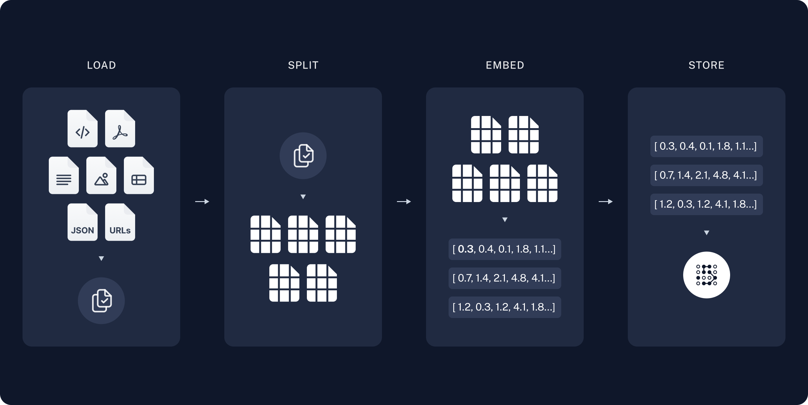

# 29.LlamaIndex大模型应用开发快速入门

## <font style="color:rgb(51, 51, 51);">一、什么是 LlamaIndex</font>

### <font style="color:rgb(51, 51, 51);">1. 简介</font>

LlamaIndex 是一个用于 LLM 应用程序的数据框架，用于注入，结构化，并访问私有或特定领域数据。就是将大模型部署到本地或是公司服务器上，然后将自有数据结合大模型为个人或是企业服务。

官方文档：<https://docs.llamaindex.ai/en/stable/>

中文文档：<https://www.aidoczh.com/llamaindex/>

<font style="color:rgb(0, 0, 0);">RAG是一种用额外数据增强大语言模型知识的技术。</font>

<font style="color:rgb(0, 0, 0);">大语言模型可以对广泛的主题进行推理，但它们的知识仅限于训练时截止日期前的公开数据。如果你想构建能够对私有数据或模型截止日期后引入的数据进行推理的人工智能应用，你需要用特定信息来增强模型的知识。检索适当信息并将其插入模型提示的过程被称为检索增强生成（RAG）。</font>

<font style="color:rgb(0, 0, 0);">LangChain有许多组件旨在帮助构建问答应用，以及更广泛的RAG应用。</font>


<font style="color:rgb(0, 0, 0);">一个典型的RAG应用有两个主要组成部分：</font>

**<font style="color:rgb(0, 0, 0);">索引(Indexing)</font>**<font style="color:rgb(0, 0, 0);">：从数据源获取数据并建立索引的管道(pipeline)。</font>*<font style="color:rgb(0, 0, 0);">这通常在离线状态下进行。</font>*

**<font style="color:rgb(0, 0, 0);">检索和生成(Retrieval and generation)</font>**<font style="color:rgb(0, 0, 0);">：实际的RAG链，在运行时接收用户查询，从索引中检索相关数据，然后将其传递给模型。</font>

<font style="color:rgb(0, 0, 0);">从原始数据到答案的最常见完整顺序如下：</font>

### <font style="color:rgb(0, 0, 0);">索引(Indexing) </font>

1. **<font style="color:rgb(0, 0, 0);">加载(Load)</font>**<font style="color:rgb(0, 0, 0);">：首先我们需要加载数据。这是通过文档加载器</font>[<font style="color:rgb(0, 0, 0);">Document Loaders</font>](https://blog.frognew.com/library/agi/langchain/components/document-loaders.html)<font style="color:rgb(0, 0, 0);">完成的。</font>
2. **<font style="color:rgb(0, 0, 0);">分割(Split)</font>**<font style="color:rgb(0, 0, 0);">：文本分割器</font>[<font style="color:rgb(0, 0, 0);">Text splitters</font>](https://python.langchain.com/docs/concepts/#text-splitters)<font style="color:rgb(0, 0, 0);">将大型文档(</font><code><font style="color:rgb(0, 0, 0);">Documents</font></code><font style="color:rgb(0, 0, 0);">)分成更小的块(chunks)。这对于索引数据和将其传递给模型都很有用，因为大块数据更难搜索，而且不适合模型有限的上下文窗口。</font>
3. **<font style="color:rgb(0, 0, 0);">存储(Store)</font>**<font style="color:rgb(0, 0, 0);">：我们需要一个地方来存储和索引我们的分割(splits)，以便后续可以对其进行搜索。这通常使用向量存储</font>[<font style="color:rgb(0, 0, 0);">VectorStore</font>](https://blog.frognew.com/library/agi/langchain/components/vector-stores.html)<font style="color:rgb(0, 0, 0);">和嵌入模型</font>[<font style="color:rgb(0, 0, 0);">Embeddings model</font>](https://blog.frognew.com/library/agi/langchain/components/embedding-models.html)<font style="color:rgb(0, 0, 0);">来完成。</font>



### <font style="color:rgb(0, 0, 0);">检索和生成(Retrieval and generation) </font>

4. **<font style="color:rgb(0, 0, 0);">检索(Retrieve)</font>**<font style="color:rgb(0, 0, 0);">：给定用户输入，使用检索器</font>[<font style="color:rgb(0, 0, 0);">Retriever</font>](https://blog.frognew.com/library/agi/langchain/components/retrievers.html)<font style="color:rgb(0, 0, 0);">从存储中检索相关的文本片段。</font>
5. **<font style="color:rgb(0, 0, 0);">生成(Generate)</font>**<font style="color:rgb(0, 0, 0);">：</font><font style="color:rgb(0, 0, 0);"> </font>[<font style="color:rgb(0, 0, 0);">ChatModel</font>](https://blog.frognew.com/library/agi/langchain/components/chat-models.html)<font style="color:rgb(0, 0, 0);">使用包含问题和检索到的数据的提示来生成答案。</font>


### <font style="color:rgb(51, 51, 51);">2. 作用</font>

<font style="color:rgb(51, 51, 51);">在本质上，LLM(如 GPT，DeepSeek 等) 为人类和推断出的数据提供了基于自然语言的交互接口。广泛可用的大模型通常在大量公开可用的数据上进行的预训练，包括来自维基百科、邮件列表、书籍和源代码等。构建在 LLM 模型之上的应用程序通常需要使用私有或特定领域数据来增强这些模型。不幸的是，这些数据可能分布在不同的应用程序和数据存储中。它们可能存在于 API 之后、SOL 数据库中，或者存在在 PDF 文件以及幻灯片中。Llamalndex 应运而生。总体来说就是将特定领域数据和大模型相结合。</font>

## <font style="color:rgb(51, 51, 51);">二、LlamaIndex 核心组件</font>

<font style="color:rgb(51, 51, 51);">LlamaIndex 提供的五大核心工具如下：</font>

### <font style="color:rgb(51, 51, 51);">1. 数据连接器（Data Connectors）</font>

<font style="color:rgb(51, 51, 51);">数据连接器用于从各种数据源中摄取数据，并将其转换为统一的文档表示形式。支持的数据源包括本地文件、PDF、API、SQL 数据库、Notion、Google 文档等。</font>

### <font style="color:rgb(51, 51, 51);">2. 数据索引（Data Indexes）</font>

<font style="color:rgb(51, 51, 51);">数据索引将数据组织成可查询的索引形式，支持多种索引类型：</font><font style="color:rgb(51, 51, 51);">向量索引（Vector Store Index）：基于向量相似度检索数据。</font><font style="color:rgb(51, 51, 51);">列表索引（List Index）：按顺序存储节点，支持关键字过滤。</font><font style="color:rgb(51, 51, 51);">树形索引（Tree Index）：构建层次化结构，支持从根节点到叶节点的查询。</font><font style="color:rgb(51, 51, 51);">关键字表索引（Keyword Table Index）：通过关键字映射快速检索节点。</font>

### <font style="color:rgb(51, 51, 51);">3. 引擎（Engines）</font>

<font style="color:rgb(51, 51, 51);">提供对数据的自然语言访问，主要包括：查询引擎（Query Engines）：用于问答，例如 RAG 流程中结合上下文和 LLM 生成答案。聊天引擎（Chat Engines）：用于与数据进行多轮对话交互。</font>

### <font style="color:rgb(51, 51, 51);">4. 数据代理（Data Agents）</font>

<font style="color:rgb(51, 51, 51);">数据代理是由大语言模型（LLM）驱动的知识工作者，通过工具增强，能够执行各种任务，如研究、数据提取等。代理可以使用 RAG 管道等多种工具来完成任务。</font>

### <font style="color:rgb(51, 51, 51);">5. 应用集成（Application Integrations）</font>

<font style="color:rgb(51, 51, 51);">LlamaIndex 提供了丰富的应用集成选项，包括：</font><font style="color:rgb(51, 51, 51);">向量数据库集成：如 Pinecone、Chroma、Weaviate、Milvus 等。应用框架集成：如 Streamlit、Chainlit。</font><font style="color:rgb(51, 51, 51);">其他集成：如与 OpenAI API、Hugging Face Transformers、Azure OpenAI 等模型服务的对接.</font>

## <font style="color:rgb(51, 51, 51);">三、LlamaIndex 核心概念</font>

<font style="color:rgb(51, 51, 51);">LlamaIndex 帮助构建 LLM 驱动的，基于个人或私域数据的应用。RAG(Retrieval Augmented Generation) 是 LlamaIndex 应用的核心概念,</font>

### <font style="color:rgb(51, 51, 51);">1. RAG</font>

<font style="color:rgb(51, 51, 51);">RAG，也称为检索增强生成，是利用个人或私域数据增强 LLM 的一种范式。通常，它包含两个阶段:</font>

#### <font style="color:rgb(51, 51, 51);">1，索引</font>

<font style="color:rgb(51, 51, 51);">构建知识库</font>

#### <font style="color:rgb(51, 51, 51);">2，查询</font>

<font style="color:rgb(51, 51, 51);">从知识库检索相关上下文信息, 以辅助 LLM 回答问题.</font><font style="color:rgb(51, 51, 51);">LlamaIndex 提供了工具包帮助开发者及其便捷地完成这两个阶段工作。</font>

### <font style="color:rgb(51, 51, 51);">2. 索引阶段</font>

<font style="color:rgb(51, 51, 51);">LlamaIndex 通过提供 Data connectors(数据连接器) 和 Indexes (索引) 帮助开发者构建知识库该阶段会用到如下工具或组件:</font>

#### <font style="color:rgb(51, 51, 51);">1，Data connectors</font>

<font style="color:rgb(51, 51, 51);">数据连接器。它负责将来自不同数据源, 不同格式的数据注入，并转换为 lamaIndex 支持的文档 (Document) 表现形式，其中包含了文本和元数据。</font>

#### <font style="color:rgb(51, 51, 51);">2，Documents /Nodes</font>

<font style="color:rgb(51, 51, 51);">Document 是 LlamaIndex 中容器的概念，它可以包含任何数据源，包括，PDF 文档，API 响应, 或来自数据库的数据。Node 是 LlamaIndex 中数据的最小单元，代表了一个 Document 的分块。它还包含了元数据，以及与其他 Node 的关系信息。这使得更精确的检索操作成为可能。</font>

#### <font style="color:rgb(51, 51, 51);">3，Data Indexes</font>

<font style="color:rgb(51, 51, 51);">LlamaIndex 提供便利的工具，帮助开发者为注入的数据建立索引，使得未来的检索简单而高效, 最常用的索引是向量存储索引 - vectorstoreIndex。</font><font style="color:rgb(51, 51, 51);">中的来说，就是连接用户的数据，然后存起来，切成小段，再给它们建立索引，方便后面查找相关信息。</font>

### <font style="color:rgb(51, 51, 51);">3. 查询阶段</font>

<font style="color:rgb(51, 51, 51);">在查询阶段， RAG 管道根据的用户査询，检索最相关的上下文，并将其与査询一起，传递给 LLM，以合成响应。这使 LLM 能够获得不在其原始训练数据中的最新知识，同时也减少了虚构内容。该阶段的关键挑战在于检索、编排和基于知识库的推理。</font><font style="color:rgb(51, 51, 51);">LlamaIndex 提供可组合的模块，帮助开发者构建和集成 RAG 管道，用于问答、聊天机器人或作为代理的一部分。这些构建块可以根据排名偏好进行定制，并组合起来，以结构化的方式基于多个知识库进行推理。</font><font style="color:rgb(51, 51, 51);">该阶段的构建块包括:</font>

#### <font style="color:rgb(51, 51, 51);">1，Retrievers</font>

<font style="color:rgb(51, 51, 51);">检索器。它定义如何高效地从知识库，基于查询，检索相关上下文信息。</font>

#### <font style="color:rgb(51, 51, 51);">2，Node Post Processors</font>

<font style="color:rgb(51, 51, 51);">Node 后处理器。它对一系列文档节点 (Node) 实施转换，过滤，或排名。</font>

#### <font style="color:rgb(51, 51, 51);">3，Response Synthesizers</font>

<font style="color:rgb(51, 51, 51);">响应合成器。它基于用户的查询，和一组检索到的文本块 (形成上下文)，，利用 LLM 生成响应。</font><font style="color:rgb(51, 51, 51);">RAG 管道包括:</font>

#### <font style="color:rgb(51, 51, 51);">4，Query Engines</font>

<font style="color:rgb(51, 51, 51);">查询引擎 - 端到端的管道，允许用户基于知识库，以自然语言提问，并获得回答，以及相关的上下文</font>

#### <font style="color:rgb(51, 51, 51);">5，Chat Engines</font>

<font style="color:rgb(51, 51, 51);">聊天引擎 - 端到端的管道，允许用户基于知识库进行对话 (多次交互，会话历史)。</font>

#### <font style="color:rgb(51, 51, 51);">6，Agents</font>

<font style="color:rgb(51, 51, 51);">代理，它是一种由 LLM 驱动的自动化决策器。代理可以像査询引擎或聊天引擎一样使用。主要区别在于，代理动态地决定最佳的动作序列，而不是遵循预定的逻辑。这为其提供了处理更复杂任务的额外灵活性。</font>

## <font style="color:rgb(51, 51, 51);">四、个性化配置</font>

<font style="color:rgb(51, 51, 51);">LlamaIndex 对 RAG 过程提供了全面的配置支持，允许开发者对整个过程进行个性化设置。常见的配置场景包括:</font><font style="color:rgb(51, 51, 51);">自定义文档分块</font><font style="color:rgb(51, 51, 51);">自定义向量存储</font><font style="color:rgb(51, 51, 51);">自定义检索</font><font style="color:rgb(51, 51, 51);">指定 LLM</font><font style="color:rgb(51, 51, 51);">注，个性化配置主要通过 LlamaIndex 提供的 ServiceContext 类实现。</font><font style="color:rgb(51, 51, 51);">配置场景示例</font><font style="color:rgb(51, 51, 51);">接下来通过简明示例代码段展示 LlamaIndex 对各种配置场景的支持。</font>

### <font style="color:rgb(51, 51, 51);">1. 自定义文档分块</font>

<font style="color:rgb(51, 51, 51);">这里先定义 500 一个块，根据自己数据量大小，数据量大的话就可以大点，数据量小就设置小点。</font>

```plain
from llama_index import ServiceContext, QueryBundle, VectorStoreIndex, SimpleDirectoryReader

# #自定义文档分块，不指定LLM
service_context = ServiceContext.from_defaults(chunk_size=500)
```

### <font style="color:rgb(51, 51, 51);">2. 自定义向量存储</font>

<font style="color:rgb(51, 51, 51);">ChromaDB 是一个开源的嵌入式向量数据库，专为存储和查询高维向量数据而设计，特别适用于与大型语言模型（LLMs）和嵌入模型（Embeddings）相关的应用场景。其核心目标是帮助开发者高效地存储、检索和管理嵌入向量数据，从而支持自然语言处理、推荐系统、问答系统等任务。还有很多别的库，也可以存储向量数据，Milvus，LanceDB 等。这也是区别于传统数据 MySQL，Redis 等。</font>

```plain
import chromadb
from llama_index.vector_stores import ChromaVectorStore
from llama_index import StorageContext

chroma_client = chromadb.PersistentClient()
try:
    chroma_collection =  chroma_client.get_collection("quickstart")
    print("使用已存在的本地知识库")
except chromadb.errors.InvalidCollectionException:
    chroma_collection = chroma_client.create_collection("quickstart")
    print("创建一个全新的本地知识库")
vector_store = ChromaVectorStore(chroma_collection=chroma_collection)
storage_context = StorageContext.from_defaults(vector_store=vector_store)
```

### <font style="color:rgb(51, 51, 51);">3. 自定义检索</font>

<font style="color:rgb(51, 51, 51);">自定义检索中，我们可以通过参数指定査询引擎 (Query Engine) 在检索时请求的相似文档数。</font><font style="color:rgb(51, 51, 51);">下面就是通过查询引擎, 选出排名最高前的 5 条.</font>

```plain
index=VectorStoreIndex.from_documents(documents)
query_engine = index.as_query_engine(similarity_top_k=5)
response = query_engine.query("人形机器人，请用中文答复")
print(response)
```

### <font style="color:rgb(51, 51, 51);">4. 指定 LLM</font>

<font style="color:rgb(51, 51, 51);">基座大模型可以自己随便选, Qwen,DeepSeek 也可以.</font>

```plain
service_context = ServiceContext.from_defaults(llm=OpenAI())
```

## <font style="color:rgb(51, 51, 51);">五、总结</font>

<font style="color:rgb(51, 51, 51);">大模型开发，对于基座模型一般需要很高的算法基本功，以及很强的数学功底，比如 DeepSeek 基本都是名校博士。但是对于大模型的应用开发，要求就没有那么高，也是未来大部分开发人员从事的方向, 主要涉及就是以下 2 个方向，一个就是微调，一个就是 RAG。</font>

### <font style="color:rgb(51, 51, 51);">1. 微调</font>

<font style="color:rgb(51, 51, 51);">功能: 能够让现有的开源大模型理解我们自己的 (私有化) 数据。特点: 需要做模型的二次训练 (成本、风险)应用场景: 当需要去改变大模型自身特性时，就得用微调去调整的是大模型的风格，而不是它的能力 (智商)。加强大模型对当前私有化数据的理解能力。</font>

### <font style="color:rgb(51, 51, 51);">2.RAG</font>

<font style="color:rgb(51, 51, 51);">应用场景: 事前不训练模型，但需要让模型直接根据我们的数据来进行作答。功能: 能够让现有的开源大模型理解我们自己的 (私有化) 数据。特点: 相比较于微调来讲，成本更低，风险更小，如果不涉及模型问答风格，仅需模型对当下的私有化数据做出回答，那么就用 RAG，如果涉及到大模型回答风格，或者当前模型对私有数据理解不够准确，再用模型微调技术。</font>


> 更新: 2025-04-20 22:38:52  
> 原文: <https://www.yuque.com/aaron-wecc3/dhluml/lc7068hkaz3f4gfs>