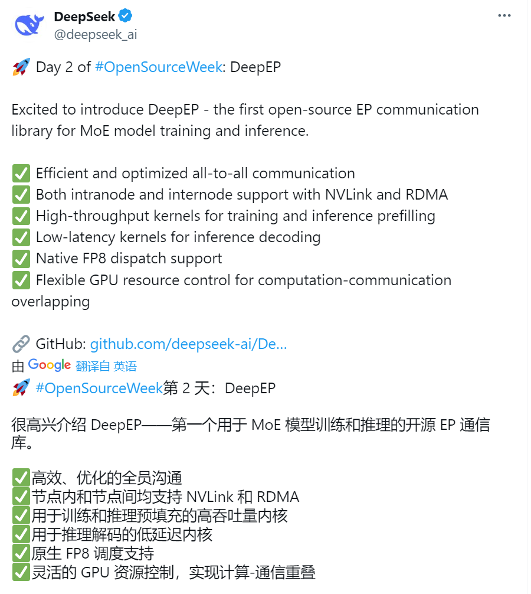
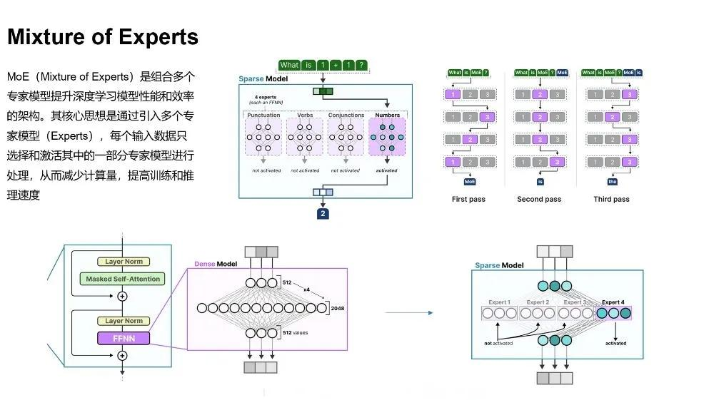
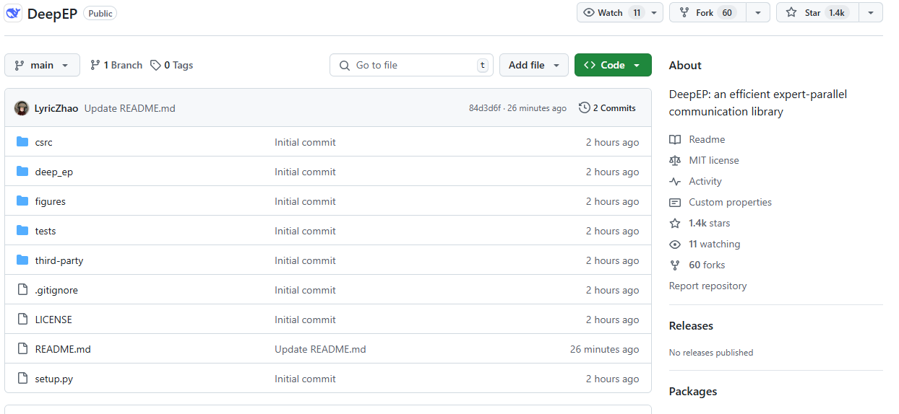
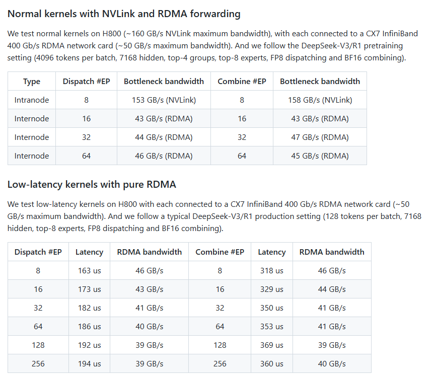
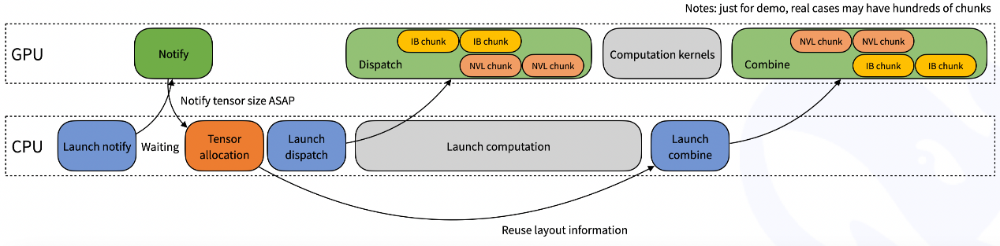
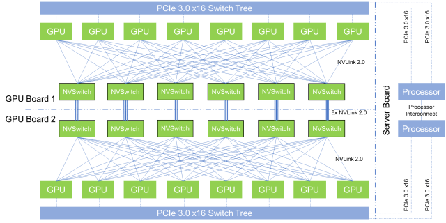
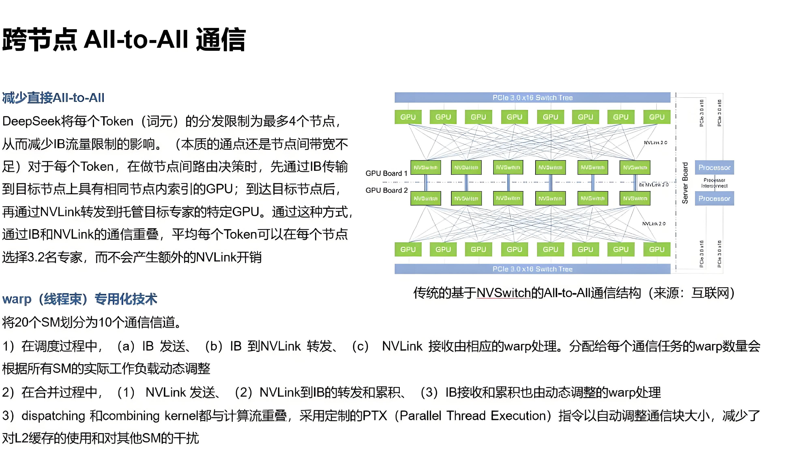
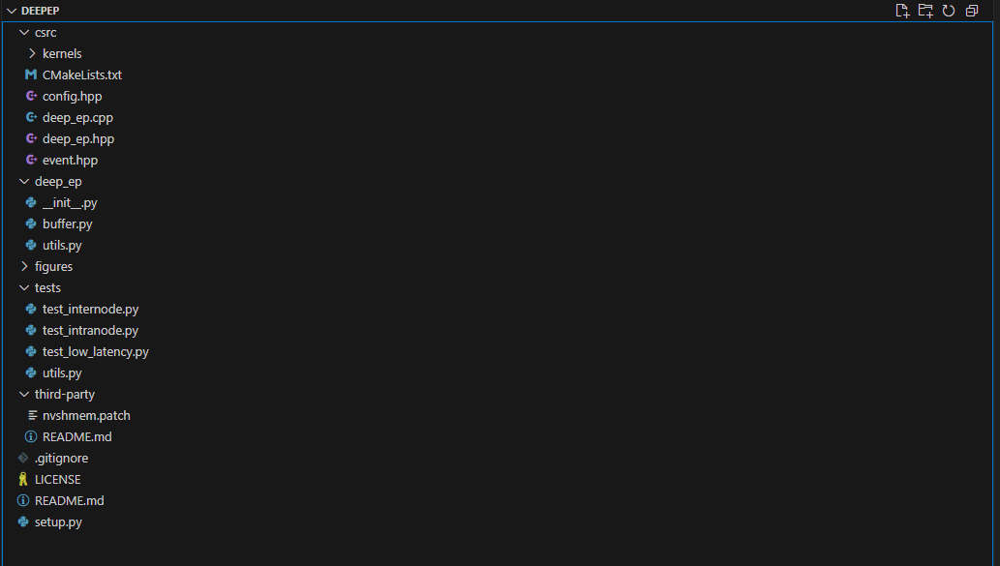

# 32.DeepSeek开源Day2：DeepEP技术详解

2 月 24 日，DeepSeek 启动 “开源周”，第二个开源的代码库为 DeepEP。很好，又挤了一段有硬件基因的牙膏出来。H100/H800 绝对是 DeepSeek 的小心肝。

## 1 DeepEP 简介
DeepEP 是由 deepseek-ai （深度求索）开发的一个开源项目。DeepEP 针对混合专家（MoE）+ 专家并行（EP）模型架构设计的通信库。MoE 是由多个专家子网络组成的大模型，通过门控网络决定输入分配给哪个专家。

DeepEP 提供高吞吐量和低延迟的 all-to-all GPU 内核，包括 MoE 分发（dispatch）和合并（combine）。该库支持 FP8 等低精度运算，特别适用于 DeepSeek 系列模型（如 DeepSeek-V2、V3 和 R1）。

MoE 介绍（来源：中存算半导体）

为了与 DeepSeek-V3 论文中的组限制门控算法（group-limited gating algorithm）保持一致，DeepEP 针对非对称域带宽转发设计和优化通信内核（例如将数据从 [NVLink](https://zhida.zhihu.com/search?content_id=254263352&content_type=Article&match_order=1&q=NVLink&zhida_source=entity) 域转发到 [RDMA](https://zhida.zhihu.com/search?content_id=254263352&content_type=Article&match_order=1&q=RDMA&zhida_source=entity) 域）并提供高吞吐量，使其适用于训练和推理预填充任务。

DeepEP 主要适用于大模型训练，特别是需要 EP 的集群训练。通过提升通信信道的使用率，提升训练效率。

DeepEP 的安装要求如下：

1）[Hopper 架构](https://zhida.zhihu.com/search?content_id=254263352&content_type=Article&match_order=1&q=Hopper%E6%9E%B6%E6%9E%84&zhida_source=entity) GPU（看出来 DeepSeek 对 H 是真爱）

2）Python 3.8 或更高版本

3）CUDA 12.3 或更高版本

4）PyTorch 2.1 或更高版本

5）NVLink 与 RDMA（DeepEP 已通过 [InfiniBand](https://zhida.zhihu.com/search?content_id=254263352&content_type=Article&match_order=1&q=InfiniBand&zhida_source=entity) 网络的测试，并未在 RDMA 完全测试）

## 2 DeepEP 的关键技术与未来优化
DeepEP 具备以下关键技术：

1）高吞吐量、低延迟的 all-to-all GPU 内核，专门优化的分派和组合操作。确保数据在多个 GPU 之间快速传输，减少通信时间。

2）支持低比特操作，如 FP8 格式，显著降低计算和存储需求，提升整体效率。

3）针对非对称域带宽转发（如从 NVLink 域到 RDMA 域），提供优化内核，适合训练和推理 Prefill 任务。允许直接内存访问，减少 CPU 介入。DeepEP 的优化确保数据在不同域之间高效传输，特别适用于大规模混合卡的分布式训练。

CPU 等待 GPU 接收计数信号（来源：DeepSeek）

## 3 DeepEP 的原理与架构
### 3.1 从英伟达集群到 All-to-All 通信
V3/R1 的训练框架定制了高效的跨节点 All-to-All 通信内核，以充分利用 IB 和 NVLink 带宽，并节约流式多处理器（SM，(Stream Multiprocessor）。

传统的基于 NVSwitch 的 All-to-All 通信结构（来源：互联网）

通信内核（通信 SM 控制代码）的实现与 MoE 门控算法和集群网络拓扑是按照软硬件协同的思路来进行设计的。具体来说，在集群中，跨节点 GPU 与 IB 完全互连，节点内（单台服务器内）通信通过 NVLink 完成。NVLink 提供 160 GB/s 的带宽，约是 IB 的 3.2 倍 （50 GB/s）。

All-to-All 通信（来源：中存算半导体）

DeepSeek 还采用了 warp（线程束）专用化技术，将 20 个 SM 划分为 10 个通信信道。

1）在调度过程中，（a）IB 发送、（b）IB 到 NVLink 转发、（c） NVLink 接收由相应的 warp 处理。分配给每个通信任务的 warp 数量会根据所有 SM 的实际工作负载动态调整。

2）在合并过程中，（1） NVLink 发送、（2）NVLink 到 IB 的转发和累积、（3）IB 接收和累积也由动态调整的 warp 处理。

3）dispatching 和 combining kernel 都与计算流重叠，采用定制的 [PTX](https://zhida.zhihu.com/search?content_id=254263352&content_type=Article&match_order=1&q=PTX&zhida_source=entity)（Parallel Thread Execution）指令以自动调整通信块大小，减少了对 L2 缓存的使用和对其他 SM 的干扰。

### 3.2 DeepEP 架构
DeepEP 的架构设计围绕 MoE 模型的通信需求展开，包含以下关键组件：

**1）常规内核**：GPU 缓存管理、forward 和 backward dispatch、forward 和 backwardcombine 的函数，分别用于常规内核操作，支持训练和推理的计算流程。

**2）低延迟内核**：专为推理解码设计，专门操作 NVLink/Infiniband 或 RDMA 技术，减少通信延迟，适合实时通信。

**3）通信 - 计算重叠调度**：减少 SM（Streaming Multiprocessors）资源占用，提升算力利用率。

## 4 DeepEP 代码结构分析
[https://github.com/deepseek-ai/DeepEP](https://github.com/deepseek-ai/DeepEP)

DeepEP 目录包含以下关键文件和目录：

+ **third-party/**: 包含 NVSHMEM 相关文件，如 README.md（安装指南）和 nvshmem.patch（补丁文件），用于管理外部依赖。
+ **figures/**: 存储示意图，帮助理解技术实现。
+ **tests/**: 包含测试脚本，如 test_intranode.py（节点内测试）、test_internode.py（节点间测试）和 test_low_latency.py（低延迟测试），以及 utils.py（工具函数）。
+ **setup.py**: 用于构建和安装 DeepEP 库。
+ **LICENSE**: 采用 MIT 许可，部分文件受 NVSHMEM SLA（Software License Agreement）限制，有可能影响开源使用。
+ **csrc/**: 包含 C++ 源代码，内有 kernels / 子目录，如 ibgda_device.cuh，用于内核实现。

deep_ep.cpp 用于管理 CUDA 内存和执行分布式通信任务：针对非对称域通信分别设计了 num_nvl_bytes 和 num_rdma_bytes。low_latency_mode 可配置低延迟模式。

ibgda_device.cuh 实现了与 NVSHMEM（NVIDIA 共享内存库）相关的 [IBGDA](https://zhida.zhihu.com/search?content_id=254263352&content_type=Article&match_order=1&q=IBGDA&zhida_source=entity)（InfiniBand General Data Access）设备功能。

runtime.cu 用于在 CUDA 环境下，节点内和节点间 runtime 实现，通信的同步和初始化操作。

## 5 DeepEP 的未来优化
DeepEP 目前仍处于早期阶段，最新提交日期为 2025 年 2 月 25 日，初始提交包含 32 个文件，8461 行新增代码。

预计 DeepEP 未来将进一步进行如下优化：

1）性能优化：进一步提升通信效率，特别是在更大规模模型或新硬件架构上的支持，如更多 GPU 类型或新型网络技术，以适应不断增长的计算需求。

2）硬件兼容性扩展：可能支持更多硬件平台，如 AMD Instinct GPU，扩大应用范围。

3）与其他开源框架集成：可能与更多 AI 框架或库集成，进一步提升兼容性和开发便利性。

DeepEP 作为 DeepSeek 技术栈的重要组成部分，展示了在 MoE 模型通信优化上的创新潜力。其开源代码为促进全球高效训练和推理提供了坚实基础，未来可能在性能优化和硬件兼容性上进一步扩展。在全球 AI 竞争的背景下这种开源精神值得赞许。

> 更新: 2025-04-20 22:38:50  
> 原文: <https://www.yuque.com/aaron-wecc3/dhluml/gf5zaqwz2qx2brml>