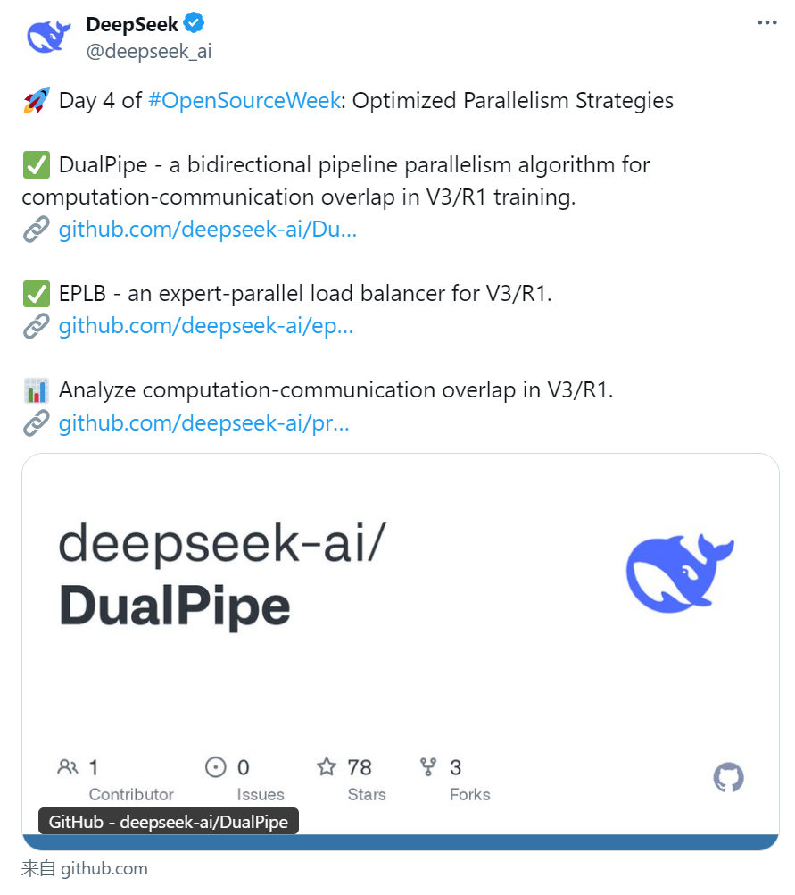
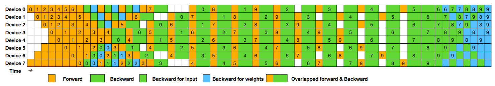
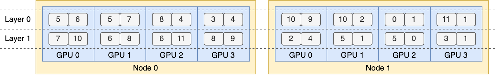
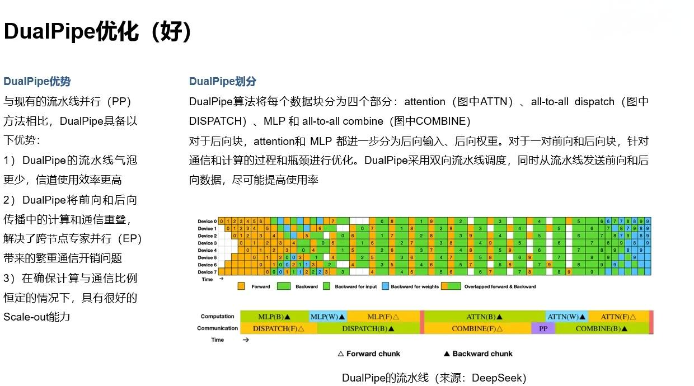
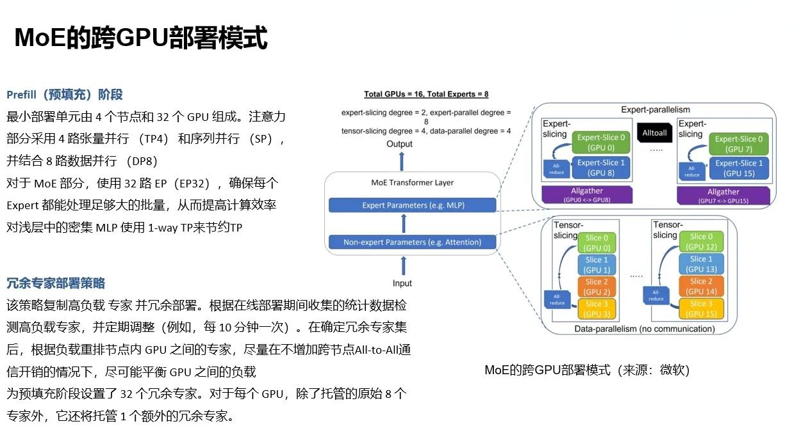
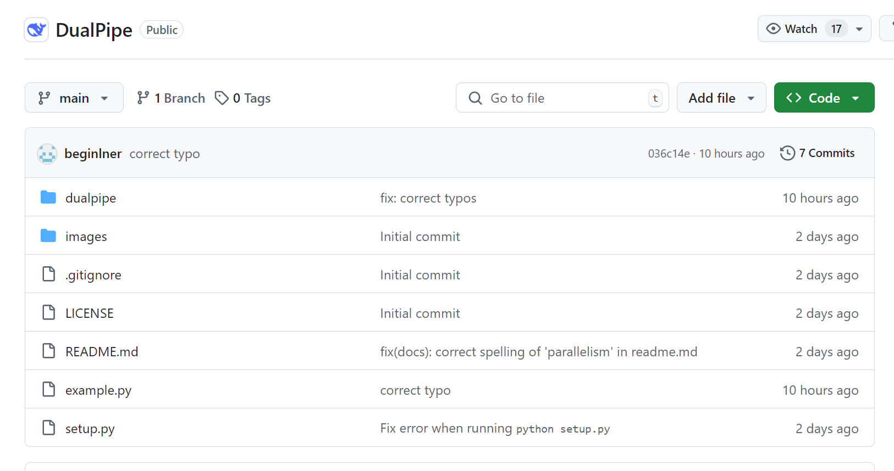
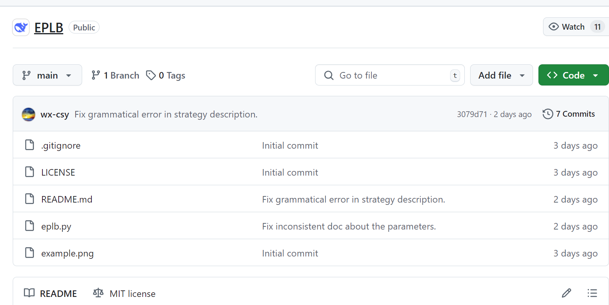

# 34.DeepSeek开源Day4：DualPipe&EPLB技术详解

2 月 24 日，DeepSeek 启动 “开源周”，第四个开源的代码库为 DualPipe 与 EPLB（一下发布了两个）。DualPipe 与 EPLB 依然使用了大量与 [Hopper 架构](https://zhida.zhihu.com/search?content_id=254371560&content_type=Article&match_order=1&q=Hopper%E6%9E%B6%E6%9E%84&zhida_source=entity)绑定的技术。

DualPipe 是由 DeepSeek-AI 团队开发的一种双向流水线并行通信算法，主要用于优化大模型（如 [DeepSeek-V3](https://zhida.zhihu.com/search?content_id=254371560&content_type=Article&match_order=1&q=DeepSeek-V3&zhida_source=entity)/R1）的数据交互和训练效率。

EPLB （Expert Parallelism Load Balancer，专家并行负载均衡器）则主要用于优化混合专家模型（MoE）的分布式部署，特别是在 DeepSeek-V3 和 [DeepSeek-R1](https://zhida.zhihu.com/search?content_id=254371560&content_type=Article&match_order=1&q=DeepSeek-R1&zhida_source=entity) 等大规模语言模型的训练中。

DualPipe 负责提升通信效率，确保信道均衡；EPLB 则负责优化专家副本分配，确保不同 GPU 节点的负载均衡。

相对前两天的 FlashMLA 和 DeepGEMM，DualPipe 与 EPLB 更多偏向于工程优化。当然这两者的工程优化也不是大部分团队可以做的。需要对信道优化和推断集群部署有很强的软硬件综合优化能力。

## 1 DualPipe 与 EPLB 简介
### 1.1 DualPipe 核心特点
DualPipe 具有以下核心特点：

**1）计算与通信重叠**DualPipe 的设计目标是最大化集群设备的计算性能，通过在前向传播（Forward）和后向传播（Backward）阶段实现计算与通信的完全重叠，显著减少传统流水线并行中的 “气泡”（Pipeline Bubble，即空闲等待时间）。这对于需要跨节点协作的专家并行（Expert Parallelism）场景尤为重要。

**2）双向调度**与传统的单向流水线并行不同，DualPipe 采用双向调度策略，从流水线的两端同时输入微批次（Micro-batches），充分利用硬件资源。这种方法在保持计算通信比例恒定的情况下，即使模型规模进一步扩大，也能维持接近零的通信开销。

**3）高效扩展性**DualPipe 针对跨节点的混合专家模型（MoE）进行了优化，通过减少通信瓶颈，使得大规模分布式训练能够在相对有限的硬件资源（如 H800 GPU）上高效运行。

**4）显存优化**DualPipe 将模型的最浅层（包括嵌入层）和最深层（包括输出层）部署在同一流水线级别（PP Rank），实现参数和梯度的物理共享，进一步提升内存效率。这种设计减少了高代价的张量并行（Tensor Parallelism）需求。

DualPipe 优化（来源：DeepSeek）

### 1.2 EPLB 核心特点
为保证 MoE 部分不同专家之间的负载均衡，会将共享专家和高负载的细粒度专家在集群的不同 GPU 做多个复制，让 GPU 把更多的热数据（发给共享专家的）跑起来。这个方案就是 EPLB。

EPLB 具有如下核心特点：

1）**负载均衡优化**EPLB 通过复制高负载专家（Redundant Experts Strategy）并对专家分配进行启发式调整，确保不同 GPU 之间的负载均衡。这种方法解决了专家并行中因专家负载不均导致的计算资源浪费问题。分层负载平衡策略也可用于预填充阶段，具有较小的专家并行规模。

2）**跨节点通信优化**在 DeepSeek-V3 的技术报告中提到，EPLB 尝试将同一组的专家尽量分配到同一节点，减少跨节点的数据传输开销。这种分组限制路由（Group-Limited Expert Routing）策略显著提升了分布式训练的效率。

3）**高效可扩展性**EPLB 支持灵活的专家复制和分配，能够适配不同规模的模型和硬件配置。例如，在一个包含 2 个节点、每个节点 4 个 GPU 的集群上，EPLB 可以动态规划 16 个个专家副本的分配。

12 个专家在 2 节点的分布示例（来源：DeepSeek）

4）**开源与可重现性**EPLB 作为 DeepSeek 开源周的一部分发布，提供了一个易于复现的负载均衡方案，方便研究者和开发者在自己的 MoE 训练中应用。

## 2 DualPipe 与 EPLB 架构分析
### 2.1 DualPipe 架构
DualPipe 的架构基于 Transformer 框架，并针对流水线并行进行了深度优化。其核心思想是将每个计算块（Chunk）细分为多个组件，并在调度中实现高效重叠。具体架构特点包括：

**1）细粒度分块**每个计算块被划分为四个部分：注意力机制（Attention）、All-to-All 派发（All-to-All Dispatch）、多层感知机（MLP）和 All-to-All 合并（All-to-All Combine）。对于后向传播块，注意力机制和 MLP 进一步细分为输入梯度计算（Backward for Input）和权重梯度计算（Backward for Weights）。

**2）双向流水线调度**DualPipe 通过双向调度实现微批次的同时处理。例如，在一个包含 8 个流水线级别（PP Ranks）和 20 个微批次的场景中，正向和反向的微批次对称运行，通信阶段被计算阶段完全掩盖。

**3）通信优化**DualPipe 针对跨节点的 All-to-All 通信（All-to-All Communication）开发了高效内核，充分利用 [InfiniBand](https://zhida.zhihu.com/search?content_id=254371560&content_type=Article&match_order=1&q=InfiniBand&zhida_source=entity) 和 [NVLink](https://zhida.zhihu.com/search?content_id=254371560&content_type=Article&match_order=1&q=NVLink&zhida_source=entity) 的带宽，结合 PTX 编程减少流式多处理器（SMs）在通信上的占用。

**4）**[**FP8 混合精度**](https://zhida.zhihu.com/search?content_id=254371560&content_type=Article&match_order=1&q=FP8+%E6%B7%B7%E5%90%88%E7%B2%BE%E5%BA%A6&zhida_source=entity)**支持**DualPipe 的训练框架支持 FP8 混合精度计算，通过降低精度减少 GPU 显存使用并加速训练，同时保持模型性能。这种低精度训练策略与算法设计紧密结合。

DualPipe 技术说明（来源：中存算半导体）

与现有的流水线并行（PP）方法相比，DualPipe 具备以下优势：

1）DualPipe 的流水线气泡更少，信道使用效率更高。

2）DualPipe 将前向和后向传播中的计算和通信重叠，解决了跨节点专家并行（EP）带来的繁重通信开销问题.

3）在确保计算与通信比例恒定的情况下，具有很好的 Scale-out 能力。

### 2.2 EPLB 架构
EPLB 的架构基于 MoE 模型的专家并行需求，主要包括以下组件：

**1）负载均衡算法**EPLB 使用基于偏置的动态调整策略（bias-based dynamic adjustment），替代传统的基于辅助损失的负载均衡方法。这种方法通过实时监控每个专家的负载情况，动态分配输入 token，确保均衡性。

**2）与 DualPipe 的协同**根据 X 上的信息，EPLB 可与 DualPipe（双向流水线重叠技术）结合使用。DualPipe 负责计算与通信的并行优化，而 EPLB 则专注于专家层的负载分布，二者共同提升 MoE 模型的整体性能。

**3）模块化设计**EPLB 的代码结构具有模块化特点，便于集成到其他 MoE 系统中。它可能包括负载监控模块、动态路由调整模块以及与底层硬件通信的接口。

**4）支持大规模并行**EPLB 针对多节点、跨 GPU 的训练环境进行了优化，支持 DeepSeek-V3/R1 这样的大模型的分布式部署。

EPLB 架构思路说明（来源：中存算半导体）

## 3 DualPipe 与 EPLB 代码结构分析
### 3.1 DualPipe 代码结构分析
从 GitHub 仓库 [https://github.com/deepseek-ai/DualPipe](https://link.zhihu.com/?target=https%3A//github.com/deepseek-ai/DualPipe) 的描述来看，该代码库主要是一个 Python 实现的调度算法示例。以下是对其代码结构的初步分析（基于公开信息和常见调度算法实现推测）：

+ **调度核心（Scheduler）**：实现双向流水线调度的逻辑，定义微批次的分配和计算通信重叠的策略。
+ **通信管理（Communication Manager）**：处理跨节点的 All-to-All 通信，可能包含针对 InfiniBand 或 NVLink 的优化接口。
+ **模型分层（Layer Assignment）**：实现浅层和深层的物理共享逻辑，优化内存布局。
+ **性能分析（Profiling）**：提供用于验证计算通信重叠的性能数据生成工具。主要代码包括：
+ 核心调度算法文件（如 dualpipe.py）。
+ 通信模块（communication/）、测试用例（tests/）和文档（docs/）。
+ 配置脚本用于设置流水线级别和微批次数量。

### 3.2 EPLB 代码结构分析
[https://github.com/deepseek-ai/EPLB](https://github.com/deepseek-ai/EPLB)

## 4 DualPipe 与 EPLB 的现状与未来
两者已在 DeepSeek-V3 和 DeepSeek-R1 的训练和部署中得到实际验证，证明其在超大规模 MoE 模型训练 / 部署中的有效性。特别是训练成本低至约 557 万美元，远低于传统大模型（如 Llama-3.1 的数亿美元），显示出其经济性和实用性。

当前两者针对 H800 GPU 优化，未来可能适配更多硬件（如 AMD MI300X 或其他消费级 GPU），提升普适性。

另外 DualPipe 可结合 EPLB（专家并行负载平衡器）进一步优化跨节点专家的动态分配。

DualPipe 与 EPLB 的低成本高效特性可能推动开源 AI 模型的进一步发展，缩小与闭源模型的差距。它为资源有限的团队提供了

> 更新: 2025-04-20 22:38:50  
> 原文: <https://www.yuque.com/aaron-wecc3/dhluml/aqnmbf3tf7xibqxg>