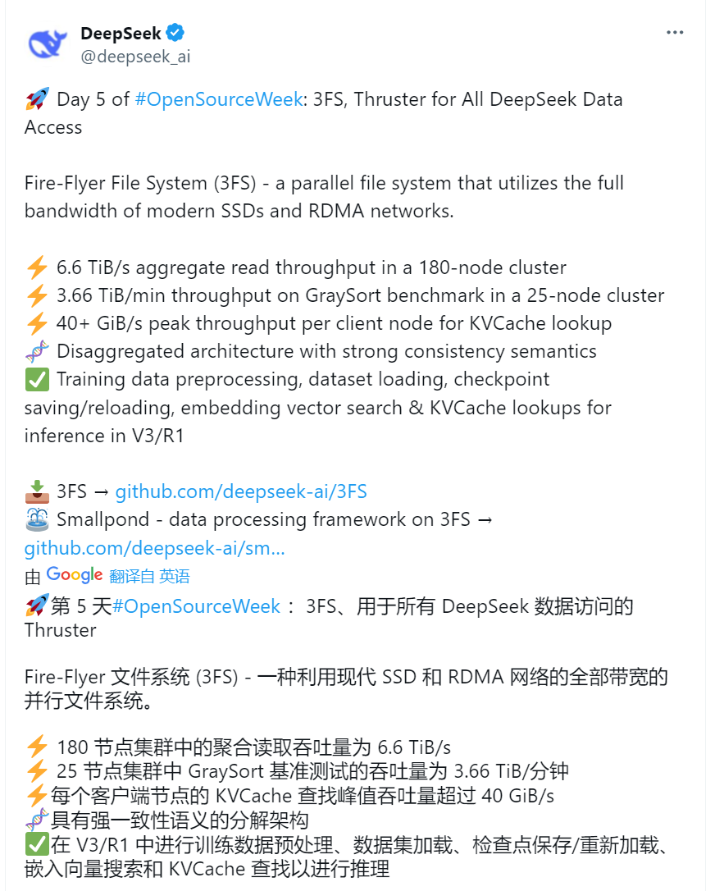
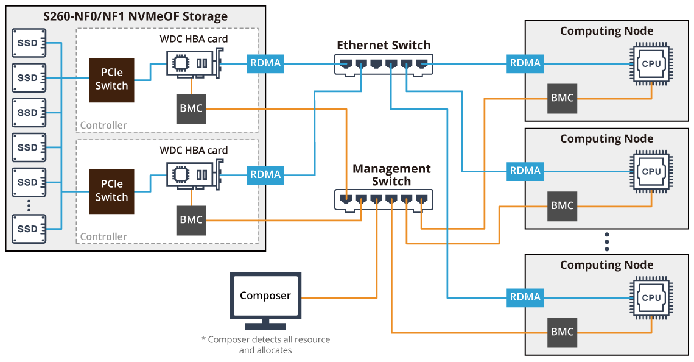

# 35.DeepSeek开源Day5：3FS&smallpond技术详解

2 月 24 日，DeepSeek 启动 “开源周”，第四个开源的代码库为 3FS&smallpond（又是一下发布了两个）。

3FS（Fire-Flyer File System）是 DeepSeek 内部开发的一款高性能分布式文件系统，旨在为 AI 训练和推理工作负载提供高效的共享存储层。它充分利用现代 SSD（固态硬盘）和 [RDMA](https://zhida.zhihu.com/search?content_id=254414455&content_type=Article&match_order=1&q=RDMA&zhida_source=entity)（远程直接内存访问）网络技术，简化分布式应用程序的开发，解决大规模数据密集型任务中的存储瓶颈问题。作为 DeepSeek 开源生态的一部分，3FS 于 2025 年 2 月 27 日在 GitHub 上正式开源（地址：[https://github.com/deepseek-ai/3FS](https://link.zhihu.com/?target=https%3A//github.com/deepseek-ai/3FS)）

Smallpond 基于 3FS 和 [DuckDB](https://zhida.zhihu.com/search?content_id=254414455&content_type=Article&match_order=1&q=DuckDB&zhida_source=entity) 构建，专注于 PB 级数据的快速处理。Smallpond 定位为 AI 数据的辅助工具，能够无缝集成到 3FS 的存储生态中，支持数据清洗、转换和分析等任务。

与 WekaFS、DAOS 和 BeeGFS 相比，3FS 侧重于充分利用 NVMe SSD 和 RDMA 网络的高 IOPS 和吞吐量。

## 1 3FS & smallpond 简介
1. **1 3FS（Fire-Flyer File System）**

3FS 的设计初衷是为 DeepSeek 的 AI 基础设施（如 Fire-Flyer AI-HPC）和模型（如 DeepSeek-V3、R1）提供底层存储 + 数据支持。3FS 涵盖训练数据预处理、数据集加载、检查点保存与重载、嵌入向量搜索以及推理过程中的 KVCache（键值缓存）查找等环节。3FS 显然是 DeepSeek 高效训练体系的关键组件，进一步体现了 DeepSeek 的硬件基因。

目前 3FS 已支持包括 DeepSeek-V3（6710 亿参数 MoE 模型）和 DeepSeek-R1（推理模型）在内的多个大模型的开发，涵盖数据预处理、检查点管理、推理缓存等场景。官方数据显示，3FS 在 180 节点集群中实现了 6.6 TiB/s 的聚合读取吞吐量，展现了其卓越性能。

### 1.2 smallpond
Smallpond 的设计目标是简化大规模数据处理流程，降低 AI 开发者的技术门槛，同时保持高性能和低资源占用。

## 2 3FS & smallpond 特点
3FS 具备如下特点

+ 高性能：在 180 节点集群中实现 6.6 TiB/s 读取吞吐量，单节点 KVCache 查找峰值速率超 40 GiB/s。
+ 强一致性：提供 POSIX 兼容的强一致性语义，适合多节点并发读写。（这点很关键）
+ 针对硬件优化：充分利用 NVMe SSD 和 RDMA 网络，最大化现代硬件性能。
+ 针对 KV 语义定制：支持 KV Context Caching on Disk，优化推理阶段的缓存访问。
+ 开源：完全开源，允许社区贡献和定制。（非常好）

NVMe SSD + RDMA 示意（来源：互联网）

Smallpond 具备如下特点：

+ 轻量级：基于 DuckDB 的嵌入式设计，资源占用低，单机即可运行。
+ 高效处理：支持 PB 级数据的高速查询和转换，继承 3FS 的存储性能。
+ 易集成：与 3FS 无缝对接，提供简洁的 API 和命令行接口。
+ 灵活性：支持多种数据格式（如 [Parquet](https://zhida.zhihu.com/search?content_id=254414455&content_type=Article&match_order=1&q=Parquet&zhida_source=entity)、[CSV](https://zhida.zhihu.com/search?content_id=254414455&content_type=Article&match_order=1&q=CSV&zhida_source=entity)）和处理任务。
+ 开源：遵循 DeepSeek 开源理念，促进社区协作。

## 3 3FS & smallpond 技术优势
### 3.1 3FS 技术优势
+ 针对硬件的软件适配：通过 NVMe SSD 和 RDMA 协同优化 I/O 和网络传输，相比传统文件系统（如 HDFS）在高并发场景下延迟更低、吞吐量更高。
+ 去中心化架构：无单点故障，节点间对等设计提升了可扩展性和可靠性。
+ 高效缓存：KVCache 查找性能达 40 GiB/s，显著降低推理延迟，优于现有开源方案（如 Alluxio）。
+ 成本效益：在普通硬件上实现高性能，避免对专用存储设备的依赖，符合 DeepSeek 一贯高性价比策略。
+ 流量隔离：与 HFReduce 协同设计，避免存储与计算流量冲突，提升系统稳定性。

另外 3FS 的文档看起来更详细一些。

### 3.2 Smallpond
+ 高性能查询：基于 DuckDB 的列式存储和向量化执行引擎，查询速度远超传统工具（如 Spark 在小规模任务中的开销）。
+ 低开销：无需分布式集群支持，单机即可处理大规模数据，部署简单。
+ 与 3FS 协同：直接利用 3FS 的存储能力，避免数据迁移成本，实现高效数据流水线。
+ 扩展性好：支持插件式扩展，可集成更多数据源和处理逻辑。

## 4 3FS & smallpond 架构
### 4.1. 3FS 架构
+ 核心组件：
+ 集群管理器
+ meta 数据管理：分布式 meta 数据存储，支持高并发访问，避免单点瓶颈。
+ 数据存储层：基于 SSD 的去中心化节点，利用 RDMA 实现高效数据交换。
+ 客户端接口：提供 POSIX 接口和定制 API，支持标准操作和 AI 特定任务。
+ 去中心化设计：每个节点兼具存储和计算功能，数据分片和副本机制确保高可用性。
+ 网络层：基于 RDMA（支持 InfiniBand 或 RoCE），配合流量隔离技术优化传输。
+ 缓存层：内置 3FS-KV 模块，优化 KVCache 的磁盘存储和访问。

在 Fire-Flyer 2 AI-HPC 中，DeepSeek 部署了 180 个存储节点，每个节点包含 16 个 PCIe 4.0 NVMe SSD 和 2 个 Mellanox CX6 200Gbps InfiniBand HCA。共计 360 * 200Gbps 的 InfiniBand HCA，系统总共可以提供 9TB/s 理论带宽。

文件系统 meta 数据存储在分布式键值存储系统中。每个文件或目录都有一个唯一的 inode ID。meta 服务的所有状态都持久化在分布式 KV 存储系统上。多个 meta 服务同时运行以处理来自客户端的 meta 请求。可以看出 3FS 是针对 KV 存储进行优化的架构。

存储服务具有带分配查询的链复制 （CRAQ），以提供强一致。为了将读 / 写流量均匀地分配到所有 SSD（增加读写带宽），每个 SSD 都为来自不同链的多个存储目标提供服务。

3FS-KV 是构建在 3FS 之上的共享存储分布式数据处理系统，目前支持三种模型：KV、消息队列和对象存储。3FS-KV 支持读写分离和按需启动，能够充分利用 3FS 提供的高 I/O 吞吐量。3FS-KV 支持 DeepSeek 的 KV Context Caching on Disk 技术，并将 LLM 服务成本降低了一个数量级。（这里很有意思，用高速闪存系统来存 KV）

### 4.2 smallpond
+ 核心组件：
+ 查询引擎：基于 DuckDB，提供高效的 SQL 查询能力。
+ 存储适配层：与 3FS 集成，负责数据读写和缓存管理。
+ 任务调度：轻量级调度器，支持并行处理和流水线优化。
+ 单机架构：嵌入式设计，无需分布式协调，适合中小规模任务。
+ 扩展接口：支持插件机制，可添加新数据源或自定义处理逻辑。

## 5 代码架构
### 5.1 3FS 代码机构
[https://github.com/deepseek-ai/3FS](https://github.com/deepseek-ai/3FS)

3FS目录结构如下：

3FS/

├── src/ # 核心源代码  
│ ├── fs_core/ # 文件系统核心（元数据、存储）  
│ ├── network/ # RDMA 网络模块  
│ ├── kv_store/ # 键值存储实现  
│ └── utils/ # 工具函数  
├── tests/ # 测试用例  
├── docs/ # 文档  
├── examples/ # 示例代码  
└── README.md # 项目说明

+ 代码特点：
+ C++ 主导：性能敏感部分用 C++ 实现（如 RDMA、SSD I/O），辅以 Python 接口。
+ 模块化：各组件独立封装，便于维护和扩展。
+ 异步 I/O：大量使用多线程和异步操作，提升并发性能。

### 5.2 Smallpond
[https://github.com/deepseek-ai/smallpond](https://github.com/deepseek-ai/smallpond)

smallpond 目录结构如下：

smallpond/

├── src/ # 核心源代码  
│ ├── query/ # 查询引擎（基于 DuckDB）  
│ ├── storage/ # 存储适配层（对接 3FS）  
│ └── utils/ # 工具函数  
├── tests/ # 测试用例  
├── examples/ # 示例代码  
├── docs/ # 文档  
└── README.md # 项目说明

+ 代码特点：
+ C++ 和 Python 混合：查询引擎用 C++（DuckDB），接口层用 Python。
+ 轻量化设计：代码量少，编译快速，易于部署。
+ 插件化：支持动态加载模块，增强灵活性。

## 6 小结
3FS 是 DeepSeek 开源生态中的高性能分布式文件系统，以其 6.6 TiB/s 的吞吐量和强一致性支持 AI 工作负载，技术优势在于硬件优化和去中心化设计。Smallpond 则是基于 3FS 的轻量级数据处理框架，专注于 PB 级数据的高效处理，凭借低开销和易用性补充了 3FS 的功能。二者的架构和代码设计体现了 DeepSeek 的高效与开源理念，未来将在开源的高性能训练生态和 AI 部署持续进化，共同推动 AI 基础设施的发展。

> 更新: 2025-04-20 22:38:49  
> 原文: <https://www.yuque.com/aaron-wecc3/dhluml/cg06i3ruwb0gmzyk>