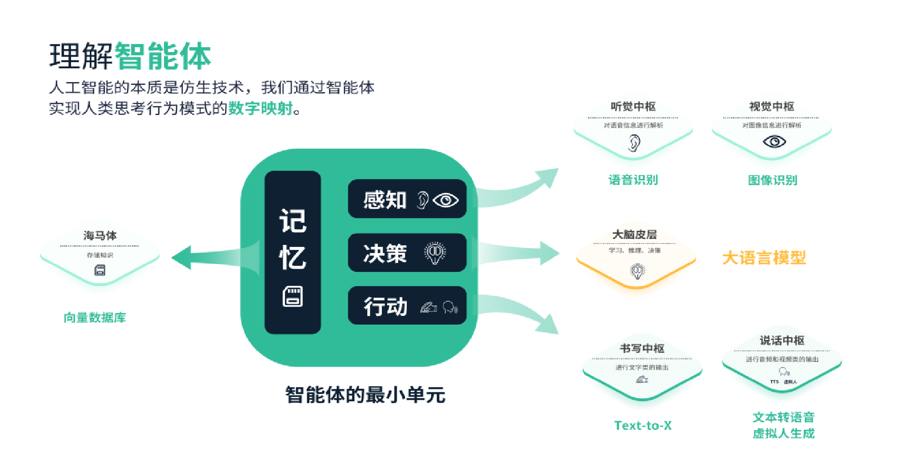
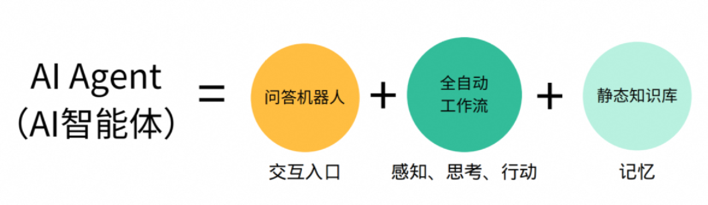
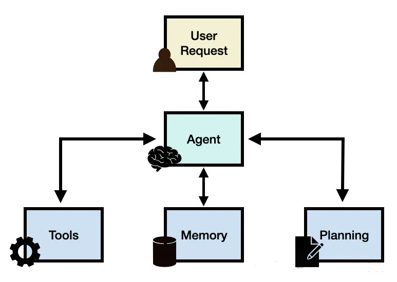
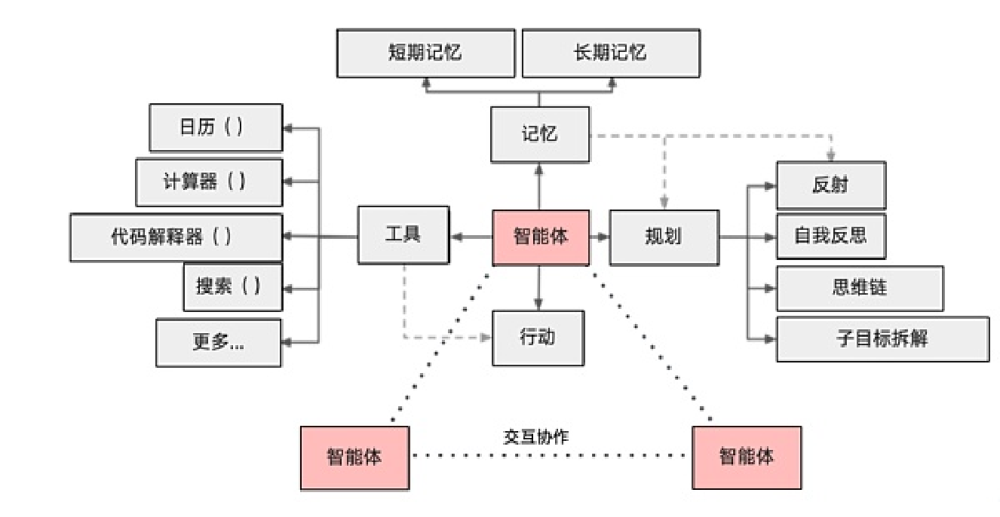

# 41.Manus爆火带来的技术思考

## Manus
官网

[https://manus.im/](https://manus.im/)

1.要求设计一个AI驱动的rogue like的dnd规则游戏，实现脚手架 [https://manus.im/share/CUIPWPqrbTKWrGkmf4bKRS?replay=1](https://manus.im/share/CUIPWPqrbTKWrGkmf4bKRS?replay=1)

2.要求实现一个微信群聊监控机器人，发现邀请码就快速打开页面填入 [https://manus.im/share/flo3wfcTSDu8G3PbgUMahm?replay=1](https://manus.im/share/flo3wfcTSDu8G3PbgUMahm?replay=1)

3.分析前几天AI + Toy浪潮的失败原因，给出当下生成式AI浪潮的差异，并且生成调研报告 [https://manus.im/share/Qa9asdpYi6zcMSB4tIChdM?replay=1](https://manus.im/share/Qa9asdpYi6zcMSB4tIChdM?replay=1)

4.于three.js实现人物骨骼动画控制系统，并且可以在多浏览器上运行 [https://manus.im/share/dnvGsGOgAI5k9XUAX0q91s?replay=1](https://manus.im/share/dnvGsGOgAI5k9XUAX0q91s?replay=1)

## 智能体底层逻辑
大模型可以帮我们做很多事情，例如回答问题、写周报&文

档、内容总结、翻译等。但普通人和大模型直接交互是不现实的， 类GPT聊天机器人是大模型面向普通用户提供的一种接口，能够帮忙人们完成很多任务，但大模型能做的远不止于此，而聊天是一种泛化的场景，很多时候解决问题的效率不是很高。因此，这就需要

“智能体”登场了。

**智能体（Agent）**是人工智能领域中的一个核心概念，指的是  具有智能的实体，能够感知其环境、通过学习和推理改变自身状 态，并采取行动以实现特定目标。智能体既可以是物理实体，如机器人，也可以是虚拟实体，如软件程序。它们能够自主活动并与环境交互，具备驻留性、反应性、社会性、主动性等特征，构成了一种能够持续自主发挥作用的计算实体。

想象一下科幻电影里的场景，一个机器人边工作边和人类对话，可以根据人类指令完成任务，还可以独自开飞船，维修设备， 甚至照看小孩等。可以将这种智能机器人视为一种智能体。

基于**大模型的智能体**是一种具有**自我管理、自我学习、自我适应、自我决策**能力的机器人或软件。它可以在没有人工参与的情况下工作，这与传统的自动化程序是不同的。自动化程序是将固定的流程自动执行，假如其中某个依赖项不可用时，自动化程序一般会失败。智能体能够感知环境，自我学习和自我决策，能够创造性地解决问题。

大语言模型（LLM）智能体，是一种利用大语言模型进行复杂任务执行的应用。如果将大模型（LLM）比作底层操作系统（如iOS 和Andriod）的话，那么智能体（Agent）就是上层App。这正是工 程技术人员擅长的领域。

## 智能体架构	
构建大语言模型智能体（LLM    Agent）时，LLM充当着控制中

心或“大脑”的角色，负责管理完成任务或响应用户请求所需的一系  列操作。智能体Agent通过调用大模型的能力完成任务，并需要依赖于规划、记忆以及工具使用等关键模块。

通常，一个大语言模型智能体框架包含以下核心部分：

用户请求： 表达用户的问题或请求

智能体/大脑： 作为协调者的智能体核心规划： 助于智能体为未来行动做规划

记忆： 管理智能体的历史行为和经验，分为长期记忆和短期记忆。

工具使用： 调用工具与外部环境交互

通过这些组成部分的协同工作，大模型智能体能够处理从简单到复杂的各种请求，不仅能够提供直接的答案，还能解决需要深度分析和多步骤操作的问题。这种智能体的能力，使其在处理复杂信息查询、数据分析和可视化表示等方面具有巨大潜力。

下图展示了更详细的智能体架构。

对于没有接触过智能体的人，上述框架可能有点抽象，下面我们以一个例子来说明智能体的架构，假如我们想让AI完成以下任务：

用户：明天上午要去A地出差，下午与X开会，帮我订好机票、酒店和会议日程。

对于人类助理来说，这是很简单的事情，但以目前大模型的能力，还难以解决这个问题。而从技术角度来说，可以开发一个基于大模型的智能体来解决这类问题，这个智能体主要包含以下部分：

1. 规划：通过调用大模型的能力将任务分解，先分为出差行程安排和会议预约两个子任务。

    1. 出差行程安排继续分解为：
        1. 从用户所在地到所在城市机场：
            1. 其中用户所在地通过感知环境信息获得（可以通过用户初始设置或过往历史存放在记忆组件里面）
            2. 决定出行时间
            3. 决定出行方式：如乘坐出租车，预约
        2. 从用户所在城市机场到A地机场：
            1. 决定出行时间
            2. 决定出行方式，预约
        3. 从A地机场到A地某酒店：
            1. 预订A地某酒店
                1. 决定入住时间
            2. 决定从A地机场到达酒店方式：如乘坐出租车，预约

    1. 会议预约继续分解为：
        1. 查看用户和X的日程，找到二者都空闲的时间段
        2. 确定会议时间，预约会议
1. 记忆：
    1. 用户所在地应存放在长期记忆中。
    2. 根据规划的分解，后面的步骤会依赖前面步骤的结果，那么需要把前面步骤的执行结果存放在短期记忆中。
2. 工具使用：
    1. 通过调用网约车平台接口预约出租车（需要用户授权，授权信息也可以存储在长期记忆中）
    2. 通过调用航班信息查询接口获取航班信息，调用航班预订接口订机票（需要用户授权，授权信息也可以存储在长期记忆中）
    3. 通过调用OTA平台接口完成酒店预订（需要用户授权，授权信息也可以存储在长期记忆中）
    4. 通过调用支付接口完成支付（需要用户授权，授权信息也可以存储在长期记忆中）
    5. 通过调用日历接口完成日程查询和会议预订

以上是假想的一个智能体应用场景，目前市面上应该还没有这种产品出现。从技术角度来说，这是可行的。

## 单智能体和多智能体	
单智能体即一个独立的智能体，它可以自动完成相关任务。对

一些比较复杂的任务，单智能体可能难以胜任。此时，可以构建多个相互协作的智能体，共同构成一个系统来处理用户任务。

例如，考虑一个软件项目，当用户提出需求后：

1.由产品经理和用户沟通明确需求，产出产品设计文档。

2.架构师对系统进行架构设计，产出技术设计文档。

3.项目经理分派任务并跟踪进度。

4.开发人员负责编写模块代码。

5.测试人员负责编写测试用例，执行测试。

6.运维人员负责上线发布。

根据软件项目中的角色，我们可以分别构造不同角色的智能体, 例如有一个产品经理智能体可以和用户沟通需求，并生成产品设计文档，另外有一个架构师智能体根据产品文档产出技术设计文档， 依此类推。让这些智能体相互协作，构成一个软件开发智能体团

队，共同完成用户需求。这不是幻想，目前已经有公司在开发类似产品、进行这方面尝试了。

[github 上 这 个 项 目 （https://github.com/assafelovic/gpt-rese](https://github.com/assafelovic/gpt-researcher)  a[rcher），通过多智能体实现了一个能够根据用户提问，自动收集  ](https://github.com/assafelovic/gpt-researcher)相关信息，规划研究计划，并产出研究报告的多智能体团队。

## 智能体开发技术框架	
关于大模型智能体的开发技术架构，听的最多就是langchain，

网上介绍文章也很多。langchain是一个第三方的开源大模型应用开发框架，官方提供了python和javascript两种语言支持，其它语言   也有一些开发者/组织做了移植，例如langchain4j、langchaingo。   除了langchain，还有AutoGPT，微软的AutoGen等，这些框架支持的主流开发语言大多都是python。对于Java背景的开发人员，

Java/Spring生态体系下也有Spring AI框架。

这些开发框架主要针对的是技术开发人员，有一定的学习门槛。为了降低开发成本，各大厂商纷纷推出了低代码或零代码的智能体平台，这样非技术背景的人也能很快地创建自己的智能体。

> 更新: 2025-04-20 22:39:04  
> 原文: <https://www.yuque.com/aaron-wecc3/dhluml/ki7pvoozq0xtiz4k>