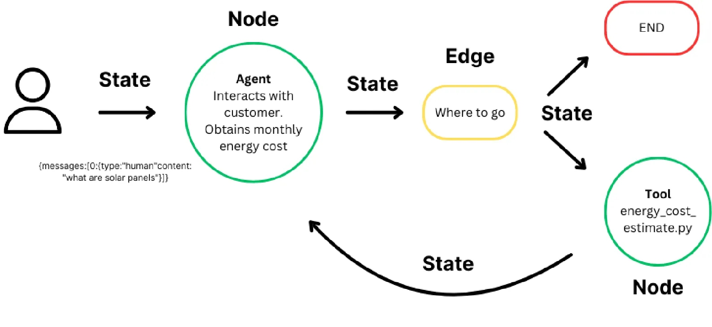

# 49.LangGraph核心组件

**示例代码**

[langgraph-core.ppt](https://www.yuque.com/attachments/yuque/0/2025/ppt/1387387/1745159945962-f1f32070-40ee-445f-8923-4db9b2da2f2a.ppt)

*<font style="color:#DF2A3F;">注：将ppt后缀名改为zip后解压</font>*

python版本：3.12.4

## LangGraph

[<font style="color:rgb(30, 136, 229);">LangGraph</font>](https://langchain-ai.github.io/langgraph/)<font style="color:rgba(0, 0, 0, 0.87);"> 是一个用于构建有状态的多参与者应用程序的库，利用 LLM 创建代理和多代理工作流。与其他 LLM 框架相比，它提供了以下核心优势：循环性、可控性和持久性。LangGraph 允许您定义涉及循环的流程，这对于大多数代理架构至关重要，使其与基于 DAG 的解决方案区别开来。作为一个非常底层的框架，它提供了对应用程序流和状态的细粒度控制，这对于创建可靠的代理至关重要。此外，LangGraph 包含内置的持久性，支持先进的人机协作和记忆特性。</font>

<font style="color:rgba(0, 0, 0, 0.87);">LangGraph 的灵感来源于</font><font style="color:rgba(0, 0, 0, 0.87);"> </font>[<font style="color:rgb(30, 136, 229);">Pregel</font>](https://research.google/pubs/pub37252/)<font style="color:rgba(0, 0, 0, 0.87);"> </font><font style="color:rgba(0, 0, 0, 0.87);">和</font><font style="color:rgba(0, 0, 0, 0.87);"> </font>[<font style="color:rgb(30, 136, 229);">Apache Beam</font>](https://beam.apache.org/)<font style="color:rgba(0, 0, 0, 0.87);">。公共接口受</font><font style="color:rgba(0, 0, 0, 0.87);"> </font>[<font style="color:rgb(30, 136, 229);">NetworkX</font>](https://networkx.org/documentation/latest/)<font style="color:rgba(0, 0, 0, 0.87);"> </font><font style="color:rgba(0, 0, 0, 0.87);">的启发。LangGraph 是由 LangChain Inc 开发的，它是 LangChain 的创建者，但可以在不使用 LangChain 的情况下使用。</font>

[<font style="color:rgb(30, 136, 229);">LangGraph 平台</font>](https://langchain-ai.github.io/langgraph/concepts/langgraph_platform)<font style="color:rgba(0, 0, 0, 0.87);"> 是用于部署 LangGraph 代理的基础设施。它是一个商业解决方案，用于将代理应用程序部署到生产环境，构建于开源的 LangGraph 框架之上。LangGraph 平台由多个组件组成，这些组件协同工作以支持 LangGraph 应用程序的开发、部署、调试和监控：</font>[<font style="color:rgb(30, 136, 229);">LangGraph 服务器</font>](https://langchain-ai.github.io/langgraph/concepts/langgraph_server)<font style="color:rgba(0, 0, 0, 0.87);">（API）、</font>[<font style="color:rgb(30, 136, 229);">LangGraph SDK</font>](https://langchain-ai.github.io/langgraph/concepts/sdk)<font style="color:rgba(0, 0, 0, 0.87);">（API 客户端）、</font>[<font style="color:rgb(30, 136, 229);">LangGraph CLI</font>](https://langchain-ai.github.io/langgraph/concepts/langgraph_cli)<font style="color:rgba(0, 0, 0, 0.87);">（构建服务器的命令行工具）、</font>[<font style="color:rgb(30, 136, 229);">LangGraph Studio</font>](https://langchain-ai.github.io/langgraph/concepts/langgraph_studio)<font style="color:rgba(0, 0, 0, 0.87);">（用户界面/调试器）。</font>

<font style="color:rgba(0, 0, 0, 0.87);"></font>

<font style="color:rgba(0, 0, 0, 0.87);">官方文档地址：</font><https://langchain-ai.github.io/langgraph/>

中文文档地址：<https://www.aidoczh.com/langgraph/>

### <font style="color:rgba(0, 0, 0, 0.87);">主要特性</font>

* **<font style="color:rgba(0, 0, 0, 0.87);">循环和分支</font>**<font style="color:rgba(0, 0, 0, 0.87);">：在您的应用程序中实现循环和条件。</font>
* **<font style="color:rgba(0, 0, 0, 0.87);">持久性</font>**<font style="color:rgba(0, 0, 0, 0.87);">：在图中的每一步自动保存状态。在任何时刻暂停和恢复图的执行，以支持错误恢复、人机协作工作流、时间旅行等。</font>
* **<font style="color:rgba(0, 0, 0, 0.87);">人机协作</font>**<font style="color:rgba(0, 0, 0, 0.87);">：中断图的执行以批准或编辑代理计划的下一个动作。</font>
* **<font style="color:rgba(0, 0, 0, 0.87);">流式支持</font>**<font style="color:rgba(0, 0, 0, 0.87);">：在每个节点产生输出时进行流式传输（包括令牌流式传输）。</font>
* **<font style="color:rgba(0, 0, 0, 0.87);">与 LangChain 的集成</font>**<font style="color:rgba(0, 0, 0, 0.87);">：LangGraph 与</font><font style="color:rgba(0, 0, 0, 0.87);"> </font>[<font style="color:rgb(30, 136, 229);">LangChain</font>](https://github.com/langchain-ai/langchain/)<font style="color:rgba(0, 0, 0, 0.87);"> </font><font style="color:rgba(0, 0, 0, 0.87);">和</font><font style="color:rgba(0, 0, 0, 0.87);"> </font>[<font style="color:rgb(30, 136, 229);">LangSmith</font>](https://docs.smith.langchain.com/)<font style="color:rgba(0, 0, 0, 0.87);"> </font><font style="color:rgba(0, 0, 0, 0.87);">无缝集成（但不需要它们）。</font>

### <font style="color:rgba(0, 0, 0, 0.87);">LangGraph 平台</font>

<font style="color:rgba(0, 0, 0, 0.87);">LangGraph 平台是一个商业解决方案，用于将代理应用程序部署到生产环境，构建于开源的 LangGraph 框架之上。 以下是一些在复杂部署中常见的问题，LangGraph 平台解决了这些问题：</font>

* **<font style="color:rgba(0, 0, 0, 0.87);">流式支持</font>**<font style="color:rgba(0, 0, 0, 0.87);">：LangGraph 服务器提供</font><font style="color:rgba(0, 0, 0, 0.87);"> </font>[<font style="color:rgb(30, 136, 229);">多种流式模式</font>](https://langchain-ai.github.io/langgraph/concepts/streaming)<font style="color:rgba(0, 0, 0, 0.87);">，优化以满足各种应用需求</font>
* **<font style="color:rgba(0, 0, 0, 0.87);">后台运行</font>**<font style="color:rgba(0, 0, 0, 0.87);">：在后台异步运行代理</font>
* **<font style="color:rgba(0, 0, 0, 0.87);">支持长时间运行的代理</font>**<font style="color:rgba(0, 0, 0, 0.87);">：能够处理长时间运行过程的基础设施</font>
* [**<font style="color:rgb(30, 136, 229);">双重文本</font>**](https://langchain-ai.github.io/langgraph/concepts/double_texting)<font style="color:rgba(0, 0, 0, 0.87);">：处理用户在代理回复之前收到两条消息的情况</font>
* **<font style="color:rgba(0, 0, 0, 0.87);">处理突发性</font>**<font style="color:rgba(0, 0, 0, 0.87);">：任务队列以确保请求在高负载下也能始终如一地处理，不会丢失</font>

<font style="color:rgba(0, 0, 0, 0.87);"></font>



## <font style="color:rgba(0, 0, 0, 0.87);">Graph(图)</font>

<font style="color:rgba(0, 0, 0, 0.87);">LangGraph 的核心是将代理工作流建模为图。你可以使用三个关键组件来定义代理的行为</font>

1. [<font style="color:rgba(0, 0, 0, 0.87);">状态</font>](https://github.langchain.ac.cn/langgraph/concepts/low_level/#state)<font style="color:rgba(0, 0, 0, 0.87);">：一个共享的数据结构，表示应用程序的当前快照。它可以是任何 Python 类型，但通常是</font><font style="color:rgba(0, 0, 0, 0.87);"> </font>`TypedDict`<font style="color:rgba(0, 0, 0, 0.87);"> </font><font style="color:rgba(0, 0, 0, 0.87);">或 Pydantic</font><font style="color:rgba(0, 0, 0, 0.87);"> </font>`BaseModel`<font style="color:rgba(0, 0, 0, 0.87);">。</font>
2. [<font style="color:rgba(0, 0, 0, 0.87);">节点</font>](https://github.langchain.ac.cn/langgraph/concepts/low_level/#nodes)<font style="color:rgba(0, 0, 0, 0.87);">：编码代理逻辑的 Python 函数。它们接收当前 </font>`状态`<font style="color:rgba(0, 0, 0, 0.87);"> 作为输入，执行一些计算，并返回一个更新的 </font>`状态`<font style="color:rgba(0, 0, 0, 0.87);">。</font>
3. [<font style="color:rgba(0, 0, 0, 0.87);">边</font>](https://github.langchain.ac.cn/langgraph/concepts/low_level/#edges)<font style="color:rgba(0, 0, 0, 0.87);">：Python 函数，根据当前</font><font style="color:rgba(0, 0, 0, 0.87);"> </font>`状态`<font style="color:rgba(0, 0, 0, 0.87);"> </font><font style="color:rgba(0, 0, 0, 0.87);">确定要执行的下一个</font><font style="color:rgba(0, 0, 0, 0.87);"> </font>`节点`<font style="color:rgba(0, 0, 0, 0.87);">。它们可以是条件分支或固定转换。</font>

<font style="color:rgba(0, 0, 0, 0.87);">通过组合</font><font style="color:rgba(0, 0, 0, 0.87);"> </font>`节点`<font style="color:rgba(0, 0, 0, 0.87);"> </font><font style="color:rgba(0, 0, 0, 0.87);">和</font><font style="color:rgba(0, 0, 0, 0.87);"> </font>`边`<font style="color:rgba(0, 0, 0, 0.87);">，你可以创建复杂的循环工作流，随着时间的推移发展</font><font style="color:rgba(0, 0, 0, 0.87);"> </font>`状态`<font style="color:rgba(0, 0, 0, 0.87);">。但是，真正的力量来自于 LangGraph 如何管理</font><font style="color:rgba(0, 0, 0, 0.87);"> </font>`状态`<font style="color:rgba(0, 0, 0, 0.87);">。需要强调的是：</font>`节点`<font style="color:rgba(0, 0, 0, 0.87);"> </font><font style="color:rgba(0, 0, 0, 0.87);">和</font><font style="color:rgba(0, 0, 0, 0.87);"> </font>`边`<font style="color:rgba(0, 0, 0, 0.87);"> </font><font style="color:rgba(0, 0, 0, 0.87);">不过是 Python 函数——它们可以包含 LLM 或简单的 Python 代码。</font>

<font style="color:rgba(0, 0, 0, 0.87);">简而言之：</font>*<font style="color:rgba(0, 0, 0, 0.87);">节点完成工作。边指示下一步要做什么</font>*<font style="color:rgba(0, 0, 0, 0.87);">。</font>

<font style="color:rgba(0, 0, 0, 0.87);">LangGraph 的底层图算法使用</font><font style="color:rgba(0, 0, 0, 0.87);"> </font>[<font style="color:rgba(0, 0, 0, 0.87);">消息传递</font>](https://en.wikipedia.org/wiki/Message_passing)<font style="color:rgba(0, 0, 0, 0.87);"> </font><font style="color:rgba(0, 0, 0, 0.87);">来定义一个通用程序。当一个节点完成其操作时，它会沿着一条或多条边向其他节点发送消息。这些接收节点然后执行其函数，将结果消息传递给下一组节点，并且该过程继续进行。受到 Google 的</font><font style="color:rgba(0, 0, 0, 0.87);"> </font>[<font style="color:rgba(0, 0, 0, 0.87);">Pregel</font>](https://research.google/pubs/pregel-a-system-for-large-scale-graph-processing/)<font style="color:rgba(0, 0, 0, 0.87);"> </font><font style="color:rgba(0, 0, 0, 0.87);">系统的启发，该程序以离散的“超级步骤”进行。</font>

<font style="color:rgba(0, 0, 0, 0.87);">超级步骤可以被认为是图节点上的单个迭代。并行运行的节点属于同一个超级步骤，而顺序运行的节点则属于不同的超级步骤。在图执行开始时，所有节点都处于</font><font style="color:rgba(0, 0, 0, 0.87);"> </font>`inactive`<font style="color:rgba(0, 0, 0, 0.87);"> </font><font style="color:rgba(0, 0, 0, 0.87);">状态。当节点在任何传入边（或“通道”）上收到新消息（状态）时，它将变为</font><font style="color:rgba(0, 0, 0, 0.87);"> </font>`active`<font style="color:rgba(0, 0, 0, 0.87);"> </font><font style="color:rgba(0, 0, 0, 0.87);">状态。然后，活动节点运行其函数并响应更新。在每个超级步骤结束时，没有传入消息的节点通过将其标记为</font><font style="color:rgba(0, 0, 0, 0.87);"> </font>`inactive`<font style="color:rgba(0, 0, 0, 0.87);"> </font><font style="color:rgba(0, 0, 0, 0.87);">来投票</font><font style="color:rgba(0, 0, 0, 0.87);"> </font>`halt`<font style="color:rgba(0, 0, 0, 0.87);">。当所有节点都处于</font><font style="color:rgba(0, 0, 0, 0.87);"> </font>`inactive`<font style="color:rgba(0, 0, 0, 0.87);"> </font><font style="color:rgba(0, 0, 0, 0.87);">状态且没有消息在传输中时，图执行终止。</font>

### <font style="color:rgba(0, 0, 0, 0.87);">StateGraph</font>

`StateGraph`<font style="color:rgba(0, 0, 0, 0.87);"> 类是使用的主要图类。它由用户定义的 </font>`状态`<font style="color:rgba(0, 0, 0, 0.87);"> 对象参数化。</font>

```python
from langgraph.graph import StateGraph
from typing_extensions import TypedDict
class MyState(TypedDict)
    ...
graph = StateGraph(MyState)
```

<font style="color:rgba(0, 0, 0, 0.87);">基类：</font>`图`

<font style="color:rgba(0, 0, 0, 0.87);">一个图，其节点通过读取和写入共享状态进行通信。每个节点的签名是 State -> Partial</font><font style="color:rgba(0, 0, 0, 0.87);">.</font>

<font style="color:rgba(0, 0, 0, 0.87);">每个状态键可以选择性地使用一个 reducer 函数进行注释，该函数将用于聚合从多个节点接收到的该键的值。reducer 函数的签名是 (Value, Value) -> Value。</font>

**<font style="color:rgba(0, 0, 0, 0.87);">参数</font>**

* <code>**state_schema**</code><font style="color:rgba(0, 0, 0, 0.87);"> </font><font style="color:rgba(0, 0, 0, 0.87);">(</font>`[类型](http://docs.pythonlang.cn/3/library/typing.html#typing.Type)[[任何](http://docs.pythonlang.cn/3/library/typing.html#typing.Any)]`<font style="color:rgba(0, 0, 0, 0.87);">, 默认值：</font>`None`<font style="color:rgba(0, 0, 0, 0.87);"> </font><font style="color:rgba(0, 0, 0, 0.87);">) –</font><font style="color:rgba(0, 0, 0, 0.87);"> </font>

<font style="color:rgba(0, 0, 0, 0.87);">定义状态的模式类。</font>

* <code>**config_schema**</code><font style="color:rgba(0, 0, 0, 0.87);"> </font><font style="color:rgba(0, 0, 0, 0.87);">(</font>`[可选](http://docs.pythonlang.cn/3/library/typing.html#typing.Optional)[[类型](http://docs.pythonlang.cn/3/library/typing.html#typing.Type)[[任何](http://docs.pythonlang.cn/3/library/typing.html#typing.Any)]]`<font style="color:rgba(0, 0, 0, 0.87);">, 默认值：</font>`None`<font style="color:rgba(0, 0, 0, 0.87);"> </font><font style="color:rgba(0, 0, 0, 0.87);">) –</font><font style="color:rgba(0, 0, 0, 0.87);"> </font>

<font style="color:rgba(0, 0, 0, 0.87);">定义配置的模式类。使用此方法在您的 API 中公开可配置参数。</font>

**<font style="color:rgba(0, 0, 0, 0.87);">示例</font>**

```python
#示例：state_graph.py
# 从langgraph.graph模块导入START和StateGraph
from langgraph.graph import START, StateGraph

# 定义一个节点函数my_node，接收状态和配置，返回新的状态
def my_node(state, config):
    return {"x": state["x"] + 1,"y": state["y"] + 2}

# 创建一个状态图构建器builder，使用字典类型作为状态类型
builder = StateGraph(dict)
# 向构建器中添加节点my_node，节点名称将自动设置为'my_node'
builder.add_node(my_node)  # node name will be 'my_node'
# 添加一条边，从START到'my_node'节点
builder.add_edge(START, "my_node")
# 编译状态图，生成可执行的图
graph = builder.compile()
# 调用编译后的图，传入初始状态{"x": 1}
print(graph.invoke({"x": 1,"y":2}))

```

**结果**

```python
{'x': 2, 'y': 4}
```

### <font style="color:rgba(0, 0, 0, 0.87);">Compiling your graph(编译你的图)</font>

要构建你的图，你首先定义状态，然后添加节点和边，最后进行编译。编译图究竟是什么，为什么需要它？

<font style="color:rgba(0, 0, 0, 0.87);">编译是一个非常简单的步骤。它对图的结构进行一些基本检查（没有孤立的节点等等）。它也是你可以指定运行时参数的地方，例如</font><font style="color:rgba(0, 0, 0, 0.87);"> </font>[<font style="color:rgba(0, 0, 0, 0.87);">检查点</font>](https://github.langchain.ac.cn/langgraph/concepts/low_level/#checkpointer)<font style="color:rgba(0, 0, 0, 0.87);"> </font><font style="color:rgba(0, 0, 0, 0.87);">和</font><font style="color:rgba(0, 0, 0, 0.87);"> </font>[<font style="color:rgba(0, 0, 0, 0.87);">断点</font>](https://github.langchain.ac.cn/langgraph/concepts/low_level/#breakpoints)<font style="color:rgba(0, 0, 0, 0.87);">。你只需调用</font><font style="color:rgba(0, 0, 0, 0.87);"> </font>`.compile`<font style="color:rgba(0, 0, 0, 0.87);"> </font><font style="color:rgba(0, 0, 0, 0.87);">方法即可编译你的图。</font>

```python
#你必须在使用图之前编译它。
graph = graph_builder.compile(...)
```

**编译结果**

```python
nodes={'__start__': PregelNode(config={'tags': ['langsmith:hidden'], 'metadata': {}, 'configurable': {}}, channels=['__start__'], triggers=['__start__'], writers=[ChannelWrite<__root__>(recurse=True, writes=[ChannelWriteEntry(channel='__root__', value=<object object at 0x00000180616FE0C0>, skip_none=True, mapper=None)], require_at_least_one_of=['__root__']), ChannelWrite<start:my_node>(recurse=True, writes=[ChannelWriteEntry(channel='start:my_node', value='__start__', skip_none=False, mapper=None)], require_at_least_one_of=None)]), 'my_node': PregelNode(config={'tags': [], 'metadata': {}, 'configurable': {}}, channels=['__root__'], triggers=['start:my_node'], writers=[ChannelWrite<my_node,__root__>(recurse=True, writes=[ChannelWriteEntry(channel='my_node', value='my_node', skip_none=False, mapper=None), ChannelWriteEntry(channel='__root__', value=<object object at 0x00000180616FE0C0>, skip_none=True, mapper=None)], require_at_least_one_of=['__root__'])])} channels={'__root__': <langgraph.channels.last_value.LastValue object at 0x0000018061C48470>, '__start__': <langgraph.channels.ephemeral_value.EphemeralValue object at 0x0000018061C484A0>, 'my_node': <langgraph.channels.ephemeral_value.EphemeralValue object at 0x0000018065131BB0>, 'start:my_node': <langgraph.channels.ephemeral_value.EphemeralValue object at 0x0000018064DC0050>} auto_validate=False stream_mode='updates' output_channels='__root__' stream_channels='__root__' input_channels='__start__' builder=<langgraph.graph.state.StateGraph object at 0x0000018064DE0740>

```

<font style="color:rgba(0, 0, 0, 0.87);"></font>

## <font style="color:rgba(0, 0, 0, 0.87);">State(状态)</font>

<font style="color:rgba(0, 0, 0, 0.87);">定义图时，你做的第一件事是定义图的</font><font style="color:rgba(0, 0, 0, 0.87);"> </font>`状态`<font style="color:rgba(0, 0, 0, 0.87);">。</font>`状态`<font style="color:rgba(0, 0, 0, 0.87);"> </font><font style="color:rgba(0, 0, 0, 0.87);">包含图的</font><font style="color:rgba(0, 0, 0, 0.87);"> </font>[<font style="color:rgba(0, 0, 0, 0.87);">模式</font>](https://github.langchain.ac.cn/langgraph/concepts/low_level/#schema)<font style="color:rgba(0, 0, 0, 0.87);"> </font><font style="color:rgba(0, 0, 0, 0.87);">以及</font><font style="color:rgba(0, 0, 0, 0.87);"> </font>[<font style="color:rgba(0, 0, 0, 0.87);">归约器函数</font>](https://github.langchain.ac.cn/langgraph/concepts/low_level/#reducers)<font style="color:rgba(0, 0, 0, 0.87);">，它们指定如何将更新应用于状态。</font>`状态`<font style="color:rgba(0, 0, 0, 0.87);"> </font><font style="color:rgba(0, 0, 0, 0.87);">的模式将是图中所有</font><font style="color:rgba(0, 0, 0, 0.87);"> </font>`节点`<font style="color:rgba(0, 0, 0, 0.87);"> </font><font style="color:rgba(0, 0, 0, 0.87);">和</font><font style="color:rgba(0, 0, 0, 0.87);"> </font>`边`<font style="color:rgba(0, 0, 0, 0.87);"> </font><font style="color:rgba(0, 0, 0, 0.87);">的输入模式，可以是</font><font style="color:rgba(0, 0, 0, 0.87);"> </font>`TypedDict`<font style="color:rgba(0, 0, 0, 0.87);"> </font><font style="color:rgba(0, 0, 0, 0.87);">或者</font><font style="color:rgba(0, 0, 0, 0.87);"> </font>`Pydantic`<font style="color:rgba(0, 0, 0, 0.87);"> </font><font style="color:rgba(0, 0, 0, 0.87);">模型。所有</font><font style="color:rgba(0, 0, 0, 0.87);"> </font>`节点`<font style="color:rgba(0, 0, 0, 0.87);"> </font><font style="color:rgba(0, 0, 0, 0.87);">将发出对</font><font style="color:rgba(0, 0, 0, 0.87);"> </font>`状态`<font style="color:rgba(0, 0, 0, 0.87);"> </font><font style="color:rgba(0, 0, 0, 0.87);">的更新，这些更新然后使用指定的</font><font style="color:rgba(0, 0, 0, 0.87);"> </font>`归约器`<font style="color:rgba(0, 0, 0, 0.87);"> </font><font style="color:rgba(0, 0, 0, 0.87);">函数进行应用。</font>

### <font style="color:rgba(0, 0, 0, 0.87);">Schema(模式)</font>

<font style="color:rgba(0, 0, 0, 0.87);">指定图模式的主要文档化方法是使用</font><font style="color:rgba(0, 0, 0, 0.87);"> </font>`TypedDict`<font style="color:rgba(0, 0, 0, 0.87);">。但是，我们也支持</font><font style="color:rgba(0, 0, 0, 0.87);"> </font>[<font style="color:rgba(0, 0, 0, 0.87);">使用 Pydantic BaseModel</font>](https://github.langchain.ac.cn/langgraph/how-tos/state-model/)<font style="color:rgba(0, 0, 0, 0.87);"> </font><font style="color:rgba(0, 0, 0, 0.87);">作为你的图状态，以添加</font>**<font style="color:rgba(0, 0, 0, 0.87);">默认值</font>**<font style="color:rgba(0, 0, 0, 0.87);">和其他数据验证。</font>

<font style="color:rgba(0, 0, 0, 0.87);">默认情况下，图将具有相同的输入和输出模式。如果你想更改这一点，你也可以直接指定显式输入和输出模式。当你有许多键，其中一些是显式用于输入，而另一些是用于输出时，这很有用。查看</font><font style="color:rgba(0, 0, 0, 0.87);"> </font>[<font style="color:rgba(0, 0, 0, 0.87);">此笔记本</font>](https://github.langchain.ac.cn/langgraph/how-tos/input_output_schema/)<font style="color:rgba(0, 0, 0, 0.87);">，了解如何使用。</font>

<font style="color:rgba(0, 0, 0, 0.87);">默认情况下，图中的所有节点都将共享相同的状态。这意味着它们将读取和写入相同的状态通道。可以在图中创建节点写入私有状态通道，用于内部节点通信——查看</font><font style="color:rgba(0, 0, 0, 0.87);"> </font>[<font style="color:rgba(0, 0, 0, 0.87);">此笔记本</font>](https://github.langchain.ac.cn/langgraph/how-tos/pass_private_state/)<font style="color:rgba(0, 0, 0, 0.87);">，了解如何执行此操作。</font>

### <font style="color:rgba(0, 0, 0, 0.87);">Reducers(归约器)</font>

<font style="color:rgba(0, 0, 0, 0.87);">归约器是理解节点更新如何应用于</font><font style="color:rgba(0, 0, 0, 0.87);"> </font>`状态`<font style="color:rgba(0, 0, 0, 0.87);"> </font><font style="color:rgba(0, 0, 0, 0.87);">的关键。</font>`状态`<font style="color:rgba(0, 0, 0, 0.87);"> </font><font style="color:rgba(0, 0, 0, 0.87);">中的每个键都有其自己的独立归约器函数。如果未显式指定归约器函数，则假设对该键的所有更新都应该覆盖它。存在几种不同类型的归约器，从默认类型的归约器开始</font>

#### <font style="color:rgba(0, 0, 0, 0.87);">Default Reducer(默认归约器)</font>

<font style="color:rgba(0, 0, 0, 0.87);">这两个示例展示了如何使用默认归约器</font>

```python
#示例：default_reducer.py
from typing import TypedDict, List, Dict, Any

class State(TypedDict):
    foo: int
    bar: List[str]

def update_state(current_state: State, updates: Dict[str, Any]) -> State:
    # 创建一个新的状态字典
    new_state = current_state.copy()
    # 更新状态字典中的值
    new_state.update(updates)
    return new_state

# 初始状态
state: State = {"foo": 1, "bar": ["hi"]}

# 第一个节点返回的更新
node1_update = {"foo": 2}
state = update_state(state, node1_update)
print(state)  # 输出: {'foo': 2, 'bar': ['hi']}

# 第二个节点返回的更新
node2_update = {"bar": ["bye"]}
state = update_state(state, node2_update)
print(state)  # 输出: {'foo': 2, 'bar': ['bye']}

```

<font style="color:rgba(0, 0, 0, 0.87);">在此示例中，没有为任何键指定归约器函数。假设图的输入是 </font>`{"foo": 1, "bar": ["hi"]}`<font style="color:rgba(0, 0, 0, 0.87);">。然后，假设第一个 </font>`节点`<font style="color:rgba(0, 0, 0, 0.87);"> 返回 </font>`{"foo": 2}`<font style="color:rgba(0, 0, 0, 0.87);">。这被视为对状态的更新。请注意，</font>`节点`<font style="color:rgba(0, 0, 0, 0.87);"> 不需要返回整个 </font>`状态`<font style="color:rgba(0, 0, 0, 0.87);"> 模式——只需更新即可。应用此更新后，</font>`状态`<font style="color:rgba(0, 0, 0, 0.87);"> 则变为 </font>`{"foo": 2, "bar": ["hi"]}`<font style="color:rgba(0, 0, 0, 0.87);">。如果第二个节点返回 </font>`{"bar": ["bye"]}`<font style="color:rgba(0, 0, 0, 0.87);">，则 </font>`状态`<font style="color:rgba(0, 0, 0, 0.87);"> 则变为 </font>`{"foo": 2, "bar": ["bye"]}`

## <font style="color:rgba(0, 0, 0, 0.87);">Nodes(节点)</font>

<font style="color:rgba(0, 0, 0, 0.87);">在 LangGraph 中，节点通常是 Python 函数（同步或</font>`async`<font style="color:rgba(0, 0, 0, 0.87);">），其中第一个位置参数是</font>[<font style="color:rgba(0, 0, 0, 0.87);">状态</font>](https://github.langchain.ac.cn/langgraph/concepts/low_level/#state)<font style="color:rgba(0, 0, 0, 0.87);">，（可选地），第二个位置参数是“配置”，包含可选的</font>[<font style="color:rgba(0, 0, 0, 0.87);">可配置参数</font>](https://github.langchain.ac.cn/langgraph/concepts/low_level/#configuration)<font style="color:rgba(0, 0, 0, 0.87);">（例如</font>`thread_id`<font style="color:rgba(0, 0, 0, 0.87);">）。</font>

<font style="color:rgba(0, 0, 0, 0.87);">类似于</font>`NetworkX`<font style="color:rgba(0, 0, 0, 0.87);">，您可以使用</font>[<font style="color:rgba(0, 0, 0, 0.87);">add_node</font>](https://github.langchain.ac.cn/langgraph/reference/graphs/#langgraph.graph.StateGraph.add_node)<font style="color:rgba(0, 0, 0, 0.87);">方法将这些节点添加到图形中</font>

```python
#示例：node_case.py
from langchain_core.runnables import RunnableConfig
from langgraph.graph import StateGraph, START
from langgraph.graph import END

# 初始化 StateGraph，状态类型为字典
graph = StateGraph(dict)

# 定义节点
def my_node(state: dict, config: RunnableConfig):
    print("In node: ", config["configurable"]["user_id"])
    return {"results": f"Hello, {state['input']}!"}

def my_other_node(state: dict):
    return state

# 将节点添加到图中
graph.add_node("my_node", my_node)
graph.add_node("other_node", my_other_node)

# 连接节点以确保它们是可达的
graph.add_edge(START, "my_node")
graph.add_edge("my_node", "other_node")

graph.add_edge("other_node", END)

# 编译图
print(graph.compile())
```

<font style="color:rgba(0, 0, 0, 0.87);">在幕后，函数被转换为</font>[<font style="color:rgba(0, 0, 0, 0.87);">RunnableLambda</font>](http://python-api.langchain.ac.cn/en/latest/runnables/langchain_core.runnables.base.RunnableLambda.html#langchain_core.runnables.base.RunnableLambda)<font style="color:rgba(0, 0, 0, 0.87);">，它为您的函数添加了批处理和异步支持，以及本地跟踪和调试。</font>

<font style="color:rgba(0, 0, 0, 0.87);">如果您在没有指定名称的情况下将节点添加到图形中，它将被赋予一个默认名称，该名称等同于函数名称。</font>

```python
graph.add_node(my_node)
# You can then create edges to/from this node by referencing it as `"my_node"`
```

### `START`<font style="color:rgba(0, 0, 0, 0.87);">节点</font>

`START`<font style="color:rgba(0, 0, 0, 0.87);">节点是一个特殊节点，它代表将用户输入发送到图形的节点。引用此节点的主要目的是确定哪些节点应该首先被调用。</font>

```python
from langgraph.graph import START

graph.add_edge(START, "my_node")
graph.add_edge("my_node", "other_node")
```

### `END`<font style="color:rgba(0, 0, 0, 0.87);">节点</font>

`END`<font style="color:rgba(0, 0, 0, 0.87);">节点是一个特殊节点，它代表一个终端节点。当您想要指定哪些边在完成操作后没有动作时，会引用此节点。</font>

```python
from langgraph.graph import END

graph.add_edge("other_node", END)
```

## <font style="color:rgba(0, 0, 0, 0.87);">Edges(边)</font>

<font style="color:rgba(0, 0, 0, 0.87);">边定义了逻辑如何路由以及图形如何决定停止。这是您的代理如何工作以及不同节点如何相互通信的重要部分。有一些关键类型的边</font>

* <font style="color:rgba(0, 0, 0, 0.87);">普通边：直接从一个节点到下一个节点。</font>
* <font style="color:rgba(0, 0, 0, 0.87);">条件边：调用一个函数来确定下一个要转到的节点。</font>
* <font style="color:rgba(0, 0, 0, 0.87);">入口点：用户输入到达时首先调用的节点。</font>
* <font style="color:rgba(0, 0, 0, 0.87);">条件入口点：调用一个函数来确定用户输入到达时首先调用的节点。</font>

<font style="color:rgba(0, 0, 0, 0.87);">一个节点可以有多个输出边。如果一个节点有多个输出边，则所有这些目标节点将在下一个超级步骤中并行执行。</font>

### <font style="color:rgba(0, 0, 0, 0.87);">普通边</font>

<font style="color:rgba(0, 0, 0, 0.87);">如果您总是想从节点 A 到节点 B，您可以直接使用</font>[<font style="color:rgba(0, 0, 0, 0.87);">add_edge</font>](https://github.langchain.ac.cn/langgraph/reference/graphs/#langgraph.graph.StateGraph.add_edge)<font style="color:rgba(0, 0, 0, 0.87);">方法。</font>

```python
#示例：edges_case.py
graph.add_edge("node_a", "node_b")
```

### <font style="color:rgba(0, 0, 0, 0.87);">条件边</font>

<font style="color:rgba(0, 0, 0, 0.87);">如果您想选择性地路由到一个或多个边（或选择性地终止），您可以使用</font>[<font style="color:rgba(0, 0, 0, 0.87);">add_conditional_edges</font>](https://github.langchain.ac.cn/langgraph/reference/graphs/#langgraph.graph.StateGraph.add_conditional_edges)<font style="color:rgba(0, 0, 0, 0.87);">方法。此方法接受节点的名称和一个“路由函数”，该函数将在该节点执行后被调用</font>

```python
graph.add_conditional_edges("node_a", routing_function)
```

<font style="color:rgba(0, 0, 0, 0.87);">类似于节点，</font>`routing_function`<font style="color:rgba(0, 0, 0, 0.87);">接受图形的当前</font>`state`<font style="color:rgba(0, 0, 0, 0.87);">并返回一个值。</font>

<font style="color:rgba(0, 0, 0, 0.87);">默认情况下，返回值</font>`routing_function`<font style="color:rgba(0, 0, 0, 0.87);">用作要将状态发送到下一个节点的节点名称（或节点列表）。所有这些节点将在下一个超级步骤中并行运行。</font>

<font style="color:rgba(0, 0, 0, 0.87);">您可以选择提供一个字典，该字典将</font>`routing_function`<font style="color:rgba(0, 0, 0, 0.87);">的输出映射到下一个节点的名称。</font>

```python
graph.add_conditional_edges("node_a", routing_function, {True: "node_b", False: "node_c"})
```

### <font style="color:rgba(0, 0, 0, 0.87);">入口点</font>

<font style="color:rgba(0, 0, 0, 0.87);">入口点是图形启动时运行的第一个节点。您可以从虚拟的</font>[<font style="color:rgba(0, 0, 0, 0.87);">START</font>](https://github.langchain.ac.cn/langgraph/reference/graphs/#start)<font style="color:rgba(0, 0, 0, 0.87);">节点使用</font>[<font style="color:rgba(0, 0, 0, 0.87);">add_edge</font>](https://github.langchain.ac.cn/langgraph/reference/graphs/#langgraph.graph.StateGraph.add_edge)<font style="color:rgba(0, 0, 0, 0.87);">方法到要执行的第一个节点，以指定进入图形的位置。</font>

```python
from langgraph.graph import START

graph.add_edge(START, "my_node")
```

### <font style="color:rgba(0, 0, 0, 0.87);">条件入口点</font>

<font style="color:rgba(0, 0, 0, 0.87);">条件入口点允许您根据自定义逻辑从不同的节点开始。您可以从虚拟的</font>[<font style="color:rgba(0, 0, 0, 0.87);">START</font>](https://github.langchain.ac.cn/langgraph/reference/graphs/#start)<font style="color:rgba(0, 0, 0, 0.87);">节点使用</font>[<font style="color:rgba(0, 0, 0, 0.87);">add_conditional_edges</font>](https://github.langchain.ac.cn/langgraph/reference/graphs/#langgraph.graph.StateGraph.add_conditional_edges)<font style="color:rgba(0, 0, 0, 0.87);">来实现这一点。</font>

```python
from langgraph.graph import START

graph.add_conditional_edges(START, routing_function)
```

<font style="color:rgba(0, 0, 0, 0.87);">您可以选择提供一个字典，该字典将</font>`routing_function`<font style="color:rgba(0, 0, 0, 0.87);">的输出映射到下一个节点的名称。</font>

```python
graph.add_conditional_edges(START, routing_my,{True: "my_node", False: "other_node"})
```


> 更新: 2025-04-20 22:39:05  
> 原文: <https://www.yuque.com/aaron-wecc3/dhluml/xgvxqva8u9gcuilb>