# 51.OpenManus整合QwQ-32B光速打脸Manus

## <font style="color:rgb(51, 51, 51);">前言 </font>

<font style="color:rgb(51, 51, 51);">在本周四早上（2025/03/06），一大堆自媒体账号开始提到一个项目【</font><code><font style="color:rgb(51, 51, 51);background-color:rgb(243, 244, 244);">Manus</font></code><font style="color:rgb(51, 51, 51);">】等一系列评价：</font>

* <font style="color:rgb(51, 51, 51);">“AGI 就这么来了？”</font>
* <font style="color:rgb(51, 51, 51);">“下一个 DeepSeek”</font>
* <font style="color:rgb(51, 51, 51);">“国运级 AI 再次诞生”</font>

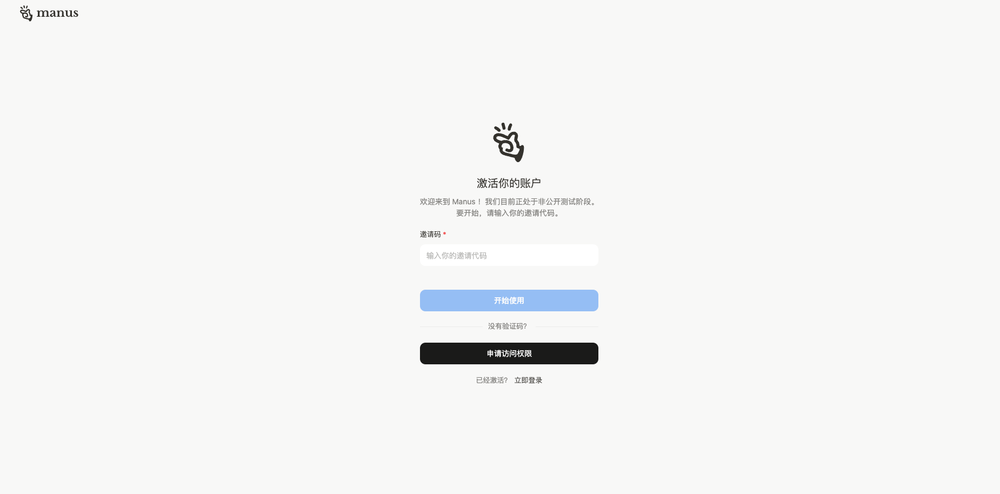

<font style="color:rgb(51, 51, 51);">然而到了下午打开电脑一看，需要内测码，而且在一些电商平台一个内测码，竟然炒到了 1w、5w、10w 不等的价格，虽然创始人说没有花一分钱去做营销（我不信...)。</font>

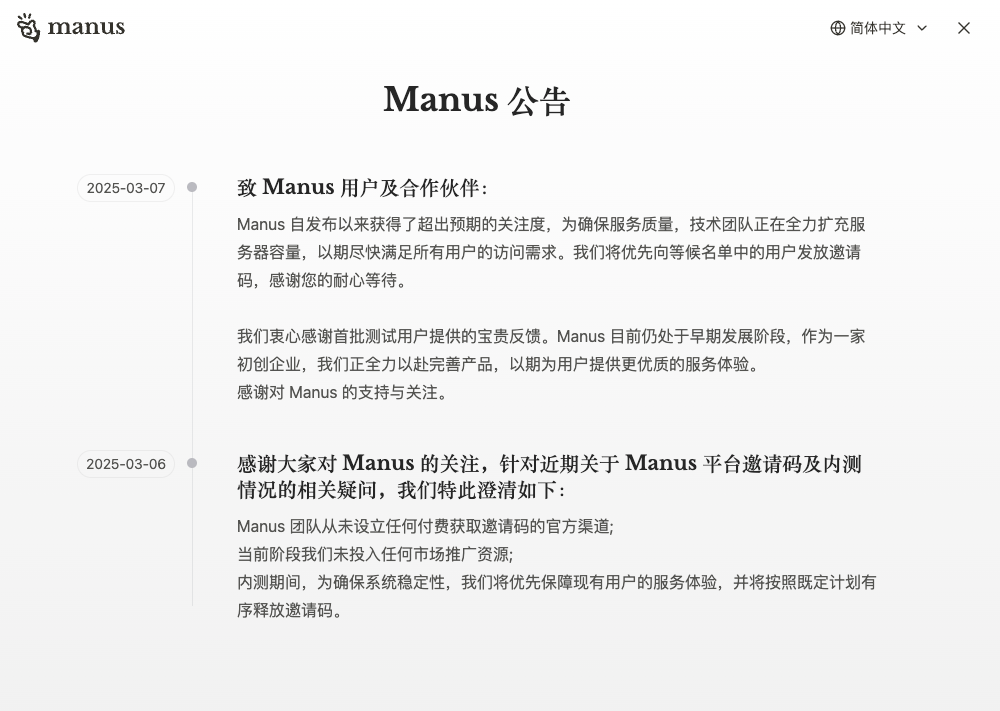

### <font style="color:rgb(51, 51, 51);">Manus 是什么？ </font>

<font style="color:rgb(51, 51, 51);">Manus 是中国团队开发的 AI 智能体，能自己动脑动手干活。比如它能独立筛选简历、分析股票、找房子，直接生成完整报告或表格，不像普通 AI 只回答问题。它靠多个模型协同工作，测试成绩超过 </font><code><font style="color:rgb(51, 51, 51);background-color:rgb(243, 244, 244);">OpenAI</font></code><font style="color:rgb(51, 51, 51);"> 同类产品，现在内测邀请码被炒到上万元</font>

<font style="color:rgb(51, 51, 51);">很多同学应该在较早之前用过 </font><code><font style="color:rgb(51, 51, 51);background-color:rgb(243, 244, 244);">Monica</font></code><font style="color:rgb(51, 51, 51);"> 插件，</font><code><font style="color:rgb(51, 51, 51);background-color:rgb(243, 244, 244);">Monica</font></code><font style="color:rgb(51, 51, 51);"> 就是 </font><code><font style="color:rgb(51, 51, 51);background-color:rgb(243, 244, 244);">Manus</font></code><font style="color:rgb(51, 51, 51);"> 的创始公司。不得不说，</font><code><font style="color:rgb(51, 51, 51);background-color:rgb(243, 244, 244);">Monica</font></code><font style="color:rgb(51, 51, 51);"> 还是做得很不错的。</font>

<font style="color:rgb(51, 51, 51);">话又说回来，</font><code><font style="color:rgb(51, 51, 51);background-color:rgb(243, 244, 244);">Manus</font></code><font style="color:rgb(51, 51, 51);"> 真的有这么强大吗？真的能做完全通用智能体？</font>

[<font style="color:rgb(65, 131, 196);">https://manus.im/</font>](https://manus.im/)


### <font style="color:rgb(51, 51, 51);">OpenManus 又是什么？ </font>

<font style="color:rgb(51, 51, 51);">OpenManus 是由 MetaGPT 团队开源复刻的 AI Agent 工具，能自主浏览网页、查询整合信息并生成报告，实现类似 Manus 的基础功能，下面是他们的 README 介绍：</font>

<https://github.com/mannaandpoem/OpenManus/blob/main/README_zh.md>

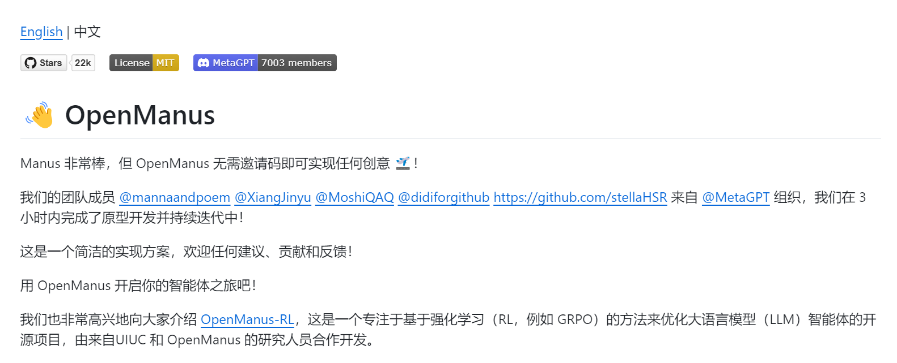

## <font style="color:rgb(51, 51, 51);">安装指南 </font>

<font style="color:rgb(51, 51, 51);">我花不起 5w、10w RMB，我还花不起这点流量吗？我自己 clone 一个</font>

### <font style="color:rgb(51, 51, 51);">创建新的 conda 环境 </font>

<font style="color:rgb(51, 51, 51);">如果你还没有安装，可以去 anaconda 下载。</font>

[<font style="color:rgb(65, 131, 196);">https://www.anaconda.com/download</font>](https://www.anaconda.com/download)

```shell
conda create -n open_manus python=3.12
conda activate open_manus
python main.py
python run_flow.py
```

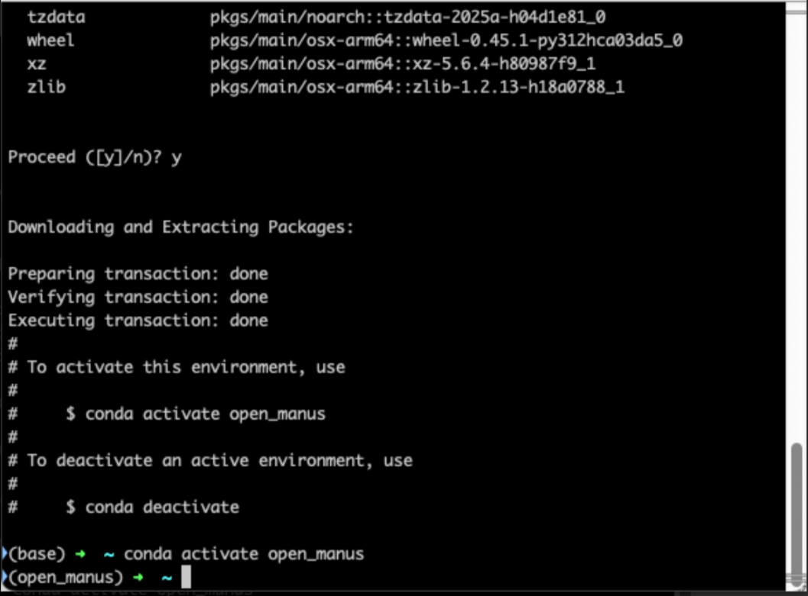

### <font style="color:rgb(51, 51, 51);">Clone 项目 </font>

<font style="color:rgb(51, 51, 51);">克隆仓库到本地然后运行。</font>

```shell
git clone https://github.com/mannaandpoem/OpenManus.git
```

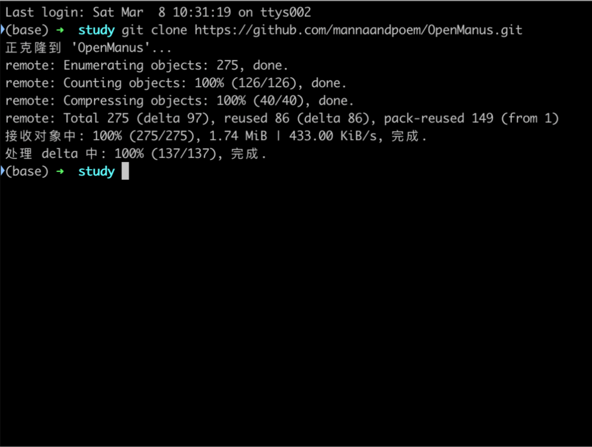

### <font style="color:rgb(51, 51, 51);">修改配置文件 </font>

<font style="color:rgb(51, 51, 51);">在编辑器打开 </font><code><font style="color:rgb(51, 51, 51);background-color:rgb(243, 244, 244);">OpenManus</font></code><font style="color:rgb(51, 51, 51);"> 目录 找到 </font><code><font style="color:rgb(51, 51, 51);background-color:rgb(243, 244, 244);">config/config.example.toml</font></code><font style="color:rgb(51, 51, 51);">，这个文件定义的一些模型的配置，你可以使用硅基流动，也可以直接使用 </font><code><font style="color:rgb(51, 51, 51);background-color:rgb(243, 244, 244);">Claude</font></code><font style="color:rgb(51, 51, 51);">、</font><code><font style="color:rgb(51, 51, 51);background-color:rgb(243, 244, 244);">OpenAI</font></code><font style="color:rgb(51, 51, 51);">、</font><code><font style="color:rgb(51, 51, 51);background-color:rgb(243, 244, 244);">QWQ32b</font></code><font style="color:rgb(51, 51, 51);"> 可以调用 utils 的模型。</font>

<font style="color:rgb(51, 51, 51);">注意：这里需要用到 Function Call ，DeepSeek 模型是不支持的。</font>

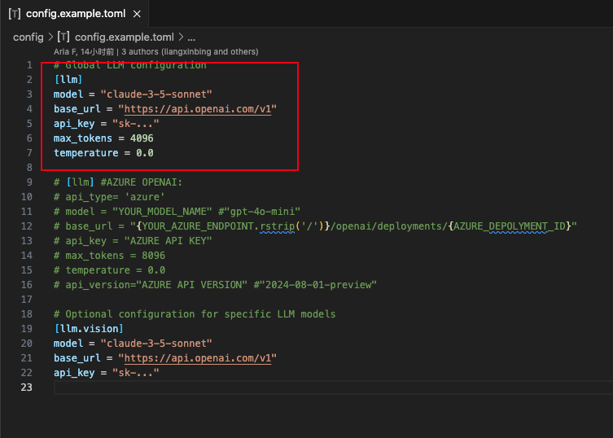

<font style="color:rgb(51, 51, 51);">我这里直接配置硅基流动的 API，大家可以去 </font>[<font style="color:rgb(65, 131, 196);">https://siliconflow.cn/</font>](https://siliconflow.cn/)<font style="color:rgb(51, 51, 51);"> 注册账号，然后创建密钥。</font>

<https://cloud.siliconflow.cn/i/kiYZYNJI>

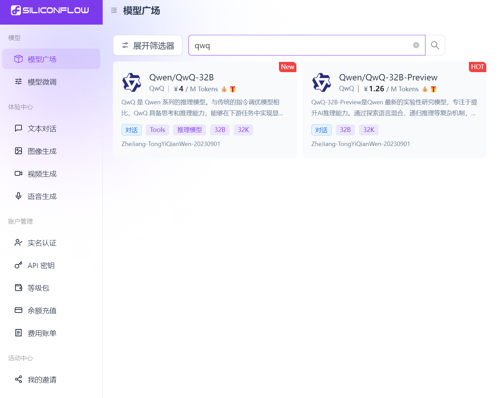

### <font style="color:rgb(51, 51, 51);">配置参考 </font>

<font style="color:rgb(51, 51, 51);">可以参考我的配置，如下：</font>

1. <font style="color:rgb(51, 51, 51);">第一个是全局对话模型配置</font>
2. <font style="color:rgb(51, 51, 51);">第二个是视觉模型配置。</font>

<font style="color:rgb(51, 51, 51);">toml</font>

```plain
# Global LLM configuration
[llm]
model = "Qwen/QwQ-32B"
base_url = "https://api.siliconflow.cn/v1"
api_key = "填写你的密钥"
max_tokens = 4096
temperature = 0.0

# Optional configuration for specific LLM models
[llm.vision]
model = "Qwen/Qwen2-VL-72B-Instruct"
base_url = "https://api.siliconflow.cn/v1"
api_key = "填写你的密钥"
```

### <font style="color:rgb(51, 51, 51);">安装项目依赖 </font>

<font style="color:rgb(51, 51, 51);">在项目终端执行</font>

```plain
pip install -r requirements.txt
```

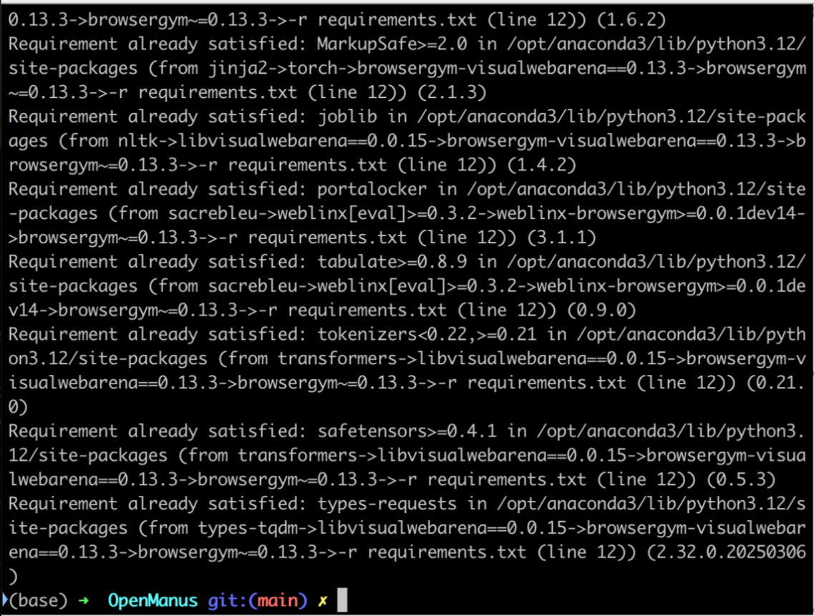

### <font style="color:rgb(51, 51, 51);">运行 OpenManus </font>

<font style="color:rgb(51, 51, 51);">继续在终端执行运行命令</font>

#### <font style="color:rgb(51, 51, 51);">第一次尝试 </font>

<font style="color:rgb(51, 51, 51);">可以在下面截图看到，我让它帮我执行一个任务</font>

<font style="color:rgb(119, 119, 119);">帮我写一个小红书爆款文案，然后生成一个 md 格式的文件，放到D盘根目录下</font>

<font style="color:rgb(119, 119, 119);">帮我写一个抖音爆款视频逐字稿，然后生成一个txt格式的 文件，放到D盘根目录下</font>

<font style="color:rgb(119, 119, 119);">帮我用html、javascript、css写一个飞机大战游戏，要求可以正常运行，代码文件放到D盘根目录下</font>

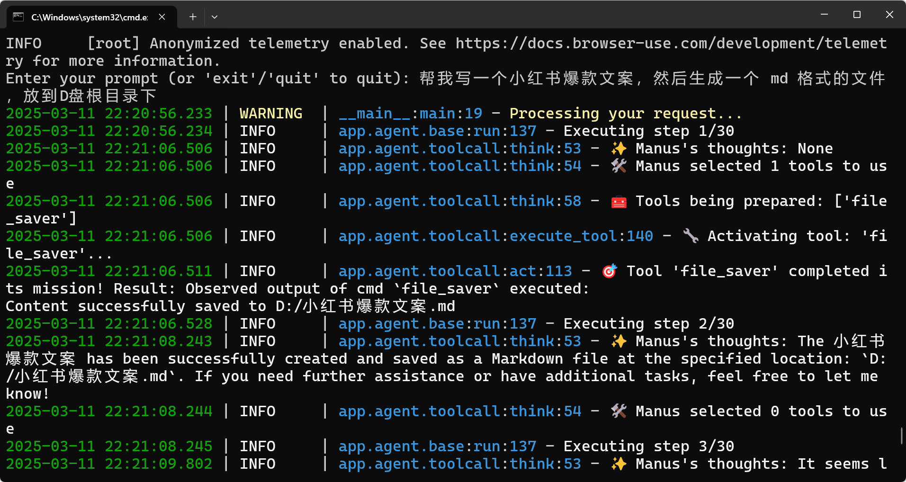

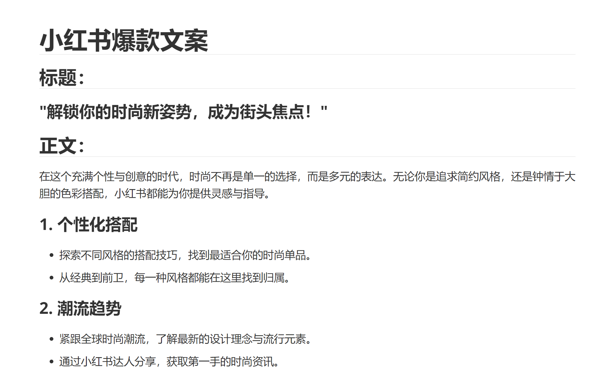

<font style="color:rgb(51, 51, 51);">分析步骤太长了，就不一一截图了。 其实内容都已经在对话中展示出来了，但是这个文件并没有创建在本地，可能识别还没那么精确。</font>

#### <font style="color:rgb(51, 51, 51);">第 N 次尝试 </font>

<font style="color:rgb(51, 51, 51);">后面我试着让他写一个网站，嗯... 至少能够自主调用浏览器（playwright）了，且将放置在了我指定的目录地址上了。</font>

帮我写一个科技圈的官网，名字叫 tech，静态网站，HTML 文件存放在 D盘根目录下，参考 https://manus.im/ 的风格

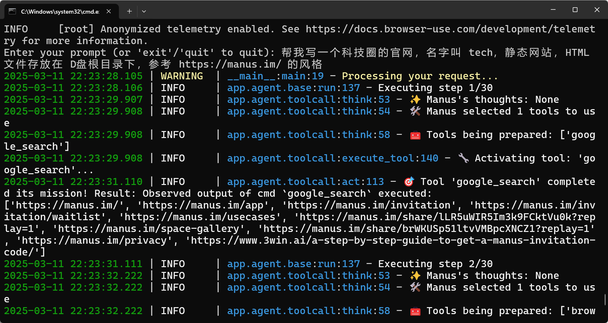


### <font style="color:rgb(51, 51, 51);">结尾 </font>

<font style="color:rgb(51, 51, 51);">毕竟这个 </font><code><font style="color:rgb(51, 51, 51);background-color:rgb(243, 244, 244);">OpenManus</font></code><font style="color:rgb(51, 51, 51);"> 确实只花了三个小时，就能复刻这些基本的工具链调用。虽然还没那么强大，但是个人感觉这种开源的项目，社区维护起来之后发展还是非常快的，拭目以待吧。</font>

#### <font style="color:rgb(51, 51, 51);">关键文件解释 </font>

<font style="color:rgb(51, 51, 51);">感兴趣的同学也可以去通过日志 + 源码了解下。</font>

```plain
/OpenManus/app/
├── __init__.py                  # 包初始化文件
├── agent/                       # 代理模块，包含各种类型的代理实现
│   ├── __init__.py              # 代理模块初始化
│   ├── base.py                  # 基础代理类定义
│   ├── manus.py                 # Manus 通用代理实现
│   ├── planning.py              # 规划代理实现
│   ├── react.py                 # ReAct 模式代理实现
│   ├── swe.py                   # 软件工程代理实现
│   └── toolcall.py              # 工具调用代理实现
├── config.py                    # 配置管理
├── exceptions.py                # 自定义异常类
├── flow/                        # 流程管理模块
│   ├── __init__.py              # 流程模块初始化
│   ├── base.py                  # 基础流程类定义
│   ├── flow_factory.py          # 流程工厂，用于创建不同类型的流程
│   └── planning.py              # 规划流程实现
├── llm.py                       # 大语言模型接口
├── logger.py                    # 日志管理
├── prompt/                      # 提示词模板
│   ├── __init__.py              # 提示词模块初始化
│   ├── manus.py                 # Manus 代理提示词
│   ├── planning.py              # 规划代理提示词
│   ├── swe.py                   # 软件工程代理提示词
│   └── toolcall.py              # 工具调用代理提示词
├── schema.py                    # 数据模型定义
└── tool/                        # 工具模块，包含各种工具实现
    ├── __init__.py              # 工具模块初始化
    ├── base.py                  # 基础工具类定义
    ├── bash.py                  # Bash 命令执行工具
    ├── browser_use_tool.py      # 浏览器使用工具
    ├── create_chat_completion.py # 聊天完成工具
    ├── file_saver.py            # 文件保存工具
    ├── google_search.py         # Google 搜索工具
    ├── planning.py              # 规划工具
    ├── python_execute.py        # Python 代码执行工具
    ├── run.py                   # 运行工具
    ├── str_replace_editor.py    # 字符串替换编辑器
    ├── terminate.py             # 终止工具
    └── tool_collection.py       # 工具集合管理
```

## <font style="color:rgb(51, 51, 51);">总结</font>

<font style="color:rgb(51, 51, 51);">看了很多博主宣传、测评，以及使用的过程中的一些问题，其实跟这个 </font><code><font style="color:rgb(51, 51, 51);background-color:rgb(243, 244, 244);">OpenManus</font></code><font style="color:rgb(51, 51, 51);"> 区别不大。</font>

**<font style="color:rgb(10, 10, 10);">Manus 的护城河在哪里？</font>**

<font style="color:rgb(55, 65, 81);">现在的 AI 产品来说，护城河主要就几个点：</font>

1. **模型 + 算力**
2. **数据**
3. **用户体验**

<font style="color:rgb(55, 65, 81);">比如说 OpenAI 的 Deep Research，虽然开源或者商业的竞品很多，但是效果比它好的还没有第二家，因为它用来规划任务、选择工具、汇总的模型是他们家最强的推理 o3 模型，可能也是业界最强的推理模型，无论是推理能力还是上下文长度都超过了公开的 Claude 3.7 Sonnet 模型，同时他们还基于 o3 针对 Deep Research 做了大量的强化学习训练，让模型在执行任务和生成内容都可以取得很好的效果，</font>**模型能力就是 OpenAI 的护城河。**

<font style="color:rgb(55, 65, 81);">比如说 Google，虽然模型不一定有 OpenAI 的强，但是它们家的数据搜索能力是最强的，可以获取到优质的数据源，所以效果也不错，</font>**数据搜索就是 Google 的护城河。**

<font style="color:rgb(55, 65, 81);">比如说经常被比作是“套壳”的 AI 产品 Perplexity，模型比不过 OpenAI，数据搜索比不上 Google，但是依然在 AI 搜索中占有很重要的地位，它依赖的是独特的用户体验，更懂用户，更好的提供了用户想要的搜索结果。</font>

<font style="color:rgb(55, 65, 81);">但这里的用户体验，不是传统意义上的用户界面交互层面的体验，而是基于大量用户使用数据而个性化优化后的优化体验，很懂用户想要什么。</font>

<font style="color:rgb(55, 65, 81);">类似的例子还有 AI 编辑器 Cursor，它也是靠的用户体验来吸引用户，虽然它的 Composer 功能很快就被竞争对手学习借鉴过去了，但是它的自动补全功能却一直没被竞争对手超越，作为一个重度使用者感觉特别明显，就是 Cursor 真的很懂我想要做什么，每次修改一点，它就能自动给我建议要完成的下一步操作，而大部分时候，它的建议都是我想要的。正是这个原因，即使我同时还用其他家的 AI 编辑器，Cursor 的订阅也一直留着。</font>

**Perplexity 和 Cursor 这类 AI “套壳”产品的护城河，就在于它有大量用户数据沉淀后的用户体验。**

<font style="color:rgb(55, 65, 81);">所以未来对于 Manus 或者这类产品来说，想形成自己的护城河，不仅仅是要在用户产品体验上的创新，还需要有用户数据上的沉淀，把这种数据变成一种飞轮效应：基于用户的数据做出更懂用户的体验，更懂用户的体验吸引更多的用户使用。</font>

Manus的护城河如果让我一句话总结，那么就是：**交互上有非常大的创新，但受限于模型与数据，目前没有护城河。**

**优点：**

* Manus 在产品交互上有非常大的创新，可以说相当惊艳。可以很容易的上手，整个过程对用户透明不需要干预，结果也很直观。
* 采用模拟人类浏览网页的方式让它更具有通用性，可以适用于通用任务而不是特定任务类型，未来有更大想象空间，就好比类人的机器人可以做更多的通用型任务。
* 可以对获取到的数据进行分析生成漂亮的图表。
* 生成的代码直接可以在虚拟机运行看到效果

不足：

* 通过 ToDo List 规划的方式，虽然可以让 AI 探索的路径不至于太发散，但是会让结果趋于平庸，毕竟稍微复杂一点的任务是需要根据获得的信息做动态调整的。
* 受限于模型的能力和上下文窗口长度，在资料的筛选，和最终资料的合并整理上，会有比较大损耗，最终生成结果和质量大部分时候是比较平庸的。
* 使用目前模拟浏览器搜索、点击、滚动，再用视觉识别文字图表的方式，时间成本和资源成本都不低，通过 OCR 获取屏幕内容也可能会导致信息缺失。

<font style="color:rgb(51, 51, 51);background-color:rgb(243, 244, 244);"></font>

<code><font style="color:rgb(51, 51, 51);background-color:rgb(243, 244, 244);">Manus</font></code><font style="color:rgb(51, 51, 51);"> 现在被吹得挺神的，但说白了就是个 “拼装车” 产品。这东西其实没什么黑科技，就是把市面上现成的 AI 模型（比如 Claude、OpenAI ）打个包，套个好看的界面，再蹭着 “智能助理” 的热度宣传。</font>

**<font style="color:rgb(51, 51, 51);">举个通俗的例子</font>**<font style="color:rgb(51, 51, 51);">：这就好比有人把手机里的天气预报、导航、记事本这些 APP 打包成一个新软件，然后吹嘘说这是 “万能生活管家”。实际用起来你会发现，单独每个功能还行，但真要处理复杂任务（比如既订酒店又安排行程还要算预算），它也就是把不同功能硬串起来用，跟真正能自主思考的“智能管家” 差远了。</font>

<font style="color:rgb(51, 51, 51);">就像网友说的：“你以为是钢铁侠的贾维斯，结果就是个语音版 Excel”。</font>

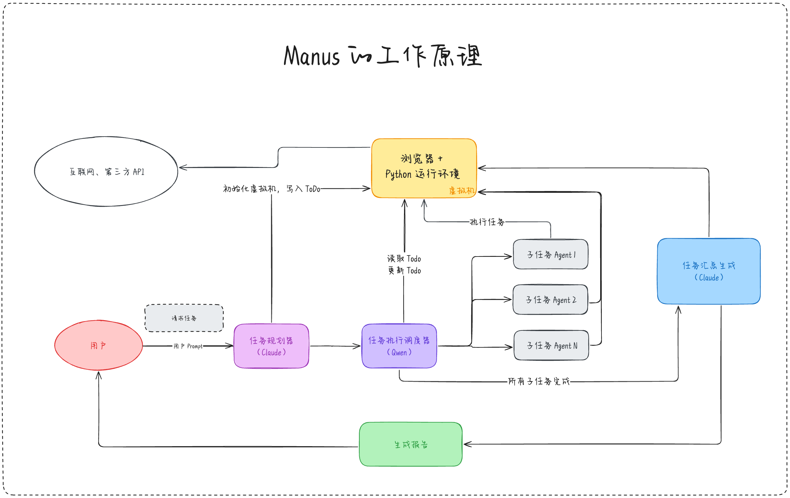

1. **<font style="color:rgb(51, 51, 51);">虚拟机</font>**<font style="color:rgb(51, 51, 51);">：一个 Linux 系统的虚拟机，安装有</font>
   1. <font style="color:rgb(51, 51, 51);">Chrome 浏览器，用来访问网页</font>
   2. <font style="color:rgb(51, 51, 51);">Python 运行环境，可以执行脚本分析数据，可以启动一个网页运行环境</font>
2. **<font style="color:rgb(51, 51, 51);">任务规划器</font>**<font style="color:rgb(51, 51, 51);">：根据用户输入的任务请求，拆分成 ToDo List，我推测是 Claude 模型，因为这一步至关重要，必须要求模型有很强的推理能力，目前来说 Claude 3.7 Sonnet 应该是很经济实惠的选择</font>
3. **<font style="color:rgb(51, 51, 51);">任务执行调度器</font>**<font style="color:rgb(51, 51, 51);">：根据 ToDo List 的任务清单，逐一执行，根据任务去选择最合适的 Agent。由于这一步重点是在 Agent 的选择，所以不需要能力太强的模型，可以用开源模型比如 Qwen 稍微微调一下就可以用了。</font>
4. **<font style="color:rgb(51, 51, 51);">各种执行不同类型任务的 Agents</font>**<font style="color:rgb(51, 51, 51);">：Manus 内置了很多 Agent，比如最复杂的应该是类似于 OpenAI Operator 的网页浏览 Agent，比如根据特定 API 检索特定数据的 Agent，每个 Agent 在完成任务后都会把任务结果写到虚拟机。</font>
5. **<font style="color:rgb(51, 51, 51);">任务汇总生成器</font>**<font style="color:rgb(51, 51, 51);">：当每个子任务执行完成后，任务执行调度器就会通知任务汇总生成器，任务汇总生成器就会去虚拟机读取 ToDo List 以及各个子任务的生成结果，把这些结果汇总整理生成最终结果，根据任务要求，可能是一份调研报告，可能是网页程序。由于这一步要求有极强的推理能力和语言能力，所以必然要求一个很强的模型，所以我猜这里也应该是 Claude 3.7 Sonnet。</font>


> 更新: 2025-04-20 22:38:49  
> 原文: <https://www.yuque.com/aaron-wecc3/dhluml/uqdxuiw8zt42xf9s>