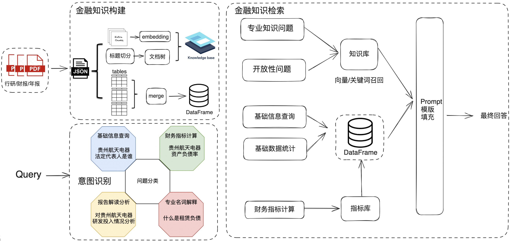
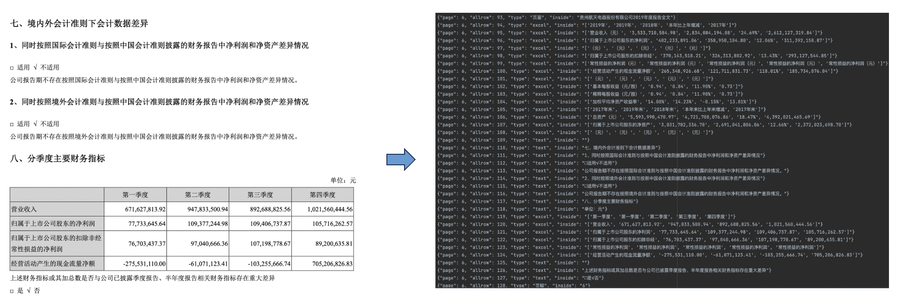
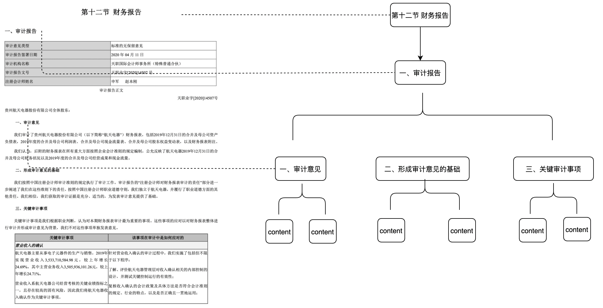
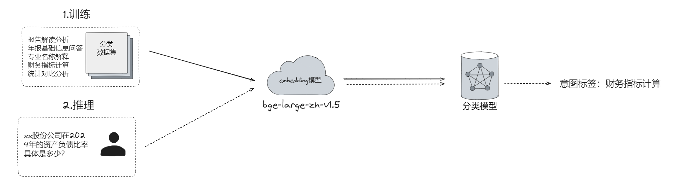
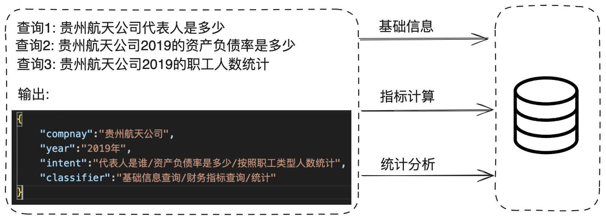
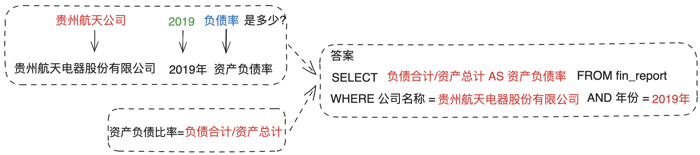
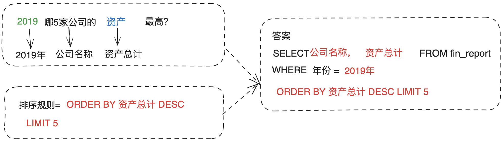
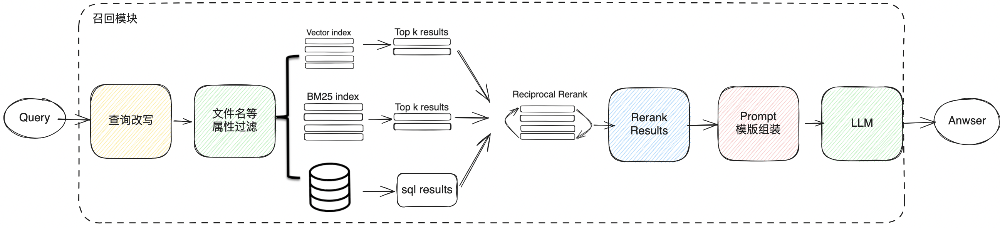
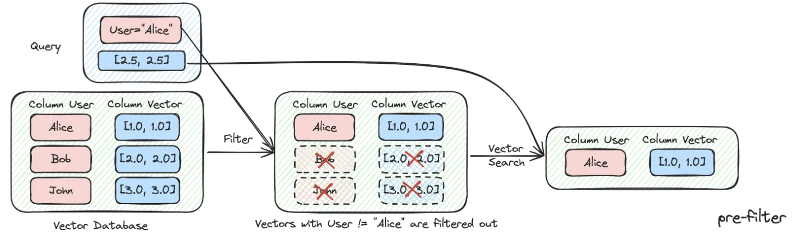

# 60.基于DB-GPT开发金融财报分析助手

## <font style="color:#1a1a1a;">一、背景</font>

<font style="color:#333333;">最近，利用大模型进行财务报表分析正逐渐成为垂直领域的一个热门应用。大模型能够比人类更准确地理解复杂的财务规则，并在基于专业知识的基础上输出合理的分析结果。然而，财务报表信息庞大且复杂，对数据分析的准确性要求极高，通用的RAG和Agent的解决方案往往难以满足这些需求。</font>

<font style="color:#333333;">以某公司的2022年财务报表为例，传统方法在处理类似“2022年XXX子公司的第三季度的营业净利润是多少？”的查询时，通常通过知识向量相似检索和匹配来召回最相关的文本块进行总结和问答。然而，财务年报中包含多处相关信息，如不同季度的利润表、现金流量表等，这些信息可能会引发误判。如果不能准确召回并理解正确部分，就容易生成错误答案。</font><font style="color:#000000;background-color:#ffffff;">如果涉及到财务指标的计算，分析过程可能会变得更加复杂。例如，计算毛利率、净利率等指标需要对收入和成本等多方面的数据进行综合分析。</font>

<font style="color:#333333;">为了克服大模型应用中的这些挑战，我们需要结合财务领域的知识背景，添加专门的外部模块来增强其功能。我们以DB-GPT的AWEL编排模式为例，借助DB-GPT-Hub的几个关键原子，详细阐述如何利用大模型进行有效的财报数据分析，希望能为在垂直领域的进行数据AI赋能的朋友提供一些思考。</font>

DB-GPT项目地址：<https://github.com/eosphoros-ai/DB-GPT>

## <font style="color:#1a1a1a;">二、架构方案</font>

<font style="color:rgb(25, 27, 31);">实现方式可以通过上传公司年报，利用大模型作为知识驱动引擎，调用向量数据库、关系型数据库、OCR服务以及相关模型等组件，通过AWEL(agent流式编排)构建一个财报分析的问答助手，能够直接回答用户这几类问题：</font>

* <font style="color:#333333;">财报基础信息回答</font>
* <font style="color:#333333;">财报指标计算</font>
* <font style="color:#333333;">报告解读分析</font>
* <font style="color:#333333;">专业名词解释</font>

<font style="color:rgb(25, 27, 31);">这里的架构设计主要是通过意图分类解决财报分析中可能出现的问题。针对每类意图执行单独的处理链路，每条处理链路基于不同场景精心设计。同时为了保证数据分析的正确性，我们还会通过解析和抽取用户查询中的相关参数，调用工具或执行SQL查询，为分析结果提供更准确的数据支持。因此整个架构围绕3部分进行实现，金融知识构建，查询意图识别，以及金融知识检索。</font>



* **<font style="color:#333333;">金融知识构建</font>**<font style="color:#333333;">，目的是进行数据多元化的信息抽取与索引存储，涉及pdf文档加载，数据预处理，PDF转JSON，文档切分，文档树构建，表格的提取与合并，Embedding以及数据存储等过程。</font>
* **<font style="color:#333333;">查询意图识别</font>**<font style="color:#333333;">，目的是进行问题分类以及槽位提取，可以解析和抽取用户查询中的相关参数后可以路由到不同的知识检索处理流程中。</font>
* **<font style="color:#333333;">金融知识检索</font>**<font style="color:#333333;">，目的是更精准地查询出用户想要的知识信息，涉及RAG以及Text2SQL的处理。</font>

## <font style="color:#1a1a1a;">三、金融知识构建</font>

<font style="color:rgb(25, 27, 31);">在A股上市公司发布的财务报告中，通常会包含一些重要的文本描述、财务表格和其他附注信息。每个财务报表都提供了不同方面的财务数据，用来展示公司的财务状况、经营成果和现金流情况：</font>

* <font style="color:#000000;">资产负债表显示公司的资产、负债和股东权益，提供了公司在某一特定日期的财务状况。</font>
* <font style="color:#000000;">利润表展示公司在一定期间内的收入、成本、费用及净利润情况，反映公司的经营成果。</font>
* <font style="color:#000000;">现金流量表展示公司在一定期间内现金及现金等价物流入和流出的情况，分为经营活动、投资活动和筹资活动三个部分。</font>
* <font style="color:#000000;">所有者权益变动表展示公司在一定期间内股东权益的变动情况，包括净利润、分红、增发等。</font>
* <font style="color:#000000;">财务报表附注提供了对报表中项目的详细解释和补充说明，帮助报表使用者更好地理解公司的财务状况和经营成果。</font>

<font style="color:rgb(25, 27, 31);">这些表格数据结构化程度高，需要提取出完整有用的数据信息进行加工处理。而财报文本部分则包含大量公司简介、业务描述、风险分析和管理层讨论等重要信息。我们希望大模型能够通过深入理解文本内容，提取对投资决策有帮助的信息，如公司未来的战略规划、市场风险和机遇等。</font>

### <font style="color:#1a1a1a;">3.1 数据预处理</font>

<font style="color:#000000;">针对财报pdf这样的非结构化数据处理，考虑到针对财报文档的一些特性，表格数据密集，专业术语繁多等情况，需要在信息抽取之前对pdf这样的非结构化数据进行预处理，主要的思路是将非结构化数据 -> 结构化数据，因此首先在数据读取和数据预处理模块，利用</font><code><font style="color:#000000;">pdfplumber</font></code><font style="color:#000000;">按页读取并转换为json格式，并且识别出哪些是需要的文本数据，哪些是表格数据，哪些是不需要的数据，比如页眉，页脚等等。</font>



### <font style="color:#1a1a1a;">3.2 知识抽取</font>

<font style="color:#000000;">数据预处理后，我们得到了标准的结构化的json数据，基于处理后的json数据，我们将内容划分为文本和表格两大块，针对这两块数据分别进行文本信息抽取和表格抽取。</font>

#### <font style="color:#1a1a1a;">3.2.1 文本抽取</font>

<font style="color:#333333;">	</font><font style="color:#000000;">文本抽取包括</font><code><font style="color:#000000;">知识切片</font></code><font style="color:#000000;">，</font><code><font style="color:#000000;">元数据信息抽取</font></code><font style="color:#000000;">，</font><code><font style="color:#000000;">embedding</font></code><font style="color:#000000;">等一系列子任务组成。</font>

<font style="color:#000000;">	</font><font style="color:#000000;">知识切片主要目的是1.保持语义相关性，也就是上下文相关性，这直接关乎回复准确率。2.保持在大模型的上下文限制内，分块保证输入到LLMs的文本不会超过其token limitations。这里有很多种分片策略进行选择：按照文本大小切分，按照页切分，按照标题进行切分。本次案例为了保持语义的相关性，推荐采取按照页进行切分和按照标题级别进行切分。</font>

##### <font style="color:#000000;">按照页切分</font>

<font style="color:#000000;">   按照pdf每一页进行切分，保留每一页的完整性。</font>

* <font style="color:#000000;">优点：能够保证语义完整性，实现简单。</font>
* <font style="color:#000000;">缺点：会给模型带来额外的数据杂音，对模型上下文窗口要求限制高。</font>

##### <font style="color:#000000;">按照标题级别切分</font>

<font style="color:#000000;">这里需要识别财报里面的标题信息，以标题层级构建chunk的树形节点，形成一个多叉树结构，每一层级节点只需要存储文档标题，叶子节点存储具体的文本内容。这样利用树的遍历算法，如果用户问题命中相关非叶子标题节点，就可以将相关的子节点数据进行召回。</font>

* <font style="color:#000000;">优点：解决了上下文完整性不足的问题，也能匹配时完全依据语义和关键词，能够减少噪音。</font>
* <font style="color:#000000;">缺点：对模型上下文窗口要求限制高。</font>



#### <font style="color:#1a1a1a;">3.2.2 表格抽取</font>

<font style="color:#333333;">  </font><font style="color:#000000;">我们的目标是对金融财报指标进行计算和分析，这里有两个难点：</font>

1. <font style="color:#000000;">一份财报有几十甚至上百张表格，如果对每份表格单独抽取后直接进行数据存储，这里就会面临在NL2SQL环节召回表困难的问题。</font>
2. <font style="color:#000000;">我们有成百上千份公司的财报，如果对每一份财报数据单独存储，就无法回答用户对不同的公司比较分析的问题。</font>

:::color1
<font style="color:#000000;">因此，针对这两个问题，我们需要对财报里面的表格进行合并，这里有两种合并方案。</font>

:::

##### <font style="color:#000000;">合并成一张大宽表，由于不同公司的主要财报数据的表格定义都是相似的，因此可以针对财报数据的表格进行分类：</font>

* <font style="color:#000000;">公司基础信息表：包括公司基本信息表，联系方式表，注册变更表，员工信息表等等</font>
* <font style="color:#000000;">金融指标表：包括资产负债表，利润表、现金流表等等 </font>
* <font style="color:#000000;">额外的信息表</font>

<font style="color:#000000;">根据分类情况单独提取每一类别的表格信息进行合并，最后再将3类表格汇总成一张大宽表，生成最终的DataFrame。</font>

* <font style="color:#000000;">优点：</font>
  * <font style="color:#000000;">由于都汇总成了一张表，避免了数据计算分析环节nl2sql过程中表召回困难，表召回错误的情况。</font>
  * <font style="color:#000000;">不同的公司的表格数据都汇总到了一起，可以对不同公司的数据进行比较分析。</font>
* <font style="color:#000000;">缺点：在表格提取和数据合并的过程中，存在一部分数据的丢失，导致有些信息的缺失。</font>


##### <font style="color:#000000;">合并成多张表数据，包括基本信息表，员工信息表，资产负债表，现金流表，其他信息表等等。</font>

* <font style="color:#000000;">优点：避免了大宽表的数据缺失，分析过程可以更加精准</font>
* <font style="color:#000000;">缺点：</font>
  * <font style="color:#000000;">需要更细致的表格处理 </font>
  * <font style="color:#000000;">NL2SQL需要解决表召回和多表连接的问题</font>

## <font style="color:#1a1a1a;">四、意图识别</font>

### <font style="color:#1a1a1a;">4.1 问题分类</font>

<font style="color:#000000;">用户的查询需求多种多样，包括数据查询、年报问答等。模型需要准确识别用户意图，调用相应功能模块。例如，用户查询公司资产负债率时，模型需要识别这是一个数据查询请求，并调用相关公式进行SQL查询；询问公司未来增长策略时，模型需调用年报问答模块，基于RAG模块提供回复。</font>

<font style="color:#000000;"></font>

<font style="color:#000000;">目前我们提供了几种不同的意图识别方案，每种方案各有优缺，大家可以根据自己的资源和精度要求进行选择实现</font>

##### <font style="color:#000000;">方案一、基于embedding（Bert）的识别：</font>

* <font style="color:#000000;">利用BGE-v1.5对用户query和意图label进行向量化，使用逻辑回归等简单的机器学习模型进行学习分类就能获得很好效果。这种方案训练时间短、准确率高，但需要根据实际业务制作query意图数据集。</font>
* <font style="color:#000000;">这个方案最重要的其实是选择一个高质量的embedding模型，文本数据的多样性和复杂性很高，直接处理原始文本往往效果不佳。大多数embedding模型是在大规模语料库上预训练的，它们已经捕捉了广泛的语言特征，embedding模型能够适应和理解不同的文本语义，将输入文本转化为标准化的稠密向量表示，提供了丰富的语言特征，从而使得逻辑回归等简单的分类器也能进行精确分类。</font>



##### <font style="color:#000000;">方案二、大模型prompt的ICL能力：</font>

* <font style="color:#000000;">通过在prompt中加入意图识别的样例和规则，引导大模型理解用户意图，生成期望输出。这种方案无需大量数据集和训练，但可能产生大量token消耗，且意图数量增加时准确率下降。</font>
* <font style="color:#000000;">Prompt一般包含意图列表和相关示例，输出一般为具体的意图名称或对应的序号</font>

##### <font style="color:#000000;">方案三、大模型SFT</font>

* <font style="color:#000000;">构建意图识别的指令微调数据集，输入为用户查询语句，输出为意图标签文本或json。这种方法是通过微调的方式，让大模型具备理解和学习意图的能力</font>
* <font style="color:#000000;">开源大模型微调可以试试llama-factory或者DB-GPT-Hub</font>

## <font style="color:#1a1a1a;">五、Text2SQL</font>

<font style="color:#333333;">财务分析过程中，大模型Text2SQL的能力很关键。用户查询经过意图识别后，输出意图如果为数据分析类，则会调用为Text2SQL模块进行数据查询与计算。</font>



* <font style="color:#333333;">数</font><font style="color:#333333;">据库结构</font>
  * <font style="color:#000000;">构建一个元数据字典，用来描述数据库的结构，包括表名、字段名及其类型、表之间的关系等，将其插入数据查询prompt</font>
  * <font style="color:#000000;">将实体-关系（ER）图抽象成文本表示，例如</font>
    * <font style="color:#000000;">实体和属性</font>
      * **<font style="color:#000000;">公司</font>**
        * <font style="color:#000000;">属性：公司名称、注册地址、法定代表人、成立日期等。</font>
      * **<font style="color:#000000;">财务报表</font>**
        * <font style="color:#333333;">1. </font><font style="color:#000000;">属性：报表编号、报表类型（如资产负债表、利润表、现金流量表）、报告期间）等。</font>
    * **<font style="color:#000000;">账户科目</font>**
      \- <font style="color:#333333;">1. </font><font style="color:#000000;">属性：科目代码、科目名称、账户类型（如资产、负债、收入、费用）、金额等。</font>
    * <font style="color:#000000;">关系描述：</font>
      * <font style="color:#000000;">资产负债表包含了货币资金、应收账款等资产科目，以及短期借款、应付账款等负债科目。属性：购买日期（日期）、数量（整数）、总金额（小数）等。</font>
      * <font style="color:#000000;">利润表包含了营业收入、营业成本等收入和费用科目。</font>
    * <font style="color:#000000;">约束和约定：</font>
      * <font style="color:#333333;">公司实体的主键是公司编号。</font><font style="color:#000000;">账户科目实体的外键是报表编号，参照于财务报表实体的主键。</font>
  * <font style="color:#333333;">优化本地数据库结构，尽量减少复杂查询，将关键信息或常用数据放入一张大宽表中进行处理</font>
* <font style="color:#333333;">Query查询预处理：</font>
  * <font style="color:#333333;">对查询语句进行信息抽取，将关键实体与关系与schema信息匹配，然后链接映射到具体的数据库表中</font>
  * <font style="color:#333333;">可构建query-sql_template对进行分类训练，按照不同难度配比生成不同模板下的SQL语料集，用户输入query，应输出对应的sql模板或相应集合，</font><font style="color:#000000;">再尝试填充或直接放入prompt中。</font>
  * <font style="color:#000000;">针对复杂查询可以将其分解为几个简单查询逐步生成SQL语句</font>
* <font style="color:#000000;">SQL优化</font>
  * <font style="color:#000000;">在prompt中告诉模型使用索引和适当的查询优化策略，提升SQL查询性能，避免全表扫描等低效操作。</font>
  * <font style="color:#000000;">将生成的SQL查询在数据库上执行，并验证结果是否符合预期，不符合预期应反馈给用户或执行专门的复杂查询链路</font>

<font style="color:#333333;">接下来我们看下每个细分类别的text2sql的处理和优化。</font>

### <font style="color:#1a1a1a;">5.1 基础信息查询</font>

<font style="color:#333333;">	基础信息查询最大的挑战就是需要找到正确的数据列，将原始查询信息进行改写。包括公司名称，年份，查询信息意图，如果用户输入'贵州航天公司2019代表人是谁'基础信息问题，如果不做任何改写，生成的sql就变成了'SELECT 代表人 FROM fin_report WHERE 公司名称='贵州航天公司'，这样生成的sql执行的结果肯定是不正确的。因此需要根据正确的数据列预先对查询进行改写，这样生成sql才是符合预期的。</font>


### <font style="color:#1a1a1a;">5.2 财务指标计算</font>

<font style="color:#000000;">财务分析中常用许多专业财务指标描述企业经营状况，例如资产负债率、营业利润率、速动比率等。这要求模型能够利用这些公式计算特定财务指标。因此我们需要事先建立财务计算指标公式库，例如：</font>

```json
"毛利率": {"公式": "毛利率=(CAST(营业收入)-CAST(营业成本))/CAST(营业收入)", "数值": ["营业收入", "营业成本"]},
"营业利润率": {"公式": "营业利润率=CAST(营业利润)/CAST(营业收入)", "数值": ["营业利润", "营业收入"]},
"流动比率": {"公式": "流动比率=CAST(流动资产合计)/CAST(流动负债合计)", "数值": ["流动资产合计", "流动负债合计"]},
"速动比率": {"公式": "速动比率=(CAST(流动资产合计)-CAST(存货))/CAST(流动负债合计)", "数值": ["流动资产合计", "存货", "流动负债合计"]},
"资产负债比率": {"公式": "资产负债比率=CAST(负债合计)/CAST(资产总计)", "数值": ["负债合计", "资产总计"]},
"现金比率": {"公式": "现金比率=CAST(货币资金)/CAST(流动负债合计)", "数值": ["货币资金", "流动负债合计"]},
"非流动负债合计比率": {"公式": "非流动负债合计比率=CAST(非流动负债合计)/CAST(负债合计)", "数值": ["非流动负债合计", "负债合计"]},
"流动负债合计比率": {"公式": "流动负债合计比率=流动负债合计/负债合计", "数值": ["流动负债合计", "负债合计"]},
"净利润率": {"公式": "净利润率=CAST(净利润)/CAST(营业收入)", "数值": ["净利润", "营业收入"]}
```

<font style="color:#333333;">与基础信息查询不同的是，财务指标计算需要预置指标库，将指标的计算公式通过RAG方式进行召回，帮助模型更好的理解指标的计算规则是什么。</font>



### <font style="color:#1a1a1a;">5.3 信息统计分析</font>

<font style="color:#333333;">统计分析类别中，常常需要涉及分组(GROUP BY)和排序(ORDER BY)， 因此，除了前面讲到的需要召回到具体查询的数据列以后，还需要召回统计维度和规则，是需要分组还是需要排序等等。</font>



## <font style="color:#1a1a1a;">六、金融知识检索</font>

<font style="color:#000000;">通过对查询进行意图识别后，通过知识检索模块，根据用户的query精准的找到相关性比较高、有一定时效性、比较丰富的内容。目前分为四个阶段，query的改写，元数据过滤，多级召回以及相关性重排序。</font>



### <font style="color:#1a1a1a;">6.1 查询改写</font>

<font style="color:#333333;">有了意图识别后，查询改写目的是将用户的query改写成语义更清晰、含义更丰富的一个可检索的Query。比如用户问贵州公司资产负债率是多少，但是实际数据库存的公司名称是</font><font style="color:#ff0000;">贵州航天电器股份有限公司</font><font style="color:#333333;">，因此需要对查询的主体进行补全改写，当然常用的改写手段还有查询纠错，使用大模型来进行改写等等。通过这一系列的处理，最终目的是把用户的Query从一个主体缺失，语义不明确、不完整、有歧义、有错的改写成一个正确的、语义表达清晰的，可召回的Query。</font>

| <font style="color:#ffffff;">原始Query</font> | <font style="color:#ffffff;">改写方法</font> | <font style="color:#ffffff;">改写后Query</font> |
| :---: | :---: | :---: |
| <font style="color:#000000;">贵州公司资产负债率是多少</font> | <font style="color:#000000;">主体补全</font> | <font style="color:#df2a3f;">贵州航天电器股份有限公司</font><font style="color:#000000;">资产负债率是多少</font> |
| <font style="color:#000000;">guizhouhangtian公司会上市吗</font> | <font style="color:#000000;">纠错</font> | <font style="color:#df2a3f;">贵州航天电器股份有限公司</font><font style="color:#000000;">会上市吗</font> |
| <font style="color:#000000;">贵州航天为啥不涨</font> | <font style="color:#000000;">Context+LLM改写</font> | <font style="color:#df2a3f;">贵州航天电器股份有限公司</font><font style="color:#df2a3f;">A股市场为什么一直低迷，什么时候才能复苏</font> |

### <font style="color:#1a1a1a;">6.2 元数据过滤</font>

<font style="color:#333333;">当我们把索引分成许多chunks并且都存储在相同的知识空间里面，检索效率会成为问题。比如用户问浙江我武科技公司相关信息时，并不想召回其他公司的信息。因此，如果可以通过公司名称元数据属性先进行过滤，就会大大提升效率和相关度。</font>



### <font style="color:#1a1a1a;">6.3 多级召回</font>

<font style="color:#333333;"> </font><font style="color:#333333;">传统Native RAG的做法是依靠向量相似度进行单独召回获取相关上下文，如果只靠向量相似度召回，可能检索的内容存在缺失或者语义不够完整的问题，因此在财报除了向量相似度召回以外，我们也需要关键词召回，文档树召回，SQL计算召回和GraphRAG召回来弥补Native RAG的单一召回完整性不够的问题。</font>

* <font style="color:#333333;">关键词召回：通过构建全文索引，通过原始查询通过分词，通过BM25将相关文档块进行检索，这种召回方式对要求精确性的检索场景非常适用。</font>
* <font style="color:#333333;">文档树召回：在前面的知识构建模块中讲到了可以通过构建一棵文档多叉树，因此在检索过程中，可以使用图的广度优先遍历算法将匹配到文档标题的内容的所有叶子节点进行召回，弥补了向量召回的完整性缺失问题。</font>
* <font style="color:#333333;">SQL召回：对涉及财报统计或者指标计算场景中，需要进行根据用户问题生成需要的sql进行数据分析。</font>

### <font style="color:#1a1a1a;">6.4 相关性重排序</font>

<font style="color:#333333;">有时候随着知识空间的文档越来越多，我们的检索结果并不理想，原因是chunks在系统内数量很多，我们检索的维度不一定是最优的，一次检索的结果可能就会在相关度上面没有那么理想。仅仅靠embedding模型的向量召回，这时候我们需要有一些策略来对检索的结果做重排序，比如使用planB重排序，或者把组合相关度、匹配度等因素做一些重新调整，得到更符合我们业务场景的排序。因为在这一步之后，我们就会把结果送给LLM进行最终处理了，所以这一部分的结果很重要。</font>

<font style="color:#333333;">与Embedding模型不同，重排序模型以查询和上下文作为输入，直接输出相似度分数，而不是Embeddings。重要的是要注意，重新排序模型是使用交叉熵损失函数进行优化的，允许不限于特定范围的相关性分数，甚至可以是负的。目前，没有很多可用的重排模型。一种选择是Cohere提供的在线模型，可以通过API访问。还有一些开源模型，如bge-reranker-base和bge-reranker-large等。</font>


> 更新: 2025-04-20 22:38:49  
> 原文: <https://www.yuque.com/aaron-wecc3/dhluml/gt2nkqt25xgrikvo>